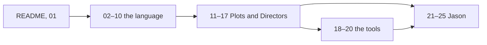

# PROTOTYPE: the 1.5 guide's chapter list

Draft for *The guide's chapter list* (`../issues/04-guide-chapter-list.md`). Accepted by the user on 2026-11-20 as drafted; the open questions at the end are answered there. Each chapter is now a writing ticket.

Per chapter: title, spec chapters it draws on, constructs it covers, the showcase files it quotes most. Spec numbers in **bold** are the chapter's main source; the rest are borrowed for a section. "2.0 notes" names the "In 2.0" notes the chapter carries.

## File naming

`docs/guide/NN-slug.md`, like `docs/spec/` (`04-plans.md`), with `README.md` as the introduction and the index. The old `<n> - <Title>.md` sorts `10` before `2` and needs quoting in every shell command and link.

## The chapters

### Part 1: reading a Program

| # | Title | Spec | Covers | Quotes most |
| --- | --- | --- | --- | --- |
| README | Introduction | 27 (*Regia 1.5*), ADR 0025 | What Regia is, Program → Transpiler → Build → Jason → game; what 1.5 is and the "In 2.0" notes; the banquet world; how a chapter reads (example first, *Checks*, `Spec:`); the chapter index | `README.md`, `courtesy.regia`, `royal_banquet.regia` |
| 01 | The logic of Regia | 05, 15, 16, 20, 21 (one section each) | One small Program read end to end: a Playbook, a Plot with Roles and Phases, a Giving, an Instancing, one run | `courtesy.regia`, `royal_banquet.regia`, `banquet.regin` |

### Part 2: the language

| # | Title | Spec | Covers | Quotes most | 2.0 notes |
| --- | --- | --- | --- | --- | --- |
| 02 | Syntax | **01**, **02** | Statements and Blocks, indentation as the default, `.`/`;` one-line layout, continuation lines, empty Blocks (`PASS`), comments and doc comments, reserved words; retired spellings (a pointer to chapter 01's table, not a copy) | any; `vocabulary.regia` for doc comments | `R0109` on a 2.0 word |
| 03 | Vocabulary and files | **10**, 03 (declaring parameters), 12 (*Durations*) | `GAME`, the kinds of item, parameters, Values, Durations, imports, one namespace, name rules, declaration order, external names, local Vocabulary | `vocabulary.regia`, imports at the top of every file | — |
| 04 | Plans | **05**, **06** | Trigger, Context, Body; Trigger kinds; Cues and Events; several Plans under one Trigger; `IF`; loops | `courtesy.regia`, `dining.regia`, `serving.regia` | `FROM GAME`, `FROM ME` |
| 05 | Placeholders and Expressions | **03**, **04** | Filling and using Placeholders, `?_`, certainly-filled, naming a value, Numbers, Expressions, "the Context tests, the Body fills" | `wagering.regia`, `dining.regia` | — |
| 06 | Matching | **26** | One Match unspecified, Picks, `FOR EACH`, `COUNT` | `hosting.regia`, `royal_banquet.regia` | — |
| 07 | Actions and time | **08**, **12** | Basic Actions on Facts and Goals, `PRINT`, Custom Actions, `WAIT`, `WAIT … UNTIL`, `AFTER` (a pointer to chapter 12 of the guide for Phases), the Target's clock and pausing | `serving.regia`, `keeping_watch.regia`, `royal_banquet.regia` | — |
| 08 | Randomness | **09**, 21 (`RANDOM`, the seed) | `RANDOMLY` / `OPTION`, weights, Placeholders in an Option, random Picks, random starting values, the seed | `wagering.regia`, `duelling.regia`, `banquet.regin` | — |
| 09 | Goals and Failure | **05** (Goals, how a Pursuit ends), **11** | `PURSUE`, the same Goal twice, `DROP`, `REACHED`/`FAILED`/`DROPPED`, what fails a Plan, how Failure spreads, `FAIL`, Reasons, `WHEN g FAILED`, fallbacks | `scheming.regia`, `duelling.regia`, `poisoning.regia` | `BY`; hearing an asked Goal's ending |
| 10 | Messages | **07** | `TELL`, `ASK`, `SIGNAL`, recipients, `FROM`, delivery, what the receiver sees, a conversation | `courtesy.regia`, `serving.regia`, `noble_socializing.regia` | `BY`, `FROM GAME`/`FROM ME`, `FROM` with `OR` |

### Part 3: Plots and Directors

| # | Title | Spec | Covers | Quotes most | 2.0 notes |
| --- | --- | --- | --- | --- | --- |
| 11 | Playbooks and Roles | **15** | A Playbook, its Roles, Mappings, `CAST`, counts and fractions (`%`), `EXCEPT`, `PLAYS`, Givings, several Givings of one Playbook, taking a Playbook away | `noble_socializing.regia`, `royal_banquet.regia` | — |
| 12 | Plots and Directors | **20**, **16** | A Plot, its Roles, a Role's Block as its setup, Phases, `ENTER`, `WHEN ENTERED`, `DURING PLOT`, what a Director perceives, Director Actions, failure in a Director, the Root Plot | `royal_banquet.regia` | `FROM GAME` |
| 13 | Subplots and Stagings | **17** | `START SUBPLOT`, casting, several Stagings, a Subplot outliving its Phase, `FINISHED WITH`, `ENDED` as the catch-all, `DROP SUBPLOT`, no cycles | `honor_duel.regia`, `poisoning.regia`, `royal_banquet.regia` | — |
| 14 | When an Agent leaves | **19** | Leaving, `LEFT`, `EMPTIED`, a leaver's Givings, Picks and bindings dropped, what the Director tidies | `royal_banquet.regia`, `honor_duel.regia` | Joining, `JOINED`; Quota Triggers (chapter 18) as a whole |
| 15 | Interfaces | **38** | Nothing is declared; the Interface of a Playbook and of a Plot; who sends a Cue; the checks one side against the other | across `playbooks/` and `plots/` | asked-Goal rows |
| 16 | Precedence and Labels | **13**, **14** | One Plan per Trigger, falling through, order inside a Playbook, `PRECEDENCE`, a Plot and its Subplots, Labels, Propensities, Suits, `SHIFT`, reading the order | `scheming.regia`, `duelling.regia`, `royal_banquet.regia` | — |
| 17 | Instancing | **21** | `.regin` files, Agent kinds, how many start, a kind in several Roles, individual Agents, setup lines, starting Propensities, the Root Plot, the seed, Target settings | `banquet.regin` | spawning |

### Part 4: the tools

| # | Title | Spec | Covers | Quotes most |
| --- | --- | --- | --- | --- |
| 18 | The Trace | **34** | What it records, entry fields, the failure chain, Trace codes, the console line, behaviour cases and their scripts (`link` steps, `> lose link`) | throwaway traces of a banquet run |
| 19 | The Transpiler | **23**, **27** | Passes, the Model, Diagnostics and codes, entry files, the command line, the Build folder, Targets, crates, the WASM Workspace, conformance cases and coverage, `regia test` | throwaway; `README.md` *Diagnostics* |
| 20 | The Visual Editor | **24**, **25**, **22** | Platform, projects, layout, highlighting, quick fixes, the Phase map, the Nested Plans view, the Inspector and Docs tab, editing from the graph, extents, text as the source of truth | `royal_banquet.regia` (Phase map), `courtesy.regia` |

### Part 5: the Jason Target

| # | Title | Spec | Covers | Quotes most |
| --- | --- | --- | --- | --- |
| 21 | Jason: the Build | **28**, **36** | Files, names, Shared Infrastructure, the Java library, the game link, the clock, the `.jcm`, starting names, `cast.json`, `regia_kind`, setup lines | `banquet.regin`, throwaway Build tree |
| 22 | Jason: Plans and Goals | **39**, **40** | Placeholders and variables, Contexts, `IF`, random choice, Picks, Basic Actions, `WAIT`, Messages; a Pursuit's identity, the ending goals, `-!g`, the walker, intentions | `courtesy.regia`, `scheming.regia` |
| 23 | Jason: Givings and Precedence | **29**, **32** | Plans compiled in and switched on, the guard, the Giving record, `ASSIGNED`/`REMOVED` (`regia_removed`), Levels, Rank, `selectOption` | `noble_socializing.regia`, `royal_banquet.regia` |
| 24 | Jason: Directors and Stagings | **30**, **31**, **33** | The Director's agent class, hearing the game, Phases (`!regia_enter`), one Director per Staging, starting and ending a Staging, the starting cast, leaving | `royal_banquet.regia`, `honor_duel.regia` |
| 25 | Jason: the game and the Trace | **37**, **35** | The envelope, Custom Actions, game messages, pausing, the end of the story, test mode; the Trace writer, source map, file and console | throwaway game messages |

Jason chapters carry "In 2.0" notes only for whole spec sections they skip (Quota counts in 33, joining in 30 and 33, the `regia_join` body fields in 36).

## Who reads what

## Order of writing

Chapters point at each other only by title (*How this combines with…*), so once this list is fixed they can be written in parallel. Three waves:

1. **The sample** (*The chapter template, fixed by a sample chapter*): **10 Messages**. Mid-size, has "In 2.0" notes of three kinds, a real *Checks* list, and two showcase files talking to each other.
2. **Everything from 02 to 25**, in parallel.
3. **01 and README** last: they summarise the rest and pick the snippets the other chapters made familiar.

## The showcase's coverage table

`docs/showcase/README.md` lists coverage under one `###` per spec chapter, not as a table. Instead of a column: one line under each heading, `Guide: <title>` linking the chapter. Added by each writing ticket for the spec chapters it draws on, so it never runs ahead of the guide.

## Gone from the old list

- *13 Quotas and Cast Changes*: Quotas are 2.0; leaving is chapter 14.
- *19 Showcase*, *20 Review List*: settled.
- *18 Translation to ASL*: split into 21–25.
- No *Since 1.0* anywhere.

## Answered with the user (2026-11-20)

1. Five Jason chapters (21–25).
2. *When an Agent leaves* is its own chapter (14), and hosts the "In 2.0" note on Quota Triggers.
3. *The Trace* sits in Part 4, before *The Transpiler*; *Goals and Failure* points at it.
4. `NN-slug.md`, with `README.md` as the introduction and index.
5. *Messages* (10) is the sample chapter.
