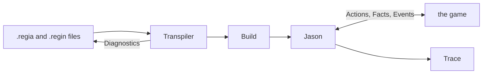

A Guest arrives at a royal banquet, walks to the seat laid for them, sits down and greets the Host. When every Guest has done so, the reception begins. Regia is a language for writing down both halves of that sentence: what one character does, and how the evening moves on once enough characters have done it. This guide describes Regia 2.0, the language and its two tools, as we plan to build them. None of it is built yet.

The guide is written from the point of view of someone using the language. It is derived from the specification in `docs/spec/`, the glossary and the ADRs, and where it disagrees with them, they are right. The next chapter, *The Logic of Regia*, reads one small Program line by line; the chapters after it take one part of the language each.

## What Regia is

`showcase/playbooks/courtesy.regia`
```regia
TO take_seat FROM DIRECTOR:
    GIVEN seat(?place):
        DO walk_to(?place).              # waits until we have arrived
        DO sit_down.
        TELL host greeting.
        SIGNAL took_seat.
```

`showcase/plots/royal_banquet.regia`
```regia
DURING arrival:
    WHEN ENTERED:
        DO open_doors.

    WHEN took_seat FROM ALL Guest:
        TRANSITION TO reception.
```

Regia describes the characters of a game as Agents that hold Facts about the world, pursue Goals and react to Events. What an Agent does is written as Plans. The first snippet is one: a recipe for the Goal `take_seat`, usable when the Agent knows its seat. Plans are grouped in Playbooks, here `Courtesy`, the manners everyone at the banquet has.

A Playbook says nothing about when it applies or to whom. That is the work of a Plot, which names Roles (`Guest`, `Host`), moves through Phases (`arrival`, `reception`), and gives Playbooks to Roles as it goes. Each Plot is run by a Director. In the second snippet the Director of `RoyalBanquet` opens the doors, waits until all Guests have sent `took_seat`, and moves on. The Director is the one who asked every Guest to take a seat in the first place, which is what `FROM DIRECTOR` in the first snippet says.

The language is wordy on purpose. It is meant for game designers as much as for programmers, and a Plan should read close to the sentence we would use to describe it. Its terms are a designer's too (Fact, Goal, Plan), and the glossary fixes them.

Regia doesn't run by itself. It is translated into a Target, a language that can run, and the game supplies the world: it tells Agents what they see, and carries out the Custom Actions (`walk_to`, `sit_down`) they ask for. 2.0 has one Target, AgentSpeak as run by Jason.



## The Transpiler

The Transpiler is a command-line tool. We hand it an Entry file, and it reads that file and everything reachable from it through Imports: the Program. `regia check` reports Diagnostics, each an error, a warning or a note pointing at a place in the source and carrying a stable code. `regia build` also writes the Build, the Target files for that Program, when there are no errors.

A Build holds our Plans, translated, and the Infrastructure: fixed code, the same for every Program, that runs Givings, Phases and the rest around them. When the Build runs, it leaves a Trace, the record of what happened in order. The Trace is how we find out why a Guest never sat down. (*The Transpiler*, *Translation to ASL*)

Spec: chapter 23, chapter 34.

## The Visual Editor

The Visual Editor is a web application that opens a folder of Regia files as a Project. It shows the text of a file on one side and, on the other, a drawing of one of its Plots: Phases as nodes, transitions as arrows labelled with their Triggers. Both sides can be edited. Adding a Phase on the drawing writes a `PHASE` line into the text, and typing one makes it appear on the drawing.

The text is the only thing stored. The drawing is made again from it after every change, and we never arrange it by hand. The Transpiler runs inside the editor, so Diagnostics show as we type. (*The Visual Editor*)

Spec: chapter 22, chapter 24, chapter 25.

## How the guide is organised

| Chapters | What they cover |
|---|---|
| *The Logic of Regia* | How Agents, Roles, Playbooks, Plots and Directors fit together, on one small Program |
| *Syntax*, *Vocabulary* | How a file is written, and the names Plans are built from |
| *Plans*, *Placeholders and Expressions*, *Matching*, *Randomness* | What one Plan can say |
| *Goals and Failure*, *Messages* | How Plans depend on each other, within an Agent and between Agents |
| *Playbooks and Roles*, *Plots and Directors*, *Subplots and Stagings*, *Quotas and Cast Changes* | How behaviour is handed out and how a scenario unfolds |
| *Precedence and Labels* | Which Plan runs when several could |
| *Instancing* | How a Program becomes a running cast |
| *The Transpiler*, *The Visual Editor*, *Translation to ASL* | The tools, and what a Program becomes on Jason |
| *Showcase*, *Review List* | The whole example Program with one run of it, and everything the guide found awkward |

Every chapter has the same shape. It opens with a case at the banquet. Each section then shows an example first and gives the rule after, with a pointer to the spec chapters on its last line. A part called *How this combines with…* looks at the construct next to the others, and *Since 1.0* closes the chapter.

Rules are not restated in full and Diagnostic codes are not listed: the spec has both. Other chapters are named by title, in italics.

## The two tags

Two tags mark paragraphs for later use.

- `#revise` starts a paragraph about something in the design that was awkward to write or to explain: two constructs that read alike, an example that needed too much ceremony, a rule with no short explanation. The guide records the spot and the reason and leaves the design as it is. *Review List* collects them all as the input to a later revision.
- `#changes` starts a line in *Since 1.0* saying how 2.0 differs from 1.0.

A fault of the example alone, such as a construct the banquet doesn't use yet, is not a `#revise`. Those are listed in the showcase's README and fixed by adding to the Program.

## The example world

All examples come from one Program, the showcase, in `docs/guide/showcase/`. A snippet has the path of its file on the line above it and is cut from that file as it stands. A snippet with no path is a variant made up on the spot, usually to show something we should not write.

The world is one evening at a royal banquet in a 3D hall. The Root Plot, `RoyalBanquet`, goes through four Phases: `arrival`, `reception`, `feast` and `farewell`. During the feast, an insult taken badly starts an `HonorDuel` between two Guests with the others looking on, and a `Poisoning` runs unseen with one Guest as the Poisoner and the Guards on watch. Eight Playbooks carry the behaviour, from `Courtesy`, which everyone holds, to `Duelling`, held only while a duel lasts.

The cast is built from six Agent kinds, among them a `knight` who is a Guest and a Guard at once, and a `latecomer` who enters only once the evening is under way. Two Instancing files set the numbers: `banquet.regin` for the full hall, and `test.regin` for a small cast of one king, two nobles, one knight and one servant. The small cast is the one *Showcase* follows through a whole run.

With no Transpiler, the examples can't be run. Each one was checked by hand against the spec chapters named under it.

## Since 1.0

Regia 1.0 was built for a Master's thesis: a Transpiler in Python, and a Visual Editor that called it over the network. `docs/primer/` describes it together with the first wishes for 2.0, and stays as it was. The banquet comes from there, and is extended here.

`#changes` The Transpiler is written again in Rust. It also runs inside the Visual Editor, which no longer needs a server.

`#changes` A 1.0 Story is a Plot and a 1.0 Agent is a Role. Agent now means a single character at runtime.

`#changes` The primer tagged open questions `#discuss`. Those were settled in the spec; the guide tags what looks wrong once written down, with `#revise`.
