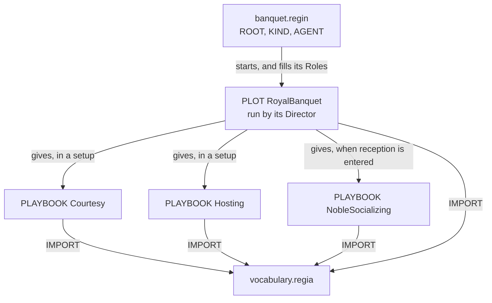

# The logic of Regia

The banquet starts with the doors opening. The Guests walk to their seats and greet the Host. Once they are all seated, the reception begins and they fall into small talk. After a while the Host stands for a toast, and the feast is on. To write this in Regia we decide, for every sentence, whether it is about what a character does or about how the evening goes. The first kind goes in a Playbook, the second in a Plot. Who sits in the hall goes in neither: Instancing says it.

| We write | It says | In full in |
|---|---|---|
| `PLAYBOOK Courtesy:` | what one Agent does, in Plans written from its own point of view | *Plans*, *Playbooks and Roles* |
| `PLOT RoyalBanquet:` | who takes part in a story, as Roles, and the Phases it goes through | *Plots and Directors* |
| `ROLE Guest:` with a Block | what every Agent of a Role starts with | *Plots and Directors* |
| `ASSIGN NobleSocializing TO Guest` | a Giving: a Plot hands a Playbook to the Agents of a Role | *Playbooks and Roles* |
| `DURING reception:` | the Director's Plans for one Phase | *Plots and Directors* |
| `KIND noble, PLAYS Guest:` | in a `.regin` file, which Agents exist and which Roles they play | *Instancing* |

This chapter reads the banquet from its first line to the toast, through the three files that carry it: `courtesy.regia`, `royal_banquet.regia` and `banquet.regin`. It uses constructs before the chapters that explain them, and names those chapters as it goes.



## A Playbook: what one Agent does

[`playbooks/courtesy.regia`](../showcase/playbooks/courtesy.regia)
```regia
IMPORT "../vocabulary"

#@desc: Manners everyone at the banquet has, whatever else they are doing.
PLAYBOOK Courtesy:
    ROLE host

    CUE greeting                             # only holders of Courtesy say it, and hear it

    TO take_seat, FROM DIRECTOR:
        GIVEN seat(?place):
            DO walk_to(?place)               # waits until we have arrived
            DO sit_down
            TELL host greeting
        # no ELSE: with no seat laid for us, take_seat fails at once

    WHEN take_seat FAILED:
        DO stand_by(wall)

    WHEN take_seat ENDED: SIGNAL took_seat   # seated or standing, the Director counts us

    WHEN greeting, FROM ?who:
        DO bow_to(?who)

    TO take_leave, FROM DIRECTOR:
        TELL host greeting
        DO walk_to(door)
        DO leave_hall                        # the game removes us: we leave the Program
```

A Playbook is a named set of Plans. Every Plan is written from the point of view of the one Agent that holds it, and has three parts: a Trigger that says what starts it, a Context that says when it applies, and a Body that says what to do.

`TO take_seat` is a recipe: when we have the Goal `take_seat`, and we know a `seat`, we walk there, sit down and greet the Host. `?place` is a Placeholder, filled with whichever seat we know. `WHEN greeting, FROM ?who` is a reaction: someone greeted us, and we bow to them. `WHEN take_seat ENDED` runs however the Goal ends, seated or standing by the wall, and sends the Cue `took_seat` to the Director.

Every name comes from the Vocabulary, `vocabulary.regia`, where it is declared with its kind. `seat` is a Fact the game keeps (`GAME FACT hall.seating.seat AS seat(place)`). `take_seat` is a Goal, `took_seat` a Cue, `walk_to` an Action the game carries out. `greeting` is declared in `Courtesy` itself, so only holders of `Courtesy` use it.

The Playbook reaches other Agents in two ways only:

- `TELL host greeting` sends a Message to `host`, a Role the Playbook declares on its first line. `host` is an address: the Playbook doesn't know who is behind it.
- `SIGNAL took_seat` sends a Cue to the Director of whichever Plot gave the Playbook. `FROM DIRECTOR` is the same link the other way: these recipes answer a Goal the Director asked for.

Nothing in `Courtesy` says when it applies, to whom, or what comes after `took_seat`. It names no Plot, and it can't make another Agent act: `TELL` informs, and the receiver's own Plans decide what follows. A Goal is reached when its recipe finishes; nothing checks the world.

The parts of a Plan are in *Plans*, the names in *Vocabulary and files*, `TELL` and `SIGNAL` in *Messages*, and how a Goal ends in *Goals and Failure*.

**Checks**

- A Cue tested in a Context or an `IF` → `R0502`
- `LEARN` or `FORGET` with a Cue or a Goal, `PURSUE` or `DROP` with a Fact or a Cue → `R0802`
- A Director Statement in a Playbook (`ASSIGN`, `ENTER`, …) → `R1507`
- A Goal pursued, asked or declared with no `TO` Plan anywhere in the Program → `R1101` (warning)

Spec: chapter 05.

## A Plot and its Roles

[`plots/royal_banquet.regia`](../showcase/plots/royal_banquet.regia)
```regia
PLOT RoyalBanquet:
    CAST:
        ASSIGN Courtesy                      # its `host` is the Plot's Host, by name

    ROLE Host:
        ASSIGN Hosting
        PURSUE take_seat
    #@desc: Everyone invited to the table. A knight is a Guest and a Guard at once.
    ROLE Guest:
        LEARN purse(RANDOM(5, 20))           # rolled for each Guest
        LEARN craves(roast)
        LEARN craves(pie)
        PURSUE take_seat
    ROLE Servant
    ROLE Guard:
        ASSIGN Keeping_watch
        LEARN on_duty
```

A Plot describes a story. It starts by naming its Roles, the classes of Agents that take part: `Host`, `Guest`, `Servant`, `Guard`. A Role says nothing about how many Agents play it or what they are called. No Plan names a single Agent.

A `ROLE` line with a Block is the Role's setup: what each of its Agents starts with. A Guard starts with the Playbook `Keeping_watch` and the Fact `on_duty`; a Guest with a purse, two cravings and the Goal `take_seat`. `CAST:` is the setup of everyone in the Plot, whatever they play: every Agent gets `Courtesy`.

The setup speaks for the Director. Its Facts arrive told by the Director, its Goals asked by it, which is why `TO take_seat, FROM DIRECTOR:` in `Courtesy` answers the Host's and every Guest's `PURSUE take_seat`.

`ASSIGN Courtesy` fills the Playbook's `host` with the Plot's `Host`, because the names match, ignoring case. When a Guest's `Courtesy` says `TELL host greeting`, the Message goes to whoever plays `Host` here. The Host holds the same Giving, but a Message never comes back to its sender: the Host's own greeting reaches nobody. Had the names differed, the line would need a `MAPPING Host AS host`.

- The setup's Statements are the same for every Agent of the Role, and worked out for each: `RANDOM(5, 20)` is rolled once per Guest.
- `CAST:` runs first, then each Role's setup in the order written. The Host's `PURSUE take_seat` finds its recipe because `Courtesy` is already given.
- A setup holds `ASSIGN`, `LEARN` and `PURSUE` only. It has no Context and can't fail.
- An Agent can play several Roles. A knight is a Guest and a Guard: it gets both setups, and `Courtesy` only once.

Setups are in *Plots and Directors*, and Roles, `CAST` and binding by name in *Playbooks and Roles*.

**Checks**

- A Statement other than `ASSIGN`, `LEARN` or `PURSUE` in a setup → `R1602`
- A Block on a Playbook's `ROLE` → `R1601`
- A Playbook Role left unfilled, with no `MAPPING` and no Plot Role of the same name → `R1503` (hint: a `MAPPING`)
- A Role name used as a Value → `R0303` (hint: `FROM Role ?x`)
- A setup `PURSUE` above the `ASSIGN` that gives the only Playbook with a recipe for it → `R1605` (warning)
- The retired `ROLE r STARTS WITH:` → `R1608` (hint: `ROLE r:`)

Spec: chapter 16. For binding by name, chapter 15.

## A Playbook given for a while

[`plots/royal_banquet.regia`](../showcase/plots/royal_banquet.regia)
```regia
DURING reception:
    WHEN ENTERED:
        ASSIGN NobleSocializing TO Guest, MAPPING Guest AS peer
```

[`playbooks/noble_socializing.regia`](../showcase/playbooks/noble_socializing.regia)
```regia
# Small talk. The more grudges we hold against those at the table, the likelier we vent one.
WHEN idle:
    LET ?grudges BE COUNT(grudge(?foe, ?) AND ?foe PLAYS peer)
    RANDOMLY:
        OPTION, WEIGHT 3: DO chat
        OPTION, WEIGHT 2:
            DO sip_wine
            IF RANDOM(1, 100) <= 30:     # one cup too many
                DO laugh
        OPTION, WEIGHT ?grudges: PURSUE vent
        OPTION, WEIGHT 5: PASS           # nothing, this time
```

An Agent holds Plans only through a Giving: a Plot handing a Playbook to some of its Agents. The setups made the first Givings. This one is made by a Plan of the Director, when the Plot enters `reception`.

Until then, a Guest the game sends `idle` does nothing with it, since it holds no Plan for it. Once `NobleSocializing` is given, the same Cue makes it chat, sip wine, vent a grudge, or let the moment pass. The Guest still holds `Courtesy` and still bows when greeted: Givings add up. Behaviour changes this way as the story moves on: the small talk is written in a Playbook that knows nothing of receptions, and the Plot hands it out when the reception starts.

`MAPPING Guest AS peer` fills the Playbook's Role `peer` with the Plot's `Guest`: a Guest's peers are the other Guests. The Plot takes the Playbook back in `farewell`, with `REMOVE NobleSocializing FROM Guest`.

- A Giving to a Role reaches the Agents who play the Role. Each Agent holds the Playbook with the Mappings of that Giving.
- A Mapping binds a Role to a Role, not to a list of Agents. Who plays `peer` is looked up each time a Plan uses it.
- A Playbook can't give a Playbook. Givings are made by a Plot, in a setup or a Director's Plan, and by Instancing for the Root Plot.

Givings, Mappings and `REMOVE` are in *Playbooks and Roles*; the weighted `RANDOMLY` in *Randomness*, the `COUNT` in *Matching*.

**Checks**

- Two `MAPPING`s to one receiving Role in one Statement, or a `MAPPING` to a Role the Playbook doesn't declare → `R1504`
- A giving Role the Plot doesn't declare → `R1502`
- The retired `MAPPING a TO b` → `R1514` (hint: `MAPPING a AS b`)
- The retired `UNASSIGN` → `R1515` (hint: `REMOVE`)

Spec: chapter 15.

## The Director and its Phases

[`plots/royal_banquet.regia`](../showcase/plots/royal_banquet.regia)
```regia
PHASE arrival INITIAL
PHASE reception
#@desc: Dinner is served. Insults start duels, and someone at the table means harm.
PHASE feast
PHASE farewell
```

```regia
DURING arrival:
    WHEN ENTERED:
        DO open_doors

    WHEN took_seat, FROM Guest ?g:
        LEARN seated(?g)
        IF COUNT(seated(?)) >= COUNT(? PLAYS Guest):
            ENTER reception

    WHEN took_seat, FROM Host:           # the king is seated: music
        DO play_music

DURING reception:
    WHEN ENTERED:
        ASSIGN NobleSocializing TO Guest, MAPPING Guest AS peer

    AFTER 2 MINUTES:
        ASK Host TO open_feast

    WHEN toast_given, FROM Host:
        ENTER feast
```

A Phase is a state of the Plot. The Plot is in exactly one at a time, starts in the one marked `INITIAL`, and moves when a Plan says `ENTER`. The `DURING` Blocks hold Plans built like an Agent's, with Triggers, Contexts and Bodies, but they belong to the Director, the agent behind the scenes that runs the Plot. A `DURING` Block's Plans react only while the Plot is in its Phase.

The Director acts on the game (`DO open_doors`) and hears the Signals its Agents send. Each `took_seat` from a Guest is written down in `seated`, a Fact the Plot declares for its Director, and once every Guest is counted the Plot enters `reception`. The Host's `took_seat` goes to the other Plan, since a Plan's `FROM` decides which Plan under one Trigger runs.

The Director can't make an Agent act. It gives Playbooks (`ASSIGN`), it asks for Goals (`ASK Host TO open_feast`), and it tells Facts and Cues. Each time, the Agent's own Plans decide what happens. The Director learns that the toast is over only because `Hosting` Signals it:

[`playbooks/hosting.regia`](../showcase/playbooks/hosting.regia)
```regia
TO open_feast, FROM DIRECTOR:
    DO stand_up
    DO play_fanfare                      # the Target's own code: Regia doesn't wait on the game
    DO raise_cup

WHEN open_feast ENDED: SIGNAL toast_given
```

- `ENTER` stops the Plans of the Phase being left, runs its `EXITED` Plan, takes back what was given for that Phase, and runs the new Phase's setups and `ENTERED` Plan.
- `AFTER 2 MINUTES:` counts from entering the Phase, and is stopped if the Phase is left first.
- The Director reads only its own Facts. What a Guest knows reaches it only as a Signal.
- A Director has no Goals: no `TO` recipes and no `PURSUE`. It can't `SIGNAL` either.

> **In 2.0** the Director hears how a Goal it asked ended, and a Quota Trigger waits for every Guest's `take_seat` in a single Trigger. Spec chapter 20, *Hearing how an asked Goal ended*, and chapter 18. In 1.5 `Courtesy` Signals `took_seat`, and the Director counts in a Fact of its own.

Phases, `ENTER`, `AFTER` and what a Director perceives and does are in *Plots and Directors*; `ASK … TO` is in *Messages*.

**Checks**

- A Plot with Phases and no `INITIAL`, or several → `R2007`
- `DURING`, `ENTER` or `IN` naming a Phase the Plot doesn't declare → `R2008`
- `Role DO …` or `WORLD DO …` → `R2006`
- `PURSUE`, `DROP g` or `SIGNAL` in a Director → `R2001`
- The retired `TRANSITION TO p` → `R2016` (hint: `ENTER p`)
- `FROM ALL Guest` or another quantity after `FROM`, or a Goal's ending in a Plot, in a 1.5 build → `R0109`
- A Signal with no Plan in the current Phase or `DURING PLOT` → `T3801` (Trace, `unheard`)

Spec: chapter 20.

## Who is in the hall

[`banquet.regin`](../showcase/banquet.regin)
```regia
IMPORT "plots/royal_banquet"

ROOT RoyalBanquet

AGENT king, PLAYS Host

KIND noble, PLAYS Guest:
    COUNT 6
    bravery AT RANDOM(0.2, 0.8)
    sympathy AT RANDOM(0, 0.8)
    aggressiveness AT RANDOM(-0.4, 0.4)
```

Nothing so far has said how many Guests there are. That is Instancing, written in `.regin` files and kept apart from the story. `ROOT` names the Root Plot, the Plot that starts when the run does. A `KIND` is a sort of Agent: which Roles of the Root Plot its Agents play, how many start, and what each starts with. `AGENT king` is one Agent with a name of its own.

`banquet.regin` goes on with two hotheads, two knights and three servants. The whole hall:

| Written | Agents | Plays |
|---|---|---|
| `AGENT king` | 1 | `Host` |
| `KIND noble` | 6 | `Guest` |
| `KIND hothead, LIKE noble` | 2 | `Guest` |
| `KIND knight`, `AGENT percival, LIKE knight` | 2 | `Guest`, `Guard` |
| `KIND servant` | 3 | `Servant` |

Kinds exist only here. Playbooks and Plots never name `noble`: they address `Guest`, and work the same with two Guests or twenty. A kind's lines also say what differs between Agents of one Role: a noble's bravery, a hothead's grudge against `percival`. What holds for every Guest of every cast belongs to the Plot's setup.

Kinds, individual Agents, `LIKE`, starting Propensities and the seed are in *Instancing*.

**Checks**

- A `.regin` Entry that reaches no `ROOT` → `R2104`
- A `PLAYS` Role that isn't a Role of the Root Plot → `R2105`
- A `.regia` file importing a `.regin` → `R2101`
- A Root Plot Role that no kind and no individual Agent plays → `R2110` (warning)

Spec: chapter 21.

## One run

```mermaid
sequenceDiagram
    participant G as game
    participant D as Director of RoyalBanquet
    participant H as Host (king)
    participant N as Guests (10)
    Note over D: arrival is current; setups and kinds' lines run
    D->>H: Courtesy, Hosting, take_seat
    D->>N: Courtesy, purse, cravings, take_seat
    D->>G: DO open_doors
    N->>G: DO walk_to, DO sit_down
    N->>H: TELL host greeting
    H->>G: DO bow_to
    N->>D: SIGNAL took_seat
    Note over D: the last Guest counted: ENTER reception
    D->>N: NobleSocializing
    G->>N: idle
    N->>G: DO chat, DO sip_wine, …
    Note over D: AFTER 2 MINUTES
    D->>H: ASK Host TO open_feast
    H->>G: DO stand_up, DO play_fanfare, DO raise_cup
    H->>D: SIGNAL toast_given
    Note over D: ENTER feast
```

When the run starts, Instancing creates the fourteen Agents with their Propensities, and the Root Plot's single Staging starts:

1. `arrival` becomes current, so that a `took_seat` sent straight away is counted.
2. The setups run for every Agent: `CAST:` first, then each Role's in the order written. Then each Agent's kind lines run, such as a hothead's grudge.
3. `arrival`'s `ENTERED` Plan runs, and the Director opens the doors.

From there each Agent works through `take_seat` at its own pace. `DO walk_to` waits until the game says the Agent has arrived, so the ten Signals reach the Director at different moments. The Host bows once for every greeting. A Guest the game laid no seat for fails `take_seat`, stands by the wall, and is counted all the same.

The `AFTER` in `reception` holds back no one. The Guests chat for two minutes, while the Director waits for the time to pass. Then it asks for the toast, and the Host's Signal moves the Plot to `feast`.

How a run is recorded is in *The Trace*, and how a Program becomes one in *The Transpiler*.

**Checks**

- A setup Statement that can't be carried out, skipped → `T1601` (Trace warning)
- A Director Plan that failed → `T2002` (Trace warning, after the entry of its cause)

Spec: chapter 20, *What starting a Staging does*. For the order of setups and kind lines, chapter 16 and chapter 21, *Setup lines*.

## How this combines with…

### Goals and Failure

`take_seat` fails at once when the game laid no seat, since the recipe's `GIVEN` has no `ELSE`. `WHEN take_seat FAILED` stands the Guest by the wall, and `WHEN take_seat ENDED` Signals in either case, so the Director's count is never left waiting for a seatless Guest. (*Goals and Failure*)

### Several Playbooks on one Agent

During the feast a knight holds `Courtesy`, `NobleSocializing`, `Keeping_watch` and `Dining` at once, and two of them have a Plan for `scandal`. One Plan runs, and the Plot that gave them decides which, in its `PRECEDENCE` Block. (*Precedence and Labels*)

### Plots inside Plots

`feast` starts `Poisoning` as a Subplot, and an insult can start an `HonorDuel`. A Subplot is a Plot with its own Director and Roles, filled with some of the banquet's Agents, and the banquet hears how it ends. (*Subplots and Stagings*)

### Agents who leave

A Guest can walk out at any time, and nobody comes in. The banquet re-counts when a Guest leaves, and ends when no Guest or no Host is left. (*When an Agent leaves*)

### What a Plot and a Playbook agree on

Nothing in `Courtesy` declares that it Signals `took_seat` or expects `take_seat` from a Director. The Transpiler works this out from the Plans, and checks the Playbook against every Plot that gives it. (*Interfaces*)

### Running it

The Transpiler turns `banquet.regin` and everything it reaches into a Build for a Target. On the Jason Target, every Agent and every Director becomes a Jason agent. (*The Transpiler*, *Jason: the Build*)
