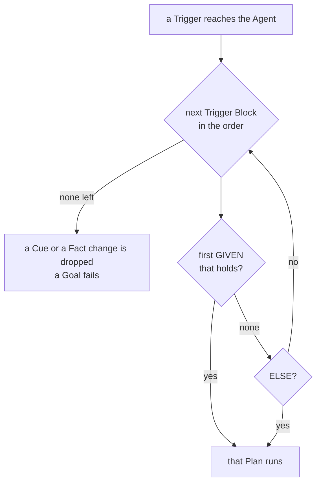

# Plans

A Guest is greeted and bows. A Guest gets hungry and sets about having dinner. A duellist is hit and either loses a point of stamina or yields. Each of these is a Plan: something that starts it, sometimes a condition, and the steps that follow. The first part is the Trigger, the second the Context, the third the Body.

| Part | We write | It says |
|---|---|---|
| Trigger | `WHEN <event>:` or `TO <goal>:` | what starts the Plan |
| Context | `GIVEN <condition>:` under the Trigger, or `ELSE:` | when the Plan may be chosen |
| Body | the Statements in the Block | what the Agent does, top to bottom |

This chapter covers the three parts, the Events a Trigger can name, how several Plans share one Trigger, and the difference between a condition that chooses a Plan (`GIVEN`) and one that steers a Body already running (`IF`). The names a Plan uses are declared as in *Vocabulary and files*. What goes in a slot is in *Placeholders and Expressions* and *Matching*; the Statements of a Body are in *Actions and time*, *Goals and Failure* and *Messages*.

## A Trigger and a Body

[`playbooks/courtesy.regia`](../showcase/playbooks/courtesy.regia)
```regia
WHEN greeting, FROM ?who:
    DO bow_to(?who)
```

The smallest Plan is a header and one Statement. `WHEN greeting` is the Trigger: the Plan starts when the Cue `greeting` reaches the Agent. `, FROM ?who` fills `?who` with whoever sent it. The Block under the header is the Body.

[`playbooks/duelling.regia`](../showcase/playbooks/duelling.regia)
```regia
WHEN yielded, FROM opponent:
    DROP strike                          # no more lunges at a beaten opponent
    DO salute
    SIGNAL duel_won
```

A Body runs from top to bottom, one Statement at a time. A Statement that waits holds the Body where it is: the duellist has finished saluting when the Director hears `duel_won`, because `DO` waits until the game says the Action is done. Which Statements wait is in *Actions and time*.

- A Plan belongs to the Agent that holds its Playbook and is written from that Agent's side. Nothing in it says who "we" are; `ME` is the Value for the Agent running it.
- A Trigger Block whose Statements come straight after the header is one Plan with no Context. It runs whenever its Trigger reaches it.
- Plans in a Plot are built the same way, from the same Triggers, Contexts and Bodies, and run in the Plot's Director (*Plots and Directors*).

Spec: chapter 05, chapter 06.

## Cues, Facts and Events

[`playbooks/dining.regia`](../showcase/playbooks/dining.regia)
```regia
WHEN served(?dish), FROM waiter:
    GIVEN sated:
        DO push_away(?dish)
    ELSE:
        LEARN on_plate(?dish)
```

`served` is a Cue: something that happens and is over once noticed. It starts a Plan and leaves nothing behind. The Guest can't ask later whether it was served, so a Plan that needs to remember it records a Fact, as `LEARN on_plate(?dish)` does here. A Fact lasts until it is forgotten, and a Context can test it at any moment.

An Event is anything that happens to an Agent or a Director and can start a Plan: a Cue, a Fact learned or forgotten, a Goal pursued or over, a Playbook given or taken away, a Phase entered or left, a Role left or emptied, a Phase's time running out. A Trigger names one Event.

- A Cue can't be tested. `GIVEN served(?dish):` and `IF idle:` are errors.
- A Cue can't be learned or forgotten. `LEARN idle` is an error.
- A Signal is a Cue an Agent sends to the Directors; a Director reacts to it like to any other Cue (*Messages*).

**Checks**

- A Cue tested in a Context or an `IF` → `R0502`
- `LEARN` or `FORGET` with a Cue or a Goal, `PURSUE` or `DROP` with a Fact or a Cue → `R0802`
- `EVENT` to declare a Cue → `R0513` (hint: `CUE`)

Spec: chapter 05, *Cues are momentary*, *Events*. For the Basic Actions, chapter 08.

## Trigger kinds

[`playbooks/dining.regia`](../showcase/playbooks/dining.regia)
```regia
WHEN ASSIGNED:
    IF hungry:
        PURSUE have_dinner, WITHOUT WAITING
    ELSE:
        SIGNAL finished_eating           # not hungry tonight: nothing to count on

WHEN hungry LEARNED:
    GIVEN NOT sated AND NOT PURSUING have_dinner:
        PURSUE have_dinner, WITHOUT WAITING

WHEN hungry FORGOTTEN:
    DROP have_dinner                     # stops the recipe, even while it waits
```

Each sort of Event is a Trigger kind. A Fact starts a Plan when it is learned or when it is forgotten, and the word after the item says which. `Dining` uses every kind a Playbook can:

| A Plan starts when | We write | In the showcase |
|---|---|---|
| a Cue happens | `WHEN <cue>:` | `WHEN served(?dish), FROM waiter:` |
| a Fact is learned | `WHEN <fact> LEARNED:` | `WHEN hungry LEARNED:` |
| a Fact is forgotten | `WHEN <fact> FORGOTTEN:` | `WHEN hungry FORGOTTEN:` |
| a Goal is pursued (a recipe) | `TO <goal>:` | `TO have_dinner:` |
| a Pursuit is reached | `WHEN <goal> REACHED:` | `WHEN have_dinner REACHED: LEARN sated` |
| a Pursuit is dropped | `WHEN <goal> DROPPED:` | `WHEN have_dinner DROPPED:` |
| a Pursuit fails | `WHEN <goal> FAILED:`, `… FAILED WITH <reason>:` | `WHEN have_dinner FAILED WITH no_food:` |
| a Pursuit is over, however it went | `WHEN <goal> ENDED:` | `WHEN have_dinner ENDED: SIGNAL finished_eating` |
| the Playbook is given, or its last Giving taken away | `WHEN ASSIGNED:`, `WHEN REMOVED:` | `WHEN ASSIGNED:` |

A Director's Plans have more: `WHEN ENTERED:` and `WHEN EXITED:` for a Phase, `AFTER <duration>:` for a Phase's time, `WHEN Guest ?g LEFT:` and `WHEN Guest EMPTIED:` for the cast, and `WHEN HonorDuel(?) FINISHED WITH duel_settled(?winner):` and its siblings for a Subplot (*Plots and Directors*, *Subplots and Stagings*, *When an Agent leaves*).

- A Fact Trigger always has its kind word. `WHEN hungry:` is an error, so a reader never has to look up whether a bare name is a Fact or a Cue.
- The kind word follows the item. A Trigger with no written item has the kind word alone: `WHEN ASSIGNED:` is about this Playbook, `WHEN ENTERED:` about this Phase.
- The kind word must suit the item. `WHEN served(?dish) LEARNED:` is an error, since `served` is a Cue.
- `LEARNED` and `FORGOTTEN` fire whatever caused the change: the game (as with `hungry`), a Message, or the Agent's own `LEARN` and `FORGET`. They fire only on a change: learning a Fact already known fires nothing, and neither does forgetting one that isn't.
- `TO` and `AFTER` are the two Triggers without `WHEN`. A `TO` Plan, a Goal's recipe, is otherwise an ordinary Plan, with the same Context, Labels and Body.
- `ASSIGNED` fires when the Agent goes from no Giving of the Playbook to one, and `REMOVED` when the last one goes (*Playbooks and Roles*). Neither takes an item, a Placeholder or `FROM`.

### A Goal's Triggers

[`playbooks/dining.regia`](../showcase/playbooks/dining.regia)
```regia
WHEN have_dinner REACHED: LEARN sated

# Full before the plate is empty: push away what is left.
WHEN have_dinner DROPPED:
    FOR EACH on_plate(?dish):
        DO push_away(?dish)
        FORGET on_plate(?dish)

WHEN have_dinner FAILED WITH no_food:
    PURSUE make_do, WITHOUT WAITING      # the fallback
WHEN have_dinner FAILED, SHIFTS sympathy BY -0.3:
    DO complain

WHEN have_dinner ENDED: SIGNAL finished_eating
```

Every request to pursue a Goal starts a Pursuit, and a Pursuit ends in one of three ways: reached when its recipe finishes its Body, dropped, or failed. The matching Trigger fires, and `ENDED` fires after it, once per Pursuit. A Guest who eats its dinner fires `REACHED` and then `ENDED`, so the Director hears `finished_eating` however the dinner went.

- An ending Plan only hears about the ending. By the time a `REACHED` Plan runs, the Body that waited on the Goal has already carried on, and no ending Plan changes how the Pursuit ended.
- A Plan for an ending that fails just stops, with a Trace entry. Nothing else fires, so endings can't loop.
- These Triggers are about the Agent's own Pursuits. Hearing how a Goal asked of someone else ended is 2.0 (*Messages*).

What a Pursuit is, what fails one, and how to write a fallback are in *Goals and Failure*.

**Checks**

- A Fact Trigger without `LEARNED` or `FORGOTTEN` → `R0503`
- A kind word that doesn't suit the item (`WHEN served(?dish) LEARNED`, `WHEN have_dinner LEARNED`) → `R0504`
- `WITH` on `REACHED`, `DROPPED` or `ENDED` → `R1105`
- `WHEN ASSIGNED:` or `WHEN REMOVED:` in a Plot, or with an item, a Placeholder or `FROM` → `R1508`
- `WHEN Guest ?g JOINED:`, in a 1.5 build → `R0109` (*When an Agent leaves*)

Spec: chapter 05, *Trigger kinds*, *How a Pursuit ends*. For `ASSIGNED` and `REMOVED`, chapter 15; for `FAILED WITH`, chapter 11.

## Where it came from: `FROM`

[`playbooks/courtesy.regia`](../showcase/playbooks/courtesy.regia)
```regia
TO take_seat, FROM DIRECTOR:
    GIVEN seat(?place):
        DO walk_to(?place)               # waits until we have arrived
        DO sit_down
        TELL host greeting
    # no ELSE: with no seat laid for us, take_seat fails at once
```

[`playbooks/serving.regia`](../showcase/playbooks/serving.regia)
```regia
WHEN bring(?dish, ?) FAILED, FROM patron ?guest:
    DO bow_to(?guest)                    # an apology, and nothing more to say
```

Something sent has a Sender: a Cue or a Fact told by another Agent, a Goal asked by an Agent or a Director, a Signal at a Director. A `FROM` clause restricts the Sender, names it, or both. Everything else, what the game reports and what the Agent does to itself, has no Sender.

| We write | The Plan starts if | In the showcase |
|---|---|---|
| no `FROM` | anyone sent it, or nobody did | `WHEN hungry LEARNED:` |
| `FROM peer` | the Sender plays the Role | `WHEN yielded, FROM opponent:` |
| `FROM ?who` | anyone sent it; `?who` holds the Sender | `WHEN greeting, FROM ?who:` |
| `FROM peer ?who` | the Sender plays the Role; `?who` holds it | `WHEN insulted, FROM peer ?who, …` (*noble_socializing*) |
| `FROM DIRECTOR` | the Director of a Plot that gives the Agent this Playbook sent it | `TO take_seat, FROM DIRECTOR:` |

- Any `FROM` leaves out what has no Sender. No `FROM` takes everything in.
- On `TO` and on a Goal's endings, `FROM` is where that Pursuit's request came from. `Serving`'s apology runs only for a `bring` a Guest asked for, and `?guest` is that Guest.
- An Agent's own `PURSUE` has no Sender, wherever it is written. `TO take_seat, FROM DIRECTOR:` takes no `PURSUE take_seat`, and such a Pursuit fails at once for want of a recipe.
- What a Role setup does (`PURSUE take_seat`, `LEARN on_duty`) is sent by the Director, so it is `FROM DIRECTOR`.
- On `LEARNED`, a `FROM` matches only a Fact told by an Agent or a Director, and only if it was new. `FROM` is never written on `FORGOTTEN`: nobody sends a forgetting.
- `FROM DIRECTOR` is worked out when the Event arrives, so a Playbook never names a Plot.

The full story of Senders, recipients and delivery is in *Messages*.

> **In 2.0** a Trigger can name what has no Sender: `FROM GAME` for what the game sent or reported, `FROM ME` for the Agent's own doing. Spec chapter 05, *The game and the Agent itself*. In 1.5, `WHEN saw_pouring(?who):` in `Keeping_watch` has no `FROM`, so it also runs if another Agent tells a Guard `saw_pouring`, and nothing in the Trigger can shut that out.

**Checks**

- `FROM` on `FORGOTTEN` → `R0505`
- `BY` on a Trigger that isn't a Goal's ending → `R0506`
- `FROM GAME`, `FROM ME`, `FROM` with `OR`, `BY` on a Goal's ending, or a quantity after `FROM`, in a 1.5 build → `R0109`
- `FROM` a Role the Playbook or Plot doesn't declare → `R1502`

Spec: chapter 05, *Where it came from: `FROM`*. For Role setups, chapter 16; for Senders in Messages, chapter 07.

## The shape of a Trigger

[`playbooks/serving.regia`](../showcase/playbooks/serving.regia)
```regia
WHEN bring(?dish, ?) FAILED WITH sold_out(?dish), FROM patron ?guest:
    TELL ?guest sold_out(?dish)          # the Reason, told back by hand
```

[`playbooks/noble_socializing.regia`](../showcase/playbooks/noble_socializing.regia)
```regia
WHEN insulted, FROM peer ?who, SUITS sympathy AT -0.5, SHIFTS aggressiveness BY 0.3:
```

A Trigger is a core and its clauses. The core reads left to right:

1. `WHEN`, or `TO`;
2. the item, with its slots;
3. the kind word, if any;
4. `WITH <reason>`, after `FAILED` only.

The clauses come after, each after a `,`, in any order: `FROM …`, and the Labels `SUITS` and `SHIFTS` (*Precedence and Labels*). Tools write `FROM` first, then the Labels.

- The kind words, `WITH` and `FROM` are reserved, so the parser always knows where the item ends. So are `DIRECTOR`, `GAME` and `ME`.
- A Trigger has no Context clause. The Context is a `GIVEN` Block under the header, and `WHEN insulted, GIVEN grudge(?who, ?):` is a parse error.
- A clause written without its `,`, `WHEN insulted FROM peer:`, is an error whose hint adds the comma.

**Checks**

- A clause keyword with no `,` before it → `R0111`
- `SUITS a AT x AND b AT y` → `R1412` (hint: `,` between the items)

Spec: chapter 05, *The shape of a Trigger*. For clauses and the comma, chapter 01; for Labels, chapter 14.

## The Context: `GIVEN`

[`playbooks/keeping_watch.regia`](../showcase/playbooks/keeping_watch.regia)
```regia
WHEN scandal(?), FROM ?speaker:
    GIVEN on_duty AND (NOT seat(?) OR NOT hungry):   # standing guard, or seated and not thinking of food
        DO watch(?speaker)
    # no ELSE: a hungry knight at the table leaves gossip to NobleSocializing
```

`GIVEN` holds the Context: the condition under which the Plan is chosen. A Guard on duty who hears gossip watches the speaker, if it is standing guard or isn't thinking of food. Otherwise the Plan is not chosen and none of its Body runs.

The Context is checked once, when the Plan is chosen, before any Statement of the Body runs. It promises nothing about later: a Guard relieved of duty halfway through `DO watch(?speaker)` goes on watching.

A Context tests:

| We write | It holds when | In the showcase |
|---|---|---|
| a Fact | the Agent knows a matching Fact; Placeholders are filled from it | `GIVEN seat(?place):` (*courtesy*) |
| a comparison | it is true; `COUNT(…)` counts Matches | `GIVEN stamina(?now) AND ?now > 1:` (*duelling*) |
| `PURSUING <goal>` | the Agent has a Pursuit of the Goal running | `GIVEN NOT PURSUING bring(?, ?):` (*serving*) |
| `?x PLAYS <Role>` | `?x` plays the Role | `GIVEN grudge(?foe, ?size) AND ?foe PLAYS peer, …` (*noble_socializing*) |
| `<Plot> RUNNING`, `IN <phase>` | a Subplot is running, the Plot is in a Phase; in a Director only | `IF IN arrival AND …` (*royal_banquet*) |

The items are joined with three operators and parentheses:

| Operator | Means | Binds |
|---|---|---|
| a comparison, or `PLAYS`, `RUNNING` after their subject | | tightest |
| `NOT x` | `x` doesn't hold | |
| `x AND y` | both hold | |
| `x OR y` | at least one holds | loosest |

- `NOT` applies to the one item after it. `NOT sated AND NOT PURSUING have_dinner` is two negations joined. `NOT ?x PLAYS peer` is `NOT (?x PLAYS peer)`.
- `AND` and `OR` can't be mixed at one level without parentheses. `on_duty AND NOT seat(?) OR NOT hungry` is an error whose hint shows both groupings. A chain of only `AND`s, or only `OR`s, needs none.
- The word after a term says what the item is, so a condition parses without knowing the names: `Poisoning RUNNING` is a Subplot and `hungry` a Fact. A condition word comes first when its subject is the Agent or the Plot itself: `PURSUING have_dinner`, `IN feast`.
- In a Goal's own recipe, `PURSUING` doesn't count the Pursuit the recipe is running. `TO have_dinner: GIVEN NOT PURSUING have_dinner:` would ask about another dinner.
- A Context that matches a Fact asks only whether there is a Match. Which one the Plan then works with, and how to choose it, is in *Matching*.

**Checks**

- `AND` and `OR` mixed at one level → `R0601`
- A Cue in a Context → `R0502`
- `RUNNING` in a Playbook → `R1714`; `IN` in a Playbook, or in a Plot with no Phases → `R2014`
- `?x SENT <cue>`, in a 1.5 build → `R0109`

Spec: chapter 06, *Two different questions*, *Conditions*. For `PURSUING`, chapter 05; `PLAYS`, chapter 15; `RUNNING`, chapter 17; `IN`, chapter 20; comparisons, chapter 04.

## Several Plans under one Trigger

[`playbooks/duelling.regia`](../showcase/playbooks/duelling.regia)
```regia
WHEN hit, FROM opponent, SHIFTS aggressiveness BY 0.1:
    GIVEN stamina(?now) AND ?now > 1:
        UPDATE stamina(?now) TO stamina(?now - 1)
    GIVEN stamina(?now):
        FORGET stamina(?now)
        DO drop_sword
        TELL opponent yielded
    # no ELSE: a hit after we have yielded changes nothing
```

One Trigger can head several Plans. Each `GIVEN` Block is a Plan, and so is an `ELSE`. Of the `GIVEN`s under one Trigger, the first in the text whose Context holds runs, and only that one. A duellist with stamina to spare loses a point. One with a single point left skips the first `GIVEN`, matches the second, and yields. One with none matches neither.

[`playbooks/wagering.regia`](../showcase/playbooks/wagering.regia)
```regia
WHEN duel_on, FROM DIRECTOR:
    GIVEN purse(?gold) AND ?gold >= 2:
        LET ?stake BE RANDOM(1, ?gold / 2)   # a whole roll, up to half the purse
        UPDATE purse(?gold) TO purse(?gold - ?stake)
        SIGNAL wagered(?stake)
        DO cheer
    ELSE:
        DO cheer
```

`ELSE` runs when no `GIVEN` holds. A Spectator too poor to bet still cheers.

- First match wins, top to bottom, however the Plans are ordered at runtime and whatever other Playbooks react to the same Trigger.
- `ELSE` is optional, and comes last. An `ELSE` with no `GIVEN` before it is an error.
- A Trigger Block holds a Body or `GIVEN`/`ELSE` Blocks, never both. A Statement before, between or after the `GIVEN`s is an error, because the Context is checked before any Statement runs. A Statement every case needs is written in each Plan, as `DO cheer` is, or the cases become one Plan with an `IF`.
- The Plans share everything in the Trigger: the item and its kind word, the Placeholders it fills, `FROM`, and the Labels on the header. Both Plans for `hit` come from `opponent` and both shift `aggressiveness`.
- Each `GIVEN` fills its own Placeholders, so siblings may reuse a name: both Plans for `hit` fill `?now`. A Trigger Placeholder used by only some of the Plans is not reported as unused.
- A single `GIVEN` or `ELSE` may carry its own `SHIFTS` Label, never `SUITS`: siblings never compete, so there is nothing for the Selection function to choose.
- A doc comment above the Trigger documents every Plan under it. One above a `GIVEN` or `ELSE` documents that Plan alone.
- A `GIVEN` an earlier sibling always catches, such as `GIVEN stamina(?now):` above `GIVEN stamina(?now) AND ?now > 1:`, can never run and gets a warning. The fix is usually to move the narrower case up, which is what `WHEN hit` does.

A one-Plan Trigger with a Context fits on one line: `WHEN idle: GIVEN NOT PURSUING bring(?, ?): DO walk_to(kitchen)` (*Syntax*).

### A `GIVEN` chain or an `IF`

With an `ELSE`, a chain of `GIVEN`s does what one Plan does when an `IF` chain fills its Body. `WHEN duel_on` could have been written:

```regia
WHEN duel_on, FROM DIRECTOR:
    IF purse(?gold) AND ?gold >= 2:
        LET ?stake BE RANDOM(1, ?gold / 2)
        UPDATE purse(?gold) TO purse(?gold - ?stake)
        SIGNAL wagered(?stake)
    DO cheer
```

Both are accepted, with no warning. The `GIVEN` chain is worth writing when a case should let the Trigger fall through (no `ELSE`, next section), when a case needs its own `SHIFTS` Label, or when each case should show in the Trace as a Plan of its own. Otherwise the `IF` writes the shared Statements once.

**Checks**

- An `ELSE` with no `GIVEN` before it, or a `GIVEN` after the `ELSE` → `R0602`
- A Statement before, between or after the `GIVEN`s → `R0603`
- A `GIVEN` that an earlier sibling always catches → `R0605` (warning)
- `SUITS` on a `GIVEN` or `ELSE` → `R1405`
- A Placeholder filled and never used → `R0307` (warning), except a Trigger Placeholder some sibling uses

Spec: chapter 06, *Plans under one Trigger*. For Labels on a `GIVEN`, chapter 14; for doc comments, chapter 02.

## Falling through

[`playbooks/noble_socializing.regia`](../showcase/playbooks/noble_socializing.regia)
```regia
WHEN scandal(?victim), FROM peer ?speaker:
    GIVEN grudge(?victim, ?):
        DO snigger
    GIVEN grudge(?speaker, ?), SHIFTS sympathy BY -0.1:
        DO roll_eyes
    # no ELSE: gossip about strangers falls through to the next Playbook
```

With no `ELSE`, a Trigger Block whose `GIVEN`s all fail is not a candidate, and the Trigger falls through to the next candidate. Gossip about someone a Guest has no grudge with, from someone it has no grudge with, leaves `NobleSocializing` and goes on to `Keeping_watch` or `Wagering`, if the Agent holds one.

Falling through is one rule for every Trigger kind. Only the end of the line differs:

[`playbooks/courtesy.regia`](../showcase/playbooks/courtesy.regia)
```regia
TO take_seat, FROM DIRECTOR:
    GIVEN seat(?place):
        DO walk_to(?place)               # waits until we have arrived
        DO sit_down
        TELL host greeting
    # no ELSE: with no seat laid for us, take_seat fails at once
```

A Guest the game has laid no seat for finds no `GIVEN` that holds, so `take_seat` falls through. No other recipe for it is left, and a Goal that no Plan takes fails at once: `WHEN take_seat FAILED` sends the Guest to stand by the wall. A Cue or a Fact change that no Plan takes is dropped, and nothing fails.



The next candidate can be in the same Playbook. Inside a Playbook, the first Trigger Block in the text comes first:

[`playbooks/dining.regia`](../showcase/playbooks/dining.regia)
```regia
WHEN served(roast), FROM waiter:
    GIVEN sated:                         # full, but nobody turns away the roast
        DO eat(roast)
    # no ELSE: otherwise the roast is served like any dish, below

WHEN served(?dish), FROM waiter:
    GIVEN sated:
        DO push_away(?dish)
    ELSE:
        LEARN on_plate(?dish)
```

A full Guest eats the roast. A hungry one falls through to the general Plan, which puts the roast on the plate.

- A Trigger Block with an `ELSE`, or with no Context, always applies, so nothing ranked after it ever sees the Trigger. The Playbook's author decides this without seeing what comes after; the conflict report shows it as a full stop (*Precedence and Labels*).
- A recipe that falls through doesn't fail its Goal by itself. A recipe for the same Goal in another Playbook the Agent holds still gets its turn.
- Regia never retries. Once a Plan is chosen and fails, the Trigger doesn't fall through to the next one, even if its Context would now hold (*Goals and Failure*).
- How Trigger Blocks of different Playbooks are ordered is in *Precedence and Labels*.

**Checks**

- A Trigger Block an earlier one in the same Playbook always catches → `R1307` (warning)
- A Goal that no Plan takes → `T1104` (Trace, Failure)
- A told Cue that no Plan takes → `T0702` (Trace, `unheard`)

Spec: chapter 06, *Plans under one Trigger*; chapter 13, *Candidates*, *Inside a Playbook*. For a Goal no Plan takes, chapter 11.

## `IF` in a Body

[`playbooks/duelling.regia`](../showcase/playbooks/duelling.regia)
```regia
TO strike:
    GIVEN stamina(?):                    # chosen while we can still fight …
        WAIT RANDOM(1, 3) SECONDS
        IF stamina(?):                   # … and still able, now that the wait is over?
            DO lunge
            TELL opponent hit
            PURSUE strike, WITHOUT WAITING
```

An `IF` is a Statement in the Body. It is checked when the Body reaches it, after everything above it has run, and it only decides which Statements come next. The Plan was chosen before.

`GIVEN stamina(?)` and `IF stamina(?)` test the same Fact at two moments. The first asks when the duellist decides to strike. The second asks up to three seconds later, after the opponent's hits have had time to land and the duellist may have yielded.

| | `GIVEN` | `IF` |
|---|---|---|
| Where | a Block under the Trigger | a Statement in the Body |
| Checked | once, when the Plan is chosen | when the Body reaches it |
| If it doesn't hold | the next `GIVEN`, then `ELSE`; with neither, the Trigger falls through | the next `ELSE IF`, then `ELSE`; with neither, the Body carries on after the `IF` |
| Can it fail a Goal | yes, when no Plan is left to take it | no |

The full form has any number of `ELSE IF`s, an optional last `ELSE`, and nests to any depth:

[`plots/royal_banquet.regia`](../showcase/plots/royal_banquet.regia)
```regia
WHEN Guest ?g LEFT:
    FORGET seated(?g)
    FORGET finished(?g)
    IF IN arrival AND COUNT(seated(?)) >= COUNT(? PLAYS Guest):
        ENTER reception
    ELSE IF IN feast AND COUNT(finished(?)) * 4 >= COUNT(? PLAYS Guest) * 3:
        ENTER farewell
```

- An `IF` condition is written like a Context and tests the same things.
- It is matched against what the Agent knows at that moment. With several Matches, one is used and the language doesn't say which, unless a Pick chooses (*Matching*).

### Placeholders in an `IF`

[`playbooks/noble_socializing.regia`](../showcase/playbooks/noble_socializing.regia)
```regia
TO resent(?who):
    IF grudge(?who, ?size):              # fills ?size, for this branch only
        UPDATE grudge(?who, ?size) TO grudge(?who, ?size + 1)
    ELSE:
        LEARN grudge(?who, 1)
```

An `IF` condition fills Placeholders, like a Context. `?who` was filled by the Trigger, so the `IF` tests it; `?size` is new, and the `IF` fills it.

- A Placeholder filled in an `IF` condition lives in that branch only: not in the `ELSE IF`s or the `ELSE`, not after the `IF`.
- Sibling branches of one chain may reuse the name, since only one of them runs: `IF grudge(?x, ?): … ELSE IF craves(?x): …`.
- Anywhere else in the Plan the name is taken: a later `IF`, the Trigger, the Context. Each Placeholder is filled once per run of a Plan.
- Under `NOT`, or in only some branches of an `OR`, nothing is certainly filled, as in a Context (*Placeholders and Expressions*).

**Checks**

- A Placeholder filled in an `IF` condition and used, or filled again, outside its branch → `R0604`
- `AND` and `OR` mixed, a Cue tested → `R0601`, `R0502`, as in a Context

Spec: chapter 06, *`IF` in a Body*, *Placeholders in an `IF`*. For certainly filled, chapter 03.

## Loops

Regia has no `WHILE` and no counted loop. Repetition is written in three ways:

| To repeat | We write | In the showcase |
|---|---|---|
| once for every Match of a condition | `FOR EACH <condition>:` | `FOR EACH craves(?dish):` (*dining*) |
| a recipe, round after round | a recipe ending in `PURSUE <its goal>, WITHOUT WAITING` | `TO strike:` (*duelling*) |
| whenever something changes | a Plan triggered by the change | `WHEN hungry LEARNED:` (*dining*) |

`TO strike` above repeats: each round ends by starting the next and doesn't wait for it. It stops when its `GIVEN` or its `IF` no longer holds, or when `WHEN yielded` drops it. The waiting form, `PURSUE strike` inside `TO strike`, never repeats: each round would wait on the next, and none would ever be reached. With the recipe's own arguments and no `GIVEN` or `IF` around it, that is a warning.

From the second round on, a repeating recipe has no Sender: the Agent gave the Goal to itself. So `TO fight, FROM DIRECTOR:` starts `strike` and `strike` has no `FROM`:

[`playbooks/duelling.regia`](../showcase/playbooks/duelling.regia)
```regia
TO fight, FROM DIRECTOR:
    DO draw_sword
    LEARN stamina(3)
    PURSUE strike, WITHOUT WAITING
```

> **In 2.0** a recipe the Director starts can repeat by itself, written `TO strike, FROM DIRECTOR OR ME:`. Spec chapter 05, *Alternatives: `OR`*, and chapter 08, *Repeating*. In 1.5 a recipe that repeats takes no `FROM`, and a Director-only recipe in front of it does the starting, as `TO fight` does here.

`FOR EACH` is in *Matching*; `PURSUE` and `WITHOUT WAITING` in *Goals and Failure*.

**Checks**

- A waiting `PURSUE g` in `TO g` with the Trigger's own arguments and no `GIVEN` or `IF` around it → `R0806` (warning; hint: `, WITHOUT WAITING`)
- A recipe written `FROM DIRECTOR` that pursues its own Goal: the second round finds no recipe → `T1104` (Trace, Failure)

Spec: chapter 06, *Loops*; chapter 08, *Repeating*.

## How this combines with…

### Placeholders and Expressions

The Trigger and the Context fill Placeholders by matching, and the Body uses them. A Context only tests, so a value worked out from others is named in the Body with `LET`, as `LET ?stake BE RANDOM(1, ?gold / 2)` in `Wagering`. (*Placeholders and Expressions*)

### Matching

`GIVEN grudge(?victim, ?)` holds for a Guest with one such grudge or three. A Pick in the Context chooses which Match the Body gets: `GIVEN NOT poured AND grudge(?mark, ?size), LOWEST ?size:` in `Scheming`, and `, WEIGHT ?size` on `TO vent` for a weighted random one. (*Matching*, *Randomness*)

### Precedence and Labels

`NobleSocializing` has three Trigger Blocks for `WHEN insulted, FROM peer …`, each with its own `SUITS`. These are not `GIVEN` siblings: they are Suits alternatives, and the Agent's Propensities choose among them where text order chooses among `GIVEN`s. Between Playbooks, `PRECEDENCE` in the Plots that gave them sets the order a Trigger falls through. (*Precedence and Labels*)

### Goals and Failure

A Plan fails at a refused `DO`, a failed `PURSUE`, an `UPDATE` of an unknown Fact, or a `FAIL`. A failed `TO g` fails `g`; a failed `WHEN` Plan just stops. Nothing a failed Body already did is undone: a Guest whose `have_dinner` fails after a minute has still sent its orders. (*Goals and Failure*)

### Actions and time

`WAIT` pauses only the Body it is in. The Agent goes on reacting, so while `TO have_dinner` waits for its plate, `WHEN served(?dish)` fills it. (*Actions and time*)

### Playbooks and Roles

`WHEN ASSIGNED:` and `WHEN REMOVED:` run when the Playbook is given and when its last Giving goes. `?foe PLAYS peer` in a Context asks about the Playbook's own Roles. (*Playbooks and Roles*)

### Plots and Directors

A Director's Plans sit in `DURING <phase>:` or `DURING PLOT:` Blocks and have the Trigger kinds of a Plot. A Phase's Plan still running when the Plot leaves the Phase is stopped, with no Failure. (*Plots and Directors*)

### Jason: Plans and Goals

Each `GIVEN` becomes an ASL plan of its own, whose context adds the negation of every earlier sibling's. That keeps "first match wins" whatever order Jason holds the plans in. (*Jason: Plans and Goals*)
