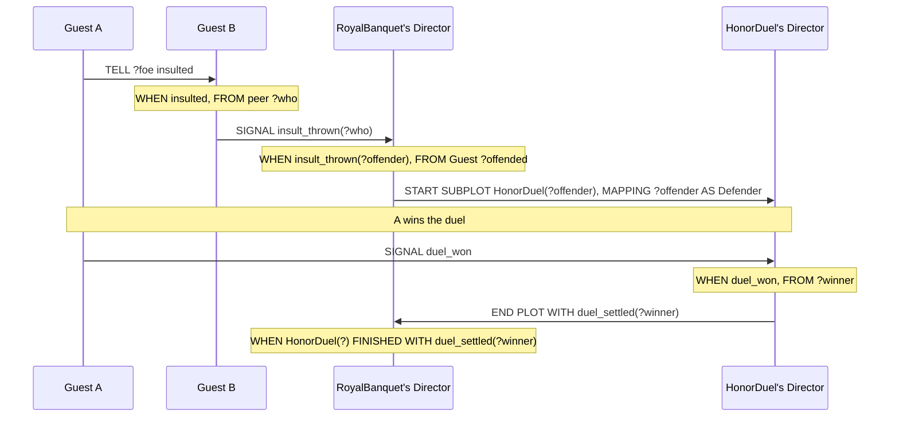

# Placeholders and Expressions

A Servant is asked to bring a dish. Which dish, to which seat and for whom can't be known when the Plan is written, since every Guest orders for itself. The Plan leaves blanks, and the Agent fills them when the request arrives. Such a blank is a Placeholder, written `?name`. Once a Plan has its values, it can calculate with them: halve a purse, take one off a duellist's stamina, roll a die. What it writes for that is an Expression.

| We write | It is | Filled |
|---|---|---|
| `?dish` | a Placeholder | by matching, in a Trigger, a Context or an `IF` |
| `?`, `?_who` | a blank nobody uses | by matching, and never read |
| `roast`, `3`, `-0.5`, `"…"`, `ME` | a Value | when the Plan is written |
| `?gold / 2`, `RANDOM(1, 6)`, `COUNT(…)` | an Expression | worked out where it stands |
| `LET ?stake BE <Expression>` | a Statement that fills a Placeholder | in the Body, in order |

This chapter covers where Placeholders are filled, which ones a Body may use, Numbers, the Expressions that calculate with them, and how a Body names a value it worked out. How the Vocabulary declares parameters and Names is in *Vocabulary and files*. What a Plan does when a blank could be filled in several ways is in *Matching*, and random choices have more room in *Randomness*.

## A blank in a Trigger

[`playbooks/serving.regia`](../showcase/playbooks/serving.regia)
```regia
TO bring(?dish, ?place), FROM patron ?guest:
    PURSUE fetch(?dish)                  # waits: if fetching fails, so does bringing
    DO walk_to(?place)
    DO put_down(?dish)
    TELL ?guest served(?dish)
```

`?dish` and `?place` sit in the slots of the Goal and are filled with what the request carried. `?guest` follows `FROM` and is filled with the Guest who asked. All three are filled when the Plan starts, by matching the Trigger against what arrived. The Body then uses them wherever it could have written a Value: as an argument of a Goal or an Action, in a Message, and for `?guest`, as its recipient.

- The `?` is written every time, where the blank is filled and where it is used. `DO put_down(dish)` would put down a Name called `dish`, and fail to build, since no `NAME dish` is declared.
- We choose the names. The Vocabulary declares `bring(dish, place)`, and the Plan could as well write `bring(?what, ?where)`: parameter names document the slots and bind nothing.
- Every use of an item has as many arguments as its declaration has parameters.
- Two Placeholders of one Plan can't differ only in case, and no Placeholder starts with `regia_` or holds `__`: those names are kept for what the Transpiler generates.

A Placeholder is not a programming variable:

- It is filled once per run of the Plan, by matching or by one `LET` (*Naming a value*, below), and keeps that value until the run ends. It is never reassigned.
- It is gone when the run ends. Anything an Agent has to remember, or that changes over time, is a Fact.
- It doesn't travel. `PURSUE fetch(?dish)` hands the value over as an argument, and `TO fetch(?dish):` fills a Placeholder of its own that happens to have the same name.

### A Value in a Trigger

[`playbooks/dining.regia`](../showcase/playbooks/dining.regia)
```regia
WHEN served(roast), FROM waiter:
    GIVEN sated:                         # full, but nobody turns away the roast
        DO eat(roast)
    # no ELSE: otherwise the roast is served like any dish, below

WHEN served(?dish), FROM waiter:
    GIVEN sated:
        DO push_away(?dish)
    ELSE:
        LEARN on_plate(?dish)
```

A Value in a Trigger slot has to match exactly, so it narrows the Plan to that value. The first Trigger Block is about the roast and nothing else; the second takes any dish. Both apply to a roast, and inside one Playbook the first in the text comes first, so the narrow one is written above the wide one (*Plans*, *Falling through*).

A Trigger slot holds a Value or a Placeholder, never an Expression. `WHEN wagered(?stake + 1):` is an error, since a Trigger only matches what arrived.

### `ME`

[`playbooks/noble_socializing.regia`](../showcase/playbooks/noble_socializing.regia)
```regia
WHEN scandal(ME), FROM peer ?speaker:
    SHIFT sympathy BY -0.2
    TELL 50% OF peer wronged(ME, ?speaker)
    PURSUE resent(?speaker)

# Gossip about someone else.
WHEN scandal(?victim), FROM peer ?speaker:
```

`ME` is a reserved Value: the Agent running the Plan. In the Trigger it narrows the Plan to gossip about this Guest, the way `roast` narrows `served`, and the general Plan follows. In `wronged(ME, ?speaker)` it is an argument.

- `ME` is filled in by the Agent that writes it. In a Message it travels as that Agent: the receiver of `wronged(ME, ?speaker)` reads the victim, not itself. At the receiver, `?victim = ME` holds exactly when `?victim` is the receiver.
- It goes wherever a Value goes in a Playbook: a Trigger slot, a Context, an `IF`, an argument, a comparison.
- It is never a recipient, and it is an error anywhere in a Plot, a Role setup included: a Director is not an Agent.
- A Role name is never a Value. `DO toast(host)` is an error. A Plan that needs the Agent playing a Role fills a Placeholder with it, `FROM host ?h` or `GIVEN ?h PLAYS host`, and uses `?h`.

**Checks**

- A use with a different number of arguments from the declaration → `R0301`
- A Role name used as a Value → `R0303` (hint: `FROM Role ?x`)
- `ME` in a Plot, a Role setup included → `R0309`; `ME` as a recipient → `R0704`
- An Expression in a Trigger slot → `R0402`
- A Name not declared with `NAME` → `R0310` (hint: the closest declared Name)
- Two Placeholders of one Plan that differ only in case → `R1007`; a Placeholder starting with `regia_` or holding `__` → `R1008`

Spec: chapter 03, *Declaring parameters*, *Values and Placeholders*, *`ME`*, *Values in a Trigger restrict it*. For the order of Trigger Blocks, chapter 13; for the reserved names, chapter 10.

## Blanks in a Context

[`playbooks/noble_socializing.regia`](../showcase/playbooks/noble_socializing.regia)
```regia
TO vent:
    GIVEN grudge(?foe, ?size) AND ?foe PLAYS peer, WEIGHT ?size:
        DO sneer_at(?foe)
        TELL ?foe insulted
        TELL EVERYONE scandal(?foe)
```

A Context fills Placeholders too, by matching its condition against what the Agent knows. Here `grudge(?foe, ?size)` fills both from one of the Guest's grudges, and `?foe PLAYS peer` tests the `?foe` it was just given.

A Placeholder written more than once in a Trigger and its Context stands for one value. Reading left to right, the first appearance fills it and every later one has to agree. Two conditions are joined this way: the Guest looks for a grudge against someone who is also at the table.

- A Match satisfies the whole Context. A first grudge against someone who has left the table doesn't stop the Guest finding a second one against someone still there.
- A Placeholder the Trigger filled is a fixed value in the Context. `TO resent(?who): IF grudge(?who, ?size):` asks about that one person and fills only `?size`.
- A comparison never fills. In `GIVEN stamina(?now) AND ?now > 1:` the Fact fills `?now` and the comparison tests it (*The Context tests, the Body fills*, below).
- With several Matches the Agent uses one, and the language doesn't say which. `, WEIGHT ?size` is a Pick that chooses at random, a big grudge more likely than a small one (*Matching*).

A Body can only use a Placeholder that was filled before it, in the Trigger, the Context, or a Statement above:

```regia
WHEN idle:
    DO sneer_at(?foe)                    # error: nothing filled ?foe
```

A Plot's parameters are Placeholders already filled, in every Plan and Role setup of the Plot, for the whole Staging. `PLOT HonorDuel(offender):` gives each of its Plans a `?offender`: a Plan that names it tests it, and none fills it again (*Subplots and Stagings*).

**Checks**

- A Placeholder used in the Body that was never filled, or used before the Statement that fills it → `R0304`
- A named Placeholder filled and never used → `R0307` (warning; hint: `?`)

Spec: chapter 03, *Where Placeholders are filled and used*, *Same name, same value*, *Matching a Context*. For Picks, chapter 26; for a Plot's parameters, chapter 17.

## The blank nobody uses: `?`

[`playbooks/serving.regia`](../showcase/playbooks/serving.regia)
```regia
WHEN bring(?dish, ?) FAILED WITH sold_out(?dish), FROM patron ?guest:
    TELL ?guest sold_out(?dish)          # the Reason, told back by hand
```

A bare `?` fills a slot without naming it. `bring` has two slots wherever it is written, and this Plan has no use for the second, the seat. `?dish` is written twice, so the Plan is for a `bring` that failed because that same dish was sold out.

- Every `?` stands alone. `COUNT(grudge(?, ?))` has two unrelated blanks.
- A `?` can't be read. In a Body it is an error: `FORGET on_plate(?)` doesn't mean "forget every dish" (*Matching* has `FOR EACH` for that).
- A named Placeholder that is filled and never used gets a warning whose hint is `?`.

A Placeholder counts as used when:

- the Body names it, as an argument, in an Expression, or as a recipient;
- it appears a second time in the Trigger or the Context, so it joins two conditions, even when the second appearance is under `NOT`;
- a Pick ranks or weighs by it: `HIGHEST ?p`, `LOWEST ?p`, `WEIGHT ?size`. A Pick needs a name, so `?` couldn't be written there;
- it appears only inside a `COUNT(…)`, where the name documents the slot.

One case is spared the warning, because `?` can't fix it: a Trigger Placeholder that only some of the `GIVEN` siblings use, or only the `ELSE`. The Trigger is written once for all of them. A Placeholder a `GIVEN` fills is checked against that `GIVEN`'s Plan alone.

### A blank with a name: `?_who`

[`playbooks/noble_socializing.regia`](../showcase/playbooks/noble_socializing.regia)
```regia
WHEN insulted, FROM peer ?who, SUITS aggressiveness AT 0.8, bravery AT 0.8:
    DO stand_up
    SIGNAL insult_thrown(?who)
```

```regia
# `?_who` names who we ignore, so that the three ways read alike.
WHEN insulted, FROM peer ?_who, SUITS sympathy AT 0.7, SHIFTS aggressiveness BY -0.1:
    DO laugh
```

A name starting with `_` is still a `?`. It says what is ignored and fills nothing the Plan can use. The Guest who laughs off an insult has no use for the speaker, but its Trigger keeps the shape of the two Plans next to it, which use theirs.

- Two `?_who` never join, even with the same name.
- A `?_name` never gets the "never used" warnings.
- It can't be read in a Body, like `?`.

**Checks**

- A `?` or a `?_name` in the Body → `R0306`
- A named Placeholder filled and never used → `R0307` (warning; hint: `?`)

Spec: chapter 03, *"Don't care": `?`*. For `COUNT` and Picks, chapter 26; for `GIVEN` siblings, chapter 06.

## Only what is certainly filled

[`playbooks/serving.regia`](../showcase/playbooks/serving.regia)
```regia
WHEN idle:
    GIVEN NOT PURSUING bring(?, ?):      # no order on our hands
        DO walk_to(kitchen)
```

A Body can use a Placeholder only if it is filled on every way the condition can hold. `NOT` never fills anything: it holds when nothing matches, so there is no value to hand on. The Servant asks whether it has any order at all, and `?` says so. `NOT PURSUING bring(?dish, ?place)` would get a warning for each name.

`OR` fills a Placeholder only when every side fills it:

```regia
GIVEN grudge(?foe, ?) OR wronged(?, ?foe):      # ?foe is filled either way
GIVEN grudge(?foe, ?) OR hungry:                # ?foe may be empty, so the Body can't use it
```

[`playbooks/keeping_watch.regia`](../showcase/playbooks/keeping_watch.regia)
```regia
WHEN scandal(?), FROM ?speaker:
    GIVEN on_duty AND (NOT seat(?) OR NOT hungry):   # standing guard, or seated and not thinking of food
        DO watch(?speaker)
```

Nothing in this condition has to reach the Body: the Trigger filled `?speaker`, and the blanks under `NOT` are `?`.

- A Placeholder the Trigger or Context already filled is simply tested under `NOT`. `TO resent(?who): GIVEN NOT grudge(?who, ?):` holds when there is no grudge against that one person.
- The rule holds wherever a Placeholder is read: an argument, a recipient, a Duration (`WAIT ?delay SECONDS`), a Weight, a comparison.
- An `IF` condition follows the same rule, and its Placeholders live in its branch only (*Plans*, *Placeholders in an `IF`*). A `FOR EACH` fills its Placeholders afresh in every round, and they are gone after the loop (*Matching*).

**Checks**

- A Placeholder used that is filled only under `NOT`, or in only some branches of an `OR` → `R0305` (the message names the branch)
- A named Placeholder that appears only under `NOT` → `R0308` (warning; hint: `?`)
- A Placeholder filled in an `IF` condition and used outside its branch → `R0604`
- A Placeholder filled by a `FOR EACH` used after its Block → `R2604`

Spec: chapter 03, *Only what is certainly filled can be used*. For `IF`, chapter 06; for `FOR EACH`, chapter 26.

## Numbers

[`banquet.regin`](../showcase/banquet.regin)
```regia
KIND hothead, LIKE noble:
    COUNT 2
    bravery AT 0.9
    sympathy AT -0.4
    aggressiveness AT RANDOM(0.6, 1)
    LEARN grudge(percival, 2)                # every hothead has a score to settle with Sir Percival
```

Regia has one kind of Number. `2` and `0.9` are the same kind, so `5 = 5.0` holds.

| We write | It means |
|---|---|
| `80` | eighty |
| `-0.4` | minus four tenths |
| `0.5` | one half |

- A decimal has a digit before the `.`: `0.5`, never `.5`. A `.` followed by a digit belongs to the number, so it never closes a Statement (*Syntax*).
- A `-` straight before a digit, where a Value starts, is part of the number: `SHIFTS sympathy BY -0.3`.
- There are no exponents (`1e3`), digit separators (`1_000`) or other bases (`0xFF`).
- How precise a decimal is depends on the Target. The language only promises that decimals exist.

The other written Value is a String, `"The feast is over, and the poisoner was never found."`. Strings are for `PRINT` and arguments; nothing calculates with them.

**Checks**

- A number in a form Regia doesn't have: `.5`, an exponent, digit separators, another base → `R0401`

Spec: chapter 04, *Numbers*. For Strings, chapter 03.

## Expressions

[`plots/royal_banquet.regia`](../showcase/plots/royal_banquet.regia)
```regia
WHEN finished_eating, FROM Guest ?g:
    LEARN finished(?g)
    IF COUNT(finished(?)) * 4 >= COUNT(? PLAYS Guest) * 3:     # three Guests in four
        ENTER farewell
```

An Expression is anything that works out to a Value: a Value, a filled Placeholder, `RANDOM(…)`, `COUNT(…)`, or these joined by operators. The Director counts the Guests who have finished, and moves to farewell once three in four have.

| We write | It means | Works on |
|---|---|---|
| `+` `-` `*` `/` | add, subtract, multiply, divide; `-?x` negates | Numbers |
| `( … )` | grouping | |
| `=` `!=` | equal, not equal | any Values |
| `<` `>` `<=` `>=` | less, greater, or equal | Numbers |
| `COUNT(<condition>)` | the number of distinct Matches, right now | |
| `RANDOM(a, b)` | a random Number from `a` to `b` (next section) | Numbers |

From tightest to loosest: `*` and `/`, then `+` and `-`, then comparisons, then `NOT`, `AND` and `OR`. `NOT ?now - 1 = 0` means `NOT ((?now - 1) = 0)`.

- `/` gives a decimal when the result isn't whole: `7 / 2` is `3.5`. There is no remainder and no whole-number division. `%` is never a remainder: it writes a share of a Role, `50% OF peer` (*Playbooks and Roles*).
- `=` only ever compares. It never fills a Placeholder (*Naming a value*, below). `?dish != roast` is the same test as `NOT ?dish = roast`, and the tools write `!=`.
- Comparisons don't chain. `0 < ?h < 20` is an error whose hint is `0 < ?h AND ?h < 20`.
- Spaces around operators are optional: `?h-10` is `?h - 10`, since names never hold `-`.
- Arithmetic is for Numbers only. There is no `+` for Strings; `PRINT` joins its arguments with spaces (*Actions and time*).
- `COUNT(? PLAYS Guest)` counts a Role's Agents. A Director's `COUNT` reads only its own Facts, never an Agent's (*Matching*).

An Expression can stand in most places a Value can:

| Place | In the showcase |
|---|---|
| a Body argument | `UPDATE stamina(?now) TO stamina(?now - 1)` (*duelling*) |
| after `BE` in a `LET` | `LET ?grudges BE COUNT(grudge(?foe, ?) AND ?foe PLAYS peer)` (*noble_socializing*) |
| either side of a comparison, in a Context or an `IF` | `GIVEN purse(?gold) AND ?gold >= 2:` (*wagering*) |
| a Duration | `WAIT RANDOM(1, 3) SECONDS` (*duelling*) |
| a Weight | `OPTION, WEIGHT ?grudges: PURSUE vent` (*noble_socializing*) |
| the count of a recipient | `TELL 50% OF peer wronged(ME, ?speaker)` (*noble_socializing*) |
| an argument in a Role setup | `LEARN purse(RANDOM(5, 20))` (*royal_banquet*) |

It never stands in a Trigger slot, which matches what arrived, or in a declaration, which holds parameter names. To compare a Fact's number, match the Fact and compare the Placeholder: `GIVEN stamina(?now) AND ?now > 1:`.

**Checks**

- An Expression in a Trigger slot → `R0402`
- A chained comparison, `0 < ?h < 20` or `?a = ?b != ?c` → `R0403` (hint: `AND`)
- Arithmetic, or `<` `>` `<=` `>=`, on something the source shows isn't a Number (`roast + 1`, `"hi" < 3`) → `R0406`
- `%` anywhere but before `OF` → `R1517`

Spec: chapter 04, *Expressions*, *Where Expressions can appear*. For `COUNT`, chapter 26; for Durations, chapter 12; for Weights, chapter 09; for counted recipients, chapter 15.

## Random numbers

[`playbooks/wagering.regia`](../showcase/playbooks/wagering.regia)
```regia
WHEN duel_on, FROM DIRECTOR:
    GIVEN purse(?gold) AND ?gold >= 2:
        LET ?stake BE RANDOM(1, ?gold / 2)   # a whole roll, up to half the purse
        UPDATE purse(?gold) TO purse(?gold - ?stake)
        SIGNAL wagered(?stake)
        DO cheer
    ELSE:
        DO cheer
```

`RANDOM(a, b)` gives a random Number from `a` to `b`, both included. Whether it is whole or decimal is decided by how the bounds are written, never by what they work out to:

| The bounds | The roll | In the showcase |
|---|---|---|
| either is a decimal written out, `3.0` or `-0.5` | a decimal | `aggressiveness AT RANDOM(-0.4, 0.4)` (*banquet.regin*) |
| anything else | whole | `RANDOM(1, ?gold / 2)`, `RANDOM(5, 20)`, `RANDOM(1, 3)` |

So `RANDOM(1, ?gold / 2)` is a whole roll whatever `?gold` holds. With 13 coins its range is 1 to 6.5, and it gives 1 to 6. This is the only place a roll rounds a Number.

- Bounds in either order mean the same range: `RANDOM(6, 1)` is `RANDOM(1, 6)`.
- A whole roll with no whole number between its bounds has nothing to give. With one coin, `RANDOM(1, ?gold / 2)` runs from 1 to 0.5. In a Body that fails the Plan; in a condition the comparison holding it is false. The Spectator's `?gold >= 2` is the guard that keeps the roll in range.
- Every `RANDOM(…)` is a fresh roll. The Spectator names its roll with `LET` because it uses it twice: once to lower the purse and once to tell the Director. Two `RANDOM`s would be two different stakes.
- A roll can stand in a condition, for a Plan that applies only some of the time, and is never stored there: `IF RANDOM(1, 100) <= 30:` in `NobleSocializing` laughs three times in ten.
- A roll in a Role setup is made once per Agent: `LEARN purse(RANDOM(5, 20))` gives every Guest its own purse.
- A starting Propensity value in Instancing is always a decimal roll, whatever its bounds look like: `sympathy AT RANDOM(0, 0.8)` (*Instancing*).

Which rolls a seed covers is in *Randomness*.

**Checks**

- A whole roll with no whole number between its bounds, in a Body → `T0403` (Trace, Failure)

Spec: chapter 04, *Random numbers*. For the setup's rolls, chapter 16; for Propensity rolls and the seed, chapter 21.

## The Context tests, the Body fills

A Context or an `IF` only tests. Both sides of a comparison have to be filled already, and the comparison fills nothing:

```regia
WHEN duel_on, FROM DIRECTOR:
    GIVEN purse(?gold) AND ?half = ?gold / 2:     # error: ?half is not filled
```

A value worked out from others is named in the Body.

### Naming a value: `LET`

[`playbooks/noble_socializing.regia`](../showcase/playbooks/noble_socializing.regia)
```regia
# Small talk. The more grudges we hold against those at the table, the likelier we vent one.
WHEN idle:
    LET ?grudges BE COUNT(grudge(?foe, ?) AND ?foe PLAYS peer)
    RANDOMLY:
        OPTION, WEIGHT 3: DO chat
        OPTION, WEIGHT 2:
            DO sip_wine
            IF RANDOM(1, 100) <= 30:     # one cup too many
                DO laugh
        OPTION, WEIGHT ?grudges: PURSUE vent
        OPTION, WEIGHT 5: PASS           # nothing, this time
```

`LET ?name BE <Expression>` is a Statement of the Body. It fills `?name` with what the Expression works out to, and from then on `?name` is a Placeholder like any other: filled once, never reassigned, gone when the run ends. Here the Guest counts the grudges it holds against Guests at the table and uses the count as a Weight. `?foe` lives inside the `COUNT` only.

- `LET` on a Placeholder already filled is an error, not a reassignment. `LET ?gold BE ?gold - ?stake` doesn't lower `?gold`; a new name does: `LET ?left BE ?gold - ?stake`.
- `LET` goes only in a Body, as a Statement of its own. A one-line Option holds one: `OPTION: LET ?stake BE 1`. In a Context or an `IF` condition it is an error.
- Order counts. A `LET` Placeholder can be used by the Statements below it, not above.
- `?x = e` as a Statement is the retired spelling. It is an error whose hint is `LET ?x BE e`.
- An Expression used once needs no `LET`: `UPDATE purse(?gold) TO purse(?gold - ?stake)` calculates in place.

### `LET` in branches

A Placeholder filled inside an `IF` branch can be used after the `IF` only if every branch fills it, as with `OR` in a condition:

```regia
WHEN duel_on, FROM DIRECTOR:
    GIVEN purse(?gold):
        IF ?gold >= 10:
            LET ?stake BE RANDOM(5, 10)
        ELSE:
            LET ?stake BE 1
        SIGNAL wagered(?stake)       # every branch filled ?stake
```

- Without the `ELSE`, or with a branch that doesn't fill `?stake`, the `SIGNAL` is an error.
- Sibling branches may each fill the same name, since only one of them runs.
- The Options of a `RANDOMLY` follow the same rule: a Placeholder filled in every Option outlives the choice. An Option holding only `PASS` fills nothing, so in `WHEN idle` above nothing an Option fills could outlive it (*Randomness*).
- A Placeholder filled in an `IF` *condition*, not by a `LET` in its branch, never outlives the branch (*Plans*).

### What lasts is a Fact

After the `UPDATE`, `?gold` still holds the old amount. When the run ends `?gold` and `?stake` are gone, and the purse lasts because it is a Fact, `purse(…)`, which the next duel matches again. A value that has to outlive a Plan run is learned as a Fact and read back by matching.

**Checks**

- A comparison in a Context or an `IF` with a side that isn't filled yet → `R0404`
- `LET` on a Placeholder already filled → `R0405` (hint: a new name)
- `?x = e` as a Body Statement → `R0407` (hint: `LET ?x BE e`)
- `LET` in a Context or an `IF` condition → `R0408`
- A Placeholder filled in some branches or Options but not all, used after them → `R0305`

Spec: chapter 04, *The Context tests, the Body fills*. For Options, chapter 09; for `IF` branches, chapter 06.

## When a Number isn't a Number

Slots have no types, so a Placeholder can hold a Name where a Number was meant. Nothing stops a Plan from learning `purse(roast)`.

- The Transpiler reports every misuse it can see in the source: `roast + 1`, `"hi" < 3`.
- At runtime, in a condition, a comparison that needs Numbers and doesn't get them is false. A Spectator whose purse holds `roast` fails `?gold >= 2`, takes the `ELSE`, and cheers without betting.
- At runtime, in a Body, arithmetic on something that isn't a Number fails the Plan, and so does a division by zero. A Weight or a Duration that isn't a Number fails it too.

What failing does is in *Goals and Failure*.

**Checks**

- Arithmetic or an ordering comparison on what the source shows isn't a Number → `R0406`
- Body arithmetic on something that isn't a Number → `T0401` (Trace, Failure)
- A division by zero → `T0402` (Trace, Failure)

Spec: chapter 04, *When a Number isn't a Number*. For what a Failure does, chapter 11.

## How this combines with…

### Messages

Regia never names an Agent, so the only way to reach one particular Agent is a Placeholder that holds it. `?guest` in `Serving` comes from `FROM`; `?foe` in `TO vent` comes from a slot of a Fact. Nothing checks that a slot meant for a person holds one: a grudge against `roast` fails `TO vent` at `TELL ?foe insulted`. (*Messages*)

### Matching

When a condition has several Matches, its Placeholders could be filled in several ways, and the language doesn't say which is used. A Pick chooses by a Placeholder the same condition fills: `LOWEST ?size` in `Scheming`. Placeholders inside `COUNT(…)` never leave it, and those of `FOR EACH` are filled afresh in every round. (*Matching*)

### Randomness

A Weight is an Expression, worked out when the Body reaches `RANDOMLY`, before the roll. `?grudges` decides how likely `PURSUE vent` is, and a Weight of 0 means never. (*Randomness*)

### Goals and Failure

When a Goal fails, its arguments are all an ending Trigger gets back: `WHEN bring(?dish, ?) FAILED, FROM patron ?guest:` fills `?dish` from the Goal and `?guest` from its Sender. Whatever the failed recipe had named with `LET` is gone with its run. (*Goals and Failure*)

### Plots and Directors

A Director fills Placeholders with Agents in the same ways, and does more with them: maps them onto a Role, gives them a Playbook. A Role setup is a Block with no Placeholders but the Plot's parameters: nothing is matched there, so its slots take Values and Expressions.

The Guest who throws an insult is held by a Placeholder at every step of the evening, and the source never names it:



(*Plots and Directors*, *Subplots and Stagings*)

### Jason: Plans and Goals

A Placeholder becomes a Jason variable with its first letter uppercased, `?speaker` → `Speaker`. Jason binds a variable once for the rest of a plan, which is the rule for a Placeholder already, so nothing is renamed. `LET ?x BE e` becomes `X = e`, and `!=` becomes `\==`. (*Jason: Plans and Goals*)
