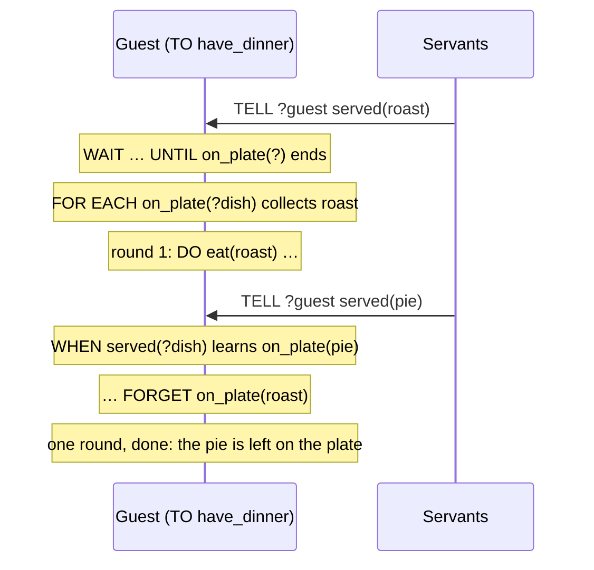

# Matching

A Guest who holds three grudges satisfies `grudge(?foe, ?size)` three times, once per grudge. Each of those ways is a Match: a Value for every blank of the condition, named Placeholders and `?` alike. Most Plans don't care which Match they get. When a Plan does care, it says so, in one of four ways:

| We write | The Plan uses | Where |
|---|---|---|
| a plain condition | one Match, and the language doesn't say which | a Context, an `IF` |
| a Pick: `, RANDOMLY`, `, HIGHEST ?p`, `, LOWEST ?p`, `, WEIGHT <Expression>` | one Match, chosen as the Pick says | a Context, an `IF`, an `ELSE IF` |
| `FOR EACH <condition>:` | every Match, one round of a Block each | a Body |
| `COUNT(<condition>)` | the number of Matches | wherever an Expression goes |

How conditions are written is in *Plans*, and how they fill Placeholders is in *Placeholders and Expressions*. Random choice between Blocks, as opposed to between Matches, is in *Randomness*.

## One Match, and we don't say which

[`playbooks/noble_socializing.regia`](../showcase/playbooks/noble_socializing.regia)
```regia
WHEN scandal(?victim), FROM peer ?speaker:
    GIVEN grudge(?victim, ?):
        DO snigger
    GIVEN grudge(?speaker, ?), SHIFTS sympathy BY -0.1:
        DO roll_eyes
    # no ELSE: gossip about strangers falls through to the next Playbook
```

A Guest who resents the victim sniggers. `?` stands for the size of the grudge, which the Plan doesn't need. If the Guest held two grudges against the victim, `grudge(?victim, ?)` would have two Matches, one per size, and the Agent would use one of them. Nothing in the Body depends on which, so the Plan doesn't need to say.

- With several Matches, a plain condition uses one, and the language doesn't say which. A Plan must not rely on any order, even where a Target always gives the same answer. Jason does, and Regia doesn't promise it.
- A Match satisfies the whole condition, not one Fact in it. In `grudge(?foe, ?size) AND ?foe PLAYS peer` a Match is a grudge together with the peer it names.
- Matches are distinct. Two branches of an `OR` that produce the same Values are one Match.
- The open choice is deliberate. A plain condition costs what the Target's own test costs, and choosing a Match is written down only where it matters.

The default is unsafe only when the Body uses what was filled and several Matches can exist. `Duelling` keeps a single `stamina` Fact, and its Plans lean on that:

[`playbooks/duelling.regia`](../showcase/playbooks/duelling.regia)
```regia
WHEN hit, FROM opponent, SHIFTS aggressiveness BY 0.1:
    GIVEN stamina(?now) AND ?now > 1:
        UPDATE stamina(?now) TO stamina(?now - 1)
    GIVEN stamina(?now):
        FORGET stamina(?now)
        DO drop_sword
        TELL opponent yielded
    # no ELSE: a hit after we have yielded changes nothing
```

```regia
WHEN REMOVED:
    FOR EACH stamina(?left): FORGET stamina(?left)
```

`TO fight` learns `stamina(3)` and every hit updates it, so one duel never holds two. `WHEN REMOVED` forgets whatever is left when the duel takes `Duelling` away, and the next duel starts from a clean slate. Without it, a knight in its second duel would have two `stamina` Facts, and which one a hit wears down would be left open.

**Checks**

- Several possible Matches under a plain condition → nothing (legal, and silent)

Spec: chapter 26, *Matches*, *The default: one Match, unspecified*. For matching a condition, chapter 03.

## Picks

[`plots/honor_duel.regia`](../showcase/plots/honor_duel.regia)
```regia
AFTER 20 SECONDS:                    # betting closes
    GIVEN wager(?backer, ?stake), HIGHEST ?stake, RANDOMLY:
        ASK ?backer TO give_signal
    ELSE:
        ENTER fighting               # nobody bet: no handkerchief to wait for
```

When betting closes, the duel's Director asks the biggest backer to drop the handkerchief. `HIGHEST ?stake` keeps the Match with the largest stake. Two Spectators may have bet the same amount, so `RANDOMLY` breaks the tie. With no wager at all there is no Match, and the `ELSE` starts the fight.

A Pick is a trailing clause on a condition's header that chooses which Match the Plan uses:

| We write | The Plan uses |
|---|---|
| `, RANDOMLY` | one Match, each equally likely |
| `, HIGHEST ?p` | the Match with the largest `?p`; a tie is left open |
| `, LOWEST ?p` | the Match with the smallest `?p`; a tie is left open |
| `, HIGHEST ?p, RANDOMLY` or `, LOWEST ?p, RANDOMLY` | the largest or smallest, ties broken at random |
| `, WEIGHT <Expression>` | one Match at random, each as likely as its Weight (*A weighted Pick*, below) |

The Poisoner uses a bare `LOWEST`:

[`playbooks/scheming.regia`](../showcase/playbooks/scheming.regia)
```regia
# The cup of the Guest we resent least: nobody would suspect us.
WHEN idle:
    GIVEN NOT poured AND grudge(?mark, ?size), LOWEST ?size:
        DO pour_poison(?mark), WITHOUT WAITING    # we don't stand there while it dissolves
        LEARN poured
        DO slip_away
    # no ELSE: once the poison is poured, idle falls through to small talk
```

Two Guests resented equally little are a tie, and the language doesn't say which one's cup is poisoned. Leaving it open is allowed and gets no warning: a writer may know no two values can be equal, or not care.

- A Pick chooses among the Matches of the whole condition. In `Scheming` it ranks the grudges that come with `NOT poured`, and `NOT` fills nothing.
- A Pick changes whether the condition holds only when it leaves no Match to use: no ranked value is a Number (below), or every Weight is 0 (*A weighted Pick*). Otherwise the condition holds when it has at least one Match, and the first `GIVEN` that holds wins among its siblings, as without a Pick (*Plans*).
- The clauses come in any order, and mix with a `SHIFTS` Label on a `GIVEN`: `GIVEN grudge(?foe, ?size), HIGHEST ?size, SHIFTS anger BY 0.1:`.
- `HIGHEST` and `LOWEST` together are an error, and so is a clause written twice.

### The ranked Placeholder

`HIGHEST ?p` and `LOWEST ?p` rank by a named Placeholder, and it has rules of its own:

- It is filled by the same condition. A Trigger Placeholder, or one filled earlier in the Body, has the same value in every Match, so there is nothing to rank. `HIGHEST ?victim` under `WHEN scandal(?victim)` is an error.
- A Match whose `?p` isn't a Number is skipped, as a comparison with a non-Number is false. If no Match is left, the condition doesn't hold: a `GIVEN` doesn't apply, and an `IF` goes on to its `ELSE IF` or `ELSE`.
- One Placeholder per Pick. Ranking by a second value, to break ties by something other than chance, isn't in the language.
- Ranking by `?p` uses it. A `?p` named only in the condition and the Pick gets no "never used" warning.

**Checks**

- `HIGHEST` with `LOWEST`, or a Pick clause written twice → `R2601`
- A ranked Placeholder not filled by the same condition → `R2602`
- `, AT RANDOM` → `R2606` (hint: `, RANDOMLY`)

Spec: chapter 26, *Picks*, *The ranked Placeholder*. For a comparison with a non-Number, chapter 04; for sibling `GIVEN`s, chapter 06.

## A weighted Pick

[`playbooks/noble_socializing.regia`](../showcase/playbooks/noble_socializing.regia)
```regia
# We insult someone we resent who is at the table: the bigger the grudge, the likelier.
TO vent:
    GIVEN grudge(?foe, ?size) AND ?foe PLAYS peer, WEIGHT ?size:
        DO sneer_at(?foe)
        TELL ?foe insulted
        TELL EVERYONE scandal(?foe)
```

`, WEIGHT <Expression>` picks one Match at random, each as likely as its Weight compared with the sum of all the Weights. A Guest with grudges of size 3 and 1 against two peers insults the first three times in four. These are the Weights of a Random choice, with Matches in the place of Options (*Randomness*).

- The Weight is worked out once per Match, with the Placeholders the condition fills in that Match. A certainly-filled Placeholder from before the condition is a fixed value in it. `WEIGHT ?size * 2` and `WEIGHT 10 - ?distance` are both fine.
- It stands alone. Beside `HIGHEST`, `LOWEST` or `RANDOMLY` it is an error: it is already random, and it ranks nothing.
- It mixes with Labels like the other Picks: `GIVEN grudge(?foe, ?size), WEIGHT ?size, SHIFTS anger BY 0.1:`.
- A Weight is a plain Number, never a share: `WEIGHT 30%` is an error.
- Naming a Placeholder in a Weight uses it, as ranking by it does.

What goes wrong with a Weight follows Random choice:

| The Weights are | What happens |
|---|---|
| some negative | each counts as 0 |
| all 0 or less | the condition has no Match: a `GIVEN` doesn't apply, an `IF` goes on to its `ELSE IF` or `ELSE`. The Trace writes an entry, not a warning |
| one not a Number, on a `GIVEN` | that Match is left out |
| one not a Number, on an `IF` or `ELSE IF` | the Plan fails |

With no Match, `TO vent` has no `ELSE` to fall back on, and the Goal fails. A Guest whose grudges are all against Agents who aren't at the table never gets that far: the `idle` Plan that pursues `vent` counts the same condition, and gives it a Weight of 0 (*`COUNT`*, below).

**Checks**

- `WEIGHT` with `HIGHEST`, `LOWEST` or `RANDOMLY` → `R2601`
- A Weight using a Placeholder neither filled by the condition nor certainly filled before it → `R2605`
- `WEIGHT 30%` → `R1517`
- Every Match weighs 0 or less → `T2601` (Trace entry)
- A Weight that isn't a Number on a Body `IF` or `ELSE IF` → `T0901` (Trace, Failure)

Spec: chapter 26, *A weighted Pick*. For Weights, chapter 09; for `%`, chapter 15.

## Where Picks are allowed

A Pick goes on a `GIVEN`, an `IF` or an `ELSE IF`, after the condition. Everywhere else it is an error:

```regia
FOR EACH craves(?dish), RANDOMLY:            # error: FOR EACH uses every Match
WHEN wagered(?stake), HIGHEST ?stake:        # error: a Trigger matches one Message
LET ?n BE COUNT(grudge(?, ?size), LOWEST ?size)   # error: COUNT counts every Match
ELSE, RANDOMLY:                              # error: ELSE has no condition
```

A Trigger matches one Cue, one Fact change or one Goal, so it never has a choice to make. Its Placeholders are filled once, by what arrived.

**Checks**

- A Pick, `WEIGHT` included, on `FOR EACH`, a Trigger, `COUNT(…)` or `ELSE` → `R2603`

Spec: chapter 26, *Where Picks are allowed*.

## `FOR EACH`

[`playbooks/dining.regia`](../showcase/playbooks/dining.regia)
```regia
TO have_dinner:
    GIVEN seat(?place):
        FOR EACH craves(?dish):
            ASK 1 OF waiter TO bring(?dish, ?place)
        WAIT 1 MINUTE, UNTIL on_plate(?)
        IF NOT on_plate(?):
            FAIL WITH no_food
        FOR EACH on_plate(?dish):
            DO eat(?dish)
            FORGET on_plate(?dish)
    # no ELSE: hungry with no seat, have_dinner fails at once
```

`FOR EACH <condition>:` is a Statement of the Body. Its Block runs once for every Match, then the Body carries on after it. The first `FOR EACH` sends one order per dish the Guest craves; the second eats whatever is on the plate.

- The rounds run in no specified order.
- The Matches are collected once, when the Body reaches the `FOR EACH`. Nothing the Block does adds a round or takes one away, and a round runs with its Match even if that Fact is gone by then: forgotten in an earlier round, or changed while a round waited. A Block that needs to know uses an `IF` inside it.
- No Matches: the Block doesn't run, and the Body carries on. That isn't a Failure.
- A Failure in any round fails the Plan, and the rounds left don't run.
- The condition can use certainly-filled Placeholders from before it, as fixed values: `?place` above. What the condition fills, and anything filled inside the Block, lives in the Block only, as in an `IF` branch. Each round fills it afresh.
- The Block can hold any Statement: `WAIT`, a waiting `PURSUE`, `IF`, `RANDOMLY`, another `FOR EACH`.
- The condition is written like any other, with `AND`, `OR`, `NOT`, comparisons and `PLAYS`.

The snapshot matters in the second `FOR EACH`. The `WAIT` ends as soon as the first dish is on the plate, and `DO eat(?dish)` waits for the game. A dish served while the Guest eats is learned by `WHEN served(?dish)`, but the `FOR EACH` already has its list, and that dish stays on the plate:



Regia has no other loop. Repeating "until the plate is empty" is a recipe that pursues its own Goal again, or a Plan on `on_plate(?) LEARNED` (*Plans*, *Loops*).

### Forgetting everything that matches

A Basic Action holds no blank, so `FORGET wager(?who, ?)` is an error. Changing every Match is a `FOR EACH`:

[`plots/honor_duel.regia`](../showcase/plots/honor_duel.regia)
```regia
WHEN Spectator ?who LEFT:
    FOR EACH wager(?who, ?stake): FORGET wager(?who, ?stake)
```

A Spectator who walks out of the hall can't drop the handkerchief, so the duel's Director forgets its wagers before betting closes. `?who` comes from the Trigger and is fixed in every round; `?stake` is filled afresh. A Block of one Statement can stay on the header's line.

- Each `FORGET` is its own change, and fires its own `FORGOTTEN` Triggers. `FOR EACH … DROP` drops one Pursuit per round, each with its own `DROPPED`.
- `FOR EACH` works in a Director, over the Director's own Facts, as here.

**Checks**

- A blank in a Basic Action → `R0801` (for `FORGET`, the hint suggests `FOR EACH`)
- A Placeholder filled by a `FOR EACH` condition or inside its Block, used after the Block → `R2604`
- A Pick on `FOR EACH` → `R2603`

Spec: chapter 26, *`FOR EACH`*, *Forgetting everything that matches*. For blanks in Basic Actions, chapter 08; for `IF` branches, chapter 06.

## `COUNT`

[`plots/royal_banquet.regia`](../showcase/plots/royal_banquet.regia)
```regia
WHEN took_seat, FROM Guest ?g:
    LEARN seated(?g)
    IF COUNT(seated(?)) >= COUNT(? PLAYS Guest):
        ENTER reception
```

`COUNT(<condition>)` is a Number: how many distinct Matches the condition has, right now. The Director learns a `seated` Fact from each Guest's Signal and moves on once the count reaches the Guests still in the Plot.

- It is an Expression, and goes wherever one goes: a comparison in a Context or an `IF`, after `BE` in a `LET`, a Weight, an argument, arithmetic (`COUNT(finished(?)) * 4 >= COUNT(? PLAYS Guest) * 3`).
- Every blank counts, `?` included. `COUNT(grudge(?, ?))` counts `grudge` Facts, so a foe resented for two reasons would count twice; `COUNT(grudge(?foe, ?))` is the same number.
- A condition with no blanks counts 1 or 0: `COUNT(sated)`.
- Placeholders filled inside `COUNT(…)` are never filled outside it. A certainly-filled Placeholder from outside is a fixed value inside. A name used only inside a `COUNT` gets no "never used" warning: it documents the slot.
- `n OF` is not a condition. There is no `GIVEN 3 OF …`; we write `GIVEN COUNT(…) >= 3`.

The Guests count too, and use the number as a Weight:

[`playbooks/noble_socializing.regia`](../showcase/playbooks/noble_socializing.regia)
```regia
WHEN idle:
    LET ?grudges BE COUNT(grudge(?foe, ?) AND ?foe PLAYS peer)
    RANDOMLY:
        OPTION, WEIGHT 3: DO chat
        OPTION, WEIGHT 2:
            DO sip_wine
            IF RANDOM(1, 100) <= 30:     # one cup too many
                DO laugh
        OPTION, WEIGHT ?grudges: PURSUE vent
        OPTION, WEIGHT 5: PASS           # nothing, this time
```

The more peers the Guest resents, the likelier it vents. A peer reached through two Givings of `NobleSocializing` is still one Match, and counts once. `?foe` lives inside the `COUNT` only.

### Counting who plays a Role

`COUNT(? PLAYS Guest)` in a Plot counts the Agents playing a Role of the Plot, in this Staging. `COUNT(? PLAYS waiter)` in a Playbook counts those the Playbook's Role reaches. Unlike a recipient, a test doesn't leave the Agent itself out: a Servant counting `? PLAYS waiter` counts itself if it plays `waiter`.

A Director counts only its own Facts, never an Agent's. That is why `RoyalBanquet` keeps `seated` and `finished` of its own, learned from Signals. Its other conditions count the same way: `COUNT(HonorDuel(?) RUNNING)` is the number of duels this Staging started that are still running, one per distinct argument, and `IN feast` holds or doesn't, 1 or 0.

> **In 2.0** a Quota Trigger fires when enough of a Role have sent a Cue, `WHEN took_seat, FROM ALL Guest:`, and keeps the count itself, including Agents who leave. Spec chapter 18, *The form* and *Counting*. In 1.5 `RoyalBanquet` counts by hand with `COUNT`, its own Facts and a `LEFT` Plan that forgets the leaver and counts again.

**Checks**

- A Pick inside `COUNT(…)` → `R2603`
- A Placeholder filled inside `COUNT(…)` used outside it → `R0304`
- `n OF` in a Context (`GIVEN 3 OF …`) → `R2607` (hint: `COUNT(…) >= n`)
- `FROM ALL Guest` or any other quantity after `FROM` or `BY`, in a 1.5 build → `R0109`

Spec: chapter 26, *`COUNT`*. For Expressions, chapter 04; for `PLAYS`, chapter 15; for `RUNNING`, chapter 17; for a Director's conditions, chapter 20.

## How this combines with…

### Plans

A Pick runs after the condition holds, and doesn't change which sibling `GIVEN` wins. A `FOR EACH` round is a Body like any other, so a Fact that matters after a `WAIT` is tested again with `IF`, as `TO strike` does in `Duelling`. (*Plans*)

### Placeholders and Expressions

A Pick, a Weight and a `COUNT` all count as using the Placeholders they name. Placeholders filled by `FOR EACH` or inside `COUNT(…)` don't outlive them, and a Body can use only what is certainly filled. (*Placeholders and Expressions*)

### Randomness

A weighted Pick and a Random choice share their Weights and their rules for wrong ones, and every random Pick draws from the seeded source, like every other roll. In `NobleSocializing` the two meet: `WEIGHT ?grudges` decides whether to vent, and `WEIGHT ?size` whom at. (*Randomness*)

### Precedence and Labels

Pick clauses and Labels share the header and its commas, in any order. A Pick is read only once the Plan has been chosen, by text order, Suits or `PRECEDENCE`. (*Precedence and Labels*)

### Goals and Failure

A Failure in one round of a `FOR EACH` fails the whole Plan, and nothing the earlier rounds did is undone: orders already sent stay sent. A weighted Pick whose Weights all come to 0 fails a recipe with no `ELSE`. (*Goals and Failure*)

### Plots and Directors

A Director's Picks, `FOR EACH` and `COUNT` run over its own Facts. It can't read an Agent's purse, so `HonorDuel` has the Spectators Signal their stakes, keeps them as `wager` Facts, and picks among those. (*Plots and Directors*)

### When an Agent leaves

A count of `? PLAYS Guest` drops as soon as a Guest leaves, but Facts the Director learned about it stay. `RoyalBanquet` forgets the leaver's `seated` and `finished` in its `LEFT` Plan and counts again, and `HonorDuel` forgets the leaver's wagers with a `FOR EACH`. (*When an Agent leaves*)

### Jason: Plans and Goals

A Pick, a `FOR EACH` and a `COUNT` each collect the distinct Matches into a list with `.setof`, so they cost time linear in the matching Facts every time they are checked. A plain condition doesn't. Random Picks draw from `regia.random` and `regia.weighted_pick`, and `FOR EACH` is Jason's `for` over the snapshot. (*Jason: Plans and Goals*)
