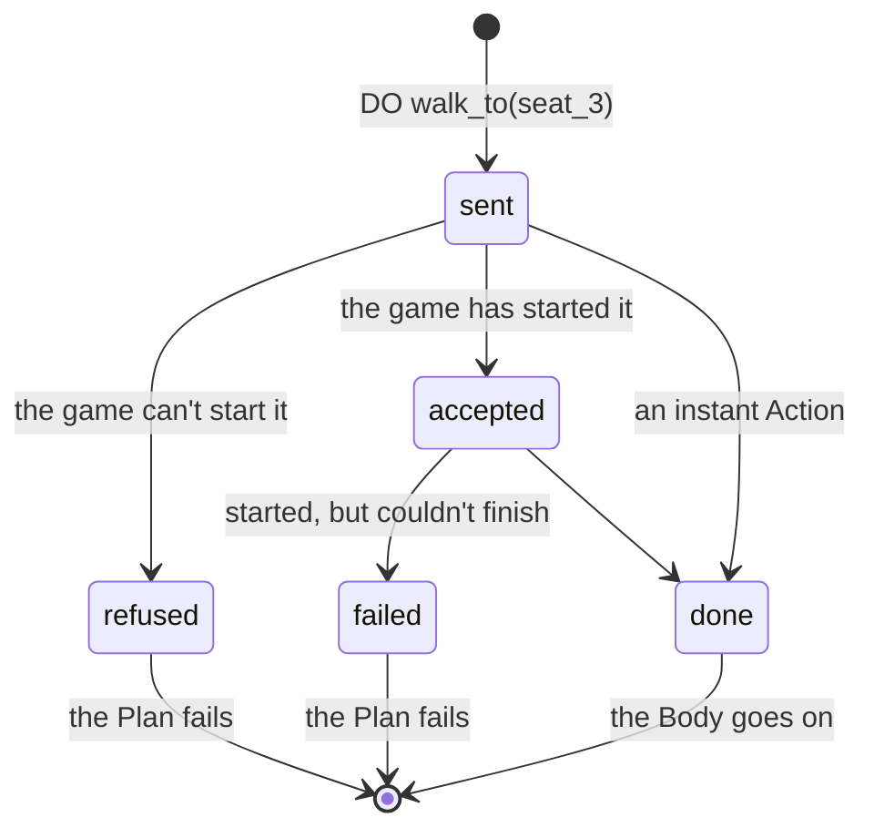
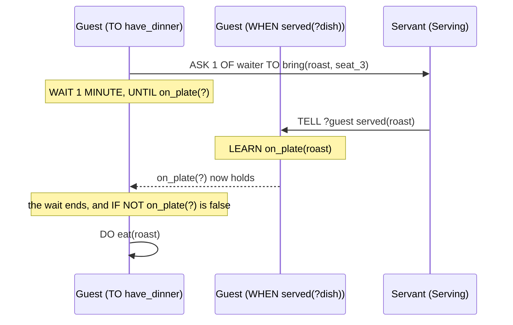

# Actions and time

A Guest at the table has been served the roast. It adds `on_plate(roast)` to what it knows, eats, and forgets the plate again. Learning and forgetting are things an Agent does to itself, so Regia has words for them. Eating is something the game does, so the Agent asks the game to do it with `DO`, and waits until the game says it's done. Everything a Body does is a Statement, and most Statements are Actions:

| We write | It does | Here or in |
|---|---|---|
| `LEARN f`, `FORGET f`, `UPDATE f TO f2` | changes the Agent's own Facts | here |
| `PURSUE g`, `PURSUE g, WITHOUT WAITING`, `DROP g` | starts or stops a Goal | here, briefly; in full in *Goals and Failure* |
| `DO a`, `DO a, WITHOUT WAITING` | asks the game, or the Target's own code, to do something | here |
| `PRINT(e1, e2, …)` | prints, for debugging | here |
| `WAIT d`, `WAIT d, UNTIL c`, `WAIT UNTIL c` | pauses the Body | here |
| `TELL`, `ASK … TO`, `SIGNAL` | sends a Message | *Messages* |
| `FAIL`, `FAIL WITH r` | fails the Plan | *Goals and Failure* |
| `SHIFT m BY n` | changes a Mood | *Precedence and Labels* |
| `PASS` | nothing, in a Block that must be written | *Syntax* |

Only a Custom Action, one the Vocabulary declares with `ACTION`, is written with `DO`. Every other Action is built into Regia and written bare. A Director has the same Actions, except `PURSUE`, `DROP`, `SIGNAL` and `SHIFT` (*Plots and Directors*). This chapter ends with the one Trigger that is about time, `AFTER`, and with the clock that measures every Duration.

## Learning and forgetting

[`playbooks/dining.regia`](../showcase/playbooks/dining.regia)
```regia
WHEN served(?dish), FROM waiter:
    GIVEN sated:
        DO push_away(?dish)
    ELSE:
        LEARN on_plate(?dish)

WHEN sold_out(?dish), FROM waiter:
    FORGET craves(?dish)
```

A dish a Servant brings goes on the plate as a Fact. A dish the kitchen has run out of is crossed off what the Guest craves. Both Statements change only the Guest's own Facts. Nobody else sees the change unless they are told.

- An argument is a Value, an Expression, or a Placeholder that is certainly filled: `LEARN grudge(?who, 1)`, `LEARN purse(RANDOM(5, 20))`. A blank is never allowed. `FORGET on_plate(?)` doesn't mean "forget whatever is on the plate".
- Learning a Fact the Agent already knows does nothing. Forgetting one it doesn't know does nothing. Neither fails the Plan.
- `LEARNED` and `FORGOTTEN` fire for these changes as for any other, and only when something changed. A Fact the Agent learned by itself has no Sender, so a `LEARNED` Trigger with any `FROM` doesn't run for it.
- The name says which Action fits. `LEARN` and `FORGET` take a Fact. With a Goal or a Cue they are an error, whose message names the right Statement.
- A game Fact (`GAME FACT`, *Vocabulary and files*) is the game's to keep. `FORGET hungry` works, but the game may report the Agent hungry again at its next update. To remember something about a game Fact, a Plan learns a Fact of the Program's own.

**Checks**

- A blank in the argument of `LEARN`, `FORGET` or `UPDATE` → `R08_01-unfilled-action-argument` (for `FORGET`, the hint suggests `FOR EACH`)
- `LEARN`, `FORGET` or `UPDATE` with a Cue or a Goal → `R08_02-wrong-kind-for-action`
- `DO LEARN …` → `R08_03-misused-do`
- `LEARN`, `FORGET` or `UPDATE` on a game Fact → `R08_07-edit-of-game-fact` (warning)
- A Placeholder in an argument not certainly filled → `R03_04-unfilled-placeholder`, `R03_05-maybe-unfilled-placeholder`

Spec: chapter 08.

### Forgetting everything that matches

A blank can't stand in a `FORGET`, so forgetting every Fact of a kind goes one Match at a time:

[`playbooks/duelling.regia`](../showcase/playbooks/duelling.regia)
```regia
WHEN REMOVED:
    FOR EACH stamina(?left): FORGET stamina(?left)
```

`FOR EACH` takes its Matches once, before the first round, so forgetting inside its Block is safe (*Matching*).

Spec: chapter 08, *Facts*. For `FOR EACH`, chapter 26.

## Updating a Fact

[`playbooks/wagering.regia`](../showcase/playbooks/wagering.regia)
```regia
WHEN duel_on, FROM DIRECTOR:
    GIVEN purse(?gold) AND ?gold >= 2:
        LET ?stake BE RANDOM(1, ?gold / 2)   # a whole roll, up to half the purse
        UPDATE purse(?gold) TO purse(?gold - ?stake)
        SIGNAL wagered(?stake)
        DO cheer
    ELSE:
        DO cheer
```

`UPDATE purse(?gold) TO purse(?gold - ?stake)` replaces one Fact with another of the same name. It is `FORGET purse(?gold)` followed by `LEARN purse(?gold - ?stake)`, written as one Statement.

- Both sides name the same Fact and differ only in their arguments. `UPDATE purse(?gold) TO wager(…)` is an error.
- The old Fact must be known. If it isn't, the Plan fails: a change from something that isn't there is a mistake, while a plain `FORGET` of an unknown Fact is not.
- It fires what the pair would: `FORGOTTEN` for the old Fact, then `LEARNED` for the new one. If both sides are equal, nothing changes and nothing fires.
- `TO` here is a destination, one of the two places where `TO` doesn't introduce a Goal.

The Context usually makes sure the old Fact is there, as `GIVEN purse(?gold)` does above. Where the Fact may or may not exist yet, an `IF` picks between updating and learning:

[`playbooks/noble_socializing.regia`](../showcase/playbooks/noble_socializing.regia)
```regia
TO resent(?who):
    IF grudge(?who, ?size):              # fills ?size, for this branch only
        UPDATE grudge(?who, ?size) TO grudge(?who, ?size + 1)
    ELSE:
        LEARN grudge(?who, 1)
```

**Checks**

- `UPDATE f TO f2` with two different Facts → `R08_04-update-to-another-fact`
- The retired `CHANGE f TO f2` → `R08_08-retired-change` (hint: `UPDATE f TO f2`)
- `UPDATE` when the old Fact isn't known → `T08_01-update-of-unknown-fact` (Trace, Failure)

Spec: chapter 08, *Updating a Fact*.

## Starting and stopping a Goal

[`playbooks/serving.regia`](../showcase/playbooks/serving.regia)
```regia
TO bring(?dish, ?place), FROM patron ?guest:
    PURSUE fetch(?dish)                  # waits: if fetching fails, so does bringing
    DO walk_to(?place)
    DO put_down(?dish)
    TELL ?guest served(?dish)
```

[`playbooks/dining.regia`](../showcase/playbooks/dining.regia)
```regia
WHEN hungry LEARNED:
    GIVEN NOT sated AND NOT PURSUING have_dinner:
        PURSUE have_dinner, WITHOUT WAITING

WHEN hungry FORGOTTEN:
    DROP have_dinner                     # stops the recipe, even while it waits
```

A Goal is started and stopped by Actions too. What matters for this chapter is which of them waits:

| We write | The Body |
|---|---|
| `PURSUE g` | waits until `g` is reached, and fails if `g` fails |
| `PURSUE g, WITHOUT WAITING` | goes on at once; `g` is pursued alongside it |
| `DROP g` | goes on at once, unless it stopped itself (below) |

The Servant can't walk to the table before the dish is fetched, so `bring` waits on `fetch`. The Guest's `WHEN hungry LEARNED` Plan only starts dinner; it has nothing to wait for. `DROP have_dinner` stops every Pursuit of the Goal at once, whatever its recipe was doing, and the drop spreads to what that recipe was waiting on.

- `, WITHOUT WAITING` is a trailing clause, and only `PURSUE` and `DO` take it.
- `ASK … TO` never waits. Doing something ourselves is sequential, and sending is not (*Messages*).
- `PURSUE` and `DROP` take a Goal. A Plot isn't a Goal: a Director stops a Subplot with `DROP SUBPLOT` (*Subplots and Stagings*).
- A recipe that ends by pursuing its own Goal `WITHOUT WAITING` repeats, as `TO strike` does under *`WAIT`* below. The waiting form doesn't repeat: each round would wait on the next, and none would ever be reached.

The same Goal pursued twice, what dropping stops and in which order, and how Failure spreads up through a waiting `PURSUE` are in *Goals and Failure*.

**Checks**

- `PURSUE` or `DROP` with a Fact or a Cue, `DROP` with a Plot → `R08_02-wrong-kind-for-action` (for a Plot, the hint is `DROP SUBPLOT`)
- A trailing clause other than `, WITHOUT WAITING`, or on a Statement other than `PURSUE` and `DO` → `R08_05-wrong-trailing-clause`
- A waiting `PURSUE g` inside `TO g`, with the Trigger's own arguments and no `GIVEN` or `IF` around it → `R08_06-endless-self-pursuit` (warning; hint: `, WITHOUT WAITING`)
- `PURSUE` or `DROP` in a Director → `R20_01-playbook-statement-in-director`

Spec: chapter 08, *Goals*. For Pursuits, chapter 05; for Failure, chapter 11.

## Custom Actions

[`playbooks/courtesy.regia`](../showcase/playbooks/courtesy.regia)
```regia
TO take_seat, FROM DIRECTOR:
    GIVEN seat(?place):
        DO walk_to(?place)               # waits until we have arrived
        DO sit_down
        TELL host greeting
    # no ELSE: with no seat laid for us, take_seat fails at once
```

`DO walk_to(?place)` asks the game to walk the Guest's character to its seat. The Body waits there until the game answers that the walk is done, and only then does the Guest sit down.

What "done" means is the game's to decide, Action by Action: arrived, an animation finished, or at once. Regia never looks at the world itself. The `ACTION` declaration's doc comment is where the designer and the game programmer write the agreement down, and the Visual Editor shows it beside every `DO`:

[`vocabulary.regia`](../showcase/vocabulary.regia)
```regia
#@desc: Done when the Agent has arrived. Refused if the place can't be reached.
ACTION walk_to(place)
#@desc: Done at once. The game then removes the Agent, which leaves the Program.
ACTION leave_hall
#@desc: Refused once the kitchen has run out of the dish.
ACTION pick_up(dish)
#@desc: Done when the dish is eaten. Called off, the Agent puts down what is left.
ACTION eat(dish)
```

The game answers a `DO` in up to two steps:



- A waiting `DO` fails the Plan if the game refuses the Action or reports that it failed. `TO take_seat` fails at the first `DO` when no path leads to the seat, and `WHEN take_seat FAILED` sends the Guest to stand by the wall.
- Every game Action can be refused: the game may not know it, the character may be unable to act, or the Agent may have no character at all. So no declaration says "can be refused"; the doc comment says when.
- Nothing times out. A game that never answers leaves the `DO` waiting until its Plan is stopped.
- `DO` takes only a Custom Action. A Custom Action without `DO` is an error, as is `DO` before a built-in one.
- A Director writes `DO` the same way. It has no character of its own, so its Actions travel to the game on a link of their own (*Jason: the game and the Trace*). An `EXITED` Plan may `DO`, and the Phase change waits for the game's answer: `DO clear_tables` as the feast ends.

`leave_hall` ends the Agent: the game removes the character, and the Agent leaves the Program. No declaration can say that, so its doc comment does, and the Program learns of it as a leaving (*When an Agent leaves*).

**Checks**

- A Custom Action without `DO`, or `DO` before a Basic Action → `R08_03-misused-do`
- `DO` with anything but a Custom Action → `R08_02-wrong-kind-for-action`
- A `DO` the game refuses, or a waiting `DO` it reports as failed → `T11_01-failed-custom-action` (Trace, Failure)

Spec: chapter 08, *Custom Actions*. For the game's replies, chapter 37; for the Failure, chapter 11.

### Not waiting: `, WITHOUT WAITING`

[`playbooks/scheming.regia`](../showcase/playbooks/scheming.regia)
```regia
WHEN idle:
    GIVEN NOT poured AND grudge(?mark, ?size), LOWEST ?size:
        DO pour_poison(?mark), WITHOUT WAITING    # we don't stand there while it dissolves
        LEARN poured
        DO slip_away
```

`pour_poison` is accepted at once and done only when the poison has dissolved. The Poisoner doesn't wait for that. It goes on as soon as the game has accepted the Action, and slips away.

- `DO a, WITHOUT WAITING` fails the Plan only if the game refuses the Action. A failure reported later can't reach a Body that has moved on. The Trace records it, and nothing else happens.
- No Trigger listens for an Action's result.

A Plan that needs to know how a set-loose Action went puts the Action in a Goal of its own. The Goal's recipe waits on the `DO`, the Body starts the Goal `WITHOUT WAITING`, and the Goal's `REACHED` and `FAILED` Plans say how it went:

```regia
WHEN cup_unwatched(?mark):
    PURSUE poison_cup(?mark), WITHOUT WAITING
    DO look_innocent

TO poison_cup(?mark):
    DO pour_poison(?mark)

WHEN poison_cup(?) REACHED:
    LEARN poured
```

Spec: chapter 08, *Custom Actions*.

### Calling an Action off

`DROP have_dinner` in `Dining` can come while the Guest is in the middle of `DO eat(roast)`. The recipe stops, and the game is told to stop eating. A waiting `DO` is called off whenever its Plan is stopped from outside:

- its Goal is dropped;
- its Playbook is taken away, the Phase it belongs to is left, or the Staging that gave it ends;
- the Agent leaves the Program.

What stopping means is the game's to decide, as "done" is. For `eat` the doc comment says it: the Guest puts down what is left. A `walk_to` stops where it is, and an instant Action has nothing to stop.

- Only a waiting `DO` is called off. An Action started `WITHOUT WAITING` was set loose, and runs to its end.
- A Plan that fails never has an Action under way. It stops at the failing Statement.
- Calling off isn't a Failure. What is reported is what stopped the Plan, such as the Goal's `DROPPED`.

Spec: chapter 08, *Custom Actions*. For the message to the game, chapter 37.

### The Target's own code

[`playbooks/hosting.regia`](../showcase/playbooks/hosting.regia)
```regia
TO open_feast, FROM DIRECTOR:
    DO stand_up
    DO play_fanfare                      # the Target's own code: Regia doesn't wait on the game
    DO raise_cup
```

[`vocabulary.regia`](../showcase/vocabulary.regia)
```regia
#@desc: The Target's own code, not the game's: done when that code returns.
ACTION hall.music.fanfare AS play_fanfare
```

An Action whose External name has a dot isn't the game's. It is code of the Target's own: in Jason, a Java internal action of the Project. A Body writes it as any other, `DO play_fanfare`.

- It is done when the code returns, and fails the Plan when the code fails.
- `, WITHOUT WAITING` changes nothing: the code has returned before the next Statement either way.
- It can't be called off, since nothing stops a Plan while such code runs.
- A game can't name an Action with a dot. A dotted name is always an External name, behind an `AS`.

**Checks**

- A dotted name without `AS` → `R10_09-dotted-name-without-as`
- The code fails, or isn't there → `T11_01-failed-custom-action` (Trace, Failure)

Spec: chapter 08, *Custom Actions*; chapter 10, *External names*. For Jason, chapter 37, *The Target's own code*.

## `PRINT`

[`plots/royal_banquet.regia`](../showcase/plots/royal_banquet.regia)
```regia
WHEN Poisoning DROPPED:
    PRINT("The feast is over, and the poisoner was never found.")
```

`PRINT` writes a line to wherever the Target logs. It is for the writer, and changes nothing in the Agent or the Director.

- It takes any number of Expressions, in parentheses and separated by `,`, and prints them in order, joined by single spaces: `PRINT("Lost", ?dmg, "health")` prints `Lost 12 health`.
- Strings have no `+`. Joining is what the list is for.
- The parentheses keep the list apart from a trailing clause, which also starts with `,`.

Spec: chapter 08, *`PRINT`*.

## `WAIT`

[`playbooks/duelling.regia`](../showcase/playbooks/duelling.regia)
```regia
TO fight, FROM DIRECTOR:
    DO draw_sword
    LEARN stamina(3)
    PURSUE strike, WITHOUT WAITING

# One lunge, then the next.
TO strike:
    GIVEN stamina(?):                    # chosen while we can still fight …
        WAIT RANDOM(1, 3) SECONDS
        IF stamina(?):                   # … and still able, now that the wait is over?
            DO lunge
            TELL opponent hit
            PURSUE strike, WITHOUT WAITING
```

A duellist lunges every one to three seconds while it has stamina left. `WAIT RANDOM(1, 3) SECONDS` pauses the recipe, the recipe ends by starting the next round, and the duel goes on until somebody yields.

- `WAIT` pauses only the Body it is in. The duellist goes on reacting while it waits: `WHEN hit` takes stamina away in the meantime.
- That is why `TO strike` tests stamina twice. The Context chose the recipe before the wait, and the world may have changed by the end of it. A condition that must still hold after a `WAIT` is tested again with `IF`.
- A waiting Plan is still running. `strike` is still pursued during the wait, and a `PURSUE strike` waiting on it keeps waiting.
- The Duration is worked out once, when the Body reaches the `WAIT`. `WAIT 0 SECONDS` goes on at once.
- A negative Duration counts as 0, with a warning in the Trace. A Duration that isn't a Number fails the Plan, and that is the only way a `WAIT` fails.
- A Plan stopped during a `WAIT` just stops. `DROP strike`, when the opponent yields, ends the round in the middle of its wait. What is reported is the drop, not the wait.
- How a Duration is written, with its unit word, is in *Vocabulary and files*.

`TO strike` takes no `FROM`, because from its second round on it is the Agent's own Goal and has no Sender. The Director asks for `fight`, and `fight` starts the first round (*Plans*, *Loops*).

**Checks**

- A Duration without a unit word, or with another word → `R12_01-wrong-duration-unit`
- A Duration whose Placeholders aren't certainly filled before the `WAIT` → `R12_02-maybe-unfilled-duration`
- A negative Number written as the Duration → `R12_03-negative-duration` (warning)
- A Duration that isn't a Number → `T12_01-duration-not-number` (Trace, Failure)
- A negative Duration, counted as 0 → `T12_02-duration-below-zero` (Trace warning)
- `WAIT` in a Director's `EXITED` Plan → `R20_03-wrong-statement-in-exited`

Spec: chapter 12, *`WAIT`*.

## `WAIT … UNTIL`

[`playbooks/dining.regia`](../showcase/playbooks/dining.regia)
```regia
TO have_dinner:
    GIVEN seat(?place):
        FOR EACH craves(?dish):
            ASK 1 OF waiter TO bring(?dish, ?place)
        WAIT 1 MINUTE, UNTIL on_plate(?)
        IF NOT on_plate(?):
            FAIL WITH no_food
        FOR EACH on_plate(?dish):
            DO eat(?dish)
            FORGET on_plate(?dish)
    # no ELSE: hungry with no seat, have_dinner fails at once
```

The Guest orders, then waits for something to land on its plate, but not for more than a minute. The wait ends at the first of the two. The `IF` after it tells which one it was: an empty plate means the minute ran out.



The plate is filled by another Plan of the same Guest. That works because `WAIT` pauses only its own Body: `WHEN served` runs during the wait, and its `LEARN` ends it.

| We write | It waits until |
|---|---|
| `WAIT 1 MINUTE, UNTIL on_plate(?)` | the condition holds, or the minute is over |
| `WAIT UNTIL NOT guard_near` | the condition holds, however long that takes |

- `, UNTIL` belongs to `WAIT`'s own form. It is not a trailing clause, so `R08_05-wrong-trailing-clause` doesn't apply to it.
- The condition is anything an `IF` could test at that point: the Agent's Facts, or in a Director its own Facts, `IN`, `PLAYS` and `RUNNING`.
- It is tested when the Body reaches the `WAIT`, and again whenever what it tests changes. If it holds already, the Body goes on at once.
- Running out of time isn't a failure. The Body goes on either way, and an `IF` tells the endings apart. Here the recipe chooses to `FAIL WITH no_food`; another might go on with what it has.
- The condition fills nothing. After a timeout there would be nothing to fill it with. Its Placeholders are certainly filled before the `WAIT`, or blanks, as `?` is here. To use what was found, the Body tests it again, as `FOR EACH on_plate(?dish)` does.
- A wait with no limit may never end. Whether the condition can come true is the game's design, so nothing warns. A Plan stopped while it waits just stops, as with `WAIT`.
- Each `WAIT … UNTIL` writes a `time` entry to the Trace when it ends, saying whether the condition was met or the time ran out (*The Trace*).
- The condition is the Agent's own choice to wait, so `WAIT … UNTIL` belongs in Playbooks as much as in Plots.

**Checks**

- A Placeholder in the condition that isn't certainly filled before the `WAIT` and isn't a blank → `R12_04-maybe-unfilled-wait-condition`
- The Duration's own checks, as for `WAIT` → `R12_01-wrong-duration-unit`, `R12_02-maybe-unfilled-duration`, `R12_03-negative-duration`, `T12_01-duration-not-number`, `T12_02-duration-below-zero`

Spec: chapter 12, *`WAIT … UNTIL`*. For what a condition can test, chapter 06.

## `AFTER`: a timeout in a Plot

[`plots/honor_duel.regia`](../showcase/plots/honor_duel.regia)
```regia
DURING betting:
    WHEN ENTERED:
        TELL Spectator duel_on

    WHEN wagered(?stake), FROM Spectator ?who:
        LEARN wager(?who, ?stake)

    AFTER 20 SECONDS:                    # betting closes
        GIVEN wager(?backer, ?stake), HIGHEST ?stake, RANDOMLY:
            ASK ?backer TO give_signal
        ELSE:
            ENTER fighting               # nobody bet: no handkerchief to wait for

    AFTER 1 MINUTE:                      # the handkerchief never fell
        ENTER fighting

    WHEN handkerchief_dropped, FROM Spectator:
        ENTER fighting
```

Betting lasts twenty seconds. Then the biggest backer is asked to drop the handkerchief, and the fight starts when it falls. If it hasn't fallen a minute after betting opened, the fight starts anyway.

`AFTER <Duration>:` is a Trigger of a Director's Plans. It fires once the Duration has passed:

| Written in | The count starts |
|---|---|
| `DURING <phase>` | when the Plot enters the Phase, alongside the `ENTERED` Plan |
| `DURING PLOT` | when the Staging starts |

- The Duration is worked out once, when the count starts. One that isn't a Number fails the Plan, as for `WAIT`.
- The Context is tested when the time is up, since that is when the Trigger fires. The Pick above chooses among the wagers made in the first twenty seconds. A false Context with no `ELSE` means the Plan doesn't run, and nothing is written.
- Leaving the Phase stops the count, silently. When the handkerchief falls at second thirty, `ENTER fighting` leaves `betting`, and the one-minute count never fires. Coming back to the Phase starts the count again.
- A Block may have several `AFTER` Plans, each counting on its own, as `betting` has.
- Once fired, an `AFTER` Plan is an ordinary Plan of its Block: it may `WAIT`, `ENTER` or `END PLOT`, and it is stopped if the Phase is left.

Phases, `ENTER` and the order of a transition are in *Plots and Directors*. The banquet's other timeouts are written the same way: `AFTER 2 MINUTES: ASK Host TO open_feast` in `reception`, and `AFTER 2 MINUTES: END PLOT WITH duel_abandoned` in a duel's `fighting`.

`AFTER` is for Plots only. A Playbook describes what its Agent decides, and a timeout imposed from outside is the Plot's nudge. An Agent that chooses to wait writes `WAIT`, or `WHEN ASSIGNED:` followed by a `WAIT`.

**Checks**

- `AFTER` in a Playbook → `R12_05-after-in-playbook` (hint: `WAIT`, or `WHEN ASSIGNED: WAIT …`)
- The Duration's own checks, as for `WAIT` → `R12_01-wrong-duration-unit`, `R12_02-maybe-unfilled-duration`, `R12_03-negative-duration`, `T12_01-duration-not-number`, `T12_02-duration-below-zero`

Spec: chapter 12, *`AFTER`*. For the transition it starts with, chapter 20.

## The clock

Every Duration in this chapter, a `WAIT`, the limit of a `WAIT … UNTIL` and an `AFTER`, is measured on one clock. Regia fixes how long a Duration is; the Target decides what measures it.

- One Program uses one clock. Two Agents waiting three seconds wait the same length of time.
- The clock stops while the game is paused. The game says when it pauses and when it resumes, and in between no Duration runs. Agents and Directors still hear Messages and Cues, and Actions still go to the game: pausing their characters is the game's affair.
- A game running at double speed doesn't make Durations shorter. Regia doesn't follow the game's time scale.
- The Jason Target uses the wall clock, stopped while the game is paused, with no setting to change it (*Jason: the Build*).
- Each pause and resume writes a `time` entry to the Trace. In a behaviour case time is virtual: the clock jumps to the next wake-up once the run has settled, so a long `WAIT` costs nothing (*The Trace*).
- The time of day in the story (`is_night`) is an ordinary Fact the game keeps up to date, and has nothing to do with the clock.

So nothing about time fails a Plan except a Duration that isn't a Number. There are no repeating Triggers (`EVERY 10 SECONDS:`) and no timeouts on `PURSUE` or `DO`. A repeating Cue, such as `idle`, is sent by the game. A Body that must not wait too long on a Goal starts it `WITHOUT WAITING`, has the Goal's `REACHED` Plan learn a Fact, and waits for that Fact with `WAIT d, UNTIL`.

Spec: chapter 12, *The clock belongs to the Target* and *Not in 2.0*. For pausing in Jason, chapter 37.

## How this combines with…

### Goals and Failure

This chapter's Statements fail a Plan in four ways: an `UPDATE` whose old Fact isn't known, a waiting `DO` refused or failed, a `DO … WITHOUT WAITING` refused, and a Duration that isn't a Number. A waiting `PURSUE` adds a fifth, a Goal that fails. Whatever ran before stays done: in `have_dinner`, a Guest whose second `eat` fails has already forgotten the first dish. (*Goals and Failure*)

### Messages

`DO` and `PURSUE` hold the Body until the work is done; `TELL`, `ASK` and `SIGNAL` never do. A Guest that asks a Servant for roast and needs it before going on waits for the answer with `WAIT … UNTIL`, on a Fact its own `WHEN served` Plan learns. (*Messages*)

### Plots and Directors

A Director learns, forgets and updates its own Facts, does Custom Actions, prints and waits. It has no Goals and sends no Signals. Leaving a Phase stops every Plan of the Phase, waiting or counting, with no Failure, and calls off the Agents' waiting Actions under the Playbooks the Phase gave. An `EXITED` Plan can't `WAIT`. (*Plots and Directors*)

### Placeholders and Expressions

Every argument of an Action is an Expression with certainly-filled Placeholders, and so is every Duration: `WAIT ?delay * 2 SECONDS`. The unit word comes after the whole Expression. (*Placeholders and Expressions*)

### Randomness

`RANDOM` gives an Action or a Duration a fresh roll each time it runs: `LEARN purse(RANDOM(5, 20))` in a Guest's Role setup, `WAIT RANDOM(1, 3) SECONDS` between lunges. A run's rolls repeat with its seed. (*Randomness*)

### Matching

`FOR EACH` is how an Action is done once per Match: `FOR EACH on_plate(?dish): DO eat(?dish)`. A blank in an Action's argument is always an error, and its hint points there. (*Matching*)

### When an Agent leaves

An Agent that leaves calls off its waiting Actions, and its paused Plans stop. A Custom Action like `leave_hall` can make a character leave; the doc comment says so, and the Program hears it as a leaving. (*When an Agent leaves*)

### Jason: Plans and Goals

`WAIT` becomes `regia.wait`, `WAIT … UNTIL` a `regia.wait` with a condition, and `PURSUE g` and `PURSUE g, WITHOUT WAITING` become `!g` and `!!g`. Every `DO` goes through `regia.act`, which sends the game Action or runs the Target's own code (*Jason: Plans and Goals*, *Jason: the game and the Trace*).
