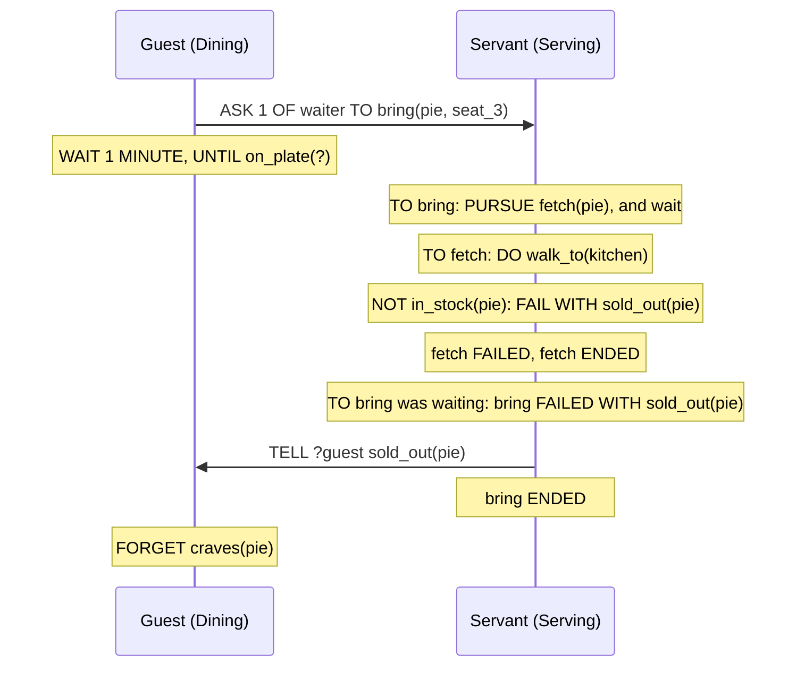

# Goals and Failure

A Guest who gets hungry sets about having dinner. It orders, waits for the Servants and eats what arrives. That takes a while, other Plans may wait on it, and it can go wrong: the kitchen runs out, or no seat was laid. Something an Agent sets about doing is a Goal. This chapter covers how a Goal is started, pursued, dropped and reached, what fails a Plan, how a Failure climbs from one Plan to the next, and how we react to it.

| We write | It |
|---|---|
| `GOAL have_dinner` | declares a Goal |
| `TO have_dinner:` | is a recipe for it, a Plan that runs when the Goal is pursued |
| `PURSUE have_dinner` | starts a Pursuit and waits for it; `, WITHOUT WAITING` doesn't wait |
| `PURSUING have_dinner` | tests, in a Context or an `IF`, whether a Pursuit is running |
| `DROP have_dinner` | stops every Pursuit of the Goal |
| `FAIL`, `FAIL WITH no_food` | fails the current Plan on purpose, with or without a Reason |
| `WHEN have_dinner REACHED:` and `DROPPED`, `FAILED`, `FAILED WITH …`, `ENDED` | react to how a Pursuit ended |

The Trigger kinds are introduced in *Plans*, and which Actions wait in *Actions and time*. Asking another Agent for a Goal is in *Messages*, and what a Director asks for in *Plots and Directors*.

## A Goal and its recipe

[`playbooks/hosting.regia`](../showcase/playbooks/hosting.regia)
```regia
TO open_feast, FROM DIRECTOR:
    DO stand_up
    DO play_fanfare                      # the Target's own code: Regia doesn't wait on the game
    DO raise_cup

WHEN open_feast ENDED: SIGNAL toast_given
```

`open_feast` is declared in the Vocabulary with `GOAL`, like any other item. A Plan whose Trigger is `TO open_feast` is a recipe for it: when the Host takes the Goal on, the recipe runs. Apart from its first word it is an ordinary Plan, with Placeholders, a Context, Labels and a Body.

The Goal is reached when the recipe finishes its Body. Nothing looks at the world: `open_feast` is reached once the cup is raised, whether or not anyone watched.

An Agent takes a Goal on in three ways:

| From | We write | In the showcase |
|---|---|---|
| itself | `PURSUE g` in a Body | `PURSUE have_dinner, WITHOUT WAITING` (*dining*) |
| a Director | `ASK <Role> TO g` in a Director's Plan, or `PURSUE g` in a Role setup | `ASK Host TO open_feast`, `PURSUE take_seat` (*royal_banquet*) |
| another Agent | `ASK <recipient> TO g` | `ASK 1 OF waiter TO bring(?dish, ?place)` (*dining*) |

[`plots/royal_banquet.regia`](../showcase/plots/royal_banquet.regia)
```regia
ROLE Guest:
    LEARN purse(RANDOM(5, 20))           # rolled for each Guest
    LEARN craves(roast)
    LEARN craves(pie)
    PURSUE take_seat
```

However it arrived, it is now the Agent's own Goal, and the Agent's recipes decide what is done. `FROM` on a recipe says whose request it takes: `TO open_feast, FROM DIRECTOR` runs only for a Director that gives the Host `Hosting`.

- There is one kind of Goal: one the Agent reaches and then stops pursuing. A Goal that must be kept true, or that is reached when a Fact holds, can't be declared.
- A name has one kind. A Goal and the Fact that says it is done get two names: `have_dinner` and `sated`.
- A setup's `PURSUE` is the Director asking. Its Pursuit has the Director as Sender, so `TO take_seat, FROM DIRECTOR` takes it, and it never waits.
- The setup runs in the order written. A `PURSUE` above the `ASSIGN` that gives its only recipe finds none, and the Goal fails.
- An Agent's own `PURSUE` has no Sender, wherever it is written, even inside a recipe a Director asked for. A Guest writing `PURSUE take_seat` would find no recipe that takes it, since the one recipe says `FROM DIRECTOR`. A recipe with no `FROM` takes every request.
- A Director has no Goals. It asks for them, and has no recipes, no `PURSUE` and no `DROP`.

**Checks**

- One name declared as a Goal and as another kind → `R0501`
- `PURSUE` with a Fact or a Cue → `R0802`
- A Goal pursued, asked or declared with no `TO` Plan anywhere in the Program → `R1101` (warning)
- A setup `PURSUE` above the `ASSIGN` that gives the only Playbook with a recipe for it → `R1605` (warning)
- `PURSUE` in a Director → `R2001`

Spec: chapter 05, *Goals*. For setups, chapter 16; for a Director, chapter 20.

## Waiting on a Goal

[`playbooks/serving.regia`](../showcase/playbooks/serving.regia)
```regia
TO bring(?dish, ?place), FROM patron ?guest:
    PURSUE fetch(?dish)                  # waits: if fetching fails, so does bringing
    DO walk_to(?place)
    DO put_down(?dish)
    TELL ?guest served(?dish)

TO fetch(?dish):
    DO walk_to(kitchen)
    IF NOT in_stock(?dish):
        FAIL WITH sold_out(?dish)
    DO pick_up(?dish)                    # still refused if the last one went while we walked
```

`PURSUE fetch(?dish)` holds the Body of `TO bring` until `fetch` is reached, and only then does the Servant walk to the seat. The Servant never puts down a dish it doesn't have. A waiting Body depends on its Goal: if `fetch` fails, `bring` fails at the same line, and if `fetch` is dropped, `bring` is dropped too.

[`playbooks/duelling.regia`](../showcase/playbooks/duelling.regia)
```regia
TO fight, FROM DIRECTOR:
    DO draw_sword
    LEARN stamina(3)
    PURSUE strike, WITHOUT WAITING
```

`fight` starts the lunges and is reached at once. `strike` goes on alongside, and nothing that happens to it reaches `fight`.

- `PURSUE g` waits for the Pursuit it started and no other.
- A Pursuit has at most one Body waiting on it. That makes the waiting Plans a chain, which is the path Failure climbs and a drop spreads along.
- A Goal pursued `WITHOUT WAITING` is set loose. Its Failure stays with it, and so does its drop.
- `ASK` never waits. The asker learns how the Goal went only if the receiver tells it (*Messages*).
- A recipe that ends with `PURSUE` of its own Goal, `WITHOUT WAITING`, repeats: `TO strike` does (*Actions and time*). Each round is a Pursuit of its own, and from the second round on it has no Sender.

**Checks**

- A trailing clause other than `, WITHOUT WAITING` on `PURSUE` → `R0805`
- A waiting `PURSUE g` inside `TO g`, with the Trigger's own arguments and no `GIVEN` or `IF` around it → `R0806` (warning; hint: `, WITHOUT WAITING`)

Spec: chapter 08, *Pursuing*, *Repeating*; chapter 05, *Waiting for a Goal*.

## The same Goal twice

[`playbooks/dining.regia`](../showcase/playbooks/dining.regia)
```regia
WHEN ASSIGNED:
    IF hungry:
        PURSUE have_dinner, WITHOUT WAITING
    ELSE:
        SIGNAL finished_eating           # not hungry tonight: nothing to count on

WHEN hungry LEARNED:
    GIVEN NOT sated AND NOT PURSUING have_dinner:
        PURSUE have_dinner, WITHOUT WAITING
```

A Guest can be given `Dining` while hungry, and can learn `hungry` later. Both start dinner. A Guest who already dines when `hungry` is learned again doesn't start a second one, because the Context says so.

Every request starts a Pursuit: one run of the Goal by one Agent, from the request to its ending, with its own Sender. Nothing is ignored and nothing is joined. Two Guests who order pie from the same Servant give it two Pursuits of `bring`, and each pursues `fetch(pie)`: two Pursuits of the same Goal with the same arguments, each with its own recipe running, each ending by itself. Arguments say what is wanted, never which Pursuit is which.

A Goal that must not run twice at once says so in a Context, with `PURSUING`:

[`playbooks/serving.regia`](../showcase/playbooks/serving.regia)
```regia
WHEN idle:
    GIVEN NOT PURSUING bring(?, ?):      # no order on our hands
        DO walk_to(kitchen)
```

- `PURSUING g` holds while at least one Pursuit of `g` has a recipe running. Matching and Placeholders work as for a Fact: `bring(?, ?)` holds for any order.
- In the Context and the Body of a `TO g` Plan, the Plan's own Pursuit doesn't count: `PURSUING g` there asks about another one. Written as `GIVEN NOT PURSUING have_dinner` inside `TO have_dinner`, a second request finds the first, falls through and fails at once.
- Everywhere else, the recipe of a sub-Goal included, every Pursuit counts.
- A Plan of the same Agent can tell two Pursuits apart only by their Sender, with `FROM`.

**Checks**

- A Goal no recipe takes, such as a second request a `NOT PURSUING` turns away → `T1104` (Trace, Failure)

Spec: chapter 05, *Pursuits*, *Testing Goals in a Context*.

## Dropping a Goal

[`playbooks/dining.regia`](../showcase/playbooks/dining.regia)
```regia
WHEN hungry FORGOTTEN:
    DROP have_dinner                     # stops the recipe, even while it waits
```

```regia
# Full before the plate is empty: push away what is left.
WHEN have_dinner DROPPED:
    FOR EACH on_plate(?dish):
        DO push_away(?dish)
        FORGET on_plate(?dish)
```

A Guest who is full after the first dish stops dinner. The recipe stops wherever it is, in the middle of `DO eat(roast)` or of the `WAIT`, and the `DROPPED` Plan pushes the rest away.

`DROP g` does this for every Pursuit of `g` the Agent has, in this order:

1. It stops the Pursuit's running recipe at once, even if that recipe is the one running `DROP`. The rest of its Body doesn't run.
2. It stops every Pursuit that recipe was waiting on, and every Pursuit those were waiting on, in turn.
3. It fires `WHEN g DROPPED`, then `WHEN g ENDED`.
4. It stops the Body that was waiting on this Pursuit. If that Body is a recipe, its own Pursuit is dropped the same way, and so on up.

A drop spreads as a drop in both directions. Every Pursuit stopped in steps 2 and 4 fires `DROPPED` and `ENDED`, never `FAILED`. Downward they fire innermost first, before `g`'s own; upward, each level after the one below it. A throwaway shows the upward half, a Servant told the kitchen is closed:

```regia
WHEN kitchen_closed:                     # a game Cue
    DROP fetch(pie)
```

A Servant fetching pie for `bring(pie, seat_3)` stops. `fetch(pie)` fires `DROPPED` and `ENDED`, then `bring(pie, seat_3)` does the same. Neither `WHEN bring … FAILED` Plan runs, so the Guest is never told `sold_out`.

[`playbooks/duelling.regia`](../showcase/playbooks/duelling.regia)
```regia
WHEN yielded, FROM opponent:
    DROP strike                          # no more lunges at a beaten opponent
    DO salute
    SIGNAL duel_won
```

`strike` repeats, one Pursuit per lunge. `DROP strike` stops the round under way, so no further round starts. The `WHEN yielded` Plan isn't waiting on `strike`, so it carries on and salutes.

- `DROP` can't pick one Pursuit of several. `DROP fetch(pie)` stops both orders of pie.
- Dropping a Goal that isn't pursued does nothing, and `DROPPED` doesn't fire.
- Goals started `WITHOUT WAITING` are left alone, and so is a Body that started `g` `WITHOUT WAITING`. Both were set loose on purpose.
- A waiting `WHEN` Plan stopped in step 4 has no Goal, so nothing fires for it. The Trace records that it stopped.
- A waiting `DO` in a stopped recipe is called off (*Actions and time*). Nothing else is undone: the dishes already eaten stay eaten.
- Only the Agent drops its own Goals. A Director takes a Playbook away instead, and the Pursuits that Playbook's recipes were carrying are dropped as `DROP` would drop them. Their `DROPPED` Plans still run, even in the Playbook being taken.

**Checks**

- `DROP` with a Fact or a Cue, or with a Plot → `R0802` (for a Plot, the hint is `DROP SUBPLOT`)
- A trailing clause on `DROP` → `R0805`
- `DROP` in a Director → `R2001`

Spec: chapter 08, *Dropping*. For a Playbook taken away, chapter 15.

## How a Pursuit ends

[`playbooks/dining.regia`](../showcase/playbooks/dining.regia)
```regia
WHEN have_dinner REACHED: LEARN sated
```

```regia
WHEN have_dinner ENDED: SIGNAL finished_eating
```

A Pursuit ends in exactly one of three ways, and fires the Trigger for it. `ENDED` then fires as well, once per Pursuit:

| The Pursuit | Fires |
|---|---|
| is reached: its recipe finishes its Body | `REACHED`, then `ENDED` |
| is dropped: by `DROP`, or by a drop of a Goal it waits on or that waits on it | `DROPPED`, then `ENDED` |
| fails | `FAILED`, then `ENDED` |

A Guest who eats its dinner learns `sated`, and then sends `finished_eating`. One whose dinner was dropped or failed sends it too. Cleanup that must run however the Goal ended is written once, under `ENDED`.

- An ending Plan is told about the ending, and can't change it. By the time a `REACHED` Plan runs, the Body that waited on the Goal has already carried on; for `DROPPED` and `FAILED`, it has already stopped.
- An ending Plan is not a recipe. If it fails, it stops with a Trace entry and nothing else fires, so endings can't loop.
- Along a chain of waiting Plans, innermost first, each level complete before the next: `fetch DROPPED`, `fetch ENDED`, `bring DROPPED`, `bring ENDED`.
- Each Pursuit fires its own. Two Pursuits of `fetch(pie)` that are reached fire `REACHED` twice.
- `FROM` on an ending means where that Pursuit's request came from, as on its recipe: `WHEN bring(?dish, ?) FAILED, FROM patron ?guest` names the Guest who ordered.
- Which Plans run for an ending is chosen as for any Trigger, across the Playbooks the Agent holds (*Precedence and Labels*).
- These Triggers are about the Agent's own Pursuits. In 1.5 nobody hears how a Goal it asked of someone else ended, so whoever must know is told by hand.

[`playbooks/courtesy.regia`](../showcase/playbooks/courtesy.regia)
```regia
WHEN take_seat ENDED: SIGNAL took_seat   # seated or standing, the Director counts us
```

> **In 2.0** whoever asked for a Goal hears how it ended, on an ending Trigger with a `BY` clause naming the Agent whose Pursuit it was: `WHEN take_seat ENDED, BY Guest ?g:` in the Plot. Spec chapter 05, *Who pursued it: `BY`*, and chapter 20, *Hearing how an asked Goal ended*. In 1.5 the Director hears nothing, so `Courtesy` and `Hosting` signal `took_seat` and `toast_given` from their `ENDED` Plans.

**Checks**

- A kind word that doesn't suit the item (`WHEN have_dinner LEARNED`) → `R0504`
- `WITH` on `REACHED`, `DROPPED` or `ENDED` → `R1105`
- `BY` on a Goal's ending, or a Goal's ending in a Plot, in a 1.5 build → `R0109`

Spec: chapter 05, *How a Pursuit ends*; chapter 11, *Every Pursuit that ends fires its Triggers*.

## What fails a Plan

[`playbooks/serving.regia`](../showcase/playbooks/serving.regia)
```regia
TO fetch(?dish):
    DO walk_to(kitchen)
    IF NOT in_stock(?dish):
        FAIL WITH sold_out(?dish)
    DO pick_up(?dish)                    # still refused if the last one went while we walked
```

A Plan fails when one of its Statements can't be carried out. `fetch` can fail in three places: the game refuses `walk_to`, the dish is out of stock and the Plan fails on purpose, or the game refuses `pick_up` because another Servant took the last one.

| A Statement can't be carried out when | At the banquet |
|---|---|
| the game refuses a Custom Action, or reports that it failed while the `DO` waits | `DO pick_up(?dish)` once the last one has gone |
| a waiting `PURSUE g` and `g` fails | `PURSUE fetch(?dish)` in `TO bring` |
| it is `FAIL` or `FAIL WITH r` | `FAIL WITH sold_out(?dish)` |
| an `UPDATE` names a Fact the Agent doesn't know | nowhere: every `UPDATE` in the showcase follows a Context that matched the Fact |
| arithmetic meets something that isn't a Number, or divides by zero | `purse(?gold - ?stake)`, if a purse ever held a Name |
| a Weight, a Duration or a count of a Role isn't a Number | `WAIT RANDOM(1, 3) SECONDS` never fails: both ends are Numbers |
| the Placeholder a `TELL` or `ASK` goes to doesn't hold an Agent | `TELL ?foe insulted`, if a grudge named a thing |

The Plan stops at the failing Statement, and the rest of its Body doesn't run. Nothing is undone: Facts learned or forgotten stay that way, Messages sent stay sent, Actions done stay done, and Goals started `WITHOUT WAITING` keep going. A Servant whose `pick_up` is refused has still walked to the kitchen.

Some things that look like trouble are not Failures, and the Plan carries on:

- learning a Fact already known, forgetting one that isn't, dropping a Goal that isn't pursued;
- a Random choice whose Weights are all 0;
- a Message to an Agent that has left the Program;
- a `WAIT … UNTIL` whose limit runs out. Nothing to do with time fails: there are no timeouts;
- a waiting `DO` called off because its Plan was stopped;
- a drop.

Regia never checks the world. A Custom Action fails only when the game says so, and on a game that never does, every `DO` succeeds. A `DO … , WITHOUT WAITING` fails only if the game refuses it; a failure the game reports later is only traced.

**Checks**

- A `DO` refused, or a waiting `DO` reported as failed → `T1101` (Trace, Failure)
- `FAIL`, with its Reason → `T1103` (Trace, Failure)
- Arithmetic on a non-Number, a division by zero → `T0401`, `T0402` (Trace, Failure)
- A recipient that isn't an Agent → `T0701` (Trace, Failure)
- `UPDATE` when the old Fact isn't known → `T0801` (Trace, Failure)
- A Weight that isn't a Number → `T0901` (Trace, Failure)
- A Duration that isn't a Number → `T1201` (Trace, Failure)
- A count or a fraction of a Role that isn't a Number → `T1501` (Trace, Failure)

Spec: chapter 11, *When a Plan fails*, *What a failed Plan leaves behind*.

## How Failure spreads

What a failed Plan does to the rest of the Agent depends on its Trigger:

- A failed `TO g` Plan fails `g`. The Goal stops being pursued without being reached.
- The Body waiting on `g` with `PURSUE g` then fails at that line. If that Body is a recipe, its Goal fails, and so on up the chain.
- `WITHOUT WAITING` stops the climb. The Body that started the Goal has moved on.
- A failed `WHEN` Plan has nobody waiting on it. It stops.

In `Serving` the climb has two levels. An order for pie, on an evening the pie has run out:



The Failure climbs inside the Servant and stops there. The Guest sent an `ASK` and never waited on it, so nothing reaches it unless the Servant tells it. If the roast arrives, the Guest's dinner goes on; if nothing does, it fails later, for its own reason.

A Goal also fails without any Plan failing, when no recipe takes it:

[`playbooks/courtesy.regia`](../showcase/playbooks/courtesy.regia)
```regia
TO take_seat, FROM DIRECTOR:
    GIVEN seat(?place):
        DO walk_to(?place)               # waits until we have arrived
        DO sit_down
        TELL host greeting
    # no ELSE: with no seat laid for us, take_seat fails at once
```

A Guest with no seat finds no `GIVEN` that holds and no `ELSE`, so `take_seat` falls through. If no other Playbook the Guest holds has a recipe that takes it, the Goal fails at once. That covers a Goal with no recipe on this Agent at all, and one whose recipe's `FROM` turns the request away. A Cue or a Fact change that no Plan takes is dropped, which is normal; a Goal that no recipe takes is a Failure, whoever gave it.

A waiting `WHEN` Plan fails in turn, too:

[`playbooks/noble_socializing.regia`](../showcase/playbooks/noble_socializing.regia)
```regia
WHEN scandal(ME), FROM peer ?speaker:
    SHIFT sympathy BY -0.2
    TELL 50% OF peer wronged(ME, ?speaker)
    PURSUE resent(?speaker)
```

If `resent` failed, this Plan would fail at its last line and stop, with an entry in the Trace. No Plan can react to it: a `WHEN` Plan has no name to hang a Trigger on. A step that must be recoverable goes in a Goal of its own, pursued from the `WHEN` Plan, as this one does.

Regia never tries again. When a recipe fails, no other recipe for the Goal is tried, even if a `GIVEN` further down would hold by now. The Guest whose dinner failed stays hungry until something starts dinner again.

**Checks**

- A Goal no recipe takes → `T1104` (Trace, Failure)
- A Goal with no `TO` Plan anywhere in the Program → `R1101` (warning)

Spec: chapter 11, *How failure spreads*, *When no Plan applies*. For falling through, chapter 13.

## `FAIL` and Reasons

[`playbooks/dining.regia`](../showcase/playbooks/dining.regia)
```regia
TO have_dinner:
    GIVEN seat(?place):
        FOR EACH craves(?dish):
            ASK 1 OF waiter TO bring(?dish, ?place)
        WAIT 1 MINUTE, UNTIL on_plate(?)
        IF NOT on_plate(?):
            FAIL WITH no_food
        FOR EACH on_plate(?dish):
            DO eat(?dish)
            FORGET on_plate(?dish)
    # no ELSE: hungry with no seat, have_dinner fails at once
```

Without the `FAIL`, a Guest with an empty plate after a minute would run the second `FOR EACH` zero times and reach a dinner it never had. `FAIL` fails the Plan on purpose. It is a Basic Action, written without `DO`. In a recipe it fails the Goal, and the Failure spreads as any other. In a `WHEN` Plan it stops the Plan.

`WITH no_food` gives the Failure a Reason: a Cue, declared in the Vocabulary, that says why in the designer's words. `no_food` and `sold_out` are both declared as Cues.

- `FAIL WITH` takes exactly one declared Cue, with its arguments filled. The Cue is sent to nobody and starts no `WHEN no_food` Plan. It only rides on the Failure.
- Only `FAIL WITH` gives a Reason. A refused Action, arithmetic, a Goal no recipe takes and a plain `FAIL` have none. Their causes are in the Trace and are not words of the language.
- The Reason travels unchanged up the chain of waiting Plans. `fetch` fails `WITH sold_out(pie)`, and so does `bring`. No Goal on the way can replace it or drop it.
- In a `WHEN` Plan, `FAIL WITH` is allowed, and the Reason reaches only the Trace.
- A local Cue of a Playbook can be a Reason.
- A Statement written after `FAIL` in the same Block can never run.

> **In 2.0** the Reason also reaches whoever asked for the Goal, on its `FAILED WITH` Trigger with `BY`. Spec chapter 11, *Reasons*, and chapter 07, *Hearing how an asked Goal ended*. In 1.5 it climbs only the Agent's own chain, so `Serving` tells `sold_out` back to the Guest by hand, and `sold_out` is both a Reason and a told Cue.

**Checks**

- `FAIL WITH` something other than one declared Cue, or with unfilled arguments → `R1104`
- Statements after `FAIL` in the same Block → `R1102` (warning)
- `FAIL`, with its Reason → `T1103` (Trace, Failure)

Spec: chapter 11, *`FAIL`*, *Reasons*.

## Reacting: `WHEN g FAILED`

[`playbooks/serving.regia`](../showcase/playbooks/serving.regia)
```regia
WHEN bring(?dish, ?) FAILED WITH sold_out(?dish), FROM patron ?guest:
    TELL ?guest sold_out(?dish)          # the Reason, told back by hand
WHEN bring(?dish, ?) FAILED, FROM patron ?guest:
    DO bow_to(?guest)                    # an apology, and nothing more to say
```

When `bring` fails because the dish ran out, the Servant tells the Guest. When it fails for any other cause, a refused `walk_to` or a `pick_up` that lost the race, the Servant bows: there is nothing true to say.

`FAILED` is a Trigger kind on a Goal. It fires when the Goal fails, for any of the causes above.

- It is a notification, not a rescue. By the time the `FAILED` Plan runs, every Body that waited on the Goal has already failed. Finishing the `FAILED` Plan doesn't reach the Goal and lets nothing carry on. So the line after `PURSUE g` runs only if a recipe for `g` finished: the Servant never walks to the seat empty-handed because some other Plan "handled" the missing dish.
- Every level fires, innermost first. `fetch` fires `FAILED`, which nobody listens to, and then `bring` does.
- `WITH` matches a Failure with that Reason and fills Placeholders as any Trigger does. Plain `FAILED` matches every Failure, with a Reason or without. There is no catch-all Placeholder for a Reason.
- The `FAILED` Plans of one Playbook, with and without `WITH`, share one Trigger and are tried in written order; the first that matches runs. A plain `FAILED` above a `FAILED WITH` catches everything the second would.
- A Plan reads the Reason, never the cause. Which Statement failed and how is in the Trace only.
- `FROM` names whoever gave the Goal, as on the recipe. The Servant answers the Guest who ordered.
- Labels go on it as on any Trigger: `WHEN have_dinner FAILED, SHIFTS sympathy BY -0.3:` sours a hungry Guest.

**Checks**

- A plain `WHEN g FAILED` above a `WHEN g FAILED WITH …` it also matches → `R1106` (warning)
- `WITH` on any ending but `FAILED` → `R1105`
- `BY` on a Goal's ending, in a 1.5 build → `R0109`

Spec: chapter 11, *Reacting: `WHEN g FAILED`*. For `FROM` on an ending, chapter 05.

## Writing a fallback

[`playbooks/dining.regia`](../showcase/playbooks/dining.regia)
```regia
WHEN have_dinner FAILED WITH no_food:
    PURSUE make_do, WITHOUT WAITING      # the fallback
WHEN have_dinner FAILED, SHIFTS sympathy BY -0.3:
    DO complain

WHEN have_dinner ENDED: SIGNAL finished_eating

# Nothing came: fetch some bread ourselves.
TO make_do:
    DO walk_to(kitchen)
    DO pick_up(bread)
    DO eat(bread)
```

Since `FAILED` doesn't rescue and nothing is tried twice, a second way of reaching a Goal is written out. The showcase uses all three places for it:

| Where | When it is chosen | In the showcase |
|---|---|---|
| another recipe: a second `GIVEN`, or an `ELSE` | before the recipe starts | `WHEN served(roast)` falling through to `WHEN served(?dish)` (*dining*) |
| a test before the risky step, that takes another way or fails cleanly | while the recipe runs | `IF NOT in_stock(?dish): FAIL WITH sold_out(?dish)` (*serving*) |
| a fallback started from `FAILED` | after the Goal has failed | `PURSUE make_do, WITHOUT WAITING` above; `DO stand_by(wall)` (*courtesy*) |

A Guest with an empty plate goes to the kitchen for bread and doesn't complain: the first `FAILED` Plan that matches is the only one that runs. A Guest with no seat has no Reason, so it complains. Both send `finished_eating`.

### Trying again

A `FAILED` Plan may pursue the Goal that has just failed. That Pursuit is over, so `PURSUE` starts a new one. With nothing to stop it, a Goal that fails every time is pursued again for as long as the Program runs, so a retry counts. A throwaway:

```regia
WHEN have_dinner FAILED:
    GIVEN tries(?n) AND ?n < 3:
        UPDATE tries(?n) TO tries(?n + 1)
        PURSUE have_dinner, WITHOUT WAITING
```

There is no limit at runtime.

**Checks**

- A `WHEN g FAILED` Plan that pursues `g` with the Trigger's own arguments and no `GIVEN` or `IF` around the `PURSUE` → `R1103` (warning)

Spec: chapter 11, *Writing a fallback*, *Trying again*.

## What the Trace keeps

A `FAILED` Plan only reacts. The Trace is the one place that says why. Every Failure leaves entries there, whether or not a Plan reacted: one entry for the cause, then one for each Goal that failed in turn and each waiting `WHEN` Plan that failed with it, all pointing at the cause. The pie, as console lines (source locations left out):

```
#81 FAILURE T1103 FAIL WITH sold_out(pie)
#82 GOAL fetch(pie) FAILED because #81
#83 GOAL bring(pie, seat_3) FAILED because #81
#84 PLAN Serving: WHEN bring(pie, seat_3) FAILED WITH sold_out(pie)
#85 TELL noble_3 sold_out(pie)
```

- The cause names the Statement and its code, and the Reason when `FAIL WITH` gave one. The Reason isn't repeated further up.
- A failing recipe has no entry of its own: its Goal's is its entry.
- A drop writes no Failure. Each Pursuit it stops writes a "dropped" entry, linked to the first, and a waiting `WHEN` Plan a "stopped" one.

The entries, their fields and how a behaviour case matches them are in *The Trace*.

Spec: chapter 11, *The trace*; chapter 34, *The failure chain*, *A drop is not a Failure*.

## How this combines with…

### Plans

A recipe is chosen like any other Plan: the first `GIVEN` that holds wins, and with none and no `ELSE` the Goal falls through to the next Playbook. Only the end of the line differs from a Cue: a Cue nobody takes is dropped, a Goal nobody takes fails. (*Plans*)

### Messages

An asked Goal is the receiver's own. It fails at the receiver, where its `FAILED` Plan runs, and the asker hears nothing unless that Plan tells it. A Message sent before a Plan fails stays sent: a Guest whose `walk_to(door)` is refused in `TO take_leave` has already greeted the Host. (*Messages*)

### Matching

A `GIVEN` with no Match is a `GIVEN` that doesn't hold. `TO vent` picks a grudge against someone at the table, and with none it would fail; the `idle` Plan's Weight, the count of those grudges, keeps the Option from being chosen then. A round of a `FOR EACH` that fails fails the whole Plan, and the remaining rounds don't run. (*Matching*)

### Actions and time

A refused or failed `DO` is the one Failure the game causes. A recipe paused in a `WAIT` is still running: its Goal is still pursued, `PURSUING` holds, and the Body waiting on it keeps waiting. A drop stops it there, and calls off a waiting `DO`. (*Actions and time*)

### Plots and Directors

A Director gives Goals with `ASK` and with a setup's `PURSUE`, and in 1.5 hears nothing of how they end: every "done" a Director waits for is a Signal sent from a recipe's `ENDED` Plan. Its own Plans fail like an Agent's, on a refused `DO` or a `FAIL`; the Plan stops, and the Phase and the Staging stay as they were. A Phase's Plan stopped because the Plot left the Phase has not failed. (*Plots and Directors*)

### Playbooks and Roles

Taking a Playbook away stops the Plans running from it, and the Pursuits they carried are dropped, sub-Goals first. Their `DROPPED` and `ENDED` Plans run, even those of the Playbook being taken, so `Dining` clears the plate of a Guest whose dinner is cut short. (*Playbooks and Roles*)

### When an Agent leaves

An Agent that leaves the Program stops its Plans with no ending at all: nothing was reached, dropped or failed, and none of its ending Plans run. A Message to it is dropped and doesn't fail the sender. (*When an Agent leaves*)

### Jason: Plans and Goals

`PURSUE g` is `!g`, and `WITHOUT WAITING` is `!!g`. Jason's `-!g` rescues, so the Transpiler generates a `-!g` for every Goal that runs the designer's `FAILED` and `ENDED` Plans, writes the Trace entry and fails again, up to the next level. `FAIL WITH r` carries `r` on that failure. (*Jason: Plans and Goals*)
