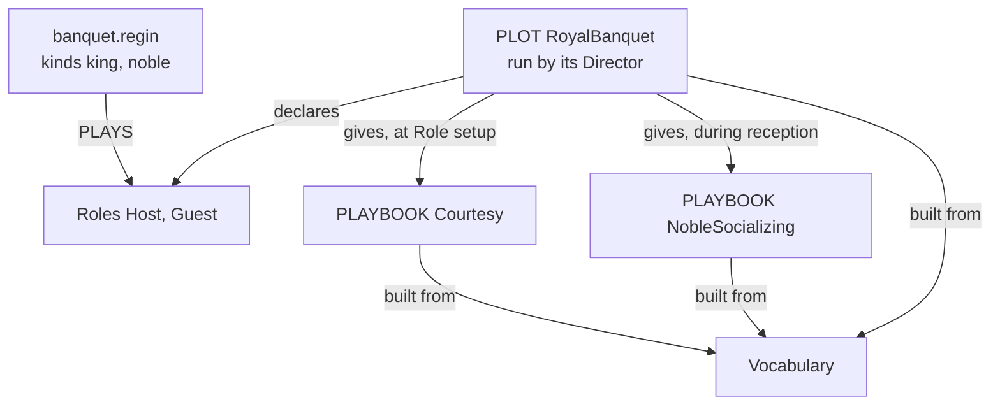
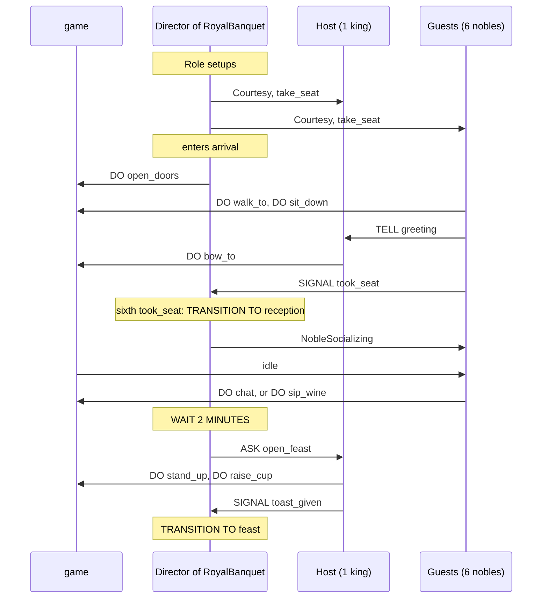

The banquet starts with the doors opening. Guests walk to their seats and greet the Host, and once all of them are seated the reception begins and they fall into small talk. After a while the Host stands for a toast, and the feast is on. To write this in Regia we have to decide, for every sentence, whether it is about what a character does or about how the evening goes. The first kind goes in a Playbook, the second in a Plot.

This chapter reads one small Program from top to bottom: the banquet up to the toast, cut from the showcase. It follows *Introduction* and uses constructs before the chapters that explain them, from *Syntax* onwards. Later chapters come back to this Program.

## The Program

Four source files and one Instancing file, each a cut of the showcase file named above its snippet. Lines we don't need yet are left out, and nothing is added. What is printed in this chapter is a whole Program.



## Names first

`showcase/vocabulary.regia`
```regia
FACT hall.seating.seat AS seat(place)
EVENT hall.clock.idle AS idle

EVENT greeting
EVENT took_seat, toast_given

GOAL take_seat, open_feast

ACTION walk_to(place)
ACTION sit_down, stand_up, bow_to(person), raise_cup
ACTION chat, sip_wine
ACTION open_doors
```

Every name a Plan uses is declared once, with its kind. A Fact is something an Agent knows (`seat`, the place laid for it). An Event happens and is gone (`idle`, a `greeting`). A Goal is something to reach, and an Action is something the game carries out.

The first two lines come from the game, which has its own names for them: `hall.seating.seat` is the game's, `seat` is ours. The game tells each Agent its `seat` and sends `idle` to an Agent with nothing to do. `greeting`, `took_seat` and `toast_given` are Events Agents send. The Vocabulary doesn't say who sends what to whom. (*Vocabulary*)

Spec: chapter 05. For names the game uses, chapter 10.

## A Playbook: what one character does

`showcase/playbooks/courtesy.regia`
```regia
IMPORT "../vocabulary".

PLAYBOOK Courtesy:
    ROLE host.

    TO take_seat FROM DIRECTOR:
        GIVEN seat(?place):
            DO walk_to(?place).              # waits until we have arrived
            DO sit_down.
            TELL host greeting.
            SIGNAL took_seat.

    WHEN greeting FROM ?who:
        DO bow_to(?who).

    TO open_feast FROM DIRECTOR:
        DO stand_up.
        DO raise_cup.
        SIGNAL toast_given.
```

A Playbook is a named set of Plans. Each Plan here is written from the point of view of the one Agent that holds it. `TO take_seat` is a recipe: when the Agent has the Goal `take_seat`, and it knows a seat, it walks there, sits, greets and reports. `?place` is a Placeholder, filled with whatever seat the Agent knows. `WHEN greeting FROM ?who` is a reaction: someone greeted us, and we bow to them.

The Playbook reaches other Agents in two ways only. `TELL host greeting` sends a Message to `host`, a Role the Playbook declares for itself on its second line. `host` is an address. The Playbook doesn't know who will be behind it. `SIGNAL took_seat` sends an Event upwards, to the Director of whatever Plot gave this Playbook. `FROM DIRECTOR` is the same link read the other way: these recipes are for a Goal the Director asked for.

Nothing in `Courtesy` says when it applies, to whom, or what happens after `took_seat`. It names no Plot. It can't make another Agent do anything either: `TELL` informs, and the receiver's own Plans decide what follows. (*Plans*, *Messages*, *Playbooks and Roles*)

`#revise` `Courtesy` is independent of any Plot only on paper. It works if some Director asks for `take_seat` and counts `took_seat`, and the Director needs to know that the Signal exists. A Playbook declares the Roles it talks to, but the Goals it expects to be asked and the Signals it sends can only be found by reading its Plans.

Spec: chapter 15. For `FROM DIRECTOR` and `SIGNAL`, chapters 05 and 07.

## A Plot: who is in the scene

`showcase/plots/royal_banquet.regia`
```regia
IMPORT "../vocabulary".
IMPORT "../playbooks/courtesy".
IMPORT "../playbooks/noble_socializing".

PLOT RoyalBanquet:
    ROLE Host STARTS WITH:
        ASSIGN Courtesy, MAPPING Host TO host.
        PURSUE take_seat.
    ROLE Guest STARTS WITH:
        ASSIGN Courtesy, MAPPING Host TO host.
        PURSUE take_seat.

    PHASE arrival INITIAL.
    PHASE reception.
    PHASE feast.
```

A Plot describes a scenario. It starts by naming its Roles, the classes of Agents that take part. `Host` and `Guest` say nothing about how many Agents there are or what they are called; a Plan never names a single Agent.

`STARTS WITH` is a Role setup: what every Agent of the Role gets when it starts playing it. `ASSIGN Courtesy` gives the Playbook. This handing over is called a Giving, and it is the only way an Agent comes to hold Plans. `PURSUE take_seat` asks for the Goal, and arrives at the Agent as asked by the Director, which is why `TO take_seat FROM DIRECTOR` answers it.

`MAPPING Host TO host` fills the Playbook's Role with one of the Plot's. From now on, when a Guest's `Courtesy` says `TELL host greeting`, the Message goes to whoever plays `Host` in this Plot. The Host got the same Mapping, but a Message never goes to its own sender, so the Host greets nobody.

Then come the Phases, the states the Plot moves through. It is in exactly one at a time and starts in the one marked `INITIAL`. (*Plots and Directors*, *Playbooks and Roles*)

`#revise` `Host` is the Plot's Role and `host` the Playbook's, told apart by a capital letter. A Role means a class of Agents in the first and an address in the second. Had both been spelled the same, the Mapping would have been made without being written, and we would not see it at all.

Spec: chapter 15, chapter 16.

## Phases: how the scene moves

`showcase/plots/royal_banquet.regia`
```regia
    DURING arrival:
        WHEN ENTERED:
            DO open_doors.

        WHEN took_seat FROM ALL Guest:
            TRANSITION TO reception.

    DURING reception:
        WHEN ENTERED:
            ASSIGN NobleSocializing TO Guest, MAPPING Guest TO peer.
            WAIT 2 MINUTES.
            ASK Host TO open_feast.

        WHEN toast_given FROM Host:
            TRANSITION TO feast.
```

These are Plans too, with the same Triggers and Bodies, but they belong to the Director: the agent behind the scenes that runs the Plot. A `DURING` Block holds the Director's Plans for one Phase. They react only while the Plot is in that Phase.

The Director can act on the game (`DO open_doors`), and it hears the Signals its Agents send. `WHEN took_seat FROM ALL Guest` is a Quota Trigger: it fires when every Guest has sent `took_seat`. `TRANSITION TO reception` then changes the Phase.

What the Director can't do is make an Agent act. It has three means, all in the `reception` Block. It gives a Playbook (`ASSIGN NobleSocializing TO Guest`), it asks for a Goal (`ASK Host TO open_feast`), or it tells a Fact or an Event. In each case the Agent's own Plans decide what happens. The Director doesn't learn whether the Host raised a cup unless the Host's Plan Signals it, which `TO open_feast` does on its last line.

`feast` is declared and has no Block: the Program stops when the Plot gets there. (*Plots and Directors*, *Quotas and Cast Changes*)

Spec: chapter 20. For the Quota, chapter 18.

## A Playbook given for a while

`showcase/playbooks/noble_socializing.regia`
```regia
IMPORT "../vocabulary".

PLAYBOOK NobleSocializing:
    ROLE peer.

    WHEN idle:
        EITHER, WEIGHT 3: DO chat.
        OR: DO sip_wine.
```

Until `reception`, a Guest who gets `idle` from the game does nothing with it, because it holds no Plan for it. Once the Director has given `NobleSocializing`, the same Event makes the Guest chat or sip wine, three times out of four the former. The Guest still holds `Courtesy` and still bows when greeted. Givings add up.

This is how behaviour changes as the story moves. The chatting is written in a Playbook that knows nothing of receptions, and the Plot hands it out when the reception starts. In the showcase the Plot takes it away again in `farewell`, with `UNASSIGN`.

`peer` is filled with the Plot's `Guest`: a Guest's peers are the other Guests. The Plans that use it, for insults and gossip, are among the lines cut here. (*Randomness*, *Playbooks and Roles*)

Spec: chapter 15, chapter 09.

## From Roles to Agents

`showcase/banquet.regin`
```regia
IMPORT "plots/royal_banquet".

ROOT RoyalBanquet.

AGENT king PLAYS Host:
    COUNT 1.

AGENT noble PLAYS Guest:
    COUNT 6.
```

Nothing so far has said how many Guests there are. That is Instancing, kept apart from the rest. `ROOT` names the Root Plot, the one Plot every Agent starts in. An Agent kind says which Roles of the Root Plot its Agents play and how many of them start. Here the run begins with one king as `Host` and six nobles as `Guest`.

Kinds exist only here. Playbooks and Plots never mention `noble`; they address `Guest`, and work the same with two Guests or twenty. (*Instancing*)

Spec: chapter 21.

## One run



The Role setups run first, before the Plot enters `arrival`. Each Agent then works through `take_seat` at its own pace: `DO walk_to` waits until the game says the Agent has arrived, so the six Signals reach the Director at different moments. The Host bows once for every greeting.

The Director's `WAIT 2 MINUTES` holds back only the Plan it is in. Guests go on chatting, and the Director would still react to another Trigger of `reception` if it had one.

## How this combines with…

### Failure

A Guest for whom the game laid no seat has no Match for `GIVEN seat(?place)`. The recipe doesn't apply, `take_seat` fails, and `took_seat` is never sent. `FROM ALL Guest` is then never met and the evening stays in `arrival` for good. The showcase has one more Plan in `Courtesy`, `WHEN take_seat FAILED FROM DIRECTOR`, that stands the Guest by the wall and sends the Signal anyway. (*Goals and Failure*)

### Several Playbooks on one Agent

During `reception` a Guest holds two Playbooks, and no Event is handled by both. When two Playbooks on one Agent react to the same Trigger, the Plot that put them together says which goes first. (*Precedence and Labels*)

### Agents that arrive late

A Guest who Joins during `reception` gets the Role setup, so `Courtesy` and `take_seat`, and also `NobleSocializing`: a Giving to a whole Role stays in force for whoever starts playing the Role later. An `ASK` isn't kept in the same way. It reaches the Agents who play the Role when it is sent. (*Quotas and Cast Changes*)

### Plots inside Plots

A Director can start another Plot as a Subplot, filling its Roles with some of its own Agents, and react to how it ends. In the showcase a duel and a poisoning run inside the feast. (*Subplots and Stagings*)

## Since 1.0

1.0 had the same two halves, Playbooks and a state machine over them, under other names. What changed is how the two halves are joined: a Playbook can now address others through Roles of its own, and a Director can no longer reach into an Agent.

`#changes` A 1.0 Story is a Plot, and what 1.0 called an Agent is a Role. Agent now means one character at runtime.

`#changes` A Director no longer orders an Action (`Host DO call_guards`). It gives Playbooks, asks and tells.

`#changes` The Director's own Actions are written `DO …` as an Agent's are. `WORLD` is gone.

`#changes` `ON ENTER` and `ON EXIT` are now the Triggers `WHEN ENTERED` and `WHEN EXITED` inside a `DURING` Block.

`#changes` Roles inside a Playbook and their Mappings, Role setup, Quota Triggers and Instancing are new in 2.0. 1.0 already mapped Roles into a Subplot.
