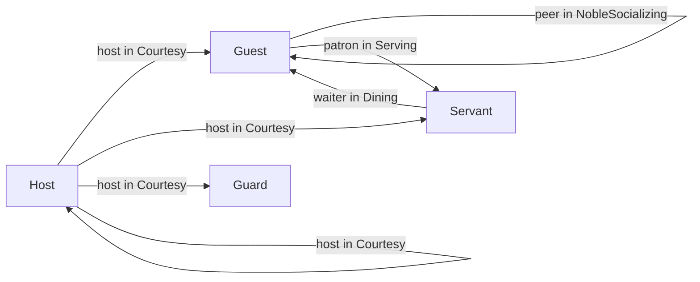

A Guest who wants roast writes `ASK waiter TO bring(…)`. Who the waiters are is not the Guest's business, and it is not written in `Dining` either. A Playbook is a named set of Plans for one Agent, written without knowing the scene it will be used in. Where its Plans talk to others, it declares Roles of its own, and the Plot that hands the Playbook out fills them with a Mapping. Each handing out is a Giving, and an Agent can hold several of the same Playbook.

*The Logic of Regia* showed a Playbook and a Giving for the first time. Recipients and `FROM` are in *Messages*. The Director's side of `ASSIGN`, and the Role setup, are in *Plots and Directors*, and the same `MAPPING` clause on `START SUBPLOT` is in *Subplots and Stagings*.

## A Playbook

`showcase/playbooks/keeping_watch.regia`
```regia
IMPORT "../vocabulary".

#@desc: A Guard's duty. A knight holds it next to NobleSocializing.
PLAYBOOK Keeping_watch:

    WHEN scandal(?) FROM ?speaker:
        GIVEN on_duty:
            DO watch(?speaker).

    WHEN saw_pouring(?who):
        DO seize(?who).
        SIGNAL culprit_seized(?who).         # reaches every Director that gave us this Playbook
```

This is a whole Playbook: a name and two Plans. Its Plans exist for an Agent only while the Agent holds the Playbook. A Guest who hears a `scandal` doesn't watch anybody, and a Guard does.

A `PLAYBOOK` Block holds three things: `ROLE` lines, Local Vocabulary and Trigger Blocks. `Keeping_watch` has only the last. It still receives Messages (`FROM ?speaker`) and reports to its Directors (`SIGNAL`), since neither needs a Role.

- A Playbook's name sits in the one namespace of the Program, with the Vocabulary and the Plots. No Fact can be called `Keeping_watch`, and declaring a Playbook twice is an error, even with the same Plans.
- A Playbook never names a Plot, a Plot's Role or another Playbook. Everything that ties it to a scene is written in the Plot.
- A Playbook holds no Director Statements. `ASSIGN`, `UNASSIGN`, `TRANSITION` and the rest are errors in it.

The last rule is one case of a wider one. A Playbook describes the Agent that holds it and can't make another Agent do anything. It can tell and it can ask, and the receiver's own Plans decide what follows.

Spec: chapter 15. For names, chapter 10.

## Roles of a Playbook

`showcase/playbooks/dining.regia`
```regia
PLAYBOOK Dining:
    ROLE waiter.

    FACT on_plate(dish)

    TO have_dinner:
        GIVEN hungry AND seat(?place):
            FOR EACH craves(?wish):
                ASK waiter TO bring(?wish, ?place).
            …

    WHEN served(?dish) FROM waiter:
        LEARN on_plate(?dish).
```

`ROLE waiter.` declares that `Dining` talks to somebody it calls `waiter`. The line comes before the Trigger Blocks. The name is local to the Playbook: another Playbook may have a `waiter` of its own, and the two have nothing to do with each other.

In a Playbook, a Role is an address and nothing more. It can stand in two places:

| Where | In the showcase | Meaning |
|---|---|---|
| the recipient of a `TELL` or an `ASK` | `ASK waiter TO bring(?wish, ?place).` | every Agent bound to `waiter`, except us |
| after `FROM` on a Trigger | `WHEN served(?dish) FROM waiter:` | the Sender is bound to `waiter` |

Anywhere else the name is an error: as an argument (`DO bow_to(host)`), in a Context, in an Expression. A Playbook's Role has no setup either, since nobody plays it. When a Plan needs one particular Agent of the Role, it takes it from a Message with `FROM waiter ?who` and uses `?who`.

`showcase/playbooks/serving.regia`
```regia
PLAYBOOK Serving:
    ROLE patron.

    TO bring(?dish, ?place) FROM patron ?guest:
        PURSUE fetch(?dish, ?place).         # PURSUE waits: if fetching fails, so does bringing
        DO walk_to(?place).
        DO put_down(?dish).
        TELL ?guest served(?dish).
```

`Serving` is the other half of the same exchange, and it names the other side `patron`. The recipe runs only for a `bring` that a patron asked, and `?guest` is the patron who did. The dish is announced to that one Guest. `TELL patron served(?dish)` would announce it to all of them.

`#revise` A Role gives up an Agent only when a Message arrives from it. `Duelling` has `DO lunge.` with no target, because `lunge(opponent)` is an error and a duellist holds no Placeholder for the opponent. The Defender could get one from `WHEN challenged FROM opponent ?foe`, but it would be gone when that Plan ends, and the Challenger, who speaks first, has none at all.

`#revise` A Playbook can't ask whether an Agent plays one of its Roles, nor which Roles its own Agent plays. `TELL ?foe insulted` in `NobleSocializing` goes to whoever the grudge names, peer or not. And the three Plans of `Courtesy` that only the Host is ever asked (`open_feast`, `honour`, `guest_arrived`) sit in a Playbook that every Servant and Guard holds.

Spec: chapter 15. For recipients and `FROM`, chapters 07 and 05.

## Mappings

`showcase/plots/royal_banquet.regia`
```regia
DURING feast:
    WHEN ENTERED:
        ASSIGN Dining TO Guest, MAPPING Servant TO waiter.
        ASSIGN Serving TO Servant, MAPPING Guest TO patron.
```

A Mapping fills a Role of the Playbook with a Role of the Plot. It is a clause after the comma, `MAPPING <the Plot's Role> TO <the Playbook's Role>`, one clause per Role to fill. The first line gives `Dining` to the Guests and says that their `waiter` is the Servants. The second gives `Serving` to the Servants, whose `patron` is the Guests.

A Role can be filled with the Role that holds the Playbook:

`showcase/plots/royal_banquet.regia`
```regia
ASSIGN NobleSocializing TO Guest, MAPPING Guest TO peer.
```

A Guest's `peer` is the Guests. A recipient never includes the sender, so `TELL peer scandal(?foe)` reaches the other Guests and the name fits.



An arrow from A to B labelled "r in P" reads: B holds the Playbook P, and its r is A. These are all the Mappings onto Playbook Roles that `RoyalBanquet` writes.

- Every Role the Playbook declares must be filled. One left out is a compile-time error at the `ASSIGN`.
- A Role with no `MAPPING` is filled by the Plot's Role of the same name, if there is one. Had `Dining` called its Role `Servant`, the first line above would need no clause. A written `MAPPING` wins over the name.
- One Plot Role may fill several Playbook Roles (`MAPPING Host TO host, MAPPING Host TO speaker`). The reverse is not possible: a Playbook Role takes one `MAPPING` per Statement.
- The left side is always a Role of the Plot the Statement is in, and the right side a Role the Playbook declares.

`#revise` No Mapping in the showcase is left to the names. Its Plots write Roles with a capital and its Playbooks without, so `Host` and `host` are different names and all four Role setups spell out `MAPPING Host TO host`. With the same spelling they would have bound silently, and a reader of the Plot would see no sign that `Courtesy` has a Role at all.

`#revise` `ASSIGN Dining TO Guest, MAPPING Servant TO waiter.` is followed two lines later by `ASK Guest TO have_dinner.` That is three `TO`s with three jobs: who receives the Playbook, which Role is filled, and which Goal is asked. The Role comes after `TO` in the first and before it in the third. `TRANSITION TO`, `CHANGE … TO` and the `TO` that opens a recipe are three more.

*Messages* has a `#revise` on the pair `waiter` and `patron`: one relation written under two names in two Playbooks and as two Mappings in the Plot, with nothing checking them against each other.

Spec: chapter 15.

## What a Mapping binds

`MAPPING Servant TO waiter` binds `waiter` to the Role `Servant` of this Staging. The Servants present when the `ASSIGN` runs are not listed anywhere. Who is behind the name is looked up each time it is used: when an `ASK waiter` runs, and when a Message arrives at a `FROM waiter` Trigger. A Servant who entered the hall after the `ASSIGN` receives the next order, and the `served` it sends back is accepted.

The left side of a Mapping has three more forms, which bind the Role to Agents and not to a Role:

| Left side | The Playbook's Role is |
|---|---|
| `Servant` | whoever plays `Servant` in this Staging, looked up at each use |
| `2 OF Servant` | two of them, drawn at random when the Statement runs |
| `50 PERCENT OF Servant` | half of them, rounded down, drawn the same way |
| `?who` | the one Agent the Placeholder holds |

```regia
ASSIGN Dining TO Guest, MAPPING 1 OF Servant TO waiter.
```

With this line the whole table would order from one Servant. The draw is made once, and it is one draw for the Statement: every Guest gets the same `waiter`. The set never grows. A Servant who starts later is not added to it, and one who leaves drops out and is not replaced, which can leave the Role empty.

Counted Mappings in one Statement that draw from the same Role never take an Agent twice. The number is an Expression. A count that isn't whole is rounded down, a negative one counts as 0, one larger than the Role takes everybody, and the last two leave a warning in the Trace. A count that isn't a Number fails the Plan. *Randomness* covers the draw itself.

`#revise` A separate draw for each receiver ("every Guest gets a Servant of their own") can't be written. The spec keeps it for after 2.0, and until then `1 OF` on a Mapping means "the same one for all".

Spec: chapter 15. For `?who`, chapter 20.

## Givings

Each `ASSIGN` that runs makes a Giving: the Playbook, the Agents who get it, and the bindings of its Roles. The showcase writes three of the four targets.

| Target | In the showcase | Who holds the Playbook |
|---|---|---|
| a whole Role | `ASSIGN NobleSocializing TO Guest, MAPPING Guest TO peer.` | every Guest, and every Agent who becomes one later |
| part of a Role | none (`ASSIGN Serving TO 2 OF Servant, …`) | the Agents drawn, and nobody else afterwards |
| one Agent | `ASSIGN Keeping_watch TO ?winner.` | that Agent |
| none, in a Role setup | `ASSIGN Courtesy, MAPPING Host TO host.` | each Agent, when it starts playing the Role |

A Giving to a whole Role is standing. The Plot gave `NobleSocializing` once, when `reception` began, and a Guest who Joins during the feast still gets it, with the same Mapping as everyone else. The other Givings are made to the Agents there at the time.

A Giving lasts until the Plot takes it away or the Staging ends. It doesn't belong to the Phase whose Plan made it: `NobleSocializing` is given in `reception` and is still held through `feast`.

`showcase/plots/royal_banquet.regia`
```regia
WHEN HonorDuel ENDED WITH duel_settled(?winner):
    ASK Host TO honour(?winner).
    ASSIGN Keeping_watch TO ?winner.     # the winner stands guard of honour
    TELL ?winner on_duty.
```

Here the Playbook goes to one Agent, the one the Outcome named. `Keeping_watch` declares no Roles, so there is nothing to map. The `TELL` after it is a Message like any other. The Fact `on_duty` is not part of the Giving and will not go away with it.

`#revise` A Phase can't give a Playbook for as long as it lasts. `RoyalBanquet` gives in the entry Plans of `reception` and `feast` and takes everything back in `farewell`, three `UNASSIGN`s that have to be kept in step with three `ASSIGN`s written in other Blocks.

Spec: chapter 15, chapter 19. For Givings to one Agent, chapter 20.

## Several Givings of one Playbook

`showcase/plots/poisoning.regia`
```regia
ROLE Watchman STARTS WITH:
    ASSIGN Keeping_watch.                # a second Giving of what the Guards already hold
```

The Guards hold `Keeping_watch` from the setup of their Role in `RoyalBanquet`. When `Poisoning` starts they become its Watchmen and are given the Playbook again. They now hold two Givings of it, from two Directors.

It is still one Playbook on the Agent. A Guard who sees the poison poured seizes the culprit once. What adds up is everything the Playbook reaches outwards:

| In the Playbook | With several Givings |
|---|---|
| `SIGNAL` | goes to every Director that gave the Playbook |
| `FROM DIRECTOR` | matches any of those Directors |
| a Role, as recipient or after `FROM` | everyone bound to it by any of the Givings |
| Local Vocabulary | one set of Facts and Goals, shared by all the Givings |
| Precedence | the Playbook ranks at the best of its positions |

`SIGNAL culprit_seized(?who)` therefore reaches the Director of `Poisoning`, which ends the Subplot with `poisoner_caught(?who)`, and the Director of `RoyalBanquet`, which has no Plan for it and lets it pass.

For Roles, adding up is harmless when the bindings agree. A knight is a Guest and a Guard, and holds `Courtesy` once from each setup, both with `MAPPING Host TO host`. Its `host` is the Host either way. It is not harmless in `Duelling`. A Guest who is in two duels at once holds two Givings with two different opponents, and `TELL opponent hit` strikes both. The duellist also has a single `stamina`, since Local Facts belong to the Playbook and not to the Giving.

`#revise` A Plan can't tell its Givings apart. It can't send a Signal to one Director, address the `opponent` of one duel or keep a Fact per Giving. The README has this as two duels that the source can't keep apart.

`#revise` Whether a Signal has a listener depends on which Givings the sender holds, and that is not visible in the Playbook. The winner of a duel gets `Keeping_watch` from `RoyalBanquet` alone. If that Guest sees the poison poured, it seizes the Poisoner and Signals the one Director that does nothing about it. `Poisoning` hears nothing and ends with `poison_taken` while its Poisoner is held.

Spec: chapter 15. For `SIGNAL` and `FROM DIRECTOR`, chapters 07 and 05; for the rank, chapter 13.

## Taking a Playbook away

`showcase/plots/royal_banquet.regia`
```regia
DURING farewell:
    WHEN ENTERED:
        END SUBPLOT HonorDuel.
        END SUBPLOT Poisoning.
        UNASSIGN NobleSocializing FROM Guest.
        UNASSIGN Dining FROM Guest.
        UNASSIGN Serving FROM Servant.
        ASK Guest TO take_leave.
```

`UNASSIGN` has no way to point at one Giving. It names a Playbook and a target, and removes every Giving of that Playbook that fits:

| We write | It takes away |
|---|---|
| `UNASSIGN Dining FROM Guest.` | every Giving of `Dining` this Staging made to `Guest`: to the whole Role, to a part of it, or through its setup. A standing Giving stops reaching newcomers. |
| `UNASSIGN Dining FROM ?who.` | every Giving of `Dining` this Staging made that `?who` holds, whatever its target. A standing Giving goes on for the others and for newcomers. |
| a Staging ending | every Giving that Staging made, to anyone |

A Director only ever removes its own Staging's Givings. When `END SUBPLOT Poisoning` takes `Keeping_watch` from the Watchmen, the Guards still hold it from `RoyalBanquet` and go on watching. The only change is that their Signals now have one Director to go to.

When the last Giving of a Playbook goes, the Playbook stops for that Agent:

- Its running Plans stop where they are. Nothing they did is undone.
- A Goal one of them was pursuing is dropped. Its `DROPPED` Trigger fires, but the Plans of the Playbook being taken away no longer run, their own `DROPPED` Plans included.
- A Plan of another Playbook that was waiting on such a Goal with `PURSUE` fails, as for any dropped Goal.
- Local Goals are dropped, since their recipes are gone. Local Facts stay, out of sight, and are there again if the Playbook comes back.

At the banquet, a Guest still at dinner when `farewell` begins stops eating in the middle of the plate. `have_dinner` is dropped. The Plan that would clear the plate, `WHEN have_dinner DROPPED`, is in `Dining` and doesn't run. The Guest keeps its `on_plate` Facts, unseen. A Servant on the way back from the kitchen stops with the dish in hand, and the Guest who ordered it gets neither `served` nor `sold_out`.

`#revise` Nothing fires when a Playbook is given or taken away, so a Playbook can neither set itself up nor clean up after itself. `Duelling` clears the `stamina` of an earlier duel at the top of `TO fight`. `Dining` waits for `hungry LEARNED`, which a Guest already hungry never gets, so the Director also asks for `have_dinner`.

`#revise` `UNASSIGN … FROM ?who` can't take back only what was given to `?who`. If the winner of a duel is a knight, `UNASSIGN Keeping_watch FROM ?winner` would also remove the Giving from the Guard setup, and the knight would stop being a Guard in all but name. `UNASSIGN Keeping_watch FROM Guest` goes the other way and doesn't touch a Giving made to `?winner`. Since `?winner` is lost when its Plan ends, the showcase never ends the guard of honour.

Spec: chapter 15, chapter 19. For what stops, chapters 10, 12 and 29.

## Local Vocabulary in a Playbook

`showcase/playbooks/serving.regia`
```regia
PLAYBOOK Serving:
    ROLE patron.

    GOAL fetch(dish, place)

    TO fetch(?dish, ?):                      # the place only keeps two orders of one dish apart
        DO walk_to(kitchen).
        DO pick_up(?dish).                   # refused once the dish has run out
```

A `FACT` or a `GOAL` declared inside the Block belongs to the Playbook. *Vocabulary* has the rules. In a Playbook they give two things.

A Local Goal is a step nobody else can ask for. `bring` is declared in the shared file because Guests ask it. `fetch` is the Servant's own way of doing it, and since a local item can't be sent, no `ASK … TO fetch` can be written anywhere. A Local Fact is working memory: `on_plate` in `Dining`, `stamina` in `Duelling`, `poured` in `Scheming`. The game never sets it and no other Playbook on the same Agent can test it.

What a Playbook shows to the outside is then what is left: the shared items it reacts to and sends, and its Roles.

`#revise` That interface is declared only in part. The `ROLE` lines say whom the Playbook talks to. The Goals it expects to be asked (`TO bring … FROM patron`), the Events it tells and the Signals it sends can only be found by reading every Plan. *The Logic of Regia* has the same note for `Courtesy` and its Director.

Spec: chapter 10.

## How this combines with…

### Role setup

`showcase/plots/royal_banquet.regia`
```regia
ROLE Guard STARTS WITH:
    ASSIGN Courtesy, MAPPING Host TO host.
    ASSIGN Keeping_watch.
    LEARN on_duty.
```

An `ASSIGN` in a setup has no `TO`: the target is each Agent that starts playing the Role. It takes whole-Role Mappings only. A counted Mapping is an error here, because it would be one draw for the starting cast and a new one for every Agent who Joins. The Giving counts as made to the Role, so `UNASSIGN Keeping_watch FROM Guard` would remove it. (*Plots and Directors*)

### Several Playbooks on one Agent

One Plan runs per Trigger on an Agent, whichever Playbooks hold a Plan for it. A Playbook can't say that it goes before another, since it can't name one. The Plot that gives both writes it: `Keeping_watch OVER NobleSocializing ON scandal.` A Playbook whose Context doesn't hold, and that has no `ELSE`, lets the Trigger fall through to the next, which is how the Poisoner goes back to small talk once the poison is poured. (*Plans*, *Precedence and Labels*)

### Agents that arrive late

A latecomer who becomes a Guest during `feast` gets the Role setup first, then the standing Givings in the order they were made, `NobleSocializing` and then `Dining`. It doesn't get the `ASK Guest TO have_dinner` that followed them, because Messages are not kept. It dines only if the game makes it hungry later, through `WHEN hungry LEARNED`. On the other side nothing has to be done: the Servants' `patron` is the Role `Guest`, so the newcomer's orders are accepted. (*Quotas and Cast Changes*)

### Subplots and Stagings

`showcase/plots/honor_duel.regia`
```regia
ROLE Challenger STARTS WITH:
    ASSIGN Duelling, MAPPING Defender TO opponent.
ROLE Defender STARTS WITH:
    ASSIGN Duelling, MAPPING Challenger TO opponent.
```

One Playbook is given to two Roles, with its Role filled crosswise. `START SUBPLOT` takes the same `MAPPING` clause, with a difference in what is filled: a Subplot's Roles are played, with setups and Givings of their own, while a Playbook's Roles are only addresses. An Agent cast into a Subplot keeps the Givings of the parent and adds the Subplot's, which last until that Staging ends. (*Subplots and Stagings*)

### Quota Triggers

A Playbook can count Senders over one of its Roles, `WHEN scandal(?victim) FROM 3 OF peer:`. The count runs over everyone bound to the Role by any Giving, and it is cleared when the Playbook is taken away. (*Quotas and Cast Changes*)

### Translation to ASL

On Jason, every Playbook an Agent could ever be given is in its files from the start. A Giving only adds a record, and each Plan of the Playbook first tests that some record exists. Taking the last record away is what stops the Playbook. The record also holds the giving Director and the bindings, which is where `SIGNAL`, `FROM DIRECTOR` and the Roles are read from. (*Translation to ASL*)

## Since 1.0

A 1.0 Playbook was a set of Plans and no more. It could `TELL` "a specific instance or role" without saying where the name came from, and its examples used a Role's name as a plain argument (`toast(host)`). `ASSIGN` and `UNASSIGN` took a Role, and `MAPPING` existed only on `START SUBPLOT`. What an Agent held after two `ASSIGN`s, or lost on an `UNASSIGN`, was whatever the generated code did.

`#changes` A Playbook declares Roles of its own with `ROLE`, as the primer proposed. They are addresses for Messages and nothing else: a Role's name is no longer a Value.

`#changes` `ASSIGN` takes `MAPPING` clauses, and Roles of the same name bind without one.

`#changes` A Mapping, and the target of an `ASSIGN`, can be a number or a share of a Role (`2 OF`, `30 PERCENT OF`) or one Agent held by a Placeholder.

`#changes` Givings are part of the language: several of one Playbook add up, a Giving to a whole Role is standing, and `UNASSIGN` removes the Givings of its own Staging only.

`#changes` What stops when a Playbook is taken away is defined: running Plans stop, the Goals they pursued are dropped, Local Facts stay.

`#changes` `FACT` and `GOAL` can be declared inside a Playbook, private to it.
