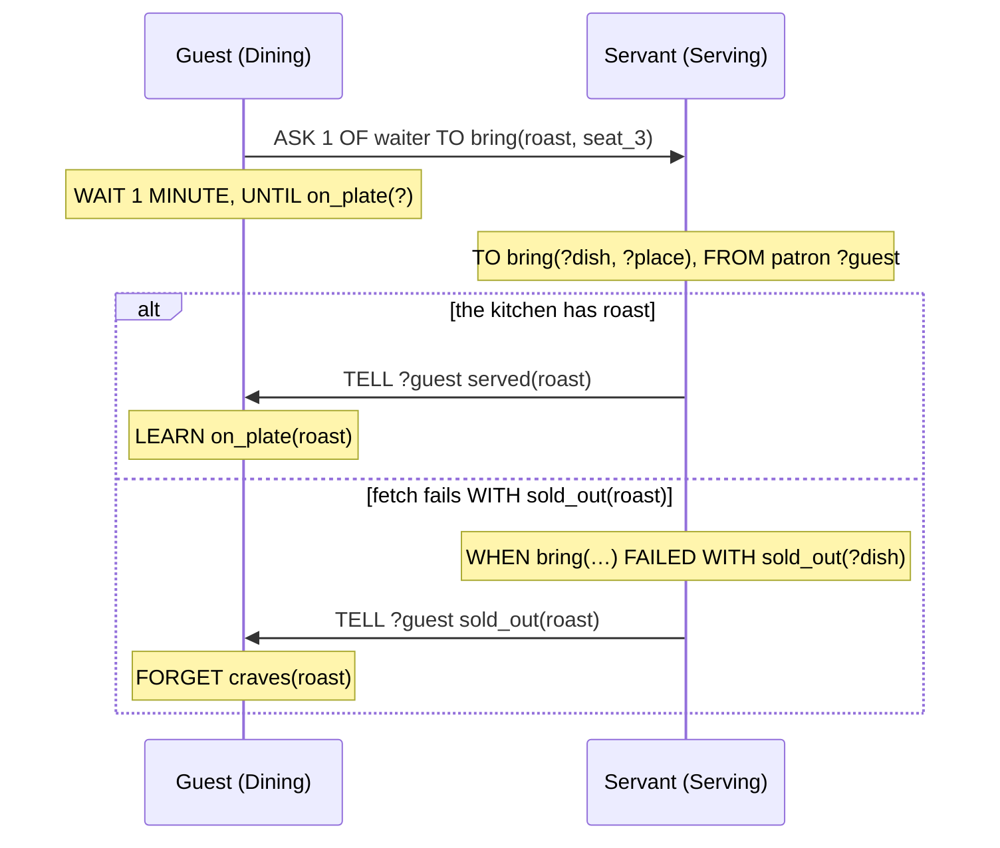
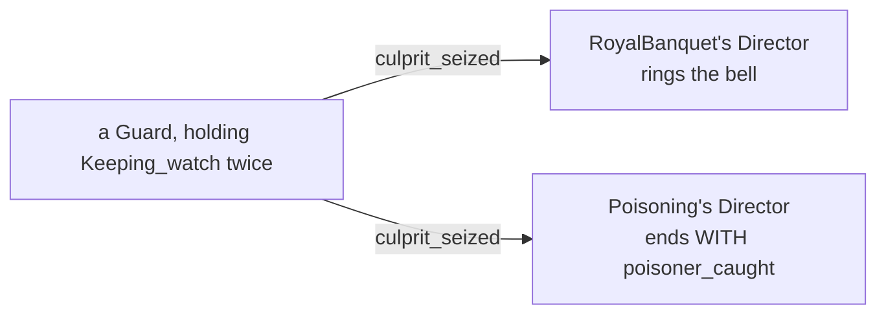

# Messages

A Guest at the table wants roast. It has no Plan for fetching one, and it can't make a Servant move: a Playbook describes its own Agent and nobody else. All it can do is say so. A Message is something one Agent sends to others: a Fact or a Cue with `TELL`, a request to pursue a Goal with `ASK … TO`, or a Cue for the Directors with `SIGNAL`. What happens next is decided by the Plans of whoever receives it.

| We write | It sends | To |
|---|---|---|
| `TELL <recipient> <fact or cue>` | a Fact or a Cue | an Agent, a Role, a count of a Role, or `EVERYONE` |
| `ASK <recipient> TO <goal>` | a request to pursue a Goal | the same |
| `SIGNAL <cue>` | a Cue | the Directors giving this Playbook |

Each name has one kind, so the Statement never says what it sends: the Vocabulary does. How a Playbook's Roles get their Agents is in *Playbooks and Roles*; what a Director sends is in *Plots and Directors*.

## Telling a Cue

[`playbooks/courtesy.regia`](../showcase/playbooks/courtesy.regia)
```regia
TO take_seat, FROM DIRECTOR:
    GIVEN seat(?place):
        DO walk_to(?place)               # waits until we have arrived
        DO sit_down
        TELL host greeting
    # no ELSE: with no seat laid for us, take_seat fails at once

WHEN take_seat FAILED:
    DO stand_by(wall)

WHEN take_seat ENDED: SIGNAL took_seat   # seated or standing, the Director counts us

WHEN greeting, FROM ?who:
    DO bow_to(?who)
```

Once seated, a Guest tells the Host `greeting`. `host` is a Role of the Playbook, and `greeting` a Cue. The Host holds `Courtesy` too, so the last Plan runs there, with `?who` filled by the Guest who spoke, and the Host bows.

- Sending never waits. The Guest's recipe is over as soon as the `TELL` is sent, whether or not the Host has bowed.
- A told Cue is the same Cue as one from the game. It starts a Plan and is gone; nothing is left to test. If no Plan runs for it, it is dropped, and the Trace notes it as unheard.
- A Message never comes back to its sender. The Host pursues `take_seat` too and tells `host`, which is the Host alone. That `TELL` reaches nobody, and that is not an error.
- `greeting` is declared inside `Courtesy`, a local Cue: only holders of the Playbook say it and hear it. A local Cue can be told, never Signalled.

**Checks**

- `TELL` with a Goal → `R0701` (hint: `ASK … TO`)
- `TELL` or `ASK … TO` with a local Fact or Goal, `SIGNAL` with a local Cue → `R1014`
- A told Cue for which no Plan of the receiver runs → `T0702` (Trace, `unheard`)

Spec: chapter 07.

## Recipients

[`playbooks/noble_socializing.regia`](../showcase/playbooks/noble_socializing.regia)
```regia
TO vent:
    GIVEN grudge(?foe, ?size) AND ?foe PLAYS peer, WEIGHT ?size:
        DO sneer_at(?foe)
        TELL ?foe insulted
        TELL EVERYONE scandal(?foe)
```

```regia
WHEN scandal(ME), FROM peer ?speaker:
    SHIFT sympathy BY -0.2
    TELL 50% OF peer wronged(ME, ?speaker)
    PURSUE resent(?speaker)
```

The first `TELL` goes to one Agent, the one `?foe` holds. The second goes to every Agent in the game but the speaker, `?foe` included: the victim hears the gossip about itself, matches `scandal(ME)`, and tells half of its peers who wronged it.

| We write | It reaches | In the showcase |
|---|---|---|
| `?foe` | the Agent a certainly-filled Placeholder holds | `TELL ?foe insulted` |
| `peer` | every Agent the Role reaches, except the sender | `TELL host greeting` (*courtesy*) |
| `1 OF waiter`, `50% OF peer` | that many of them, or that share, picked at random each time the Statement runs | `ASK 1 OF waiter TO bring(…)` (*dining*) |
| `EVERYONE` | every Agent in the game, except the sender | `TELL EVERYONE scandal(?foe)` |

- Regia never names an Agent. An Agent is reached through a Placeholder filled at runtime: by `FROM ?who`, by a Fact slot (`grudge(?foe, ?)`), or by a Pick. `TELL king greeting` is an error, and so is `TELL ME …`.
- One recipient per Statement. Reaching two takes two Statements.
- A Role is looked up when the Statement runs. In a Playbook, it reaches the Agents bound to it by every Giving the Agent holds, across Plots and Stagings (*Playbooks and Roles*).
- A share rounds up, against the Role without the sender: `50% OF peer` with seven other peers tells four.
- `EVERYONE` is the only audience that doesn't depend on a Plot. It reaches the Servants too, who have no Plan for `scandal`: each writes an unheard entry and nothing else.
- An Agent playing two Roles hears a `TELL` to each of them twice.
- A Director has two more recipients, `CAST` and a Role with `EXCEPT` (*Plots and Directors*).

What can go wrong at runtime ends in three different ways:

| The recipient is | What happens |
|---|---|
| a Role nobody else plays, `EVERYONE` with nobody else, a count that finds too few | nothing is sent, or fewer; the Plan goes on (a count writes a Trace warning) |
| a Placeholder holding an Agent that has left the Program | the Message is dropped, with a Trace entry; the Plan goes on |
| a Placeholder holding something that isn't an Agent | the Plan fails |

The last can't be caught at build. `grudge(person, size)` promises a person only through its Parameter name, and a grudge against `roast` fails `TO vent` at the first `TELL`, after the sneer.

**Checks**

- A Value in the recipient position, `ME` included → `R0704`
- A recipient Placeholder not filled, or not certainly filled → `R0304`, `R0305`
- A Role the Playbook or Plot doesn't declare → `R1502`
- A count on `EVERYONE`, `EXCEPT` in a Playbook → `R1506`, `R1510`
- A count asking for more Agents than the Role has left → `T1502` (Trace warning); a negative count → `T1503` (Trace warning)
- A recipient that has left the Program → `T1901` (Trace warning)
- A recipient that isn't an Agent at runtime → `T0701` (Trace, Failure)

Spec: chapter 07. For Roles in a Playbook and counted recipients, chapter 15. For leaving, chapter 19.

## Who sent it

[`playbooks/dining.regia`](../showcase/playbooks/dining.regia)
```regia
WHEN served(?dish), FROM waiter:
    GIVEN sated:
        DO push_away(?dish)
    ELSE:
        LEARN on_plate(?dish)
```

A Message arrives with its Sender, and a Trigger restricts or names it with `FROM`. Here `served` counts only if a `waiter` sent it. The showcase uses every form 1.5 has:

| We write | The Plan starts if | In the showcase |
|---|---|---|
| no `FROM` | anyone sent it, or nobody did | `WHEN saw_pouring(?who):` (*keeping_watch*) |
| `FROM waiter` | the Sender plays the Role | `WHEN served(?dish), FROM waiter:` |
| `FROM ?speaker` | anyone sent it; `?speaker` holds the Sender | `WHEN scandal(?), FROM ?speaker:` (*wagering*) |
| `FROM peer ?who` | the Sender plays the Role; `?who` holds it | `WHEN insulted, FROM peer ?who, …` (*noble_socializing*) |
| `FROM DIRECTOR` | a Director giving us this Playbook sent it | `TO take_seat, FROM DIRECTOR:` (*courtesy*) |

- What the game sends has no Sender, and neither has what the Agent does to itself. Any `FROM` leaves both out; no `FROM` takes them in.
- The Role is checked when the Message arrives, against who plays it then.
- The Sender is known to the Trigger only. A Body that needs it names it there, as `?who`. `?_who` names it and says it isn't used.

> **In 2.0** a Trigger can say "nobody sent it": `FROM GAME` for what the game sent, `FROM ME` for the Agent's own doing, and several forms joined with `OR`. Spec chapter 05, *The game and the Agent itself* and *Alternatives: `OR`*. In 1.5, `WHEN saw_pouring(?who):` in `Keeping_watch` also runs if another Agent tells a Guard `saw_pouring(?rival)`, and nothing in the Trigger can shut that out.

**Checks**

- `FROM GAME`, `FROM ME`, or `FROM` with `OR`, in a 1.5 build → `R0109`
- `FROM <Role>` or `FROM ?who` in a Plot where no Playbook the Plot gives Signals that Cue → `R3802` (warning)

Spec: chapter 05, chapter 07.

## Telling a Fact

[`plots/royal_banquet.regia`](../showcase/plots/royal_banquet.regia)
```regia
WHEN HonorDuel(?) FINISHED WITH duel_settled(?winner):
    ASK Host TO honour(?winner)
    ASSIGN Keeping_watch TO ?winner  # the winner stands guard of honour
    TELL ?winner on_duty
```

[`playbooks/keeping_watch.regia`](../showcase/playbooks/keeping_watch.regia)
```regia
WHEN on_duty LEARNED, FROM DIRECTOR:
    DO salute
```

`on_duty` is a Fact, so this `TELL` leaves something behind. The winner knows `on_duty` as if it had learned it by itself, and every `GIVEN on_duty` in `Keeping_watch` holds from here on.

A told Fact becomes the receiver's own, and nothing remembers who told it. The Sender is seen once, by a `LEARNED` Trigger:

- The Plan runs only if the Fact is new. A knight has known `on_duty` since its Role setup, so a knight who wins a duel is told something it knows already, and doesn't salute again.
- Only the first teller is heard. Two Agents telling the same Fact fire `LEARNED` once. Whether the Fact is new is decided when the Message arrives, not when the Plan runs.
- `FORGET on_duty` removes the Fact, however many Agents told it.

The showcase's Agent-to-Agent Fact is `wronged`, told by the victim of gossip to half its peers:

[`playbooks/noble_socializing.regia`](../showcase/playbooks/noble_socializing.regia)
```regia
WHEN wronged(?victim, ?offender) LEARNED, FROM peer:
    GIVEN grudge(?offender, ?):
        DO bow_to(?victim)
```

### A Fact or a Cue

Which one to tell is chosen by what the receiver should do with it. A Fact is for what lasts: the receiver can test it, and telling it again changes nothing. A Cue is for each telling: every one fires, with its own Sender, and leaves nothing to test. `TELL ?winner on_duty` and `TELL host greeting` read alike; only the Vocabulary says which is which, and the Visual Editor shows it.

A writer who needs to know who said what, to believe a rumour "once three people say it", tells a Cue and records the teller in a Fact of the receiver's own.

### Taking a told Fact back

No Message takes a Fact back. The receiver forgets it in its own Plans, usually in the Playbook the Fact belongs with:

[`playbooks/keeping_watch.regia`](../showcase/playbooks/keeping_watch.regia)
```regia
WHEN REMOVED:
    FORGET on_duty                       # the last Giving is gone, and the duty with it
```

`REMOVED` fires when the Agent's last Giving of `Keeping_watch` goes, so a knight who also won a duel stays on duty while it is still a Guard.

**Checks**

- A Fact Trigger without `LEARNED` or `FORGOTTEN` → `R0503`
- `FROM` on `FORGOTTEN` → `R0505` (nobody sends a forgetting)

Spec: chapter 07. For `LEARNED` and `FROM`, chapter 05. For `REMOVED`, chapter 15.

## Asking for a Goal

[`playbooks/dining.regia`](../showcase/playbooks/dining.regia)
```regia
TO have_dinner:
    GIVEN seat(?place):
        FOR EACH craves(?dish):
            ASK 1 OF waiter TO bring(?dish, ?place)
        WAIT 1 MINUTE, UNTIL on_plate(?)
```

[`playbooks/serving.regia`](../showcase/playbooks/serving.regia)
```regia
TO bring(?dish, ?place), FROM patron ?guest:
    PURSUE fetch(?dish)                  # waits: if fetching fails, so does bringing
    DO walk_to(?place)
    DO put_down(?dish)
    TELL ?guest served(?dish)
```

```regia
WHEN bring(?dish, ?) FAILED WITH sold_out(?dish), FROM patron ?guest:
    TELL ?guest sold_out(?dish)          # the Reason, told back by hand
WHEN bring(?dish, ?) FAILED, FROM patron ?guest:
    DO bow_to(?guest)                    # an apology, and nothing more to say
```

`ASK … TO` sends a request. `bring(roast, seat_3)` becomes the Servant's own Goal, like one it gave itself, and its `TO bring` recipe starts. `ASK` reads like the `TO` it starts on the other side.

- The asker doesn't wait. `ASK` returns at once; `PURSUE` is the one that waits. The Guest waits for its plate with a `WAIT … UNTIL` of its own.
- Every `ASK` starts a Pursuit of its own at the receiver, even for a Goal it already pursues with the same arguments.
- The receiver can't refuse. Its recipes and their Contexts decide what is done. A recipe that won't do it fails with a Reason; if no recipe applies, the Goal fails at the receiver.
- The Goal keeps its Sender. `FROM patron ?guest` on the recipe and on the ending Triggers is how both answers find their way back.
- `1 OF waiter` picks afresh each time: two dishes may go to two Servants.



> **In 2.0** whoever asked hears how the Goal ended, with the Reason of a Failure, on an ending Trigger that names who pursued it with `BY`. Spec chapter 05, *Who pursued it: `BY`*, and chapter 07, *Hearing how an asked Goal ended*. In 1.5 the asker hears nothing, so `Serving` tells the answers back by hand, and `sold_out` is both a Reason and a told Cue.

**Checks**

- `ASK … TO` with a Fact or a Cue → `R0702` (hint: `TELL`)
- A Plot's Mappings leave an `ASK` or `TELL` with no receiving Plan whose `FROM` admits the sender's Role → `R3803` (warning)
- `BY` on a Goal's ending, in a 1.5 build → `R0109`

Spec: chapter 07. For Pursuits, chapter 05; for what a failed Goal does, chapter 11.

## Signals

[`playbooks/wagering.regia`](../showcase/playbooks/wagering.regia)
```regia
WHEN duel_on, FROM DIRECTOR:
    GIVEN purse(?gold) AND ?gold >= 2:
        LET ?stake BE RANDOM(1, ?gold / 2)   # a whole roll, up to half the purse
        UPDATE purse(?gold) TO purse(?gold - ?stake)
        SIGNAL wagered(?stake)
        DO cheer
```

[`plots/honor_duel.regia`](../showcase/plots/honor_duel.regia)
```regia
WHEN wagered(?stake), FROM Spectator ?who:
    LEARN wager(?who, ?stake)
```

A Signal is a Cue sent to the Directors. It has no recipient: it goes to the Director of every Plot that currently gives the Agent the Playbook the `SIGNAL` is written in. `Wagering` is given by `HonorDuel`, so `wagered` reaches the duel's Director and not the banquet's. The Director handles it like any Cue, and `FROM` tells it which of its Roles the Sender plays.

- A Signal carries a Cue, never a Fact or a Goal, and never a local Cue.
- It is an Agent's only way to reach a Director. A Director plays no Role and no Placeholder holds it, so it is never a `TELL` or `ASK` recipient. A Director can't `SIGNAL`.
- A Playbook never names a Plot. Who hears a Signal is decided by who gave the Playbook, as with `FROM DIRECTOR` the other way.

Where a Signal goes is not on its line. `Keeping_watch` is given to the Guards by `RoyalBanquet` and again by `Poisoning`:

[`playbooks/keeping_watch.regia`](../showcase/playbooks/keeping_watch.regia)
```regia
WHEN saw_pouring(?who):
    DO seize(?who)
    SIGNAL culprit_seized(?who)          # reaches every Director that gave us this Playbook
```



A Signal that finds no Plan in the Director's current Phase is dropped with an unheard entry. `insult_thrown`, sent from `NobleSocializing` during `reception`, finds a Plan only in `feast`, and nothing follows.

**Checks**

- `SIGNAL` with something that isn't a Cue → `R0703`
- `SIGNAL` in a Director → `R2001`
- A Plot gives a Playbook that Signals a Cue the Plot has no Plan for in any Phase → `R3801` (warning)
- A Signal with no Plan in the Director's current Phase or `DURING PLOT` → `T3801` (Trace, `unheard`)

Spec: chapter 07. For the Director's side, chapter 20; for what a Plot and a Playbook must agree on, chapter 38.

## A conversation

[`playbooks/duelling.regia`](../showcase/playbooks/duelling.regia)
```regia
WHEN hit, FROM opponent, SHIFTS aggressiveness BY 0.1:
    GIVEN stamina(?now) AND ?now > 1:
        UPDATE stamina(?now) TO stamina(?now - 1)
    GIVEN stamina(?now):
        FORGET stamina(?now)
        DO drop_sword
        TELL opponent yielded
    # no ELSE: a hit after we have yielded changes nothing

WHEN yielded, FROM opponent:
    DROP strike                          # no more lunges at a beaten opponent
    DO salute
    SIGNAL duel_won
```

A duel is two Agents telling each other Cues until one yields. No Statement waits for an answer, so an exchange is written as Plans that answer Messages, and the Facts each side keeps hold it together. The three Cues, `challenged`, `hit` and `yielded`, are declared in `Duelling` itself: only duellists say them.

Two things are promised about delivery:

- Messages from one sender to one receiver arrive in the order they were sent. In `TO vent`, the victim gets `insulted` before `scandal`. Across senders nothing is promised: the two duellists' hits may cross.
- A Message is never lost while its receiver is in the Program. When it arrives is up to the Target.

A Message Statement takes no trailing clause: `ASK ?who TO fight, AND WAIT` is an error, as is any other. The kind words `TOLD`, `AGREED` and `REFUSED`, and the Statement `REFUSE`, are reserved for a later version in which Agents answer each other.

**Checks**

- A trailing clause on `TELL`, `ASK` or `SIGNAL` → `R0705`
- `TOLD`, `AGREED`, `REFUSED` or `REFUSE` used → `R0706`

Spec: chapter 07.

## How this combines with…

### Playbooks and Roles

[`plots/royal_banquet.regia`](../showcase/plots/royal_banquet.regia)
```regia
ROLE Guest:
    ASSIGN Dining, MAPPING Servant AS waiter
ROLE Servant:
    ASSIGN Serving, MAPPING Guest AS patron
```

The dinner works because of these two Mappings. `ASK 1 OF waiter` in `Dining` reaches the Servants through the first, and `FROM patron` in `Serving` recognises the Guests through the second. The Transpiler checks that every `ASK` and `TELL` the Mappings connect has a Plan on the other side whose `FROM` lets the sender in.

An Agent holding a Playbook through several Givings has, for each Role, everyone bound by any of them. A Guest in two duels at once has both opponents as `opponent`, and each `TELL opponent hit` strikes both. (*Playbooks and Roles*, *Subplots and Stagings*)

### Goals and Failure

A sender's Plan fails on a Message in one case only: a recipient that isn't an Agent. Everything else goes wrong at the receiver. A Message already sent stays sent when the Plan fails later: a Guest whose `walk_to(door)` is refused in `TO take_leave` has already greeted the Host. (*Goals and Failure*)

### Precedence and Labels

A Message is delivered to an Agent, whichever Playbooks it holds. `scandal` has Plans in `NobleSocializing`, `Keeping_watch` and `Wagering`, and a knight watching a duel holds all three. One Plan runs; `PRECEDENCE` in the Plots that gave them decides which. (*Precedence and Labels*)

### Matching

`FOR EACH craves(?dish): ASK 1 OF waiter TO bring(?dish, ?place)` sends one request per Match. In `HonorDuel` a Pick chooses the recipient: `GIVEN wager(?backer, ?stake), HIGHEST ?stake, RANDOMLY:` and then `ASK ?backer TO give_signal`. (*Matching*)

### Subplots and Stagings

A Signal from a Playbook a Subplot gave reaches the Subplot's Director, and the parent's Director hears nothing of it. The parent learns how the Subplot went from its Outcome. (*Subplots and Stagings*)

### When an Agent leaves

A Message to an Agent that has left is dropped and doesn't fail the sender. A Role recipient needs no such care: it is looked up when sent, so once the Defender has walked out, the Challenger's `opponent` is a Role nobody plays. (*When an Agent leaves*)

### Interfaces

Nothing in a Playbook declares what it sends or expects. The Transpiler works out each Playbook's Interface from its `TELL`, `ASK`, `SIGNAL` and `FROM` lines, and checks it against the Plots that give it. (*Interfaces*)
