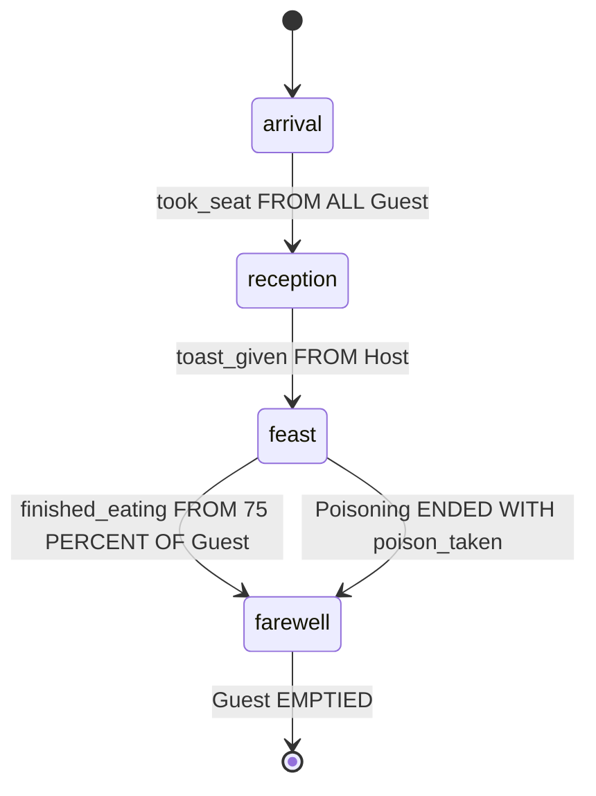

No Guest decides that the feast has begun. Each of them sits down, chats, eats and leaves, and none of them knows that the evening has four parts. That knowledge is in the Plot. A Plot names the Roles of a scenario and the Phases it goes through, and its Plans belong to a Director, the agent behind the scenes that moves the Plot from one Phase to the next, hands out Playbooks, and tells and asks the Agents playing its Roles.

*The Logic of Regia* read the first half of `RoyalBanquet` line by line. Givings, Mappings and `UNASSIGN` are in *Playbooks and Roles*, and a Director's `TELL` and `ASK` in *Messages*. *Subplots and Stagings*, *Quotas and Cast Changes* and *Precedence and Labels* take up the three things this chapter only points at.

## A Plot

`showcase/plots/poisoning.regia`
```regia
IMPORT "../vocabulary".
IMPORT "../playbooks/scheming".
IMPORT "../playbooks/keeping_watch".

#@desc: Someone at the table means harm. No Phases: it runs until the poison is taken or the Poisoner caught.
PLOT Poisoning:
    ROLE Poisoner STARTS WITH:
        ASSIGN Scheming.
    ROLE Watchman STARTS WITH:
        ASSIGN Keeping_watch.                # a second Giving of what the Guards already hold

    DURING PLOT:
        WHEN poison_poured FROM Poisoner:
            WAIT 30 SECONDS.                 # the Watchmen's chance
            END PLOT WITH poison_taken.

        WHEN culprit_seized(?who) FROM Watchman:
            END PLOT WITH poisoner_caught(?who).

        WHEN Poisoner EMPTIED:
            END PLOT.
```

This is the smallest Plot of the showcase, and it is whole. It has two Roles, each with the Playbook its Agents start with, and three Plans. The Plans are the Director's. They are built like an Agent's, a Trigger and a Body, and they sit in a `DURING` Block. `DURING PLOT` holds the Plans that apply for as long as the Plot runs.

Every Trigger here is something the Director hears about its Agents: a Signal from the Poisoner, a Signal from a Watchman, the last Poisoner leaving the hall. Every Body ends the Plot. In between, the Director does nothing, and the Poisoner and the Watchmen act out of `Scheming` and `Keeping_watch`.

A `PLOT` Block can hold five things, and the showcase writes them in this order: `ROLE` lines, `PHASE` lines, Local Vocabulary, one `PRECEDENCE` Block, and `DURING` Blocks. `Poisoning` has the first and the last.

- A Plot's name is in the one namespace of the Program, with the Vocabulary and the Playbooks. Declaring a Plot twice is an error.
- Role and Phase names are local to their Plot. `HonorDuel` could have a `Guest` of its own. Inside one Plot, two Roles or two Phases can't differ only in case.
- `PHASE` and `DURING` belong to Plots. In a Playbook they are errors.
- A running copy of a Plot is a Staging, and each Staging has a Director of its own. Two duels at once are two Directors.

Spec: chapter 20. For names, chapter 10.

## Roles of a Plot

`showcase/plots/royal_banquet.regia`
```regia
DURING PLOT:
    WHEN Guest ?late JOINED:
        TELL Host guest_arrived(?late).
    …
    WHEN Host EMPTIED:
        END PLOT.
```

A Playbook's Role is an address. A Plot's Role is played: at any moment a set of Agents is cast in it, and that set is what the name means wherever the Director uses it.

| Where | In the showcase | Meaning |
|---|---|---|
| a recipient | `TELL Host guest_arrived(?late).` | the Agents playing `Host` now |
| after `FROM` | `WHEN toast_given FROM Host:` | the Sender plays `Host` |
| after `FROM`, with a quantity | `WHEN took_seat FROM ALL Guest:` | a Quota over the Role |
| before `JOINED`, `LEFT`, `EMPTIED` | `WHEN Host EMPTIED:` | the Role's cast has changed |
| the target of `ASSIGN` and `UNASSIGN` | `ASSIGN Dining TO Guest, …` | the Role, now and later |
| the left side of a `MAPPING` | `MAPPING Servant TO waiter` | the Role fills another one |

Who plays a Role is never written in the Plot. For `RoyalBanquet` it comes from Instancing: a `noble` plays `Guest`. For a Subplot it comes from the `MAPPING` clauses of the `START SUBPLOT` that started it. The Agents playing a Plot's Roles in one Staging are its Cast. The Cast is set when the Staging starts and changes only when an Agent enters or leaves the Program.

- An Agent can play several Roles of one Plot. A `knight` is a `Guest` and a `Guard`, and in a duel both duellists are also `Spectator`.
- A Role can be empty. An `ASSIGN` to it gives to nobody for the time being, and a Message to it reaches nobody. Neither is an error.
- A Role's name is not a Value. `DO point_at(Host)` is an error, as in a Playbook.

When a Plan needs one Agent of a Role and not the Role, it has to be handed one. `FROM Guest ?offended` gives the Guest who sent the Signal, `WHEN Guest ?late JOINED` the one who came in, and an Outcome can carry one up from a Subplot.

`#revise` A Director can't name an Agent of its own Cast. `HonorDuel` has a `Challenger` and a `Defender`, one Agent each, and still can't write "the Challenger" as a Value. To end with `duel_settled(?winner)` it waits for the winner to Signal `duel_won`, so that `FROM ?winner` fills the Placeholder.

Spec: chapter 15, chapter 20. For Casts, chapters 17 and 19.

## Role setup

`showcase/plots/royal_banquet.regia`
```regia
PLOT RoyalBanquet:
    ROLE Host STARTS WITH:
        ASSIGN Courtesy, MAPPING Host TO host.
        PURSUE take_seat.
    ROLE Guest STARTS WITH:
        ASSIGN Courtesy, MAPPING Host TO host.
        LEARN purse(RANDOM(5, 20)).
        LEARN craves(roast).
        LEARN craves(pie).
        PURSUE take_seat.
    ROLE Servant STARTS WITH:
        ASSIGN Courtesy, MAPPING Host TO host.
    ROLE Guard STARTS WITH:
        ASSIGN Courtesy, MAPPING Host TO host.
        ASSIGN Keeping_watch.
        LEARN on_duty.
```

`ROLE Guard.` declares a Role. `ROLE Guard STARTS WITH:` declares it and opens a Block, the Role setup, saying what each of its Agents gets when it starts playing the Role. A Guard starts with two Playbooks and the Fact `on_duty`. A Guest starts with manners, a purse, two cravings and a seat to find.

A setup holds three kinds of Statement and nothing else:

| Statement | Gives the Agent | It arrives as |
|---|---|---|
| `ASSIGN <Playbook>[, MAPPING …]` | a Giving of the Playbook | a Giving made to the Role |
| `LEARN <fact>` | the Fact | told by the Director |
| `PURSUE <goal>` | the Goal | asked by the Director |

The setup speaks for the Director. That is why `TO take_seat FROM DIRECTOR` in `Courtesy` answers the `PURSUE`, and why a Plan on `on_duty LEARNED FROM DIRECTOR` would run for a new Guard. The `PURSUE` never waits, since it is a request and the setup goes on to its next line.

- There is no Context, no `IF` and no Placeholder: nothing is matched, so nothing could fill one. Arguments are Values and Expressions.
- The Statements run in the order written. A `PURSUE` above the `ASSIGN` that gives its recipe finds no Plan and fails, so the `ASSIGN`s go first. The Transpiler warns when it sees the other order.
- The `ASSIGN` has no `TO`, and takes whole-Role Mappings only (*Playbooks and Roles*).
- A Statement that can't be carried out is skipped with a warning in the Trace, and the rest still run. A setup is not a Plan and can't fail.

A setup runs at two moments. When the Staging starts, every Role's setup runs for the starting Cast, in the order the Roles are declared, before the first Phase is entered. Later, when an Agent Joins, the setups of its Roles run for that Agent alone. A `knight` gets the `Guest` setup and the `Guard` setup. It is asked for `take_seat` once and holds `Courtesy` twice over, which changes nothing since both Givings bind `host` to the Host.

What a setup gave is not taken back as a unit. The Playbooks are Givings of the Staging and go when it ends, or when an `UNASSIGN` names them. The Facts are the Agent's own from the moment they were told and stay. So a Watchman of `Poisoning` loses its second `Keeping_watch` when the Subplot ends, and a Guard keeps `on_duty` after the banquet.

`#revise` `LEARN on_duty.` in the Guard setup and `TELL ?winner on_duty.` in `DURING PLOT` do the same thing to an Agent, in two spellings. Written in a Director's Plan, `LEARN on_duty.` would mean a third thing, a Fact of the Director itself. *Goals and Failure* has the same note for `PURSUE`, which waits in a Body and is an `ASK` here.

`#revise` A setup is the same for every Agent of the Role, and Instancing gives only Propensity values. A starting Fact that differs from one Guest to the next can't be written. Every Guest craves roast and pie, and the purses differ only because of a roll. *Randomness* notes that the spec doesn't say whether that roll is made per Agent.

`#revise` `ASSIGN Courtesy, MAPPING Host TO host.` is written four times, once per Role. A Plot has no way to say "everyone in it", in a setup or as a recipient.

`#revise` The setups run before the first Phase is entered, and a Quota starts counting when its Phase is entered. A Guest whose `take_seat` finished at once would Signal `took_seat` to a Director not yet in `arrival`, and `FROM ALL Guest` would wait for it for good.

Spec: chapter 16. For joining, chapter 19.

## Phases

`showcase/plots/royal_banquet.regia`
```regia
    PHASE arrival INITIAL.
    PHASE reception.
    PHASE feast.
    PHASE farewell.
```

A Phase is a state of the Plot. The Plot is in exactly one at a time, starts in the one marked `INITIAL`, and changes only when a Plan of its Director says `TRANSITION TO`. Each Phase can have one `DURING <phase>` Block holding the Plans that react while the Plot is in it.



The four lines of the snippet say none of this. The arrows are `TRANSITION` Statements in four Bodies, one of them in `DURING PLOT`, and each label is the Trigger of the Plan that holds it. `Host EMPTIED` ends the Plot from any Phase and is left out of the drawing.

- A Plot that declares Phases marks exactly one `INITIAL`, even if it has a single Phase. The order of the `PHASE` lines means nothing.
- A Plot may declare none, as `Poisoning` does. It then has only its setups and `DURING PLOT`, and a `TRANSITION` in it is an error.
- A Phase takes at most one `DURING` Block, and a Plot at most one `DURING PLOT`. All the Plans of a Phase are in one place.
- A Phase with no Block is allowed. It is a quiet state that `DURING PLOT` Plans move on. So is a Phase that nothing leaves, such as `farewell`.
- A `DURING` or a `TRANSITION TO` naming a Phase the Plot doesn't declare is an error. A Phase that no `TRANSITION` reaches and that isn't `INITIAL` gets a warning.

Givings, Subplots and the Director's Facts belong to the Staging, and all of them outlive the Phase in which they were made. `NobleSocializing` is given in `reception` and held through `feast`. A duel started in `feast` would go on through `farewell` if the entry Plan there didn't end it. A Phase owns only the Plans of its Block while they run, and the counts of its Quota Triggers.

`#revise` Which Phase follows which is written nowhere in one piece. To draw the diagram above we read every Body of the Plot, `DURING PLOT` included. The `PHASE` lines look like a sequence and are not one.

Spec: chapter 20.

## Entering and leaving a Phase

`showcase/plots/royal_banquet.regia`
```regia
DURING feast:
    WHEN ENTERED:
        ASSIGN Dining TO Guest, MAPPING Servant TO waiter.
        ASSIGN Serving TO Servant, MAPPING Guest TO patron.
        ASK Guest TO have_dinner.
        START SUBPLOT Poisoning, MAPPING 1 OF Guest TO Poisoner, MAPPING Guard TO Watchman.

    WHEN insult_thrown(?offender) FROM Guest ?offended:
        START SUBPLOT HonorDuel,
            MAPPING ?offended TO Challenger,
            MAPPING ?offender TO Defender,
            MAPPING Guest TO Spectator.

    WHEN finished_eating FROM 75 PERCENT OF Guest:
        TRANSITION TO farewell.

    WHEN EXITED:                         # however the feast ends: the Quota above, or the poison
        DO clear_tables.
```

`WHEN ENTERED:` and `WHEN EXITED:` are Triggers with no name in them. Their subject is the Block they are written in: this `ENTERED` fires when the Plot enters `feast`, this `EXITED` when it leaves it. The entry Plan sets the Phase up. The exit Plan runs whichever Plan caused the leaving, here the Quota two Plans above or the `poison_taken` Plan in `DURING PLOT`, which is the reason to have one.

`TRANSITION TO farewell.` does four things in order:

1. It stops every Plan of the `feast` Block that is still running.
2. It runs `feast`'s `EXITED` Plan to its end.
3. It makes `farewell` the current Phase and clears the Quota counts of `feast`.
4. It starts `farewell`'s `ENTERED` Plan.

The `ENTERED` Plan is an ordinary Plan of its Phase: it can `WAIT`, and it is stopped like any other if the Phase is left while it runs. The `EXITED` Plan has to finish before the new Phase begins, so `WAIT`, `TRANSITION` and `END PLOT` are errors in it.

- `TRANSITION` ends its Body. A Statement after it in the same branch is an error.
- The Plans stopped in step 1 have not failed. Nothing is written as a Failure and nothing they did is undone.
- A `TRANSITION` to the current Phase leaves it and enters it again: `EXITED` runs, the counts are cleared, `ENTERED` runs. This is how a round is restarted.
- `DURING PLOT` Plans are not touched by a `TRANSITION`.

Because leaving stops the Plans of a Phase, a `WAIT` can serve as a rough timeout:

`showcase/plots/honor_duel.regia`
```regia
DURING fighting:
    WHEN ENTERED:
        ASK Challenger TO fight.
        ASK Defender TO fight.
        WAIT 2 MINUTES.                  # a rough timeout: never reached if the duel ends first
        END PLOT WITH duel_abandoned.
```

If a duellist wins within two minutes, the Plan on `duel_won` ends the Plot and this Body is stopped in its `WAIT`. If nobody does, the last line runs.

`#revise` The timeout of a Phase is the tail of its entry Plan. It has to be the last thing that Plan does, there can be only one, and a reader finds it by noticing a `WAIT` near the bottom. The spec keeps delayed Triggers for after 2.0.

`#revise` `WAIT` is an error in an `EXITED` Plan because the exit has to finish. `DO clear_tables.` waits for the game all the same, and until the game answers the Plot is between `feast` and `farewell`.

`#revise` An `EXITED` Plan can't tell where the Plot is going, nor an `ENTERED` Plan where it came from. `farewell` is entered after a feast eaten to the end and after a poisoning, and its entry Plan says the same goodbye in both cases. Telling them apart takes a Fact that the Director learns just before the `TRANSITION`.

Spec: chapter 20. For `WAIT`, chapter 12.

## `DURING PLOT`

`showcase/plots/royal_banquet.regia`
```regia
DURING farewell:
    …
    WHEN Guest ?late JOINED:             # Messages aren't replayed, so we ask again
        ASK ?late TO take_leave.

DURING PLOT:
    WHEN Guest ?late JOINED:
        TELL Host guest_arrived(?late).
    …
    WHEN Poisoning ENDED WITH poison_taken:
        TRANSITION TO farewell.              # the evening is cut short
```

The Plans of `DURING PLOT` apply in every Phase and stop only when the Staging ends. They are for what can happen at any point of the evening: a latecomer, a duel ending, the Host leaving the hall. They can move the Plot like any other Plan, and `poison_taken` sends it to `farewell` from wherever it is.

When a Phase's Block and `DURING PLOT` have the same Trigger, one Plan runs, and by default it is the Phase's. A Guest who arrives during `farewell` is asked to take leave, and the Host is not told. In the other three Phases the Host is told and bows. The Plot can turn the default around in its `PRECEDENCE` Block (*Precedence and Labels*).

`DURING PLOT` takes `WHEN ENTERED:` and `WHEN EXITED:` too. `ENTERED` fires when the Staging starts, after the setups, and it starts before the first Phase's own entry Plan. `EXITED` fires when the Staging ends, after the current Phase's. A Director has no `STARTS WITH` of its own, so this is where it learns its starting Facts:

```regia
DURING PLOT:
    WHEN ENTERED:
        LEARN round(1).
```

`#revise` The Phase's Plan replaces the Plot's and can't add to it. For a latecomer in `farewell` we would want both, the Host's bow and the request to leave, and getting them means copying the `TELL` into the `farewell` Plan.

`#revise` No condition asks which Phase the Plot is in. `TRANSITION TO farewell` in `DURING PLOT` would enter `farewell` a second time if the Plot were already there, and every Guest would be asked to leave twice. It can't happen here only because `farewell` ends `Poisoning` on entry, and a Subplot ended by its parent reports no Outcome.

`#revise` A Signal that reaches a Director with no Plan for it in the current Phase is lost, and nothing says so. A Guest who takes an insult badly during `reception` Signals `insult_thrown`, which only `feast` handles. The Guest has stood up and no duel follows.

Spec: chapter 20. For which Block wins, chapter 13.

## What a Director knows

`showcase/plots/honor_duel.regia`
```regia
PLOT HonorDuel:
    …
    FACT wager(person, stake)
    …
    DURING challenge:
        WHEN wagered(?stake) FROM Spectator ?who:
            LEARN wager(?who, ?stake).
```

A Director has Facts of its own. Some are reported to it by the game, as to an Agent. The rest it keeps itself with `LEARN`, `FORGET` and `CHANGE`, and the natural place to declare those is the Plot, as Local Vocabulary. `wager` is the Director's note of who bet what. It is learned in `challenge` and still there in `fighting`, since Facts belong to the Staging. Another duel running at the same time has its own Director and its own wagers.

A Director never reads the Facts of its Agents. A `GIVEN` in a Plot tests the Director's Facts and nothing else. Whatever it needs from an Agent has to arrive as a Signal, which is why a Spectator's stake travels as `wagered(?stake)` and is written down on arrival.

The Plans of a Director are otherwise an Agent's Plans with some parts missing and some added:

| | In a Director |
|---|---|
| Context, `IF`, `FOR EACH`, Picks, `COUNT`, Random choice | as in an Agent, over its own Facts |
| `DO`, `LEARN`, `FORGET`, `CHANGE`, `TELL`, `ASK`, `PRINT`, `FAIL`, `WAIT` | allowed |
| `TO` recipes, `PURSUE`, `DROP`, `DROPPED` and `FAILED` Triggers | errors: a Director has no Goals |
| `SIGNAL`, and `FROM DIRECTOR` on a Trigger | errors: it is the one Signals go to |
| Labels | errors: it has no Propensities |
| `ENTERED`, `EXITED`, `JOINED`, `LEFT`, `EMPTIED`, `ENDED` Triggers | for Directors only |
| Director Statements | for Directors only |

`DO open_doors.` in `arrival` is a Custom Action done by the Director itself, written as an Agent would write it. A Director's Plan can fail, on a refused `DO` or a `FAIL`. It then stops with an entry in the Trace and the Plot stays in its Phase (*Goals and Failure*).

`#revise` The wagers are a copy the Director keeps by hand, and nothing keeps it true. A Spectator who walks out leaves its `wager` behind. The Pick in `challenge` can then choose it, and the `ASK` to give the signal goes to nobody.

`#revise` A `GOAL` can be declared inside a Plot, and nothing can use it. The Director can't pursue it and a local item can't be sent.

Spec: chapter 20. For Local Vocabulary, chapter 10.

## Director Statements

`showcase/plots/royal_banquet.regia`
```regia
DURING farewell:
    WHEN ENTERED:
        END SUBPLOT HonorDuel.
        END SUBPLOT Poisoning.
        UNASSIGN NobleSocializing FROM Guest.
        UNASSIGN Dining FROM Guest.
        UNASSIGN Serving FROM Servant.
        ASK Guest TO take_leave.
```

Six Statements change the Plot itself. Only a Director's Plan can hold them.

| Statement | What it does | Chapter |
|---|---|---|
| `ASSIGN <Playbook> TO <target>[, MAPPING …]` | makes a Giving | *Playbooks and Roles* |
| `UNASSIGN <Playbook> FROM <target>` | removes the Givings that fit | *Playbooks and Roles* |
| `TRANSITION TO <phase>` | changes the Phase and ends the Body | this one |
| `START SUBPLOT <Plot>[, MAPPING …]` | starts a Staging below this one | *Subplots and Stagings* |
| `END SUBPLOT <Plot>` | ends every Staging of that Plot that this one started | *Subplots and Stagings* |
| `END PLOT [WITH <event>]` | ends this Staging and ends the Body | this one |

Together with `TELL` and `ASK`, this is all a Director can do to its Agents. It gives them Plans, casts them, informs them and asks them. It never performs an Action through them, and what follows a request is decided by the Agent's own Plans.

- A Director Statement never fails. `END SUBPLOT HonorDuel` with no duel running does nothing, and so does an `ASSIGN` to an empty Role.
- Where a Role can be the target, so can a Placeholder holding one Agent: `ASSIGN Keeping_watch TO ?winner.` Such a Giving goes to that Agent alone.
- A Giving, a Mapping or a Message that reaches an Agent who has left the Program is dropped, with a warning in the Trace.
- None of them reports back. After `ASK Guest TO take_leave` the Director learns that Guests are leaving only from `LEFT` and `EMPTIED`.

Spec: chapter 20, chapter 15.

## Ending a Plot

`showcase/plots/royal_banquet.regia`
```regia
DURING farewell:
    …
    WHEN Guest EMPTIED:
        END PLOT.
```

`END PLOT.` ends the Staging its Director runs. In order: the running Plans of the current Phase are stopped and the Phase's `EXITED` Plan runs, as for a `TRANSITION`. Then `DURING PLOT`'s `EXITED` Plan runs. Then every Subplot this Staging started is ended, the innermost first. Each Staging that ends takes its Givings with it, so its Playbooks stop for the Agents who held them only from there.

Like `TRANSITION`, `END PLOT` ends its Body, and it is an error in an `EXITED` Plan. With `WITH <event>` the ending carries an Outcome for the Plot that started this one, which is how `Poisoning` reports `poison_taken` or `poisoner_caught(?who)` (*Subplots and Stagings*).

When the last Guest has left the hall, `RoyalBanquet` ends. The Host, the Servants and the Guards are still in the game. They have lost `Courtesy` and everything else the Plot gave them, and they keep their Facts.

Spec: chapter 17, chapter 20.

## The Root Plot

`showcase/banquet.regin`
```regia
IMPORT "plots/royal_banquet".

ROOT RoyalBanquet.

AGENT king PLAYS Host:
    COUNT 1.
```

A Program has exactly one Root Plot. It is the only Plot that starts by itself, in one Staging, when the Program starts. Every other Plot runs only as a Subplot, started by a `START SUBPLOT` somewhere below the Root Plot. Two stories that run side by side are two Subplots of it.

- The `ROOT` line can be left out when exactly one Plot of the Program is never started as a Subplot. That is the case here, and the showcase writes the line anyway.
- An Agent kind plays Roles of the Root Plot and of no other. Roles further down are filled by Mappings.
- An Agent that Joins the Program joins the Root Plot. It is never added to a Subplot already running.
- A `WITH` on the Root Plot's `END PLOT` has nobody to tell and is ignored with a warning.
- A Plot the Root Plot can never reach is compiled and never runs. The Transpiler warns about it.

`#revise` Nothing in `royal_banquet.regia` says that it is the Root Plot, and much depends on it. Had the banquet been a Subplot of a wider `Castle`, the file would read the same. Its `WHEN Guest ?late JOINED` Plans would never run, no latecomer could become a Guest, and the kinds would have to play Roles of `Castle`.

Spec: chapter 21. For joining, chapter 19.

## How this combines with…

### Messages and Givings

`ASSIGN Dining TO Guest, …` and `ASK Guest TO have_dinner.` stand two lines apart in the entry Plan of `feast`. The Giving is standing and reaches every later Guest. The request reaches the Guests of that moment. Anything every Agent of a Role must get, whenever it arrives, belongs in the Role setup. (*Messages*, *Playbooks and Roles*)

### Quota Triggers

`showcase/plots/royal_banquet.regia`
```regia
DURING arrival:
    WHEN ENTERED:
        DO open_doors.

    WHEN took_seat FROM ALL Guest:
        TRANSITION TO reception.
```

A Quota Trigger in a Phase counts from the moment the Phase is entered until it is left. Signals sent before that are not counted, and the count is thrown away on exit. Re-entering a Phase starts every count of its Block again. A Quota in `DURING PLOT` counts from the start of the Staging to its end. (*Quotas and Cast Changes*)

### Cast changes

For an Agent that Joins, three things happen in a fixed order: the setups of its Roles, then the standing Givings of those Roles in the order they were made, then the Director's `JOINED` Plan. By the time `TELL Host guest_arrived(?late)` runs, the latecomer already holds `Courtesy`. The starting Cast sets off no `JOINED`: it gets the setups and the first Phase's entry Plan. (*Quotas and Cast Changes*)

### Subplots and Stagings

A Subplot is a Plot like any other, with a Director, Facts and Phases of its own. Parent and Subplot share no Facts. They meet in the `MAPPING` clauses when it starts and in the Outcome when it ends. A Subplot belongs to the Staging that started it and not to the Phase, which is why `farewell` has to end the duels of `feast` by hand. (*Subplots and Stagings*)

### Precedence

A Playbook given by a setup is one of the Playbooks the Plot gives out, and is named in `PRECEDENCE:` like the rest: `Keeping_watch OVER NobleSocializing ON scandal.` orders a setup's Playbook against a Phase's. The same Block can order the Director's own Blocks against each other. (*Precedence and Labels*)

### Failure

A refused `DO open_doors` fails the entry Plan of `arrival` and leaves the Plot in `arrival`, where it goes on counting seats. A failing `EXITED` Plan doesn't hold a `TRANSITION` back: the failure is written to the Trace and the new Phase is entered. (*Goals and Failure*)

### Randomness

Random choice works in a Director's Body as in an Agent's, and so does a counted target or Mapping, which is how one Guest in the hall becomes the Poisoner. A setup takes rolls in its Expressions and no draws: a counted Mapping is an error there. (*Randomness*)

### Translation to ASL

On Jason, a Director is an agent of its own, one per Staging, and its Facts are that agent's beliefs. The current Phase is one of them. A `TRANSITION` is a single uninterrupted step that drops the old Phase's Plans, runs `EXITED` and changes the belief, and the `ENTERED` Plan is started after it as an ordinary Plan. (*Translation to ASL*)

### The Visual Editor

The Phase map draws a Plot as the diagram in *Phases* does: Phases as boxes, a labelled arrow for every `TRANSITION`, and the endings. It is read off the Bodies each time, since the source has no other record of it. (*The Visual Editor*)

## Since 1.0

A 1.0 Plot already had Roles, Phases with one `INITIAL`, `DURING` Blocks, a `DURING PLOT`, and the same Director Statements. Its Director could do more to an Agent: it ordered Actions directly. What it knew was left open, and every Role started empty.

`#changes` `ON ENTER` and `ON EXIT` are the Triggers `WHEN ENTERED` and `WHEN EXITED`. What a `TRANSITION` does, step by step, is defined, and so is what an `EXITED` Plan may not contain.

`#changes` A Director no longer orders an Action through a Role (`Host DO call_guards`). It asks with `ASK` and tells with `TELL`, and the Sender is `DIRECTOR`.

`#changes` The Director's own Actions are written `DO …`. `WORLD` is gone.

`#changes` Role setup (`ROLE … STARTS WITH:`) is new. The primer asked for "some sort of role instantiation".

`#changes` What a Director knows is defined: the Facts the game reports to it and the ones it keeps itself, never its Agents'. A Plot can declare Local Vocabulary for them. A Director still has no Goals, which the primer left open.

`#changes` A Plot may declare no Phases.

`#changes` `PRIORITY 9` on a Director's Plan is gone. A Phase's Plan goes before `DURING PLOT`'s, and the `PRECEDENCE` Block changes that.

`#changes` Leaving a Phase stops its running Plans, without Failure.

`#changes` The Root Plot is part of the language: one per Program, named with `ROOT` or inferred.

`#changes` The `PLOT` header ends in `:` like every Block header.
