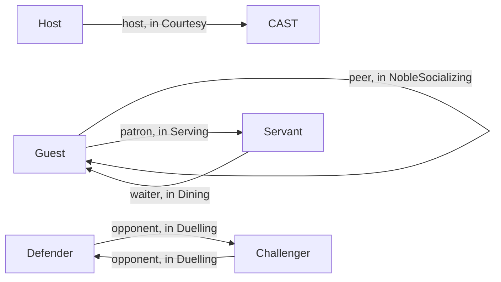

# Playbooks and Roles

A Guest who wants roast writes `ASK 1 OF waiter TO bring(…)`. Neither the Guest nor `Dining` knows who the waiters are. A Playbook is a named set of Plans for one Agent, written without knowing the scene it will be used in. Where its Plans talk to others, it declares Roles of its own, and the Plot that gives the Playbook fills them with a Mapping. Each `ASSIGN` that runs is a Giving, and an Agent can hold several Givings of one Playbook.

| We write | In | It does |
|---|---|---|
| `ROLE waiter` | a Playbook | names the Agents the Playbook talks to |
| `ASSIGN Dining, MAPPING Servant AS waiter` | a Plot | gives the Playbook and fills its Role |
| `1 OF Guest`, `50% OF peer` | a Mapping, an `ASSIGN`, a recipient | picks part of a Role at random |
| `Guest EXCEPT ?offended, ?offender` | a Plot | leaves Agents out of a Role |
| `?foe PLAYS peer` | a condition | asks who plays a Role |
| `REMOVE NobleSocializing FROM Guest` | a Plot | takes a Playbook away |
| `WHEN ASSIGNED:`, `WHEN REMOVED:` | a Playbook | reacts to being given and taken away |

Messages to and from a Role are in *Messages*. The Role setup, where most of the showcase's Givings are made, is in *Plots and Directors*, and the same `MAPPING` clause on `START SUBPLOT` is in *Subplots and Stagings*.

## A Playbook

[`playbooks/keeping_watch.regia`](../showcase/playbooks/keeping_watch.regia)
```regia
#@desc: A Guard's duty. A knight holds it next to NobleSocializing, and a duel's winner is given it too.
PLAYBOOK Keeping_watch:

    WHEN on_duty LEARNED, FROM DIRECTOR:
        DO salute

    WHEN scandal(?), FROM ?speaker:
        GIVEN on_duty AND (NOT seat(?) OR NOT hungry):   # standing guard, or seated and not thinking of food
            DO watch(?speaker)
        # no ELSE: a hungry knight at the table leaves gossip to NobleSocializing

    WHEN saw_pouring(?who):
        DO seize(?who)
        SIGNAL culprit_seized(?who)          # reaches every Director that gave us this Playbook

    WHEN REMOVED:
        FORGET on_duty                       # the last Giving is gone, and the duty with it
```

This is a whole Playbook: a name and four Plans. Its Plans exist for an Agent only while the Agent holds it. A Guest who hears a `scandal` watches nobody; a Guard does.

A `PLAYBOOK` Block holds `ROLE` lines, Local Vocabulary and Trigger Blocks. `Keeping_watch` has only the last. It still hears Messages (`FROM ?speaker`) and reports to its Directors (`SIGNAL`), and neither needs a Role.

- A Playbook never names a Plot, a Plot's Role or another Playbook. Everything that ties it to a scene is written in the Plot that gives it.
- A Playbook describes the Agent that holds it and nobody else. It can tell and ask, and the receiver's own Plans decide what follows. It can't make another Agent run an Action, give or take away a Playbook, or change who plays a Role: those are the Director's, and even a Director does them with Messages and Givings only.
- The Director's Statements and Triggers are errors in a Playbook: `ASSIGN`, `REMOVE`, `MAPPING`, `START SUBPLOT`, `ENTER`, `ENTERED`, `RUNNING`, `IN`.

**Checks**

- A Director Statement in a Playbook (`ASSIGN`, `REMOVE`, `MAPPING`, …) → `R1507`
- `WHEN ENTERED:` or `WHEN EXITED:` in a Playbook → `R2005`; `IN <phase>` → `R2014`; `RUNNING` → `R1714`

Spec: chapter 15, *Roles are addresses*. For the Director's Statements, chapter 20.

## Roles of a Playbook

[`playbooks/serving.regia`](../showcase/playbooks/serving.regia)
```regia
PLAYBOOK Serving:
    ROLE patron

    GOAL fetch(dish)

    TO bring(?dish, ?place), FROM patron ?guest:
        PURSUE fetch(?dish)                  # waits: if fetching fails, so does bringing
        DO walk_to(?place)
        DO put_down(?dish)
        TELL ?guest served(?dish)
```

`ROLE patron` says that `Serving` talks to somebody it calls `patron`. The recipe runs only for a `bring` a patron asked, and `?guest` holds the patron who asked. The dish is announced to that Guest alone; `TELL patron served(?dish)` would announce it to every one of them.

In a Playbook a Role is an address and never a Value. It stands in three places:

| Where | In the showcase | Means |
|---|---|---|
| a recipient of `TELL` or `ASK` | `ASK 1 OF waiter TO bring(?dish, ?place)` (*dining*) | Agents bound to the Role, the sender left out |
| after `FROM` on a Trigger | `TO bring(?dish, ?place), FROM patron ?guest:` | the Sender is bound to the Role |
| after `PLAYS` in a condition | `?foe PLAYS peer` (*noble_socializing*) | the Agent is bound to the Role |

Anywhere else the name is an error: as an argument (`DO bow_to(patron)`) or in an Expression. A Plan that needs one Agent of the Role fills a Placeholder, with `FROM patron ?guest` or `GIVEN ?g PLAYS patron`, and writes `?g`.

- `ROLE` lines come first in the Block, before the Trigger Blocks.
- A Playbook's Role takes no Block. Nobody plays it, so there is nothing to set up; only a Plot's Role has a setup.
- Role names are local to the Playbook. `Courtesy` has a `host`, and another Playbook may have a `host` of its own: the two have nothing to do with each other until a Plot maps them.
- The showcase writes a Plot's Roles with a capital (`Host`) and a Playbook's in lowercase (`host`), so a reader sees which side a line is on. That is a convention only. Names are compared ignoring case, which is why a Plot's `Host` fills `Courtesy`'s `host` with no Mapping (*Mappings*).
- A Playbook with no `ROLE` lines still has `FROM ?who`, `FROM DIRECTOR`, `?who` recipients and `EVERYONE`.

**Checks**

- A Role name used as a Value → `R0303` (hint: `FROM Role ?x`)
- A Role the Playbook doesn't declare, as a recipient, after `FROM` or after `PLAYS` → `R1502`
- A Block on a Playbook's `ROLE` → `R1601`
- Two Roles of one Playbook whose names differ only in case → `R1007`

Spec: chapter 15, *Playbook Roles*. For recipients and `FROM`, chapters 07 and 05; for names and case, chapter 10.

## Mappings

[`plots/royal_banquet.regia`](../showcase/plots/royal_banquet.regia)
```regia
DURING feast:
    ROLE Guest:
        ASSIGN Dining, MAPPING Servant AS waiter
    ROLE Servant:
        ASSIGN Serving, MAPPING Guest AS patron
```

A Mapping fills a Role of the Playbook with a Role of the Plot. It is a clause after a comma, `MAPPING <the Plot's Role> AS <the Playbook's Role>`, one per Role to fill, and the giver's Role always comes first. The first setup gives `Dining` to the Guests, and their `waiter` is the Servants. The second gives `Serving` to the Servants, and their `patron` is the Guests.

A Role can be filled with the Role that receives the Playbook:

[`plots/royal_banquet.regia`](../showcase/plots/royal_banquet.regia)
```regia
WHEN ENTERED:
    ASSIGN NobleSocializing TO Guest, MAPPING Guest AS peer
```

A Guest's `peer` is the Guests. A recipient leaves the sender out, so `TELL 50% OF peer …` reaches other Guests only, and the name fits. `HonorDuel` maps one Playbook crosswise, so that each duellist's `opponent` is the other:

[`plots/honor_duel.regia`](../showcase/plots/honor_duel.regia)
```regia
ROLE Challenger:
    ASSIGN Duelling, MAPPING Defender AS opponent
ROLE Defender:
    ASSIGN Duelling, MAPPING Challenger AS opponent
```

And a Role can be filled by name, with no clause:

[`plots/royal_banquet.regia`](../showcase/plots/royal_banquet.regia)
```regia
CAST:
    ASSIGN Courtesy                      # its `host` is the Plot's Host, by name
```



An arrow from A to B labelled "r, in P" reads: B holds P, and its r is A. These are all the Mappings onto Playbook Roles that `RoyalBanquet` and `HonorDuel` make.

- Every Role the Playbook declares must be filled. One left unfilled is an error at the `ASSIGN`, and the message suggests a `MAPPING`.
- A Role with no `MAPPING` is filled by the giver's Role of the same name, ignoring case, if there is one. A Plot can't declare both `Host` and `host`, so there is never a choice. A written `MAPPING` wins over the name.
- The line doesn't show a Role filled by name: nothing in `ASSIGN Courtesy` says that `Courtesy` has a `host`. The Interface and the Visual Editor show it.
- One giving Role may fill several receiving Roles (`MAPPING Host AS host, MAPPING Host AS speaker`). The reverse is not possible: a receiving Role takes one `MAPPING` per Statement.
- The giver's side is a Role of the Plot the Statement is in, `CAST`, either one with a count or an `EXCEPT`, or a Placeholder holding one Agent (`MAPPING ?offended AS Challenger`).
- The receiver's side is a Role the Playbook declares.

### A binding is live

`MAPPING Servant AS waiter` binds `waiter` to the Role `Servant` of this Staging, not to a list of Agents. Who is behind the name is looked up each time it is used: when an `ASK 1 OF waiter` runs, and when a `served` arrives at a `FROM waiter` Trigger. A Servant who has left the hall is no longer a `waiter` from that moment.

The same clause on `START SUBPLOT` is a copy: a Subplot's Roles are played, so who plays them is fixed when it starts (*Subplots and Stagings*). A Playbook's Roles are addresses, looked up when used.

**Checks**

- A receiving Role left unfilled → `R1503` (hint: a `MAPPING`)
- Two `MAPPING`s to one receiving Role in one Statement, or a `MAPPING` to a Role the receiver doesn't declare → `R1504`
- The retired `MAPPING a TO b` → `R1514` (hint: `MAPPING a AS b`)
- A giving Role the Plot doesn't declare → `R1502`

Spec: chapter 15, *Mappings*, *What a binding means*. For `MAPPING ?who`, chapter 20.

## Givings

[`plots/royal_banquet.regia`](../showcase/plots/royal_banquet.regia)
```regia
WHEN HonorDuel(?) FINISHED WITH duel_settled(?winner):
    ASK Host TO honour(?winner)
    ASSIGN Keeping_watch TO ?winner  # the winner stands guard of honour
    TELL ?winner on_duty
```

Each `ASSIGN` that runs makes one Giving: the Playbook, the Agents who get it, and the bindings of its Roles. This one goes to a single Agent, the one the Outcome named. `Keeping_watch` declares no Roles, so there is nothing to map. The `TELL` after it is a Message like any other: `on_duty` is not part of the Giving.

| Target | In the showcase | Who holds the Playbook |
|---|---|---|
| a whole Role | `ASSIGN NobleSocializing TO Guest, MAPPING Guest AS peer` | every Guest; the Giving is standing |
| part of a Role | none; `ASSIGN Serving TO 2 OF Servant` would be one | the Agents picked, and nobody else afterwards |
| one Agent | `ASSIGN Keeping_watch TO ?winner` | that Agent |
| a Role setup | `ROLE Guard:` with `ASSIGN Keeping_watch` | each Agent playing the Role; it counts as a Giving to the Role |
| the Cast setup | `CAST:` with `ASSIGN Courtesy` | every Agent of the Staging; it counts as a Giving to `CAST` |

A Giving to a whole Role, or to `CAST`, is standing. In 1.5 that means it reaches the Agents playing the Role when it is made, and lasts until it is taken away. An Agent who leaves the Program drops out of it.

A Giving lasts until a `REMOVE` takes it away, its Staging ends, or, if it was made for a Phase, the Phase is left (below). It doesn't belong to the Phase whose Plan made it: `NobleSocializing` is given when `reception` is entered, and the Guests still hold it through `feast`, until `farewell` takes it away.

> **In 2.0** Agents join a running Plot, and a standing Giving also reaches whoever starts playing the Role later, with the same bindings as everyone else; a Director hears the newcomer with `JOINED`. Spec chapter 15, *Givings*, and chapter 19. In 1.5 a Staging's cast is fixed when it starts and only shrinks, so a whole-Role Giving or binding only ever loses Agents.

### For as long as a Phase lasts: `UNTIL EXITED`

[`plots/royal_banquet.regia`](../showcase/plots/royal_banquet.regia)
```regia
WHEN ENTERED:
    START SUBPLOT Poisoning,
        MAPPING 1 OF Guest AS Poisoner,
        MAPPING Guard AS Watchman,
        UNTIL EXITED
```

A Giving can be made for a Phase. It is then taken away when the Plot leaves that Phase, after the Phase's `EXITED` Plan, with no `REMOVE` written in another Block. Two things make a Giving for a Phase:

- a setup inside a `DURING <phase>` Block, like the `feast` setups that give `Dining` and `Serving` (*Mappings*);
- `, UNTIL EXITED` on an `ASSIGN` or a `START SUBPLOT` in a Plan of a `DURING <phase>` Block. On a `START SUBPLOT`, as here, it ends the Subplot instead, and every Giving the Subplot made goes with it.

- The clause comes last, after the `MAPPING` clauses, and fits any target: a whole Role, a counted part, or `?who`.
- An earlier `REMOVE` still works.
- In `DURING PLOT` it is an error, since what such a Plan gives already ends with the Staging. In a setup it is an error too: a Phase's setup already means it.

**Checks**

- `UNTIL EXITED` outside a Plan of a `DURING <phase>` Block, not last in its Statement, or on a Statement other than `ASSIGN` and `START SUBPLOT` → `R1509`
- `TO`, a count, or a counted `MAPPING` on a setup's `ASSIGN` → `R1603`
- `JOINED`, in a 1.5 build → `R0109`

Spec: chapter 15, *Givings*, *Until the Phase is left*. For setups, chapter 16; for Givings to one Agent, chapter 20.

## The whole Cast: `CAST`

[`plots/royal_banquet.regia`](../showcase/plots/royal_banquet.regia)
```regia
CAST:
    ASSIGN Courtesy                      # its `host` is the Plot's Host, by name
```

`CAST` is the Role every Agent of the Staging plays. A Plot doesn't declare it, and writes it wherever one of its own Roles can go. Here it gives `Courtesy` to the Host, every Guest, every Servant and every Guard, once each.

- Each Agent is in it once, however many Roles it plays. A knight is a Guest and a Guard: `TELL CAST …` reaches it once, `TELL Guest …` and `TELL Guard …` once each.
- It is the Cast of this Staging: the Root Plot's, or a Subplot's as it was fixed at the start. `EVERYONE` is still the whole game.
- It is a recipient, an `ASSIGN` and `REMOVE` target, the giver's side of a `MAPPING`, the Role of a `FROM`, the subject of `LEFT` and `EMPTIED`, the Role after `PLAYS`, and the header of a setup. It takes counts and `EXCEPT` like any Role: `CAST EXCEPT Guard` is everyone who isn't a Guard.
- It never binds by name. A Playbook Role is filled from the whole Cast only by writing `MAPPING CAST AS audience`.
- A Playbook can't write it. A Playbook doesn't know a Plot, and its widest audience is one of its Roles or `EVERYONE`.

**Checks**

- `ROLE Cast`, in any case, in a Plot or a Playbook; `CAST` written in a Playbook → `R1512`

Spec: chapter 15, *The whole Cast*. For the `CAST:` setup, chapter 16.

## Counts and fractions

[`playbooks/noble_socializing.regia`](../showcase/playbooks/noble_socializing.regia)
```regia
WHEN scandal(ME), FROM peer ?speaker:
    SHIFT sympathy BY -0.2
    TELL 50% OF peer wronged(ME, ?speaker)
    PURSUE resent(?speaker)
```

A Role can be cut down to part of it, picked at random: `<Expression> OF <Role>` for that many Agents, `<Expression>% OF <Role>` for that share. The victim of gossip tells half its peers who wronged it. The showcase has one more of each kind: `MAPPING 1 OF Guest AS Poisoner` picks the Poisoner (*Givings*), and `ASK 1 OF waiter TO bring(?dish, ?place)` sends each order to one Servant (*Messages*).

| Where | In the showcase | The pick is made |
|---|---|---|
| the target of `ASSIGN … TO` | none | by the Director, once, when the Statement runs |
| the giver's side of a `MAPPING` | `MAPPING 1 OF Guest AS Poisoner` | the same |
| a recipient of `TELL` or `ASK` | `TELL 50% OF peer …`, `ASK 1 OF waiter …` | each time the Statement runs, from the Agents the Role reaches then, the sender left out |

- The pick is uniform among the Agents playing the Role at that moment. It never grows afterwards: an Agent who stops playing the Role drops out of it, and nobody takes its place. `Poisoning` has one Poisoner, and if it leaves the Role stays empty.
- No Agent is picked twice in one Statement. Counted picks from the same Role in one Statement come from one pool, without replacement; picks in different Statements are independent. A whole-Role Mapping in the same Statement still means the whole Role.
- One pick per Statement, shared. With `ASSIGN Dining TO Guest, MAPPING 1 OF Servant AS waiter`, every Guest would have the same `waiter`. A separate pick for each receiving Agent can't be written; until it can, `ASK 1 OF waiter` picks afresh for each request.
- The count is an Expression: a Number, a filled Placeholder, `RANDOM`, arithmetic. `%` follows it directly and is followed by `OF`: `50% OF Guest`, `?share% OF Guest`, `(?n * 10)% OF Guest`.
- `%` means a share of a count and nothing else. `50%` is never a Value, and `0.5 OF Guest` is a count, rounded up to 1, not half.
- The draw is covered by the run's seed (*Randomness*).

Odd values follow the same rules as `WAIT` and `WEIGHT`:

| The count is | Result |
|---|---|
| a share, or not whole | rounded up: 50% of 3 Guests is 2, 30% of 2 is 1 |
| more than are left in the pool | everyone left, with a Trace warning |
| negative | 0, with a Trace warning |
| 0 | an empty pick: sending to it sends nothing, which is not an error |
| not a Number | the Plan fails; a Director's Plan stops, and its Phase and Staging are untouched |

### A counted recipient

A count that finds nobody sends nothing, and the Plan goes on. `ASK 1 OF waiter` and `ASK waiter` behave alike in a hall with no Servants. A Plan that must not wait in vain tests first, with `GIVEN ? PLAYS waiter`.

Who was picked is not handed back to the sender. The Guest learns which Servant served it from the `served` Cue, whose `FROM waiter ?w` would name it.

A share of a Playbook Role counts against the Role without the sender: `50% OF peer` with seven other Guests tells four.

> **In 2.0** a count can also follow `FROM` and `BY`: a Quota Trigger waits until that many Agents of a Role have sent a Cue or ended a Goal. Spec chapter 18. In 1.5 `RoyalBanquet` counts by hand, recording each Guest's Signal in a Fact of its own and comparing `COUNT(seated(?))` with `COUNT(? PLAYS Guest)` (*Who plays a Role*).

**Checks**

- A count or share on `REMOVE`, after `PLAYS`, after `EXCEPT`, or on `EVERYONE` → `R1506`
- A `%` not directly before `OF` → `R1517` (hint: `n% OF Role`)
- The retired `n PERCENT OF Role` → `R1516` (hint: `n% OF Role`)
- A count after `FROM` or `BY`, in a 1.5 build → `R0109`
- A count that isn't a Number → `T1501` (Trace, Failure)
- A count larger than the pool → `T1502` (Trace warning); a negative count → `T1503` (Trace warning)

Spec: chapter 15, *Counts and fractions*. For Quotas, chapter 18; for the seed, chapter 34.

## Leaving Agents out: `EXCEPT`

[`plots/royal_banquet.regia`](../showcase/plots/royal_banquet.regia)
```regia
WHEN insult_thrown(?offender), FROM Guest ?offended:
    GIVEN NOT HonorDuel(?offender) RUNNING:  # one duel per offender at a time
        START SUBPLOT HonorDuel(?offender),
            MAPPING ?offended AS Challenger,
            MAPPING ?offender AS Defender,
            MAPPING Guest EXCEPT ?offended, ?offender AS Spectator
```

Every Guest watches the duel except the two who fight it. In a Plot, a Role can leave out the Agents of other Roles, single Agents, or both:

| We write | Means |
|---|---|
| `Guest EXCEPT Guard` | the Agents playing `Guest` and not `Guard` |
| `Guest EXCEPT ?offended, ?offender` | the Agents playing `Guest`, without the two Agents the Placeholders hold |
| `Guest EXCEPT Guard, ?culprit` | the Agents playing `Guest` and not `Guard`, without `?culprit` |
| `1 OF Guest EXCEPT Guard` | one of the Agents playing `Guest` and not `Guard` |

The showcase writes it on a Mapping only. On a Giving and on a recipient it reads the same:

```regia
ASSIGN Wagering TO Guest EXCEPT Guard        # the Guards keep their eyes on the hall
TELL Guest EXCEPT ?culprit duel_on           # ?culprit filled earlier in the Plan
```

- It goes where a Role is a recipient, an `ASSIGN` target, or the giver's side of a `MAPPING`, on a Plot's Role or on `CAST`.
- One `EXCEPT` per Role, followed by a list of Roles of this Plot and filled Placeholders, in any mix. A comma followed by a keyword (`, MAPPING`, `, UNTIL EXITED`) ends the list. Without one, the list ends at the first word that can't be an item: `AS` above, or the Message in `TELL Guest EXCEPT ?culprit duel_on`.
- It is as live as the Role it is on. A whole-Role binding with `EXCEPT Guard` is checked against who plays `Guard` when it is used. With `EXCEPT ?who`, the Agent left out is the one the Placeholder held when the Statement ran. A counted pick is drawn from what is left and is then fixed.
- An `EXCEPT ?who` whose Placeholder doesn't hold an Agent leaves nobody out for that item, with a Trace warning. The other items still apply, and the Statement still runs: Director Statements never fail.
- It isn't written in a Playbook, where a recipient already leaves the sender out. It isn't written on `FROM` either; for one Sender, a Context says it: `WHEN cheered, FROM Guest ?who:` and `GIVEN NOT ?who PLAYS Guard:` under it. After `PLAYS`, write `?x PLAYS Guest AND NOT ?x PLAYS Guard`.

**Checks**

- `EXCEPT` in a Playbook, on `REMOVE`, on `FROM`, after `PLAYS` or on `EVERYONE`; two `EXCEPT`s on one Role (hint: one list); an item that isn't one Role of this Plot or one Placeholder; or one item twice in a list → `R1510`
- A count after `EXCEPT` (`EXCEPT 2 OF Guard`) → `R1506`
- An `EXCEPT ?who` that holds no Agent at runtime → `T1504` (Trace warning)

Spec: chapter 15, *Leaving Agents out*.

## Who plays a Role: `PLAYS`

[`playbooks/noble_socializing.regia`](../showcase/playbooks/noble_socializing.regia)
```regia
TO vent:
    GIVEN grudge(?foe, ?size) AND ?foe PLAYS peer, WEIGHT ?size:
        DO sneer_at(?foe)
        TELL ?foe insulted
        TELL EVERYONE scandal(?foe)
```

A Guest vents only at someone it resents who is at the table. `?foe PLAYS peer` is matched like a Fact: `grudge` fills `?foe`, and `PLAYS` tests it. A grudge against a Guest who has gone home doesn't match, and neither does one against a Servant.

[`plots/royal_banquet.regia`](../showcase/plots/royal_banquet.regia)
```regia
WHEN took_seat, FROM Guest ?g:
    LEARN seated(?g)
    IF COUNT(seated(?)) >= COUNT(? PLAYS Guest):
        ENTER reception
```

In a Plot it asks about the Plot's own Roles. `COUNT(? PLAYS Guest)` is how many Guests are in the hall now.

- It goes in a Context, an `IF` or a `COUNT(…)`, in a Plot and in a Playbook.
- The left side is a Placeholder, `?` or `ME`. An unfilled Placeholder is filled with an Agent playing the Role; a filled one is tested; a filled one that doesn't hold an Agent just doesn't match.
- The right side is one Role. In a Plot, a Role of the Plot or `CAST`, in this Staging. In a Playbook, a Role of the Playbook, over every Giving the Agent holds, as `FROM peer` is. A Role bound to a counted pick or to one Agent is that fixed set.
- It is checked live, when the condition is.
- The Agent itself is not left out. `?foe PLAYS peer` holds for the Guest that is venting too, which is harmless here, since a Guest never resents itself. A Plan that wants someone else adds `AND ?o != ME`; `ME PLAYS host` asks whether we are the host.
- With several Matches it follows *Matching*: one Match, a Pick, `FOR EACH`, or `COUNT`. Under `NOT` its Placeholder must already be filled.
- It is a condition only. No Trigger fires on it, and no setup tests it.

`PLAYS` is the one way from a Role to an Agent besides a Message arriving.

**Checks**

- A left side that isn't a Placeholder, `?` or `ME`; a right side that isn't one Role declared here (or `CAST`, in a Plot); `PLAYS` in a Trigger or a setup → `R1511`

Spec: chapter 15, *Who plays a Role*. For Matches, chapter 26.

## Several Givings of one Playbook

[`plots/poisoning.regia`](../showcase/plots/poisoning.regia)
```regia
ROLE Watchman:
    ASSIGN Keeping_watch                 # a second Giving: the Watchmen's Signals reach this Director too
```

The Guards hold `Keeping_watch` from their Role setup in `RoyalBanquet`. When `Poisoning` starts they become its Watchmen and are given it again. Each now holds two Givings, from two Directors. A Guard who has also won a duel holds a third, made to it alone.

It is still one Playbook on the Agent, with one set of Plans: a Guard who sees the poison poured seizes the culprit once. What adds up is everything the Playbook reaches outwards:

| In the Playbook | With several Givings |
|---|---|
| a Role, as recipient, after `FROM` or after `PLAYS` | everyone bound to it by any of the Givings, from any Plot or Staging |
| `SIGNAL` | every Director giving the Playbook |
| `FROM DIRECTOR` | any of those Directors |
| Local Facts and Goals | one set, shared by all the Givings |
| Precedence | the best of the Playbook's positions |

So `SIGNAL culprit_seized(?who)` reaches the Director of `Poisoning`, which ends the Subplot with `poisoner_caught(?who)`, and the Director of `RoyalBanquet`, which rings the bell.

Adding up is harmless when the bindings agree. A knight is a Guest and a Guard, and the `CAST:` setup gives it `Courtesy` once; had both Role setups given it, its `host` would still be the Host. In `Duelling` it is not harmless. A Guest in two duels at once holds two Givings with two opponents, and `TELL opponent hit` strikes both. It has one `stamina`, too, since Local Facts belong to the Playbook and not to the Giving. A Plan can't tell its Givings apart. `RoyalBanquet` allows one duel per offender at a time with `RUNNING`, which still lets a Guest challenge one offender while another challenges it.

Spec: chapter 15, *Givings*. For `SIGNAL` and `FROM DIRECTOR`, chapter 07; for the rank, chapter 13; for two Stagings of one Plot, chapter 17.

## Given and taken: `ASSIGNED` and `REMOVED`

[`playbooks/dining.regia`](../showcase/playbooks/dining.regia)
```regia
WHEN ASSIGNED:
    IF hungry:
        PURSUE have_dinner, WITHOUT WAITING
    ELSE:
        SIGNAL finished_eating           # not hungry tonight: nothing to count on
```

[`playbooks/duelling.regia`](../showcase/playbooks/duelling.regia)
```regia
WHEN REMOVED:
    FOR EACH stamina(?left): FORGET stamina(?left)
```

A Playbook can set itself up and clean up after itself. `Dining` starts dinner as soon as it is given, so the Director doesn't have to ask for it. `Duelling` forgets the stamina of a finished duel, so the next duel starts clean.

- `ASSIGNED` fires when the Agent goes from holding no Giving of the Playbook to holding one. `REMOVED` fires when its last Giving goes.
- A second Giving fires nothing, and neither does losing one of two. When `Poisoning` ends, a Watchman still holds `Keeping_watch` from `RoyalBanquet`, and stays on duty.
- `REMOVED` fires whatever took the last Giving: a `REMOVE`, a Phase left, a Staging ending. It doesn't fire when the Agent leaves the Program: its Plans stop with it.
- A Playbook taken and given again by one `ENTER`, because both Phases give it or the Phase is entered again, fires `REMOVED` and then `ASSIGNED`.
- They take no item, `FROM` or Placeholder: their subject is the enclosing Playbook. They are a Playbook's Triggers only; a Director makes the Giving and doesn't need to hear of it.

**Checks**

- `WHEN ASSIGNED:` or `WHEN REMOVED:` in a Plot, or with an item, a Placeholder or `FROM` → `R1508`
- The retired `UNASSIGNED` → `R1515` (hint: `REMOVED`)

Spec: chapter 15, *Given and taken*.

## Taking a Playbook away

[`plots/royal_banquet.regia`](../showcase/plots/royal_banquet.regia)
```regia
DURING farewell:
    WHEN ENTERED:
        DROP SUBPLOT HonorDuel(?)
        REMOVE NobleSocializing FROM Guest
        ASK Guest TO take_leave
```

`REMOVE` names a Playbook and a target, and takes away every Giving of that Playbook that this Staging made and that fits the target. `Dining` and `Serving` need no `REMOVE`: they were given for `feast`, and went when it was left.

| We write | It takes away |
|---|---|
| `REMOVE NobleSocializing FROM Guest` | this Staging's Givings made to `Guest`: to the whole Role, a counted part, `Guest EXCEPT …`, or `Guest`'s setups. A Giving made to `CAST` narrows instead: it goes on for everyone else, as `CAST EXCEPT Guest`. |
| `REMOVE Keeping_watch FROM ?winner` | this Staging's Givings made to `?winner` alone. A Guard setup's Giving stays. |
| `REMOVE NobleSocializing FROM Guest ?culprit` | `?culprit` out of this Staging's Givings made to `Guest`. They go on for the others, as `Guest EXCEPT ?culprit`. |
| `REMOVE Courtesy FROM CAST ?culprit` | everything this Staging gave `?culprit` of `Courtesy`: Givings to it end, and it is taken out of the rest. |
| `REMOVE Courtesy FROM CAST` | every Giving of `Courtesy` this Staging made, to anyone. |

The showcase uses the third form when the Poisoner is caught:

[`plots/royal_banquet.regia`](../showcase/plots/royal_banquet.regia)
```regia
WHEN Poisoning FINISHED WITH poisoner_caught(?culprit):
    REMOVE NobleSocializing FROM Guest ?culprit
    ASK ?culprit TO take_leave       # led out of the hall
```

- A Director takes away its own Staging's Givings only. When `Poisoning` ends, the Guards keep the Giving from `RoyalBanquet`.
- A Giving made to a Role, with or without `EXCEPT`, counts as made to that Role, and `REMOVE … FROM Guest` takes it. Two Givings made to the same Role can't be taken apart.
- Narrowing adds to a Giving's list of exclusions: `ASSIGN P TO CAST EXCEPT Guard`, then `REMOVE P FROM Guest`, leaves `CAST EXCEPT Guard, Guest`.
- A `REMOVE … FROM Guest ?who` when `?who` doesn't play `Guest`, or `REMOVE … FROM ?who` with no Giving made to that Agent, takes nothing, with a Trace warning.

### Giving it back

`ASSIGN P TO Guest ?who` undoes `REMOVE P FROM Guest ?who`. In this variation of the banquet, the offender leaves the table to fight and comes back when the duel is over:

```regia
WHEN insult_thrown(?offender), FROM Guest ?offended:
    GIVEN NOT HonorDuel(?offender) RUNNING:
        REMOVE Dining FROM Guest ?offender   # no dinner while fighting
        START SUBPLOT HonorDuel(?offender),
            MAPPING ?offended AS Challenger,
            MAPPING ?offender AS Defender,
            MAPPING Guest EXCEPT ?offended, ?offender AS Spectator
```

```regia
WHEN HonorDuel(?offender) ENDED:     # however the duel ended
    DO play_music
    ASSIGN Dining TO Guest ?offender     # back to the table, if the feast still lasts
```

- It lifts the exclusion of `?who` from this Staging's Givings of `P` made to `Guest`, whether it was written (`Guest EXCEPT ?who`) or made by a `REMOVE`. `?who` holds them again, with their bindings, and a later `REMOVE P FROM Guest` takes them as it takes everyone's.
- It makes no new Giving. Here, if `feast` is over before the duel, the `feast` setup's Giving has gone and there is nothing to lift: the line does nothing, with a Trace warning.
- It takes no count, no `MAPPING` and no `UNTIL EXITED`: the Giving it reopens has its own.
- `ASSIGN P TO ?who` is different: a new Giving to that one Agent, which `REMOVE P FROM Guest` doesn't reach.

### What stops

When an Agent's last Giving of a Playbook goes:

1. Its running Plans stop, and the Pursuits they carried are dropped as `DROP` would drop them: sub-Goals first, then the Goal, then whatever was waiting on it.
2. The closing Plans run. Each drop fires `DROPPED`, then `ENDED`, and their Plans run wherever they are, the Playbook being taken away included. Then its `REMOVED` Plan runs.
3. Nothing else of the Playbook starts. From the first step on, a Cue, a Fact change or a new Goal finds no Plan in it.

[`playbooks/dining.regia`](../showcase/playbooks/dining.regia)
```regia
WHEN have_dinner DROPPED:
    FOR EACH on_plate(?dish):
        DO push_away(?dish)
        FORGET on_plate(?dish)
```

A Guest still eating when `feast` is left loses `Dining`. `have_dinner` is dropped, and this Plan still runs, so no dirty plate is left behind. Then `WHEN have_dinner ENDED: SIGNAL finished_eating` runs too. The Signal reaches `RoyalBanquet`'s Director, now in `farewell`, which has no Plan for it, and is noted as unheard.

- The closing Plans are ordinary Plans and run to their end. They may `WAIT`. A `PURSUE` in one of them for a Goal whose only recipe is in the Playbook fails for lack of a Plan, and the Playbook's `FAILED` Plan for it doesn't run.
- A closing Plan sees the Playbook's Local Facts and can forget them. What it doesn't forget stays, out of sight, and is there again if the Playbook is given back.
- A closing Plan speaks through the Givings as they were just before the taking. A `TELL` to a Playbook Role reaches the Role as they bound it, and a `SIGNAL` reaches the Directors that were giving the Playbook. If the Staging has ended, its Director hears nothing and a whole-Role binding through it reaches nobody; a counted pick and a `MAPPING ?who` still reach their Agents.
- If the Playbook is given back while closing Plans still run, they finish, and `ASSIGNED` fires as for any first Giving.
- A stopped Plan that wasn't pursuing a Goal just stops, with a Trace entry.

**Checks**

- A count or `EXCEPT` on `REMOVE` → `R1506`, `R1510`
- `ASSIGN P TO <Role> ?who` with a count, a `MAPPING` or `UNTIL EXITED` → `R1513`
- The retired `UNASSIGN` → `R1515` (hint: `REMOVE`)
- A `REMOVE` naming one Agent that takes nothing → `T1505` (Trace warning)
- An `ASSIGN P TO <Role> ?who` with nothing to lift → `T1506` (Trace warning)
- A Signal from a closing Plan with no Plan in the Director's current Phase → `T3801` (Trace, `unheard`)

Spec: chapter 15, *Givings*, *Taking a giving from one Agent*, *Giving it back*, *Taking a Playbook away*. For `DROP` and `DROPPED`, chapters 08 and 05; for the Trace entries, chapter 34.

## How this combines with…

### Messages

A Playbook Role is the commonest recipient and the commonest `FROM`. Both are looked up when used, over every Giving the Agent holds: `TELL opponent hit` reaches the opponents of every duel the Agent is in, and `FROM waiter` lets in a Sender bound to `waiter` by any of them. The Transpiler checks that each `ASK` and `TELL` the Mappings connect has a Plan on the other side whose `FROM` admits the sender. (*Messages*)

### Plots and Directors

Most Givings in the showcase are made by setups, not by Plans. A Role setup's `ASSIGN` has no `TO`: its target is each Agent playing the Role. It takes whole-Role Mappings only, and counts as a Giving to the Role, so `REMOVE Keeping_watch FROM Guard` would take it. A setup inside `DURING feast` gives for that Phase. (*Plots and Directors*)

### Subplots and Stagings

`START SUBPLOT` takes the same `MAPPING` clauses, counts and `EXCEPT`, with one difference: it casts the Subplot's Roles once, when it starts. An Agent cast into a Subplot keeps every Giving of the parent and adds the Subplot's, which last until that Staging ends. A Challenger still holds `Dining`. (*Subplots and Stagings*)

### When an Agent leaves

A leaver's Givings go with it, without `REMOVED`. It drops out of every pick and every binding: once the Poisoner has walked out, the Watchmen's Signals still reach `Poisoning`, but `Poisoner` is a Role nobody plays. (*When an Agent leaves*)

### Precedence and Labels

An Agent holding several Playbooks runs one Plan per Trigger. Which one is decided by the Plots that gave them: `Keeping_watch OVER NobleSocializing ON scandal` in `RoyalBanquet`. A Playbook given twice ranks at the best of its positions. (*Precedence and Labels*)

### Interfaces

Nothing in a Playbook declares what it expects of the Plot beyond its `ROLE` lines. The Transpiler works out which Roles each Playbook has and what each Plot fills them with, by name or by `MAPPING`, and checks the two sides against each other. (*Interfaces*)
