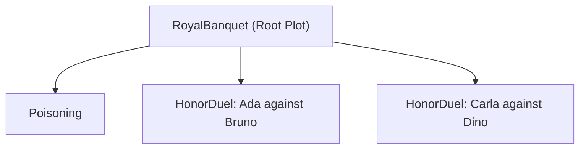
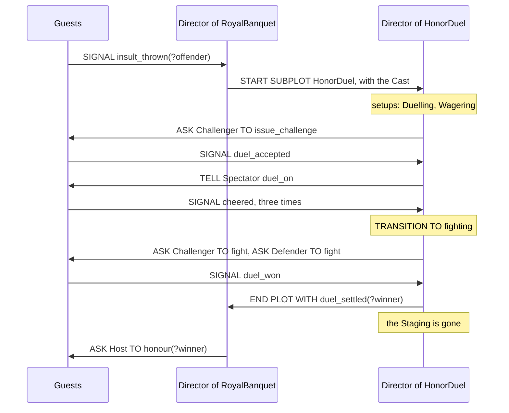

In the middle of the feast one Guest insults another, and the insulted one stands up. What follows is a duel, with a challenge, wagers, a fight and a winner. It is a story of its own, with Roles and Phases that the banquet has no use for, and the banquet goes on around it. We write the duel as a Plot, `HonorDuel`, and the banquet starts it as a Subplot. A second insult starts a second duel while the first is still being fought. Each running copy of a Plot is a Staging.

*Plots and Directors* covers what a Plot is, and it applies to a Subplot unchanged. The `MAPPING` clause is in *Playbooks and Roles*, and counted Mappings in *Randomness*. This chapter is about what is between two Plots: how a Subplot is started and cast, how it ends, and what its parent hears of it.

## Starting a Subplot

`showcase/plots/royal_banquet.regia`
```regia
DURING feast:
    WHEN ENTERED:
        ASSIGN Dining TO Guest, MAPPING Servant TO waiter.
        ASSIGN Serving TO Servant, MAPPING Guest TO patron.
        ASK Guest TO have_dinner.
        START SUBPLOT Poisoning, MAPPING 1 OF Guest TO Poisoner, MAPPING Guard TO Watchman.
```

`START SUBPLOT` names a Plot and says who plays its Roles. From this line on there is a Staging of `Poisoning` with a Director of its own, and `RoyalBanquet` is its parent. One Guest is its Poisoner and the Guards are its Watchmen.

The Statement never waits. The banquet's Body carries on at once, as after an `ASK`, and the Subplot starts in its own time. It does so in a fixed order:

1. Its Roles are cast from the `MAPPING` clauses.
2. The Role setups run for that Cast, in the order the Roles are declared. Here the Poisoner gets `Scheming` and each Watchman a second Giving of `Keeping_watch`.
3. `DURING PLOT`'s `ENTERED` Plan starts, if there is one, and then the entry Plan of the `INITIAL` Phase.

`Poisoning` has no Phases and no entry Plan, so after step 2 its Director waits for a Signal. The Poisoner does the rest out of `Scheming`.

- A Plot is written the same way whether it is the Root Plot or a Subplot. `poisoning.regia` doesn't say which Plot starts it.
- The parent's file imports the Subplot's, as it imports the Playbooks it gives.
- `START SUBPLOT` is a Director Statement and never fails.
- The parent learns how the Subplot went only when it ends, through the `ENDED` Trigger below. Nothing comes back from the start.

`#revise` A Plot takes no arguments. `HonorDuel` can't be told what the quarrel was about, nor `Poisoning` how long the Watchmen have. Whatever differs between two Stagings of one Plot has to come in through the Cast or be a Fact that its Agents already hold.

Spec: chapter 17.

## Casting

`showcase/plots/royal_banquet.regia`
```regia
WHEN insult_thrown(?offender) FROM Guest ?offended:
    START SUBPLOT HonorDuel,
        MAPPING ?offended TO Challenger,
        MAPPING ?offender TO Defender,
        MAPPING Guest TO Spectator.
```

A Subplot's Roles are played. Its Agents get its Role setups, hold its Givings and are the ones its Director tells and asks. So they are cast, once, when the Subplot starts. The two `START SUBPLOT` Statements of the showcase use the three forms a Mapping has:

| We write | Who is cast |
|---|---|
| `MAPPING Guest TO Spectator` | everyone playing `Guest` in the banquet when the Statement runs |
| `MAPPING 1 OF Guest TO Poisoner` | one of those Guests, drawn at random |
| `MAPPING ?offended TO Challenger` | the one Agent the Placeholder holds |

The left side is always the parent's: one of its Roles, a part of one, or a Placeholder that one of its Triggers filled. The right side is a Role of the Subplot.

- Every Role of the Subplot has to be filled. A Role with no `MAPPING` is filled by the parent's Role of the same name. If there is none, the Statement is an error.
- A Role gets one `MAPPING` per Statement. One Role of the parent can fill several Roles of the Subplot.
- The Cast is fixed. A latecomer who becomes a Guest during a duel is not a Spectator of it, though it will be one of the next duel. The only change is an Agent leaving the Program, which takes it out of every Staging.
- A Role can start empty, when the parent's Role is empty at that moment. That is not an error.

The parent's Roles are not handed over. `Guest` is still the banquet's Role, and the duel only knows `Spectator`.

`#revise` `MAPPING Servant TO waiter` on an `ASSIGN` and `MAPPING Guest TO Spectator` on a `START SUBPLOT` look the same and behave differently. The first is looked up each time `waiter` is used, so a new Servant is a `waiter` at once. The second copies the Guests of one moment into the Subplot's Cast.

`#revise` A whole-Role Mapping next to two Placeholder Mappings can't say "everyone else". Both duellists are Guests, so both are also Spectators. They wager on their own duel and cheer it.

`#revise` `?offender` arrives as the argument of a Signal, so it holds whatever the Guest's Plan put there, and the Statement reads the same whether or not that is a Guest of this banquet. On Jason a Mapping of anything else is dropped with a warning in the Trace. The duel then starts with no `Defender` and waits in `challenge` for an answer nobody can give.

Spec: chapter 15, chapter 17. For Placeholders on a Mapping, chapter 20.

## In two Stagings at once

`showcase/playbooks/wagering.regia`
```regia
PLAYBOOK Wagering:

    WHEN duel_on FROM DIRECTOR:
        GIVEN purse(?gold) AND ?gold > 0:
            ?stake = RANDOM(1, ?gold).
            CHANGE purse(?gold) TO purse(?gold - ?stake).
            SIGNAL wagered(?stake).
            DO cheer.
            SIGNAL cheered.
```

An Agent cast into a Subplot keeps everything it had. A Guest watching a duel is still a Guest of the banquet. It plays Roles in two Stagings and holds Givings from both.

| A Spectator holds | Given by | Its Signals reach |
|---|---|---|
| `Courtesy`, `NobleSocializing`, `Dining` | `RoyalBanquet` | the Director of the banquet |
| `Wagering` | `HonorDuel` | the Director of that duel |

A Signal goes to the Director that gave the Playbook it is written in. `SIGNAL cheered` is in `Wagering`, so the duel's Director counts it and the banquet's never hears it. The same Guest's `SIGNAL finished_eating`, in `Dining`, goes the other way. `FROM DIRECTOR` follows the same rule: `duel_on` matches because the Director that told it is one that gave `Wagering`.

The two Directors see different things of the same Agent. In `RoyalBanquet`, `FROM Guest` means its own `Guest`. `FROM Challenger` there is an error, since the banquet declares no such Role. In `HonorDuel` no Role holds the Host, so the duel's Director can reach it only with `EVERYONE`.

A Playbook given by both Plots is held twice. A `knight` is a Guard, so `Poisoning` casts it as a Watchman and gives it `Keeping_watch` a second time. Its `SIGNAL culprit_seized(?who)` then reaches both Directors, and the banquet's has no Plan for it.

`#revise` Being cast in a Subplot adds to what an Agent does and takes nothing away. A Challenger still holds `Dining`, is still served, and still eats between lunges. Precedence decides only the Triggers both sides have a Plan for, such as `idle`. To take the duellists out of the dinner, the banquet would `UNASSIGN Dining FROM ?offended` at the start, and would not know whom to give it back to when the duel ends with `duel_abandoned`.

Spec: chapter 17. For Signals, chapter 07.

## Several Stagings of one Plot

Every `START SUBPLOT` that runs makes a new Staging, whether or not a Staging of the same Plot is already running. The insult Plan above runs once per insult taken badly. With two quarrels during one feast, the banquet has three Subplots:



Each Staging has its own Director, its own Cast, its own current Phase, its own Facts and its own Quota counts. The first duel may be in `fighting` while the second is still in `challenge`. The `wager` Facts of one are unknown to the other, and `cheered FROM 3 OF Spectator` is counted in each duel apart.

Nothing in the language names a Staging. The labels in the drawing are ours. A Director's Plans are about its own Staging, and for its parent the two duels are just "`HonorDuel`".

- A Staging knows its parent and the Subplots it started, and no other Staging.
- Everything a parent says about a Subplot uses the Plot's name, so it is said of all its Stagings at once.
- In the Trace, the Directors of Stagings running side by side are numbered in the order they started: `director:HonorDuel#1`, `director:HonorDuel#2`.

`#revise` An Agent in two duels at once can't keep them apart. Every Guest is a Spectator of both and holds `Wagering` twice, so `SIGNAL cheered` reaches both Directors and each cheer counts in both duels. If Ada is a duellist in both, her `opponent` is both opponents, each `TELL opponent hit` strikes both, and her `duel_won` ends every duel that is in `fighting`, with her as the winner.

`#revise` No condition asks whether a Staging of a Plot is running, or how many. A banquet that wanted one duel at a time would have to count them in a Fact of its own, raised beside `START SUBPLOT`, lowered in the `ENDED` Plans and reset beside every `END SUBPLOT`. As written, a second insult between Ada and Bruno starts a second duel between Ada and Bruno.

Spec: chapter 17. For the Trace, chapter 34.

## Ending with an Outcome

`showcase/plots/honor_duel.regia`
```regia
DURING fighting:
    WHEN ENTERED:
        ASK Challenger TO fight.
        ASK Defender TO fight.
        WAIT 2 MINUTES.                  # a rough timeout: never reached if the duel ends first
        END PLOT WITH duel_abandoned.

    WHEN duel_won FROM ?winner:
        END PLOT WITH duel_settled(?winner).

DURING PLOT:
    WHEN Challenger EMPTIED:
        END PLOT WITH duel_abandoned.
    WHEN Defender EMPTIED:
        END PLOT WITH duel_abandoned.
```

A Subplot ends itself with `END PLOT`, as any Plot does. With `WITH <event>` it also hands its parent one Event, the Outcome, saying how it went. A duel has two: `duel_settled(?winner)` when one of the duellists has won, and `duel_abandoned` when time ran out or a duellist left the hall.

An Outcome is an Event of the shared Vocabulary, declared like the others:

`showcase/vocabulary.regia`
```regia
# ── Outcomes of the Subplots ─────────────────────────────────────────────────

EVENT duel_settled(winner), duel_abandoned
EVENT poisoner_caught(person), poison_taken
```

- `WITH` takes exactly one Event. Different endings use different Events.
- Its arguments must be filled, by Values or by Placeholders filled earlier in the Plan.
- An argument can be an Agent. `?winner` travels up to the banquet, which can then tell it, ask it, give it a Playbook or cast it in another Subplot.
- A plain `END PLOT.` ends with no Outcome. `Poisoning` does that when its Poisoner has left.
- In a Plot that is not a Subplot, `WITH` has nobody to tell and is ignored with a warning.

Whatever the Outcome, the Staging is gone after `END PLOT`. Its Director's Facts go with it, the wagers included. Its Givings are taken away, so `Duelling` and `Wagering` stop for everyone who held them only from this duel, and the Plan that answers every change of `stamina` with a lunge stops with them. What the Agents learned stays theirs. A duellist keeps its last `stamina`, and a Spectator's purse stays lighter by its stake.

`#revise` A Plot doesn't declare its Outcomes. To know how `HonorDuel` can end we read all its Bodies and find four `END PLOT` lines. In the Vocabulary, only a comment sets `duel_settled` apart from the Events Agents tell each other. *The Logic of Regia* has the same note on a Playbook's Signals.

`#revise` An Outcome can carry only what the Director was handed. `duel_abandoned` says nothing of who was duelling, because a Director can't name the Agents of its own Cast (*Plots and Directors*). The winner is known only because the winner Signals.

Spec: chapter 17.

## Hearing a Subplot end

`showcase/plots/royal_banquet.regia`
```regia
DURING PLOT:
    …
    WHEN HonorDuel ENDED WITH duel_settled(?winner):
        ASK Host TO honour(?winner).
        ASSIGN Keeping_watch TO ?winner.     # the winner stands guard of honour
        TELL ?winner on_duty.
    WHEN HonorDuel ENDED:
        DO play_music.

    WHEN Poisoning ENDED WITH poisoner_caught(?):
        DO ring_bell.
    WHEN Poisoning ENDED WITH poison_taken:
        TRANSITION TO farewell.              # the evening is cut short
```

`WHEN <Plot> ENDED` is a Trigger for Directors. It fires in the parent once for each Staging of that Plot that ends itself. `WITH <event>` narrows it to one Outcome and fills Placeholders from it, as any Trigger does. Without `WITH`, it matches every ending.

All the `ENDED` Blocks for one Plot in one `DURING` Block share a Trigger. They are tried in the order written and the first that matches runs, like several `GIVEN`s under one Trigger.

| The Subplot ends | Block that runs in `RoyalBanquet` |
|---|---|
| `HonorDuel`, with `duel_settled(?winner)` | the first: the Host honours the winner |
| `HonorDuel`, with `duel_abandoned` | the second: music |
| `Poisoning`, with `poisoner_caught(?who)` | the bell |
| `Poisoning`, with `poison_taken` | the move to `farewell` |
| `Poisoning`, with a plain `END PLOT.` | none |

- A plain `ENDED` written above a `WITH` Block shadows it, and the Transpiler warns.
- The Trigger is heard like any other of a Director: by the current Phase's Block if it has a Plan for it, otherwise by `DURING PLOT`.
- An ending that no Block matches is ignored.
- `WHEN P ENDED` in a Plot that never starts `P` is an error. `WITH` an Event that `P` never ends with gets a warning.

Here is one duel from the insult to the Host's honours, with the Messages between the Agents left out:



The banquet's Director acts at the second arrow and at the last. Between them it knows nothing of the duel.

`#revise` `WHEN HonorDuel ENDED:` reads as "when a duel ends" and here means "when a duel is abandoned", because of the Block above it. "Ended with no Outcome" can't be written by itself. Catching it means writing the plain form last and listing every Outcome before it.

`#revise` `Poisoning` ends with a plain `END PLOT.` when its Poisoner has left, and the banquet has no Block for that. The ending is ignored and nothing reports it. The Transpiler warns about a `WITH` that the Subplot never ends with, and not about an ending that the parent never hears.

`#revise` The Trigger doesn't say which Staging ended. With two duels running and one abandoned, the banquet plays music and can't tell which pair gave up.

`#revise` What happens after a Subplot is written in another Plan, often in another Block, tied to the `START SUBPLOT` only by the Plot's name. For an Agent's Goal we write `PURSUE` and the next line. A Director has no way to start a Subplot and wait for it.

Spec: chapter 17. For Director Triggers, chapter 20.

## Ending a Subplot from above

`showcase/plots/royal_banquet.regia`
```regia
DURING farewell:
    WHEN ENTERED:
        END SUBPLOT HonorDuel.
        END SUBPLOT Poisoning.
        UNASSIGN NobleSocializing FROM Guest.
        …
```

A Subplot belongs to the Staging that started it, whatever Phase that Staging was in. A duel begun in `feast` goes on when the banquet moves to `farewell`. It stops in one of three ways. It ends itself, its parent ends it with `END SUBPLOT`, or its parent ends.

`END SUBPLOT HonorDuel.` ends every running Staging of `HonorDuel` that this Staging started. Each of them goes the way of an `END PLOT`: its Plans stop, its `EXITED` Plans run, its own Subplots end before it, and its Givings are taken away.

- The parent's `WHEN HonorDuel ENDED` does not fire. The parent ended it on purpose and has nothing to learn.
- `END SUBPLOT` doesn't end its Body. The lines after it run.
- With no Staging of that Plot running it does nothing, and there is no warning.
- Naming a Plot that this Plot never starts is an error.

When a parent ends, its Subplots end with it, the innermost first. Nobody is told, since the one who would hear is ending too. This is the order in which an Agent in both loses its Givings: the Subplot's first and the parent's after.

The two lines of the snippet matter most when the evening is cut short. `Poisoning` ends with `poison_taken`, the banquet's Plan moves to `farewell`, and the entry Plan there runs. `END SUBPLOT HonorDuel` stops any duel still being fought. No music plays and no winner is honoured. `END SUBPLOT Poisoning` finds nothing left to end.

`#revise` `END SUBPLOT` ends all the Stagings of a Plot or none. The banquet can't stop the duel between Ada and Bruno and let the other run.

`#revise` A Subplot ended from above reports nothing, so whatever the `ENDED` Plans do to tidy up has to be written again beside the `END SUBPLOT`. The Subplot's own `EXITED` Plan runs, and can't tell an ending by its parent from one of its own (*Plots and Directors*).

`#revise` A Subplot that should last as long as a Phase has to be ended by hand, in that Phase's `EXITED` Plan or in the next Phase's entry Plan. The showcase does the second, which works only while `feast` leads nowhere but to `farewell`.

Spec: chapter 17, chapter 20.

## What a Plot may start

```regia
PLOT HonorDuel:
    …
    DURING fighting:
        WHEN duel_won FROM ?winner:
            START SUBPLOT HonorDuel, …       # an error: HonorDuel starts itself
```

A Plot can start any number of different Subplots, and a Subplot can start Subplots of its own. One Plot can be started from several parents. The one thing ruled out is a cycle: a Plot can't start itself, directly or through other Plots. A duel that leads to a rematch by starting itself again is an error, and the message names the cycle.

The reason is in *Precedence and Labels*. A Subplot's Playbooks rank against its parent's, and a Plot below itself would rank both above and below itself.

Spec: chapter 17. For the ranking, chapter 13.

## How this combines with…

### Role setup

A Subplot's setups run for its Cast when it starts, before any of its Plans. They are how its Agents come to behave differently for as long as it lasts: a duellist holds `Duelling` from the `Challenger` or `Defender` setup and loses it when the duel is over. An Agent cast in two Roles gets both setups. Each duellist is also a Spectator and gets `Wagering` on top. (*Plots and Directors*, *Playbooks and Roles*)

### Cast changes

`showcase/playbooks/duelling.regia`
```regia
WHEN challenged FROM opponent, SUITS bravery AT -0.5, SHIFTS sympathy BY -0.3:
    DO walk_to(door).
    DO leave_hall.
```

A Defender who is not brave walks out, and the game removes it. Leaving the Program takes an Agent out of every Staging at once, and each Director hears of it for its own Roles. The duel's hears `Defender EMPTIED` and ends with `duel_abandoned`. The banquet's hears one Guest fewer, and a moment later the ending of the duel.

Joining goes to the Root Plot only. Nobody enters a running Subplot, and a Subplot's `JOINED` Plan would never run. A Role that starts empty sets off no `EMPTIED`, since nobody left it. A banquet with no Guards starts `Poisoning` with no Watchman and no warning. (*Quotas and Cast Changes*)

### Quota Triggers

A Quota in a Subplot counts over that Staging's Cast. `cheered FROM 3 OF Spectator` needs three of the Guests who were in the hall when the duel began. `FROM ALL Spectator` would not wait for a latecomer, who is no Spectator. `ENDED` takes no quantity: "when every duel has ended" is not a Trigger. (*Quotas and Cast Changes*)

### Precedence

`showcase/plots/honor_duel.regia`
```regia
PRECEDENCE:
    PARENT OVER SELF ON scandal.         # gossip and guard duty come before hushing
```

When a Subplot's Playbook and its parent's both have a Plan for a Trigger, the Subplot's runs by default. A duellist with nothing to do limbers up, out of `Duelling`, where another Guest chats. A Subplot can give way on a Trigger by naming its parent as `PARENT`, which is the only name it has for it. The parent orders its Subplots against itself and each other by Plot name, as in `HonorDuel OVER Poisoning`. Two Stagings of one Plot are never ordered: they are the same Plot with the same Playbooks. (*Precedence and Labels*)

### Goals and Failure

A Subplot's Director can have a Plan fail, like any Director. The Staging then stays where it is, and the parent is not told, since a Failure is not an Outcome. If the entry Plan of `challenge` failed, the duel would sit in `challenge` until `farewell` ended it. On the Agents' side, a Goal that the Subplot's Director asked for is dropped when the Staging ends and the Giving that held its recipe goes. A dropped Goal has not failed, so no `FAILED` Plan runs. (*Goals and Failure*, *Playbooks and Roles*)

### Randomness

A counted Mapping draws once, when `START SUBPLOT` runs, and two counted Mappings in one Statement never draw the same Agent. A whole-Role Mapping beside them still means the whole Role, so the Poisoner can also be a Watchman if it is a `knight`. (*Randomness*)

### Translation to ASL

On Jason, every Staging is a Director agent, created when `START SUBPLOT` runs, and its name is what tells the Staging apart. The parent sends it the Cast and goes on. An ending Director ends its children and waits for them, tells each Agent of its Cast to drop its Givings, sends the Outcome to its parent and removes itself. (*Translation to ASL*)

### The Visual Editor

In a Plot's Phase map, a Subplot is a dashed node with a "starts" edge from the Plan that starts it. Expanding it shows the Subplot's own Phase map, read-only. The `ENDED` Plans are cards like the others, so the way back from a Subplot is drawn only as far as their Triggers say. (*The Visual Editor*)

## Since 1.0

1.0 could start a Subplot with `START SUBPLOT … MAPPING … TO …` and react to its end with `WHEN SUBPLOT HonorDuel ENDS:`. The primer left the rest open: how parent and child cooperate, who is told when a Plot ends, and how many Agents of a Role a Mapping takes.

`#changes` The parent's Trigger is `WHEN HonorDuel ENDED`, in the past tense like the other Trigger kinds and without the word `SUBPLOT`.

`#changes` Outcomes are new: `END PLOT WITH <event>` in the Subplot, `ENDED WITH <event>` in the parent.

`#changes` `END SUBPLOT` is new. Ending a Plot ends its Subplots, innermost first, and tells the parent unless the parent is the one ending it.

`#changes` A Mapping can take a number or a share of a Role, or one Agent held by a Placeholder. Roles with the same name are mapped without writing it. The clause is set off by a comma.

`#changes` Stagings are defined. Every `START SUBPLOT` makes one, its Cast is fixed at the start, it belongs to its parent's Staging and outlives the Phase that started it, and nothing in the language names it.

`#changes` A cycle of `START SUBPLOT` Statements is an error.
