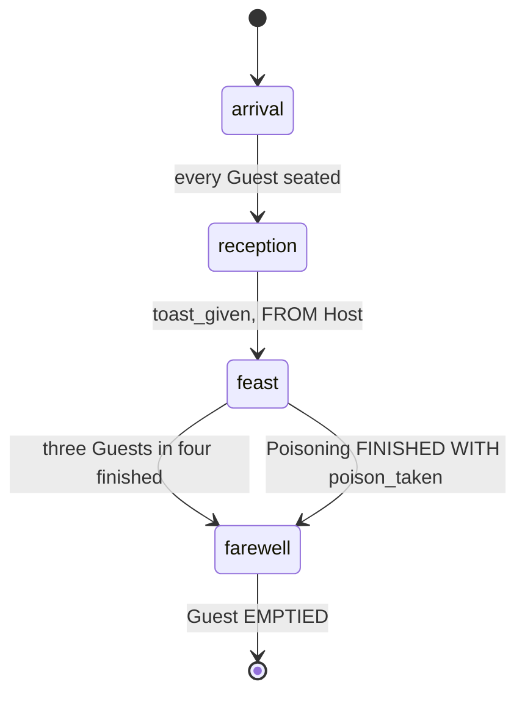

# Plots and Directors

No Guest decides that the feast has begun. Each one sits down, chats, eats and leaves, and none of them knows that the evening has four parts. The Plot knows. A Plot names the Roles of a story and the Phases it goes through, and its Plans belong to a Director: the agent behind the scenes that gives out Playbooks, tells and asks the Agents playing its Roles, and moves the Plot from one Phase to the next. A Director decides nothing for its Agents. It can only nudge them: what they do about a request is decided by their own Plans.

| We write | It does |
|---|---|
| `PLOT RoyalBanquet:` | declares a Plot; each running copy of it is a Staging, with a Director of its own |
| `ROLE Guest:` with a Block | declares a Role, and what each of its Agents starts with |
| `PHASE arrival INITIAL` | declares a Phase, and the one the Plot starts in |
| `DURING feast:`, `DURING PLOT:` | holds the Director's Plans for one Phase, or for the whole Plot |
| `ENTER farewell` | moves the Plot to another Phase |
| `WHEN ENTERED:`, `WHEN EXITED:`, `AFTER 2 MINUTES:` | react to entering and leaving a Phase, and to time passing in it |
| `IN arrival` | asks which Phase the Plot is in |
| `END PLOT` | ends the Staging |
| `ROOT RoyalBanquet` | in a `.regin` file, names the Plot the story starts from |

Givings, Mappings, `CAST`, counts and `EXCEPT` are in *Playbooks and Roles*, and a Director's `TELL` and `ASK` follow *Messages*. Starting and ending Subplots is in *Subplots and Stagings*, and `LEFT` and `EMPTIED` in *When an Agent leaves*.

## A Plot

[`plots/poisoning.regia`](../showcase/plots/poisoning.regia)
```regia
#@desc: Someone at the table means harm. No Phases: it runs until the poison is drunk, the Poisoner is caught, or the feast ends.
PLOT Poisoning:
    ROLE Poisoner:
        ASSIGN Scheming
    ROLE Watchman:
        ASSIGN Keeping_watch                 # a second Giving: the Watchmen's Signals reach this Director too

    DURING PLOT:
        WHEN culprit_seized(?who), FROM Watchman:
            END PLOT WITH poisoner_caught(?who)

        WHEN poison_drunk:                   # a game Cue, straight to the Director
            END PLOT WITH poison_taken

        WHEN EXITED, BY PARENT:              # the feast ended first
            DO discard_cup
```

This is the smallest Plot of the showcase, and it is complete. It has two Roles, each with the Playbook its Agents start with, and three Plans. The Plans are the Director's. They are built like an Agent's, with a Trigger, a Context and a Body, and they sit in a `DURING` Block. `DURING PLOT` holds the Plans that apply for as long as the Plot runs.

The Director waits. The Poisoner and the Watchmen act out of `Scheming` and `Keeping_watch`, and the Director hears about it twice: a Signal from a Watchman, or the game reporting that the cup was drunk. Either way the Plot ends, carrying an Outcome to the Plot that started it.

A `PLOT` Block holds `ROLE` lines with their setups, a `CAST:` setup, `PHASE` lines, local `FACT` declarations, one `PRECEDENCE` Block, and `DURING` Blocks. The showcase writes them in that order; only the `DURING` Blocks are Trigger Blocks.

- A Plot's name is in the program-wide namespace, with the Vocabulary and the Playbooks. Role and Phase names are local to their Plot: `HonorDuel` could have a `Host` of its own.
- A running copy of a Plot is a Staging, and each Staging has its own Director, Facts and Givings. Two duels at once are two Directors that know nothing of each other.
- A Plot can declare Facts of its own, for its Director to keep. It can't declare Goals, since its Director has none to pursue, nor Cues: an Outcome is named by the parent and a Signal by the Playbook that sends it.
- `PHASE` and `DURING` belong to Plots. A Playbook has neither.
- A Plot can take parameters, `PLOT HonorDuel(offender):`, filled when a parent starts it (*Subplots and Stagings*).

**Checks**

- A Plot declared twice → `R1006`; two Roles or two Phases of one Plot that differ only in case → `R1007`
- `GOAL` declared inside a Plot → `R1015` (hint: declare it at file level to `ASK` for it)
- `CUE` or `ACTION` declared inside a Plot → `R1012`
- `PHASE` or `DURING` inside a Playbook → `R2010`

Spec: chapter 20, *What a Director is*. For names and local declarations, chapter 10.

## Roles of a Plot

[`banquet.regin`](../showcase/banquet.regin)
```regia
KIND knight, PLAYS Guest, Guard:
    COUNT 1
    bravery AT 0.8
    sympathy AT 0.3
    aggressiveness AT 0.1
```

A Playbook's Role is an address. A Plot's Role is played: in each Staging, a set of Agents is cast in it, and that set is what the name means wherever the Director writes it. The Agents playing a Staging's Roles are its Cast.

Who plays a Role is never written in the Plot. For the Root Plot it comes from Instancing: every `knight` is a Guest and a Guard, every `noble` a Guest, and `king` the Host. For a Subplot it comes from the `MAPPING` clauses of the `START SUBPLOT` that started it (*Subplots and Stagings*).

| Where a Plot's Role stands | In the showcase | It means |
|---|---|---|
| a recipient | `ASK Guest TO take_leave` | the Agents playing it when the Statement runs |
| after `FROM` | `WHEN toast_given, FROM Host:` | the Sender plays it |
| the target of `ASSIGN` or `REMOVE` | `REMOVE NobleSocializing FROM Guest` | a Giving to the Role (*Playbooks and Roles*) |
| the giver's side of a `MAPPING` | `MAPPING Servant AS waiter` | the Role fills a Role of the Playbook |
| after `PLAYS` | `COUNT(? PLAYS Guest)` | who plays it now |
| before `LEFT` or `EMPTIED` | `WHEN Host EMPTIED:` | the Role has lost an Agent (*When an Agent leaves*) |
| a setup header | `ROLE Guard:` with a Block | what each of its Agents starts with |

- An Agent can play several Roles of one Plot. A knight is a Guest and a Guard; `TELL Guest …` and `TELL Guard …` reach it once each, `TELL CAST …` once.
- A Role can be empty. A Message to it reaches nobody, and an `ASSIGN` to it gives nothing. Neither is an error.
- A Role's name is not a Value. `DO point_at(Host)` is an error. A Plan that needs one Agent of a Role fills a Placeholder: `FROM Guest ?g`, `GIVEN ?c PLAYS Challenger`, or an Outcome's `WITH duel_settled(?winner)`.
- In 1.5 the Cast is fixed when the Staging starts and only shrinks, as Agents leave the Program.

**Checks**

- A Role name used as a Value → `R0303` (hint: `FROM Role ?x`)
- A Role the Plot doesn't declare, anywhere a Role is written → `R1502`
- A Root Plot Role that no kind and no individual Agent plays → `R2110` (warning)

Spec: chapter 15, *Roles are addresses*, chapter 20. For who plays the Root Plot's Roles, chapter 21.

## A Role's setup

[`plots/royal_banquet.regia`](../showcase/plots/royal_banquet.regia)
```regia
PLOT RoyalBanquet:
    CAST:
        ASSIGN Courtesy                      # its `host` is the Plot's Host, by name

    ROLE Host:
        ASSIGN Hosting
        PURSUE take_seat
    #@desc: Everyone invited to the table. A knight is a Guest and a Guard at once.
    ROLE Guest:
        LEARN purse(RANDOM(5, 20))           # rolled for each Guest
        LEARN craves(roast)
        LEARN craves(pie)
        PURSUE take_seat
    ROLE Servant
    ROLE Guard:
        ASSIGN Keeping_watch
        LEARN on_duty
```

`ROLE Servant` declares a Role. `ROLE Guard:` with a Block declares it and says what each of its Agents starts with: that Block is the Role's setup. A Guard starts with `Keeping_watch` and the Fact `on_duty`. A Guest starts with a purse, two cravings and a seat to find. `CAST:` is the setup of every Agent of the Staging, whatever it plays: everyone gets `Courtesy`, once.

A setup holds three kinds of Statement, in any number and any order:

| Statement | Gives the Agent | As if the Director had written |
|---|---|---|
| `ASSIGN <Playbook>[, MAPPING …]` | a Giving of the Playbook, with no `TO` | `ASSIGN … TO Guard` |
| `LEARN <fact>` | the Fact | `TELL Guard on_duty` |
| `PURSUE <goal>` | the Goal, without waiting | `ASK Guest TO take_seat` |

The setup speaks for the Director. A setup Fact arrives told by the Director, a setup Goal asked by it, so `TO take_seat, FROM DIRECTOR:` in `Courtesy` is the recipe that answers the Host's and every Guest's `PURSUE take_seat`. `LEARN` and `PURSUE` read here as they read in a Body, from the Agent's side: the Agent comes to know `on_duty`, the Agent takes on `take_seat`. Only the source differs.

- Each Agent of the Role gets the setup once per Staging. A knight gets the `Guest` setup and the `Guard` setup, and the `CAST` setup only once.
- The Statements are the same for every Agent, and their Expressions are worked out for each one. `LEARN purse(RANDOM(5, 20))` rolls once per Guest, so every Guest has its own purse. What differs between kinds of Agent, such as the hotheads' grudge against Sir Percival, is written in Instancing on the kind (*Instancing*).
- Nothing is matched, so no Placeholder can be filled. The only Placeholders a setup may use are the Plot's parameters. `ME` is an error too.
- No Context, no `IF`, no `RANDOMLY`, and no other Action or Director Statement.
- The `ASSIGN` takes whole-Role Mappings only. A counted Mapping would be one pick shared by every Agent of the Role.
- The Statements run in the order written. A `PURSUE` above the `ASSIGN` that gives its recipe finds no Plan, and the Goal fails. The Guests' `PURSUE take_seat` is safe with no `ASSIGN` above it, because the `CAST` setup runs first and has already given `Courtesy`.
- A setup is not a Plan and can't fail. A Statement that can't be carried out, such as arithmetic on a Value that isn't a Number, is skipped with a Trace entry, and the rest still run.

A setup is sugar. Everything in it could be written in the initial Phase's `ENTERED` Plan as an `ASSIGN`, a `TELL` and an `ASK` to the Role. What it adds is a place to write it, next to the Role.

### A setup for a Phase

[`plots/royal_banquet.regia`](../showcase/plots/royal_banquet.regia)
```regia
DURING feast:
    ROLE Guest:
        ASSIGN Dining, MAPPING Servant AS waiter
    ROLE Servant:
        ASSIGN Serving, MAPPING Guest AS patron
```

The same Block inside a `DURING <phase>` Block is the Role's setup for that Phase. It runs for every Agent of the Role each time the Phase is entered, and its Givings last as long as the Phase: when the Plot leaves `feast`, `Dining` and `Serving` are taken away with no `REMOVE` written. Facts and Goals stay, as they do from any setup.

- The `ROLE` line here names a Role the Plot declares; it declares nothing. `ROLE Guest` with no Block inside a `DURING` is an error.
- One setup per Role per Phase, and one `CAST:` setup per Phase.
- There is no setup in `DURING PLOT`: a setup for the whole Plot is written on the Role's own `ROLE` line.
- It runs again on every entry of the Phase, re-entering included. A Fact the Agent already knows fires no `LEARNED`; a Goal is a new Pursuit.

### What a setup leaves behind

| Given | When the Agent stops playing the Role, or the Staging ends |
|---|---|
| a Playbook | taken away with the Staging's other Givings; a Phase's setup gives it up earlier, when the Phase is left |
| a Fact | stays: once told, it is the Agent's own |
| a Goal | nothing extra; it stops only if its recipe is in a Playbook being taken away |

A setup's Giving counts as a Giving to the Role, and `REMOVE` reaches it: `REMOVE Keeping_watch FROM Guard` would take it. In `PRECEDENCE` it is named by its Playbook like any other the Plot gives out.

> **In 2.0** an Agent can join a running Plot, and the setups of its Roles, and of the current Phase, run for it alone when it arrives. Spec chapter 16, *What it means*, and chapter 19. In 1.5 setups run only for the starting Cast and when a Phase is entered.

**Checks**

- A Block on a Playbook's `ROLE` → `R1601`
- A Statement other than `ASSIGN`, `LEARN` or `PURSUE` in a setup → `R1602`
- `TO`, a count, or a counted `MAPPING` on a setup's `ASSIGN` → `R1603`
- A Placeholder other than the Plot's parameters → `R1604`; `ME` → `R0309`
- A setup in `DURING PLOT`, a second setup for one Role or for `CAST` in one place, or `ROLE <name>` with no Block inside a `DURING` → `R1606`
- A Phase setup for a Role the Plot doesn't declare → `R1607`
- The retired `ROLE r STARTS WITH:` or `CAST STARTS WITH:` → `R1608` (hint: `ROLE r:`, `CAST:`)
- A `PURSUE` above the `ASSIGN` that gives the only Playbook with a Plan for it → `R1605` (warning)
- A setup Statement that can't be carried out, skipped → `T1601` (Trace warning)

Spec: chapter 16. For the Mappings on a setup's `ASSIGN`, chapter 15.

## Phases

[`plots/royal_banquet.regia`](../showcase/plots/royal_banquet.regia)
```regia
PHASE arrival INITIAL
PHASE reception
#@desc: Dinner is served. Insults start duels, and someone at the table means harm.
PHASE feast
PHASE farewell
```

A Phase is a state of the Plot. A Staging is in exactly one Phase at a time, starts in the one marked `INITIAL`, and moves only when one of its Director's Plans says `ENTER`. Each Phase has at most one `DURING <phase>` Block, holding the Plans that react while the Plot is in it.



The four `PHASE` lines say none of this. Each arrow is an `ENTER` in some Body, and its label is the Trigger of the Plan that holds it. Two of them are written in `DURING PLOT`: the poison cuts the evening short, and a Guest leaving the hall can complete a count. `Host EMPTIED` ends the Plot from any Phase and is left out of the drawing. The Visual Editor's Phase map draws this diagram from the Bodies, since the source keeps it nowhere else.

- A Plot that declares Phases marks exactly one `INITIAL`, even if it has only one. The order of the `PHASE` lines means nothing.
- A Plot may declare none, as `Poisoning` does. It then behaves as if it had a single Phase that is never left: only setups and `DURING PLOT`, and an `ENTER` in it is an error.
- A Phase with no `DURING` Block is allowed, a quiet state that `DURING PLOT` Plans move on. So is a Phase that nothing leaves, such as `farewell`, ended by `END PLOT` or by the parent.
- A Phase that isn't `INITIAL` and that no `ENTER` names can never be entered.
- A Phase owns its `DURING` Block's Plans while they run, its setups' Givings, and whatever was given or started with `UNTIL EXITED` in it (*Playbooks and Roles*). Everything else outlives it: `NobleSocializing`, given when `reception` is entered, is held through `feast`, and the Director's Facts belong to the Staging.

**Checks**

- A Plot with Phases and no `INITIAL`, or several → `R2007` (quick fix: mark one)
- `DURING p`, `ENTER p` or `IN p` naming a Phase the Plot doesn't declare → `R2008` ("did you mean")
- Two `DURING` Blocks for one Phase, or two `DURING PLOT` Blocks → `R2009`
- A Phase that can never be entered → `R2011` (warning)

Spec: chapter 20, *Declaring Phases*. For the Phase map, chapter 25.

## Entering and leaving a Phase

[`plots/royal_banquet.regia`](../showcase/plots/royal_banquet.regia)
```regia
DURING reception:
    WHEN ENTERED:
        ASSIGN NobleSocializing TO Guest, MAPPING Guest AS peer

    AFTER 2 MINUTES:
        ASK Host TO open_feast

    WHEN toast_given, FROM Host:
        ENTER feast
```

`WHEN ENTERED:` and `WHEN EXITED:` are Triggers with no item: their subject is the Block they are written in. This `ENTERED` runs when the Plot enters `reception`, and sets the Phase up. After two minutes of chatter the Director asks the Host to open the feast. The Host's `Hosting` Playbook Signals `toast_given` when its toast is over, and the Director enters `feast`.

`ENTER feast` does six things, in order:

1. It stops every Plan of `reception`'s Block still running, silently: no Failure, nothing undone. An `AFTER` still counting is stopped the same way.
2. It runs `reception`'s `EXITED` Plan, if there is one, to its end.
3. It takes away what was given for `reception`: its setups' Givings and its `UNTIL EXITED` Givings, and ends its `UNTIL EXITED` Subplots.
4. It makes `feast` the current Phase.
5. It runs `feast`'s setups: the `CAST` setup, then the Role setups in Role declaration order.
6. It runs `feast`'s `ENTERED` Plan as an ordinary Plan of the Phase, and starts its `AFTER` counts.

So by the time `feast`'s `ENTERED` starts the Poisoning Subplot, every Guest already holds `Dining` and every Servant `Serving`.

[`plots/royal_banquet.regia`](../showcase/plots/royal_banquet.regia)
```regia
WHEN EXITED:                         # however the feast ends
    DO clear_tables
```

The `EXITED` Plan runs however the Phase is left. `feast` is left by the count of finished Guests in its own Block, by the poison in `DURING PLOT`, or by `END PLOT` from a `Guest EMPTIED`: the tables are cleared each time, and none of those Plans has to say so.

- `ENTER` ends its Body. A Statement after it in the same branch is an error. This holds in `DURING PLOT` Plans too.
- The `EXITED` Plan must finish before the new Phase begins, so it can't pause or move the Plot: `WAIT`, `ENTER` and `END PLOT` are errors in it. A `DO` is allowed, and the transition waits for the game's answer.
- `EXITED` runs before step 3, so it can still reach the Agents through the Phase's Playbooks. The Agents' own closing Plans (`REMOVED`, `DROPPED`) run on their side; the transition doesn't wait for them.
- `ENTERED` is an ordinary Plan of its Phase. It may `WAIT`, and is stopped if the Phase is left meanwhile.
- `ENTER` naming the current Phase leaves it and enters it again: Plans stopped, `EXITED`, Givings taken, setups run again, `ENTERED`. That is how a round restarts. A Plan that must not re-enter tests `IN` first.
- A Playbook that both Phases give is taken and given again: its Plans stop, `REMOVED` then `ASSIGNED` fire. A Playbook meant to last across Phases is given by the Plot's own setup or by a plain `ASSIGN`.
- Where a transition comes from has no Trigger. What belongs to "leaving `feast` for `farewell`" goes in the Plan that writes `ENTER farewell`, before it. An `ENTERED` Plan that must know where the Plot came from reads a Fact that Plan learned.

### A timeout: `AFTER`

[`plots/honor_duel.regia`](../showcase/plots/honor_duel.regia)
```regia
DURING betting:
    WHEN ENTERED:
        TELL Spectator duel_on

    WHEN wagered(?stake), FROM Spectator ?who:
        LEARN wager(?who, ?stake)

    AFTER 20 SECONDS:                    # betting closes
        GIVEN wager(?backer, ?stake), HIGHEST ?stake, RANDOMLY:
            ASK ?backer TO give_signal
        ELSE:
            ENTER fighting               # nobody bet: no handkerchief to wait for

    AFTER 1 MINUTE:                      # the handkerchief never fell
        ENTER fighting

    WHEN handkerchief_dropped, FROM Spectator:
        ENTER fighting
```

`AFTER <Duration>:` runs a Plan once that much time has passed in the Phase. Betting closes after twenty seconds, and the biggest backer is asked to drop the handkerchief. If nobody bet, the duel starts at once. If the handkerchief hasn't fallen after a minute, it starts anyway. Whichever `ENTER fighting` runs first leaves the Phase and stops the other counts.

- In a Phase Block it counts from entering the Phase; in `DURING PLOT`, from the start of the Staging. Re-entering the Phase starts the count again.
- The Duration is worked out once, when the count starts. One that isn't a Number fails the Plan.
- The Context is tested when the time is up. A false Context means the Plan doesn't run.
- It is an ordinary Plan of its Block: it can `WAIT`, `ENTER` and `END PLOT`. A Block may have several, each counting on its own.
- The clock stops while the game is paused (*Actions and time*).
- `AFTER` is for Plots only. A timeout imposed from outside is the Plot's nudge. An Agent that chooses to wait writes `WAIT`.

### Starting a Staging

When a Staging starts, three things happen before anything else:

1. `DURING PLOT` and the initial Phase become active.
2. The Plot's setups run for the starting Cast, `CAST:` first and then each Role in declaration order, then the initial Phase's setups. For the Root Plot, the lines of each Agent's kind come after them (*Instancing*).
3. `DURING PLOT`'s `ENTERED` Plan runs, then the initial Phase's, and the `AFTER` counts start.

The initial Phase is current before any setup runs. A Guest with no seat laid fails `take_seat` at once and Signals `took_seat` straight away, and `arrival` is already there to count it.

**Checks**

- `WAIT`, `ENTER` or `END PLOT` in an `EXITED` Plan → `R2003`
- A Statement after `ENTER` in the same branch → `R2004`
- `ENTER` in a Plot with no Phases → `R2008`
- `WHEN ENTERED:` or `WHEN EXITED:` in a Playbook → `R2005`
- `AFTER` in a Playbook → `R1205` (hint: `WAIT`, or `WHEN ASSIGNED: WAIT …`)
- The retired `TRANSITION TO p` → `R2016` (hint: `ENTER p`)
- An `AFTER` Duration that isn't a Number → `T1201` (Trace, Failure); a negative one, counted as 0 → `T1202` (Trace warning)

Spec: chapter 20, *Entering and leaving Phases*. For `AFTER`, chapter 12; for setups at Phase entry, chapter 16.

## `DURING PLOT`

[`plots/royal_banquet.regia`](../showcase/plots/royal_banquet.regia)
```regia
DURING PLOT:
    WHEN Guest ?g LEFT:
        FORGET seated(?g)
        FORGET finished(?g)
        IF IN arrival AND COUNT(seated(?)) >= COUNT(? PLAYS Guest):
            ENTER reception
        ELSE IF IN feast AND COUNT(finished(?)) * 4 >= COUNT(? PLAYS Guest) * 3:
            ENTER farewell
```

The Plans of `DURING PLOT` apply in every Phase and stop only when the Staging ends. They are for what can happen at any point of the evening: a Guest walking out, a duel ending, the poison. They move the Plot like any other Plan.

A Guest who leaves may be the one the Director was waiting for. If the rest are all seated, or enough of the rest have eaten, the Plot moves on. Which count to check depends on where the Plot is, and `IN` says.

- When a Phase's Block and `DURING PLOT` both have a Plan for a Trigger, one runs, and by default the Phase's. The Plot can turn that around in its `PRECEDENCE` Block (*Precedence and Labels*). A `DURING PLOT` Plan that a Phase always catches can never run.
- `DURING PLOT` takes `ENTERED` and `EXITED` too. `ENTERED` runs when the Staging starts, after the setups and before the initial Phase's `ENTERED`. `EXITED` runs when the Staging ends, after the current Phase's `EXITED`.
- A Director has no setup of its own. Facts it must start with are learned in `DURING PLOT`'s `WHEN ENTERED:`.

### Where the Plot is: `IN`

`IN <phase>` holds when the Staging is in that Phase now. It goes wherever a condition goes: a Context, an `IF`, under `NOT`, joined with `AND` and `OR`.

- It is meant for `DURING PLOT`. In a Phase's own Block, `IN` of that Phase always holds, since the Block's Plans stop when the Phase is left.
- A Phase is not a Value. There is no `IN ?p`, and nothing to pick or count.
- `GIVEN NOT IN farewell:` above an `ENTER farewell` keeps a `DURING PLOT` Plan from entering a Phase the Plot is already in, and running its setups and `ENTERED` again.

A Director's conditions can ask about its own Staging in two more ways: `?c PLAYS Challenger` (*Playbooks and Roles*) and `HonorDuel(?offender) RUNNING` (*Subplots and Stagings*).

### Ended from above: `EXITED, BY PARENT`

[`plots/honor_duel.regia`](../showcase/plots/honor_duel.regia)
```regia
WHEN EXITED, BY PARENT:              # the banquet called the duel off
    DO ring_bell
```

A Subplot can tell an ending by its parent from one of its own. `EXITED, BY PARENT` matches when the Staging ends because of the Plot above it: a `DROP SUBPLOT`, an `UNTIL EXITED` whose Phase was left, or the parent itself ending. `Poisoning` uses it to discard the cup when the feast ends first. A duel that ends with a winner rings no bell.

- The specific Plan runs first, then a plain `EXITED` Plan if there is one. What every exit does goes in plain `EXITED`, once.
- It is written in a Phase's Block, where it matches when the Staging is ended from above in that Phase, or in `DURING PLOT`.
- In a Plot never started as a Subplot it can't fire.
- `BY PARENT` is a clause, after a `,`, and goes only on `EXITED`.

**Checks**

- `IN <phase>` in a Playbook, or in a Plot with no Phases → `R2014`
- A `DURING PLOT` Plan always shadowed by a Phase's → `R1307` (warning)
- `BY PARENT` on a Trigger other than `EXITED`, or `BY` with anything but `PARENT` on `EXITED` → `R0506`
- `WHEN EXITED BY PARENT:` with no `,` → `R0111`
- `WHEN EXITED, BY PARENT` in a Plot never started as a Subplot → `R2015` (warning)

Spec: chapter 20, *What a Director knows about its own Staging*, *`EXITED, BY PARENT`*. For which Block wins, chapter 13.

## What a Director perceives

[`plots/poisoning.regia`](../showcase/plots/poisoning.regia)
```regia
WHEN poison_drunk:                   # a game Cue, straight to the Director
    END PLOT WITH poison_taken
```

A Director perceives the game the way an Agent does. Game Cues set off its `WHEN e:` Plans, and game Facts become its own Facts, so `WHEN f LEARNED:` fires and a `GIVEN` can test them. Which game Cues and Facts reach which Director is the Target's business.

The rest of what it hears is Signals from the Agents holding Playbooks it gave (*Messages*), the endings of its Subplots (*Subplots and Stagings*), Agents leaving its Roles (*When an Agent leaves*), its own Phases, and time.

[`plots/honor_duel.regia`](../showcase/plots/honor_duel.regia)
```regia
FACT wager(person, stake)
```

A Director keeps Facts of its own, with `LEARN`, `FORGET` and `UPDATE`. A Plot declares them as Local Vocabulary, and they are visible in all its `DURING` Blocks. `wager` is the duel Director's note of who bet what, learned in `betting` from each `wagered` Signal.

- A `GIVEN` in a Plot tests the Director's Facts and nothing else. A Director never reads an Agent's Facts. A Spectator's stake reaches it only because the Spectator Signals it.
- Facts belong to one Staging. Two duels at once keep two sets of wagers, and a parent can't read a Subplot's Facts, nor the other way round. They meet only in the `MAPPING` clauses of `START SUBPLOT` and in the Outcome.
- Nothing keeps a copy true. A Spectator who walks out leaves its `wager` behind, so `HonorDuel` forgets it in a `LEFT` Plan (*When an Agent leaves*).

A Director has no Goals: no `TO` recipes, no `PURSUE`, no `DROP g`. It has no Propensities either, so no Labels and no `SHIFT`. `ME` is not a word of a Plot.

> **In 2.0** a Trigger can say "nobody sent it": `FROM GAME` on a Director's Cue matches the game's Cue and not a Signal. Spec chapter 05, *The game and the Agent itself*. In 1.5 `WHEN poison_drunk:` would also run if a Playbook that `Poisoning` gives Signalled `poison_drunk`; neither of them does.

### Counting by hand

[`plots/royal_banquet.regia`](../showcase/plots/royal_banquet.regia)
```regia
DURING arrival:
    WHEN ENTERED:
        DO open_doors

    WHEN took_seat, FROM Guest ?g:
        LEARN seated(?g)
        IF COUNT(seated(?)) >= COUNT(? PLAYS Guest):
            ENTER reception

    WHEN took_seat, FROM Host:           # the king is seated: music
        DO play_music
```

The Director wants to know when every Guest has sat down. It can't see their Goals, so `Courtesy` Signals `took_seat` when `take_seat` ends, seated or not, and the Director writes each Guest down in a Fact of its own and compares the count with the Guests still in the hall. The Host's Signal goes to the second Plan, since a Plan's `FROM` decides which of the Plans under one Trigger runs (*Plans*).

> **In 2.0** the Director needs none of this: it hears how a Goal it asked ended, and a Quota Trigger waits until every Guest's `take_seat` has ended, in a single Trigger. Spec chapter 20, *Hearing how an asked Goal ended*, and chapter 18. In 1.5 the recipe Signals, and the Director counts in Facts.

**Checks**

- `TO g:` or `FROM DIRECTOR` in a Director → `R2002`
- `PURSUE`, `DROP g` or `SIGNAL` in a Director → `R2001`
- A Label on a Director's Plan, or `SHIFT` in its Body → `R1406`
- `ME` in a Plot → `R0309`
- `WHEN ASSIGNED:` or `WHEN REMOVED:` in a Plot → `R1508`
- `FROM GAME`, a quantity after `FROM` or `BY`, or a Goal's ending in a Plot, in a 1.5 build → `R0109`
- A Signal with no Plan in the current Phase or `DURING PLOT` → `T3801` (Trace, `unheard`)

Spec: chapter 20, *What a Director is*, *What a Director perceives*. For local Facts, chapter 10; for Quotas, chapter 18.

## What a Director does

[`plots/royal_banquet.regia`](../showcase/plots/royal_banquet.regia)
```regia
DURING farewell:
    WHEN ENTERED:
        DROP SUBPLOT HonorDuel(?)
        REMOVE NobleSocializing FROM Guest
        ASK Guest TO take_leave
```

The evening is over. The Director calls off every duel still running, takes the gossip away from the Guests, and asks them to leave. It never makes an Agent do anything: `take_leave` is a request, and `Courtesy`'s recipe decides how a Guest goes.

A Director's Body has the Actions an Agent's has, less those about Goals, and the Director Statements, which only a Director has:

| Statement | In a Director | Where |
|---|---|---|
| `DO <action>` | the Director's own Custom Action, as an Agent writes it | *Actions and time* |
| `LEARN`, `FORGET`, `UPDATE` | on the Director's own Facts | *Actions and time* |
| `TELL`, `ASK … TO` | Messages whose Sender is `DIRECTOR` | *Messages* |
| `PRINT`, `FAIL`, `WAIT` | as in an Agent; no `WAIT` in an `EXITED` Plan | *Actions and time* |
| `ASSIGN`, `REMOVE` | make and take away Givings | *Playbooks and Roles* |
| `ENTER <phase>` | moves the Plot; ends the Body | this chapter |
| `START SUBPLOT`, `DROP SUBPLOT` | start and end Stagings below this one | *Subplots and Stagings* |
| `END PLOT [WITH <cue>]` | ends this Staging; ends the Body | this chapter |
| `PURSUE`, `DROP g`, `SIGNAL` | errors: a Director has no Goals, and Signals go to Directors | |

- `DO open_doors` is the Director's own Action, sent to the game as an Agent's is. Ordering an Agent to act, as in `Host DO call_guards`, is not part of the language.
- `TELL` and `ASK` from a Director are matched by `FROM DIRECTOR`, as a setup's are. A Director has two recipients a Playbook doesn't: `CAST`, and a Role with `EXCEPT`.
- A Role recipient reaches the Agents playing the Role in this Staging when the Message is sent, and nobody later. What every Agent of a Role must get belongs in its setup.
- The Director hears nothing back from a `TELL` or an `ASK`. It learns what came of `take_leave` from `LEFT` and `EMPTIED`.

### Directing one Agent

A Placeholder holding one Agent can stand where a Role does: a recipient, the target of `ASSIGN` and `REMOVE`, and the giver's side of a `MAPPING`. The showcase fills it four ways: `FROM Guest ?offended` on a Signal, a Pick over the Director's Facts (`?backer`, above), an Outcome (`duel_settled(?winner)`), and `PLAYS` in a condition.

[`plots/royal_banquet.regia`](../showcase/plots/royal_banquet.regia)
```regia
WHEN Poisoning FINISHED WITH poisoner_caught(?culprit):
    REMOVE NobleSocializing FROM Guest ?culprit
    ASK ?culprit TO take_leave       # led out of the hall
```

- The Placeholder must be certainly filled.
- `ASSIGN Keeping_watch TO ?winner` is a Giving to that Agent alone, and `MAPPING ?offended AS Challenger` fills the Role with exactly that Agent (*Playbooks and Roles*, *Subplots and Stagings*).
- An Agent that has left the Program is dropped from a Giving, a Mapping or a Message with a Trace warning. It is not a Failure.

**Checks**

- `Role DO …` or `WORLD DO …` → `R2006`
- A Director Statement in a Playbook → `R1507`
- A recipient, `ASSIGN` target or `MAPPING` Placeholder not certainly filled → `R0304`, `R0305`
- A Giving or Mapping that reaches an Agent who has left → `T2001` (Trace warning); a Message → `T1901` (Trace warning)

Spec: chapter 20, *How a Director directs Agents*, *Directing one Agent*, *Actions*. For Messages, chapter 07; for Givings, chapter 15.

## Failure in a Director

A Director's Plan can fail like an Agent's: a Custom Action the game refuses, arithmetic on a Value that isn't a Number, a count that isn't a Number, or `FAIL`. With no Goals, nothing above it can fail in turn.

- A failing Director Plan stops where it failed and writes a Trace entry. The Phase and the Staging are untouched, and nothing done before is undone. If the game refuses `DO open_doors`, the Plot stays in `arrival` and goes on counting seats.
- No Plan reacts to it: a Director has no `FAILED` Trigger to write.
- Director Statements never fail. An `ASSIGN` to an empty Role gives nothing, a `DROP SUBPLOT HonorDuel(?)` with no duel running does nothing, and a Giving, Mapping or Message to an Agent that has left is dropped with a warning.
- A failing `EXITED` Plan doesn't hold the transition back: it stops, and the Phase is left all the same. If the game refuses `DO clear_tables`, the Plot still enters `farewell`.

**Checks**

- A Director Plan that failed → `T2002` (Trace warning, after the entry of its cause)

Spec: chapter 20, *Failure*. For what fails a Plan, chapter 11.

## Ending a Plot: `END PLOT`

[`plots/royal_banquet.regia`](../showcase/plots/royal_banquet.regia)
```regia
WHEN Guest EMPTIED:
    END PLOT
WHEN Host EMPTIED:
    END PLOT
```

When the last Guest has left the hall, or the Host has, the banquet ends. `END PLOT` ends the Staging its Director runs:

1. The current Phase's running Plans stop, and its `EXITED` Plan runs, as for an `ENTER`.
2. `DURING PLOT`'s `EXITED` Plan runs.
3. Every Subplot this Staging started ends, children before parents, each with `EXITED, BY PARENT`.
4. Each Staging that ends takes its Givings with it: the Playbooks stop for the Agents that held them only from there, and their closing Plans run.

- `END PLOT` ends its Body. A Statement after it in the same branch is an error.
- The Agents stay in the game, with their Facts. A Guard keeps `on_duty` after the banquet; it has lost `Keeping_watch`.
- `END PLOT WITH <cue>` hands an Outcome to the Plot that started this one, which is how `Poisoning` reports `poisoner_caught(?who)` (*Subplots and Stagings*). The Root Plot has nobody to hand it to.
- When the Root Plot ends, the story is over, and the Target tells the game.

**Checks**

- A Statement after `END PLOT` in the same branch → `R1702`
- `END PLOT WITH` in a Plot never started as a Subplot → `R1705` (warning: `WITH` is ignored)

Spec: chapter 17, *Ending*, chapter 20, *What `ENTER` does*.

## The Root Plot

[`banquet.regin`](../showcase/banquet.regin)
```regia
IMPORT "plots/royal_banquet"

ROOT RoyalBanquet
```

A Program has exactly one Root Plot. It is the only Plot that starts by itself, in one Staging, when the Program starts. Every other Plot runs only as a Subplot, started by a `START SUBPLOT` somewhere below it. Stories that run side by side are Subplots of the Root Plot, often started from its `DURING PLOT`'s `WHEN ENTERED:`.

- The Root Plot is named in Instancing with `ROOT`, never inferred. Nothing in `royal_banquet.regia` says that it is the Root. Had the banquet been a Subplot of a wider `Castle`, the file would read the same.
- A Build's Entry is a `.regin` file that reaches a `ROOT`. A `.regia` file given as the Entry is checked but not built, and the checks that need a Root Plot don't run.
- Agent kinds and individual Agents play Roles of the Root Plot and of no other. Roles further down are filled by Mappings.
- The Root Plot takes no parameters: Instancing has nothing to pass them.
- A Plot the Root Plot never reaches is compiled and never runs.

**Checks**

- A `.regin` Entry that reaches no `ROOT`, or a `ROOT` naming a Plot that is started as a Subplot → `R2104`
- A Root Plot with parameters → `R2114`
- A `PLAYS` Role that isn't a Role of the Root Plot → `R2105`
- A Plot the Root Plot never reaches → `R2112` (warning)

Spec: chapter 21, *The Root Plot*. For Entry files, chapter 23.

## How this combines with…

### Playbooks and Roles

Most Givings in the showcase are made by setups, not by Plans. A setup's Giving counts as a Giving to its Role, a Phase setup's lasts the Phase, and the `CAST:` setup gives each Agent one Giving whatever it plays. The `MAPPING` clauses, `REMOVE` and the closing Plans that follow it are the same as for an `ASSIGN` in a Plan. (*Playbooks and Roles*)

### Messages

A Director is reached only by Signals, sent from Playbooks it gave, and it speaks with `TELL` and `ASK` like an Agent, as `DIRECTOR`. A Signal that finds no Plan in the current Phase or in `DURING PLOT` is dropped as unheard: `insult_thrown` during `reception` starts no duel, since only `feast` has a Plan for it. (*Messages*)

### Subplots and Stagings

A Subplot is a Plot like any other, with a Director, Facts and Phases of its own. It belongs to the Staging that started it, not to the Phase: `farewell` drops the duels by hand, while `Poisoning`, started `UNTIL EXITED`, ends with `feast`. Its endings are heard by the current Phase's Plan, else by `DURING PLOT`. (*Subplots and Stagings*)

### When an Agent leaves

The Cast only shrinks in 1.5. `LEFT` and `EMPTIED` are Director Triggers, written like any other in a Phase's Block or in `DURING PLOT`, and the banquet uses them both to tidy its counts and to end. (*When an Agent leaves*)

### Precedence and Labels

A Phase's Plan beats `DURING PLOT`'s for the same Trigger, unless the Plot's `PRECEDENCE` Block says otherwise. The same Block orders the Playbooks the Plot gives, setups included, and its Subplots. A Director's Plans take no Labels. (*Precedence and Labels*)

### Matching and Randomness

A Director's Contexts match its own Facts with the same Picks, `FOR EACH` and `COUNT` an Agent has: `HIGHEST ?stake, RANDOMLY` chooses the backer. A setup rolls `RANDOM` once per Agent, and counted Mappings are drawn by the Director when the Statement runs, never in a setup. (*Matching*, *Randomness*)

### Instancing

The Root Plot's setups run first for the starting Cast, then the lines of each Agent's kind or individual Agent, all before the entry Plans. A hothead's `grudge(percival, 2)` arrives after the Guest setup, told by the Root Plot's Director. (*Instancing*)

### The Visual Editor

The Phase map draws a Plot as the diagram in *Phases* does: Phases as boxes, an edge for every `ENTER`, labelled with the Trigger of its Plan. It reads the Bodies each time, since the source keeps no other record. (*The Visual Editor*)

### Jason: Directors and Stagings

On Jason a Director is an agent of its own, one per Staging, and its Facts and current Phase are that agent's beliefs. An `ENTER` is one uninterrupted step that drops the old Phase's intentions and runs `EXITED`; the `ENTERED` Plan is posted after it as an ordinary event. (*Jason: Directors and Stagings*)
