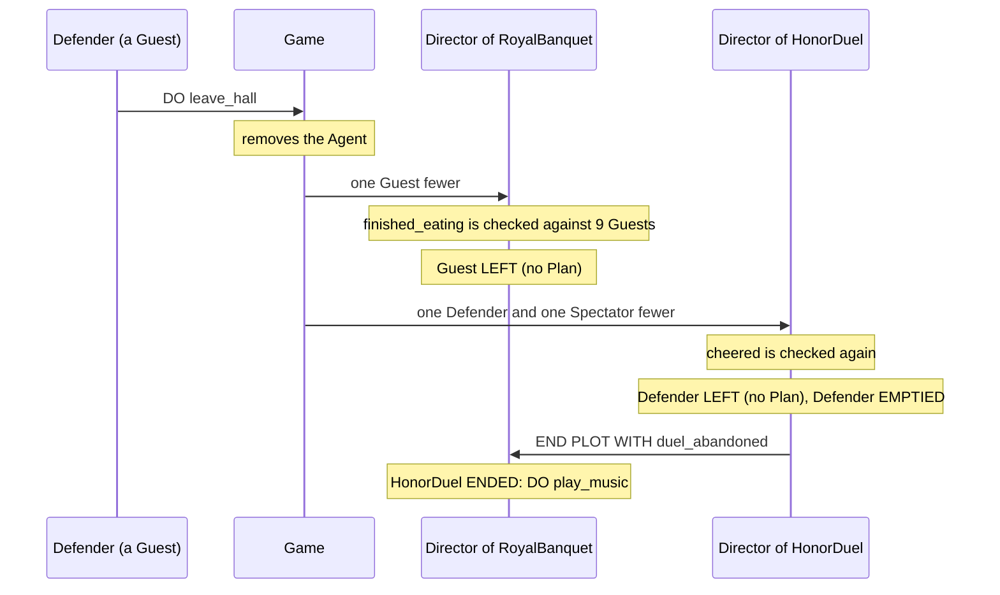

The banquet moves from `arrival` to `reception` when every Guest has sat down. No single Guest decides that. The Director has to hear the same Signal from enough of them, and "enough" is written in the Trigger: a Quota Trigger. Meanwhile the hall doesn't hold still. A latecomer walks in halfway through the feast, a Defender with no stomach for a duel walks out, and at the end of the evening everybody leaves. These are cast changes: Joining and Leaving.

The two are in one chapter because they meet. A Quota is counted over the Agents playing a Role, and Joining and Leaving change who that is. *Plots and Directors* covers Roles, Phases and the Director's other Triggers, *Playbooks and Roles* covers Givings, and *Messages* covers Signals.

## A Quota Trigger

`showcase/plots/royal_banquet.regia`
```regia
DURING arrival:
    WHEN ENTERED:
        DO open_doors.

    WHEN took_seat FROM ALL Guest:
        TRANSITION TO reception.
```

A plain `WHEN took_seat FROM Guest:` would run its Plan for every Guest who sits down. With `ALL` in front of the Role, the Plan runs once, when the last Guest has sent `took_seat`. The Director keeps a count of the Guests who have Signalled, and the Trigger fires when the count reaches the quantity.

- Each Agent counts once, however many times it sends the Event.
- Only Agents playing the Role count. A `took_seat` from the Host is not counted.
- Only Events can be counted, so a quantity is an error on a `LEARNED`, a `TO` or any other Trigger kind. A Director can't read its Agents' Facts. "When every Guest is seated" is always "when every Guest has told us so", and each Guest's Playbook has to send the Signal.
- A Placeholder after the Role is an error. `FROM ALL Guest ?who` has no one Agent to hold.

`#revise` `FROM Guest` and `FROM ALL Guest` differ by one word. The first runs a Plan per Signal and the second runs it once after many. `FROM 1 OF Guest` is legal and behaves like the first, under the rules of the second.

`#revise` A Quota Plan knows that enough Agents sent the Event and never which ones. To know who, the Director keeps Facts from a plain Trigger written beside the Quota, as `HonorDuel` does with its `wager` Facts.

Spec: chapter 18. For `FROM`, chapter 05.

## The three quantities

`showcase/plots/royal_banquet.regia`
```regia
WHEN finished_eating FROM 75 PERCENT OF Guest:
    TRANSITION TO farewell.
```

`showcase/plots/honor_duel.regia`
```regia
WHEN cheered FROM 3 OF Spectator:
```

| We write | It fires when | In the full hall (10 Guests) | In the small cast (3 Guests) |
|---|---|---|---|
| `FROM ALL Guest` | every Agent playing `Guest` has sent it | the 10th | the 3rd |
| `FROM 75 PERCENT OF Guest` | at least that share of them have | the 8th | the 3rd |
| `FROM 3 OF Spectator` | at least 3 different Spectators have | the 3rd | the 3rd |

`ALL` and `PERCENT` are measured against the Agents playing the Role at the moment of the check, not when the Phase began. `PERCENT` means at least that share and is never rounded: 75 percent of 10 is 7.5, so eight Guests are needed, and of three Guests all three.

`n OF` doesn't look at the size of the Role. With more than three Spectators it fires at the third cheer. With fewer it can't be met and never fires.

- The quantity is a literal Number: whole and at least 1 for `n OF`, above 0 and at most 100 for `PERCENT`. No Expression, no Placeholder, no `RANDOM`.
- There is no `ANY`. Any Guest is the plain `FROM Guest`.
- `ALL` of a Role nobody plays never fires. A banquet started with no Guests stays in `arrival`.

`#revise` `75 PERCENT OF Guest` in a Trigger rounds up, and `75 PERCENT OF Guest` in a Mapping rounds down (*Playbooks and Roles*). Of ten Guests the first means eight and the second seven.

`#revise` A counted Mapping takes an Expression (`MAPPING RANDOM(1, 3) OF Guest TO Poisoner`) and a Quota takes a literal. The quantity can't follow a Fact of the Director.

`#revise` `3 OF Spectator` is written in the Plot and the size of the hall in Instancing. With two Guests the duel waits in `challenge` for a third cheer that can't come, and nothing warns. The small cast has exactly three Spectators only because both duellists are also cast as Spectators.

`#revise` `ALL` of an empty Role is never met, where "every Guest of none" could be read as met at once. No `EMPTIED` fires either, since nobody left. The Plot waits and nothing says why.

Spec: chapter 18. For counted Mappings, chapter 15.

## Counting per argument

`showcase/plots/honor_duel.regia`
```regia
WHEN wagered(?stake) FROM Spectator ?who:
    LEARN wager(?who, ?stake).

WHEN cheered FROM 3 OF Spectator:
    GIVEN wager(?backer, ?stake), HIGHEST ?stake, AT RANDOM:
        ASK ?backer TO give_signal.
        TRANSITION TO fighting.
    ELSE:
        TRANSITION TO fighting.
```

A Quota keeps one count for each value of the Event's arguments. Had we written the duel like this, it would not start after three wagers:

```regia
WHEN wagered(?stake) FROM 3 OF Spectator:      # three Spectators with the same stake
    TRANSITION TO fighting.
```

This fires when three Spectators have wagered the same amount, and fills `?stake` with it. Stakes of 4, 7 and 12 are three counts of one each. That is why `Wagering` sends two Signals, `wagered(?stake)` for the Director to remember and a bare `cheered` for it to count.

The rule fits a vote. `WHEN voted(?choice) FROM 50 PERCENT OF Guest:` fires for the choice that half the hall agrees on.

- A Value in a slot narrows the count as it narrows any Trigger: `voted(duel) FROM ALL Guest` counts votes for `duel` only.
- An Agent that sends `voted(duel)` and then `voted(feast)` counts once towards each.
- When one value fires, its count starts again and the partial counts of the other values stay.

`#revise` An argument that describes the sender, as a stake does, splits the count. The same Signal can't be both counted and carry data, so `cheered` exists only to be counted.

Spec: chapter 18.

## When a count starts, fires and ends

The count belongs to the Trigger and lives as long as a Block holding it is active. In a Phase that is from entry to exit, and in `DURING PLOT` from the start of the Staging to its end.

- A Signal sent before the count started is not counted. A Guest that signalled `took_seat` before `arrival` was entered would have to signal again (*Plots and Directors* has a `#revise` on the Role setups, which run first).
- Leaving the Phase throws the count away. Entering it again starts from zero.
- If a Phase's Block and `DURING PLOT` hold the same Quota Trigger, the count is kept across the exit, and the Phase's Plan is the one that runs while the Plot is in that Phase.

When the quantity is reached the Trigger fires once and the count starts again from zero. In `HonorDuel` that goes unnoticed, because the Plan moves to `fighting` and the count of `challenge` is thrown away. In the full hall there are ten Spectators. The duel starts on the third cheer, and the other seven cheers arrive in a Phase that has no Plan for them. So do the wagers that come with them: the Pick ranks only the stakes the Director had heard of by the third cheer.

A Plan that stays in its Phase is fired again:

```regia
DURING feast:
    WHEN complaint FROM 3 OF Guest:
        ASK Host TO apologise.           # at the 3rd complaint, the 6th, the 9th
```

Reaching the quantity is momentary, like an Event. The Plan is chosen at that moment or not at all:

```regia
WHEN cheered FROM 3 OF Spectator:
    GIVEN wager(?backer, ?stake), HIGHEST ?stake, AT RANDOM:
        ASK ?backer TO give_signal.
        TRANSITION TO fighting.
    # no ELSE
```

With no wager when the third cheer arrives, no Plan applies. The count is reset all the same and the three cheers are spent. In the small cast nobody is left to cheer again, and the duel stays in `challenge`. The showcase has the `ELSE` for this reason.

A Quota Trigger is a Trigger of its own, apart from the plain one on the same Event and from other quantities:

```regia
DURING arrival:
    WHEN took_seat FROM Guest ?who:
        TELL Servant seated(?who).       # for every Guest
    WHEN took_seat FROM ALL Guest:
        TRANSITION TO reception.         # once, after the last
```

The last Guest's Signal runs both Plans. Neither shadows the other. `FROM ALL Guest` and `FROM 3 OF Guest` on one Event would likewise be two Triggers with two counts.

`#revise` A Quota fires every time the count fills again. "Once" is written by leaving the Phase or by a Fact and a `GIVEN`, and with the `GIVEN` each later round spends its Signals for nothing.

`#revise` A Quota that is met while no `GIVEN` holds is lost without a trace. For a plain Event that is one Signal ignored. Here it is the whole count.

Spec: chapter 18. For Phases, chapter 20.

## Joining

`showcase/banquet.regin`
```regin
# No COUNT: a latecomer only ever enters by Joining.
AGENT latecomer PLAYS Guest:
    bravery AT RANDOM(-0.6, 0.6).
    sympathy AT RANDOM(0, 0.8).
    aggressiveness AT RANDOM(-0.4, 0.4).
```

An Agent Joins when the game adds it to the Program while it runs. Nothing in a Plot or a Playbook makes that happen. The game spawns a character, and reports its Agent kind and a name for it. The Agent then plays the Roles of its kind in the Root Plot, as the starting Agents of that kind do. A `latecomer` becomes a Guest of `RoyalBanquet`. The game can spawn any declared kind, a seventh `noble` as well. The `latecomer` kind has no `COUNT`, so none is there at the start.

Three things happen for a joiner, in this order:

1. The Role setup runs for it, for each Role it Joins, in the order the Roles are declared.
2. The standing Givings of those Roles reach it, in the order they were made.
3. The Director's `JOINED` Trigger fires, once per Role.

What a latecomer has after step 2 depends on when it walks in:

| It Joins during | It holds | It misses |
|---|---|---|
| `arrival` | `Courtesy`, a purse, two cravings, the Goal `take_seat` | nothing: `FROM ALL Guest` now waits for it too |
| `reception` | the same, and `NobleSocializing` | nothing, though its `took_seat` reaches a Director that no longer counts it |
| `feast` | the same, and `Dining` | `ASK Guest TO have_dinner`, the draw of the Poisoner, every duel already running |
| `farewell` | `Courtesy` and the setup's Facts and Goal | `ASK Guest TO take_leave`, which the Phase's `JOINED` Plan repeats |

- A Giving to a whole Role is standing. `ASSIGN Dining TO Guest, MAPPING Servant TO waiter.` ran once, when the feast began, and the latecomer gets `Dining` with the same Mapping. An `UNASSIGN … FROM Guest` ends the standing Giving, which is why `farewell` gives the latecomer neither `NobleSocializing` nor `Dining`.
- A Giving to a counted target is a fixed set. So is a counted Mapping. The joiner is never added to either.
- Messages are not replayed. `ASK Guest TO have_dinner` reached the Guests of that moment.
- A joiner enters the Root Plot only. A duel already running has its Cast, and the latecomer is not a Spectator of it. It will be one of the next duel.

`#revise` Whatever a Role should get "whenever it arrives" has three homes with three behaviours: the setup (every Phase, joiners included), a whole-Role `ASSIGN` (joiners included, until taken away) and an entry Plan's `TELL` or `ASK` (never for joiners). `feast` uses the second and the third two lines apart.

`#revise` A setup can't depend on the Phase. A latecomer in `farewell` is given `take_seat` by the setup and `take_leave` by the `JOINED` Plan, and walks to its seat and to the door at once.

Spec: chapter 19. For setups, chapter 16; for kinds, chapter 21.

## Leaving

`showcase/playbooks/courtesy.regia`
```regia
TO take_leave FROM DIRECTOR:
    TELL host greeting.
    DO walk_to(door).
    DO leave_hall.                       # the game removes us: we Leave the Program
```

`showcase/vocabulary.regia`
```regia
#@desc: Done at once. The game then removes the Agent: it Leaves the Program.
ACTION leave_hall
```

An Agent Leaves when the game removes it from the Program. Regia has no Statement for it. `leave_hall` is a Custom Action like `sit_down`, and that the game answers it by removing the Agent is known only from the two comments above. A Director can't remove an Agent, and can't move one out of a Role either.

When an Agent Leaves:

- It stops playing every Role in every Staging at once. A `knight` in a duel stops being a Guest, a Guard, a Spectator and, if `Poisoning` is running, a Watchman.
- Its Givings and its Plans go with it. Nothing is undone for the others: the dish a Servant was carrying to it is still carried.
- A Role it played is one Agent smaller wherever the Role is looked up: as a recipient, in a whole-Role Mapping, in a Quota.
- It drops out of every counted pick, and the pick is not refilled. If the Poisoner Leaves, there is no Poisoner.
- A Message to it through a Placeholder is dropped with a warning in the Trace, and the sender's Plan carries on. `TELL ?guest served(?dish)` in `Serving` is one of these when the patron has gone home.

An Agent that is dead and still lying in the hall has not left. Being dead is the game's business, reported as a Fact or an Event like anything else.

`#revise` Leaving is the game's answer to an Action, so in the source it looks like any other `DO`. A Statement written after `DO leave_hall` would read as reachable. The README has the same note.

Spec: chapter 19. For dropped Messages, chapter 07.

## What the Director hears

`showcase/plots/royal_banquet.regia`
```regia
DURING farewell:
    …
    WHEN Guest ?late JOINED:             # Messages aren't replayed, so we ask again
        ASK ?late TO take_leave.

    WHEN Guest EMPTIED:
        END PLOT.

DURING PLOT:
    WHEN Guest ?late JOINED:
        TELL Host guest_arrived(?late).
    …
    WHEN Host EMPTIED:
        END PLOT.
```

A Director has three Trigger kinds about the Roles of its own Staging. The Role is written first, as the subject.

| We write | It fires when |
|---|---|
| `WHEN Guest JOINED:` or `WHEN Guest ?late JOINED:` | an Agent starts playing `Guest` by Joining |
| `WHEN Guest LEFT:` or `WHEN Guest ?gone LEFT:` | an Agent playing `Guest` Leaves |
| `WHEN Guest EMPTIED:` | the last Agent playing `Guest` Leaves |

The showcase ends its evening with `EMPTIED`. `farewell` asks the Guests to take leave, each one walks to the door, and when the last has gone the Plot ends. `LEFT` reacts to each departure:

```regia
DURING PLOT:
    WHEN Guest ?gone LEFT:
        TELL Host departed(?gone).
```

- The starting Cast sets off no `JOINED`, since starting is not Joining.
- `?late` holds an Agent like any other: it can be told and asked, given a Playbook, or mapped onto a Role of a Subplot. `?gone` is a Value and no more. A Message to it is dropped.
- `EMPTIED` takes no Placeholder, and none of the three takes a quantity. `WHEN ALL Guest LEFT:` is an error.
- A Role that empties ends nothing. The Staging goes on, Messages to the Role reach nobody, and a standing Giving waits for the next joiner. Ending is the Director's call.
- A Role that starts empty has not emptied.
- The three are for Directors. In a Playbook they are errors.

When one Agent Leaves, a Director handles it in a fixed order. First its Quota Triggers are checked again. Then, for each Role the Agent played, in the order the Roles are declared, `LEFT` fires and after it `EMPTIED` if nobody is left. Here is the Defender who would not fight, seen from both Stagings:



`#revise` A Director can't count the Agents of its Roles. `EMPTIED` covers "none left", and "one left" or "fewer than half" can't be written. `COUNT` works on the Director's own Facts, so the workaround is a Fact kept by hand in `JOINED` and `LEFT` Plans, with no way to learn the starting number.

`#revise` `?gone` can be written wherever `?late` can. `ASK ?gone TO take_leave.` compiles and is dropped at run time with a warning.

`#revise` An Agent never hears of a cast change. A Challenger whose `opponent` has walked out goes on telling `hit` to a Role nobody plays. What the others should know, the Director relays in a Message we have to invent, as `guest_arrived` was.

Spec: chapter 19. For Director Triggers, chapter 20.

## What a cast change does to a count

A Quota counts current players only, so both kinds of cast change move it.

| What happens | `ALL` and `PERCENT` | `n OF` |
|---|---|---|
| a counted Agent Leaves | one fewer counted, one fewer to wait for | one fewer counted |
| an Agent not yet counted Leaves | one fewer to wait for: the Trigger may fire with no new Signal | nothing |
| an Agent Joins | one more to wait for | nothing, until it sends the Event |

Leaving sets off a check and Joining doesn't, since a joiner can only raise the bar.

In `arrival`, nine Guests are seated and the tenth is removed by the game on its way to the table. `took_seat FROM ALL Guest` fires on the departure.

In `feast`, seven of ten Guests have finished eating, and eight are needed. A Defender who had not finished walks out of a duel. Seven of nine is over 75 percent, and the banquet moves to `farewell` with no Guest having just finished.

A latecomer does the opposite. With seven of ten finished, one more Guest makes eleven, and nine are needed. The latecomer holds `Dining` and was never asked for `have_dinner`. It Signals `finished_eating` only if the game makes it hungry. Four latecomers who never get hungry keep ten finished Guests at the table: ten of fourteen is under 75 percent.

`#revise` A joiner is counted in the denominator of a Quota for a Signal that nobody asked it to send. The Giving is standing and the request was a Message. The banquet would need a `JOINED` Plan in `feast` that repeats the `ASK`, and that Plan would replace the one in `DURING PLOT` that has the Host bow (*Plots and Directors*).

`#revise` A Quota can fire with no Event arriving, on a departure. The Plan's Trigger reads `WHEN finished_eating …` and nobody has just finished eating. A Placeholder in the Event is still filled, with the value whose count was completed.

Spec: chapter 18, chapter 19.

## How this combines with…

### Playbooks

A Quota Trigger also works in a Playbook, over Events told by the Agents bound to one of its Roles:

```regia
PLAYBOOK NobleSocializing:
    ROLE peer.

    WHEN scandal(?victim) FROM 3 OF peer:
        PURSUE resent(?victim).          # three people say it, so we believe it
```

Here the count per argument is what we want: three peers gossiping about the same victim. The Agent itself is left out of the count and of `ALL` and `PERCENT`, since it never hears its own Messages. Counting starts when the Playbook is given and the count is dropped when its last Giving is taken away. With several Givings, the Role is everyone bound to it by any of them. `JOINED`, `LEFT` and `EMPTIED` have no place in a Playbook, whose Roles are addresses and not casts. (*Playbooks and Roles*)

### Messages

A Role recipient is looked up when the Message is sent, so it follows the Cast with no effort: a joiner hears the next `TELL Guest …`, and an Agent that has left doesn't. A Placeholder holding an Agent is a snapshot. `ASK ?backer TO give_signal.` in `HonorDuel` is dropped if the highest bidder has gone since wagering, and its `wager` Fact stays with the Director. (*Messages*)

### Matching

The Pick in `HonorDuel` runs inside a Quota Plan, over Facts gathered by a plain Trigger. The two are tied only by timing: `Wagering` sends `wagered` before `cheered`, so each counted Spectator's stake is known when the count fills. Nothing in the Director's Block says so. (*Matching*)

### Subplots and Stagings

Leaving reaches every Staging the Agent plays in, and each Director reacts for its own Roles. The spec fixes the order inside one Staging and not between two. Joining reaches the Root Plot alone, so a `JOINED` Plan in `HonorDuel` would never run and a Quota there never has its bar raised. `MAPPING ?offender TO Defender` for an offender who has since left starts a duel with no Defender. `Defender EMPTIED` doesn't fire, since the Role started empty, and the duel waits in `challenge`. (*Subplots and Stagings*)

### Phases and Precedence

The cast Triggers are chosen like any other of a Director: the current Phase's Block if it has a Plan, otherwise `DURING PLOT`. A Quota Trigger competes only with Blocks that have the same Event, quantity and Role. In a `PRECEDENCE` line, `ON took_seat` names the plain Trigger and every Quota on that Event together. (*Plots and Directors*, *Precedence and Labels*)

### Goals and Failure

A Director hears Signals and never Failures, so every Guest has to send the counted Signal however its Goal ended. `Courtesy` sends `took_seat` from the `FAILED` Plan of `take_seat`, and `Dining` sends `finished_eating` from four places. A Guest whose Plan forgets one of them holds an `ALL` back for the whole hall. (*Goals and Failure*)

### Instancing

Which Roles a joiner plays is in its Agent kind's `PLAYS`. Its Propensity values are drawn when it Joins, so each latecomer has a temperament of its own. A kind with no `COUNT` exists only for Joining. (*Instancing*, *Randomness*)

### The Transpiler

Joining and Leaving are the game's doing, so a behaviour case scripts them: `> join latecomer late_1` and `> leave noble_2`. The Trace records them as `JOINED late_1 AS Guest` and `LEFT noble_2`, and a dropped Message as a warning. A Quota being met has no entry of its own. It shows as the Plan it starts. (*The Transpiler*)

### Translation to ASL

On Jason a count is a set of beliefs, one per counted sender and argument value, held by the Director or the Agent that owns the Trigger. An Event that some Quota watches goes through a generated dispatcher, which starts the plain Plans and then counts the sender and checks the quantity. The game reports joins and leaves to the Root Plot's Director only. A leave is passed down the tree of Stagings, and each Director removes the Agent, checks its counts and posts `LEFT` and `EMPTIED`. (*Translation to ASL*)

### The Visual Editor

In a Phase map an arrow is labelled with its Trigger as written, so the two arrows out of `arrival` and `feast` read `took_seat FROM ALL Guest` and `finished_eating FROM 75 PERCENT OF Guest`. When we draw a new arrow, the Trigger picker offers Events, Subplot endings and cast changes. The spec lists no quantity there, so we add it in the text. (*The Visual Editor*)

## Since 1.0

1.0 had neither. A Director reacted to one Event at a time, so "when everyone is ready" could not be written, and the primer said nothing about Agents entering or leaving a running Program.

`#changes` Quota Triggers are new: `FROM ALL`, `FROM n OF` and `FROM n PERCENT OF` a Role, on Event Triggers, in Directors and in Playbooks.

`#changes` Joining and Leaving are defined. Both are the game's doing. A joiner enters the Root Plot through its Agent kind, and a leaver is out of every Staging at once.

`#changes` `JOINED`, `LEFT` and `EMPTIED` are new Trigger kinds for Directors.

`#changes` A Giving to a whole Role is standing and reaches joiners. Counted picks are fixed, and Messages are not replayed.
