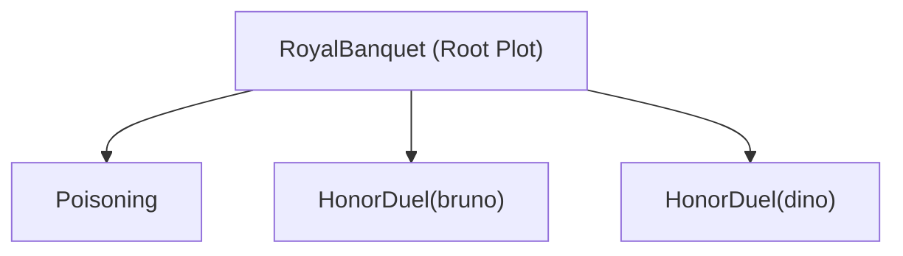
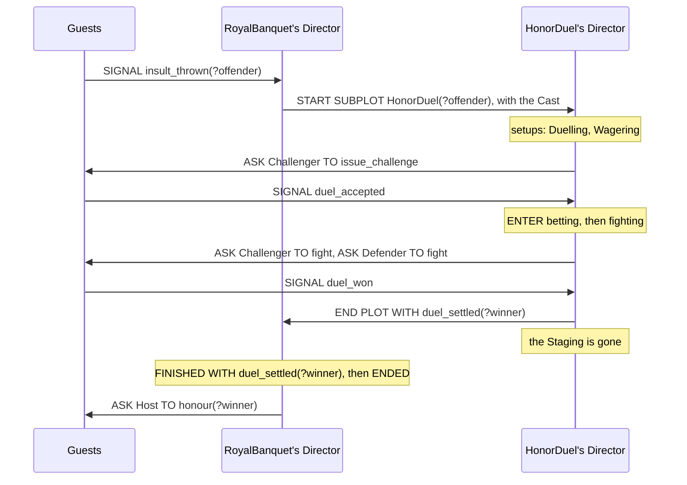

# Subplots and Stagings

Halfway through the feast one Guest insults another, and the insulted Guest stands up. A duel follows, with a challenge, wagers, a fight and a winner. It has its own Roles and Phases, none of which the banquet needs, and dinner goes on around it. We write the duel as a Plot, `HonorDuel`, and the banquet starts it as a Subplot. If a second insult comes while the first duel is still being fought, a second duel starts. Each running copy of a Plot is a Staging.

| We write | It does |
|---|---|
| `START SUBPLOT HonorDuel(?offender), MAPPING …` | starts a new Staging of a Plot below this one, and casts its Roles |
| `PLOT HonorDuel(offender):` | declares a Plot that takes parameters |
| `HonorDuel(?offender) RUNNING` | asks whether a Staging this one started is still running |
| `END PLOT WITH duel_settled(?winner)` | ends this Staging and hands its parent an Outcome |
| `WHEN HonorDuel(?) FINISHED WITH …:`, `FINISHED`, `DROPPED`, `ENDED` | hear how a Subplot ended |
| `DROP SUBPLOT HonorDuel(?)` | ends Subplots from above |
| `, UNTIL EXITED` | ties a Subplot to the Phase that started it |

What a Plot is, its Phases and its Director, is in *Plots and Directors*, and it all applies to a Subplot unchanged. The `MAPPING` clause, counts and `EXCEPT` are in *Playbooks and Roles*. This chapter is about what happens between two Plots: how a Subplot is started and cast, how it ends, and what its parent hears.

## Starting a Subplot

[`plots/royal_banquet.regia`](../showcase/plots/royal_banquet.regia)
```regia
DURING feast:
    ROLE Guest:
        ASSIGN Dining, MAPPING Servant AS waiter
    ROLE Servant:
        ASSIGN Serving, MAPPING Guest AS patron

    WHEN ENTERED:
        START SUBPLOT Poisoning,
            MAPPING 1 OF Guest AS Poisoner,
            MAPPING Guard AS Watchman,
            UNTIL EXITED
```

`START SUBPLOT` names a Plot and says who plays its Roles. After this line a Staging of `Poisoning` exists, with its own Director, and `RoyalBanquet` is its parent. One Guest is the Poisoner and every Guard is a Watchman. `UNTIL EXITED` ends it when the feast does (*A Subplot outlives its Phase*, below).

The Statement never waits. The banquet's Body carries on at once, as it does after an `ASK`, and the Subplot starts when it is ready, in a fixed order:

1. Its Roles are cast from the `MAPPING` clauses (*Casting*, below).
2. Its Role setups run for that Cast, as for any Staging (*Plots and Directors*). The Poisoner gets `Scheming`, and each Watchman gets a second Giving of `Keeping_watch`.
3. A Role that starts with nobody in it fires `EMPTIED`.
4. `DURING PLOT`'s `ENTERED` Plan runs, then the initial Phase's, and the `AFTER` counts start.

`Poisoning` has no Phases and no `ENTERED` Plan, so after its setups its Director waits for a Signal. The Poisoner does the rest from `Scheming`.

- Every `START SUBPLOT` that runs makes a new Staging, even if this parent already has a Staging of the same Plot running, with the same arguments or different ones, so two insults start two duels. A parent that wants one at a time asks first (*Running Stagings*, below).
- The parent hears how it went only when the Subplot ends (*Hearing a Subplot end*, below). Nothing comes back from the start, and no Plan can start a Subplot and wait for it on the next line.
- `START SUBPLOT` is a Director Statement, and like the others it never fails.
- The parent's file imports the Subplot's file, as it imports the Playbooks it gives. A Plot is written the same way whether it runs as the Root Plot or as a Subplot.

**Checks**

- `START SUBPLOT` in a Playbook → `R1507`
- A Plot that isn't declared in the file or anything it imports → `R1004` (the hint suggests the `IMPORT`)

Spec: chapter 17, *Starting a Subplot*. For what starting a Staging does, chapter 20.

## Plot parameters

[`plots/honor_duel.regia`](../showcase/plots/honor_duel.regia)
```regia
#@desc: One duel over one insult. The offender is the Defender; it also tells this duel from the others.
PLOT HonorDuel(offender):
```

[`plots/royal_banquet.regia`](../showcase/plots/royal_banquet.regia)
```regia
WHEN insult_thrown(?offender), FROM Guest ?offended:
    GIVEN NOT HonorDuel(?offender) RUNNING:  # one duel per offender at a time
        START SUBPLOT HonorDuel(?offender),
            MAPPING ?offended AS Challenger,
            MAPPING ?offender AS Defender,
            MAPPING Guest EXCEPT ?offended, ?offender AS Spectator
```

A Plot can take parameters, written after its name the way a Goal's are. The `START SUBPLOT` passes the arguments. `HonorDuel` takes the offender. The duel doesn't read it: the parameter is there so the banquet can tell one duel from another, in `RUNNING` and in the Triggers that hear a duel end.

Inside the Plot a parameter is a Placeholder that is already filled, in every Block: the Role setups, `DURING PLOT` and every Phase. `offender` is read as `?offender`. A variation of the duel that uses it:

```regia
PLOT HonorDuel(offender):
    ROLE Challenger:
        ASSIGN Duelling, MAPPING Defender AS opponent
        LEARN grudge(?offender, 1)           # the insult is not forgotten
```

- The parameter is fixed for the Staging. No Plan fills it again, and a Trigger or Context that names it tests it, as it would test any filled Placeholder.
- It is the only Placeholder a Role setup may use (*Plots and Directors*).
- The arguments of `START SUBPLOT` must be filled when it runs: Values, or Placeholders that are certainly filled. An Agent is allowed, as `?offender` is. A Role is not a Value and can't be an argument.
- A Plot has one parameter count. If it has parameters, every `START SUBPLOT`, ending Trigger, `DROP SUBPLOT` and `RUNNING` writes them, with `?` where any value will do. If it has none, it is written bare. `PRECEDENCE` names it bare either way, since all its Stagings share one rank.
- The Root Plot takes no parameters, because Instancing has nothing to pass to them.
- The parameters belong to the Plot's Interface. They are declared in the header, not inferred.

**Checks**

- A Plot written with the wrong number of arguments: bare when it has parameters, with arguments when it has none, in `START SUBPLOT`, an ending Trigger, `DROP SUBPLOT` or `RUNNING`; or written with arguments in `PRECEDENCE` → `R1709`
- A `START SUBPLOT` argument that isn't filled, or is a Role → `R1710`
- A Plan that fills a parameter again (`LET ?offender BE …`), or two parameters of one Plot with one name → `R1711`
- A Root Plot with parameters → `R2114`

Spec: chapter 17, *Plot parameters*. For Placeholders, chapter 03; for the Interface, chapter 38.

## Casting

The two `START SUBPLOT` Statements above use every form of Mapping the showcase has:

| We write | Who is cast |
|---|---|
| `MAPPING Guard AS Watchman` | everyone playing `Guard` in the banquet's Staging when the Statement runs |
| `MAPPING 1 OF Guest AS Poisoner` | one of those Guests, drawn at random when the Statement runs |
| `MAPPING ?offended AS Challenger` | the one Agent the Placeholder holds |
| `MAPPING Guest EXCEPT ?offended, ?offender AS Spectator` | every Guest but the two who fight |

A Playbook's Roles are addresses. A Subplot's Roles are played: its Agents get its Role setups, hold its Givings, and are the ones its Director tells and asks. So they are cast once, when the Subplot starts.

The left side of a Mapping is always the parent's: one of its Roles, `CAST`, either with a count or an `EXCEPT`, or a Placeholder holding one Agent. The right side is a Role of the Subplot. Everything about the clause itself is as on `ASSIGN`: a Role with no `MAPPING` is filled by the parent's Role of the same name, ignoring case, and a Role filled by neither is an error.

Unlike on `ASSIGN`, a whole-Role Mapping on `START SUBPLOT` is a copy. `MAPPING Guard AS Watchman` casts the Agents who are Guards at that moment, and later changes to `Guard` don't reach the Subplot. On `ASSIGN`, `MAPPING Servant AS waiter` binds `waiter` to the Role itself, and who it reaches is looked up each time it is used.

- `EXCEPT` and `CAST` are read when `START SUBPLOT` runs, like any whole-Role Mapping here: `MAPPING CAST EXCEPT Guard AS Spectator` would be the whole banquet but its Guards, as they stood then.
- A counted pick draws once, and never draws the same Agent twice in one Statement. A whole-Role Mapping next to it still means the whole Role: a knight is a Guest and a Guard, so the Poisoner can also be a Watchman.
- Inside the Subplot, `CAST` is the Subplot's own Cast: everyone it cast, whatever Role they play.
- The Cast only shrinks. An Agent who leaves the Program leaves every Staging, and each Director hears it for its own Roles (*When an Agent leaves*).

### A Role that starts empty

[`plots/honor_duel.regia`](../showcase/plots/honor_duel.regia)
```regia
WHEN Challenger EMPTIED:
    END PLOT WITH duel_abandoned
WHEN Defender EMPTIED:
    END PLOT WITH duel_abandoned
```

A Role can start with nobody in it, when the parent's Role was empty at that moment or a count found nobody. That is not an error. The Role fires `EMPTIED` once, after the setups and before the initial Phase's `ENTERED`, in Role declaration order with `CAST` last. A Plan written for "the last one has left" also covers "nobody came": a duel that somehow started without a Defender ends itself at once, instead of waiting in `challenge` for an answer nobody can give. A banquet with no Guards would start `Poisoning` with no Watchman, and since `Poisoning` has no Plan for `Watchman EMPTIED`, it would carry on with nobody watching.

> **In 2.0** Agents can join the Root Plot while it runs, but a joiner never reaches a Subplot that is already running. A Guest who arrives during a duel is no Spectator of that duel, though the next duel's whole-Role Mapping copies it in. Spec chapter 17, *Casting*, and chapter 19, *Joining*. In 1.5 nobody joins, and every Cast only shrinks.

**Checks**

- A Subplot Role left unfilled → `R1503` (the message suggests a `MAPPING`)
- Two `MAPPING`s to one Role in one Statement, or a `MAPPING` to a Role the Subplot doesn't declare → `R1504`
- A Role on the left that the parent doesn't declare → `R1502`
- `EXCEPT` misused → `R1510`
- A `MAPPING ?who` whose Placeholder isn't filled, or isn't certainly filled → `R0304`, `R0305`
- The retired `MAPPING a TO b` → `R1514` (hint: `MAPPING a AS b`)
- A count asking for more Agents than the Role has → `T1502` (Trace warning)
- A Mapping that reaches an Agent who has left → `T2001` (Trace warning)

Spec: chapter 17, *Casting*. For the Mapping clause, counts and `EXCEPT`, chapter 15; for `EMPTIED`, chapter 19.

## Being in both

An Agent cast into a Subplot keeps everything it had. A Spectator is still a Guest of the banquet. It plays Roles in two Stagings and holds Givings from both:

| A Spectator holds | Given by | Its Signals reach |
|---|---|---|
| `Courtesy`, `NobleSocializing`, `Dining` | `RoyalBanquet` | the banquet's Director |
| `Wagering` | `HonorDuel` | that duel's Director |

[`playbooks/wagering.regia`](../showcase/playbooks/wagering.regia)
```regia
WHEN duel_on, FROM DIRECTOR:
    GIVEN purse(?gold) AND ?gold >= 2:
        LET ?stake BE RANDOM(1, ?gold / 2)   # a whole roll, up to half the purse
        UPDATE purse(?gold) TO purse(?gold - ?stake)
        SIGNAL wagered(?stake)
        DO cheer
    ELSE:
        DO cheer
```

A Signal goes to the Directors that gave the Playbook it is written in. `wagered` is in `Wagering`, so the duel's Director records the stake and the banquet's never hears it. The same Guest's `finished_eating`, from `Dining`, goes to the banquet. `FROM DIRECTOR` works the same way in reverse: `duel_on` matches because the Director that sent it gave `Wagering`.

- Each Director sees its own Roles. In `RoyalBanquet`, `FROM Guest` still means the banquet's `Guest`. A parent never sees its Subplots' Roles, so `FROM Challenger` there is an error.
- Being cast in a Subplot adds and never takes away. A Challenger still holds `Dining`, is still served, and still eats between lunges. Where both Playbooks have a Plan for one Trigger, precedence decides which runs (*Precedence and Labels*). A parent that wants the duellists away from the table removes `Dining` before the `START SUBPLOT` and gives it back in its `ENDED` Plan (*Playbooks and Roles*, *Giving it back*).
- A Playbook given by both Plots is held twice. A knight is a Guard, so `Poisoning` makes it a Watchman and gives it `Keeping_watch` a second time. Its `SIGNAL culprit_seized(?who)` then reaches both Directors.
- When the Subplot ends, its Givings go and the parent's stay.

**Checks**

- A Role the Plot doesn't declare, a Subplot's included → `R1502`

Spec: chapter 17, *Being in both*. For Signals and `FROM DIRECTOR`, chapter 07; for Givings, chapter 15.

## Several Stagings of one Plot

The insult Plan runs once for each insult taken badly. With two quarrels during one feast, the banquet has three Subplots running:



Each Staging has its own Director, Cast, current Phase and Facts. The first duel can be in `fighting` while the second is still in `challenge`. One duel's `wager` Facts are unknown to the other.

Stagings have no names in the language. A Staging knows its parent and the Subplots it started, and no other Staging, and everything its Director writes is about its own Staging. A parent tells its Subplots apart by their arguments, matched the way a Goal's arguments are: `WHEN HonorDuel(?o) ENDED` says whose duel it was, and `DROP SUBPLOT HonorDuel(?o)` ends only the duels over that offender. Two Stagings with the same arguments can't be told apart at all, and a Statement that matches one matches both.

In the Trace, each Subplot's Director has a number, given in the order its Staging started: `director:HonorDuel#1`, `director:HonorDuel#2`. Only the Trace has these numbers. Nothing in a run can read them.

### An Agent in two Stagings of one Plot

An Agent can play Roles in two running Stagings of the same Plot. Here every Guest who isn't fighting is a Spectator of both duels, and the language allows it. Whether that makes sense is a question for the game, and guarding against it is up to the writer, with the Plot's arguments, Facts of the parent's own, and `RUNNING`. The banquet allows one duel per offender at a time, and nothing more.

A Plan doesn't know which Giving it runs for, so:

- A Playbook given by both Stagings is held twice and runs one set of Plans. Its Roles are the union of both bindings. If Ada fights two duels, her `opponent` is both opponents, and each `TELL opponent hit` strikes both.
- A `SIGNAL` reaches both Directors, whichever Director's Message started the Plan. A Spectator's `wagered` is recorded by every duel still taking bets, and Ada's `duel_won` ends every one of her duels that is in `fighting`, with her as the winner.

The Trace marks it on the start of the second Staging: every Agent of its Cast who already plays in a running Staging of the same Plot is followed by `ALSO IN #<n>`. The mark is not a warning.

Spec: chapter 17, *Stagings*, *An Agent in two Stagings of one Plot*. For the Trace's names, chapter 34.

## Running Stagings: `RUNNING`

[`plots/royal_banquet.regia`](../showcase/plots/royal_banquet.regia)
```regia
GIVEN NOT HonorDuel(?offender) RUNNING:  # one duel per offender at a time
```

`HonorDuel(?offender) RUNNING` holds while a Staging of `HonorDuel` that this Staging started is running with that argument. Here `?offender` is filled by the Trigger, so the condition tests it. If the same Guest gives offence again while its first duel is still on, nothing new starts.

A blank or an unfilled Placeholder matches any argument, and the condition fills Placeholders as any condition does:

```regia
WHEN culprit_seized(?):
    GIVEN COUNT(HonorDuel(?) RUNNING) > 1:   # two duels and a poisoner: the hall is in uproar
        DO ring_bell
```

- It goes wherever a condition goes: a Context, an `IF`, under `NOT`, inside `COUNT(…)`, with Picks and `FOR EACH`.
- Its Matches are distinct, as every condition's are: one per set of arguments, not one per Staging. `COUNT(HonorDuel(?) RUNNING)` counts the offenders being fought, and `COUNT(Poisoning RUNNING)` is 1 or 0.
- A Staging runs from its `START SUBPLOT` until it ends: by itself, from above, or with its parent. It stops counting before its ending is heard, so a `WHEN HonorDuel(?) ENDED` Plan already sees it gone.
- It sees only the Stagings this Staging started. A Subplot can't ask about its parent, its siblings, or its own Subplots' Subplots.
- Only a Director can ask it. A Playbook knows no Plots.

**Checks**

- `RUNNING` naming a Plot this Plot never starts → `R1704`
- `RUNNING` in a Playbook → `R1714`
- A Plot with parameters written bare, or one without written with arguments → `R1709`

Spec: chapter 17, *Running Stagings*. For distinct Matches and `COUNT`, chapter 26.

## A Subplot outlives its Phase

A Subplot belongs to the parent's Staging, not to the Phase that started it. A duel begun in `feast` goes on when the banquet moves to `farewell`, where the banquet ends it by hand. A Subplot stops only when it ends itself, when the parent drops it, or when the parent ends.

A Subplot meant to last only as long as a Phase says so where it starts, with `UNTIL EXITED`, as `Poisoning` does (*Starting a Subplot*, above). When the banquet leaves `feast`, after `feast`'s `EXITED` Plan, `Poisoning` is ended as if by `DROP SUBPLOT`. Whichever way the feast ends, by the count of finished Guests, by the poison, or by `END PLOT`, the Subplot ends with it, and no other Block has to say so.

[`plots/royal_banquet.regia`](../showcase/plots/royal_banquet.regia)
```regia
WHEN Poisoning DROPPED:
    PRINT("The feast is over, and the poisoner was never found.")
```

The parent hears it as `DROPPED` (below). `feast` has been left by then, so its Plans can't hear it. The ending is heard by the new Phase's Plan, or else by `DURING PLOT`, which is where the banquet writes it. On the other side, `Poisoning`'s `WHEN EXITED, BY PARENT:` discards the cup (*Plots and Directors*).

- `UNTIL EXITED` is written last, after the Mappings, in a Plan of a `DURING <phase>` Block. In `DURING PLOT` it would mean nothing, since everything there already ends with the Staging.
- An earlier `DROP SUBPLOT` still works, and the Subplot can still end itself first. Then nothing is left to end when the Phase is left.

**Checks**

- `UNTIL EXITED` outside a Plan of a `DURING <phase>` Block, or not last → `R1509`
- `START SUBPLOT P …, UNTIL EXITED` in Phase `p`, with a `DROPPED` or `ENDED` Plan for `P` only in `p` → `R1713` (warning: nothing hears the ending)

Spec: chapter 17, *A Subplot outlives its Phase*. For `UNTIL EXITED`, chapter 15; for what `ENTER` does, chapter 20.

## Ending itself: `END PLOT WITH`

[`plots/honor_duel.regia`](../showcase/plots/honor_duel.regia)
```regia
DURING fighting:
    WHEN ENTERED:
        ASK Challenger TO fight
        ASK Defender TO fight

    AFTER 2 MINUTES:                     # nobody yielded
        END PLOT WITH duel_abandoned

    WHEN duel_won, FROM ?winner:
        END PLOT WITH duel_settled(?winner)
```

[`vocabulary.regia`](../showcase/vocabulary.regia)
```regia
# ── Outcomes of the Subplots ─────────────────────────────────────────────────

CUE duel_settled(winner), duel_abandoned
CUE poisoner_caught(person), poison_taken
```

A Subplot ends itself with `END PLOT`, as any Plot does. With `WITH <cue>`, it also hands its parent one Cue, the Outcome, which says how it went. A duel has two Outcomes: `duel_settled(?winner)` when one duellist has won, and `duel_abandoned` when time ran out or a duellist left the hall. `Poisoning` has two as well, `poisoner_caught(?who)` and `poison_taken`.

- An Outcome is one Cue of the Vocabulary, declared like any other. A Plot can't declare Cues of its own, and a Playbook's local Cue can't be an Outcome. Different endings use different Cues.
- Its arguments must be filled, by Values or by Placeholders certainly filled earlier in the Plan.
- An argument can be an Agent. `?winner` travels up to the banquet, which can then tell it, ask it, give it a Playbook or cast it in another Subplot.
- A plain `END PLOT` ends with no Outcome. The parent hears it as an ending with nothing attached.
- The Plot doesn't list its Outcomes anywhere. The Transpiler collects them from the `END PLOT WITH` lines into the Plot's Interface, and checks the parent against them (*Interfaces*).
- `WITH` in the Root Plot has nobody to tell, and is ignored with a warning.

`END PLOT` in a Subplot runs as in any Plot: the current Phase's `EXITED`, then `DURING PLOT`'s, then its own Subplots end, children before parents, and every ending Staging's Givings are taken away. `Duelling` and `Wagering` stop for everyone who held them only from this duel, and the duel's `wager` Facts go with its Director. What the Agents learned stays theirs, so a Spectator's purse stays lighter by its stake. Then the parent is told.

**Checks**

- A Statement after `END PLOT` in the same branch → `R1702`
- `END PLOT WITH` something other than one declared Cue, or with arguments not filled → `R1703`
- A Playbook's local Cue as an Outcome → `R1004` (the Plot can't see it)
- `END PLOT WITH` in a Plot never started as a Subplot → `R1705` (warning: `WITH` is ignored)

Spec: chapter 17, *Ending*, *Outcomes*. For what `END PLOT` does to the Staging, chapter 20.

## Hearing a Subplot end: `FINISHED`, `DROPPED`, `ENDED`

[`plots/royal_banquet.regia`](../showcase/plots/royal_banquet.regia)
```regia
WHEN HonorDuel(?) FINISHED WITH duel_settled(?winner):
    ASK Host TO honour(?winner)
    ASSIGN Keeping_watch TO ?winner  # the winner stands guard of honour
    TELL ?winner on_duty
WHEN HonorDuel(?) ENDED:             # however the duel ended
    DO play_music

WHEN culprit_seized(?):              # any Guard's report: sound the alarm
    DO ring_bell
WHEN Poisoning FINISHED WITH poisoner_caught(?culprit):
    REMOVE NobleSocializing FROM Guest ?culprit
    ASK ?culprit TO take_leave       # led out of the hall
WHEN Poisoning FINISHED WITH poison_taken:
    ENTER farewell                   # the evening is cut short
WHEN Poisoning DROPPED:
    PRINT("The feast is over, and the poisoner was never found.")
```

A parent hears a Subplot's ending the way an Agent hears a Goal's: a specific Trigger for how it ended, then plain `ENDED` for every ending.

| Trigger | Fires when the Subplot |
|---|---|
| `WHEN P FINISHED WITH e` | ended itself with `END PLOT WITH e` |
| `WHEN P FINISHED` | ended itself, with an Outcome that no `FINISHED WITH` Plan above it matched, or with a bare `END PLOT` |
| `WHEN P DROPPED` | was ended by this Staging: `DROP SUBPLOT`, or `UNTIL EXITED` when the Phase was left |
| `WHEN P ENDED` | ended in any of these ways, after the specific Trigger's Plan |

Each word has one meaning, shared with Goals. `FINISHED` is the Subplot's word for "ended by itself", as `REACHED` and `FAILED` are a Goal's: a Subplot doesn't succeed or fail, and its Outcome says how it went. `DROPPED` means stopped on purpose by whoever started it, for a Goal and a Subplot alike. `ENDED` means over, however it went. It takes no complement and always fires after the specific Trigger.

Here is what the banquet does for each way its Subplots can end:

| The Subplot ends | The Plans that run, in order |
|---|---|
| `HonorDuel`, `WITH duel_settled(?winner)` | the honours, then the music |
| `HonorDuel`, `WITH duel_abandoned` | no `FINISHED` Plan matches; the music |
| `HonorDuel`, dropped in `farewell` | no `DROPPED` Plan; the music |
| `Poisoning`, `WITH poisoner_caught(?culprit)` | the culprit is led out |
| `Poisoning`, `WITH poison_taken` | the move to `farewell` |
| `Poisoning`, dropped when `feast` is left | the `PRINT` |
| either, because the banquet itself ends | nothing |

- The `FINISHED` Plans of one Block, with and without `WITH`, share a Trigger and are tried in the order written. The first that matches runs, as for `FAILED`. A plain `FINISHED` matches every ending the Subplot chose, so it goes after the `FINISHED WITH` Plans; above one, it shadows it.
- `WITH <cue>` after `FINISHED` matches the Outcome and fills Placeholders from it, as any Trigger does. A bare `END PLOT` is heard only by a plain `FINISHED`.
- The specific Trigger fires first, then `ENDED`, a Plan for each. A specific Trigger with no Plan doesn't stop `ENDED`. Tidying that every ending needs is written once, in `ENDED`.
- They fire once for each Staging that ends, with its arguments. A Plot with parameters is written with them, and they are matched like a Trigger's, so `WHEN HonorDuel(?o) ENDED` knows whose duel it was.
- They are heard like any Director Trigger: by the current Phase's Plan, or else by `DURING PLOT`.
- An ending the Subplot chose that has no `FINISHED` Plan and no `ENDED` Plan is ignored, and the Trace notes it as unheard. A `DROPPED` ending with no Plan is silent, since the parent caused it.
- A Subplot that ends because its parent is ending reports nothing: the parent is going too.

The banquet hears `duel_abandoned` only through `ENDED`. A banquet that wants to say something about every duel that ended without a winner writes a plain `FINISHED` after the `FINISHED WITH`:

```regia
WHEN HonorDuel(?) FINISHED WITH duel_settled(?winner):
    ASK Host TO honour(?winner)
WHEN HonorDuel(?) FINISHED:              # duel_abandoned, or a bare END PLOT
    DO ring_bell
WHEN HonorDuel(?) ENDED:
    DO play_music
```

The Statements on the two sides of one duel, from the insult to the honours:



The banquet's Director acts at the second arrow and at the end. In between it knows nothing of the duel.

**Checks**

- `WHEN P FINISHED`, `DROPPED` or `ENDED` where this Plot never starts `P` → `R1704`
- `WHEN P DROPPED` where this Plot never ends `P` from above: no `DROP SUBPLOT P`, no `UNTIL EXITED` on its `START SUBPLOT` → `R1712`
- The retired `WHEN P ENDED WITH e:` or `WHEN P ENDED WITHOUT OUTCOME:`, or `ENDED` with any complement → `R1715` (hint: `FINISHED WITH e`, or a plain `FINISHED` after the `FINISHED WITH` Plans)
- `WHEN P FINISHED WITH e` where `P` never ends with `e` → `R1706` (warning)
- An ending of `P` that no Plan of the parent hears in any Phase → `R1708` (warning, on the `START SUBPLOT`, once per ending)
- A plain `FINISHED` above a `FINISHED WITH` it also matches → `R1716` (warning)
- An ending the Subplot chose that no Plan heard → `T3802` (Trace, `unheard`)

Spec: chapter 17, *The parent's Triggers*. For a Goal's ending Triggers, chapter 05; for which Block hears a Trigger, chapter 13.

## Ending it from above: `DROP SUBPLOT`

[`plots/royal_banquet.regia`](../showcase/plots/royal_banquet.regia)
```regia
DURING farewell:
    WHEN ENTERED:
        DROP SUBPLOT HonorDuel(?)
        REMOVE NobleSocializing FROM Guest
        ASK Guest TO take_leave
```

The evening is over, and any duel still being fought is called off. `DROP SUBPLOT HonorDuel(?)` ends every running Staging of `HonorDuel` that this Staging started. It is the opposite of `START SUBPLOT`, and it is worded after the Trigger it fires, as `DROP g` fires a Goal's `DROPPED`.

Each Staging it ends goes the way of an `END PLOT`, with its own Subplots ending first. In the duel, `WHEN EXITED, BY PARENT:` rings the bell (*Plots and Directors*). The banquet then hears `DROPPED` and `ENDED` for each, and the music plays once per duel stopped.

- For a Plot with parameters it ends the Stagings whose arguments match. `DROP SUBPLOT HonorDuel(?o)` with `?o` filled ends the duels over that offender. `HonorDuel(?)`, or an unfilled Placeholder, ends them all.
- It doesn't end the Body. The `REMOVE` and the `ASK` run after it.
- The parent's `DROPPED` and `ENDED` Plans run after the Body that dropped them, like any Trigger's.
- With no such Staging running, it does nothing, without a warning. `Poisoning` needs no `DROP` here: it was started `UNTIL EXITED`, and leaving `feast` has already ended it.
- The word `SUBPLOT` is required. `DROP HonorDuel` is an error.

### When the parent ends

When a Plot ends, its Subplots end with it, children before parents, each with `EXITED, BY PARENT`. Nobody is told, since the parent that would hear it is ending too. This is also the order in which an Agent in both loses its Givings: the Subplot's first, then the parent's.

**Checks**

- `DROP SUBPLOT P` where this Plot never starts `P` → `R1704`
- `DROP P` with a Plot → `R0802` (hint: `DROP SUBPLOT P`)
- The retired `END SUBPLOT P` → `R1717` (hint: `DROP SUBPLOT P`)
- A Plot with parameters written bare → `R1709`

Spec: chapter 17, *`DROP SUBPLOT`*, *`END PLOT`*. For `EXITED, BY PARENT`, chapter 20.

## No cycles

```regia
PLOT HonorDuel(offender):
    ...
    DURING fighting:
        WHEN duel_won, FROM ?winner:
            START SUBPLOT HonorDuel(?winner)     # a rematch: HonorDuel starts itself
```

A Plot can start any number of different Subplots, a Subplot can start Subplots of its own, and one Plot can be started from several parents. A cycle is the one thing ruled out: a Plot can't start itself, directly or through other Plots (A starts B, B starts A). A duel that leads to a rematch by starting itself again is an error, and the message names the cycle.

A Subplot's Playbooks rank against its parent's, and a Plot below itself would rank both above and below itself (*Precedence and Labels*).

**Checks**

- A cycle among `START SUBPLOT` Statements → `R1701` (the message names the cycle)

Spec: chapter 17, *No cycles*. For ranking, chapter 13.

## How this combines with…

### Plots and Directors

A Subplot is a Plot like any other, with Roles, Phases, setups and a Director of its own. Starting one runs the same steps as starting any Staging, and ending one runs the same `EXITED` Plans. `EXITED, BY PARENT` is how the Subplot tells an ending from above from one of its own. (*Plots and Directors*)

### Playbooks and Roles

`START SUBPLOT` takes the same `MAPPING` clauses, counts and `EXCEPT` as `ASSIGN`, but copies its whole-Role Mappings at the start. A Subplot's Givings belong to its Staging and go when it ends, and an Agent holding the same Playbook from both Plots keeps the parent's. (*Playbooks and Roles*)

### Messages

A Signal from a Playbook the Subplot gave reaches the Subplot's Director, and the parent hears nothing of it. The parent learns how the Subplot went from its Outcome. (*Messages*)

### When an Agent leaves

Leaving the Program takes an Agent out of every Staging at once, and each Director hears it for its own Roles. When a duellist walks out, the duel's Director hears `Defender EMPTIED` and ends with `duel_abandoned`, and the banquet's hears one Guest fewer, then the duel ending. (*When an Agent leaves*)

### Precedence and Labels

[`plots/honor_duel.regia`](../showcase/plots/honor_duel.regia)
```regia
PRECEDENCE:
    PARENT OVER SELF ON scandal          # gossip and guard duty come before hushing
```

A Subplot's Playbooks beat its parent's by default. A Subplot can give way on a Trigger by naming its parent as `PARENT`, the only name it has for it. The parent orders its Subplots against itself and each other by Plot name, as in `HonorDuel OVER Poisoning`. All the Stagings of one Plot share its rank. (*Precedence and Labels*)

### Randomness

A counted Mapping draws once, when `START SUBPLOT` runs, and two counted Mappings in one Statement never draw the same Agent. (*Randomness*)

### Interfaces

A Plot's Interface lists its parameters, its Roles and its Outcomes. The parameters are declared, and the Outcomes are collected from its `END PLOT WITH` lines. The parent's ending Triggers are checked against them. (*Interfaces*)

### The Trace

Each Staging's start and end is a `staging` entry, with its arguments, its Cast and how it ended. An Agent cast while already in a running Staging of the same Plot is marked `ALSO IN`. (*The Trace*)

### Jason: Directors and Stagings

On Jason every Staging is a Director agent of its own, created when `START SUBPLOT` runs, and its name tells it apart from the others. The parent sends it the Cast and the arguments, keeps a record of its running Stagings for `RUNNING`, and goes on. (*Jason: Directors and Stagings*)
