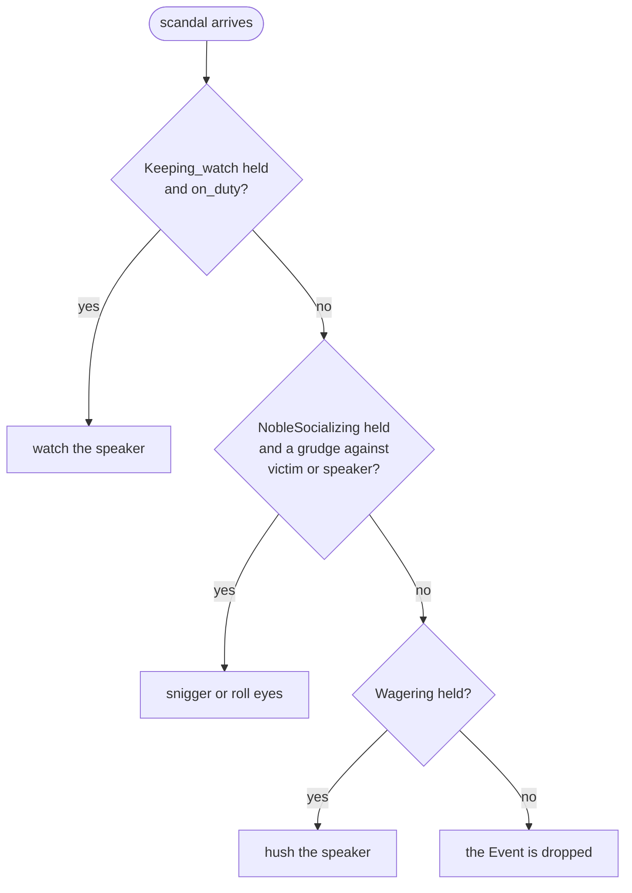

During the feast a knight is watching a duel when a Guest nearby passes on some gossip. The knight holds three Playbooks with a Plan for `scandal`. `Keeping_watch` would have it watch the speaker, `NobleSocializing` snigger, and `Wagering` hush them. One of the three runs. This chapter is about which one: the order of Plans inside a Playbook, the Precedence a Plot declares between the Playbooks it gives out and the Subplots it starts, and the two Labels, Suits and Shifts, through which an Agent's Propensities choose between Plans and are changed by them.

Sibling `GIVEN`s are in *Plans*, Givings in *Playbooks and Roles*, Phases in *Plots and Directors*, Subplots in *Subplots and Stagings*. Propensities are declared in *Vocabulary* and get their values in *Instancing*.

## One Plan for each Trigger

`showcase/playbooks/keeping_watch.regia`
```regia
WHEN scandal(?) FROM ?speaker:
    GIVEN on_duty:
        DO watch(?speaker).
```

`showcase/playbooks/noble_socializing.regia`
```regia
WHEN scandal(?victim) FROM peer ?speaker:
    GIVEN grudge(?victim, ?):
        DO snigger.
    GIVEN grudge(?speaker, ?), SHIFTS sympathy BY -0.1:
        DO roll_eyes.
    # no ELSE: gossip about strangers falls through to the next Playbook
```

`showcase/playbooks/wagering.regia`
```regia
WHEN scandal(?) FROM ?speaker:
    DO hush(?speaker).
```

A Trigger that reaches an Agent sets off one Plan, however many of its Playbooks have one for it. The knight doesn't watch, snigger and hush. This holds for every Trigger kind: Events, Fact changes, `DROPPED`, `FAILED` and `TO` recipes.

What competes is the Trigger Block: one `WHEN` or `TO` header with everything under it. The `GIVEN`s under one header never compete with each other, since the first that holds wins (*Plans*). A Trigger Block is a candidate for a Trigger when three things are true:

- its Playbook is given to the Agent at that moment;
- its Trigger matches, Values and `FROM` included. `NobleSocializing` listens `FROM peer`, so gossip told by anyone who isn't a peer never reaches its Block;
- it can run: one of its `GIVEN`s holds, or it has an `ELSE`, or it has no Context.

The candidates are put in an order and the first one runs. The order comes from three things, each used only where the one before leaves a choice:

1. Precedence, which is the order between Playbooks and between Plots, declared or default. Most of this chapter is about it.
2. The Selection function, which chooses by the Agent's Propensities among candidates we tied on purpose.
3. Name order, the last resort for a competition nobody ordered. It always comes with a warning.

The order never depends on the order of files, of `IMPORT` lines, or of Givings.

Three neighbouring questions have a fixed answer and no construct. Several things that happen are handled in the order they arrive. A running Plan is never interrupted by a more important one: running Plans take turns, a step at a time. And two running Plans whose Actions can't happen together are not kept apart.

`#revise` One Plan per Trigger means the knight can't both watch the speaker and snigger. "Both" has to be written as one more Plan with the two Bodies copied into it, in a Playbook that then knows what the other two do.

Spec: chapter 13.

## Falling through

The three Plans above are not equally greedy. `Keeping_watch` runs only for an Agent on duty and has no `ELSE`. `NobleSocializing` runs only for a Guest with a grudge against the victim or the speaker. `Wagering` has no Context and always runs.

A Trigger Block whose `GIVEN`s all fail and that has no `ELSE` is not a candidate, and the Trigger falls through to the next one in the order. For `scandal` the order is `Keeping_watch`, `NobleSocializing`, `Wagering`, for reasons the next sections give.



A knight is on duty from its Role setup, so it always watches and never reaches the other two. A noble with a grudge sniggers. A noble with none hushes the speaker while a duel is on, and otherwise does nothing: with no candidate left, an Event or a Fact change is dropped. A Goal with no candidate left fails (*Goals and Failure*).

So a Plan that should give way is written with a Context and no `ELSE`. A Trigger Block with an `ELSE`, or with no Context, is a full stop: nothing placed after it ever sees the Trigger. That is fine for `Wagering`, which comes last.

`#revise` Whether a Playbook lets a Trigger pass is decided by a missing `ELSE`, in a Playbook whose author can't see what comes after it. Adding `ELSE: DO sip_wine.` to the gossip Plan of `NobleSocializing` would end the hushing in every duel, and nothing in `Wagering` or `HonorDuel` would change or warn.

Spec: chapter 13. For dropped Events, chapter 07; for Goals, chapter 11.

## Inside a Playbook

```regia
PLAYBOOK Dining:
    …
    WHEN served(pie) FROM waiter:        # this Guest never touches pie
        DO push_away(pie).

    WHEN served(?dish) FROM waiter:
        LEARN on_plate(?dish).
```

Two Trigger Blocks of one Playbook can match the same Trigger. Then the first in the text wins, which is the reading rule of sibling `GIVEN`s. A served pie is pushed away and every other dish lands on the plate.

Written the other way round, `served(?dish)` would catch every dish and the pie Plan would never run. The Transpiler warns about a Trigger Block that an earlier one always shadows. Falling through works here as it does between Playbooks: if the first Block had a Context that failed and no `ELSE`, the pie would go to the second.

The exception is Suits alternatives, further down, which are meant to overlap.

Spec: chapter 13.

## The `PRECEDENCE` Block

`showcase/plots/royal_banquet.regia`
```regia
PRECEDENCE:
    Keeping_watch OVER NobleSocializing ON scandal.      # a knight is a Guard first
    HonorDuel OVER Poisoning.
    SELF OVER Poisoning ON scandal.                      # see the README's review notes
```

A Playbook never names another Playbook, so `Keeping_watch` can't say that it goes before `NobleSocializing`. The Plot that gives out both is the only author who sees them side by side, and it writes the order as relations in one `PRECEDENCE:` Block, next to its `ROLE` and `PHASE` lines.

The first line orders two Playbooks that `RoyalBanquet` gives: on `scandal`, every candidate of `Keeping_watch` goes before every candidate of `NobleSocializing`. The other two lines order Subplots and are read in the next section.

| Relation | Meaning |
|---|---|
| `A OVER B.` | Every candidate of A goes before every candidate of B. |
| `A OVER B ON item.` | The same, only for Triggers on `item`. On everything else A and B stay unordered. |
| `A TIES B.` or `A TIES B ON item.` | A and B are equal on purpose, and the Selection function chooses (*Tied Playbooks*, below). |

- `ON` takes a Trigger's item with its kind word, if it has one: `ON scandal`, `ON hungry LEARNED`, `ON have_dinner` for the recipe, `ON have_dinner FAILED`.
- Relations hold for the Plot's whole life, in every Phase. A relation only matters while both Playbooks are given, so "during the feast" follows from when each is given and is never written.
- Inside one Plot, relations combine: `A OVER B` and `B OVER C` put A before C. A cycle is an error, and the message prints it.
- There are no numbers. An order is always a relation, written by someone who can see both sides.
- A relation naming a Playbook the Plot never gives is an error. One whose two sides share no Trigger gets a warning, which catches a typo or a line left behind after a Playbook changed.

The relation names Playbooks, and not Agents or Roles. The Comment says "a knight", but the line holds for anyone who holds both, the winner of a duel included, who is given `Keeping_watch` and told `on_duty` as a guard of honour.

With no relation, two Playbooks of one Plot that share a Trigger are ordered by name, alphabetically, and the Transpiler warns, naming the pair and the line to add. The warning is only for Playbooks that share a Trigger, and the banquet's other Playbooks share none. The Transpiler knows which Playbooks an Agent can hold and not which it holds at the same time, so it can warn about a pair given in two different Phases.

`#revise` `Keeping_watch` comes before `NobleSocializing` in the alphabet, and `HonorDuel` before `Poisoning`. Two of the three lines above say what name order would have decided anyway, and deleting them changes nothing but two warnings. Had the Playbook been called `Watch`, the same Program without the line would have knights sniggering. A rename changes behaviour, and the warning is the only thing that says so.

`#revise` A relation covers a whole Playbook or one item of it. It can't name a single Trigger Block, and it takes one item per line, so a Playbook that should go first on three Events and second on the rest takes three lines.

Spec: chapter 13. Why the order is written in the Plot: ADR 0008.

## A Plot and its Subplots

`showcase/plots/honor_duel.regia`
```regia
PRECEDENCE:
    PARENT OVER SELF ON scandal.         # gossip and guard duty come before hushing
```

A Plot also orders its direct Subplots, against itself and against each other. With nothing declared, a Subplot goes before its parent: it is the more specific part of the story. A duellist with nothing to do limbers up, out of `Duelling`, where another Guest chats, and no line says so. The Poisoner's `idle` goes to `Scheming` first for the same reason.

A Plot names a Subplot by its Plot name, which it writes in `START SUBPLOT` anyway, and itself as `SELF`. `HonorDuel OVER Poisoning` in `RoyalBanquet` puts everything the duel gives before everything the poisoning gives. On `idle` it matters for one Agent: a Poisoner who is also a duellist limbers up and pours the poison only once the duel is over.

A Subplot can't know who starts it, so it has one name for that Plot: `PARENT`. `HonorDuel` gives `Wagering` to every Guest, and its `scandal` Plan has no Context. By default it would go first and take every piece of gossip for as long as a duel lasts. `PARENT OVER SELF ON scandal` gives way on that one item.

On a Guest who holds everything, the two shared Triggers come out like this:

| Trigger | Order | Decided by |
|---|---|---|
| `idle` | `Duelling`, `Scheming`, `NobleSocializing` | `HonorDuel OVER Poisoning`; both Subplots before the banquet, by default |
| `scandal` | `Keeping_watch`, `NobleSocializing`, `Wagering` | `PARENT OVER SELF ON scandal` in `HonorDuel`; `Keeping_watch OVER NobleSocializing ON scandal` |

The rules behind the table:

- The order is a hierarchy. First comes the order between the Plots, then the order of the Playbooks inside each Plot.
- A Subplot counts together with everything it starts. Nobody names a grandchild, and nobody names a Subplot's Playbooks.
- Relations don't carry across Plots. Each Plot's lines order only what that Plot names.
- If a parent and its Subplot say opposite things, the parent wins, and the Transpiler notes the relation it dropped.
- Two sibling Subplots with no relation are ordered by name, with the warning.
- Two Stagings of one Plot under one parent have the same place. They are the same Plot with the same Playbooks.
- A Playbook given by two Plots is still one Playbook, and it goes at the best of its places. The Guards hold `Keeping_watch` from the banquet and again from `Poisoning`, and on `scandal` the banquet's Giving is the better one.
- `TIES` joins only Playbooks given by one Plot. It can't join Subplots, `SELF` or `PARENT`.

Every Plot is the Root Plot or below it, so any two Plots have a common ancestor that orders them. This is why Instancing orders nothing, and why a Plot can't start itself (*Subplots and Stagings*).

`#revise` `HonorDuel` says `PARENT OVER SELF ON scandal`, `RoyalBanquet` says `HonorDuel OVER Poisoning`, and the default puts `Poisoning` before the banquet. On `scandal` that is a cycle, built from one line in each of two files and a line nobody wrote. `RoyalBanquet` breaks it with `SELF OVER Poisoning ON scandal`, which it could only write by knowing what its Subplot declared. The spec doesn't say whether a default gives way by itself here.

`#revise` `PARENT OVER SELF ON scandal` is written blind. A Subplot that can be started by any Plot can't know that its parent has Plans for `scandal`, yet the Comment on the line describes two Playbooks of `RoyalBanquet`. Started from another parent, the line either orders nothing or orders Plans its author never saw.

`#revise` `SELF` means two things. In `RoyalBanquet`, `SELF OVER Poisoning` is the banquet's own Playbooks without its Subplots. In `HonorDuel`, the `SELF` of `PARENT OVER SELF` is the duel with everything it starts, since the line is read from the parent's side as `SELF OVER HonorDuel`. `PARENT` is the parent's own Playbooks only, so a Subplot can place itself against its parent and never against its siblings.

Spec: chapter 13, chapter 17. For how the two tables are built, chapter 32.

## A Director's own Plans

`showcase/plots/royal_banquet.regia`
```regia
DURING PLOT:
    …
    WHEN HonorDuel ENDED WITH duel_settled(?winner):
        ASK Host TO honour(?winner).
        ASSIGN Keeping_watch TO ?winner.     # the winner stands guard of honour
        TELL ?winner on_duty.
    WHEN HonorDuel ENDED:
        DO play_music.
```

A Director has the same question on a smaller scale. Its candidates are the Trigger Blocks of the current Phase's `DURING` Block and of `DURING PLOT`. Inside one Block the first in the text wins: a settled duel is honoured, and any other ending gets music. With the two written the other way round, the plain `ENDED` would shadow the other and the Transpiler would warn.

Between the two Blocks, the Phase's goes first, being the more specific state. A Guest who arrives during `farewell` is asked to take leave by that Phase's `JOINED` Plan, and `DURING PLOT`'s, which tells the Host, doesn't run (*Plots and Directors*). Falling through works here too. A Phase's Trigger Block whose `GIVEN`s all fail passes the Trigger on to `DURING PLOT`.

The `PRECEDENCE` Block can turn the default around for one item:

```regia
PRECEDENCE:
    DURING PLOT OVER DURING feast ON insult_thrown.
```

In the showcase this line would only earn a warning, since `DURING PLOT` has no Plan for `insult_thrown` and the two sides share nothing.

A Director has no Propensities. `TIES` can't join its Blocks, and any Label on one of its Plans is an error.

Spec: chapter 13, chapter 20.

## Labels on a header

`showcase/playbooks/noble_socializing.regia`
```regia
WHEN insulted FROM peer ?who,
        SUITS aggressiveness AT 0.2 AND sympathy AT -0.5,
        SHIFTS aggressiveness BY 0.3:
    DO scowl_at(?who).
    PURSUE resent(?who).
```

A Label is a tag at the end of a Trigger's header, after the item, its kind word and `FROM`. Each one starts with a comma and its keyword. The language has two, and a Target can't add more:

| Label | Form | Names | Meaning |
|---|---|---|---|
| Suits | `SUITS p AT n` | Traits and Moods | The Plan best fits an Agent whose `p` is close to `n`. |
| Shifts | `SHIFTS m BY n` | Moods only | Running the Plan changes Mood `m` by `n`. |

- The two can come in either order, each at most once on a header.
- A Label that names several Propensities joins them with `AND`. A comma always starts the next Label.
- The values are Number literals from -1 to 1. An Expression or a Placeholder is an error: a Label is fixed when the Program is written.
- A name that isn't a declared Propensity is an error, and so is a Trait after `SHIFTS`.
- A long header wraps after any comma (*Syntax*).

Where each one can go:

| Header | `SUITS` | `SHIFTS` |
|---|---|---|
| `WHEN …` or `TO …` in a Playbook | yes | yes |
| `GIVEN …` or `ELSE` under it | error | yes |
| any Plan of a Director | error | error |

A Label on a Trigger applies to every Plan under it. Pick clauses use the same comma on a `GIVEN`, and *Matching* has the `#revise` on telling the two apart.

Spec: chapter 14.

## Suits alternatives

`showcase/playbooks/noble_socializing.regia`
```regia
# Three ways to take an insult. The Selection function picks the one that suits us.
WHEN insulted FROM peer ?who, SUITS aggressiveness AT 0.8 AND bravery AT 0.8:
    DO stand_up.
    SIGNAL insult_thrown(?who).

WHEN insulted FROM peer ?who,
        SUITS aggressiveness AT 0.2 AND sympathy AT -0.5,
        SHIFTS aggressiveness BY 0.3:
    DO scowl_at(?who).
    PURSUE resent(?who).

WHEN insulted FROM peer ?who, SUITS sympathy AT 0.7, SHIFTS aggressiveness BY -0.1:
    DO laugh.
```

Three Trigger Blocks in one Playbook, with the same Trigger and a `SUITS` Label each, are Suits alternatives. By the rule for a Playbook the first would always win and the other two would never run. The Labels change that. None shadows another, every alternative whose Context holds goes to the Selection function, and the Selection function picks the one that fits the Agent best.

A `hothead`, with bravery at 0.9 and aggressiveness above 0.6, fits the first almost exactly: it stands up and Signals the insult, which starts a duel. A noble with high sympathy and little else laughs. The nobles of the small cast, at 0.8 and 0.7, stand up every time, and the walkthrough depends on it.

- Mixing is an error. For one Trigger in one Playbook, either every Trigger Block carries `SUITS` or none does. A `SHIFTS` alone doesn't count: `WHEN hit FROM opponent, SHIFTS aggressiveness BY 0.1:` in `Duelling` is an ordinary Trigger Block.
- There is no neutral alternative. A "default" reaction has to say what it suits, for instance `SUITS sympathy AT 0`.
- Alternatives are always separate Trigger Blocks. `SUITS` on a `GIVEN` is an error.
- The language promises that exactly one of the candidates is picked, and that Propensities never go against Precedence: the Selection function only sees candidates Precedence left equal. How a fit is measured belongs to the Target.
- On a Target with no Selection function, alternatives fall back to text order, with one warning for the Program.

The second pair is in the duel:

`showcase/playbooks/duelling.regia`
```regia
WHEN challenged FROM opponent, SUITS bravery AT 0.7:
    DO pick_up_glove.
    SIGNAL duel_accepted.

WHEN challenged FROM opponent, SUITS bravery AT -0.5, SHIFTS sympathy BY -0.3:
    DO walk_to(door).
    DO leave_hall.
```

Both name the one Trait, so we can read the outcome off the values: an Agent whose bravery is nearer 0.7 accepts, one nearer -0.5 walks out. A Trait never changes, so an Agent answers every challenge of the evening the same way.

The spec calls alternatives the Trigger Blocks "with the same Trigger" and doesn't say whether `FROM peer ?who` and `FROM peer` are the same. The showcase keeps `?who` on all three, and the one that only laughs gets an unused-Placeholder warning for it (*Placeholders and Expressions*).

`#revise` The three ways to take an insult name three different sets of Propensities: aggressiveness and bravery, aggressiveness and sympathy, sympathy alone. A knight (bravery 0.8, sympathy 0.3, aggressiveness 0.1) fits the first exactly on one value and badly on the other, the second the other way round, and the third fairly on its only one. Which Plan runs depends on how the Target weighs a fit over two values against a fit over one, and nothing in the source says. We wrote the alternatives without being able to tell what a third of the cast does.

`#revise` With no neutral alternative, a fallback is one more point in the space, and it wins whenever it happens to be nearest. Giving one reaction a `SUITS` also forces a Label onto every other Trigger Block of that Trigger in the Playbook, wanted or not.

Spec: chapter 13, chapter 14.

## Shifts

`showcase/playbooks/dining.regia`
```regia
WHEN have_dinner FAILED, SHIFTS sympathy BY -0.3:
    DO complain.
    SIGNAL finished_eating.
```

A Shifts Label says that running the Plan changes a Mood. A Guest whose dinner failed complains and comes out of it less sympathetic. The number is signed, and only Moods can be named.

A single `GIVEN` or `ELSE` can carry a `SHIFTS` of its own, which adds to the Trigger's for that one Plan. In the gossip Plan at the top of the chapter, sniggering changes nothing, and rolling our eyes at a speaker we resent costs 0.1 of sympathy. Naming the same Mood on the Trigger and on one of its `GIVEN`s is an error.

Shifts and Suits work on each other. A Guest who scowls at an insult gains 0.3 of aggressiveness. Two scowls later it is close to the 0.8 of the first alternative and, if brave enough, the third insult makes it stand up. Laughing takes 0.1 away again.

A Mood belongs to the whole Agent and not to a Playbook. The failed dinner in `Dining` lowers the sympathy that `NobleSocializing` reads when the next insult comes, and every hit taken in `Duelling` adds to the aggressiveness the Guest carries back to the table. Two Playbooks that never name each other act on each other through a Mood.

When a Shift is applied, and what a Mood's value is kept within, belong to the Target.

`#revise` The language promises that running the Plan shifts the Mood, and leaves the moment to the Target. It doesn't say whether a Plan that fails halfway has shifted. On VEsNA-Pro today a Shift is applied only when the Agent has several Plans running and chooses between them, so a Guest who scowls with nothing else going on doesn't get angrier, and one who is busy may be shifted at every step. The escalation above can't be relied on.

`#revise` No condition can test a Mood, no Statement changes it, and the Trace records only the values an Agent starts with. Whether two scowls led to a duel can be checked only by the Plan that ran next.

`#revise` A Shift sits on a header, so it is all or nothing for the Plan. A Guest who eats well can't gain sympathy from an `IF` branch of `have_dinner`. The `challenged` alternative that walks out carries `SHIFTS sympathy BY -0.3` for an Agent that is gone from the Program two Actions later.

Spec: chapter 14.

## Tied Playbooks

```regia
PRECEDENCE:
    Keeping_watch TIES NobleSocializing ON scandal.
```

Suppose we wanted a knight to be torn between duty and gossip, and its temperament to decide. `TIES` says that two Playbooks of one Plot are equal on purpose. Their candidates go into one pool: each side's Suits alternatives whose Context holds, and each side's first unlabelled Trigger Block that can run. The Selection function picks from the pool.

Written over the showcase as it stands, the line does nothing. Neither `scandal` Plan has a `SUITS`, so there is nothing to choose by, and the Transpiler falls back to name order with a warning that tells us to write `OVER` or add `SUITS`. To make the tie work we would open both Playbooks and label both Plans:

```regia
# in Keeping_watch
WHEN scandal(?) FROM ?speaker, SUITS bravery AT 0.8:
    GIVEN on_duty:
        DO watch(?speaker).

# in NobleSocializing
WHEN scandal(?victim) FROM peer ?speaker, SUITS sympathy AT -0.5:
    …
```

- `TIES` between two Playbooks already ordered by `OVER` is an error, so the line replaces the showcase's and can't stand next to it.
- `TIES` marks the competition as wanted, so the name-order warning is not given.
- A pool that mixes labelled and unlabelled candidates is allowed, with a warning. How an unlabelled candidate compares with a labelled one belongs to the Target.
- A tie never draws lots. For variety we write `EITHER` (*Randomness*).

`#revise` A tie is declared by the Plot and only works through Labels inside the two Playbooks. The author who puts them together has to edit both, which is what Precedence was designed to spare them. If only one side is labelled, the Target decides: on VEsNA-Pro's default strategy the unlabelled Plan counts as a perfect fit and wins, so the tie behaves as an `OVER` for the Playbook that has no Labels.

`#revise` A tie can't cross a Plot. Whether a duellist with nothing to do limbers up or chats is fixed by the order between `HonorDuel` and the banquet, and can't be left to its Propensities.

Spec: chapter 13, chapter 14.

## Reading the order

With nothing declared, each competition has a default, and the Transpiler says something about some of them:

| Competition | Winner | We hear |
|---|---|---|
| Two Trigger Blocks in one Playbook | the first in the text | a warning if one can never run |
| Suits alternatives | the Selection function's pick | nothing |
| Two Playbooks given by one Plot | name order | a warning |
| A Subplot and its parent | the Subplot | a note in the conflict report |
| Two sibling Subplots | name order | a warning |
| A Phase's Plan and a `DURING PLOT` Plan | the Phase's | a warning if the Phase's always catches the Trigger |
| One Playbook given by two Plots | no competition | nothing |

The showcase compiles without a name-order warning: every pair that shares a Trigger is ordered by a line or by the Subplot default.

On request the Transpiler prints a conflict report. For each Role and Trigger it lists the competing Trigger Blocks in the order they come, with the reason for each place: a relation, a default, the Selection function, or the name. It is built from the same tables that the Build uses, so the report and the run can't disagree.

`#revise` The report is the only place where the order for `scandal` can be read in one piece. In the source it is spread over a line in `RoyalBanquet`, a line in `HonorDuel`, a default, and the missing `ELSE`s of two Playbooks.

Spec: chapter 13.

## How this combines with…

### Matching

A Pick is looked at only after the Plan has been chosen. `HIGHEST ?size` decides which grudge a Plan uses and never which Plan runs. A Pick also never makes a Context fail, so it doesn't make a Trigger fall through. (*Matching*)

### Goals and Failure

Recipes compete like any other Plan, and `ON have_dinner` names the recipe in a relation. The difference is at the end of the order: an Event that nobody takes is dropped, and a Goal that nobody takes fails. A recipe that gives way with a missing `ELSE` therefore fails the Goal unless a later Playbook has a recipe too. `FAILED` and `DROPPED` Plans are ordered the same way and can carry Labels: the failed dinner above is the showcase's one Shift on a Goal's Trigger. (*Goals and Failure*)

### Givings

A relation says nothing about when. `farewell` takes `NobleSocializing` away from the Guests, and from then on a knight's `scandal` has one candidate fewer and the relation is idle. A Playbook held through several Givings is one competitor, at its best place. (*Playbooks and Roles*)

### Subplots and Stagings

Every Guest in the hall when a duel starts is one of its Spectators, so for as long as one is on, nearly the whole hall holds `Wagering` and gossip about strangers is hushed. When the duel ends the Giving goes and the same gossip is dropped again. A Guest in two duels at once holds `Duelling` twice and competes once. (*Subplots and Stagings*)

### Quota Triggers

A Quota Trigger never competes with the plain Trigger on the same Event: both can fire for one Signal. It competes only with a Block that has the same Event, quantity and Role. In a relation, `ON cheered` covers the plain Trigger and every Quota on it. (*Quotas and Cast Changes*)

### Cast changes

A Suits alternative can end in an Agent Leaving. A Defender with low bravery walks out on every challenge, the duel ends as `duel_abandoned`, and the banquet has one Guest fewer for its Quotas. A Trait set in Instancing decides whether a Subplot ever gets to its second Phase. (*Quotas and Cast Changes*, *Subplots and Stagings*)

### Randomness

The Selection function draws nothing at random: a Guest whose Moods don't move takes every insult the same way. The chance is one step earlier, in the `RANDOM` values that made one noble braver than another, and a latecomer draws its own when it Joins. (*Randomness*)

### Instancing

`noble` and `hothead` play the same Role and hold the same Playbooks. They differ only in Propensity values, so Suits alternatives are the one place where two kinds of one Role behave differently. The Transpiler warns when a kind gives no value to a Propensity that a `SUITS` it can meet names. `test.regin` redeclares `hothead` with no values, and gets that warning for all three. The Jason Target's `strategy` setting chooses how VEsNA-Pro's Selection function picks. (*Instancing*)

### The Transpiler

Precedence is resolved when the Program is built: cycles, relations that name nothing, ties with nothing to choose by, and the name-order warnings all come from the build. In a Trace, a `PLAN` entry gives the Trigger and the values of its Placeholders. `#revise` The three ways to take an insult write the same `PLAN` line, and a behaviour case tells them apart only by the `DO` that follows. Nothing in the Trace says why a Plan was chosen. (*The Transpiler*)

### Translation to ASL

Jason would take the first applicable plan in the order the files were loaded. The Build never relies on that. Every Giving carries its place in the tree of Plots, every plan an annotation with its Playbook and item, and the Agent's `selectOption` keeps the best-placed candidates, hands Suits alternatives and tied pools to VEsNA-Pro, and settles what is left by name. `SUITS` becomes a `temper` annotation and `SHIFTS` an `effects` one. (*Translation to ASL*)

### The Visual Editor

With nothing selected, the Inspector shows the Plot and its `PRECEDENCE` relations. The spec lists no edit operation for them, so we write them in the text. (*The Visual Editor*)

## Since 1.0

In 1.0 a Trigger took three flags written one after the other, `WHEN insult_heard PRIORITY 5 TEMPER sympathy(-0.5) EFFECTS aggressiveness(0.2):`. `PRIORITY` was never implemented, and the primer's own examples used 5, 9 and 10 with no shared scale. Which of two Playbooks reacted was left to the order of the generated plans.

`#changes` `PRIORITY` is gone. The order between Playbooks is a relation in the `PRECEDENCE` Block of the Plot that gives them out, with `OVER`, `TIES`, `ON`, `SELF` and `PARENT`.

`#changes` A Trigger Block that can't run lets its Trigger fall through to the next candidate.

`#changes` `TEMPER p(v)` is `SUITS p AT v`, and `EFFECTS m(v)` is `SHIFTS m BY v`. Labels start with a comma, join several Propensities with `AND`, and take values from -1 to 1.

`#changes` Suits alternatives are a declared construct: for one Trigger in a Playbook, every Trigger Block carries `SUITS` or none does.

`#changes` Propensities are declared in the Vocabulary as `TRAIT` and `MOOD`, and only a Mood can be shifted.
