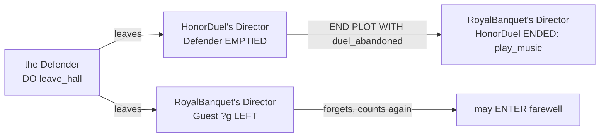

# When an Agent leaves

Halfway through the feast, a Guest is challenged to a duel, loses its nerve, walks to the door and is gone. The game has removed the character, and the Agent has left the Program with it. Nothing in the Agent's own Plans says goodbye. Each Director whose Staging it played in hears that it left, and it is up to the Director to tidy what it knew and decide whether the story can go on.

| We write | Where | It means |
|---|---|---|
| `DO leave_hall` | a Playbook | a Custom Action the game answers by removing the Agent (its doc comment says so) |
| `WHEN Guest ?g LEFT:` | a Director | an Agent playing `Guest` in this Staging has left the Program |
| `WHEN Guest EMPTIED:` | a Director | the last `Guest` here has left, or the Role started with nobody |
| `WHEN CAST ?who LEFT:`, `WHEN CAST EMPTIED:` | a Director | the same, for the whole Cast |

In 1.5 nobody joins. Every Agent comes from the starting Instancing, so a Cast is fixed when its Staging starts and can only shrink. Joining is at the end of this chapter, as a 2.0 note.

## Leaving the Program

[`playbooks/courtesy.regia`](../showcase/playbooks/courtesy.regia)
```regia
TO take_leave, FROM DIRECTOR:
    TELL host greeting
    DO walk_to(door)
    DO leave_hall                        # the game removes us: we leave the Program
```

[`playbooks/duelling.regia`](../showcase/playbooks/duelling.regia)
```regia
WHEN challenged, FROM opponent, SUITS bravery AT 0.1, SHIFTS sympathy BY -0.3:
    DO walk_to(door)
    DO leave_hall                        # out of the banquet, and out of the Program
```

A Guest leaves at the end of the evening, when the banquet asks it to `take_leave`. A cowardly Defender leaves in the middle of the evening without being asked. Both do the same Action, and the game answers it by removing the character.

[`vocabulary.regia`](../showcase/vocabulary.regia)
```regia
#@desc: Done at once. The game then removes the Agent, which leaves the Program.
ACTION leave_hall
```

- Only the game takes an Agent out of the Program. No Statement does it. A Plan does an Action, and the game decides that the character is gone.
- A declaration has no word for "this Action ends the Agent", so the doc comment says it. Nothing in the Program changes when `leave_hall` is done: it changes when the game reports the leave.
- A character that dies and stays in the world has not left. Being dead is the game's business, and it reaches the Program as a Fact or a Cue like any other.
- A Director can't take an Agent out of the Program, and it can't move one out of a Role either. `REMOVE` takes a Playbook away, and the Agent still plays its Roles.
- Leaving is from every Staging at once. A Defender who walks out stops being a Guest of the banquet and a Defender of the duel at the same moment.

The Trace writes the leave as a `cast` entry, `LEFT noble_4`, whether or not a Plan hears it. A behaviour case makes an Agent leave with the script step `> leave noble_4`.

Spec: chapter 19, *Who changes the Cast*, *Leaving*. For `leave_hall`'s doc comment, chapter 08; for the Trace and its script, chapter 34.

## What goes with it

[`plots/royal_banquet.regia`](../showcase/plots/royal_banquet.regia)
```regia
WHEN Poisoning FINISHED WITH poisoner_caught(?culprit):
    REMOVE NobleSocializing FROM Guest ?culprit
    ASK ?culprit TO take_leave       # led out of the hall
```

The caught Poisoner is led out. Once it is gone, nothing in the Program has to undo it by hand, except what Directors know about it (*Tidying what the Director knows*, below).

| What | When the Agent leaves |
|---|---|
| its Roles, in every Staging | it stops playing them |
| its Givings, in every Staging | they vanish, with no `REMOVED` Plan |
| its running Plans and Pursuits | they stop, with no ending: nothing was reached, dropped or failed |
| a waiting `DO` | the game is told to call the Action off |
| a whole-Role binding or recipient that held it | stops reaching it, since a Role is looked up when used |
| a counted pick that held it | it drops out, and nobody takes its place |
| a Message sent to it through a Placeholder | dropped, with a Trace warning; the sender's Plan goes on |
| a Placeholder or an Outcome holding it | still holds it, as a Value |
| Facts that name it, a Director's or another Agent's | stay |

- Nothing is undone in other Agents. A Fact the Poisoner told someone stays told.
- A counted pick is never refilled. `Poisoning` cast its Poisoner with `MAPPING 1 OF Guest AS Poisoner`. A Poisoner who walks out mid-feast leaves `Poisoner` empty, and no other Guest becomes the Poisoner.
- A Role recipient needs no care at all. Once the Defender has walked out, the Challenger's `opponent` is a Role nobody plays, and `TELL opponent hit` reaches nobody. That isn't a warning.
- A Placeholder is different, because it still holds the Agent. A `TELL` or `ASK` to it is dropped, with a Trace warning. It doesn't fail the Plan, since sending never waits for the receiver. It is likely a mistake, and the warning is there so it can be found.
- Facts stay because they may be meant to outlive the leaver: `beaten_by(?who)` is still true after `?who` has gone home.

**Checks**

- A `TELL` or `ASK` to a Placeholder holding an Agent that has left → `T19_01-message-after-leaving` (Trace warning; the Message is dropped)

Spec: chapter 19, *Leaving*. For bindings and counted picks, chapter 15; for a called-off Action, chapter 08; for Pursuits that end without an ending, chapter 05.

## Hearing it: `LEFT`

[`plots/royal_banquet.regia`](../showcase/plots/royal_banquet.regia)
```regia
DURING PLOT:
    WHEN Guest ?g LEFT:
        FORGET seated(?g)
        FORGET finished(?g)
        IF IN arrival AND COUNT(seated(?)) >= COUNT(? PLAYS Guest):
            ENTER reception
        ELSE IF IN feast AND COUNT(finished(?)) * 4 >= COUNT(? PLAYS Guest) * 3:
            ENTER farewell
```

The banquet moves on when enough Guests are done: every Guest seated in `arrival`, three in four finished in `feast`. Each count compares the Director's own Facts with `COUNT(? PLAYS Guest)`. A Guest who leaves lowers the second number at once, but it never Signals, and its `seated` and `finished` Facts stay. So the `LEFT` Plan forgets them and counts again. The last Guest still eating may be the one who walked out, and then its leaving completes the count and ends the Phase.

- The Role comes first and the Placeholder after it, as in `FROM Guest ?g`. `WHEN Guest LEFT:` without a Placeholder fires the same way.
- `?g` holds the leaver as a Value. It can be used to forget Facts that name it, as here. A Message to it is dropped, with a Trace warning.
- `LEFT` is a Director Trigger. A Playbook doesn't know Plot Roles, and can only test its own with `PLAYS`, so `LEFT` in a Playbook is an error.
- The Role must be one of this Plot's, or `CAST`. A Director hears about its own Roles in its own Staging only.
- It takes no quantity. `WHEN ALL Guest LEFT:` is an error.
- It is written in a Phase's Block or in `DURING PLOT`, like any Trigger, and the two compete: the Phase's Plan wins by default. The banquet writes it in `DURING PLOT`, since a Guest can leave in any Phase, and the Plan tests the Phase with `IN`.

> **In 2.0** a Quota Trigger keeps the count for us: `WHEN took_seat, FROM ALL Guest:` counts only the Guests still in the Role, and is checked again whenever one leaves, so a leaving can complete it with no Signal arriving. Spec chapter 18, *Counting*, and chapter 19, *Quota Triggers*. In 1.5 the Director counts by hand, and the `LEFT` Plan above is half of that hand count.

**Checks**

- `JOINED`, `LEFT` or `EMPTIED` in a Playbook → `R19_01-cast-change-in-playbook`
- `LEFT` or `EMPTIED` after something that isn't a Role of this Plot or `CAST` → `R19_02-wrong-cast-change-subject`
- A quantity on them (`WHEN ALL Guest LEFT:`) → `R19_04-quantity-on-cast-change`
- A Quota Trigger (`FROM ALL Guest`, `BY 3 OF waiter`) in a 1.5 build → `R01_09-later-regia-construct`

Spec: chapter 19, *The Director hears about it*. For the hand count, chapter 26, *`COUNT`*; for `IN`, chapter 20; for which Block wins, chapter 13.

### Tidying what the Director knows

[`plots/honor_duel.regia`](../showcase/plots/honor_duel.regia)
```regia
WHEN Spectator ?who LEFT:
    FOR EACH wager(?who, ?stake): FORGET wager(?who, ?stake)
```

`HonorDuel` records each Spectator's wager as a Fact of its own, and when betting closes the biggest backer is asked to drop the handkerchief:

[`plots/honor_duel.regia`](../showcase/plots/honor_duel.regia)
```regia
AFTER 20 SECONDS:                    # betting closes
    GIVEN wager(?backer, ?stake), HIGHEST ?stake, RANDOMLY:
        ASK ?backer TO give_signal
    ELSE:
        ENTER fighting               # nobody bet: no handkerchief to wait for
```

Without the `LEFT` Plan, the Pick could choose a Spectator who has gone home. The `ASK` would be dropped, nobody would drop the handkerchief, and the duel would wait out its minute. A Director that keeps a record of its Agents tidies it on `LEFT`, and the language doesn't do it for it: a Fact may be meant to outlive the leaver, and only the writer knows which.

Spec: chapter 19, *Leaving*. For `FOR EACH`, chapter 26.

## Nobody is left: `EMPTIED`

[`plots/honor_duel.regia`](../showcase/plots/honor_duel.regia)
```regia
WHEN Challenger EMPTIED:
    END PLOT WITH duel_abandoned
WHEN Defender EMPTIED:
    END PLOT WITH duel_abandoned
```

[`plots/royal_banquet.regia`](../showcase/plots/royal_banquet.regia)
```regia
WHEN Guest EMPTIED:
    END PLOT
WHEN Host EMPTIED:
    END PLOT
```

`EMPTIED` fires when the last Agent playing a Role in this Staging leaves. A duel with one duellist gone can't be fought, so it ends. The banquet ends when the last Guest has taken leave, which is how `farewell` is meant to finish, or when the king walks out early.

- `EMPTIED` takes no Placeholder: no single Agent emptied the Role. The last leaver also fires `LEFT`, which can name it.
- A condition can count a Role, `COUNT(? PLAYS Guest) = 0`, but a condition is only read when something else fires. `EMPTIED` is the Trigger for the moment the count reaches nothing.
- It also fires for a Role that starts empty, once, after the Role setups and before the initial Phase's `ENTERED` Plans, in Role declaration order with `CAST` last. A Plan written for "nobody is left" then also covers "nobody came" (*Subplots and Stagings*).
- Like `LEFT`, it is a Director Trigger, takes a Role of this Plot or `CAST`, and takes no quantity.

### An empty Role

Nothing happens on its own when a Role empties:

- The Staging doesn't end. Ending is the Director's call, usually in an `EMPTIED` Plan, as above.
- A Statement aimed at the empty Role sends nothing and gives nothing, like any empty recipient. Neither is an error.
- A standing Giving to the Role stays. In 1.5 it reaches nobody again, since nobody joins.

`Poisoning` has no Plan for an empty `Poisoner`. A Poisoner who walks out mid-feast leaves a Staging with nobody to poison anyone: the Watchmen keep watch, and the Plot runs until the feast ends and drops it. To end it at once, `Poisoning` would add a Plan of its own, with `poisoner_fled` declared as a Cue:

```regia
DURING PLOT:
    WHEN Poisoner EMPTIED:
        END PLOT WITH poisoner_fled
```

**Checks**

- `?who` after `EMPTIED` (`WHEN Guest ?g EMPTIED:`) → `R19_03-who-after-emptied`
- `EMPTIED` in a Playbook, or after something that isn't a Role of this Plot or `CAST` → `R19_01-cast-change-in-playbook`, `R19_02-wrong-cast-change-subject`
- `END PLOT WITH` something other than one declared Cue → `R17_03-misused-end-plot-with`

Spec: chapter 19, *The Director hears about it*, *An empty Role*. For a Role that starts empty, chapter 17, *Casting*; for empty recipients, chapter 07.

## The whole Cast

`CAST` can stand before `LEFT` and `EMPTIED`, as before any Role. The showcase doesn't need it, so this one is a throwaway:

```regia
DURING PLOT:
    WHEN CAST ?who LEFT:
        FORGET seated(?who)
    WHEN CAST EMPTIED:
        END PLOT
```

- `WHEN CAST ?who LEFT:` fires once for a leaver, whatever Roles it played. A knight, a Guest and a Guard, fires it once.
- `WHEN CAST EMPTIED:` fires when nobody at all is left in the Staging.
- Inside a Subplot, `CAST` is the Subplot's own Cast.

Spec: chapter 19, *The Director hears about it*. For `CAST`, chapter 15.

## Order when leaving

When an Agent leaves a Staging, its Director hears it Role by Role:

1. For each Role the Agent played there, in Role declaration order: `LEFT`, then `EMPTIED` if that Role is now empty.
2. Then `CAST`: `WHEN CAST … LEFT`, then `WHEN CAST EMPTIED` if nobody is left in the Staging.

`RoyalBanquet` declares `Host`, `Guest`, `Servant`, `Guard`. When Sir Percival, a Guest and a Guard, leaves, the banquet fires `WHEN Guest LEFT`, then `WHEN Guest EMPTIED` if he was the last Guest, then `WHEN Guard LEFT`, then `WHEN Guard EMPTIED` if he was the last Guard, then the `CAST` Triggers. The banquet only has Plans for the first two.

A leaver in several Stagings is heard by every Director it played for, each about its own Roles. When the cowardly Defender walks out:



The duel ends itself with `duel_abandoned`. The banquet hears that as an ending of the duel, and its `FINISHED WITH duel_settled(?winner)` Plan doesn't match, so `ENDED` plays music. Separately, it hears one Guest fewer and counts again.

> **In 2.0** the Quota Triggers are checked again before step 1, so a Quota counting the leaver's Role can fire before the Director's `LEFT` Plan. Spec chapter 19, *Quota Triggers*.

Spec: chapter 19, *Order when leaving*.

## What the Agents hear

Agents hear nothing of a cast change; only Directors do. The Challenger left alone in the duel doesn't notice that the Defender has gone. It stops because the duel ends, and ending takes `Duelling` away from it:

[`playbooks/duelling.regia`](../showcase/playbooks/duelling.regia)
```regia
WHEN REMOVED:
    FOR EACH stamina(?left): FORGET stamina(?left)
```

The Staging's ending is what fires `REMOVED` here. The Defender's own `REMOVED` Plan doesn't run: a leaver's Plans stop with it.

- A Director that wants the Staging to go on tells its Agents with a Message, such as `TELL Challenger opponent_fled`. What they do about it is their own Plans' business.
- A Playbook can't hear that one of its own Roles emptied. `WHEN opponent EMPTIED:` in a Playbook is an error. A Playbook's Roles are bound per Giving, and hearing a cast change of them is after 2.0.
- A Playbook can test its Roles when something else fires: `GIVEN ?x PLAYS opponent` holds only while someone plays it.

**Checks**

- `WHEN opponent EMPTIED:` in a Playbook → `R19_01-cast-change-in-playbook`

Spec: chapter 19, *What the Agents hear*. For `REMOVED`, chapter 15.

## Nobody joins

In 1.5 the game can't add an Agent while the run goes on. If it reports a spawn anyway, the spawn is refused: the Agent joins nothing, and the Trace writes a warning. Every Agent comes from the starting Instancing, and a kind that only the game would spawn has no Agents.

So `JOINED` is not a word of a 1.5 Program, and "later joiners" in the spec don't apply: a standing Giving reaches the Agents that play the Role when it is made, and none after.

> **In 2.0** the game can spawn an Agent of a kind while the run goes on. It joins the Root Plot's Staging, gets the Role setups, the current Phase's setups, its kind's setup lines and the standing Givings, and the Director hears `WHEN Guest ?g JOINED:`. A joiner never reaches a Subplot already running. Spec chapter 19, *Joining*.

**Checks**

- `WHEN Guest ?g JOINED:`, in a 1.5 build → `R01_09-later-regia-construct`
- A spawn the game reports in a 1.5 run → `T19_02-join-refused` (Trace warning; the Agent joins nothing)

Spec: chapter 19, *Regia 1.5*. For kinds and the starting cast, chapter 21.

## How this combines with…

### Messages

A Message to a Role is looked up when it is sent, so it simply reaches fewer Agents once one has left. A Message to a Placeholder holding a leaver is dropped with a Trace warning, and the sender's Plan goes on. Delivery is promised only while the receiver is in the Program. (*Messages*)

### Matching

`COUNT(? PLAYS Guest)` drops as soon as a Guest leaves, but Facts the Director learned about it stay until a `LEFT` Plan forgets them. `FOR EACH` forgets every Fact that names the leaver in one line. (*Matching*)

### Playbooks and Roles

A leaver's Givings go with it, without `REMOVED`. It drops out of every counted pick, which is never refilled, and whole-Role bindings stop reaching it on their own. (*Playbooks and Roles*)

### Plots and Directors

`LEFT` and `EMPTIED` are Director Triggers, written in a Phase's Block or in `DURING PLOT`. The banquet uses them both to tidy its counts and to end. (*Plots and Directors*)

### Subplots and Stagings

A Subplot's Cast is fixed when it starts and only shrinks. Leaving takes an Agent out of every Staging at once, and a Subplot whose Role empties usually ends itself with an Outcome its parent hears. A Role that starts empty fires `EMPTIED` too. (*Subplots and Stagings*)

### Goals and Failure

A leaver's Pursuits stop with no ending: no `REACHED`, `DROPPED` or `FAILED` Plan runs, at the leaver or anywhere else. A dropped Message is a warning, never a Failure. (*Goals and Failure*)

### Actions and time

A waiting `DO` is called off when its Agent leaves, and its waits stop. `leave_hall` is how a character makes itself leave, by the game's choice, as its doc comment says. (*Actions and time*)

### Precedence and Labels

A `LEFT` or `EMPTIED` Plan in a Phase competes with the same Trigger in `DURING PLOT`, and the Phase wins by default. Director Plans take no Labels. (*Precedence and Labels*)

### Instancing

Every 1.5 Agent comes from the `.regin` file. `AGENT king, PLAYS Host` is the only Host, so `Host EMPTIED` fires when the king leaves. (*Instancing*)

### The Trace

A leave is a `cast` entry, `LEFT <agent>`. A dropped Message is a `message` entry at warning level, `DROPPED`, with `T19_01-message-after-leaving`. A refused spawn is `T19_02-join-refused`. A behaviour case plays a leave with `> leave <name>`. (*The Trace*)

### Jason: Directors and Stagings

The game reports a leave once, on the game link, and every Director decides from its own records whether it is concerned. It removes the Agent from its Role records and counted picks, then raises its own `LEFT` and `EMPTIED` events. A send to an Agent that no longer exists is caught and turned into `T19_01-message-after-leaving`. A body whose connection closes has not left: only the game's leave report removes an Agent. (*Jason: Directors and Stagings*)
