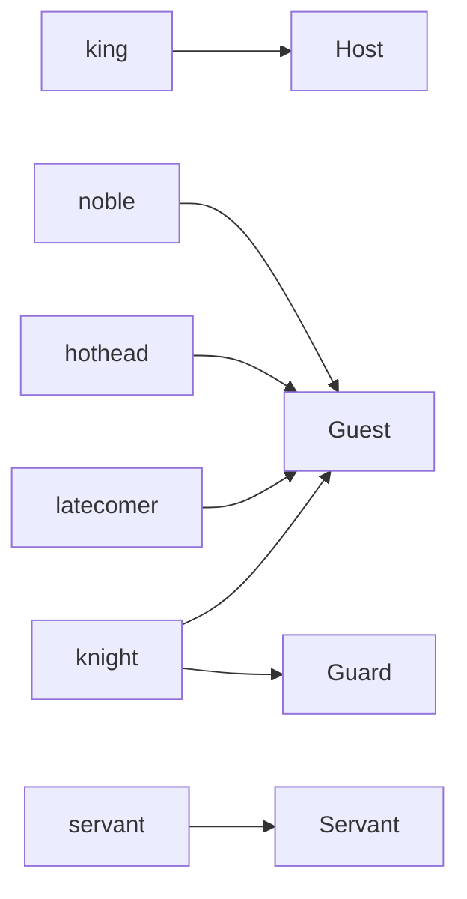

`RoyalBanquet` has a Role `Guest`, and its Playbooks say what a Guest does. None of them says how many Guests sit in the hall, which of them is quick to draw a sword, or that two of the Guards are also dining. That is Instancing: the lines that turn a Program into a running cast. They name the Root Plot, declare the Agent kinds with how many of each start and their starting Propensity values, and give settings to the Target. Instancing is optional, and it is kept apart from everything else: a Plan can't read it and a Plot can't change it.

Propensities are declared in *Vocabulary* and used in *Precedence and Labels*. The Root Plot is in *Plots and Directors*, and Agents that enter later are in *Quotas and Cast Changes*. The snippets come from the two Instancing files of the showcase, `banquet.regin` for the full hall and `test.regin` for a small cast.

## An Agent kind

`showcase/banquet.regin`
```regia
AGENT king PLAYS Host:
    COUNT 1.

AGENT servant PLAYS Servant:
    COUNT 3.
```

An Agent declaration describes an Agent kind. `king` is a sort of Agent that plays the Role `Host` of the Root Plot, and one of them exists when the Program starts. Three `servant`s start as Servants.

The game has characters, and a kind says what a character of that sort is in the story. Kind names are used in Instancing and by the game, and nowhere else:

- No Plan, Playbook or Plot names a kind. They address Roles, and `Courtesy` works the same whether the Host is a `king` or anything else we declare to play `Host`.
- Kind names have a namespace of their own. A kind `servant` and a Fact `servant` could live in one Program.
- A `PLAYS` Role has to be a Role of the Root Plot. `AGENT noble PLAYS Spectator` is an error: the Roles of `HonorDuel` are filled by Mappings when a duel starts (*Subplots and Stagings*).
- The Agents themselves are named by the Target. On Jason the three Servants are `servant_1`, `servant_2` and `servant_3`.

A Role of the Root Plot that no kind plays gets a warning, since nobody will run its Plans.



`#revise` `king PLAYS Host` and `servant PLAYS Servant` say one thing twice. Both kinds exist only to give a Role a number, and we had to find a second word for the Role to do it.

Spec: chapter 21.

## How many start

`showcase/banquet.regin`
```regia
# No COUNT: a latecomer only ever enters by Joining.
AGENT latecomer PLAYS Guest:
    bravery AT RANDOM(-0.6, 0.6).
    sympathy AT RANDOM(0, 0.8).
    aggressiveness AT RANDOM(-0.4, 0.4).
```

`COUNT` is the number of Agents of the kind that exist when the Program starts. It is a written whole number, zero or more. It can't be a roll, an Expression or a share of another kind.

With no `COUNT` line the kind starts with none, as `COUNT 0.` would say. The kind is still declared, so the game can spawn a `latecomer` during the evening, and it will Join as a Guest with values of its own. The `COUNT` is only the starting number: the game may also spawn a seventh `noble` or a fourth `servant` (*Quotas and Cast Changes*).

A kind with nothing inside is written on one line, ending with a `.`:

`showcase/test.regin`
```regia
AGENT hothead PLAYS Guest.           # a kind can't be removed, only emptied
```

`#revise` `latecomer` repeats the three lines of `noble`. A kind can't be built on another one, so "a noble who arrives late" is a second kind with the same Role and the same ranges, kept in step by hand. Since the game may spawn a `noble` just as well, the kind is there only to give the game a second name.

Spec: chapter 21. For Joining, chapter 19.

## A kind in several Roles

`showcase/banquet.regin`
```regia
AGENT knight PLAYS Guest AND Guard:
    COUNT 2.
    bravery AT 0.8.
    sympathy AT 0.3.
    aggressiveness AT 0.1.
```

A knight is a Guest and a Guard at once. Every Agent of a kind plays every Role the kind lists, from the start, and a knight spawned later Joins in both. The Role setups of both Roles run for it, in the order the Plot declares its Roles, so a knight has a purse, two cravings and the Goal `take_seat` from `Guest`, and `Keeping_watch` and `on_duty` from `Guard`. It gets `Courtesy` from each (*Playbooks and Roles*).

Instancing never picks. We can't write "ten Guests, two of them also Guards", or "one Guest in five is a hothead". Each mix is a kind with its own count. Choosing some Agents of a Role at random belongs to the Plot, as a counted Mapping such as `MAPPING 1 OF Guest TO Poisoner` (*Randomness*).

`#revise` `noble`, `hothead`, `knight` and `latecomer` are four kinds of Guest, one for each temperament or extra Role. A hot-headed knight would be a fifth, and a hot-headed latecomer a sixth, each written out in full.

`#revise` `Keeping_watch OVER NobleSocializing ON scandal` in `RoyalBanquet` is needed only because some kind plays both `Guest` and `Guard`. The Plot can't see that, and the `.regin` file doesn't show what its `AND` sets in motion. A build that adds `AGENT steward PLAYS Servant AND Guard` puts `Serving` and `Keeping_watch` on one Agent, and nothing in the `.regin` file says whether the Plot has ordered them.

Spec: chapter 21. For Role setups, chapter 16.

## Starting Propensity values

`showcase/banquet.regin`
```regia
AGENT noble PLAYS Guest:
    COUNT 6.
    bravery AT RANDOM(-0.6, 0.6).
    sympathy AT RANDOM(0, 0.8).
    aggressiveness AT RANDOM(-0.4, 0.4).

AGENT hothead PLAYS Guest:
    COUNT 2.
    bravery AT 0.9.
    sympathy AT -0.4.
    aggressiveness AT RANDOM(0.6, 1).
```

A line `<propensity> AT <value>.` gives the kind's Agents their starting value for a Trait or a Mood. Both are written the same way. A Trait keeps the value all evening, and a Mood moves from it with every `SHIFTS` (*Precedence and Labels*).

- The value is a written Number from -1 to 1, or `RANDOM(a, b)` with written bounds in the same range.
- A `RANDOM` value is drawn once for each Agent, when the Agent is created. The six nobles are six temperaments, and a noble spawned later draws its own (*Randomness*).
- The Propensity has to be declared as a `TRAIT` or a `MOOD`.
- Agents of one kind differ only through `RANDOM`. There is no line for "the third noble".

`noble` and `hothead` play the same Role and are given the same Playbooks. The values are all that separates them: a hothead fits `SUITS aggressiveness AT 0.8 AND bravery AT 0.8` and stands up at an insult, where most nobles scowl or laugh.

A Propensity that a kind doesn't mention has no value. `king` and `servant` give none, and nothing they can hold has a `SUITS` Label, so nothing is missing. When a kind can hold a Playbook whose `SUITS` names a Propensity it has no value for, the Transpiler warns.

`#revise` What an Agent does with a `SUITS` on a Propensity it has no value for is left to the Target. The language has no default value and doesn't make the line an error, so the same Program may choose differently on two Targets.

`#revise` Propensity values are the only thing a kind gives its Agents. A hothead can't start with a grudge or a heavier purse: starting Facts are in the Role setup, the same for every Guest. *Plots and Directors* has the same note from the other side.

Spec: chapter 21, chapter 14.

## Naming the Root Plot

`showcase/banquet.regin`
```regia
# The full banquet.
IMPORT "plots/royal_banquet".

ROOT RoyalBanquet.
```

`ROOT` names the Plot that starts when the Program does, the one whose Roles the kinds play. The line can be left out when exactly one Plot of the Program is never started as a Subplot, which is the case here. With none or several such Plots and no `ROOT`, the build stops, even for a Program with no other Instancing. Naming a Plot that some `START SUBPLOT` starts is an error too.

Instancing starts nothing else. There is no line for a second story running next to the banquet: that is a Subplot of the Root Plot (*Plots and Directors*).

Spec: chapter 21.

## Instancing files

The lines above are in a `.regin` file, an Instancing file. It holds Imports and Instancing and nothing more: no Vocabulary, no Playbook, no Plot. `banquet.regin` imports one Plot file and through it reaches the whole showcase. It is the Entry file we hand to the Transpiler, and what comes out is one Build (*Syntax*, *The Transpiler*).

- A `.regin` file may import `.regia` files and other `.regin` files.
- A `.regia` file can't import a `.regin`, so the story never depends on a cast.
- With no Agent declaration anywhere, the Build is the Target code alone. On Jason that means the ASL files and no `.jcm`. As soon as one kind is declared, the Build also has what it takes to start the run.

Several casts for one story are several small `.regin` files over the same `.regia` files.

Spec: chapter 21, chapter 10.

## A second build

`showcase/test.regin`
```regia
# The small cast the walkthrough follows: one king, two nobles, one knight, one servant.
# Every value is fixed, so a run reads the same each time.
IMPORT "banquet.regin".

AGENT noble PLAYS Guest:
    COUNT 2.
    bravery AT 0.8.
    sympathy AT -0.2.
    aggressiveness AT 0.7.

AGENT hothead PLAYS Guest.           # a kind can't be removed, only emptied

AGENT knight PLAYS Guest AND Guard:
    COUNT 1.
    bravery AT 0.8.
    sympathy AT 0.3.
    aggressiveness AT 0.1.

AGENT servant PLAYS Servant:
    COUNT 1.
```

`test.regin` imports `banquet.regin` and changes what differs. The rule is that the importer overrides what it imports: a setting in a file replaces the same setting in every file it reaches.

| Kind | `banquet.regin` | `test.regin` | In the small cast |
|---|---|---|---|
| `king` | 1 | not mentioned | 1, as declared below |
| `noble` | 6, rolled values | 2, fixed values | 2 |
| `hothead` | 2 | no `COUNT`, no values | none at the start |
| `knight` | 2 | 1, same values | 1 |
| `servant` | 3 | 1 | 1 |
| `latecomer` | none at the start | not mentioned | none at the start, values as declared below |

The full hall has ten Guests, two of them Guards, and the small cast three Guests, one of them a Guard. `ROOT` and the Target settings of `banquet.regin` hold for both.

- An Agent declaration is replaced whole, by kind name. The new `noble` takes nothing from the old one: its Roles, count and values are those written in `test.regin`.
- `ROOT` is one item, and each Target setting is one item.
- Declaring a kind twice in one file is an error. Two files that set an item to the same thing never conflict.

Import order never decides. Two files that set one item differently, with neither importing the other, are in conflict as soon as a third file reaches both:

```regia
# night_test.regin
IMPORT "test.regin".
IMPORT "night.regin".      # also declares noble, with other values

AGENT noble PLAYS Guest:   # without this, an error naming both files
    COUNT 2.
```

`#revise` To go from two knights to one, `test.regin` writes the knight again in full: both Roles and all three values. Leaving a line out doesn't keep it. A second build that changes only counts, the commonest kind, copies every kind it touches, and the copies drift when `banquet.regin` changes.

`#revise` A kind can't be removed by a later file. `test.regin` empties `hothead`, which still exists: the game can spawn one, and it Joins with no Propensity values, because the redeclaration dropped them. The Transpiler warns about the three missing values of a kind we meant to delete.

`#revise` Overriding has two grains in one file. Under `TARGET JASON:` each line is replaced by itself and the others are kept. Under `AGENT noble …:` the whole Block is replaced. Both are a header with indented lines under it.

Spec: chapter 21.

## Instancing comments

The same lines can stand in a `.regia` file, as Instancing comments. `#%` marks one Statement and `#%[ … ]#` a Block. The showcase has none, so this is how `royal_banquet.regia` would carry a cast of its own:

```regia
IMPORT "../vocabulary".
IMPORT "../playbooks/courtesy".

#% ROOT RoyalBanquet.
#%[
AGENT king PLAYS Host:
    COUNT 1.
AGENT noble PLAYS Guest:
    COUNT 4.
]#

PLOT RoyalBanquet:
    ROLE Host STARTS WITH:
```

With these lines the Plot file can be built by itself and gives a king and four nobles. A `.regin` that imports it overrides them like those of any other file it reaches, so `banquet.regin` would still get its six nobles.

- Instancing comments stand at the top level of the file, after its Imports. Inside a Plot, a Playbook or any other Block they are an error.
- Each one starts its own line, like a Doc comment.
- Despite the `#`, they are read. A misspelt Role inside one is an error like any other.

`#revise` Instancing has two homes with the same content, and 550 lines of showcase needed only the files. A cast inside a Plot file brings back what `.regin` files keep out: the story's file changes when the head count does. And two `.regia` files that each declare the same kind in a `#%` Block, with different lines, are in conflict in every file that imports both and doesn't declare the kind itself.

Spec: chapter 21, chapter 02.

## Target settings

`showcase/banquet.regin`
```regia
TARGET JASON:
    strategy = most_similar.
```

A `TARGET` Block holds settings for one Target, as `key = value.` lines. The keys are lowercase and belong to the Target. A value is a word, a Number or a String. Which Target a build is for is not written here: we choose it on the Transpiler's command line or in the Visual Editor, and the build reads its own Block and skips the others, so one file can configure several Targets.

Jason, the one Target of 2.0, knows four keys:

| Key | Default | What it sets |
|---|---|---|
| `strategy` | `most_similar` | how the Selection function picks among Suits alternatives; the other value is `random` |
| `address` | `localhost` | where the Agents find the game |
| `base_port` | `9080` | the first of the ports the Director and the Agents use |
| `trace_console` | `all` | how much of the Trace is printed on the console: `all`, `warnings` or `off` |

Every setting has a default, so none has to be written, and a file with no `TARGET` Block builds. An unknown key under a Target the Transpiler knows gets a warning. What the settings become is in *Translation to ASL*.

`#revise` The checks warn about an unknown key and say nothing about an unknown Target. `TARGET JASN:` reads as settings for a Target this build isn't for, and is skipped without a word.

`#revise` The one setting the showcase writes is the default. What we most wanted to set for the small cast is the seed, so that a run can be played again, and no Target has a key for it (*Randomness*).

`#revise` The settings follow rules found nowhere else in the language. `JASON` is a name the Transpiler defines, written in capitals like a keyword. `most_similar` is a word that nothing declares. `=` is neither the comparison nor the naming of a Body (*Placeholders and Expressions*).

Spec: chapter 21. For Jason's keys, chapter 36.

## How this combines with…

### Role setup and the game

What a noble has in its first moment is written in three places.

| It starts with | Written in | Differs between two nobles |
|---|---|---|
| bravery, sympathy, aggressiveness | `AGENT noble`, in `banquet.regin` | through `RANDOM` |
| `Courtesy`, a purse, two cravings, the Goal `take_seat` | `ROLE Guest STARTS WITH:`, in `RoyalBanquet` | only the purse, by a roll |
| a seat, old grudges, hunger | nowhere in the Program: the game tells them | as the game likes |

`#revise` To know a noble we read an Instancing file, a Plot and the game's own data, and the Vocabulary's Doc comments are the only sign of the third. The Facts that most make one Guest different from another, its seat and its grudges, are the ones the Program can't state. (*Plots and Directors*, *Vocabulary*)

### Quota Triggers and counted Mappings

`showcase/plots/royal_banquet.regia`
```regia
WHEN finished_eating FROM 75 PERCENT OF Guest:
    TRANSITION TO farewell.
```

The share is in the Plot and the number of Guests in Instancing. In the full hall this waits for eight of ten Guests. In the small cast it waits for all three, since two of three fall short of 75 percent. `WHEN cheered FROM 3 OF Spectator:` in `HonorDuel` is met in the small cast only if every Guest cheers, and a `test.regin` with one noble would leave each duel waiting. No check compares a written number in a Plot with the counts of a build. (*Quotas and Cast Changes*)

### Cast changes

A kind is also what the game names when it spawns an Agent. The joiner plays the kind's Roles in the Root Plot, gets their Role setups, and draws its `RANDOM` values at that moment. Everything in an Agent declaration except `COUNT` applies to it. In the small cast a `latecomer` still Joins with the ranges of `banquet.regin`, the one thing in that build that is not fixed. (*Quotas and Cast Changes*)

### Precedence and Labels

Instancing orders nothing. Which Plan wins is settled by the `PRECEDENCE` Blocks and the Labels, and a kind only supplies the values the Labels are measured against. The two nobles of the small cast have bravery 0.8 and aggressiveness 0.7, so both take an insult by standing up, and the walkthrough gets its duel. In the full hall no noble can come that close to it, with bravery at most 0.6 and aggressiveness at most 0.4, and the two hotheads are the ones made for it. (*Precedence and Labels*)

### The Transpiler and the Visual Editor

Each `.regin` file is an Entry file and gives a Build of its own, so the showcase has two. The Visual Editor treats every `.regin` in a Project that way. On Jason a Build with kinds has a `.jcm` listing the Root Plot's Director and one entry per starting Agent, and a file that tells the game which character is of which kind. (*The Transpiler*, *The Visual Editor*, *Translation to ASL*)

## Since 1.0

1.0 had no Instancing. The Transpiler wrote ASL files, and the `.jcm` that starts them on Jason was written by hand. The primer asked for "compilation comments, or compilation files", possibly starting with `#%`, and for a way to say which Plot starts.

`#changes` Instancing is new: `ROOT`, Agent declarations with `COUNT` and Propensity values, and `TARGET` Blocks.

`#changes` It is written in Instancing comments (`#%`) or in Instancing files (`.regin`), and an importing file overrides what it imports.

`#changes` A Program has exactly one Root Plot, named or inferred. The Transpiler writes the `.jcm` when at least one Agent kind is declared.

`#changes` The `ASL_VERSION` comment is gone. How an `IF` is written in ASL follows from the Target.
