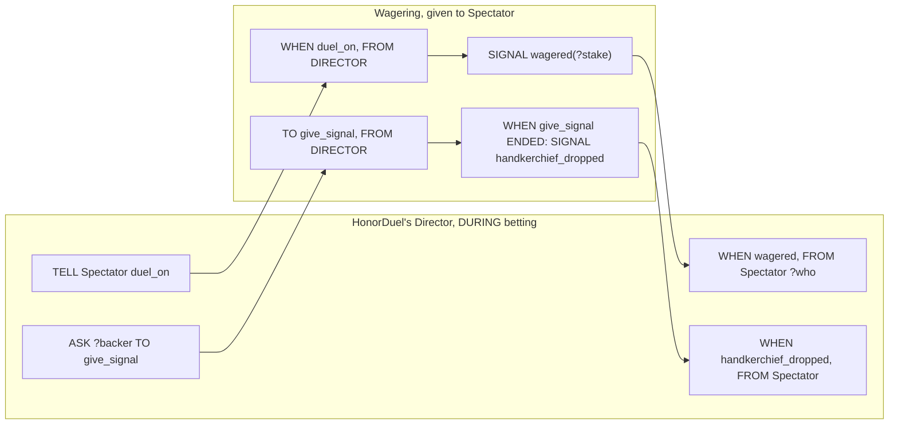

# Interfaces

`Keeping_watch` sends `culprit_seized` to the Directors that gave it, and `RoyalBanquet` gives it to its Guards. Neither file says so. The Playbook has no list of the Signals it sends, and the Plot has no list of the Signals it expects. What passes between a Playbook and the Plots that give it, and between a Subplot and its parent, is their Interface. The Transpiler works it out from the Bodies of the whole Program, checks one side against the other, and warns where they don't meet.

| Between | The Transpiler checks that |
|---|---|
| a Playbook and a Plot that gives it | every Signal the Playbook sends has a Plan in the Plot, and every `FROM <Role>` in the Plot can be reached by a Signal |
| two Roles that a Plot's Mappings connect | each `ASK` and `TELL` has a receiving Plan whose `FROM` admits the sender |
| a Goal's recipes and its ending Plans | each `FAILED WITH` names a Reason some recipe can fail with |
| the Program and the game | each Cue that some Trigger waits for is sent by something, or declared `GAME` |
| a Subplot and its parent | each ending is heard, and each Outcome the parent matches is one the Subplot ends with |

All of these are warnings. What a Message is and who receives it is in *Messages*; what a Director does with a Signal is in *Plots and Directors*; Outcomes are in *Subplots and Stagings*.

## Nothing is declared

[`playbooks/keeping_watch.regia`](../showcase/playbooks/keeping_watch.regia)
```regia
WHEN saw_pouring(?who):
    DO seize(?who)
    SIGNAL culprit_seized(?who)          # reaches every Director that gave us this Playbook
```

[`plots/royal_banquet.regia`](../showcase/plots/royal_banquet.regia)
```regia
ROLE Guard:
    ASSIGN Keeping_watch
    LEARN on_duty
```

```regia
WHEN culprit_seized(?):              # any Guard's report: sound the alarm
    DO ring_bell
```

The `SIGNAL` line is all that `Keeping_watch` says about `culprit_seized`. The Transpiler reads it, sees that `RoyalBanquet` gives the Playbook to its Guards, and looks for a Plan for `culprit_seized` in the banquet's Director. It finds one in `DURING PLOT`. Without that Plan, the Guard's setup line would carry a warning.

- A Playbook declares its Roles. A Plot declares its Roles, its Phases and its parameters. Nothing else that passes between them is declared: no line lists the Signals a Playbook sends, the Goals it answers, or the Outcomes a Plot ends with.
- No marker on a `CUE` says what sends it. The one exception is `GAME`, because the Transpiler can't see the game.
- The Interface isn't source. Nobody writes, imports or edits it, and it changes when the Bodies change.
- It is worked out from the whole Program, so a Playbook is checked against the Plots that give it in that Program and in no other. Built from `banquet.regin`, `Keeping_watch` is checked against `RoyalBanquet` and `Poisoning`. With `playbooks/keeping_watch.regia` as the Entry, no Plot gives it and there is nothing to check it against.

`regia explain <entry> interface <Playbook or Plot>` prints the Interface of one Playbook or Plot. From a `.regia` Entry it shows what that file and its imports say, with no Root Plot. The Visual Editor shows the same Interface in the Inspector of a selected `ASSIGN` or `START SUBPLOT`, and on each file's Docs page.

**Checks**

- A Plot gives a Playbook that Signals a Cue the Plot has no Plan for in any Phase → `R3801` (warning)

Spec: chapter 38, *Nothing is declared*. For `regia explain`, chapter 23.

## The Interface of a Playbook

For `Keeping_watch`, built from `banquet.regin`, the Interface has these parts:

| Part | Read from | `Keeping_watch` |
|---|---|---|
| Its Roles | the `ROLE` lines | none |
| The Goals it answers, and from whom | every `TO g:` recipe with its `FROM`; local Goals left out | none |
| The Cues and Facts it reacts to when told, and from whom | every `WHEN` Trigger with a `FROM` | `on_duty`, a Fact, from a Director; `scandal(person)`, from any Sender |
| The Reasons each Goal it answers can fail with | every `FAIL WITH` in a recipe of the Goal, or in the recipes of the Goals it waits on | none |
| What it tells and asks, and to which recipient | every `TELL` and `ASK … TO` | nothing |
| The Signals it sends | every `SIGNAL` | `culprit_seized(person)` |

`Keeping_watch` leaves most rows empty. `Serving` fills the middle ones:

[`playbooks/serving.regia`](../showcase/playbooks/serving.regia)
```regia
TO bring(?dish, ?place), FROM patron ?guest:
    PURSUE fetch(?dish)                  # waits: if fetching fails, so does bringing
    DO walk_to(?place)
    DO put_down(?dish)
    TELL ?guest served(?dish)

TO fetch(?dish):
    DO walk_to(kitchen)
    IF NOT in_stock(?dish):
        FAIL WITH sold_out(?dish)
    DO pick_up(?dish)                    # still refused if the last one went while we walked
```

`Serving` answers `bring(dish, place)`, from `patron`. `fetch` is declared inside the Playbook, a local Goal nobody else can ask for, so it isn't listed. `bring` can fail with `sold_out(dish)`. Its own recipe never says `FAIL WITH`, but it waits on `fetch`, whose recipe does. The Playbook tells `served(dish)` and `sold_out(dish)`, both to a Placeholder, `?guest`.

- A recipe with no `FROM` is listed as open to anyone, the Agent's own `PURSUE` included. `FROM ?speaker` is listed as from any Sender, which leaves out the game and the Agent itself.
- A `WHEN` Trigger with no `FROM` isn't listed. `WHEN saw_pouring(?who):` may be the game's doing, and nothing in the Trigger says otherwise.
- A Goal is waited on through `PURSUE`. `PURSUE make_do, WITHOUT WAITING` doesn't wait, so its Reasons don't reach the Goal whose recipe starts it.
- A local Cue is listed with the Playbook's own name beside it, since no other Playbook can use it. `Courtesy` tells and hears `greeting`, which is listed as `Courtesy`'s own.
- A Role filled by name shows here and nowhere in the Plot's source. `ASSIGN Courtesy` in `RoyalBanquet`'s `CAST` doesn't say that `Courtesy` has a `host`; the Interface of `Courtesy` does.

**Checks**

- `BY` on a Goal's ending, in a 1.5 build → `R0109`

Spec: chapter 38, *The Interface of a Playbook*. For local Goals and Cues, chapter 10; for `FROM`, chapter 05.

## The Interface of a Plot

[`plots/honor_duel.regia`](../showcase/plots/honor_duel.regia)
```regia
PLOT HonorDuel(offender):
    ROLE Challenger:
        ASSIGN Duelling, MAPPING Defender AS opponent
    ROLE Defender:
        ASSIGN Duelling, MAPPING Challenger AS opponent
    ROLE Spectator
```

```regia
DURING betting:
    WHEN ENTERED:
        TELL Spectator duel_on

    WHEN wagered(?stake), FROM Spectator ?who:
        LEARN wager(?who, ?stake)

    AFTER 20 SECONDS:                    # betting closes
        GIVEN wager(?backer, ?stake), HIGHEST ?stake, RANDOMLY:
            ASK ?backer TO give_signal
        ELSE:
            ENTER fighting               # nobody bet: no handkerchief to wait for

    AFTER 1 MINUTE:                      # the handkerchief never fell
        ENTER fighting

    WHEN handkerchief_dropped, FROM Spectator:
        ENTER fighting
```

For `HonorDuel`, the Interface has these parts:

| Part | Read from | `HonorDuel` |
|---|---|---|
| Its Roles | the `ROLE` lines | `Challenger`, `Defender`, `Spectator` |
| Its parameters | the `PLOT` header | `offender` |
| The Playbooks it gives, to which Role, with which Mappings | every `ASSIGN` and Role setup | `Duelling` to `Challenger`, with `Defender` as `opponent`; `Duelling` to `Defender`, with `Challenger` as `opponent`; `Wagering` to `Spectator`, from `DURING PLOT`'s `ENTERED` |
| The Signals it handles, and in which Phases | every `WHEN e` Plan, by `DURING` Block | in `challenge`, `duel_accepted` from `Defender`; in `betting`, `wagered` and `handkerchief_dropped` from `Spectator`; in `fighting`, `duel_won` from any Sender |
| What its Director tells and asks | every `TELL` and `ASK … TO` | asks `Challenger` to `issue_challenge`; tells `Spectator` `duel_on`; asks a Placeholder to `give_signal`; asks `Challenger` and `Defender` to `fight` |
| Its endings | every `END PLOT`, with its Outcome or plain | `duel_settled(winner)`, `duel_abandoned` |
| The Subplots it starts, and the endings it matches | every `START SUBPLOT`, and `WHEN P FINISHED`, `DROPPED` and `ENDED` | none |

- The parameters are the one part of a Plot's Interface that is declared. Everything else is collected.
- An ending is listed once, however many `END PLOT` lines give it. `duel_abandoned` is given in three places.
- `WHEN EXITED, BY PARENT` isn't an ending of the Plot. When a parent drops a Staging, the parent caused it.
- The Signals are listed by Phase. That is what the Visual Editor's Trigger picker offers when we add a transition to a Phase.



Each arrow is one line of one side's Interface meeting a line of the other's. The Director's `TELL Spectator duel_on` is checked against `Wagering`'s `FROM DIRECTOR`, and both Signals against the Plans of `betting`. `ASK ?backer TO give_signal` goes to a Placeholder, and isn't followed.

> **In 2.0** each side's Interface has one more row: the asked Goals whose endings the Playbook or the Plot hears, with the Reasons it can read. Spec chapter 38, *The Interface of a Playbook* and *The Interface of a Plot*, and chapter 05, *Who pursued it: `BY`*. In 1.5 nobody hears how a Goal it asked ended, so the row is always empty. `Wagering` reports the end of `give_signal` with a Signal of its own, `handkerchief_dropped`, and it is in the Interface as a Signal.

**Checks**

- A Goal's ending Trigger in a Plot, with or without `BY`, in a 1.5 build → `R0109`

Spec: chapter 38, *The Interface of a Plot*. For parameters, chapter 17; for Phases and the Director, chapter 20.

## Who sends a Cue

[`vocabulary.regia`](../showcase/vocabulary.regia)
```regia
# ── Signals to the Directors ─────────────────────────────────────────────────

CUE took_seat, toast_given, finished_eating
CUE insult_thrown(offender)
CUE duel_accepted, wagered(stake), handkerchief_dropped, duel_won
CUE culprit_seized(person)

# ── Outcomes of the Subplots ─────────────────────────────────────────────────

CUE duel_settled(winner), duel_abandoned
CUE poisoner_caught(person), poison_taken

# ── Reasons ──────────────────────────────────────────────────────────────────

CUE no_food                                  # `sold_out` is a Reason too, and also told
```

The banners are for the reader. The Transpiler doesn't read them: it sorts every Cue of the Program by what sends it.

| Sender | When | In the showcase |
|---|---|---|
| told | some `TELL` sends it | `insulted`, `scandal`, `served`, `sold_out`, `duel_on`, and the local `greeting`, `challenged`, `hit`, `yielded` |
| Signal | some `SIGNAL` sends it | `took_seat`, `toast_given`, `finished_eating`, `insult_thrown`, `duel_accepted`, `wagered`, `handkerchief_dropped`, `duel_won`, `culprit_seized` |
| Outcome | some `END PLOT WITH` ends with it | `duel_settled`, `duel_abandoned`, `poisoner_caught`, `poison_taken` |
| Reason | some `FAIL WITH` gives it | `no_food`, `sold_out` |
| from the game | it is declared `GAME CUE` | `idle`, `saw_pouring`, `poison_drunk` |

- A Cue can be in several groups. `sold_out` is a Reason, in `fetch`, and a told Cue, in `Serving`'s `FAILED WITH` Plan. A game Cue that Agents also tell is listed as both.
- A Cue moved under another banner keeps its senders. Only the sending lines change them.

### A Cue nothing sends

In this variation of `TO vent`, the insult is no longer told:

```regia
TO vent:
    GIVEN grudge(?foe, ?size) AND ?foe PLAYS peer, WEIGHT ?size:
        DO sneer_at(?foe)
        TELL EVERYONE scandal(?foe)      # the insult itself is never told
```

Now nothing in the Program sends `insulted`, and it isn't a `GAME CUE`. No Plan waiting for it can ever run. Every Trigger on it carries a warning: the three `WHEN insulted` Plans of `NobleSocializing` and the one in `Dining`. The hint is to declare it `GAME CUE`, if the game is meant to send it.

- What counts as sending is a `TELL`, a `SIGNAL`, an `END PLOT WITH` or a `FAIL WITH` anywhere in the Program, or `GAME`.
- A local Cue is checked inside its Playbook. `yielded` is sent because `Duelling` itself tells it.
- A Cue that nothing waits for isn't reported.

**Checks**

- A Trigger on a Cue that isn't `GAME` and that nothing in the Program sends → `R3807` (warning; hint: declare it `GAME CUE`)

Spec: chapter 38, *Who sends a Cue*, *A Cue nothing sends*. For `GAME`, chapter 10.

## Signals and the Plots that give them

### A Signal the giving Plot never handles

In this variation of `HonorDuel`, `betting` has no Plan for the handkerchief:

```regia
DURING betting:
    WHEN ENTERED:
        TELL Spectator duel_on

    WHEN wagered(?stake), FROM Spectator ?who:
        LEARN wager(?who, ?stake)

    AFTER 20 SECONDS:                    # betting closes
        GIVEN wager(?backer, ?stake), HIGHEST ?stake, RANDOMLY:
            ASK ?backer TO give_signal
        ELSE:
            ENTER fighting

    AFTER 1 MINUTE:                      # a duel with a backer now waits the full minute
        ENTER fighting
```

```regia
DURING PLOT:
    WHEN ENTERED:
        ASSIGN Wagering TO Spectator     # warning: handkerchief_dropped has no Plan here
```

`Wagering` Signals `handkerchief_dropped`, and no Phase of `HonorDuel` has a Plan for it, nor has `DURING PLOT`. The warning goes on the Statement that gives the Playbook, and names the Signal and the Playbook.

- The check is exact. A Signal reaches only the Directors of the Plots that give its Playbook, so a Plot with no Plan for it in any Phase never hears it.
- A Playbook given by several Plots is checked against each. `Keeping_watch` is given by `RoyalBanquet` and by `Poisoning`, and both have a Plan for `culprit_seized`.
- One Plan anywhere in the Plot is enough: in a Phase, or in `DURING PLOT`.

### A Signal handled in some Phases only

[`playbooks/noble_socializing.regia`](../showcase/playbooks/noble_socializing.regia)
```regia
WHEN insulted, FROM peer ?who, SUITS aggressiveness AT 0.8, bravery AT 0.8:
    DO stand_up
    SIGNAL insult_thrown(?who)
```

`RoyalBanquet` gives `NobleSocializing` from `reception` on, but handles `insult_thrown` only in `feast`. An insult thrown during `reception` reaches the Director and finds no Plan. There is no warning at build: telling which Givings stand in which Phase would mean following every `ASSIGN`, `REMOVE` and `ENTER`, and the answer often depends on the run. The Interface lists the Phases that handle each Signal, so the writer can see the gap, and the Trace records each Signal that falls into it as unheard. Here it is what the banquet means: duels start only once dinner is served.

An unheard Signal isn't a Failure. The sender isn't told, its Plan goes on, and the Director does nothing. The entry names the Cue, the sending Agent, the Plot and the Phase.

### A Director Plan no Signal can reach

In this variation of `Poisoning`, the Director waits for the poisoned cup from its Watchmen:

```regia
DURING PLOT:
    WHEN poison_drunk, FROM Watchman:    # warning: no Playbook given here Signals poison_drunk
        END PLOT WITH poison_taken
```

`poison_drunk` comes from the game, and what the game sends has no Sender. A `FROM Watchman` never matches it, and no Playbook that `Poisoning` gives Signals it, so the Plan can never run. The warning goes on the Trigger.

- The check looks at the Plot as a whole, not at Roles. `WHEN duel_won, FROM Spectator` in `HonorDuel` would not be warned: `Duelling`, which the Plot gives, Signals `duel_won`, even though it gives it to the duellists and not to the Spectators.
- A `FROM ?who` with no Role is checked the same way: `WHEN duel_won, FROM ?winner` in `HonorDuel` would be warned if no Playbook the Plot gives Signalled `duel_won`.
- A Trigger with no `FROM` isn't checked here, since the Cue may come from the game. The showcase's `WHEN poison_drunk:` is written that way. A Cue that nothing sends at all is the check of *A Cue nothing sends*.

**Checks**

- A Plot gives a Playbook that Signals a Cue the Plot has no Plan for in any Phase → `R3801` (warning)
- `WHEN e` with any `FROM` (a Role or `?who`) in a Plot where no Playbook the Plot gives Signals `e` → `R3802` (warning)
- A Signal with no Plan in the Director's current Phase or `DURING PLOT` → `T3801` (Trace, `unheard`)

Spec: chapter 38, *A Signal the giving Plot never handles*, *A Signal handled in some Phases only*, *A Director Plan no Signal can reach*, *Trace entries*. For where a Signal goes, chapter 07.

## Requests and the `FROM` that admits them

[`plots/royal_banquet.regia`](../showcase/plots/royal_banquet.regia)
```regia
DURING feast:
    ROLE Guest:
        ASSIGN Dining, MAPPING Servant AS waiter
    ROLE Servant:
        ASSIGN Serving, MAPPING Guest AS patron
```

`Dining` writes `ASK 1 OF waiter TO bring(?dish, ?place)`, and `Serving` answers with `TO bring(?dish, ?place), FROM patron ?guest:`. The Transpiler follows the request by Role name, inside this one Plot:

1. The sender is a `Guest`, the Plot Role given `Dining`.
2. `waiter` is mapped to `Servant`, so a `Servant` receives.
3. This Plot gives the `Servant` one recipe for `bring`, in `Serving`.
4. Its `FROM patron` admits `Guest`, since `patron` is mapped to `Guest`. The request gets through.

In this variation, the second Mapping is wrong:

```regia
DURING feast:
    ROLE Guest:
        ASSIGN Dining, MAPPING Servant AS waiter
    ROLE Servant:
        ASSIGN Serving, MAPPING Host AS patron   # warning: no Guest's request is admitted
```

The Servant now has a recipe for `bring`, and its `FROM` admits only the Host. Every Guest's request would fail at the Servant. The Transpiler warns when the receiving Role is given at least one Plan for the Goal, Cue or Fact and none of them admits the sender.

The Director's own `ASK` and `TELL` are followed the same way. `ASK Challenger TO fight` in `HonorDuel` meets `TO fight, FROM DIRECTOR:` in `Duelling`, which the duel gives to the `Challenger`.

- Only the Playbooks this Plot gives are counted. A Plan the Agent holds from another Plot isn't seen.
- When the receiving Role is given no Plan at all for the item, this check says nothing. For a Goal, the request fails at the receiver at run time, for want of a recipe.
- A recipient held in a Placeholder isn't followed, and neither is `EVERYONE`: `TELL ?guest served(?dish)`, `ASK ?backer TO give_signal` and `TELL EVERYONE scandal(?foe)` are never checked.
- `CAST` is followed as every Role of the Plot. A Role with a count or with `EXCEPT` is followed as the Role itself: `TELL 50% OF peer wronged(ME, ?speaker)` is checked as a `TELL` to `peer`, so to `Guest`.

### An Agent's own `PURSUE`

[`playbooks/courtesy.regia`](../showcase/playbooks/courtesy.regia)
```regia
TO take_seat, FROM DIRECTOR:
    GIVEN seat(?place):
        DO walk_to(?place)               # waits until we have arrived
        DO sit_down
        TELL host greeting
```

`RoyalBanquet`'s setups pursue `take_seat` for each Guest and for the Host. A setup's `PURSUE` is the Director's, so `FROM DIRECTOR` lets it in. An Agent's own `PURSUE take_seat`, written in some Plan of its own, has no Sender at all. `FROM DIRECTOR` doesn't admit it, no recipe applies, and the Goal fails at once. In 1.5 the build doesn't warn about it.

A recipe that has to take a Director's request and the Agent's own `PURSUE` both is written with no `FROM` in 1.5, and is then open to every Agent too. A recipe that repeats has no Sender from its second round on, so it too is written with no `FROM`. `Duelling` writes `TO strike:` for that reason: the Director asks for `fight`, and `fight` starts the first round of `strike` (*Actions and time*).

> **In 2.0** the build warns on an Agent's own `PURSUE` that no recipe of the Goal admits, with the hint to add `ME` to the recipe's `FROM`, and on an `ASK` to a Goal whose every recipe is the Agent's own. Spec chapter 38, *A request no recipe's `FROM` admits*, and chapter 05, *The game and the Agent itself*. 1.5 has no way to write "the Agent itself" in a `FROM`, so it has neither warning. The first case fails at run time, and the second can't be written.

**Checks**

- A Plot's Mappings leave an `ASK` or `TELL` with no receiving Plan whose `FROM` admits the sender's Role → `R3803` (warning)
- A Goal with no recipe that applies, its `FROM` included → `T1104` (Trace, Failure)
- `FROM ME`, `FROM GAME` or `FROM` with `OR`, in a 1.5 build → `R0109`
- An Agent's own `PURSUE` no recipe admits, an `ASK` to a Goal whose every recipe is the Agent's own → `R3805`, `R3806` (warnings, 2.0 only: a 1.5 build never reports them)

Spec: chapter 38, *An `ASK` or `TELL` that no `FROM` admits*, *A request no recipe's `FROM` admits*. For Mappings, chapter 15; for `FROM`, chapter 05; for a Goal with no recipe, chapter 11.

## Reasons a Goal never fails with

[`playbooks/serving.regia`](../showcase/playbooks/serving.regia)
```regia
WHEN bring(?dish, ?) FAILED WITH sold_out(?dish), FROM patron ?guest:
    TELL ?guest sold_out(?dish)          # the Reason, told back by hand
WHEN bring(?dish, ?) FAILED, FROM patron ?guest:
    DO bow_to(?guest)                    # an apology, and nothing more to say
```

`bring` never says `FAIL WITH sold_out`. The Transpiler follows its recipe to the `PURSUE fetch(?dish)` it waits on, and finds the `FAIL WITH` in `fetch`. A `FAILED WITH` Plan is checked against every Reason that the Goal's recipes, and the recipes of the Goals they wait on, can fail with.

In this variation, a Guest's `Dining` tries to read the Servant's Reason:

```regia
WHEN have_dinner FAILED WITH sold_out(?dish):    # warning: have_dinner never fails with sold_out
    FORGET craves(?dish)
```

`have_dinner` asks for its dishes with `ASK … TO`. It doesn't wait on `bring`, so `bring`'s Reasons never reach it, and the Plan can never run. Its own recipe fails only with `no_food`, which the showcase's `WHEN have_dinner FAILED WITH no_food:` reads.

- The Reasons are those of every recipe of the Goal in the Program. Which Agent holds which recipe isn't followed.
- Nothing is reported the other way. A Reason that no Plan reads is normal, and a plain `FAILED` covers it: `bring`'s second Plan catches both `sold_out` and a refused `pick_up`.

**Checks**

- `WHEN g FAILED WITH r` where no recipe of `g`, or of a Goal it waits on, fails with `r` → `R3804` (warning)

Spec: chapter 38, *A Reason the Goal never fails with*. For Reasons and waiting Goals, chapter 11.

## Between a Subplot and its parent

[`plots/royal_banquet.regia`](../showcase/plots/royal_banquet.regia)
```regia
WHEN HonorDuel(?) FINISHED WITH duel_settled(?winner):
    ASK Host TO honour(?winner)
    ASSIGN Keeping_watch TO ?winner  # the winner stands guard of honour
    TELL ?winner on_duty
WHEN HonorDuel(?) ENDED:             # however the duel ended
    DO play_music
```

The endings of `HonorDuel`'s Interface are `duel_settled(winner)` and `duel_abandoned`. The banquet matches the first by its Outcome, and `ENDED` hears both.

- A parent that matches an Outcome its Subplot never ends with is warned on the Trigger. `WHEN HonorDuel(?) FINISHED WITH poison_taken` would never run.
- An ending of the Subplot that no Plan of the parent hears, in any Phase, is warned on the `START SUBPLOT`, once for each ending. Without the `ENDED` Plan, `duel_abandoned` would be unheard. A plain `FINISHED`, or `ENDED`, hears every ending.
- Endings from above aren't checked. A `DROPPED` ending is the parent's own doing.

At run time the parent may be in a Phase with no Plan for the ending. The Trace records an unheard entry, naming the Subplot, the Outcome or a bare ending, and the parent's Phase. A dropped Subplot with no Plan writes nothing. As with Signals, the build checks against every Phase, and the Trace against the current one.

**Checks**

- `WHEN P FINISHED WITH e` where `P` never ends with `e` → `R1706` (warning)
- An ending of `P` that no Plan of the starting Plot hears in any Phase → `R1708` (warning)
- A Subplot's ending with no Plan in the parent's current Phase or `DURING PLOT` → `T3802` (Trace, `unheard`)

Spec: chapter 38, *Trace entries*. For endings and how the parent matches them, chapter 17.

## How this combines with…

### Messages

Every Message line is part of the sender's Interface: `TELL` and `ASK … TO` with their recipients, `SIGNAL` with its Cue. Every `FROM` is part of the receiver's. The checks only meet the two where a Plot connects them by Role. A Message to a Placeholder or to `EVERYONE` goes out unchecked, and a mistake there shows at run time. (*Messages*)

### Playbooks and Roles

The Interface is where a Playbook's Roles meet the Plot's. It lists the Roles a Playbook has, and for each Giving what fills them, by `MAPPING` or by name. A Playbook given twice, as `Duelling` is to both duellists, is two entries with two Mappings. (*Playbooks and Roles*)

### Plots and Directors

A Director's Plans for Signals are listed by Phase, and the build asks only that each Signal has a Plan in some Phase. A Phase that ignores a Signal, as `reception` ignores `insult_thrown`, is a design choice the Trace reports and the build leaves alone. (*Plots and Directors*)

### Vocabulary and files

The Vocabulary says what each name is, and `GAME` says what the game produces. Everything else about a Cue, whether it is told, Signalled, an Outcome or a Reason, comes from use. The Interface is computed over the Program an Entry reaches, so a `.regia` file reached by two `.regin` Entries can have two Interfaces. (*Vocabulary and files*)

### Goals and Failure

A Goal's Reasons are collected through the Goals it waits on, as Failure climbs through them at run time. In 1.5 a Reason never crosses an `ASK`. `Serving` tells `sold_out` back by hand, and that `TELL` makes `sold_out` a told Cue as well as a Reason. (*Goals and Failure*)

### Subplots and Stagings

A Plot's Interface lists its parameters, its endings and the Subplots it starts. The parent's ending Triggers are checked against the child's endings, and the child's endings against the parent's Plans. (*Subplots and Stagings*)

### The Trace

What the build can't check, because it depends on the run, the Trace reports: a Signal or a Subplot's ending that reaches a Director in a Phase with no Plan for it. Both are `info` entries, marked unheard. Neither is a Failure. (*The Trace*)

### The Transpiler

The Interface is a report of the Transpiler, not a Diagnostic: `regia explain` prints it, and its checks are ordinary warnings, which `#@allow` can silence like any other. (*The Transpiler*)

### The Visual Editor

The editor shows the Interface check of a selected `ASSIGN` or `START SUBPLOT` in its Inspector, with the warnings in place. The Docs page shows each Playbook's and each Plot's Interface. The Trigger picker offers only what the Interface says can reach the Plot. All three come from the Program of the Active Entry. (*The Visual Editor*)
