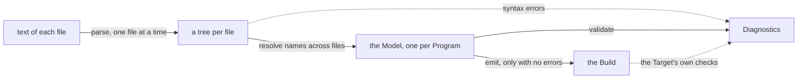

The banquet is fourteen files: a Vocabulary, eight Playbooks, three Plots and two Instancing files. None of them runs. The Transpiler is the command-line tool that reads them, tells us what is wrong with them, and writes the files Jason can run. Once a Build runs, it leaves a Trace, and reading that Trace is how we find out why a Guest got no pie.

This chapter is about using the tool: what we hand it, what it prints, what it writes, and how to read a Trace and a Conformance case. How it is built comes in only where it explains something we see. Files and Imports are in *Syntax*, the `.regin` files in *Instancing*, the same Transpiler inside the browser in *The Visual Editor*, and the files of a Build in *Translation to ASL*. No Transpiler exists yet, so every command and every line of output below is what the spec says we should get, put together by hand.

## Checking a Program

```
regia check banquet.regin
```

`regia check` reads the file we name, follows its Imports, and reports what it finds. The file we name is the Entry file, and everything reachable from it is the Program. `banquet.regin` imports one file, `plots/royal_banquet.regia`, and that one imports the rest:

`showcase/plots/royal_banquet.regia`
```regia
IMPORT "../vocabulary".
IMPORT "../playbooks/courtesy".
IMPORT "../playbooks/noble_socializing".
IMPORT "../playbooks/dining".
IMPORT "../playbooks/serving".
IMPORT "../playbooks/keeping_watch".
IMPORT "honor_duel".
IMPORT "poisoning".
```

So one command checks thirteen files, `banquet.regin` and the twelve it reaches. We never list them, and there is no project file that does. A path that leads to no file, or a loop of Imports, is reported on the `IMPORT` line.

The check prints Diagnostics and writes nothing. On the showcase it prints one warning that we know of, shown in *Reading a Diagnostic* below, and no errors.

Spec: chapter 10, chapter 23.

## Entry files

Any file can be an Entry file. The usual one is a `.regin`, because it says who is in the hall:

| We run | The Program is | What we learn |
|---|---|---|
| `regia check banquet.regin` | the banquet with its full cast | everything, Instancing included |
| `regia check test.regin` | the same files with `test.regin` on top | the same, for the small cast |
| `regia check plots/royal_banquet.regia` | the banquet with no cast | everything except the Agent declarations |
| `regia check plots/honor_duel.regia` | one duel and its two Playbooks | an error that the banquet doesn't have |
| `regia check playbooks/dining.regia` | one Playbook and the Vocabulary | an error: no Root Plot |

The last two rows fail on files that are correct. A Program has exactly one Root Plot, and with no `ROOT` line it is the one Plot that nothing starts as a Subplot. Seen alone, `HonorDuel` is that Plot, so its `PARENT OVER SELF ON scandal` is an error: a Root Plot has no parent. `dining.regia` reaches no Plot at all, which is an error too.

Uniqueness of names is checked over the whole Program, and visibility per file. Two files that never import each other can still clash on a name, and we only hear of it from an Entry file that reaches both.

`#revise` Only a whole story can be checked. A Playbook file given to `regia check` gets "no Root Plot", and a Subplot's file is taken for the Root Plot and gets errors that vanish inside the banquet. The check we want while writing `dining.regia` is "are the names and the Plans right", and there is no Entry file that asks only that.

`#revise` Chapter 10 lets us name several Entry files and calls everything they reach one Program. A Build, though, is made from one Entry file, and the Visual Editor treats each `.regin` as a Program of its own. What `regia build banquet.regin test.regin` means, one Program or two, can't be told from the words.

Spec: chapter 10, chapter 21, chapter 23.

## Reading a Diagnostic

`showcase/playbooks/noble_socializing.regia`
```regia
WHEN insulted FROM peer ?who, SUITS sympathy AT 0.7, SHIFTS aggressiveness BY -0.1:
    DO laugh.
```

The Guest who laughs an insult off never uses `?who`. The check says so:

```
warning[R0307]: `?who` is filled but never used
  --> playbooks/noble_socializing.regia:32:29
   |
32 |     WHEN insulted FROM peer ?who, SUITS sympathy AT 0.7, SHIFTS aggressiveness BY -0.1:
   |                             ^^^^
   = help: write `?` if the value isn't needed
```

The wording is ours. The spec fixes the parts, and Conformance cases pin down three of them: the severity, the code, and the line the Diagnostic starts on.

| Part | Here | What it is |
|---|---|---|
| severity | `warning` | error, warning or note |
| code | `R0307` | the stable name of this check |
| message | "`?who` is filled but never used" | one line, free to improve between versions |
| primary place | `noble_socializing.regia:32:29` | file, line and column, both counted from 1 |
| labels | none here | other places that explain the problem, each with a few words |
| hint | "write `?` …" | how to fix it |
| fixes | none here | edits the Visual Editor can apply for us; the command line prints only their titles |

An error looks the same. Had `serving.regia` lost its first line, `IMPORT "../vocabulary".`, every shared name in it would be unknown:

```
error[R1004]: `bring` is not declared
  --> playbooks/serving.regia:8:8
   |
 8 |     TO bring(?dish, ?place) FROM patron ?guest:
   |        ^^^^^
   = help: `bring` is declared in `vocabulary.regia`, which this file doesn't reach
   = help: add `IMPORT "../vocabulary".`
```

The same error follows for `walk_to`, `put_down`, `served`, `pick_up` and `sold_out` further down. The hint can name the file because `vocabulary.regia` is still in the Program, reached by other files. The second `help` is a fix, and in the Visual Editor it is one click.

- All problems come back from one run. No pass stops at the first error, and a broken line in one file doesn't hide a wrong name in another.
- Diagnostics are sorted by file, then by position. Repeats that come from one broken construct are removed.
- An error stops the Build. A warning or a note doesn't.

`#revise` A warning can't be answered. The showcase keeps `?who` on the laughing Plan on purpose, so that the three ways to take an insult have the same Trigger (*Precedence and Labels*), and it will carry this warning in every check for as long as it exists. The spec also says that some name-order warnings are false, because the Transpiler doesn't know which Playbooks are ever held together. Nothing lets us mark a warning as seen.

Spec: chapter 23. For the two checks, chapter 03 and chapter 10.

## Diagnostic codes

A code is `R`, two digits for the spec chapter that defines the check, and two digits for the check's number in that chapter.

| Code | Chapter | Check |
|---|---|---|
| `R0307` | 03, Parameters and Placeholders | a named Placeholder that is filled but never used |
| `R1004` | 10, Scoping and Imports | a name that isn't declared in the file or anything it reaches |
| `R1301` | 13, Plan selection | a cycle in one Plot's relations |
| `R2104` | 21, Instancing | no Root Plot |

A code never changes meaning and is never given to another check. A check that is dropped keeps its number, marked as retired. Each code has a page of documentation, and a message can be reworded freely because nothing depends on it. This is what we search for, quote in a bug report, and expect in a Conformance case.

Each language chapter of the spec lists its checks under *Transpiler checks*, errors first, then warnings, then notes. The Jason chapters add a few of their own, such as `R2801` for an External name of a Fact that Jason can't spell.

`#revise` A code says where in the spec its check is defined. `R13` means Plan selection only to someone who knows the spec's table of contents, and this guide numbers the same subject 14. The digits don't give the severity either: within a chapter errors come first, but a check added later takes the next free number whatever it is.

`#revise` The note is a severity with one member. In chapters 01 to 21 and 26 the only note is `R1311`, a Subplot's relation dropped because its parent says the opposite. A third severity has to be learned and looked for, on the command line and in the Visual Editor, for that one line.

Spec: chapter 27.

## What a check works on



Every file is parsed alone, and the parser always produces a tree. A line it can't read is wrapped as an error and skipped, and the rest of the file is read as usual. So a missing `:` in `dining.regia` gives one syntax error there, and the checks of every other file still run. Constructs inside the broken part are left out of what follows, so they don't set off a second round of errors.

Names are resolved once, for the whole Program, into the Model. The Model is what the Program means: `ASSIGN Dining TO Guest` no longer holds the word `Dining` but the Playbook declared in `dining.regia`, with the Mappings we left out filled in and every Precedence rank computed. Checks that need more than one file run on it, and so do the Build and the Visual Editor's drawing. This is why a name error can appear in a file nobody touched: the file is the same, and the Program around it changed.

The Model keeps what we wrote. A Role setup is still a Role setup in it, and only the Target turns it into Messages from the Director. A Diagnostic therefore speaks of our constructs, never of what they become.

`#revise` Some checks belong to the Target and come out of the emit: `R2801`, and the warning for a `SUITS` on a Target with no Selection function. The emit runs only when there are no errors, and only in `regia build`. Read that way, a Program can pass `regia check` and then fail to build, with an error that was there all along.

Spec: chapter 23. ADR 0010, ADR 0012.

## Building

```
regia build test.regin
```

`regia build` runs the same checks and then, if there is no error, writes the Build: the Target files for this Entry file, with the Instancing it reaches. For Jason the small cast gives:

```
build/test/
    test.jcm                            the starting cast, for Jason
    cast.json                           the starting cast, for the game
    asl/regia/agent.asl                 Infrastructure
    asl/regia/director.asl              Infrastructure
    asl/regia/sourcemap.json            from ASL lines back to ours
    asl/playbooks/Courtesy.asl          one per Playbook, eight in all
    asl/directors/RoyalBanquet.asl      one per Plot, three in all
    asl/roles/Guest.asl                 one per Role of the Root Plot, four in all
    asl/roles/Guard__Guest.asl          for the knight, who plays two Roles
    traces/                             filled by each run
```

- Files are named after our Playbooks, Plots and Roles, exactly as we wrote them: `Keeping_watch.asl`, `NobleSocializing.asl`.
- The two Infrastructure files are the same in every Build of every Program. They are the fixed code that runs Givings, Phases and Stagings around our Plans.
- The `.jcm` and `cast.json` exist only when Instancing declares at least one Agent kind. `regia build plots/royal_banquet.regia` writes `build/royal_banquet/` with the ASL files and neither of them.
- Each `.regin` is a Build of its own. The showcase has two, `build/banquet/` and `build/test/`, made from the same twelve `.regia` files.
- A Build holds no Java. The classes its Agents run on come from `regia-jason`, a library released with the Transpiler.

We are not meant to read the ASL. The spec promises what a Program does and leaves the Target free in how it writes it, so the ASL of one version of the Transpiler may differ from the next. What we read is the Trace, which speaks in our names. (*Translation to ASL*)

`#revise` The folder is named after the Entry file's name alone, so `test.regin` in two folders would give one `build/test/`. It also holds two kinds of thing: files made again by every build, and the Traces of past runs, which are to be kept for comparing. The Visual Editor clears the folder before it writes.

`#revise` The tool ends at the Build. Starting it takes Jason, the `regia-jason` library, VEsNA and a game that has read `cast.json`, and the spec gives a command only for the test mode of behaviour cases. After Diagnostics written in our own words, the next step is a Java class path.

`#revise` Chapter 21 says the Target is chosen on the command line. With one Target in 2.0 there is nothing to choose, and no way of writing the choice is given.

Spec: chapter 23, chapter 28, chapter 36. For Builds with no Instancing, chapter 21.

## Reading a Trace

A run writes its Trace twice: as a file, `build/test/traces/<date and time>.jsonl`, with one entry per line, and on Jason's console as it happens. The console tells us the file's path when the run starts.

Here is the Servant of the small cast, asked for a pie the kitchen has run out of.

`showcase/playbooks/serving.regia`
```regia
TO bring(?dish, ?place) FROM patron ?guest:
    PURSUE fetch(?dish, ?place).         # PURSUE waits: if fetching fails, so does bringing
    DO walk_to(?place).
    DO put_down(?dish).
    TELL ?guest served(?dish).

TO fetch(?dish, ?):                      # the place only keeps two orders of one dish apart
    DO walk_to(kitchen).
    DO pick_up(?dish).                   # refused once the dish has run out

WHEN bring(?dish, ?) FAILED FROM patron ?guest:
    TELL ?guest sold_out(?dish).
```

```
[servant_1] #311 PLAN TO bring(pie, seat_2) FROM noble_1  playbooks/serving.regia:9:5
[servant_1] #312 GOAL fetch(pie, seat_2) PURSUED  playbooks/serving.regia:10:9
[servant_1] #313 PLAN TO fetch(pie, seat_2)  playbooks/serving.regia:15:5
[servant_1] #314 DO walk_to(kitchen)  playbooks/serving.regia:16:9
[servant_1] #340 DO walk_to(kitchen) DONE  playbooks/serving.regia:16:9
[servant_1] #341 DO pick_up(pie)  playbooks/serving.regia:17:9
[servant_1] #342 DO pick_up(pie) REFUSED none left  playbooks/serving.regia:17:9
[servant_1] #343 FAILURE T1101 DO pick_up(pie) refused  playbooks/serving.regia:17:9
[servant_1] #344 FAILURE GOAL fetch(pie, seat_2) FAILED because #343  playbooks/serving.regia:15:5
[servant_1] #345 FAILURE GOAL bring(pie, seat_2) FAILED because #343  playbooks/serving.regia:9:5
[servant_1] #346 PLAN WHEN bring(pie, seat_2) FAILED FROM noble_1  playbooks/serving.regia:19:5
[servant_1] #347 TELL noble_1 sold_out(pie)  playbooks/serving.regia:20:9
[noble_1] #348 PLAN WHEN sold_out(pie) FROM servant_1  playbooks/dining.regia:47:5
[noble_1] #349 FACT -craves(pie)  playbooks/dining.regia:48:9
```

Each line is one entry. The name in brackets is the Agent that wrote it, and a starting Agent is its kind and a number. In the file a Director is `director:RoyalBanquet`, while Jason's console puts its Jason name in the brackets, `regia_director__royalBanquet`. Then come the entry's number in the run, what happened, and the place in our source. Between #314 and #340 the Servant was walking, and the numbers in between went to other Agents.

| Kind | Console text | Written when |
|---|---|---|
| `run` | `RUN STARTED <entry> SEED <n>`, `RUN ENDED` | the run starts and ends |
| `plan` | `PLAN <trigger>` | a Plan starts, with its Placeholders filled |
| `action` | `DO <action>`, then `DO <action> DONE`, `FAILED` or `REFUSED` | a Custom Action is sent, and again when the game answers |
| `message` | `TELL <to> <fact>`, `ASK <to> TO <goal>` | a Message is sent |
| `goal` | `GOAL <goal> PURSUED`, `REACHED`, `DROPPED`, `FAILED` | a Goal changes state |
| `fact` | `FACT +<fact>`, `FACT -<fact>` | an Agent learns or forgets a Fact |
| `phase` | `PHASE <old> -> <new> ON <trigger>` | a Director changes Phase |
| `staging` | `STAGING <plot> STARTED <cast>`, `ENDED <outcome>` | a Staging starts or ends |
| `giving` | `GIVE <playbook> TO <agent> AS <role>`, `TAKE <playbook> FROM <agent>` | a Playbook is given or taken away |
| `cast` | `JOINED <agent> AS <roles>`, `LEFT <agent>`, `TEMPER <agent> …` | the cast changes, or an Agent starts with its Propensity values |
| `failure` | `FAILURE <code> <what>`, `FAILURE <what> because #<n>` | a Plan or Goal fails |
| `warning` | `WARNING <code> <what>` | something was repaired or dropped, and the Plan carried on |

- Receiving has no entry. A Message shows at the receiver as the Plan it starts (#348) or the Fact it leaves. An Event or a Fact from the game shows the same way.
- Entries use our names only. No name the Transpiler made up for the ASL appears, and every place is a line of a `.regia` file. The source map in the Build is what makes this possible.
- The file has more than the console: each entry also carries the time in milliseconds since the run started, its level, and the fields of its kind.

Spec: chapter 34, chapter 35.

## Following a Failure

Lines #343 to #345 above are a Failure chain, and it reads from the bottom. `bring` failed because of #343. `fetch` failed because of #343. And #343 names the Statement, `DO pick_up(pie)` on line 17, and the cause by its Trace code: `T1101`, a Custom Action that the game refused or reported as failed. The game's own reason, "none left", is on the line before.

The first entry of a chain carries the cause. Every Goal or waiting Plan that fails in turn writes one more entry that points back at it. The entries are written as each level fails, so the chain can be read while the run goes on.

A Trace code is built like a Diagnostic code, with `T` in front: `T`, the spec chapter, a number. Failures and runtime warnings have one each.

| Code | Kind | What happened |
|---|---|---|
| `T1101` | Failure | a Custom Action refused, or failed while the `DO` waited |
| `T1102` | Failure | a `PURSUE` waiting on a Goal that was dropped or failed |
| `T1103` | Failure | `FAIL.` |
| `T1104` | Failure | a Goal with no applicable recipe |
| `T0902` | warning | a negative Weight, counted as 0 |
| `T1901` | warning | a Message dropped because its Recipient had left |

This is the one place where the reason for a Failure can be read. The Servant's `FAILED` Plan knows that `bring(pie, seat_2)` failed and for whom, and tells the Guest `sold_out(pie)` whatever the cause was. Had the Servant tripped on the way to the kitchen, the Guest would hear `sold_out` all the same, and only the Trace would show `walk_to` on line 16 in place of `pick_up` on line 17. (*Goals and Failure*)

`#revise` The Trace says what happened and has no entry for what didn't. A Signal has no kind of its own: `SIGNAL took_seat` shows only if the Director has a Plan for it. An Event nobody handles, a Quota still two Guests short, a Plan that lost to another Playbook: each leaves nothing. "Why did the feast never start" is answered by looking for lines that aren't there. *Quotas and Cast Changes* and *Precedence and Labels* have the same note for their own cases.

`#revise` A Director's name depends on what else is running. While one duel runs its Director is `director:HonorDuel`, and with two they are `director:HonorDuel#1` and `#2`. A search for one duel's lines has to know how many duels there were at each moment. On the console the same Director appears under a third name, the one Jason gives it, which is the only made-up name a Trace shows.

`#revise` How much of the Trace the console shows is the Target setting `trace_console`, in a `.regin` file. Quieting the console means editing the Program and building again, for something that changes nothing in the run.

Spec: chapter 34, chapter 11. For the Jason console, chapter 35.

## Conformance cases

A Conformance case is a small Program kept beside the spec, in `docs/spec/cases/`, with the outcome the spec promises for it. A Transpiler is correct when it passes them all. For us they are the spec's rules in a form that can be read as examples: when a sentence of the spec can be taken two ways, the case decides.

A check case states the exact Diagnostics a Program gets. This one is `13-plan-selection/precedence-cycle.regia`, cut to its Plot:

```regia
#! case: two Playbooks ordered over each other form a cycle
#! rule: R1301

PLOT Tavern:
    ROLE Patron STARTS WITH:
        ASSIGN Brawling.
        ASSIGN Drunkard.
    PHASE open INITIAL.

    PRECEDENCE:
        Brawling OVER Drunkard.
        Drunkard OVER Brawling.          #! error R1301
```

Lines starting with `#!` are annotations. To the language they are plain Comments, and only the test runner reads them. The header says what the case shows and which rule or check it exercises. `#! error R1301` after a line expects an error with that code starting on that line, and `#! ok` in the header expects no Diagnostic at all. The case passes when the Transpiler reports exactly the annotated Diagnostics: one more or one fewer fails it. Messages, hints and fixes are not compared.

A behaviour case adds a `.trace` file: a scripted run and the Trace it should leave. This is the whole of `11-failure/failed-action-fails-its-goal.trace`, the spec's version of our Servant:

```
> start
> action fails chase(*)
> event intruder_seen(thief_1)
guard_1: GOAL catch(thief_1) PURSUED
guard_1: DO chase(thief_1)
guard_1: DO chase(thief_1) FAILED
guard_1: FAILURE T1101 DO chase(thief_1) failed
guard_1: FAILURE GOAL catch(thief_1) FAILED
```

Lines starting with `>` are script steps, played by a Scripted game that stands in for the real one. The other lines are expected entries: the Agent, a colon, and the console text without its number and place.

| Step | Does |
|---|---|
| `> start` | starts the run |
| `> event <name>(<args>)` | the game sends an Event |
| `> fact +<fact>`, `> fact -<fact>` | the game reports a Fact holding, or no longer holding |
| `> join <kind> <name>`, `> leave <name>` | an Agent Joins or Leaves |
| `> action fails <pattern>`, `refused`, `holds`, `succeeds` | from now on, how the game answers Actions that match |
| `> action done <pattern>`, `failed` | finishes the Actions being held |
| `> wait <n> seconds` | moves the clock forward |

A case runs the same from one time to the next:

- A step is played only when the run has settled: every Plan has finished, is in a `WAIT`, or waits on a held Action, and no Message is on its way.
- Time is virtual. A `WAIT 1 MINUTE` costs nothing, since the clock jumps to the next wake-up.
- Randomness is seeded, with `#! seed: <n>` in the header and 1 otherwise.
- Actions succeed at once unless a step says otherwise.

Matching is looser than for check cases. The steps are barriers, and between two of them each Agent's expected lines must appear in order, with other entries allowed in between, so a case states only what its rule is about. Failures and warnings are the exception: every one the run writes must be expected, and they match by their code. `#! exactly` in the header turns the allowance off.

The spec carries one case per language chapter to show the format. The rest are written with the Transpiler, test-first.

`#revise` We can read cases and can't run one of our own. The `.trace` format would let us write "the banquet reaches `farewell` when both nobles and the knight have eaten" as a file, with a seed and a virtual clock. But the command line has `check` and `build` only, and the matching lives inside the Transpiler's own test suite. *Randomness* has the same note for the seed, which a real run can't set.

`#revise` `#!` is the fifth thing a `#` can open, after `#`, `#[`, `#@` and `#%`, and the only one the grammar doesn't know. A mistyped annotation is a Comment like any other.

Spec: chapter 27, chapter 34. ADR 0014.

## How this combines with…

### Instancing

An Entry file is usually a `.regin`, and the names in a Trace come from it: `COUNT 2` on `noble` is why the lines above say `noble_1` and why there is a `noble_2`. Agents are numbered even when there is one, so `servant_1` keeps its name if we later ask for three Servants, and a `.trace` file written for the small cast still matches. Checks on Agent declarations run only when the Program has one, so `plots/royal_banquet.regia` as an Entry file is never told that nobody plays `Servant`. (*Instancing*)

### Precedence and Labels

Most of what `regia check` says about the banquet's Precedence is a warning: an order decided by name alone, a relation whose two sides share no Trigger, a `TIES` with nothing to choose by. The full picture is the conflict report, which lists per Role and Trigger the competing Trigger Blocks in rank order, with the reason for each rank. The spec says the Transpiler prints it "on request". `#revise` Neither `check` nor `build` is described as taking such a request, so the one view that shows which Plan wins has no command. (*Precedence and Labels*)

### Randomness

The first entry of every Trace is `RUN STARTED <entry> SEED <n>`, so a run always records the seed it drew with. The small cast fixes every Propensity value and its runs still differ, since each Guest's setup rolls `LEARN purse(RANDOM(5, 20))`. (*Randomness*)

### Subplots and Stagings

A Staging has two entries of its own, `STAGING HonorDuel STARTED` with its cast and `STAGING HonorDuel ENDED` with its Outcome, and between them the duel's Director writes `PHASE challenge -> fighting ON cheered`. With two duels running, the number after `#` is what keeps their lines apart. (*Subplots and Stagings*)

### The Visual Editor

The Visual Editor runs the same Transpiler, compiled for the browser, on every keystroke. The Diagnostics are the same ones with the same codes, shown as markers in the text. There a fix is an action we can apply, where the command line prints its title. Its Build menu lists every `.regin` of the Project and writes the same `build/<entry>/` folder. A `.regia` file that no `.regin` reaches is checked as an Entry file of its own, which for a Playbook being written means a standing "no Root Plot". (*The Visual Editor*)

### Translation to ASL

Everything in this chapter stays on our side of the Build. What is inside the `.asl` files, how the `.jcm` lists the cast, and how the Trace writer turns an ASL line back into `serving.regia:17:9` are in *Translation to ASL*.

## Since 1.0

The 1.0 Transpiler was written in Python with the Lark parser. It first merged all imported files into one text and stripped the comments, then parsed, checked and wrote ASL. The `.jcm` was written by hand, and what a run did could be read only from Jason's own log, in ASL terms. The primer asked for errors reported all at once in one format, for a tree that keeps comments and spacing, and for a tool with nothing to install.

`#changes` The Transpiler is written in Rust and ships as one program per platform. The same code runs inside the Visual Editor, which no longer calls a server.

`#changes` Files are parsed one by one and never merged. Comments are part of the grammar, and Imports are resolved from the parsed files.

`#changes` Every pass reports through one kind of Diagnostic with a stable code, and all of them come back from one run.

`#changes` A Build is a folder per Entry file, with the Infrastructure written once as two fixed files where 1.0 copied its plans into every file, and with the `.jcm` when Instancing declares Agents.

`#changes` The Trace is new: one record of the run in the designer's names, with Failure chains and Trace codes.

`#changes` Conformance cases are new: check cases and behaviour cases kept beside the spec, run against a Scripted game.
