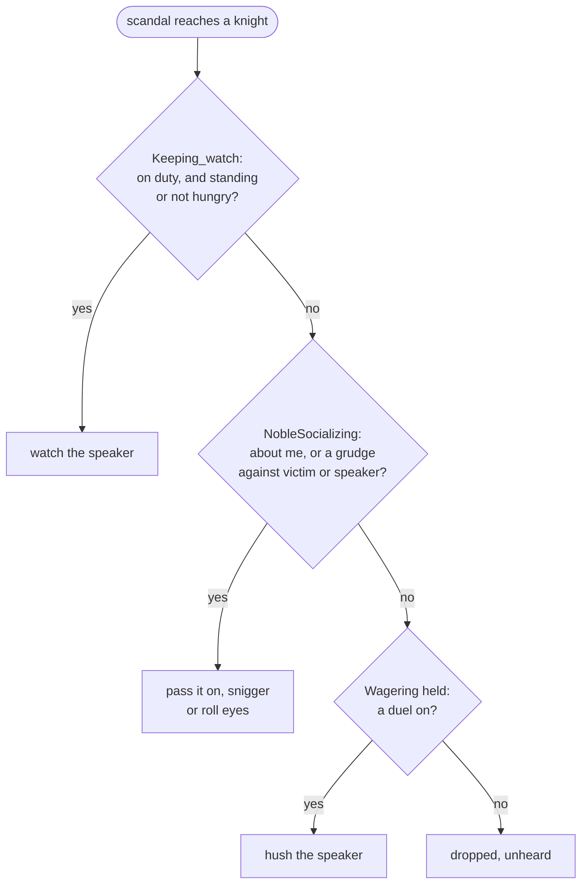

# Precedence and Labels

During the feast a knight is watching a duel when a Guest nearby passes on some gossip. Three of the knight's Playbooks have a Plan for `scandal`: `Keeping_watch` would have it watch the speaker, `NobleSocializing` snigger, `Wagering` hush them. Only one of them runs. This chapter is about which one: the order of Plans inside a Playbook, the order a Plot writes between the Playbooks it gives and the Subplots it starts, and the Labels through which an Agent's Propensities choose between Plans and are changed by them.

| We write | It decides | Where |
|---|---|---|
| two Trigger Blocks for one Trigger | the first in the text runs | a Playbook, a `DURING` Block |
| `A OVER B`, `A OVER B ON <item>` | A's candidates rank above B's | a Plot's `PRECEDENCE:` Block |
| `A TIES B`, `A TIES B ON <item>` | the Selection function chooses between A and B | the same |
| `SUITS <propensity> AT <n>` | which of several alternatives suits the Agent | a Playbook's `WHEN` or `TO` header |
| `SHIFTS <mood> BY <n>`, `SHIFT <mood> BY <n>` | how running a Plan changes a Mood | a Playbook's header; a Playbook's Body |

How a `GIVEN` chain works and how a Trigger falls through is in *Plans*. Givings are in *Playbooks and Roles*, Phases in *Plots and Directors*, Subplots in *Subplots and Stagings*. Propensities are declared as in *Vocabulary and files*, and get their values in *Instancing*.

## One Plan per Trigger

[`playbooks/keeping_watch.regia`](../showcase/playbooks/keeping_watch.regia)
```regia
WHEN scandal(?), FROM ?speaker:
    GIVEN on_duty AND (NOT seat(?) OR NOT hungry):   # standing guard, or seated and not thinking of food
        DO watch(?speaker)
    # no ELSE: a hungry knight at the table leaves gossip to NobleSocializing
```

[`playbooks/noble_socializing.regia`](../showcase/playbooks/noble_socializing.regia)
```regia
WHEN scandal(?victim), FROM peer ?speaker:
    GIVEN grudge(?victim, ?):
        DO snigger
    GIVEN grudge(?speaker, ?), SHIFTS sympathy BY -0.1:
        DO roll_eyes
    # no ELSE: gossip about strangers falls through to the next Playbook
```

[`playbooks/wagering.regia`](../showcase/playbooks/wagering.regia)
```regia
WHEN scandal(?), FROM ?speaker:
    DO hush(?speaker)
```

A Trigger reaching an Agent starts one Plan, however many of its Playbooks have one for it. The knight doesn't watch, snigger and hush. The rule is the same for every Trigger kind, in Playbooks and in Plots: Cues, `LEARNED`, `FORGOTTEN`, a Goal's endings, and `TO` recipes.

What competes is the Trigger Block: one `WHEN` or `TO` header with everything under it. The `GIVEN`s under one header never compete with each other: the first that holds runs (*Plans*). A Trigger Block is a candidate for a Trigger when:

- its Playbook is given to the Agent at that moment (for a Director, its `DURING` Block is active);
- its Trigger matches, Values and `FROM` included: gossip from someone who doesn't play `peer` never reaches the `NobleSocializing` Block;
- it can run: one of its `GIVEN`s holds, or it has an `ELSE`, or it has no Context.

The candidates are ranked and the first runs. The rank comes from three things, each used only where the one before leaves a choice:

1. Precedence: the order of the Playbooks the candidates belong to, written in the Plots or given by a default.
2. The Selection function: the Target's choice by the Agent's Propensities, only among candidates a Playbook or a Plot left equal on purpose.
3. Name order: the last resort, for a competition nobody ordered, always with a warning.

The order never depends on file order, `IMPORT` order, or the order Playbooks were given.

On `scandal` the knight's order is `Keeping_watch`, `NobleSocializing`, `Wagering`, for reasons the sections below give. The first two have a Context and no `ELSE`, so the gossip falls through them until one holds:



Three questions next to this one have a fixed answer and no construct. Several Triggers are handled in the order they arrive. A running Plan is never interrupted by a more important one: running Plans take turns, one step at a time. Two running Plans whose Actions can't happen together are not kept apart; the Trace shows which got there first.

**Checks**

- A Cue that no candidate takes → `T07_02-cue-found-no-plan` (Trace, `unheard`)
- A Goal that no candidate takes → `T11_04-goal-found-no-plan` (Trace, Failure)

Spec: chapter 13, *What this chapter decides*, *Candidates*, *Order*.

## Inside a Playbook

[`playbooks/noble_socializing.regia`](../showcase/playbooks/noble_socializing.regia)
```regia
# Gossip about me: the speaker is spreading my humiliation.
WHEN scandal(ME), FROM peer ?speaker:
    SHIFT sympathy BY -0.2
    TELL 50% OF peer wronged(ME, ?speaker)
    PURSUE resent(?speaker)

# Gossip about someone else.
WHEN scandal(?victim), FROM peer ?speaker:
```

Both Trigger Blocks match gossip about ourselves. The first in the text wins, the same reading rule as for `GIVEN` siblings, so a Guest who hears its own name passes it on and never sniggers at itself. Gossip about anyone else matches only the second.

The same rule orders a Goal's ending Plans:

[`playbooks/dining.regia`](../showcase/playbooks/dining.regia)
```regia
WHEN have_dinner FAILED WITH no_food:
    PURSUE make_do, WITHOUT WAITING      # the fallback
WHEN have_dinner FAILED, SHIFTS sympathy BY -0.3:
    DO complain
```

A dinner that failed for want of food goes to the first Plan; any other Failure goes to the second. Written the other way round, the plain `FAILED` would catch every Failure and the fallback would never run. The Transpiler warns about a Trigger Block that an earlier one always catches:

```regia
WHEN have_dinner FAILED, SHIFTS sympathy BY -0.3:
    DO complain
WHEN have_dinner FAILED WITH no_food:   # never runs: the Plan above catches it
    PURSUE make_do, WITHOUT WAITING
```

- "Always catches" means the earlier Block's Trigger covers the later one's and the earlier Block always applies: no Context, or an `ELSE`.
- A Block that an earlier one catches only sometimes gets nothing: `scandal(ME)` above catches the second Block's Trigger only for one victim.
- Suits alternatives are the exception: they are meant to overlap (*Suits alternatives*, below).

**Checks**

- A Trigger Block an earlier one in the same Playbook always catches → `R13_07-unreachable-trigger-block` (warning)

Spec: chapter 13, *Inside a Playbook*. For a Goal's ending Plans, chapter 11.

## `PRECEDENCE`

[`plots/royal_banquet.regia`](../showcase/plots/royal_banquet.regia)
```regia
PRECEDENCE:
    Keeping_watch OVER NobleSocializing ON scandal   # a knight on duty is a Guard first
    Dining TIES NobleSocializing ON insulted         # over dinner, temper decides
    HonorDuel OVER Poisoning
```

A Playbook never names another Playbook: `Keeping_watch` can't say it comes before `NobleSocializing`. Playbooks stay independent of each other and of any Plot. The Plot that gives both is the one author who sees them side by side, and it writes their order as relations in one `PRECEDENCE:` Block, next to its `ROLE` and `PHASE` declarations.

The first line orders two Playbooks `RoyalBanquet` gives: on `scandal`, every candidate of `Keeping_watch` ranks above every candidate of `NobleSocializing`. The second is a tie, read in *Tied Playbooks*. The third orders two Subplots, read in *A Plot and its Subplots*.

| Relation | Meaning |
|---|---|
| `A OVER B` | Every candidate of A ranks above every candidate of B. |
| `A OVER B ON <item>` | The same, only for Triggers on that item. Elsewhere A and B stay unordered. |
| `A TIES B`, `A TIES B ON <item>` | A and B are equal on purpose: the Selection function chooses between their candidates. |

`A` and `B` name:

- a Playbook this Plot gives, by a Role's setup, a Phase's setup, `CAST`, or `ASSIGN`;
- a direct Subplot, by its Plot name, or `SELF` for the Plot's own Playbooks and Director Plans;
- `PARENT`, in a Plot started as a Subplot;
- `DURING PLOT` or `DURING <phase>`, for the Director's own Plans.

`ON` takes a Trigger's item, with its kind word if it has one:

| We write | It covers |
|---|---|
| `ON scandal` | every Trigger on the Cue, `scandal(ME)` and `scandal(?victim)` alike |
| `ON on_duty LEARNED` | learning the Fact |
| `ON have_dinner` | the Goal's recipes, `TO have_dinner` |
| `ON have_dinner FAILED` | its `FAILED` Plans |

- Relations are static. They hold for the Plot's whole life, in every Phase. A relation only matters while both sides are given, so "on `insulted`, during the feast" follows from `Dining` being given for the `feast` and is never written.
- Inside one Plot, relations combine: `A OVER B` and `B OVER C` put A above C. A cycle among them is an error, and the message prints it.
- There are no numbers. An order is always a relation, written by someone who can see both sides.
- A relation names Playbooks, never Agents or Roles. The comment says "a knight", but the line holds for anyone who holds both, the duel's winner included, who is given `Keeping_watch` as a guard of honour.
- A relation whose two sides share no Trigger orders nothing, and gets a warning: it catches a typo, or a line left behind after a Playbook changed.

```regia
PRECEDENCE:
    Hosting OVER Serving                 # warning: no Trigger in common
    Wagering OVER NobleSocializing       # error: RoyalBanquet never gives Wagering
```

**Checks**

- A cycle in one Plot's written relations → `R13_01-precedence-cycle`
- A relation naming a Playbook the Plot never gives, a Plot it never starts, a Phase it doesn't have, or `PARENT` in a Plot never started as a Subplot → `R13_03-relation-to-absent-item`
- A relation whose two sides share no Trigger → `R13_06-relation-without-shared-trigger` (warning)

Spec: chapter 13, *Who orders what*, *`PRECEDENCE`*. Why the order is written in the Plot: ADR 0008.

### Name order

Two Playbooks one Plot gives, sharing a Trigger and ordered by nothing, are ranked by name, alphabetically, and the Transpiler warns. The warning names the pair and the relation to add to the Plot's `PRECEDENCE`. Without the first line above, a knight would still watch before it sniggers, because `Keeping_watch` comes before `NobleSocializing` in the alphabet, and the build would warn. The written line silences the warning and makes the order the Plot's decision.

- Name order places a Plot's members one at a time: wherever the relations leave several free to come next, the alphabetically first goes.
- A rename can change behaviour. Name order is kept anyway: every other unwritten order (file order, load order) is just as invisible and changes when files move, and a random pick would make runs irreproducible.
- The warning appears only for Playbooks that share a Trigger, and that some Agent can hold together. The Transpiler knows which Playbooks an Agent *can* hold, not which it holds at the same time, so two Playbooks given in different Phases can still be warned about. A writer who has checked writes `#@allow: R13_05-competition-ordered-by-name` on the Plot (*Syntax*).
- The banquet builds without the warning. `Serving` and `NobleSocializing` share `idle`, but no Role of the banquet can be given both.

**Checks**

- A competition ordered only by name → `R13_05-competition-ordered-by-name` (warning)

Spec: chapter 13, *Defaults*.

## A Plot and its Subplots

[`plots/honor_duel.regia`](../showcase/plots/honor_duel.regia)
```regia
PRECEDENCE:
    PARENT OVER SELF ON scandal          # gossip and guard duty come before hushing
```

A Plot orders its direct Subplots against itself and against each other. With nothing written, a Subplot ranks above its parent: it is the more specific part of the story. So the Poisoner's `idle` goes to `Scheming` before `NobleSocializing` with no line saying so, and once the poison is poured it falls through to small talk:

[`playbooks/scheming.regia`](../showcase/playbooks/scheming.regia)
```regia
WHEN idle:
    GIVEN NOT poured AND grudge(?mark, ?size), LOWEST ?size:
        DO pour_poison(?mark), WITHOUT WAITING    # we don't stand there while it dissolves
        LEARN poured
        DO slip_away
    # no ELSE: once the poison is poured, idle falls through to small talk
```

The same default would put `Wagering`, which `HonorDuel` gives every Spectator, above the banquet's own Playbooks. Its `scandal` Plan has no Context, so for as long as a duel lasts it would take every piece of gossip in the hall. `HonorDuel` can't name the banquet's Playbooks, and doesn't know who starts it, so it names that Plot `PARENT` and gives way on one item.

Who names what:

- A Plot names a Subplot by its Plot name, the one it writes in `START SUBPLOT`, and itself as `SELF`. It never names a Subplot's Playbooks.
- `SELF` is always the Plot's own Playbooks and its Director's own Plans, in a parent and in a Subplot alike.
- A Subplot counts together with everything it starts. `HonorDuel OVER Poisoning` ranks every Playbook given by `HonorDuel`, or by a Plot it starts, above every Playbook given by `Poisoning` or its Subplots. Nobody names a grandchild.
- A Subplot names the Plot that started it only as `PARENT`, since a reusable Subplot can't know its name. `PARENT` is the parent's `SELF`, so a Subplot places itself against its parent and never against its siblings: that order is the parent's business. When a Subplot writes `PARENT OVER SELF`, its whole subtree moves with it.
- If parent and Subplot say opposite things, the parent wins, and the Transpiler warns that the Subplot's relation was dropped.

```regia
PLOT RoyalBanquet:
    PRECEDENCE:
        HonorDuel OVER SELF ON scandal   # HonorDuel's PARENT OVER SELF ON scandal is dropped, with a warning
```

A default gives way to what is written. The written relations of a Plot, its Subplots' `PARENT` relations included, are placed first, and each default is added only where it contradicts nothing they imply, directly or through a chain. On `scandal` the banquet's relations and `HonorDuel`'s say:

- `PARENT OVER SELF ON scandal`: the banquet's own Playbooks above `HonorDuel`;
- `HonorDuel OVER Poisoning`: `HonorDuel` above `Poisoning`.

Together they put the banquet above `Poisoning` on `scandal`. The default "`Poisoning` above its parent" would close a cycle, so on `scandal` it is left out, and the conflict report says so (*Reading the order*). On every other item it stands. A cycle made only of written relations is still an error.

For a Guest who holds everything, the two shared Triggers come out like this:

| Trigger | Order | Decided by |
|---|---|---|
| `idle` | `Duelling`, `Scheming`, `NobleSocializing` | `HonorDuel OVER Poisoning`; both Subplots above the banquet by default |
| `scandal` | `Keeping_watch`, `NobleSocializing`, `Wagering` | `PARENT OVER SELF ON scandal`; `Keeping_watch OVER NobleSocializing ON scandal`; the `Poisoning` default left out |

`Duelling`'s `idle` Plan has no Context, so a Poisoner who is also duelling limbers up, and pours only once the duel is over.

- The order is a hierarchy: first between Plots, then between the Playbooks inside the winning Plot.
- Relations don't carry across Plots. Each Plot's lines order only what that Plot names.
- A Playbook given by two Plots is one Playbook with one set of Trigger Blocks, and it ranks at the best of its positions. The Guards hold `Keeping_watch` from the banquet and again from `Poisoning`; on `scandal` the banquet's position is the better one.
- Stagings of one Subplot under one parent share its position. A Guest in two duels holds `Duelling` twice and competes once.
- Two sibling Subplots with no relation are ranked by name, with the warning. `HonorDuel OVER Poisoning` agrees with the alphabet; it is written so that the order is the banquet's decision.
- `TIES` joins only Playbooks given by the same Plot. It can't join Subplots, `SELF`, `PARENT` or Phases.
- There are no independent Plots. Every Plot is the Root Plot or below it, so any two Plots have a common ancestor that orders them. Instancing orders nothing: a Program has one Root Plot, and stories that run side by side are its Subplots.

**Checks**

- A cycle in the written relations, the Subplots' `PARENT` relations included → `R13_01-precedence-cycle`
- `TIES` naming a Subplot, `SELF`, `PARENT` or a Phase → `R13_02-misused-ties`
- `PARENT` in a Plot never started as a Subplot → `R13_03-relation-to-absent-item`
- Two sibling Subplots ordered only by name → `R13_05-competition-ordered-by-name` (warning)
- A Subplot's relation dropped because its parent says the opposite → `R13_11-overridden-subplot-relation` (warning)

Spec: chapter 13, *Who orders what*, *Defaults*, *Instancing*. Why a default gives way: ADR 0032. For Stagings, chapter 17.

## A Director's own Plans

A Director has the same question on a smaller scale. Its candidates for a Trigger are the Trigger Blocks of the current Phase's `DURING` Block and of `DURING PLOT`. Inside one Block the first in the text wins. Between the two, the Phase's Plan ranks first, as the more specific state.

The banquet has no Trigger that both a Phase and `DURING PLOT` handle. `DURING PLOT` sounds the alarm on any Guard's report, in every Phase:

[`plots/royal_banquet.regia`](../showcase/plots/royal_banquet.regia)
```regia
WHEN culprit_seized(?):              # any Guard's report: sound the alarm
    DO ring_bell
```

A Plan for the same Cue in `feast` would take a Guard's report over for that Phase. `DURING PLOT` would still ring in the other Phases, and in `feast` for a report from the duel's winner, who isn't a Guard:

```regia
DURING feast:
    WHEN culprit_seized(?), FROM Guard:
        DO play_music                    # during dinner, drown out the commotion
```

The `PRECEDENCE` Block can turn the default round, for one item or for all:

```regia
PRECEDENCE:
    DURING PLOT OVER DURING feast ON culprit_seized
```

- Falling through works as in a Playbook: a Phase's Trigger Block whose `GIVEN`s all fail, with no `ELSE`, passes the Trigger on to `DURING PLOT`.
- A Plot's `WHEN ENTERED` in `DURING PLOT` and a Phase's `WHEN ENTERED` are two different Triggers, and both run (*Plots and Directors*). The same holds for `FINISHED` and `ENDED` on one Subplot: the specific one fires first, then `ENDED`.
- A Director has no Propensities. No Label goes on its Plans, `SHIFT` isn't one of its Statements, and `TIES` can't join its Blocks.

**Checks**

- A `DURING PLOT` Plan fully shadowed by a Phase's → `R13_07-unreachable-trigger-block` (warning)
- A Label on a Director's Plan, `SHIFT` in a Director → `R14_06-label-in-director`
- `DURING <phase>` naming a Phase the Plot doesn't have → `R13_03-relation-to-absent-item`

Spec: chapter 13, *Defaults*, *`PRECEDENCE`*; chapter 20.

## Propensities

[`vocabulary.regia`](../showcase/vocabulary.regia)
```regia
TRAIT bravery
MOOD sympathy, aggressiveness
```

A Propensity is a named disposition of an Agent, used to choose between Plans and changed by running them. A Trait never changes during a run; a Mood changes as the Agent runs Plans. Where they are declared and what names they may take is in *Vocabulary and files*. Their starting values come from Instancing:

[`banquet.regin`](../showcase/banquet.regin)
```regia
KIND hothead, LIKE noble:
    COUNT 2
    bravery AT 0.9
    sympathy AT -0.4
    aggressiveness AT RANDOM(0.6, 1)
```

- A Trait lies in [0, 1], a Mood in [-1, 1].
- A Propensity an Agent is given no value for is neutral: 0.5 for a Trait, 0 for a Mood. The `king` and the Servants are given none, and that is no warning: an ordinary Agent is something a writer can mean.
- A Propensity belongs to the whole Agent, never to one Playbook. A Mood that `Dining` lowers is the Mood `NobleSocializing` reads at the next insult.
- Propensities are not Facts. No Context can test one. Labels name them, and `SHIFT` changes a Mood.

**Checks**

- `TRAIT` or `MOOD` declared inside a `PLAYBOOK` or `PLOT` → `R14_07-local-propensity`
- A declared Propensity that no Label and no `SHIFT` names → `R14_09-unused-propensity` (warning)

Spec: chapter 14, *Propensities*. For values, chapter 21.

## Labels

[`playbooks/noble_socializing.regia`](../showcase/playbooks/noble_socializing.regia)
```regia
WHEN insulted, FROM peer ?who, SUITS sympathy AT -0.5, SHIFTS aggressiveness BY 0.3:
    GIVEN grudge(?who, ?):
        DO scowl_at(?who)
        PURSUE resent(?who)
```

A Label is a clause of a Trigger's header, after its core. Each starts with `, KEYWORD`. The set is fixed by the language, and 1.5 has two:

| Label | Form | Names | Meaning |
|---|---|---|---|
| Suits | `SUITS p AT n, …` | Traits and Moods | The Plan best fits an Agent whose `p` is close to `n`. The Selection function chooses by it. |
| Shifts | `SHIFTS m BY n, …` | Moods only | Running the Plan changes Mood `m` by `n`, up or down. |

- Labels stand in any order, among themselves and with `FROM`; tools write them last. Each appears at most once on a header.
- A Label naming several Propensities lists them with `,`: `SUITS aggressiveness AT 0.8, bravery AT 0.8`. After a `,`, a Propensity name continues the list, and a keyword starts the next clause. Each Propensity is named once per Label.
- The values are Number literals: in [0, 1] for a Trait after `SUITS`, in [-1, 1] for a Mood and for every `SHIFTS` amount. An Expression or a Placeholder is an error. A Label is fixed when the Program is written and can be read without running anything.
- `SHIFTS` names Moods only.
- The `BY` of `SHIFTS` is an amount. Everywhere else in Regia `BY` names who did something; this is the one exception (*Syntax*).
- A long header wraps after any `,` (*Syntax*).

Where each Label can go:

| Header | `SUITS` | `SHIFTS` |
|---|---|---|
| `WHEN …`, `TO …` in a Playbook | yes | yes |
| `GIVEN …`, `ELSE` under a Trigger | error | yes |
| any Plan of a Director | error | error |

A Label on a Trigger applies to every Plan under it. A `SHIFTS` on a `GIVEN` or `ELSE` adds to the Trigger's own for that one Plan:

[`playbooks/noble_socializing.regia`](../showcase/playbooks/noble_socializing.regia)
```regia
WHEN scandal(?victim), FROM peer ?speaker:
    GIVEN grudge(?victim, ?):
        DO snigger
    GIVEN grudge(?speaker, ?), SHIFTS sympathy BY -0.1:
        DO roll_eyes
```

Sniggering changes nothing; rolling our eyes at a speaker we resent costs a little sympathy. Naming the same Mood on the Trigger and on one of its `GIVEN`s is an error. `SUITS` never goes on a `GIVEN`: `GIVEN` siblings never compete, so there is nothing for it to choose between.

A Pick on a `GIVEN` uses the same comma (`GIVEN grudge(?foe, ?size) AND ?foe PLAYS peer, WEIGHT ?size:`) and may stand beside a `SHIFTS` in any order; so does `, WITHOUT WAITING` on a Statement. Neither is a Label (*Matching*, *Actions and time*).

**Checks**

- An unknown Label keyword, or a Label twice on one header → `R14_01-unknown-or-repeated-label`
- A Propensity named twice in one Label, or the same Mood in a Trigger's `SHIFTS` and a `GIVEN`'s → `R14_02-repeated-propensity`
- A name in `SUITS` that isn't a declared Propensity, a name in `SHIFTS` that isn't a declared Mood → `R14_03-undeclared-label-name`
- A Label value that isn't a Number literal, or lies outside its range → `R14_04-wrong-label-value`
- `SUITS` on a `GIVEN` or `ELSE` → `R14_05-misplaced-suits`
- A Label on a Director's Plan → `R14_06-label-in-director`
- Propensities joined with `AND` (`SUITS sympathy AT -0.5 AND bravery AT 0.8`) → `R14_12-retired-and-in-label` (hint: list them with `,`)

Spec: chapter 14, *Writing Labels*, *The Labels*, *Where Labels go*.

## Suits alternatives

[`playbooks/noble_socializing.regia`](../showcase/playbooks/noble_socializing.regia)
```regia
# Three ways to take an insult. The Selection function picks the one that suits us.
WHEN insulted, FROM peer ?who, SUITS aggressiveness AT 0.8, bravery AT 0.8:
    DO stand_up
    SIGNAL insult_thrown(?who)

#@desc: Scowl, and remember it. Only at someone we already resent.
WHEN insulted, FROM peer ?who, SUITS sympathy AT -0.5, SHIFTS aggressiveness BY 0.3:
    GIVEN grudge(?who, ?):
        DO scowl_at(?who)
        PURSUE resent(?who)

# `?_who` names who we ignore, so that the three ways read alike.
WHEN insulted, FROM peer ?_who, SUITS sympathy AT 0.7, SHIFTS aggressiveness BY -0.1:
    DO laugh
```

By the rule for a Playbook the first Block would always win, and the Transpiler would warn that the third can never run. The `SUITS` Labels change that. When one Trigger Block for a Trigger in a Playbook carries `SUITS`, every Trigger Block for that Trigger in the Playbook is a Suits alternative. None shadows another. Every alternative whose Context holds goes to the Selection function, which picks one.

The scowl has a Context: it is an alternative only when the Guest already holds a grudge against whoever insulted it. Otherwise two alternatives are left. A hothead, brave and aggressive, fits the first and stands up, which Signals the insult and starts a duel. A noble high in sympathy laughs it off.

The second pair is in the duel:

[`playbooks/duelling.regia`](../showcase/playbooks/duelling.regia)
```regia
# Two ways to answer a challenge.
WHEN challenged, FROM opponent, SUITS bravery AT 0.7:
    DO stand_up
    DO pick_up_glove
    SIGNAL duel_accepted

WHEN challenged, FROM opponent, SUITS bravery AT 0.1, SHIFTS sympathy BY -0.3:
    DO walk_to(door)
    DO leave_hall                        # out of the banquet, and out of the Program
```

Both name one Trait, so the outcome can be read off the values: a Defender whose bravery is nearer 0.7 accepts, one nearer 0.1 walks out. A Trait never changes, so a Guest answers every challenge of the evening the same way.

- An unlabelled alternative is neutral. It competes as if it suited every Propensity the labelled ones name at the neutral value, 0.5 for a Trait and 0 for a Mood: the Plan for an Agent with nothing particular about it. Labelled and unlabelled Blocks may be mixed.
- A `SHIFTS` Label alone doesn't make a Block an alternative. `WHEN hit, FROM opponent, SHIFTS aggressiveness BY 0.1:` in `Duelling` is an ordinary Trigger Block.
- With no `SUITS` on any of them, Trigger Blocks for one Trigger are not alternatives, and the first in the text wins.
- Alternatives are always separate Trigger Blocks, never `GIVEN` siblings.

What the language promises about the Selection function:

- It picks exactly one of the candidates it is given.
- It is only given candidates of equal rank: Propensities never override precedence. A Suits alternative in a Playbook ranked lower than another candidate never reaches it.
- How it scores belongs to the Target: how Traits and current Moods are weighed, and how a fit over two Propensities compares with a fit over one. The three ways to take an insult name different sets of Propensities, and on VEsNA-Pro's `most_similar` strategy the score is the sum of the distances over the Propensities a Plan names. A run that uses the Selection function plays the same again only given the same Mood history.
- A Target with no Selection function takes alternatives in text order, and the Program gets one warning.
- A Program with no `SUITS` Label never calls it.

**Checks**

- `SUITS` on a Target with no Selection function → `R13_10-suits-without-selection-function` (warning, once per Program)
- A Label the Target doesn't support → `R14_08-unsupported-label` (warning, once per Program per Label)

Spec: chapter 13, *Suits alternatives inside a Playbook*, *What the language promises*; chapter 14, *Suits alternatives*, *Targets without Labels*. Why an unlabelled alternative is neutral: ADR 0033.

## Shifts

[`playbooks/dining.regia`](../showcase/playbooks/dining.regia)
```regia
WHEN have_dinner FAILED, SHIFTS sympathy BY -0.3:
    DO complain
```

A Guest whose dinner failed complains, and comes out of it less sympathetic. A `SHIFTS` Label applies once, when its Plan is chosen, before the first Statement runs:

- whether or not the Plan was chosen among alternatives: this Plan has no rival, and it shifts;
- even if the Plan then fails at its first Statement;
- a Mood is kept within [-1, 1]: a Shift that would take it past a bound leaves it at the bound.

A change that depends on what happens in the Body is a `SHIFT` Statement:

[`playbooks/noble_socializing.regia`](../showcase/playbooks/noble_socializing.regia)
```regia
WHEN scandal(ME), FROM peer ?speaker:
    SHIFT sympathy BY -0.2
    TELL 50% OF peer wronged(ME, ?speaker)
    PURSUE resent(?speaker)
```

- `SHIFT` is a Basic Action. It names Moods only, several with `,`: `SHIFT sympathy BY -0.2, aggressiveness BY 0.1`.
- Its amount is any Number Expression, Placeholders included, worked out when the Statement runs: `SHIFT sympathy BY ?size * -0.1`.
- It applies at once, before the next Statement, whatever happens to the Plan afterwards, and the Mood is kept within [-1, 1].
- It is a Playbook Statement only.

Shifts and Suits work on each other. A Guest who scowls at an insult gains 0.3 of aggressiveness, and one that laughs loses 0.1, so the way it takes the next insult has moved. Every hit taken in `Duelling` before yielding adds 0.1 to the aggressiveness the Guest carries back to the table. Two Playbooks that never name each other act on each other through a Mood.

Every Mood change is in the Trace (*Reading the order*).

**Checks**

- A name in `SHIFT` that isn't a declared Mood → `R14_03-undeclared-label-name`
- The same Mood twice in one `SHIFT` → `R14_11-repeated-mood-in-shift`
- Moods in a `SHIFT` joined with `AND` → `R14_12-retired-and-in-label`
- `SHIFT` in a Director → `R14_06-label-in-director`

Spec: chapter 14, *The Labels*, *The `SHIFT` Statement*.

## Tied Playbooks: `TIES`

[`plots/royal_banquet.regia`](../showcase/plots/royal_banquet.regia)
```regia
Dining TIES NobleSocializing ON insulted         # over dinner, temper decides
```

[`playbooks/dining.regia`](../showcase/playbooks/dining.regia)
```regia
# An insult over dinner. RoyalBanquet ties this with NobleSocializing: a mild Guest may just keep eating.
WHEN insulted, SUITS aggressiveness AT -0.5:
    GIVEN PURSUING have_dinner:
        DO sip_wine
```

During the feast a Guest holds two Playbooks with a Plan for `insulted`. `TIES` says the two are equal on purpose: their candidates go into one pool, and the Selection function picks from it. The pool holds each side's Suits alternatives whose Context holds, and each side's winning Trigger Block where it has none. An insulted Guest at dinner has three or four choices: stand up, scowl if it holds a grudge, laugh, or keep sipping its wine. A mild one is likely to keep eating. Once its dinner is over, the `Dining` Block has no Context that holds and the pool is `NobleSocializing`'s alone.

- If any candidate in the pool carries `SUITS`, the unlabelled ones are neutral, as inside a Playbook. Labelling one side is enough.
- A Plot can't write Labels for the Playbooks it ties: only a Playbook's author can say what its Plans suit.
- `TIES` marks the competition as intended, so name order's warning doesn't fire.
- `TIES` with no `SUITS` in the pool has nothing to choose by. It falls back to name order, with a warning that says to write `OVER` or add `SUITS`. A tie never draws lots: variety by chance is `RANDOMLY` (*Randomness*).
- `TIES` between two Playbooks already ordered by `OVER` is an error.
- A Target with no Selection function settles a tie by name order, with the same once-per-Program warning as for alternatives.

```regia
PRECEDENCE:
    Keeping_watch OVER NobleSocializing ON scandal
    Keeping_watch TIES NobleSocializing ON scandal   # error: already ordered by OVER
```

Without the first line, the second would build with a warning instead: neither `scandal` Block carries `SUITS`.

**Checks**

- `TIES` between Playbooks already ordered by `OVER` → `R13_02-misused-ties`
- `TIES` with no `SUITS` to choose by → `R13_08-ties-without-suits` (warning)
- `SUITS` on a Target with no Selection function → `R13_10-suits-without-selection-function` (warning)

Spec: chapter 13, *`TIES` between Playbooks*; chapter 14, *Suits alternatives*.

## Reading the order

With nothing written, each competition has a default:

| Competition | Winner | We hear |
|---|---|---|
| Two Trigger Blocks in one Playbook | the first in the text | a warning only if one can never run |
| Suits alternatives | the Selection function's pick | nothing |
| A Subplot and its parent | the Subplot | a line in the conflict report |
| A Phase's Plan and a `DURING PLOT` Plan | the Phase's | a warning only if the Phase's always catches the Trigger |
| One Playbook given by two Plots | no competition: it ranks at its best position | nothing |
| Two Playbooks given by the same Plot | name order | a warning |
| Two sibling Subplots | name order | a warning |

In the source, the order on `scandal` is spread over a line in `RoyalBanquet`, a line in `HonorDuel`, a default, and the missing `ELSE`s of two Playbooks. The conflict report puts it in one place. `regia explain <entry> precedence` lists, per Role and Trigger, the competing Trigger Blocks in the order they rank, and why each is where it is: a relation, a default, a default left out, the Selection function, or the name. In the layout of the spec's sample, part of the banquet's reads:

```
Guest, scandal:
  1. Keeping_watch      (RoyalBanquet: Keeping_watch over NobleSocializing on scandal)
  2. NobleSocializing   (RoyalBanquet)
  3. Wagering           (HonorDuel: PARENT over SELF on scandal)
  default left out: Poisoning over RoyalBanquet (contradicts PARENT OVER SELF in HonorDuel, HonorDuel OVER Poisoning)
Guest, insulted:
  1. Dining, NobleSocializing   (TIES -> Selection function)
```

A Trigger Block that always applies, with an `ELSE` or no Context, is marked as a full stop, and the candidates ranked below it as unreachable. Whether a Playbook stops a Trigger or lets it pass is written in that Playbook, by an author who can't see what comes after it. Adding `ELSE: DO sip_wine` to `NobleSocializing`'s gossip Plan would end the hushing in every duel, and the report is where that shows. There is no warning: stopping the Trigger is often what a Playbook means.

In a run, the Trace says which mechanism decided. A Plan's `plan` entry, when it had rivals, names them with `OVER` and says how it won with `BY`: `SUITS`, `PRECEDENCE`, `NAME`, or `DEFAULT` for a default that gave way. A `SUITS` choice also records the fit the Target reported for each alternative. A Guest that scowls at `noble_3`:

```
PLAN NobleSocializing: WHEN insulted GIVEN grudge(noble_3, ?) OVER NobleSocializing: WHEN insulted, NobleSocializing: WHEN insulted BY SUITS
MOOD aggressiveness 0.2 -> 0.5 BY NobleSocializing: WHEN insulted
```

- The three Blocks read alike, and the entry's `at` field, the source location, tells them apart.
- A `SHIFTS` Label's `mood` entries come right after the `plan` entry and point at it. A `SHIFT` Statement writes `MOOD <mood> <old> -> <new> BY SHIFT`.
- A Block that fell through was never a candidate, so it is not a rival. The knight who hushes a speaker writes a `plan` entry for `Wagering` with no `OVER`.
- `GIVEN` siblings are not rivals either: the entry shows the `GIVEN` that ran.

Spec: chapter 13, *Defaults*, *Transpiler checks* (the conflict report); chapter 34, *Why a Plan ran*; chapter 23, for `regia explain`.

## How this combines with…

### Plans

Falling through is the mechanism precedence works with. A Playbook that should give way is written with a Context and no `ELSE`; one with an `ELSE` stops the Trigger for everything ranked below it. `GIVEN` siblings are tried before any other Trigger Block is looked at. (*Plans*)

### Matching

A Pick is looked at only after its `GIVEN` holds, and the Plan is already chosen. `LOWEST ?size` in `Scheming` decides whose cup is poisoned, never whether `Scheming` or `NobleSocializing` runs. A `WEIGHT` on a `GIVEN` or an `OPTION` is not a Label and has nothing to do with Propensities. (*Matching*)

### Randomness

The Selection function is not one of the language's draws. A Guest whose Moods don't move takes every insult the same way; the chance is one step earlier, in the `RANDOM` values that made one noble braver than another. Variety by temperament is a `SUITS` Label, variety by chance is `RANDOMLY`. (*Randomness*)

### Goals and Failure

Recipes compete like any other Plan, and `ON have_dinner` names them in a relation. Only the end of the order differs: a Cue nobody takes is dropped, a Goal nobody takes fails. A recipe that falls through doesn't fail the Goal while a recipe in another Playbook the Agent holds is still to come. Regia never retries: a chosen Plan that fails doesn't pass the Trigger on. (*Goals and Failure*)

### Playbooks and Roles

A relation says nothing about when. `farewell` takes `NobleSocializing` away from the Guests, and from then on a knight's `scandal` has one candidate fewer and the relation orders nothing. A Playbook held through several Givings is one competitor, at its best position. (*Playbooks and Roles*)

### Subplots and Stagings

Every Guest in the hall when a duel starts is one of its Spectators, so while a duel is on nearly the whole hall holds `Wagering`, and gossip about strangers is hushed. When the duel ends its Givings go, and the same gossip is dropped again. (*Subplots and Stagings*)

### When an Agent leaves

A Suits alternative can end in an Agent leaving. A Defender with low bravery walks out on the challenge, `Defender EMPTIED` ends the duel with `duel_abandoned`, and the banquet has one Guest fewer to count. A Trait set in Instancing decides whether a duel ever reaches `betting`. (*When an Agent leaves*)

### Messages

A Message is delivered to an Agent, whichever Playbooks it holds. `scandal`, told to `EVERYONE`, reaches Plans in three Playbooks, and the Plots that gave them decide which one runs. (*Messages*)

### Instancing

`noble` and `hothead` play the same Role and hold the same Playbooks. They differ only in Propensity values, so Suits alternatives are where two kinds of one Role behave differently. The Jason Target's `strategy` setting chooses how VEsNA-Pro's Selection function picks. (*Instancing*)

### The Transpiler

Precedence is worked out at build time: cycles, relations that name nothing, ties with nothing to choose by, and the name-order warnings all come from the build, and so does the conflict report. A rename that flips a pair left to name order changes behaviour, and the Visual Editor should say so. (*The Transpiler*, *The Visual Editor*)

### Jason: Givings and Precedence

Jason would take the first applicable plan in the order its files were loaded. The Build never relies on that. Each Giving carries its rank in the tree of Plots, each plan an annotation with its Playbook and item, and the Agent's `selectOption` keeps the best-ranked candidates, hands Suits alternatives and tied pools to VEsNA-Pro, and settles what is left by name. `SUITS` becomes a `temper` annotation, `SHIFTS` an `effects` one. (*Jason: Givings and Precedence*)
