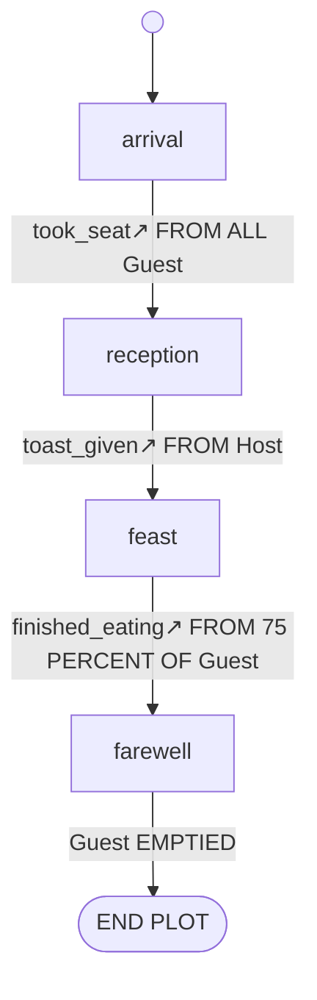
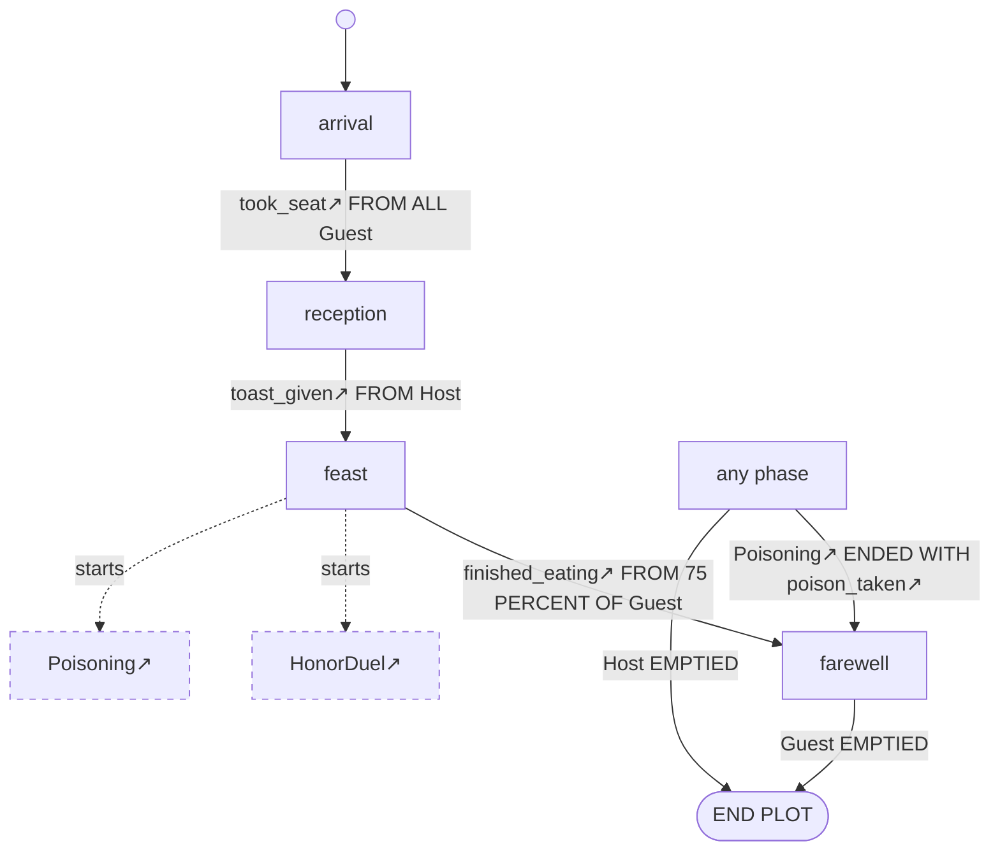
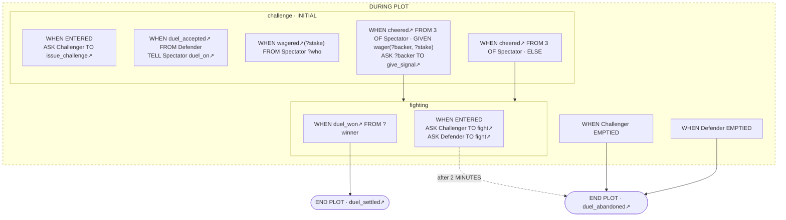

How the banquet moves from `arrival` to `farewell` is written in four `TRANSITION` lines spread over a hundred lines of `royal_banquet.regia`, each inside the Plan that makes it. To see the evening as a whole we have to find them and put them side by side in our head. The Visual Editor does that for us. It opens the folder of the banquet as a Project, shows the text of a file on the left and a drawing of its Plot on the right, and keeps the two the same: an arrow drawn on the right becomes a Plan in the text, and a Plan typed on the left becomes an arrow.

This chapter is about using it: what it opens, what it draws, what we can change from the drawing, and what that does to our text. The Transpiler inside it is the one of *The Transpiler*, and the rules on Comments and Doc comments it relies on are in *Syntax*. No Visual Editor for 2.0 exists yet, so every drawing below is put together by hand from the spec.

## A Project

```
showcase/
    banquet.regin
    test.regin
    vocabulary.regia
    README.md
    playbooks/    courtesy.regia, dining.regia, … (eight files)
    plots/        honor_duel.regia, poisoning.regia, royal_banquet.regia
```

A Project is a folder opened in the Visual Editor. The editor is a web page with no server behind it, so there is nothing to install. A Project can live in two places:

| Kind | Where the files are | Browsers |
|---|---|---|
| Disk folder | a folder on our disk; edits change the real files | Chrome and Edge |
| Browser project | storage kept by the browser | all |

Both can be brought in and taken out as a `.zip`, which is how a Browser project gets to disk or into git.

The file tree on the left shows the folder, without hidden folders such as `.git` and without `build/`. The `.regia` and `.regin` files are handed to the Transpiler. `README.md` opens as plain text, and other kinds of file are listed and don't open.

- A Project is not part of the language. There is no project file, and an `IMPORT` stays relative to the file that writes it. The Project only decides which files the editor holds.
- There is no saving. An edit is written to the file after a short pause.
- A Disk folder is read again whenever the window gets the focus back, so a `git pull` or an edit made in another tool shows up. If a file changed on disk while we were typing in it, the editor asks which version to keep.
- When we rename a file or drag it to another folder in the tree, the editor rewrites every `IMPORT` that pointed at it, and the file's own Imports. Moving `vocabulary.regia` into a `shared/` folder changes the first line of eleven files in one step.

`#revise` In Firefox or Safari the banquet can't be opened where it lies. It has to be zipped, brought into the browser, and zipped out again to be committed, so the copy in git and the copy we edit are two.

Spec: chapter 24. For Imports, chapter 10.

## The split view

```
┌──────────────────┬─────────────────────────────────┬──────────────────────────────┐
│ banquet.regin    │ [royal_banquet.regia] [dining…] │ [RoyalBanquet]               │
│ test.regin       │                                 │                    Inspector │
│ vocabulary.regia │   the text                      │   the graph        Docs      │
│ playbooks/       │                                 │   of the Plot                │
│ plots/           │                                 │                              │
└──────────────────┴─────────────────────────────────┴──────────────────────────────┘
```

The middle pane has one tab per open file. The graph pane on the right follows the active tab: it draws the Plots of that file, one tab per Plot, with a side panel for the Inspector and the Docs tab. Every Plot of the showcase has a file of its own, so the graph pane never has more than one tab. A file with no Plot gives an empty pane with a short note, and a `.regin` tab gives no graph.

The text side is checked as we type. The Transpiler runs in the page, and after each change it reads the file again and reports its Diagnostics as markers in the text. A fix that the command line can only name is an action here: with `IMPORT "../vocabulary".` missing from `serving.regia`, one click on the first unknown name writes the line back.

Colour comes in two steps. Keywords, Comments, Strings, Numbers and Placeholders are coloured at once, from the letters alone. After the check, each name is coloured by what it is: an Event, a Fact, a Goal, a Playbook, a Role, a Plot. In `ASK Host TO open_feast.` we see `Host` as a Role and `open_feast` as a Goal, and a mistyped `open_fest` is neither. The editor follows the light or dark setting of the system.

`#revise` The right half of the window is empty for eleven of the fourteen files. The drawing is of a Plot, and the eight Playbooks, where every Plan of every Agent is written, have none. They are 244 lines against the Plots' 183.

Spec: chapter 24, chapter 23.

## The Phase map

`showcase/plots/royal_banquet.regia`
```regia
PHASE arrival INITIAL.
PHASE reception.
PHASE feast.
PHASE farewell.

DURING arrival:
    WHEN took_seat FROM ALL Guest:
        TRANSITION TO reception.

DURING reception:
    WHEN toast_given FROM Host:
        TRANSITION TO feast.

DURING feast:
    WHEN finished_eating FROM 75 PERCENT OF Guest:
        TRANSITION TO farewell.

DURING farewell:
    WHEN Guest EMPTIED:
        END PLOT.
```

This is the Plot cut down to the Plans that move it. The Phase map, the view the graph pane opens with, draws exactly these:



| On the drawing | Comes from |
|---|---|
| a node | a `PHASE` line |
| the start dot | `INITIAL` |
| an arrow | a Plan in a `DURING <phase>` Block that runs `TRANSITION TO`, labelled with its Trigger as written |
| ` · GIVEN …` on a label | the Context of that Plan |
| two arrows from one Plan | an `IF` whose branches go to two Phases |
| a dotted arrow | a `WHEN ENTERED` Plan that transitions: `after 2 MINUTES` if a `WAIT` comes first, `on entry` if not |
| an `END PLOT` node | one per Outcome, and a plain one for a bare `END PLOT` |

We never arrange the drawing. It is laid out from top to bottom after every change, and nothing about it is stored, in the source or anywhere else. We can pan and zoom.

The `↗` after a name is an import mark: the name is declared in a file that this one imports. `took_seat` comes from `vocabulary.regia`. A name reached only through another file's Imports gets `↗↗` and a dashed underline, and hovering either one shows its kind, its file and the chain of Imports that leads there. A name declared in the file itself, such as `Guest`, is plain.

A Plot with no Phases, such as `Poisoning`, is one unnamed node with the start dot and its endings.

`#revise` The drawing above leaves out the second way into `farewell` and the second ending. `WHEN Poisoning ENDED WITH poison_taken: TRANSITION TO farewell.` and `WHEN Host EMPTIED: END PLOT.` are in `DURING PLOT`, and Plans of `DURING PLOT` are drawn only when a Layer is turned on. By default we see only the evening on which nothing goes wrong.

`#revise` In `HonorDuel`, three cheers move the duel to `fighting`, through a `GIVEN` and an `ELSE` that differ only in an `ASK`. They are two Plans, so the map draws two arrows from `challenge` to `fighting`, one of them carrying `cheered FROM 3 OF Spectator · GIVEN wager(?backer, ?stake)`, the longest label on the drawing. The `ASK` that tells them apart is not drawn.

`#revise` With one shared Vocabulary file, every Event, Goal and Playbook in every label of the three Plots carries `↗`. A mark that is on everything tells us nothing, and the showcase has no `↗↗`, the one that warns of a name that may break.

Spec: chapter 25.

## Layers

A Layer is a kind of detail the Phase map can show or hide, with a switch in the pane's toolbar.

| Layer | Adds | On `RoyalBanquet` |
|---|---|---|
| DURING PLOT | an "any phase" node, with the arrows of the `DURING PLOT` Plans that transition or end the Plot | the poison's way to `farewell`, and `Host EMPTIED` to `END PLOT` |
| Entry and exit | on each Phase, the Custom Actions and `WAIT` of its `ENTERED` and `EXITED` Plans | `open_doors` on `arrival`, `WAIT 2 MINUTES` on `reception`, `clear_tables` on `feast` |
| Givings | on each Phase, a `+` line per `ASSIGN` and a `−` line per `UNASSIGN` | `+ Dining` and `+ Serving` on `feast`, three `−` lines on `farewell` |
| Messages | on each Phase, its `TELL` and `ASK` lines | `ASK Host TO open_feast` on `reception` |
| Subplots | a dashed node per Subplot, with a dashed "starts" arrow from the Phase that starts it | `HonorDuel` and `Poisoning`, both from `feast` |
| Roles | a box with the Plot's Roles and their Role setups | the four Roles |
| Plain comments | on each Phase, the Comments that belong to its Plans | `# however the feast ends: …` on `feast` |

With the first and the fifth turned on, the banquet reads like this:



Every Layer is off when we first open a Plot. The editor remembers which ones we turned on, for us and not for the Project: a colleague who opens the same folder starts from the bare map.

The two "starts" arrows look the same. `Poisoning` is started once, when the feast begins, and `HonorDuel` at every insult, as many Stagings as there are quarrels. The Phase map draws from the Phase, so the difference is not on it.

`#revise` Some of what a Director does is on no Layer. `END SUBPLOT HonorDuel.` in `farewell` has no mark: a Subplot has an arrow for its start and none for its end. A `LEARN` of the Director's own Facts, such as `HonorDuel` keeping each `wager`, is not among the things drawn. And the Layers for Givings and Messages write on Phase nodes, so `ASSIGN Keeping_watch TO ?winner.` in `DURING PLOT`, the reason for the Plot's first `PRECEDENCE` line, has no node to be written on.

Spec: chapter 25.

## The Nested Plans view

A switch in the toolbar changes the Phase map for the second view, which draws every Plan. Here is `HonorDuel`:



- A dashed `DURING PLOT` frame holds the `DURING PLOT` Plans and a box per Phase. A Plot with no Phases is the frame alone.
- Each Plan is a card: its Trigger, then a summary of its Body as Custom Actions, Givings, Messages and `START SUBPLOT` lines.
- `TRANSITION` and `END PLOT` are not lines on the card. They are the arrows that leave it, dotted for a timeout as in the Phase map.
- A Subplot is a closed node with a "starts" arrow from the Plan that starts it. Opening it draws the Subplot's own Phase map inside, read-only. To change `HonorDuel` from `RoyalBanquet`'s drawing we choose "Open HonorDuel", which takes us to its file and its own tab.
- This view has two Layers: Plans without a way out, which is on to begin with and can be turned off to leave only the cards with an arrow, and Plain comments.

`#revise` The card of `WHEN wagered(?stake) FROM Spectator ?who` is a Trigger with nothing under it. Its whole Body is `LEARN wager(?who, ?stake).`, and a `LEARN` is not one of the things a card sums up. Two cards below, a Pick chooses among those `wager` Facts.

`#revise` Roles are a Layer of the Phase map and have no place in this view. The view that shows every Plan of `HonorDuel` doesn't show that both duellists start with `Duelling`, each with the other as `opponent`.

Spec: chapter 25.

## Selecting, and the Inspector

Clicking a node, a card or the label of an arrow selects it and brings its text into view on the left. It works the other way too: when the text cursor moves into a construct, the drawing selects it. A click on the empty canvas clears the selection.

The Inspector, in the side panel, describes what is selected. For the `feast` node:

```
Phase · RoyalBanquet/feast · plots/royal_banquet.regia:34

Plans
    WHEN ENTERED
    WHEN insult_thrown(?offender) FROM Guest ?offended
    WHEN finished_eating FROM 75 PERCENT OF Guest
    WHEN EXITED

Names used
    Dining            Playbook    ↗ playbooks/dining.regia
    Serving           Playbook    ↗ playbooks/serving.regia
    have_dinner       Goal        ↗ vocabulary.regia
    Poisoning         Plot        ↗ plots/poisoning.regia
    HonorDuel         Plot        ↗ plots/honor_duel.regia
    insult_thrown     Event       ↗ vocabulary.regia
    Guest             Role        this file
    …

[Rename] [Delete] [Set as initial] [+ Plan] [+ Transition]
```

The arrangement is ours. The spec fixes what is there: the kind of the selection, its key and its place in the file, its Doc comments, its Body or its Plans, every name it uses with its kind and where it comes from, and a button for each edit that applies. With nothing selected the Inspector shows the Plot: its Doc comments, its `PRECEDENCE` relations and a "+ Phase" button.

The key, `RoyalBanquet/feast`, is how the editor finds a construct again after the text has changed. It is built from the names around the construct each time the file is read, and nothing is kept between two readings. A Plan's key continues with its Trigger, as in `RoyalBanquet/feast/WHEN insult_thrown#0`.

Whatever the Phase map and its Layers don't draw about a Phase is read here, one selection at a time.

Spec: chapter 25. For keys, chapter 22.

## Editing from the graph

We double-click the empty canvas of `RoyalBanquet` and type `dancing`.

```regia
PHASE arrival INITIAL.
PHASE reception.
PHASE feast.
PHASE farewell.
PHASE dancing
```

A `PHASE` line is added after the last one. The new node has no arrow into it and no `DURING` Block yet.

The drawing was not changed by our double-click. The editor asked the Transpiler what adding a Phase means for the text, got back "insert this line here", changed the text, read the file again and drew the Plot from what it read. Every edit takes this road, and the text is the only thing that is ever edited. What we type on the left joins the same road at "read the file again".

| We want to | We do it | The text changes by |
|---|---|---|
| add a Phase | "+ Phase", or a double-click on the canvas | a `PHASE` line after the last |
| rename something | Inspector | every reference to it, in every file |
| delete something | Inspector | its Extent (below) |
| make a Phase the first | Inspector | `INITIAL` moving to its line |
| add a transition | drag from a Phase to a Phase | a Plan (next section) |
| send a transition elsewhere | drag its arrowhead to another Phase | that Plan's `TRANSITION TO` line |
| remove a transition | Inspector | the `TRANSITION` line, or the Plan if that was all of it |
| change a Trigger | Inspector | the Plan's `WHEN` line |
| add a Plan to a Phase | Inspector | a Plan at the end of the `DURING` Block, which is made if missing |
| delete a Plan | Inspector | its Extent |

- The three gestures on the canvas work in the Phase map only. In the Nested Plans view we edit through the Inspector.
- Text that an edit doesn't touch stays as we wrote it, to the byte. New lines come in the editor's own style: one Statement per line, indented like their neighbours, with no `.` at the end.
- One action is one step of undo. Undo belongs to a file, though. Renaming `HonorDuel` changes one line in `honor_duel.regia` and five in `royal_banquet.regia`, and the editor shows a notice with an "Undo all" for the pair.
- A construct with a syntax error inside it is drawn and can't be edited from the drawing until the text is mended.
- Nothing else is edited from the drawing in the spec as it stands: no Giving, no Message, no Role setup, no `PRECEDENCE` line, no Body. More operations are to be added as the editor is built.

`#revise` After the rename, the Doc comment of `RoyalBanquet` still says "HonorDuel and Poisoning are started during the feast", and the file is still `honor_duel.regia`. A rename follows references, and neither of these is one.

`#revise` Once the "Undo all" notice is gone, undo in one tab takes back that file's half of the rename and leaves the other. The Program is then broken in a way no single edit of ours made.

Spec: chapter 22, chapter 25. ADR 0011.

## Drawing a transition

We want the evening to be called off during `reception`, and drag from `reception` to `farewell`. A Trigger picker opens, with:

- the Events declared in this file, of which `royal_banquet.regia` has none;
- the Events it reaches through Imports, each with its mark and file: all twenty-six of `vocabulary.regia`;
- `WHEN ENTERED` with a `WAIT`, for a timeout;
- the endings of the Subplots this Plot starts, `WHEN HonorDuel ENDED` and `WHEN Poisoning ENDED`;
- the cast changes, such as `WHEN Guest LEFT`;
- a new Event, by name.

We type a new one, `feast_cancelled`.

```regia
DURING reception:
    WHEN ENTERED:
        ASSIGN NobleSocializing TO Guest, MAPPING Guest TO peer.
        WAIT 2 MINUTES.
        ASK Host TO open_feast.

    WHEN toast_given FROM Host:
        TRANSITION TO feast.
    WHEN feast_cancelled:
        TRANSITION TO farewell
```

The Plan goes at the end of the Phase's `DURING` Block. Had the Phase already had a Plan for the same Trigger, one that neither transitions nor ends the Plot, the `TRANSITION` would have been added at the end of its Body. If that Plan already goes somewhere, or the Trigger has `GIVEN` Blocks under it, the editor changes nothing, says why, and leaves it to us and the text.

The new Event needs a declaration, and the picker asks where to put it:

| Choice | The `EVENT` line goes |
|---|---|
| this file, which is the default | after the last `EVENT` of `royal_banquet.regia`, or under its Imports, since it has none |
| the Plot's Local Vocabulary | at the top of `RoyalBanquet` |
| another file that already declares Events we use | in `vocabulary.regia`, with an `IMPORT` added if we didn't reach it |

`#revise` Only the third choice gives an Event that anyone can send. `feast_cancelled` would be a Signal from the Host, written in `Courtesy`, and `courtesy.regia` can't see a name declared in the Plot's file: the Plot imports the Playbook, and the other way round would be a loop. The default puts the declaration where no Playbook of the banquet reaches it. The second choice is refused by the language itself, which keeps `EVENT` lines out of Plots.

`#revise` Not one of the banquet's three arrows could have been drawn this way. They are `FROM ALL Guest`, `FROM Host` and `FROM 75 PERCENT OF Guest`, and the picker offers Events, with no Sender and no quantity. What we get is `WHEN feast_cancelled:`, which any Agent of any Role sets off. The `FROM Host` is added afterwards, in the Inspector or in the text.

`#revise` In `vocabulary.regia` the new line would follow the last `EVENT`, which is `poisoner_caught(person), poison_taken`, under the heading `# ── Outcomes of the Subplots ──`. The heading for Signals is two groups above. The order of that file is kept by hand and by Comments, and the editor can't know it.

Spec: chapter 25. For where an `EVENT` may stand, chapter 10.

## Extents

`showcase/plots/royal_banquet.regia`
```regia
WHEN finished_eating FROM 75 PERCENT OF Guest:
    TRANSITION TO farewell.

WHEN EXITED:                         # however the feast ends: the Quota above, or the poison
    DO clear_tables.
```

When we delete a Plan from the Inspector, its Comments have to go with it and its neighbours' have to stay. The Extent of a construct is the construct with the Comments that belong to it, and belonging is decided by position alone:

1. Comment lines directly above a construct, with no blank line between, belong to it. This is the rule that attaches Doc comments.
2. A Comment after it on the same line belongs to it.
3. Comment lines at the end of a Block, indented like its lines, belong to the Block.
4. A Comment with a blank line between it and every construct belongs to nothing. It stays where it is, whatever is deleted around it.

Deleting `WHEN EXITED` takes its Comment along. Deleting the Quota's Plan takes two lines and leaves a Comment that speaks of "the Quota above". Position is all the editor goes by, so what a Comment says about its neighbours is ours to keep true.

A bigger deletion shows what an Extent can hold. We select `reception` and press Delete:

- `PHASE reception.` goes, and so does the whole `DURING reception:` Block.
- `TRANSITION TO reception.` in `arrival` stays. It is now an error, and the map draws its arrow to a placeholder node marked as one.
- With the Block went `ASSIGN NobleSocializing TO Guest` and `ASK Host TO open_feast.` Unless the Layers for Givings and Messages were on, the node we deleted was a box with a name in it.

`#revise` Deleting a Phase from the drawing deletes Plans that the drawing didn't show. `farewell` still takes `NobleSocializing` away from Guests who are now never given it, and nothing on the map changes to say so.

`#revise` The spec gives careful rules for moving an Extent, down to how its lines are indented again, and its list of operations has none that moves anything. For now an Extent is what a deletion removes and what the Plain comments Layer shows.

Spec: chapter 22.

## The Docs tab

`showcase/plots/royal_banquet.regia`
```regia
#@version: 2.0
#@desc[
    One evening at court, from the Guests arriving to the last one taking leave.
    HonorDuel and Poisoning are started during the feast, as its Subplots.
]#
PLOT RoyalBanquet:
```

Doc comments are never drawn on the canvas. They show in the Inspector, for the selected declaration, and in the Docs tab beside it, which is a page about the current Plot:

```
RoyalBanquet                                                    version 2.0

One evening at court, from the Guests arriving to the last one taking leave.
HonorDuel and Poisoning are started during the feast, as its Subplots.

Roles
    Host       starts with  ASSIGN Courtesy, MAPPING Host TO host.
                            PURSUE take_seat.
    Guest      starts with  …
    Servant    starts with  …
    Guard      starts with  …

Phases
    arrival (initial)    to reception   on took_seat FROM ALL Guest
    reception            to feast       on toast_given FROM Host
    feast                to farewell    on finished_eating FROM 75 PERCENT OF Guest
    farewell             END PLOT       on Guest EMPTIED
```

Again the arrangement is ours. The page holds the Plot's `desc` and `version`, its Roles with their descriptions and Role setups, and its Phases with their descriptions, transitions and endings. It is made again whenever the text changes, and we can't edit it. The descriptions of the Roles and Phases are missing above because the showcase has none.

`#revise` The page is about a Plot, and most of the showcase's Doc comments are elsewhere. Each of the eight Playbooks has a `#@desc`, and a Playbook's file has no drawing and so no Docs tab. `vocabulary.regia` has eleven, among them the only record of which Actions the game can refuse. The Inspector's table gives a name's kind and file, and the tooltip on an import mark adds the chain of Imports, and neither is said to show the description. `#@desc: Refused once the kitchen has run out of the dish.` is read in `vocabulary.regia` or not at all.

`#revise` Like the default Phase map, the page lists what Phases do. Whether the poison's way to `farewell`, a `DURING PLOT` Plan, is on it is not said.

Spec: chapter 25. For Doc comments, chapter 02.

## How this combines with…

### Syntax

The showcase ends every Statement with a `.`, and the editor writes its lines without one, as in `PHASE dancing` and `TRANSITION TO farewell` above. A file edited from both sides ends up mixed. When an edit adds to an Inline block, the smallest one around the new line is first opened into indented lines, and the rest of the line is left alone. (*Syntax*)

### Vocabulary

The Trigger picker lists the banquet's twenty-six Events together. `greeting` is said by one Agent to another, `idle` comes from the game, `duel_settled` is an Outcome that only makes sense after `HonorDuel ENDED WITH`, and `took_seat` is a Signal. The `EVENT` line doesn't say which is which, so the picker can't either, and all of them are offered as the Trigger of a transition. The colours have the same limit with Values: `kitchen` in `DO walk_to(kitchen).` is declared nowhere and has no kind, and neither has `kitchn`. (*Vocabulary*)

### Playbooks and Roles

A Playbook reaches the drawing as a line of the Givings Layer, `+ Dining`. The arrow out of `arrival` says `took_seat FROM ALL Guest` and can't say that `took_seat` is signalled by `Courtesy`, in two of its Plans. Which Playbook sends what to which Director is what we most need a picture of, and it is in the text of two files. (*Playbooks and Roles*, *Messages*)

### Precedence and Labels

With nothing selected, the Inspector lists the Plot's `PRECEDENCE` relations as they are written. They are not drawn and can't be edited from the graph. `#revise` The editor checks the Program at every change and holds the same Model the command line works on, and the conflict report, the one view that says which Plan wins for each Role and Trigger, is not among its panels. (*Precedence and Labels*, *The Transpiler*)

### Quotas and Cast Changes

A Quota is part of the label, as written. The picker can make a cast change Trigger, such as `WHEN Guest EMPTIED`, and no Quota. (*Quotas and Cast Changes*)

### Subplots and Stagings

The graph draws a Plot, and the editor has no view of a run or of its Stagings: two duels fought at once are one `HonorDuel` node. The way back from a Subplot is mostly out of sight too. Of the four `ENDED` Plans of `RoyalBanquet`, the Phase map can show the one that transitions, under the `DURING PLOT` Layer. The other three are cards in the Nested Plans view. (*Subplots and Stagings*)

### Instancing

A `.regin` file is edited as text, with the same colours and Diagnostics, and has no drawing. Instancing comments are text as well. A form for Agent kinds, counts and Propensity values is left for later. (*Instancing*)

### The Transpiler

The Build menu lists the Project's Entry files: every `.regin`, and every `.regia` that no `.regin` reaches. For the banquet these are `banquet.regin` and `test.regin`, and each `.regin` tab also has a Build button. A Build is made only when there are no errors. In a Disk folder it is written to `build/banquet/`, which is emptied first, and in a Browser project it is downloaded as `banquet.zip`.

The editor stops there, as the command line does. It doesn't start a run or show a Trace, and `build/`, where a run leaves its Traces, is the one folder the file tree hides.

`#revise` `royal_banquet.regia` belongs to two Programs, one for each `.regin`. A check that depends on the cast, such as a Role nobody plays, can pass in one and fail in the other. Nothing says which Program the markers in the open file come from, or which one the graph is drawn from. (*The Transpiler*)

## Since 1.0

The 1.0 Visual Editor was also a web page with the text on one side and a state machine on the other. It sent the text to the Python Transpiler over the network and drew what came back. It showed one Plot, the first of the one file loaded into it. An edit on the drawing inserted lines into the text by line number. The primer asked for the Transpiler to run beside the editor, for files and tabs, for a way to choose what the drawing shows, and for Doc comments to be visible.

`#changes` The Transpiler runs inside the page. There is no server.

`#changes` Projects are new: a folder opened from disk or kept in the browser, a file tree, a tab per file and a graph tab per Plot.

`#changes` An edit on the drawing is an operation the Transpiler turns into text edits, from a tree that keeps Comments and spacing. Extents are new. The primer wanted the tree itself edited and printed back, which is put off.

`#changes` Layers, the Nested Plans view, the Inspector, the Docs tab and import marks are new.

`#changes` The layout is still automatic, and now nothing about the drawing is stored at all.
