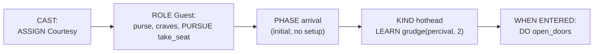

# Instancing

`RoyalBanquet` has a Role `Guest`, and its Playbooks say what a Guest does. None of them says how many Guests sit in the hall, which of them is quick to draw a sword, or that one Guest is called Sir Percival. Instancing says that. It turns a Program into a cast for one build: it names the Root Plot, says which kinds of Agent exist and how many of each start, what they start with, the seed, and settings for the Target.

| We write | It says | Where |
|---|---|---|
| `ROOT RoyalBanquet` | the Plot the story starts from | a `.regin` file, once per Build |
| `KIND noble, PLAYS Guest:` | a kind of Agent, its Roles in the Root Plot, how many start | a `.regin` file |
| `AGENT king, PLAYS Host` | one named Agent | a `.regin` file |
| `bravery AT 0.9` | a starting Propensity value | under a `KIND` or an `AGENT` |
| `LEARN grudge(percival, 2)` | a setup line: what the Agent starts with | under a `KIND` or an `AGENT` |
| `SEED 42` | the seed of every run | a `.regin` file |
| `TARGET jason:` | settings for one Target | a `.regin` file |

Every snippet in this chapter comes from `banquet.regin`, the showcase's one Instancing file, or from small throwaway `.regin` files that import it. Propensities are declared in *Vocabulary and files* and used in *Precedence and Labels*. The Root Plot's own setups are in *Plots and Directors*.

## Who says what

What a Guest has in its first moment is written in three places:

| It starts with | Written in | Because |
|---|---|---|
| `Courtesy`, a purse, two cravings, the Goal `take_seat` | `ROLE Guest:` in `RoyalBanquet` | it holds for every Guest of every cast |
| its bravery, sympathy and aggressiveness; a hothead's grudge against `percival` | `KIND noble`, `KIND hothead` in `banquet.regin` | it differs between two builds of the story, and is known before the run |
| its seat | nowhere in the Program: the game tells it (`GAME FACT … AS seat(place)`) | only the game knows where there is room |

A thing is said in the earliest layer that can know it. What holds for every cast goes in the Program, never in Instancing. What changes between builds, but is known before the run starts, goes in Instancing. What only comes up while the game runs is left to the game. The Program never names a kind or an individual Agent.

The same Fact can belong to Instancing in one game setup and to the game in another. A level that fixes the seats would have them written in `banquet.regin`; a game that hands them out tells them. Neither is an error.

Spec: chapter 21.

## Instancing files

[`banquet.regin`](../showcase/banquet.regin)
```regia
# The full banquet. The test casts the walkthrough follows import this file.
IMPORT "plots/royal_banquet"

ROOT RoyalBanquet
```

Instancing is written in `.regin` files, and only there. `banquet.regin` imports one Plot file and reaches the whole showcase through it. It is the Entry we hand to the Transpiler, and what comes out is one Build.

- A `.regin` holds `IMPORT`s and Instancing, and nothing else: no Vocabulary, no Playbook, no Plot.
- A `.regin` may import `.regia` files and other `.regin` files. A `.regia` file can't import a `.regin`: the story never depends on a cast.
- Only a `.regin` Entry can be built. A `.regia` Entry is checked without a Root Plot (*The Root Plot*, below).
- Several builds of one story are several small `.regin` files over the same `.regia` files: a two-Guest test, the full hall, a build for each Target (*Layering builds*, below).

The lines of a `.regin` follow the rules of every Regia file: indentation for Blocks, `,` between clauses, `#` comments (*Syntax*).

**Checks**

- A `.regia` file importing a `.regin` → `R2101`
- A `.regin` declaring a Vocabulary item, a Playbook or a Plot → `R2102`

Spec: chapter 21, *Instancing files*. For Entry files, chapter 10.

## The Root Plot

`ROOT RoyalBanquet` names the Plot that starts when the run does. Every other Plot is a Subplot below it, started with `START SUBPLOT`. Instancing never starts a Plot itself; a story running beside the banquet would be a Subplot the banquet starts.

- The Root Plot is named, never inferred. Nothing in `royal_banquet.regia` says it is the Root, and the file would read the same as a Subplot of a wider `Castle`.
- A Build's Entry must reach exactly one `ROOT`, even when it declares nothing else. Rank keys and Role files depend on it.
- A Plot that some `START SUBPLOT` starts can't be the Root.
- The Root Plot takes no parameters: Instancing has nothing to pass them.
- A Plot the Root Plot never reaches is compiled like the rest, and never runs.
- A `.regia` Entry has no Root Plot. `regia check playbooks/duelling.regia` runs every check that doesn't need one, and skips this chapter's checks and the ranking of Plans across Plots (*Precedence and Labels*).

**Checks**

- A `.regin` Entry that reaches no `ROOT`, or a `ROOT` naming a Plot started as a Subplot → `R2104`
- A Root Plot with parameters → `R2114`
- A Plot the Root Plot never reaches → `R2112` (warning)

Spec: chapter 21, *The Root Plot*. For Subplots, chapter 17.

## Agent kinds

[`banquet.regin`](../showcase/banquet.regin)
```regia
KIND noble, PLAYS Guest:
    COUNT 6
    bravery AT RANDOM(0.2, 0.8)
    sympathy AT RANDOM(0, 0.8)
    aggressiveness AT RANDOM(-0.4, 0.4)
```

```regia
KIND servant, PLAYS Servant:
    COUNT 3
```

A `KIND` describes a sort of Agent the game may have many of. Six nobles start as Guests, and three servants as Servants.

- `PLAYS` lists the kind's Roles in the Root Plot, with `,` between them. Roles of a Subplot can't be listed: they are filled by the Mappings of `START SUBPLOT` when a duel or a poisoning starts (*Subplots and Stagings*).
- `COUNT` is how many Agents of the kind exist when the run starts: a whole, non-negative literal. A roll, an Expression or a share of another kind is an error.
- A kind with no `COUNT` starts with none.
- The lines of the Body come in any order. A kind with nothing to set has no Body, and its header is the whole line.
- Kind names are seen by Instancing and by the game, and by nothing else. No Playbook or Plot names a kind. `Courtesy` reaches the Host the same way whether the Host is the king or any other Agent.
- The Agents of a kind are named by the Target. On Jason the servants are `servant_1`, `servant_2` and `servant_3`, numbered even when the `COUNT` is 1 (*Jason: the Build*).

Every Root Plot Role should have someone to play it. A build with no Servant gets a warning: nobody would run `Serving`, and the Guests' `ASK 1 OF waiter` would reach nobody.

> **In 2.0** the game can spawn an Agent of a kind while the run goes on, and it joins the Root Plot with the kind's Roles, its own draws of the kind's values, and the kind's setup lines. A kind with no `COUNT` is then the usual way to declare an Agent only the game brings in. Spec chapter 21, *Agent kinds*, and chapter 19, *Joining*. In 1.5 every Agent is in the starting cast, a spawn is refused, and a kind with no `COUNT` has no Agents at all.

**Checks**

- A `PLAYS` Role that isn't a Role of the Root Plot → `R2105`
- A `COUNT` that isn't a whole, non-negative literal → `R2108`
- The same name declared twice in one file → `R2109`
- A first declaration with neither `PLAYS` nor `LIKE` → `R2117`
- Roles joined with `AND` after `PLAYS` → `R2125` (hint: `PLAYS Guest, Guard`)
- A Root Plot Role that no kind and no individual Agent plays → `R2110` (warning)
- A spawn reported by the game during a 1.5 run → `T1902` (Trace warning; the Agent joins nothing)

Spec: chapter 21, *Agent kinds*. For spawning, chapter 19.

### A kind in several Roles

[`banquet.regin`](../showcase/banquet.regin)
```regia
KIND knight, PLAYS Guest, Guard:
    COUNT 1
    bravery AT 0.8
    sympathy AT 0.3
    aggressiveness AT 0.1
```

A knight is a Guest and a Guard at once. Every Agent of a kind plays every Role the kind lists, from the start. The knight gets the setups of both Roles: a purse, two cravings and `take_seat` from `Guest`, `Keeping_watch` and `on_duty` from `Guard`.

Instancing never picks. "Ten Guests, two of them also Guards" can't be written as one kind with a share; it is two kinds, each with its own `COUNT`. Picking some Agents of a Role at random is the Plot's work, with a counted Mapping such as `MAPPING 1 OF Guest AS Poisoner` (*Randomness*).

An Agent in two Roles can hold two Playbooks with Plans for the same Trigger. A knight holds `NobleSocializing` as a Guest and `Keeping_watch` as a Guard, and both have a `scandal` Plan. `RoyalBanquet` orders them with `Keeping_watch OVER NobleSocializing ON scandal`. The Plot writes that line without knowing which kinds play both Roles; the `.regin` file decides whether anyone does (*Precedence and Labels*).

Spec: chapter 21, *Agent kinds*. For the setups, chapter 16.

## Starting Propensities

[`banquet.regin`](../showcase/banquet.regin)
```regia
KIND noble, PLAYS Guest:
    COUNT 6
    bravery AT RANDOM(0.2, 0.8)
    sympathy AT RANDOM(0, 0.8)
    aggressiveness AT RANDOM(-0.4, 0.4)
```

`<propensity> AT <value>` gives an Agent a starting value for a Trait or a Mood, worded like `SUITS … AT`. Traits and Moods are written the same way. A Trait keeps its value for the whole run; a Mood starts from it and moves with every `SHIFTS` and `SHIFT`.

- The value is a literal, or `RANDOM(a, b)` with literal bounds. It lies in [0, 1] for a Trait and in [-1, 1] for a Mood: `bravery` is a Trait, `sympathy` and `aggressiveness` are Moods.
- A `RANDOM` value is drawn once for each Agent, when the Agent is created. The six nobles have six temperaments.
- A Propensity roll is always a decimal, however its bounds are written. `sympathy AT RANDOM(0, 1)` is any sympathy from 0 to 1, not one of two. This is the one place where a roll with whole bounds isn't whole (*Placeholders and Expressions*).
- A Propensity no line gives is neutral: 0.5 for a Trait, 0 for a Mood. The king and the servants give none, and they are ordinary in every way a Label can measure. There is no warning.
- Agents of one kind differ only through `RANDOM`. There is no line for "the third noble"; an Agent that differs is an individual Agent (below).

The values are what the Labels are measured against. `NobleSocializing` has a Plan for `insulted` with `SUITS aggressiveness AT 0.8, bravery AT 0.8`, and the hotheads are made to fit it.

**Checks**

- A Propensity that isn't declared as `TRAIT` or `MOOD` → `R2106`
- A value or a `RANDOM` bound that isn't a literal, or lies outside [0, 1] for a Trait or [-1, 1] for a Mood → `R2107`

Spec: chapter 21, *Agent kinds*. For Traits, Moods and the neutral value, chapter 14.

## Building on other kinds: `LIKE`

[`banquet.regin`](../showcase/banquet.regin)
```regia
KIND hothead, LIKE noble:
    COUNT 2
    bravery AT 0.9
    sympathy AT -0.4
    aggressiveness AT RANDOM(0.6, 1)
    LEARN grudge(percival, 2)                # every hothead has a score to settle with Sir Percival
```

A hothead is a noble with another temper and an old grudge. `LIKE noble` takes everything `noble` says except its `COUNT`, and the hothead's own lines replace what they write:

| Item | From `noble` | `hothead` writes | A hothead ends with |
|---|---|---|---|
| `PLAYS` | `Guest` | nothing | `Guest` |
| `COUNT` | not taken | `2` | 2 |
| `bravery` | `RANDOM(0.2, 0.8)` | `0.9` | 0.9 |
| `sympathy` | `RANDOM(0, 0.8)` | `-0.4` | -0.4 |
| `aggressiveness` | `RANDOM(-0.4, 0.4)` | `RANDOM(0.6, 1)` | a draw from 0.6 to 1 |
| setup lines | none | `LEARN grudge(percival, 2)` | the grudge |

- A kind may build on several: `KIND hot_knight, LIKE knight, hothead`. The `PLAYS` lists of the bases are joined, and so are their setup lines, in `LIKE` order. A `PLAYS` or a setup line of the kind's own replaces what it took.
- Two bases that set any other item differently are an error, unless the kind writes that item itself. `hot_knight` takes `bravery AT 0.8` from `knight` and `0.9` from `hothead`, and has to say which it wants.
- A base may build on others in turn, but a kind can't reach itself through `LIKE`.
- A first declaration needs `PLAYS` or `LIKE`, so that it plays something. `hothead` plays `Guest` through `noble`.
- `LIKE` is resolved when the Program is built. At runtime there is no trace of it: a hothead is an Agent of kind `hothead`, not also a noble.

**Checks**

- A `LIKE` naming something that isn't a kind, or a kind reaching itself → `R2119`
- Two bases setting the same item differently, with the kind not writing it → `R2120` (the message names both bases)

Spec: chapter 21, *Building on other kinds: `LIKE`*.

## Individual Agents

[`banquet.regin`](../showcase/banquet.regin)
```regia
AGENT king, PLAYS Host
```

```regia
AGENT percival, LIKE knight                  # the second knight, named so that a grudge can name him
```

An `AGENT` declares one Agent and gives it a name. It is written like a `KIND`: the same `PLAYS`, the same `LIKE`, the same Body lines, the same overriding.

- An individual Agent has no `COUNT`. It is always one Agent, in the starting cast.
- Its name is its Agent name, and the Target uses it as it is. On Jason the king is `king`, and the game's character `percival` is this Agent.
- A part only one character plays is an individual Agent: `AGENT king, PLAYS Host` says it in one line, where a kind would need a second word for the Role and a `COUNT 1`.
- `LIKE` works for an individual Agent as for a kind. `percival` takes the knight's two Roles and three values, so the hall has two knights: one `knight_1` and Sir Percival.
- The game can spawn a kind, never an individual Agent. Once Sir Percival leaves the hall, he doesn't come back.

### Instancing names

[`banquet.regin`](../showcase/banquet.regin)
```regia
    LEARN grudge(percival, 2)                # every hothead has a score to settle with Sir Percival
```

An individual Agent's name can stand as an argument in Instancing's setup lines, with no `NAME` declaration. `grudge(percival, 2)` tells each hothead a Fact whose first slot is the Agent `percival`.

- Only Instancing can write it. A `.regia` file can't name an individual Agent: the same `LEARN grudge(percival, 2)` in `ROLE Guest:` is an undeclared Name, because the story can't depend on a cast. A Plan meets `percival` at runtime, as a Name arriving in a Fact: `GIVEN grudge(?foe, ?size)` in `NobleSocializing` fills `?foe` with him.
- Kinds and individual Agents share one namespace of their own, apart from the rest of the Program. A kind `noble` and a Fact `noble` can coexist; a kind `noble` and an Agent `noble` can't.
- On Jason, an individual Agent can't be named like the Agents of a kind (`knight_2`), whatever the kind's `COUNT`.

**Checks**

- A `COUNT` in an `AGENT` → `R2118`
- A kind and an individual Agent with the same name → `R2123`
- An argument naming an individual Agent this build doesn't have → `R2122`
- An individual Agent named `<kind>_<digits>` for a kind of the Build → `R3603` (Jason)
- An individual Agent's name in a `.regia` file → `R0310` (an undeclared Name)

Spec: chapter 21, *Individual Agents*, *Instancing names*. For Jason's Agent names, chapter 36.

## Setup lines

The Body of a `KIND` or an `AGENT` may hold the three Statements of a Role setup:

| We write | The Agent starts with |
|---|---|
| `ASSIGN <Playbook>[, MAPPING …]` | a Giving of the Playbook in the Root Plot, to itself alone |
| `LEARN <fact>` | the Fact |
| `PURSUE <goal>` | the Goal, and nobody waits for it |

They follow the rules of a Role setup (*Plots and Directors*):

- The arguments are Values or Expressions, `RANDOM` included, worked out for each Agent, so a roll is made once per Agent.
- No Placeholder and no `ME`: nothing is matched, so nothing could fill them.
- `ASSIGN` takes no `TO`. Its Mappings name Roles of the Root Plot.
- A Statement that can't be carried out is skipped with a Trace entry, and the next one runs.

Everything Instancing gives is told and asked by the Root Plot's Director, as a setup is, whether or not the Fact is a `GAME FACT`. A `WHEN grudge LEARNED, FROM DIRECTOR:` Plan would fire for the hothead's grudge; a `FROM GAME` Plan would not.

### Order

When the Root Plot's Staging starts, its setups run first, for the whole starting cast: `CAST:`, then each Role in declaration order, then the initial Phase. Then, for each starting Agent, the lines of its kind, or an individual Agent's own lines. All of this comes before any entry Plan.



A kind's lines say more about one Agent than its Role's lines do, so they run later. A hothead is told its purse before its grudge, and asked to `take_seat` before either reaches the entry Plans. A `PURSUE` in a setup doesn't wait for the Goal to end.

**Checks**

- A Statement other than `ASSIGN`, `LEARN` or `PURSUE` → `R1602`
- `TO` on an `ASSIGN`, a counted target or a counted `MAPPING` → `R1603`
- A Placeholder → `R1604`
- `ME` → `R0309`
- A Statement that can't be carried out → `T1601` (Trace warning; skipped)

Spec: chapter 21, *Setup lines*. For Role setups and their order, chapter 16.

## Layering builds

A small cast for testing doesn't copy `banquet.regin`. It imports it and writes only what differs:

```regia
# small.regin
IMPORT "banquet.regin"

KIND noble:
    COUNT 2

KIND hothead:
    COUNT 0

KIND servant:
    COUNT 1

SEED 7
```

The importer overrides what it imports. A setting in a file replaces the same setting in any file it reaches, directly or through other imports. The small cast has the king, two nobles, one knight, Sir Percival and one servant, with every noble still drawing its values from `banquet.regin`'s ranges.

Overriding works item by item, and the items are single lines:

| Item | Replaced by |
|---|---|
| `ROOT` | a `ROOT` |
| `SEED` | a `SEED` |
| a Target setting | the same key under the same `TARGET` |
| a kind's or an Agent's existence | a declaration, or a `NO KIND` / `NO AGENT` |
| its `PLAYS` list, its `LIKE` list, its `COUNT` | the same line |
| each `<propensity> AT` line | the line for the same Propensity |
| its setup lines, taken together | any setup line: all of them are replaced |

- A redeclaration changes only what it writes. `KIND noble: COUNT 2` keeps the noble's Role and its three ranges. A first declaration needs `PLAYS` or `LIKE`; a redeclaration doesn't.
- Setup lines can't be told apart one by one, so a redeclaration that writes one replaces them all. A kind's setup lines can be replaced, never emptied: a later file that wants the hotheads without their grudge writes another line in its place, or removes the kind.
- Two identical settings never conflict.

### Removing: `NO KIND`, `NO AGENT`

```regia
# no_knights.regin
IMPORT "banquet.regin"

NO KIND knight
```

`NO KIND <kind>` removes a kind. It has no Agents at the start and can't be spawned. Kinds and Agents built on it with `LIKE` still take its lines, so `percival` stays a Guest and a Guard with the knight's values: `knight` is kept as a template only. `NO AGENT <name>` removes an individual Agent. An importer further up may declare either again.

Removing Sir Percival breaks the hotheads. Each one still learns `grudge(percival, 2)`, and the build has no `percival`:

```regia
# no_percival.regin
IMPORT "banquet.regin"

NO AGENT percival                            # error: the hotheads' grudge names him
```

The fix is to replace the hotheads' setup lines, or to remove the hotheads too.

### Siblings that disagree

Two files that set one item differently, neither importing the other, are in conflict as soon as a third file reaches both. Import order never decides:

```regia
# night.regin
IMPORT "small.regin"                         # noble: COUNT 2
IMPORT "crowded.regin"                       # noble: COUNT 10

KIND noble:                                  # without this, an error naming both files
    COUNT 4
```

**Checks**

- Two sibling files setting the same item differently, with no file above them settling it → `R2103`
- A `NO KIND` or `NO AGENT` naming nothing the file reaches → `R2121`
- An argument naming an individual Agent this build doesn't have → `R2122`

Spec: chapter 21, *Overriding*, *Removing a kind: `NO KIND`*.

## With no cast

```regia
# story.regin
IMPORT "plots/royal_banquet"

ROOT RoyalBanquet
```

A cast is optional; the `ROOT` isn't. A `.regin` that names the Root Plot and declares no kind and no individual Agent builds the Target code alone. On Jason that means the ASL files, and no `.jcm` to start them with. As soon as one kind or individual Agent is declared, the Build also has the instancing output: for Jason, the `.jcm` and the `cast.json` the game reads.

Checks on kinds and individual Agents run only when at least one of them exists. `story.regin` gets no warning about Roles nobody plays.

Spec: chapter 21, *With no cast*. For the Build folder, chapter 23.

## The seed

```regia
# replay.regin
IMPORT "banquet.regin"

SEED 42
```

`SEED <n>` seeds every run of the Build, so that a run can be played again. Every draw the language makes comes from it: rolls, Random choices, drawing Picks, counted parts of a Role, starting Propensity values.

- It is a whole, non-negative literal, and one item for overriding.
- A seed given when the run starts, with `regia run --seed <n>` or in a behaviour case's header, beats it.
- With neither, each run picks its own seed, and the Trace records it.

**Checks**

- A `SEED` that isn't a whole, non-negative literal → `R2108`

Spec: chapter 21, *The seed*. For what the seed covers, chapter 34; for the Randomness it drives, *Randomness*.

## Target settings

[`banquet.regin`](../showcase/banquet.regin)
```regia
TARGET jason:
    strategy most_similar                    # the default, written out
```

Which Target a Build is for is chosen outside Instancing: `regia build banquet.regin --target jason` on the command line (the default is `jason`), or the Visual Editor's project settings. A `TARGET` Block only configures a Target.

- `TARGET <name>:` groups the settings of one Target, named in lowercase as the command line writes it. A build reads its own group and skips the others, so one file can configure several Targets.
- A setting is `key value`, the shape of `SEED 42` and `COUNT 6`: a lowercase key the Target defines, then a word, a Number or a string. It is not a `LET` and fills no Placeholder.
- Each setting is one item for overriding, so `TARGET jason: base_port 9200` in a later file changes the port and keeps the `strategy`.
- Every setting has a default. Addresses, ports and Agent names never have to be written, and a `.regin` with no `TARGET` Block builds.
- How an `IF` is written in the Target's code follows from the Target, and is not a setting.

Jason knows three keys:

| Key | Default | Sets |
|---|---|---|
| `strategy` | `most_similar` | how VEsNA-Pro picks among Suits alternatives; the other value is `random` |
| `address` | `localhost` | where every body finds the game |
| `base_port` | `9080` | the game link's port; the starting Agents take the next ones |

How much of the Trace the console prints is not a setting: it is `regia run --console`.

**Checks**

- A setting written `key = value` → `R2124` (hint: `strategy most_similar`)
- An unknown key under a known Target, or a value outside the set its key takes → `R2113` (warning)
- A `TARGET` group for a Target the Transpiler doesn't know → `R2116` (warning; the group is skipped)

Spec: chapter 21, *Target settings*. For Jason's keys, chapter 36.

## How this combines with…

### Plots and Directors

The Root Plot's Director is the one that hears about the cast: it starts with every starting Agent and its Roles, and it runs the kinds' setup lines after its own Role setups. `COUNT(? PLAYS Guest)` in `RoyalBanquet` is ten in the full hall: six nobles, two hotheads, one knight and Sir Percival. The Plot never knows the number; it counts. (*Plots and Directors*)

### Subplots and Stagings

Instancing fills the Root Plot's Roles only. The Spectators, Challenger and Defender of a duel come from the Mappings of `START SUBPLOT HonorDuel(?offender)`, and the cast of Instancing reaches them through those. (*Subplots and Stagings*)

### Randomness

Instancing draws values, never Roles. A random starting Propensity is drawn once per Agent, from the run's seed, and `SEED` sits in the `.regin` beside the cast it seeds. (*Randomness*)

### Precedence and Labels

Instancing orders nothing. A kind supplies the values the Labels are measured against, and the `PRECEDENCE` Blocks of the Plots decide the rest. A kind that plays two Roles is where an order between Playbooks starts to matter. (*Precedence and Labels*)

### When an Agent leaves

In 1.5 every Agent comes from Instancing, so the starting cast is the largest the run will ever have. `AGENT king, PLAYS Host` is the only Host, and `Host EMPTIED` fires when the king leaves. (*When an Agent leaves*)

### Vocabulary and files

A `.regin` declares no Vocabulary. It uses the Propensities and the Facts of the `.regia` files it reaches. Its kinds and Agents live in a namespace of their own. (*Vocabulary and files*)

### The Transpiler and the Trace

Each `.regin` file is an Entry and gives one Build. The Trace and the behaviour cases call Agents by the names the Target gives them, `noble_1` … `noble_6`, `hothead_1`, `king`, `percival`. (*The Transpiler*, *The Trace*, *Jason: the Build*)
