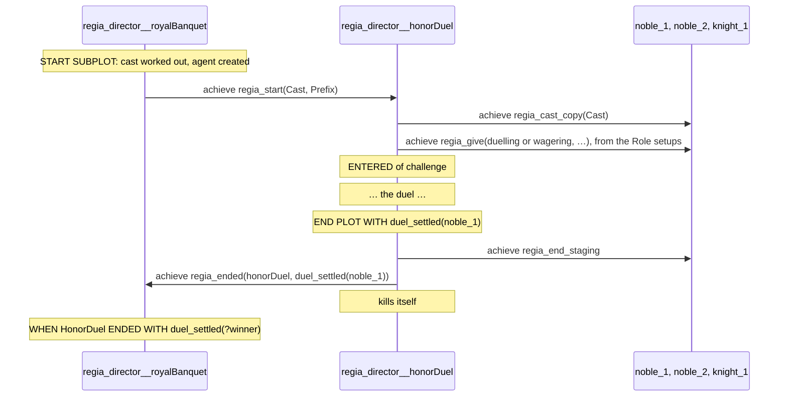
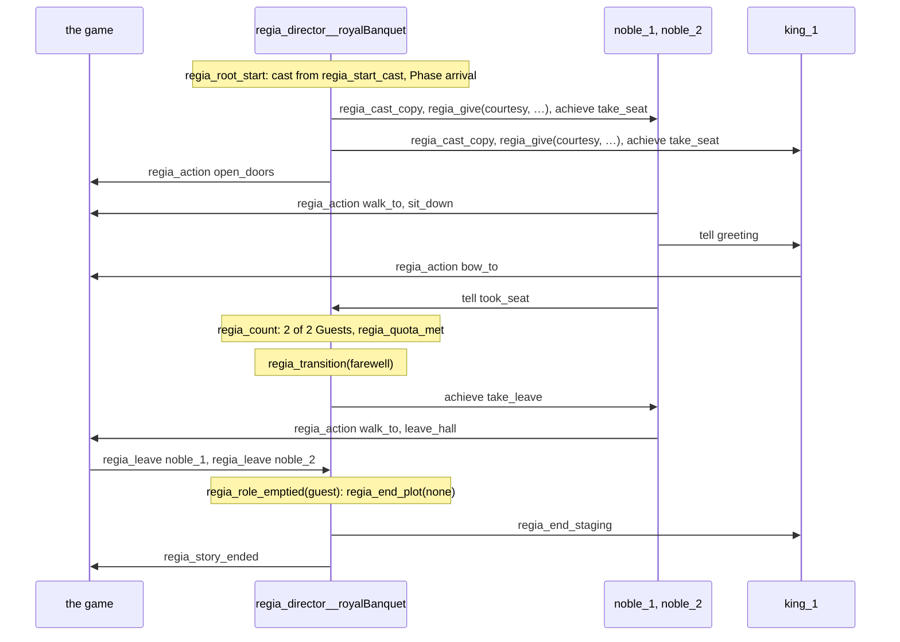

When a Guest bows back to a greeting, what runs is a Jason plan in a file called `Courtesy.asl`, made from the two lines we wrote in `Courtesy`. It runs in an agent called `noble_1`, which holds a belief saying that the Director of the banquet gave it that Playbook. This chapter puts each construct of the language next to the ASL it becomes on Jason, the one Target of 2.0, in the order the guide introduced them: a Plan, a Placeholder, a Pick, a Random choice, a Goal, a Message, a Giving, a Phase, a Subplot, a Quota Trigger, a cast change, Precedence, Instancing. It ends with a small Program and every file of its Build.

We are not meant to read the ASL of a Build, and the Trace speaks in our names (*The Transpiler*). We go through the translation anyway, because several costs of the design can be seen only in the ASL. The command that makes a Build is in *The Transpiler*, and the `.regin` files in *Instancing*.

No Transpiler exists, so every line of ASL below is put together by hand. The spec is uneven here. The code around our Plans (Givings, Directors, Stagings, ranks, Quota counts, the `.jcm`) is decided in detail, with the names used below. The translation of the Plans themselves is a set of notes at the end of the language chapters, and some of them are still open. Where the spec gives a step only in words, the snippet has a `/* … */` comment in its place.

## The files and the names

`showcase/playbooks/keeping_watch.regia`
```regia
PLAYBOOK Keeping_watch:

    WHEN scandal(?) FROM ?speaker:
        GIVEN on_duty:
            DO watch(?speaker).

    WHEN saw_pouring(?who):
        DO seize(?who).
        SIGNAL culprit_seized(?who).
```

```asl
/* Generated by the Regia Transpiler <version> from keeping_watch.regia. Do not edit. */

@regia_plan__1[regia_rank(keeping_watch, when(scandal), 0)]
+scandal(_)[source(Speaker)]
   : regia_given(keeping_watch, _, _, _, _) & on_duty
   <- regia.act(watch(Speaker)).

@regia_plan__2[regia_rank(keeping_watch, when(saw_pouring), 0)]
+hall_senses_saw_pouring(Who)
   : regia_given(keeping_watch, _, _, _, _)
   <- hall.guards.seize(Who);
      /* SIGNAL culprit_seized(Who): see A Message */.
```

This is the whole of `asl/playbooks/Keeping_watch.asl`. A Playbook file holds the plans of one Playbook and nothing else. It includes no other file. A Build has one such file per Playbook, one Director file per Plot, and one Role file per Role of the Root Plot. An agent starts from a Role file or a Director file, and that file includes the rest:

```asl
/* Generated by the Regia Transpiler <version> from royal_banquet.regia. Do not edit. */
{ include("regia/agent.asl") }
{ include("playbooks/Courtesy.asl") }
{ include("playbooks/Dining.asl") }
{ include("playbooks/Duelling.asl") }
{ include("playbooks/Keeping_watch.asl") }
{ include("playbooks/NobleSocializing.asl") }
{ include("playbooks/Scheming.asl") }
{ include("playbooks/Wagering.asl") }
regia_playbook(courtesy).
regia_playbook(dining).
/* … one per included Playbook */
```

This is `asl/roles/Guest.asl`. `regia/agent.asl` is the Infrastructure for Agents: fixed ASL, the same in every Build of every Program. The seven Playbooks are every one a Guest can be given in its lifetime, by the banquet or by a Subplot it is cast in. Only `Serving` is missing. A Subplot's Role such as `Challenger` gets no file, since no Agent starts in it.

Names are changed as little as Jason allows:

| In the source | In the ASL | Rule |
|---|---|---|
| `Keeping_watch`, `NobleSocializing`, `Guest` | `keeping_watch`, `nobleSocializing`, `guest` | our names, first letter lowercased |
| `walk_to`, `roast`, `door` | the same | |
| `saw_pouring`, declared `hall.senses.saw_pouring AS saw_pouring` | the External name | written exactly as declared |
| `stamina`, local to `Duelling` | `regia_local__duelling__stamina` | Local Vocabulary |
| anything the Transpiler adds | `regia_…`, parts joined by `__` | Generated names |
| `?speaker`, `?` | `Speaker`, `_` | Jason variables |

- A name of ours can't start with `regia_` or contain `__`, so a Generated name never meets one.
- A name that is a word of Jason's (`not`, `if`, `div`) becomes `regia_word__<name>` without telling us.
- File names keep our spelling: `Keeping_watch.asl`.

A Custom Action is where the External name matters most. `DO watch(?speaker)` becomes `regia.act(watch(Speaker))`, which sends the Action to the game and waits for its reply. `DO seize(?who)` becomes `hall.guards.seize(Who)`. A dotted name is, for Jason, a Java class of that name, so the Action is carried out by Java code inside the agent and never reaches the game.

`#revise` The showcase doesn't build. `hall.seating.seat`, `hall.needs.hungry`, `hall.social.grudge`, `hall.clock.idle` and `hall.senses.saw_pouring` are External names of Facts and Events, and Jason can't hold a dot in a belief, so each is an error for this Target. The language chapter calls External names "often dotted" for all three kinds, and the only Target accepts the dots on one. For the rest of this chapter we read those five lines with `_` in place of each dot, as in `hall_senses_saw_pouring` above.

`#revise` A dot in an Action's External name decides who carries it out. `ACTION hall.guards.seize AS seize(person)` was written as the game's name for the Action, in the same style as the Facts above it. On Jason it asks for a Java class `hall.guards.seize` that no Build contains, and nothing in the declaration says so.

`#revise` `Host`, the Plot's Role, and `host`, the Role of `Courtesy`, are both `host` in the ASL. They never sit in the same place (`bind(host, live(host))` has the Playbook's first and the Plot's second), so nothing breaks. The source needs a `MAPPING Host TO host` to tell apart two names the Build then writes alike.

Spec: chapter 28. For External names, chapter 10. For Custom Actions, chapter 37.

## A Plan

`showcase/playbooks/courtesy.regia`
```regia
WHEN greeting FROM ?who:
    DO bow_to(?who).
```

```asl
@regia_plan__3[regia_rank(courtesy, when(greeting), 0)]
+greeting[source(Who)]
   : regia_given(courtesy, _, _, _, _)
   <- regia.trace(plan, /* … */);
      regia.act(bow_to(Who)).
```

A Plan is a Jason plan. The Trigger is the triggering event, the Sender is the event's `source`, the Context is the plan's context and the Body its body. The Transpiler adds three things.

- The guard. The context starts with `regia_given(courtesy, _, _, _, _)`: the Agent holds at least one Giving of `Courtesy`. Every plan made from a Playbook starts this way. An Agent's files hold the plans of every Playbook it may ever be given, and the guard is what switches them on and off (*A Giving*, below).
- The annotation. `regia_rank(courtesy, when(greeting), 0)` names the Playbook, the Trigger's item and the Trigger Block's place among the Blocks of this Playbook with the same Trigger. It is read when several plans apply (*Precedence and Labels*, below).
- The Trace line. `regia.trace` writes the `PLAN` entry that *The Transpiler* showed. Every plan made from a Plan of ours starts with one. The snippets below leave it out.

A Trigger Block with several `GIVEN`s is one plan per `GIVEN`:

`showcase/playbooks/noble_socializing.regia`
```regia
WHEN scandal(?victim) FROM peer ?speaker:
    GIVEN grudge(?victim, ?):
        DO snigger.
    GIVEN grudge(?speaker, ?), SHIFTS sympathy BY -0.1:
        DO roll_eyes.
    # no ELSE: gossip about strangers falls through to the next Playbook
```

```asl
@regia_plan__8[regia_rank(nobleSocializing, when(scandal), 0)]
+scandal(Victim)[source(Speaker)]
   : regia_given(nobleSocializing, _, _, _, _)
     & /* Speaker is bound to peer by one of our Givings of nobleSocializing */
     & hall_social_grudge(Victim, _)
   <- regia.act(snigger).

@regia_plan__9[regia_rank(nobleSocializing, when(scandal), 0), effects([sympathy(-0.1)])]
+scandal(Victim)[source(Speaker)]
   : regia_given(nobleSocializing, _, _, _, _)
     & /* Speaker is bound to peer … */
     & hall_social_grudge(Speaker, _)
     & not hall_social_grudge(Victim, _)
   <- regia.act(roll_eyes).
```

"First match wins" can't be left to the order of the plans in the file, because the Build never relies on that order. So each plan's context also denies the Contexts of the `GIVEN`s written above it. The second plan applies when we hold a grudge against the speaker and none against the victim. An `ELSE` would be a third plan that denies both. In the denied copies a Placeholder that the Trigger didn't fill gets a new variable name, so that "no grudge against anyone" is not read as "no grudge against the one I just matched".

With no `ELSE`, a Guest who holds neither grudge has no applicable plan in `NobleSocializing`. Falling through needs no code of its own: Jason looks at the plans that apply, and this Playbook has none to offer. (*Precedence and Labels*)

An `IF` inside a Body is Jason's own `if`:

`showcase/playbooks/dining.regia`
```regia
IF COUNT(on_plate(?)) = 0:
    FAIL.
```

```asl
.count(regia_local__dining__on_plate(_), Regia__1);
if (Regia__1 == 0) { .fail };
```

`AND`, `OR` and `NOT` are `&`, `|` and `not`. An `ELSE IF` is an `elif`.

Spec: chapter 06, chapter 29. For the annotation, chapter 32.

## A Placeholder

`showcase/playbooks/wagering.regia`
```regia
WHEN duel_on FROM DIRECTOR:
    GIVEN purse(?gold) AND ?gold > 0:
        ?stake = RANDOM(1, ?gold).
        CHANGE purse(?gold) TO purse(?gold - ?stake).
        SIGNAL wagered(?stake).
        DO cheer.
        SIGNAL cheered.
    ELSE:
        DO cheer.
        SIGNAL cheered.
```

```asl
@regia_plan__1[regia_rank(wagering, when(duel_on), 0)]
+duel_on[source(D)]
   : regia_given(wagering, D, _, _, _) & purse(Gold) & Gold > 0
   <- Stake = /* a whole number from 1 to Gold */;
      Regia__1 = Gold - Stake;
      -purse(Gold); +purse(Regia__1);
      /* SIGNAL wagered(Stake) */;
      regia.act(cheer);
      /* SIGNAL cheered */.

@regia_plan__2[regia_rank(wagering, when(duel_on), 0)]
+duel_on[source(D)]
   : regia_given(wagering, D, _, _, _) & not (purse(Gold_1) & Gold_1 > 0)
   <- regia.act(cheer);
      /* SIGNAL cheered */.
```

A Placeholder is a Jason variable. Filling one is unification, in the context or against the triggering event, and `?stake = …` is a `=` in the body. Jason keeps a variable for the rest of the plan once it is bound, in an `if` as well. The rules of *Placeholders and Expressions* on where a name can be used are checked by the Transpiler, and they are strict enough that the ASL needs no renaming to keep them.

- `FROM DIRECTOR` costs nothing extra. The Sender `D` goes into the guard: we hold a Giving of `Wagering` from `D`. A Director whose Plot didn't give us this Playbook doesn't match, and the Playbook never names a Plot.
- `CHANGE` is a test that the old Fact is known, then a removal and an addition. The new value is worked out first, since Jason would otherwise store the sum unevaluated.
- `LEARN` is `+f` and `FORGET` is `-f` for every source, each guarded so that nothing happens, and no `LEARNED` or `FORGOTTEN` Plan runs, when nothing changes.
- The `ELSE` plan denies the Context with `Gold_1`, the new name described above.
- Arithmetic that goes wrong (a name where a Number is wanted) makes Jason's own arithmetic fail, and that is the Plan's Failure.

Spec: chapter 03, chapter 04, chapter 08. For `FROM DIRECTOR`, chapter 31.

## A Pick, a `FOR EACH` and a `COUNT`

`showcase/playbooks/noble_socializing.regia`
```regia
TO vent:
    GIVEN grudge(?foe, ?size), HIGHEST ?size, AT RANDOM:
        DO sneer_at(?foe).
        TELL ?foe insulted.
        TELL peer scandal(?foe).
```

```asl
@regia_plan__2[regia_rank(nobleSocializing, to(vent), 0)]
+!vent
   : regia_given(nobleSocializing, _, _, _, _)
     & .setof(m(F, S), hall_social_grudge(F, S), Regia__all)
     & /* keep the Matches whose S is a Number; Regia__max is the largest S */
     & .setof(m(F, Regia__max), .member(m(F, Regia__max), Regia__all), Regia__tied)
     & .length(Regia__tied, Regia__n) & Regia__n > 0
     & .nth(math.floor(math.random(Regia__n)), Regia__tied, m(Foe, Size))
   <- regia.act(sneer_at(Foe));
      /* the two TELLs: see A Message */.
```

With no Pick, the context is the plain condition and Jason uses the first Match it finds. That is the "we don't say which" of *Matching*. A Pick collects every Match into a list first. `.setof` drops duplicates, `HIGHEST` keeps the Matches with the largest value, and `AT RANDOM` takes one of what is left by its index.

`FOR EACH` takes the same list and goes through it, which is why its rounds are fixed when the Body reaches it. `COUNT` is `.count` for a single Fact, as in the `IF` above, and the length of the list for anything longer.

```asl
// FOR EACH stamina(?old): FORGET stamina(?old).
.setof(m(Old), regia_local__duelling__stamina(Old), Regia__2);
for (.member(m(Old), Regia__2)) { -regia_local__duelling__stamina(Old) };
```

A plain condition costs one lookup. A Pick, a `FOR EACH` and a `COUNT` each build a list of every matching Fact whenever they are reached. `WHEN idle` in `NobleSocializing` counts the grudges each time the game finds the Guest idle.

Spec: chapter 26.

## A Random choice

`showcase/playbooks/noble_socializing.regia`
```regia
WHEN idle:
    ?grudges = COUNT(grudge(?, ?)).
    EITHER, WEIGHT 3: DO chat.
    OR: DO sip_wine.
    OR, WEIGHT ?grudges: PURSUE vent.
```

```asl
@regia_plan__1[regia_rank(nobleSocializing, when(idle), 0)]
+hall_clock_idle
   : regia_given(nobleSocializing, _, _, _, _)
   <- .count(hall_social_grudge(_, _), Grudges);
      Regia__w3 = math.max(0, Grudges);          // a negative Weight counts as 0, with a Trace warning
      Regia__t = 3 + 1 + Regia__w3;
      Regia__r = math.random(Regia__t);
      if (Regia__r < 3) { regia.act(chat) }
      elif (Regia__r < 4) { regia.act(sip_wine) }
      else { !vent }.
```

The Weights are added up, one number is rolled between 0 and the total, and an `if` chain finds the Option it falls in. Fixed Weights are folded into the code, as 3 and 1 are here, and only the Weight that is an Expression is worked out and clamped at run time. The spec's template also wraps the chain in a test that the total is above 0, with the warning of *Randomness* in its `else`. Here the total is at least 4 and the sketch leaves the test out.

A `RANDOM(a, b)` in a Body, such as the stake in `Wagering` or the `WAIT RANDOM(1, 3) SECONDS` in `Duelling`, is a roll of the same kind, made whole when both bounds are whole. The spec gives no ASL for it, which is why the stake above is a comment.

Spec: chapter 09. For the seed, chapter 35.

## A Goal

`showcase/playbooks/serving.regia`
```regia
TO bring(?dish, ?place) FROM patron ?guest:
    PURSUE fetch(?dish, ?place).
    DO walk_to(?place).
    DO put_down(?dish).
    TELL ?guest served(?dish).

TO fetch(?dish, ?):
    DO walk_to(kitchen).
    DO pick_up(?dish).

WHEN bring(?dish, ?) FAILED FROM patron ?guest:
    TELL ?guest sold_out(?dish).
```

```asl
@regia_plan__1[regia_rank(serving, to(bring), 0)]
+!bring(Dish, Place)[source(Guest)]
   : regia_given(serving, _, _, _, _) & /* Guest is bound to patron … */
   <- !regia_local__serving__fetch(Dish, Place);     /* or wait, if it is already pursued */
      regia.act(walk_to(Place));
      regia.act(put_down(Dish));
      regia.send(Guest, tell, served(Dish)).

@regia_plan__2[regia_rank(serving, to(fetch), 0)]
+!regia_local__serving__fetch(Dish, _)
   : regia_given(serving, _, _, _, _)
   <- regia.act(walk_to(kitchen));
      regia.act(pick_up(Dish)).

@regia_plan__3[regia_rank(serving, failed(bring), 0)]
-!bring(Dish, _)[source(Guest)]
   : regia_given(serving, _, _, _, _) & /* Guest is bound to patron … */
   <- regia.send(Guest, tell, sold_out(Dish));
      /* the FAILURE entry of the Trace */;
      .fail.
```

A Goal is a Jason achievement goal and a recipe is a plan for `+!g`. Much of *Goals and Failure* is Jason's own behaviour.

| We write | ASL |
|---|---|
| `TO g:` | a plan for `+!g` |
| `PURSUE g.` | `!g`: the Body waits, and fails if `g` fails |
| `PURSUE g, WITHOUT WAITING.` | `!!g`: a new intention, whose Failure never reaches us |
| `DROP g.` | `.drop_desire(g)`, then the `DROPPED` event, which Jason doesn't have and the Build raises itself |
| `FAIL.` | `.fail` |
| `WAIT 1 MINUTE.` | `regia.wait(60000)` |
| `WHEN g FAILED:` | part of the plan for `-!g` |
| a Goal with no recipe that applies | Jason fails `!g` by itself |

Two things are added to Jason.

A Failure has to climb one level at a time, with a `FAILED` Trigger at each. In Jason a failed goal with no `-!g` plan drops the whole intention at once and the levels above hear nothing. So the Transpiler writes a `-!g` plan for every declared Goal, whether or not we wrote a `FAILED` Plan. It runs ours if there is one, writes the Trace entry, and fails again with `.fail`, so that the Goal above gets its own `-!` in turn. That is why the Plan above ends in `.fail` though we wrote no `FAIL`: a `FAILED` Plan is told of the Failure and doesn't mend it.

A Goal pursued twice is one pursuit. `!g` in Jason would start a second. The waiting form first asks whether `g` is already wanted and, if so, waits for that pursuit to end and takes its result.

When `pick_up` is refused, `regia.act` fails, the `fetch` plan fails, its `-!` plan passes the Failure on, `bring` fails at its first line, and `-!bring` tells the Guest `sold_out`.

Spec: chapter 08, chapter 11. For `WAIT`, chapter 12 and chapter 35.

## A Message

`showcase/playbooks/courtesy.regia`
```regia
TO take_seat FROM DIRECTOR:
    GIVEN seat(?place):
        DO walk_to(?place).
        DO sit_down.
        TELL host greeting.
        SIGNAL took_seat.
```

```asl
@regia_plan__1[regia_rank(courtesy, to(take_seat), 0)]
+!take_seat[source(D)]
   : regia_given(courtesy, D, _, _, _) & hall_seating_seat(Place)
   <- regia.act(walk_to(Place));
      regia.act(sit_down);
      /* for each A bound to host by a Giving of courtesy, except us: */
          regia.send(A, tell, greeting);
      /* for each distinct D2 with regia_given(courtesy, D2, _, _, _): */
          regia.send(D2, tell, took_seat).
```

Every Message is a Jason message.

| We write | Sent |
|---|---|
| `TELL ?foe insulted.` | `tell insulted` to that agent |
| `TELL peer scandal(?foe).` | the same `tell`, once per Agent bound to `peer` |
| `ASK waiter TO bring(?wish, ?place).` | `achieve bring(…)`, once per Agent bound to `waiter` |
| `SIGNAL took_seat.` | `took_seat` to the Director of each Giving of this Playbook |
| `TELL EVERYONE f.` | one `.broadcast` of a wrapped message that Agents unwrap and Directors ignore |
| `TELL Spectator duel_on.`, in a Plot | `tell duel_on` to each Agent the Director has in `spectator` |

On the other side, `tell` arrives as `+greeting[source(Who)]` and `achieve` as `+!bring(…)[source(Guest)]`. The `source` is what `FROM` reads. `FROM ?who` binds it, `FROM peer ?who` also tests it against the Agents bound to `peer`, and `FROM DIRECTOR` tests it against the Givings.

- No send uses Jason's `.send`. Jason throws when the receiver doesn't exist, which would fail our Plan. `regia.send` does the same job, catches that case, writes a Trace entry and carries on. That is the dropped Message of *Quotas and Cast Changes*.
- A Role recipient is worked out when the Statement runs, from the Agent's own record. Nobody is asked who plays the Role, and the Message goes straight from Sender to receiver, so `FROM` sees the real Sender and one Sender's Messages keep their order.
- A Signal is addressed to Directors by their agent names, which the Agent has in its Givings. A Playbook given by two Plots Signals both.
- A Fact that is told is a belief with its teller as source. `LEARNED` has to fire only when the Fact is new, so the receiving side first looks whether it was already known from anyone.

A told Fact and a told Event are the same `tell` on the wire, as they are the same `TELL` in the source (*Messages*). What makes `greeting` an Event is on the receiving side, where nothing must stay behind once the Plan has run. The spec gives two ways of getting that and doesn't choose between them.

Spec: chapter 07, chapter 29. For `regia.send`, chapter 33. For `EVERYONE`, chapter 30.

## A Giving

`showcase/plots/royal_banquet.regia`
```regia
DURING reception:
    WHEN ENTERED:
        ASSIGN NobleSocializing TO Guest, MAPPING Guest TO peer.
        WAIT 2 MINUTES.
        ASK Host TO open_feast.
```

```asl
@regia_plan__3[regia_phase(reception), regia_rank(0, 0)]
+!regia_entered(phase(reception))
   : regia_phase(reception)
   <- .my_name(Me);
      ?regia_rank_prefix(Prefix);
      .concat(Prefix, [lv(2, [when(scandal)-0]), 3], Rank);
      /* record it: +regia_standing(Seq, nobleSocializing, guest, Rank, [bind(peer, live(guest))]) */;
      for (regia_cast(Me, guest, A)) {
          regia.send(A, achieve, regia_give(nobleSocializing, role(guest), Rank, [bind(peer, live(guest))]))
      };
      regia.wait(120000);
      for (regia_cast(Me, host, A2)) { regia.send(A2, achieve, open_feast) }.
```

A Giving adds no plans to anyone. `noble_1` has had the plans of `NobleSocializing` in its files since it started, each behind its guard. The Director sends it a message, and a fixed plan in `regia/agent.asl` turns the message into one belief:

```asl
regia_given(nobleSocializing, regia_director__royalBanquet, role(guest),
            [lv(2, [when(scandal)-0]), 3], [bind(peer, live(guest))]).
```

| Argument | Here | Holds |
|---|---|---|
| Playbook | `nobleSocializing` | what was given |
| Director | `regia_director__royalBanquet` | who gave it, taken from the message's `source`. It is also the Staging |
| Target | `role(guest)` | given to a Role. `agent(noble_1)` for a Giving to `?who` |
| Rank | `[lv(2, …), 3]` | the Giving's place in the order (*Precedence and Labels*, below) |
| Bindings | `[bind(peer, live(guest))]` | one entry per Role of the Playbook |

From that belief the guard lets the Playbook's plans apply, `TELL peer …` finds its receivers, `SIGNAL` finds its Director and `selectOption` finds the rank. Since they all read the one record, they can't disagree about what the Agent holds.

`live(guest)` is a whole-Role Mapping: whoever plays `Guest` in that Staging when the Message is sent. For this, every Agent of a Staging keeps a copy of its cast, `regia_cast(Director, Role, Agent)`, which the Director sends before its first Giving and keeps up to date. A counted Mapping or a `MAPPING ?who` is `fixed([…])`, a list of Agents made once.

The other ways of giving and taking are the same two messages:

| We write | Message, and to whom |
|---|---|
| a Role setup's `ASSIGN Courtesy, MAPPING Host TO host` | `regia_give(courtesy, role(guest), Rank, [bind(host, live(host))])`, to the Agent starting or joining |
| a Role setup's `LEARN craves(roast)` and `PURSUE take_seat` | `tell craves(roast)` and `achieve take_seat` from the Director, so that `FROM DIRECTOR` matches |
| `ASSIGN Keeping_watch TO ?winner.` | `regia_give(keeping_watch, agent(noble_1), Rank, [])`, after checking that the Agent is in this Staging's cast |
| `UNASSIGN NobleSocializing FROM Guest.` | `regia_take(nobleSocializing, role(guest))`, to every Agent of the cast |

- A Role setup is a plan of the Director, `regia_setup__guest(A)`, run once for each starting Agent and again for each joiner. `LEARN purse(RANDOM(5, 20))` is therefore rolled per Agent.
- A whole-Role `ASSIGN` is also kept by the Director as `regia_standing(…)`, to be sent again to a joiner. A counted `ASSIGN`, one to `?who` and a setup's are not.
- The Director keeps no list of who holds what. `UNASSIGN` goes to the whole cast and each Agent removes what matches.
- When an Agent's last Giving of a Playbook goes, `regia.stop_playbook` stops the Playbook's running plans together with whatever they had called, and raises `DROPPED` for the Goals that stop with them. Local Facts stay as beliefs behind the guard.

`#revise` One line with a Placeholder puts a Playbook in every Role file. `ASSIGN Keeping_watch TO ?winner` could reach any Agent of the banquet as far as the Transpiler can tell, so `Host.asl` and `Servant.asl` carry the plans of `Keeping_watch` too, and every `saw_pouring` the game sends a Servant is tested against a guard that, in this story, never opens. The source can't say that `?winner` is a Guest.

`#revise` The plans of a Playbook that isn't given are still looked at for every event they name. A Guest holds the plan of `Scheming` from the first second of the evening, and every `idle` the game sends tests its guard. Each Agent pays this for every Playbook that any Agent of its Role might get, since the files are fixed when the Program is built.

Spec: chapter 29, chapter 30. For Role setup, chapter 16.

## A Phase

`showcase/plots/royal_banquet.regia`
```regia
DURING reception:
    WHEN toast_given FROM Host:
        TRANSITION TO feast.
```

```asl
@regia_plan__4[regia_phase(reception), regia_rank(0, 0)]
+toast_given[source(S)]
   : regia_phase(reception) & regia_cast(_, host, S)
   <- !regia_transition(feast).
```

A Director is a Jason agent too, running the file of its Plot, `asl/directors/RoyalBanquet.asl`, which includes `regia/director.asl`. Its Facts are its beliefs. A Director's Plan is a plan with a guard of another kind: `regia_phase(reception)`, the current Phase, held as one belief. `FROM Host` is a test of the Sender against the Director's cast.

| We write | ASL |
|---|---|
| `DURING feast:` … a Plan | a plan guarded by `regia_phase(feast)` and annotated with it |
| `DURING PLOT:` … a Plan | a plan guarded by `regia_phase(_)`: any Phase, as long as there is one |
| `WHEN ENTERED:` | a plan for the Goal `regia_entered(phase(feast))` |
| `WHEN EXITED:` | a plan for the Goal `regia_exited(phase(feast))` |
| `TRANSITION TO feast.` | `!regia_transition(feast)` |

`regia_transition` is a fixed plan of the Infrastructure, run in one piece, with no other event handled in between:

1. It stops every intention running a plan annotated with the old Phase, except the one that asked for the transition.
2. It runs the old Phase's `EXITED` Plan to its end.
3. It clears the old Phase's Quota counts and replaces `regia_phase`.
4. It posts `regia_entered` for the new Phase, which starts afterwards as an intention of its own and may `WAIT`.
5. It drops the intention that asked. That is why `TRANSITION` ends its Body.

This is the order given in *Plots and Directors*. An `ENTERED` Plan still in its `WAIT` when the Phase is left is stopped by step 1, because its plan carries the Phase in its label. `END PLOT` starts with the same two steps, and that is how the duel's two-minute timeout is stopped when a duellist wins first.

A Plot with no Phases, such as `Poisoning`, gets a hidden one, `regia_phase__plot`, so that its `DURING PLOT` plans have a Phase to be in. It is never left and never shown.

Spec: chapter 30. For the steps, chapter 20.

## A Subplot

`showcase/plots/royal_banquet.regia`
```regia
WHEN insult_thrown(?offender) FROM Guest ?offended:
    START SUBPLOT HonorDuel,
        MAPPING ?offended TO Challenger,
        MAPPING ?offender TO Defender,
        MAPPING Guest TO Spectator.
```

Every Staging is a Jason agent of its own. The banquet's Director is `regia_director__royalBanquet`, declared in the `.jcm`. A duel's Director is created while the Program runs, from `directors/HonorDuel.asl`, and Jason names it `regia_director__honorDuel`, with a number added when that name is taken. Two duels are two agents running one file. The agent's name is the Staging's identity: it is the Director column of every `regia_given` and `regia_cast`, and nothing else names a Staging.

`START SUBPLOT` is one plan of the parent, run in one piece. It works out the cast, creates the agent, sends it the game Facts its Plot hears, and sends the start:

```asl
regia.send(Child, achieve,
    regia_start([cast(challenger, noble_1), cast(defender, noble_2),
                 cast(spectator, noble_1), cast(spectator, noble_2), cast(spectator, knight_1)],
                [lv(0, [when(scandal)-1])]))
```

The second argument is the duel's place in the order under the banquet. The parent's Body carries on at once.



An ending takes one path, whoever asked for it. `END PLOT WITH duel_settled(?winner)` is `!regia_end_plot(duel_settled(Winner))`. The Director stops its Plans, runs its `EXITED` Plans, and removes `regia_phase`. From then on none of its Trigger plans applies, and it hears nothing. It ends its own children and waits for each to answer. Only then does it send `regia_end_staging` to its cast and `regia_ended` to its parent, and kill itself. Each Agent, on `regia_end_staging`, removes every Giving and the cast copy from that Director in one step.

It waits for the children so that, on an Agent cast in both, the Subplot's Givings go before the parent's. Jason gives no order between messages from two senders, so the parent has to send second.

`END SUBPLOT HonorDuel.` forgets the children and sends each `regia_end`. A child ended this way takes the same path with no Outcome, and its `regia_ended` is ignored by a parent that no longer has it on record.

`showcase/plots/royal_banquet.regia`
```regia
WHEN HonorDuel ENDED WITH duel_settled(?winner):
    ASK Host TO honour(?winner).
    ASSIGN Keeping_watch TO ?winner.
    TELL ?winner on_duty.
WHEN HonorDuel ENDED:
    DO play_music.
```

```asl
@regia_plan__12[regia_rank(1, 0)]
+!regia_subplot_ended(honorDuel, duel_settled(Winner))
   : regia_phase(_)
   <- /* ASK Host, the Giving to Winner, then: */
      regia.send(Winner, tell, on_duty).

@regia_plan__13[regia_rank(1, 1)]
+!regia_subplot_ended(honorDuel, Outcome)
   : regia_phase(_) & not Outcome = duel_settled(_)
   <- regia.act(play_music).
```

The Blocks for one ending exclude each other the way `GIVEN`s do: each denies the patterns written above it. A bare `END PLOT` arrives as the Outcome `none`.

The Root Director is the only Director connected to the game. A game Fact or Event that a Subplot's Plan names is passed down from parent to child, to the Stagings whose Plots hear it. A `DO` in a Subplot's Director goes the other way, straight to the Root, which performs it and passes the game's reply back.

Spec: chapter 31. For what a Director hears from the game, chapter 30.

## A Quota Trigger

`showcase/plots/royal_banquet.regia`
```regia
DURING arrival:
    WHEN took_seat FROM ALL Guest:
        TRANSITION TO reception.
```

```asl
regia_quota_watch(plot, took_seat, all, guest).
regia_quota_in(took_seat, all, guest, phase(arrival)).

@regia_dispatch__took_seat[atomic]
+took_seat[source(S)]
   <- !!regia_when__took_seat(S);
      !regia_count(took_seat, [], S).

-!regia_when__took_seat(_)[error(no_applicable)].
-!regia_when__took_seat(_)[error(no_relevant)].

@regia_plan__2[regia_phase(arrival), regia_rank(0, 0)]
+!regia_quota_met(plot, took_seat, all, guest, [])
   : regia_phase(arrival)
   <- !regia_transition(reception).
```

Jason runs one plan per event, and a Quota needs two things done with each Signal: the plain `WHEN took_seat` Plans, if any, and the count. So an Event that some Quota watches, anywhere in the Program, gets a dispatcher. It is the only plan for the arriving event. It first posts a Goal that stands for the plain Trigger, with the Sender as its last argument, and then counts. The plain Plans for that Event are compiled as recipes of that Goal. The two empty `-!` plans keep an Event nobody handles as silent as it is anywhere else.

`regia_count` is fixed ASL in the Infrastructure. For each watched Quota Trigger that is active, and whose Role has the Sender as a member, it adds one belief:

```asl
regia_quota(plot, took_seat, all, guest, [], noble_1).
```

An Agent that Signals twice adds the same belief twice, which is once. Then the Quota is checked: with `n` counted members out of `m`, `all` wants `n = m` and `m > 0`, `of(3)` wants `n ≥ 3`, and `percent(75)` wants `n × 100 ≥ 75 × m`. When it is met, the counts for those arguments are removed and `regia_quota_met` is posted. Our Quota Plan is a recipe for it.

- The members are read from `regia_cast` at each check, so a latecomer raises `m` without anything being counted.
- The Host Signals `took_seat` as well. The dispatcher runs, and `regia_count` finds that `king_1` is no member of `guest`.
- In a Playbook the same code runs in the Agent. The owner is the Playbook's name where a Director has `plot`, and the members are the Agents bound to the Playbook's Role, without the Agent itself.
- The counts are beliefs and the counting is ASL. Nothing of a Quota is in Java, so Jason's mind inspector shows who has been counted.

Spec: chapter 33, chapter 18. ADR 0013.

## A cast change

`showcase/plots/royal_banquet.regia`
```regia
DURING farewell:
    WHEN Guest ?late JOINED:
        ASK ?late TO take_leave.

    WHEN Guest EMPTIED:
        END PLOT.
```

```asl
@regia_plan__9[regia_phase(farewell), regia_rank(0, 0)]
+!regia_joined(guest, Late)
   : regia_phase(farewell)
   <- regia.send(Late, achieve, take_leave).

@regia_plan__10[regia_phase(farewell), regia_rank(0, 0)]
+!regia_role_emptied(guest)
   : regia_phase(farewell)
   <- !regia_end_plot(none).
```

The game reports a join and a leave to the Root Director only, as two messages on its connection. Our Plans are recipes for Goals that the Infrastructure posts at the end of what it does with each.

For a join, `{"kind": "latecomer", "name": "late_1", "port": 9107}`:

1. The report is checked. A name starting with `regia_`, an Agent already there or an unknown kind is ignored with a Trace warning.
2. `regia.spawn_agent` creates the Jason agent from what the Director knows of the kind (below, under Instancing), drawing its `RANDOM` values.
3. The Director adds it to `regia_cast` and sends `regia_cast_joined` to the rest of the cast.
4. It sends the joiner the cast copy, runs the Role setups for it, and sends again each standing Giving, in the order they were made.
5. It posts `regia_joined(guest, late_1)`.

For a leave, the Director removes the Agent from `regia_cast`, tells the rest of the cast, passes the leave to its children, removes the Agent from its Quota counts and checks them again, and then posts `regia_role_left` and, if the Role is now empty, `regia_role_emptied`. A child Director does the same walk, and stops if the Agent was never in its cast. Last, the Root kills the Jason agent.

Each remaining Agent, told `regia_cast_left`, drops the leaver from its cast copy, from its `fixed([…])` bindings and from its own Quota counts. A Message sent to the leaver in the meantime is caught by `regia.send`.

An Agent whose connection to the game closes has not left. It stays in every cast until the game reports the leave.

Spec: chapter 33, chapter 30. For the order of a join, chapter 19.

## Precedence and Labels

`showcase/playbooks/noble_socializing.regia`
```regia
WHEN insulted FROM peer ?who, SUITS aggressiveness AT 0.8 AND bravery AT 0.8:
    DO stand_up.
    SIGNAL insult_thrown(?who).

WHEN insulted FROM peer ?who,
        SUITS aggressiveness AT 0.2 AND sympathy AT -0.5,
        SHIFTS aggressiveness BY 0.3:
    DO scowl_at(?who).
    PURSUE resent(?who).
```

```asl
@regia_plan__4[regia_rank(nobleSocializing, when(insulted), 0),
               temper([aggressiveness(0.8), bravery(0.8)])]
+insulted[source(Who)] : /* guard, peer */ <- /* … */.

@regia_plan__5[regia_rank(nobleSocializing, when(insulted), 0),
               temper([aggressiveness(0.2), sympathy(-0.5)]), effects([aggressiveness(0.3)])]
+insulted[source(Who)] : /* guard, peer */ <- /* … */.
```

`SUITS` is a `temper` annotation and `SHIFTS` an `effects` one, both read by VEsNA-Pro. Suits alternatives share one position, the last argument of `regia_rank`, and their contexts don't deny each other, so that all of them are still there when the choice is made.

The order between Playbooks is worked out when the Program is built. For each Plot the Transpiler makes two tables of levels, lower first: one for the Plot's Subplots and itself, one for the Playbooks it gives. Where a relation has an `ON`, the table is worked out again for that item. For the banquet:

| | every other item | `ON scandal` |
|---|---|---|
| `HonorDuel` | 0 | 1 |
| `Poisoning` | 1 | 2 |
| `SELF` | 2 | 0 |

| `Courtesy` | `Dining` | `Keeping_watch` | `NobleSocializing` | `Serving` |
|---|---|---|---|---|
| 0 | 1 | 2 | 3 | 4 |

The first table comes from `HonorDuel OVER Poisoning`, the default that puts a Subplot over its parent, `SELF OVER Poisoning ON scandal`, and `HonorDuel`'s own `PARENT OVER SELF ON scandal` read from the banquet's side. In the second, `Keeping_watch OVER NobleSocializing ON scandal` changes nothing, since name order already says so.

A Giving's Rank is the path of levels from the Root Plot down to the Playbook. `lv(2, [when(scandal)-0])` is "level 2, but 0 for `scandal`". When `knight_1`, watching a duel, hears `scandal`, three of its Playbooks have a plan that applies:

| Playbook | Given by | Rank | For `scandal` |
|---|---|---|---|
| `Keeping_watch` | the banquet, as a Guard | `[lv(2, [when(scandal)-0]), 2]` | `[0, 2]` |
| `Keeping_watch` | `Poisoning`, as a Watchman | `[lv(1, [when(scandal)-2]), 0, 0]` | `[2, 0, 0]` |
| `NobleSocializing` | the banquet | `[lv(2, [when(scandal)-0]), 3]` | `[0, 3]` |
| `Wagering` | the duel | `[lv(0, [when(scandal)-1]), 0, 1]` | `[1, 0, 1]` |

The lists are compared number by number and the lower wins. A Playbook given twice counts with its best Giving for the item. So `Keeping_watch` runs at `[0, 2]`, ahead of `NobleSocializing` and of `Wagering`'s `hush`.

The choice is made in `selectOption`, the Java method Jason calls with the plans that apply. ASL can't make it, because a plan can't see the other candidates. The Agents' class does four things:

1. If no candidate has a `regia_rank`, they are Infrastructure plans, and Jason's own choice stands.
2. It keeps the candidates whose Playbook has the best Rank for the item.
3. Inside each Playbook it keeps the lowest position: the first Trigger Block in the text.
4. It hands what is left, sorted by Playbook name, to VEsNA-Pro, which uses the Temper if any candidate has a `temper` and takes the first if none has.

Plans whose guard or `GIVEN` fails were never candidates. That is how the knight above falls from one Playbook to the next.

A Director's plans carry `regia_rank(Level, Pos)` with both numbers fixed at build time: level 0 for a Phase's Plan and 1 for `DURING PLOT`'s. In `farewell` the `JOINED` Plan above, at `(0, 0)`, beats the one in `DURING PLOT`, at `(1, 0)`.

Spec: chapter 32. For the annotations, chapter 14.

## Instancing and the `.jcm`

`showcase/test.regin`
```regia
AGENT noble PLAYS Guest:
    COUNT 2.
    bravery AT 0.8.
    sympathy AT -0.2.
    aggressiveness AT 0.7.
```

```
/* Generated by the Regia Transpiler <version> from test.regin. Do not edit. */
mas test {

    agent regia_director__royalBanquet : directors/RoyalBanquet.asl {
        ag-class:      regia.DirectorAgent
        address:       localhost
        port:          9080
        trace_console: all
    }

    agent king_1 : roles/Host.asl {
        ag-class:      regia.RegiaAgent
        strategy:      most_similar
        address:       localhost
        port:          9081
        trace_console: all
    }

    agent knight_1 : roles/Guard__Guest.asl {
        ag-class:      regia.RegiaAgent
        temper:        temper(bravery(0.8), sympathy(0.3)[mood], aggressiveness(0.1)[mood])
        strategy:      most_similar
        address:       localhost
        port:          9082
        trace_console: all
    }

    agent noble_1 : roles/Guest.asl {
        ag-class:      regia.RegiaAgent
        temper:        temper(bravery(0.8), sympathy(-0.2)[mood], aggressiveness(0.7)[mood])
        strategy:      most_similar
        address:       localhost
        port:          9083
        trace_console: all
    }

    /* noble_2 on 9084, servant_1 on 9085 */

    aslSourcePath: "asl";
}
```

- The Root Director comes first and takes `base_port`. It is the only Director in the file.
- Each starting Agent has an entry of its own, because each has its own connection to the game and Jason can't give the copies of one entry different ports. Ports follow the kinds in name order, then the number.
- An Agent is `<kind>_<n>`, numbered even when there is one, so that `king_1` keeps its name if a second king is added.
- Propensity values are the `temper` parameter, Moods tagged `[mood]`. The king gives none and has no `temper` line. A `RANDOM(a, b)` is written as `random(a, b)` and drawn by the agent's class when the agent is created, so each Agent, each run and each joiner draws again.
- The `TARGET JASON` settings are parameters on every entry.
- A kind in two Roles runs a combination file. `roles/Guard__Guest.asl` includes the Infrastructure once and each Playbook of either Role once. Including the two Role files would have doubled every plan they share, since Jason doesn't skip a file it has already read.

`hothead` and `latecomer` have no `COUNT` in this build and no entry. They are in the Root Director's file, as is every kind, for the game to spawn later:

```asl
regia_kind(latecomer, [guest], "roles/Guest.asl",
           [temper("temper(bravery(random(-0.6, 0.6)), sympathy(random(0, 0.8))[mood], aggressiveness(random(-0.4, 0.4))[mood])"),
            strategy(most_similar), address(localhost), trace_console(all)]).
regia_start_cast([cast(host, king_1), cast(guest, knight_1), cast(guard, knight_1),
                  cast(guest, noble_1), cast(guest, noble_2), cast(servant, servant_1)]).
```

Next to the `.jcm` the Build writes `cast.json` for the game: the address, the Director's name and port, and each starting Agent with its kind and port. The game opens one connection per line.

Spec: chapter 36. For the settings, chapter 21.

## The Infrastructure and the game

A Build is ASL and a `.jcm`. Three things around it are not generated.

| Piece | What it is |
|---|---|
| `regia/agent.asl`, `regia/director.asl` | fixed ASL, copied into every Build: the plans for `regia_give`, `regia_take`, `regia_transition`, `regia_count`, the walks for an ending and a leave |
| `regia-jason` | a Java library released with the Transpiler: the two agent classes with their `selectOption`, the internal actions (`regia.act`, `regia.send`, `regia.wait`, `regia.trace`, `regia.stop_playbook`, `regia.start_staging`, `regia.spawn_agent` and a few more), and the test mode |
| VEsNA-Pro | the Agents' class extends its class, for the connection to the game and for the Temper. Directors run on a class of their own, built on Jason's plain agent |

Everything the Infrastructure knows is a belief: `regia_given`, `regia_cast`, `regia_phase`, `regia_standing`, `regia_quota`, `regia_child`. The Java side keeps no record of its own, so Jason's mind inspector shows the whole state of a run, in Generated names.

Each agent talks to the game over one WebSocket, in JSON:

| Message | Direction | Becomes |
|---|---|---|
| `regia_event` | game to agent | an event such as `+hall_clock_idle`, with no belief kept |
| `regia_fact` | game to agent | a belief added or removed, with `source(percept)` |
| `regia_action` | agent to game | a `DO`, with an `id` |
| `regia_action_result` | game to agent | `accepted`, `refused`, `done` or `failed` for that `id` |
| `regia_join`, `regia_leave` | game to Root Director | a cast change |
| `regia_story_ended` | Root Director to game | the Root Plot has ended, with its Outcome |

`DO walk_to(?place).` sends a `regia_action` holding `{"id": 7, "name": "walk_to", "args": ["door"]}` and suspends its intention until `done`, or fails on `refused` or `failed`. With `WITHOUT WAITING` it carries on at `accepted`. The game decides what "done" means for each Action. Values travel as JSON numbers and strings, and the game never reads Jason terms.

When the Root Plot ends, every Staging has ended and every Agent has lost every Giving. The Root Director sends `regia_story_ended` and stays alive, idle, because it holds the game's connection. The Agents stay alive too, with every guard closed.

`#revise` A Duration is wall-clock time. `WAIT 2 MINUTES` in `HonorDuel` is `regia.wait(120000)`, and it runs out while the game is paused or running at half speed, so a duel can be abandoned during a pause. The language has one `WAIT` and no way to say whose time it means.

`#revise` A Plan that is stopped doesn't stop its Action. When `have_dinner` is dropped while `eat(roast)` is waiting for `done`, the game is told nothing and the Guest goes on eating. The source has no word for calling an Action off.

Spec: chapter 28, chapter 37. For the clock, chapter 12.

## A whole Build

A banquet cut down to arriving and leaving, in three files. The game's `seat` has a plain name here, so that it builds.

```regia
# courtesy.regia
FACT seat(place)
EVENT greeting, took_seat
GOAL take_seat, take_leave
ACTION walk_to(place), sit_down, stand_by(place), bow_to(person), leave_hall

PLAYBOOK Courtesy:
    ROLE host.

    TO take_seat FROM DIRECTOR:
        GIVEN seat(?place):
            DO walk_to(?place).
            DO sit_down.
            TELL host greeting.
            SIGNAL took_seat.

    WHEN take_seat FAILED FROM DIRECTOR:
        DO stand_by(wall).
        SIGNAL took_seat.

    WHEN greeting FROM ?who:
        DO bow_to(?who).

    TO take_leave FROM DIRECTOR:
        DO walk_to(door).
        DO leave_hall.
```

```regia
# evening.regia
IMPORT "courtesy".

ACTION open_doors

PLOT RoyalBanquet:
    ROLE Host STARTS WITH:
        ASSIGN Courtesy, MAPPING Host TO host.
        PURSUE take_seat.
    ROLE Guest STARTS WITH:
        ASSIGN Courtesy, MAPPING Host TO host.
        PURSUE take_seat.

    PHASE arrival INITIAL.
    PHASE farewell.

    DURING arrival:
        WHEN ENTERED:
            DO open_doors.
        WHEN took_seat FROM ALL Guest:
            TRANSITION TO farewell.

    DURING farewell:
        WHEN ENTERED:
            ASK Guest TO take_leave.
        WHEN Guest EMPTIED:
            END PLOT.
```

```regia
# evening.regin
IMPORT "evening".

AGENT king PLAYS Host:
    COUNT 1.
AGENT noble PLAYS Guest:
    COUNT 2.
```

`regia build evening.regin` writes `build/evening/`. The two Infrastructure files and the source map are left out below. Everything else is here, without the `regia.trace` lines.

`asl/playbooks/Courtesy.asl`
```asl
/* Generated by the Regia Transpiler <version> from courtesy.regia. Do not edit. */

@regia_plan__1[regia_rank(courtesy, to(take_seat), 0)]
+!take_seat[source(D)]
   : regia_given(courtesy, D, _, _, _) & seat(Place)
   <- regia.act(walk_to(Place));
      regia.act(sit_down);
      /* for each A bound to host by a Giving of courtesy, except us: */
          regia.send(A, tell, greeting);
      /* for each distinct D2 with regia_given(courtesy, D2, _, _, _): */
          regia.send(D2, tell, took_seat).

@regia_plan__2[regia_rank(courtesy, failed(take_seat), 0)]
-!take_seat[source(D)]
   : regia_given(courtesy, D, _, _, _)
   <- regia.act(stand_by(wall));
      /* for each distinct D2 …: */
          regia.send(D2, tell, took_seat);
      /* the FAILURE entry */;
      .fail.

@regia_plan__3[regia_rank(courtesy, when(greeting), 0)]
+greeting[source(Who)]
   : regia_given(courtesy, _, _, _, _)
   <- regia.act(bow_to(Who)).

@regia_plan__4[regia_rank(courtesy, to(take_leave), 0)]
+!take_leave[source(D)]
   : regia_given(courtesy, D, _, _, _)
   <- regia.act(walk_to(door));
      regia.act(leave_hall).

/* -!take_leave, generated: the FAILURE entry, then .fail */
```

`asl/roles/Guest.asl`, and `asl/roles/Host.asl` with the same three lines
```asl
/* Generated by the Regia Transpiler <version> from evening.regia. Do not edit. */
{ include("regia/agent.asl") }
{ include("playbooks/Courtesy.asl") }
regia_playbook(courtesy).
```

`asl/directors/RoyalBanquet.asl`
```asl
/* Generated by the Regia Transpiler <version> from evening.regia. Do not edit. */
{ include("regia/director.asl") }

regia_staging(royalBanquet).
regia_rank_prefix([]).
regia_start_cast([cast(host, king_1), cast(guest, noble_1), cast(guest, noble_2)]).
regia_kind(king,  [host],  "roles/Host.asl",
           [strategy(most_similar), address(localhost), trace_console(all)]).
regia_kind(noble, [guest], "roles/Guest.asl",
           [strategy(most_similar), address(localhost), trace_console(all)]).
regia_quota_watch(plot, took_seat, all, guest).
regia_quota_in(took_seat, all, guest, phase(arrival)).
/* the initial Phase and the Roles in order, in a form the spec doesn't give */
!regia_root_start.

+!regia_setup__host(A)
   <- ?regia_rank_prefix(Prefix);
      .concat(Prefix, [0, 0], Rank);
      regia.send(A, achieve, regia_give(courtesy, role(host), Rank, [bind(host, live(host))]));
      regia.send(A, achieve, take_seat).

+!regia_setup__guest(A)
   <- ?regia_rank_prefix(Prefix);
      .concat(Prefix, [0, 0], Rank);
      regia.send(A, achieve, regia_give(courtesy, role(guest), Rank, [bind(host, live(host))]));
      regia.send(A, achieve, take_seat).

@regia_plan__1[regia_phase(arrival), regia_rank(0, 0)]
+!regia_entered(phase(arrival))
   : regia_phase(arrival)
   <- regia.act(open_doors).

@regia_dispatch__took_seat[atomic]
+took_seat[source(S)]
   <- !!regia_when__took_seat(S);
      !regia_count(took_seat, [], S).

-!regia_when__took_seat(_)[error(no_applicable)].
-!regia_when__took_seat(_)[error(no_relevant)].

@regia_plan__2[regia_phase(arrival), regia_rank(0, 0)]
+!regia_quota_met(plot, took_seat, all, guest, [])
   : regia_phase(arrival)
   <- !regia_transition(farewell).

@regia_plan__3[regia_phase(farewell), regia_rank(0, 0)]
+!regia_entered(phase(farewell))
   : regia_phase(farewell)
   <- .my_name(Me);
      for (regia_cast(Me, guest, A)) { regia.send(A, achieve, take_leave) }.

@regia_plan__4[regia_phase(farewell), regia_rank(0, 0)]
+!regia_role_emptied(guest)
   : regia_phase(farewell)
   <- !regia_end_plot(none).
```

`evening.jcm`
```
/* Generated by the Regia Transpiler <version> from evening.regin. Do not edit. */
mas evening {

    agent regia_director__royalBanquet : directors/RoyalBanquet.asl {
        ag-class:      regia.DirectorAgent
        address:       localhost
        port:          9080
        trace_console: all
    }

    agent king_1 : roles/Host.asl {
        ag-class:      regia.RegiaAgent
        strategy:      most_similar
        address:       localhost
        port:          9081
        trace_console: all
    }

    agent noble_1 : roles/Guest.asl {
        ag-class:      regia.RegiaAgent
        strategy:      most_similar
        address:       localhost
        port:          9082
        trace_console: all
    }

    agent noble_2 : roles/Guest.asl {
        ag-class:      regia.RegiaAgent
        strategy:      most_similar
        address:       localhost
        port:          9083
        trace_console: all
    }

    aslSourcePath: "asl";
}
```

`cast.json`
```json
{
  "address": "localhost",
  "director": { "name": "regia_director__royalBanquet", "port": 9080 },
  "agents": [
    { "name": "king_1", "kind": "king", "port": 9081 },
    { "name": "noble_1", "kind": "noble", "port": 9082 },
    { "name": "noble_2", "kind": "noble", "port": 9083 }
  ]
}
```

About forty-five lines of Regia give four generated ASL files, two of them alike, a `.jcm` and a `cast.json`. A run of it goes like this:



The king also Signals `took_seat`, and is not counted. At the end `king_1` is still running, seated, holding no Playbook.

Spec: chapters 28 to 33, chapter 36.

## How this combines with…

### The Trace

The ASL is full of Generated names and the Trace has none. The Build carries a source map, `asl/regia/sourcemap.json`, from each ASL line to a line of ours and from each Generated name to the item it stands for, or to nothing for the names that are never shown. The one Trace writer reads it when the run starts. When Jason reports a failure at a line of `Serving.asl`, the entry says `serving.regia:17:9`. (*The Transpiler*)

### Conformance cases

A behaviour case runs the real Build. `ScriptedGame` stands in for the game on the same ports and with the same messages, `regia.wait` waits on a clock that jumps instead of the wall clock, and Jason steps the agents in lockstep. Nothing of the ASL above changes between a case and a run. (*The Transpiler*)

### Givings and Precedence

The guard on a plan and the Rank that orders it read the same `regia_given` beliefs. A Playbook that has been taken away has no plan among the candidates and no Rank to compete with, in one step, because both are the removal of one belief. (*Playbooks and Roles*, *Precedence and Labels*)

### Cast changes and Messages

Every send in a Build goes through `regia.send`, the Infrastructure's own included. A leave is therefore safe at any point: a Director that hasn't yet heard of it, an Agent whose cast copy is one message behind, and a Signal to a duel that has just ended all end as a Trace entry. (*Quotas and Cast Changes*, *Messages*)

### Subplots and the game

The game knows the Agents and one Director. Stagings are created and killed inside Jason and the game never hears of them, which is why percepts are passed down the tree of Stagings and a Subplot's `DO` is passed up to the Root. (*Subplots and Stagings*)

## Since 1.0

The 1.0 Transpiler wrote one ASL file per Playbook, per Plot and per Role, a Subplot's Roles included, with a `playbook_active` belief as the guard. It copied its own helper plans into every file, ordered plans with a `priority(N)` annotation, named a Subplot's Director after the clock, and took a Phase's Givings away when the Phase was left. The `.jcm` was written by hand.

`#changes` The Infrastructure is two fixed files and a Java library, `regia-jason`. 1.0 copied its plans into every generated file.

`#changes` Role files exist for the Root Plot's Roles only, with a combination file for a kind in several Roles.

`#changes` A Giving is a record with its Director, Target, Rank and Bindings. 1.0's `playbook_active` said only that a Playbook was on.

`#changes` Precedence is a path of levels compared in `selectOption`. `priority(N)` is no longer written.

`#changes` Every Staging's Director is named by Jason from its Plot, and that name is the Staging's identity. 1.0 built the name from the clock's milliseconds, which could clash.

`#changes` Givings last until `UNASSIGN` or the end of the Staging. 1.0 took them away on leaving the Phase that made them.

`#changes` Custom Actions go to the game through `regia.act` and wait for its reply, where a 1.0 Plan learned that an Action was over from an Event. Sends go through `regia.send`, and a missing receiver is a Trace entry.

`#changes` Quota counts, cast copies, the Trace with its source map, the `.jcm` and `cast.json` are new.
