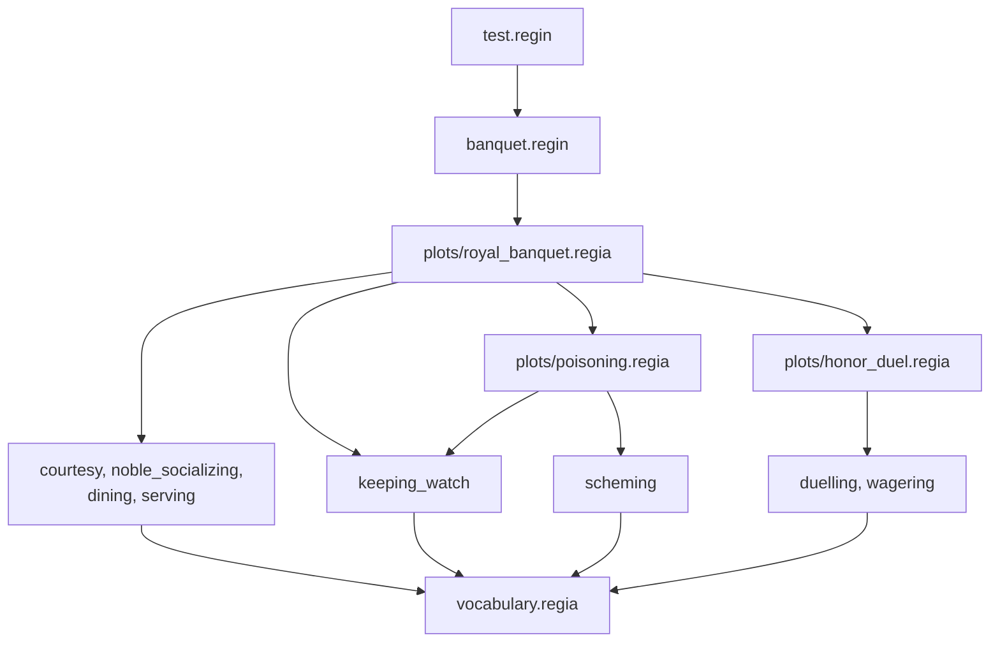

A Guest is insulted over dinner, wins a duel, is toasted by the Host, and a few seconds later is caught pouring poison into a cup. Every step of that is in the earlier chapters, one construct at a time. This chapter puts the Program back together. It prints the showcase whole, file by file, with a pointer to the chapter that explains each part. Then it follows one run of the small cast from the doors opening to the last Guest leaving, with the Trace it would leave.

The files are printed as they stand in `docs/guide/showcase/`, including what earlier chapters added to them. *The Logic of Regia* reads a cut of the same Program up to the toast, and *Review List*, the next chapter, collects every `#revise` of the guide.

## Fourteen files



An arrow is an `IMPORT`. The three Plots import `vocabulary.regia` as well, which the drawing leaves out.

| File | Lines | Holds | Read with |
|---|---|---|---|
| `vocabulary.regia` | 72 | every shared name | *Vocabulary* |
| `playbooks/courtesy.regia` | 38 | `Courtesy`: manners, and the Host's toasts | *Plans*, *Goals and Failure* |
| `playbooks/noble_socializing.regia` | 47 | `NobleSocializing`: small talk, insults, gossip | *Matching*, *Randomness*, *Precedence and Labels* |
| `playbooks/dining.regia` | 48 | `Dining`: a Guest's dinner | *Goals and Failure*, *Matching* |
| `playbooks/serving.regia` | 20 | `Serving`: a Servant's errands | *Messages*, *Goals and Failure* |
| `playbooks/keeping_watch.regia` | 12 | `Keeping_watch`: a Guard's duty | *Playbooks and Roles* |
| `playbooks/scheming.regia` | 14 | `Scheming`: the Poisoner's one job | *Plans* |
| `playbooks/duelling.regia` | 44 | `Duelling`: one side of a duel | *Messages*, *Precedence and Labels* |
| `playbooks/wagering.regia` | 21 | `Wagering`: watching a duel | *Placeholders and Expressions* |
| `plots/royal_banquet.regia` | 109 | `RoyalBanquet`, the Root Plot | *Plots and Directors*, *Quotas and Cast Changes* |
| `plots/honor_duel.regia` | 53 | `HonorDuel`, a Subplot | *Subplots and Stagings* |
| `plots/poisoning.regia` | 21 | `Poisoning`, a Subplot | *Subplots and Stagings* |
| `banquet.regin` | 37 | the full hall | *Instancing* |
| `test.regin` | 20 | the small cast | *Instancing* |

A Playbook's file never imports a Plot, and a Plot imports the Playbooks it gives and the Subplots it starts. So the drawing can be read from the bottom as "who uses this" and from the top as "what does this need". `keeping_watch` is the one Playbook with two arrows into it: both `RoyalBanquet` and `Poisoning` give it.

Spec: chapter 10.

## The Vocabulary

`showcase/vocabulary.regia`
```regia
#@desc: The Vocabulary of the banquet: everything the game, the Agents and the Directors share.

# ── Propensities ─────────────────────────────────────────────────────────────

TRAIT bravery
MOOD sympathy, aggressiveness

# ── What the game tells us ───────────────────────────────────────────────────

#@desc: The seat the game has laid for this Agent. Servants and Guards have none.
FACT hall.seating.seat AS seat(place)
#@desc: Kept up to date by the game: learned as the evening goes on, forgotten after enough food.
FACT hall.needs.hungry AS hungry
#@desc: The game seeds a few old grudges; Guests add their own.
FACT hall.social.grudge AS grudge(person, size)

#@desc: Sent by the game to an Agent with nothing to do.
EVENT hall.clock.idle AS idle
#@desc: Sent by the game to an Agent close enough to see a cup being tampered with.
EVENT hall.senses.saw_pouring AS saw_pouring(person)

# ── Facts the Agents keep ────────────────────────────────────────────────────

FACT purse(gold), craves(dish), on_duty

# ── Events Agents tell each other ────────────────────────────────────────────

EVENT greeting, guest_arrived(person)
EVENT insulted, scandal(person)
EVENT served(dish), sold_out(dish)
EVENT challenged, hit, yielded, duel_on

# ── Signals to the Directors ─────────────────────────────────────────────────

EVENT took_seat, toast_given, finished_eating
EVENT insult_thrown(offender)
EVENT duel_accepted, wagered(stake), cheered, duel_won
EVENT poison_poured, culprit_seized(person)

# ── Outcomes of the Subplots ─────────────────────────────────────────────────

EVENT duel_settled(winner), duel_abandoned
EVENT poisoner_caught(person), poison_taken

# ── Goals ────────────────────────────────────────────────────────────────────

GOAL take_seat, take_leave, open_feast, honour(person)
GOAL vent, resent(person)
GOAL have_dinner, bring(dish, place)
GOAL issue_challenge, fight, give_signal

# ── Custom Actions ───────────────────────────────────────────────────────────

#@desc: Done when the Agent has arrived. Refused if the place can't be reached.
ACTION walk_to(place)
#@desc: Done at once. The game then removes the Agent: it Leaves the Program.
ACTION leave_hall
#@desc: Refused once the kitchen has run out of the dish.
ACTION pick_up(dish)
#@desc: Refused at the table. Done when the sword is out.
ACTION draw_sword
#@desc: Accepted at once; done only when the poison has dissolved.
ACTION pour_poison
ACTION hall.guards.seize AS seize(person)

ACTION sit_down, stand_up, stand_by(place), bow_to(person), raise_cup, toast(person)
ACTION chat, sip_wine, sneer_at(person), scowl_at(person), laugh, snigger, roll_eyes
ACTION eat(dish), push_away(dish), complain, put_down(dish)
ACTION throw_glove, pick_up_glove, lunge, drop_sword, salute, limber_up
ACTION cheer, hush(person), drop_handkerchief
ACTION slip_away, watch(person)
ACTION open_doors, play_music, ring_bell, clear_tables
```

One file holds every name that more than one file uses: three Propensities, six Facts, twenty-six Events, eleven Goals and thirty-eight Actions. A `TRAIT` is fixed for the evening and a `MOOD` can be shifted. `<the game's name> AS <ours>` is an External name, and the five Facts and Events that carry one are what the game supplies. The five Actions with a Doc comment are the ones whose answer from the game matters to a Plan: when they are done, and when they are refused. (*Vocabulary*, *Syntax*)

The Values that fill the slots are nowhere in this file. `wall`, `door`, `kitchen`, `roast` and `pie` appear only where a Plan writes them, and the seats only at run time, when the game tells each Agent its own.

The Comments that split the Events into four groups are ours, and nothing checks them. Two lines are already in the wrong group: `guest_arrived` and `duel_on` are told by Directors and sit under "Events Agents tell each other". *Vocabulary* has the `#revise` on `EVENT` lines that don't say who sends them. Read from all eleven other files, the Signals and Outcomes come out like this:

| Event | Sent from | Heard by |
|---|---|---|
| `took_seat` | `Courtesy`, two Plans | `RoyalBanquet` in `arrival`, counted `FROM ALL Guest` |
| `toast_given` | `Courtesy` | `RoyalBanquet` in `reception` |
| `finished_eating` | `Dining`, four Plans | `RoyalBanquet` in `feast`, counted `FROM 75 PERCENT OF Guest` |
| `insult_thrown(offender)` | `NobleSocializing` | `RoyalBanquet` in `feast` |
| `duel_accepted`, `duel_won` | `Duelling` | `HonorDuel`, in `challenge` and in `fighting` |
| `wagered(stake)`, `cheered` | `Wagering` | `HonorDuel` in `challenge`, the second counted `FROM 3 OF Spectator` |
| `poison_poured` | `Scheming` | `Poisoning` |
| `culprit_seized(person)` | `Keeping_watch` | `Poisoning`, and `RoyalBanquet`, which has no Plan for it |
| `duel_settled(winner)`, `duel_abandoned` | `HonorDuel`, as Outcomes | `RoyalBanquet`, in `DURING PLOT` |
| `poisoner_caught(person)`, `poison_taken` | `Poisoning`, as Outcomes | `RoyalBanquet`, in `DURING PLOT` |

This table is the contract between the eight Playbooks and the three Plots, and we had to make it by hand. *The Logic of Regia* has the `#revise`.

Spec: chapter 05, chapter 10.

## `Courtesy`

`showcase/playbooks/courtesy.regia`
```regia
IMPORT "../vocabulary".

#@desc: Manners everyone at the banquet has, whatever else they are doing.
PLAYBOOK Courtesy:
    ROLE host.

    TO take_seat FROM DIRECTOR:
        GIVEN seat(?place):
            DO walk_to(?place).              # waits until we have arrived
            DO sit_down.
            TELL host greeting.
            SIGNAL took_seat.
        # no ELSE: with no seat laid for us, take_seat fails at once

    WHEN take_seat FAILED FROM DIRECTOR:
        DO stand_by(wall).
        SIGNAL took_seat.                    # the Director is counting on it

    WHEN greeting FROM ?who:
        DO bow_to(?who).

    TO take_leave FROM DIRECTOR:
        TELL host greeting.
        DO walk_to(door).
        DO leave_hall.                       # the game removes us: we Leave the Program

    # The Director only ever asks these of the Host.

    TO open_feast FROM DIRECTOR:
        DO stand_up.
        DO raise_cup.
        SIGNAL toast_given.

    TO honour(?who) FROM DIRECTOR:
        DO toast(?who).

    WHEN guest_arrived(?who) FROM DIRECTOR:
        DO bow_to(?who).
```

Every Role of the banquet gets `Courtesy` from its Role setup, so every Agent holds it from the first moment to the last. Six of its seven Plans answer the Director: four recipes with `FROM DIRECTOR`, the `FAILED` Plan for the first of them, and the reaction to `guest_arrived`. The seventh, `WHEN greeting FROM ?who`, is the only one set off by another Agent. (*Plans*, *Messages*)

`TO take_seat` has one `GIVEN` and no `ELSE`. An Agent with no seat has no recipe that applies, the Goal fails, and the `FAILED` Plan stands it by the wall and sends the Signal the Director is counting. `DO walk_to(?place)` waits until the game says the Agent has arrived, and `DO leave_hall` is how an Agent Leaves the Program, which only the Comment tells us. (*Goals and Failure*, *Quotas and Cast Changes*)

The last three Plans are the Host's. They are in the Playbook everyone holds because a Playbook can't ask which Role its Agent plays. A Servant holds `TO open_feast` too, and is never asked. `ROLE host` is filled by `MAPPING Host TO host` in each of the four setups. (*Playbooks and Roles*)

Spec: chapter 05, chapter 11, chapter 15.

## `NobleSocializing`

`showcase/playbooks/noble_socializing.regia`
```regia
IMPORT "../vocabulary".

#@desc: How Guests pass the time with each other: small talk, insults, gossip.
PLAYBOOK NobleSocializing:
    ROLE peer.

    # Small talk. The more grudges we hold, the likelier we are to vent one.
    WHEN idle:
        ?grudges = COUNT(grudge(?, ?)).
        EITHER, WEIGHT 3: DO chat.
        OR: DO sip_wine.
        OR, WEIGHT ?grudges: PURSUE vent.

    # We insult the Guest we resent the most.
    TO vent:
        GIVEN grudge(?foe, ?size), HIGHEST ?size, AT RANDOM:
            DO sneer_at(?foe).
            TELL ?foe insulted.
            TELL peer scandal(?foe).

    # Three ways to take an insult. The Selection function picks the one that suits us.
    WHEN insulted FROM peer ?who, SUITS aggressiveness AT 0.8 AND bravery AT 0.8:
        DO stand_up.
        SIGNAL insult_thrown(?who).

    WHEN insulted FROM peer ?who,
            SUITS aggressiveness AT 0.2 AND sympathy AT -0.5,
            SHIFTS aggressiveness BY 0.3:
        DO scowl_at(?who).
        PURSUE resent(?who).

    WHEN insulted FROM peer ?who, SUITS sympathy AT 0.7, SHIFTS aggressiveness BY -0.1:
        DO laugh.

    TO resent(?who):
        GIVEN grudge(?who, ?size):
            CHANGE grudge(?who, ?size) TO grudge(?who, ?size + 1).
        ELSE:
            LEARN grudge(?who, 1).

    # Gossip about someone else's insult.
    WHEN scandal(?victim) FROM peer ?speaker:
        GIVEN grudge(?victim, ?):
            DO snigger.
        GIVEN grudge(?speaker, ?), SHIFTS sympathy BY -0.1:
            DO roll_eyes.
        # no ELSE: gossip about strangers falls through to the next Playbook
```

Given to the Guests when `reception` starts and taken away in `farewell`. `peer` is filled with the banquet's `Guest`, so a Guest's peers are the other Guests.

The Playbook is a chain. An `idle` from the game draws one of three Options, and the third has a Weight equal to the number of grudges, so a Guest with none never vents. `TO vent` picks the largest grudge and sends two Messages: `insulted` to the victim alone, and `scandal(?foe)` to every peer. The victim answers with one of three Suits alternatives, chosen by the Selection function from its Propensities. Standing up Signals the Director, scowling pursues `resent`, which makes the grudge one larger, and laughing does nothing. (*Randomness*, *Matching*, *Precedence and Labels*)

The gossip Plan at the bottom has two `GIVEN`s and no `ELSE`, on purpose. A peer with no grudge against the victim or the speaker has no Plan here, and the `scandal` falls through to whichever other Playbook the Agent holds. The `SHIFTS` on the second `GIVEN` belongs to that one Plan. (*Precedence and Labels*)

`?who` on the third alternative is filled and never used, which is the one warning the Program compiles with. (*The Transpiler*)

Spec: chapter 09, chapter 13, chapter 14, chapter 26.

## `Dining` and `Serving`

`showcase/playbooks/dining.regia`
```regia
IMPORT "../vocabulary".

#@desc: A Guest's dinner: ordering, waiting for the Servants, eating.
PLAYBOOK Dining:
    ROLE waiter.

    FACT on_plate(dish)

    WHEN hungry LEARNED:
        PURSUE have_dinner, WITHOUT WAITING.

    WHEN hungry FORGOTTEN:
        DROP have_dinner.

    TO have_dinner:
        GIVEN hungry AND seat(?place):           # hungry when the Plan is chosen
            FOR EACH craves(?wish):
                ASK waiter TO bring(?wish, ?place).
            WAIT 1 MINUTE.                       # ASK never waits, so we give the Servants a minute
            IF COUNT(on_plate(?)) = 0:
                FAIL.
            FOR EACH on_plate(?dish):
                IF hungry:                       # still hungry, now that we get to this dish?
                    DO eat(?dish).
                ELSE:
                    DO push_away(?dish).
                FORGET on_plate(?dish).
            SIGNAL finished_eating.
        GIVEN NOT hungry:
            SIGNAL finished_eating.
        # no ELSE: hungry with no seat, have_dinner fails at once

    WHEN have_dinner FAILED, SHIFTS sympathy BY -0.3:
        DO complain.
        SIGNAL finished_eating.

    # Dropped because we are full: clear what is left.
    WHEN have_dinner DROPPED:
        FOR EACH on_plate(?dish):
            DO push_away(?dish).
            FORGET on_plate(?dish).
        SIGNAL finished_eating.

    WHEN served(?dish) FROM waiter:
        LEARN on_plate(?dish).

    WHEN sold_out(?dish) FROM waiter:
        FORGET craves(?dish).
```

`showcase/playbooks/serving.regia`
```regia
IMPORT "../vocabulary".

#@desc: A Servant's work: fetching what the patrons ask for.
PLAYBOOK Serving:
    ROLE patron.

    GOAL fetch(dish, place)

    TO bring(?dish, ?place) FROM patron ?guest:
        PURSUE fetch(?dish, ?place).         # PURSUE waits: if fetching fails, so does bringing
        DO walk_to(?place).
        DO put_down(?dish).
        TELL ?guest served(?dish).

    TO fetch(?dish, ?):                      # the place only keeps two orders of one dish apart
        DO walk_to(kitchen).
        DO pick_up(?dish).                   # refused once the dish has run out

    WHEN bring(?dish, ?) FAILED FROM patron ?guest:
        TELL ?guest sold_out(?dish).
```

The two are given together when `feast` starts, `Dining` to the Guests and `Serving` to the Servants, each with a Mapping onto the other: a Guest's `waiter` is the Servants, and a Servant's `patron` is the Guests. Neither file names the other. They meet in four names of the Vocabulary, `bring`, `served`, `sold_out` and `craves`.

`Dining` is where most Trigger kinds are. `hungry LEARNED` and `hungry FORGOTTEN` are Fact changes that start and drop the Goal. `TO have_dinner` is a recipe with two `GIVEN`s. `have_dinner FAILED` and `have_dinner DROPPED` react to the two ways the Goal can end without being reached. The last two Plans take Events from the Servants. `on_plate` is a Local Fact: no other Playbook can see what is on a Guest's plate. `SIGNAL finished_eating` is written four times, once for each way a dinner can end. (*Goals and Failure*, *Playbooks and Roles*)

The long recipe orders with a `FOR EACH`, then waits a minute, because an `ASK` never waits and nothing tells the Guest when the Servants are done. Then it counts the plate and fails on purpose if it is empty. (*Matching*, *Messages*)

`Serving` answers each `ASK` with a recipe that waits on a Goal of its own. `PURSUE fetch(…)` waits, so a `pick_up` that the game refuses fails `fetch`, then `bring`, and the `FAILED` Plan tells the Guest who asked. `fetch` is a Local Goal. *Placeholders and Expressions* took an unused `?place` out of its recipe, and the `?` that is left only keeps two orders of one dish apart. (*Goals and Failure*, *The Transpiler*)

Spec: chapter 05, chapter 08, chapter 11, chapter 26.

## `Keeping_watch` and `Scheming`

`showcase/playbooks/keeping_watch.regia`
```regia
IMPORT "../vocabulary".

#@desc: A Guard's duty. A knight holds it next to NobleSocializing.
PLAYBOOK Keeping_watch:

    WHEN scandal(?) FROM ?speaker:
        GIVEN on_duty:
            DO watch(?speaker).

    WHEN saw_pouring(?who):
        DO seize(?who).
        SIGNAL culprit_seized(?who).         # reaches every Director that gave us this Playbook
```

`showcase/playbooks/scheming.regia`
```regia
IMPORT "../vocabulary".

#@desc: The Poisoner's one job.
PLAYBOOK Scheming:

    FACT poured

    WHEN idle:
        GIVEN NOT poured:
            DO pour_poison, WITHOUT WAITING.     # we don't stand there while it dissolves
            LEARN poured.
            DO slip_away.
            SIGNAL poison_poured.
        # no ELSE: once the poison is poured, idle falls through to small talk
```

The two smallest Playbooks have no Role of their own. `Keeping_watch` is the most handed out of the eight: the Guards get it from the banquet's setup, the Watchmen get it again from `Poisoning`, and a duel's winner gets it through a Placeholder. Its `scandal` Plan competes with `NobleSocializing`'s on a `knight`, and the `PRECEDENCE` Block of `RoyalBanquet` settles that. `GIVEN on_duty` with no `ELSE` lets the gossip fall through for an Agent who holds the Playbook and is off duty. `saw_pouring` comes from the game. (*Playbooks and Roles*, *Precedence and Labels*)

`Scheming` is one Plan. `DO pour_poison, WITHOUT WAITING` goes on as soon as the game has accepted the Action, and the Local Fact `poured` makes sure it happens once. After that the `GIVEN` fails, there is no `ELSE`, and the Poisoner's `idle` falls through to small talk. (*Plans*, *Precedence and Labels*)

Spec: chapter 08, chapter 13.

## `Duelling` and `Wagering`

`showcase/playbooks/duelling.regia`
```regia
IMPORT "../vocabulary".

#@desc: One side of a duel. Both duellists hold it, each with the other as opponent.
PLAYBOOK Duelling:
    ROLE opponent.

    FACT stamina(points)

    TO issue_challenge FROM DIRECTOR:
        DO throw_glove.
        TELL opponent challenged.

    WHEN challenged FROM opponent, SUITS bravery AT 0.7:
        DO pick_up_glove.
        SIGNAL duel_accepted.

    WHEN challenged FROM opponent, SUITS bravery AT -0.5, SHIFTS sympathy BY -0.3:
        DO walk_to(door).
        DO leave_hall.

    TO fight FROM DIRECTOR:
        FOR EACH stamina(?old): FORGET stamina(?old).    # left over from an earlier duel
        DO draw_sword.
        LEARN stamina(3).

    # Every change of stamina, the first included, is answered with a lunge.
    WHEN stamina(?) LEARNED:
        WAIT RANDOM(1, 3) SECONDS.
        DO lunge.
        TELL opponent hit.

    WHEN hit FROM opponent, SHIFTS aggressiveness BY 0.1:
        GIVEN stamina(?now) AND ?now > 1:
            CHANGE stamina(?now) TO stamina(?now - 1).
        ELSE:
            DO drop_sword.
            TELL opponent yielded.

    WHEN yielded FROM opponent:
        DO salute.
        SIGNAL duel_won.

    WHEN idle:
        DO limber_up.
```

`showcase/playbooks/wagering.regia`
```regia
IMPORT "../vocabulary".

#@desc: Watching a duel, with money on it.
PLAYBOOK Wagering:

    WHEN duel_on FROM DIRECTOR:
        GIVEN purse(?gold) AND ?gold > 0:
            ?stake = RANDOM(1, ?gold).
            CHANGE purse(?gold) TO purse(?gold - ?stake).
            SIGNAL wagered(?stake).
            DO cheer.
            SIGNAL cheered.
        ELSE:
            DO cheer.
            SIGNAL cheered.

    TO give_signal FROM DIRECTOR:
        DO drop_handkerchief.

    WHEN scandal(?) FROM ?speaker:
        DO hush(?speaker).
```

These two exist only inside a Staging of `HonorDuel`. Both duellists hold `Duelling`, each with the other as `opponent`, and every Spectator holds `Wagering`.

The language has no loop that waits, so a fight is written as a chain of Plans. `TO fight` learns `stamina(3)`. The Plan on `stamina(?) LEARNED` answers every change of that Fact with a wait and a lunge. The `hit` Plan on the other side takes one point of stamina off, which is a change, so it lunges back. With one point left, a hit makes the duellist drop the sword and tell `yielded`. The first line of `TO fight` clears the `stamina` an earlier duel left behind, since a Local Fact outlives the Giving. (*Messages*, *Matching*, *Playbooks and Roles*)

The two `challenged` Blocks are Suits alternatives on one Trait: a brave Defender picks up the glove, and a timid one walks out of the hall. `WHEN idle` gives a duellist something to do, and beats every other `idle` Plan the Agent holds because a Subplot goes before its parent. (*Precedence and Labels*)

`Wagering` names a value (`?stake`), changes the purse, and sends two Signals where one would read better: `wagered(?stake)` for the Director to remember and a bare `cheered` for it to count. (*Placeholders and Expressions*, *Quotas and Cast Changes*)

Spec: chapter 04, chapter 12, chapter 14, chapter 15.

## `RoyalBanquet`

`showcase/plots/royal_banquet.regia`
```regia
IMPORT "../vocabulary".
IMPORT "../playbooks/courtesy".
IMPORT "../playbooks/noble_socializing".
IMPORT "../playbooks/dining".
IMPORT "../playbooks/serving".
IMPORT "../playbooks/keeping_watch".
IMPORT "honor_duel".
IMPORT "poisoning".

#@version: 2.0
#@desc[
    One evening at court, from the Guests arriving to the last one taking leave.
    HonorDuel and Poisoning are started during the feast, as its Subplots.
]#
PLOT RoyalBanquet:
    ROLE Host STARTS WITH:
        ASSIGN Courtesy, MAPPING Host TO host.
        PURSUE take_seat.
    ROLE Guest STARTS WITH:
        ASSIGN Courtesy, MAPPING Host TO host.
        LEARN purse(RANDOM(5, 20)).
        LEARN craves(roast).
        LEARN craves(pie).
        PURSUE take_seat.
    ROLE Servant STARTS WITH:
        ASSIGN Courtesy, MAPPING Host TO host.
    ROLE Guard STARTS WITH:
        ASSIGN Courtesy, MAPPING Host TO host.
        ASSIGN Keeping_watch.
        LEARN on_duty.

    PHASE arrival INITIAL.
    PHASE reception.
    PHASE feast.
    PHASE farewell.

    PRECEDENCE:
        Keeping_watch OVER NobleSocializing ON scandal.      # a knight is a Guard first
        HonorDuel OVER Poisoning.
        SELF OVER Poisoning ON scandal.                      # see the README's review notes

    DURING arrival:
        WHEN ENTERED:
            DO open_doors.

        WHEN took_seat FROM ALL Guest:
            TRANSITION TO reception.

    DURING reception:
        WHEN ENTERED:
            ASSIGN NobleSocializing TO Guest, MAPPING Guest TO peer.
            WAIT 2 MINUTES.
            ASK Host TO open_feast.

        WHEN toast_given FROM Host:
            TRANSITION TO feast.

    DURING feast:
        WHEN ENTERED:
            ASSIGN Dining TO Guest, MAPPING Servant TO waiter.
            ASSIGN Serving TO Servant, MAPPING Guest TO patron.
            ASK Guest TO have_dinner.
            START SUBPLOT Poisoning, MAPPING 1 OF Guest TO Poisoner, MAPPING Guard TO Watchman.

        WHEN insult_thrown(?offender) FROM Guest ?offended:
            START SUBPLOT HonorDuel,
                MAPPING ?offended TO Challenger,
                MAPPING ?offender TO Defender,
                MAPPING Guest TO Spectator.

        WHEN finished_eating FROM 75 PERCENT OF Guest:
            TRANSITION TO farewell.

        WHEN EXITED:                         # however the feast ends: the Quota above, or the poison
            DO clear_tables.

    DURING farewell:
        WHEN ENTERED:
            END SUBPLOT HonorDuel.
            END SUBPLOT Poisoning.
            UNASSIGN NobleSocializing FROM Guest.
            UNASSIGN Dining FROM Guest.
            UNASSIGN Serving FROM Servant.
            ASK Guest TO take_leave.

        WHEN Guest ?late JOINED:             # Messages aren't replayed, so we ask again
            ASK ?late TO take_leave.

        WHEN Guest EMPTIED:
            END PLOT.

    DURING PLOT:
        WHEN Guest ?late JOINED:
            TELL Host guest_arrived(?late).

        WHEN HonorDuel ENDED WITH duel_settled(?winner):
            ASK Host TO honour(?winner).
            ASSIGN Keeping_watch TO ?winner.     # the winner stands guard of honour
            TELL ?winner on_duty.
        WHEN HonorDuel ENDED:
            DO play_music.

        WHEN Poisoning ENDED WITH poisoner_caught(?):
            DO ring_bell.
        WHEN Poisoning ENDED WITH poison_taken:
            TRANSITION TO farewell.              # the evening is cut short

        WHEN Host EMPTIED:
            END PLOT.
```

The Root Plot, in the order a Plot is always written: Roles with their setups, Phases, Precedence, one `DURING` Block per Phase, `DURING PLOT`. *Syntax* added the `#@version` and the Doc comment over several lines, and *Plots and Directors* added the `WHEN EXITED` Plan of `feast`.

| Phase | Entered by | Its entry Plan | Left by |
|---|---|---|---|
| `arrival` | the start | opens the doors | `took_seat FROM ALL Guest` |
| `reception` | the Quota | gives `NobleSocializing`, waits two minutes, asks for the toast | `toast_given FROM Host` |
| `feast` | the toast | gives `Dining` and `Serving`, asks for dinner, starts `Poisoning` | `finished_eating FROM 75 PERCENT OF Guest`, or `poison_taken` |
| `farewell` | the Quota, or the poison | ends the Subplots, takes three Playbooks back, asks the Guests to leave | `Guest EMPTIED`, which ends the Plot |

The four setups give everyone `Courtesy`. A Guest also starts with a purse, two cravings and the Goal `take_seat`, and a Guard with `Keeping_watch` and `on_duty`. An Agent of a kind that plays two Roles gets both setups. (*Plots and Directors*)

`feast` is the busy Phase. Its entry Plan makes two Givings to whole Roles, which stay in force for latecomers, sends one `ASK`, which doesn't, and starts `Poisoning` with a counted Mapping and a whole-Role one. Its second Plan starts a Staging of `HonorDuel` for every `insult_thrown`, with two Placeholder Mappings. (*Playbooks and Roles*, *Subplots and Stagings*, *Randomness*)

`DURING PLOT` holds what can happen in any Phase: a latecomer, the four Outcomes of the two Subplots, and the Host leaving. `farewell` has a `JOINED` Plan of its own, which replaces the one in `DURING PLOT` while the Plot is in that Phase. The two `HonorDuel ENDED` Blocks are tried in order, so the plain one runs only for `duel_abandoned`. (*Quotas and Cast Changes*, *Subplots and Stagings*)

The `PRECEDENCE` Block has three lines. The first puts guard duty before gossip on a `knight`. The second puts the duel's Playbooks before the poisoning's. The third is there to break a cycle that the second makes with a line in `HonorDuel` and a default. (*Precedence and Labels*)

Spec: chapter 13, chapter 16, chapter 17, chapter 18, chapter 19, chapter 20.

## `HonorDuel` and `Poisoning`

`showcase/plots/honor_duel.regia`
```regia
IMPORT "../vocabulary".
IMPORT "../playbooks/duelling".
IMPORT "../playbooks/wagering".

#@desc: One duel. Every insult taken badly starts a new Staging of it.
PLOT HonorDuel:
    ROLE Challenger STARTS WITH:
        ASSIGN Duelling, MAPPING Defender TO opponent.
    ROLE Defender STARTS WITH:
        ASSIGN Duelling, MAPPING Challenger TO opponent.
    ROLE Spectator STARTS WITH:
        ASSIGN Wagering.

    PHASE challenge INITIAL.
    PHASE fighting.

    FACT wager(person, stake)

    PRECEDENCE:
        PARENT OVER SELF ON scandal.         # gossip and guard duty come before hushing

    DURING challenge:
        WHEN ENTERED:
            ASK Challenger TO issue_challenge.

        WHEN duel_accepted FROM Defender:
            TELL Spectator duel_on.

        WHEN wagered(?stake) FROM Spectator ?who:
            LEARN wager(?who, ?stake).

        WHEN cheered FROM 3 OF Spectator:
            GIVEN wager(?backer, ?stake), HIGHEST ?stake, AT RANDOM:
                ASK ?backer TO give_signal.
                TRANSITION TO fighting.
            ELSE:
                TRANSITION TO fighting.

    DURING fighting:
        WHEN ENTERED:
            ASK Challenger TO fight.
            ASK Defender TO fight.
            WAIT 2 MINUTES.                  # a rough timeout: never reached if the duel ends first
            END PLOT WITH duel_abandoned.

        WHEN duel_won FROM ?winner:
            END PLOT WITH duel_settled(?winner).

    DURING PLOT:
        WHEN Challenger EMPTIED:
            END PLOT WITH duel_abandoned.
        WHEN Defender EMPTIED:
            END PLOT WITH duel_abandoned.
```

`showcase/plots/poisoning.regia`
```regia
IMPORT "../vocabulary".
IMPORT "../playbooks/scheming".
IMPORT "../playbooks/keeping_watch".

#@desc: Someone at the table means harm. No Phases: it runs until the poison is taken or the Poisoner caught.
PLOT Poisoning:
    ROLE Poisoner STARTS WITH:
        ASSIGN Scheming.
    ROLE Watchman STARTS WITH:
        ASSIGN Keeping_watch.                # a second Giving of what the Guards already hold

    DURING PLOT:
        WHEN poison_poured FROM Poisoner:
            WAIT 30 SECONDS.                 # the Watchmen's chance
            END PLOT WITH poison_taken.

        WHEN culprit_seized(?who) FROM Watchman:
            END PLOT WITH poisoner_caught(?who).

        WHEN Poisoner EMPTIED:
            END PLOT.
```

Neither file says which Plot starts it. `HonorDuel` is written like the banquet, with Roles, setups, Phases and a `PRECEDENCE` Block, and is started once per insult taken badly. Its setups give `Duelling` crosswise, each duellist's `opponent` being the other Role. `wager` is a Fact of the Director itself, which is the only kind of Fact a Director can match on. The Quota Plan of `challenge` picks the highest stake among them. (*Subplots and Stagings*, *Matching*)

The duel has four endings. A duellist wins (`duel_settled(?winner)`), the two minutes of the entry Plan of `fighting` run out, or either duellist's Role empties (`duel_abandoned` for all three). `?winner` is filled by `FROM`, since the Director has no other way to name the Agent. (*Plots and Directors*, *Quotas and Cast Changes*)

`PARENT OVER SELF ON scandal` gives way to the banquet's Playbooks on one Event. Without it, `Wagering` would hush every piece of gossip for as long as a duel lasts. (*Precedence and Labels*)

`Poisoning` has no Phases, so all its Plans are in `DURING PLOT`. Once the poison is poured the Watchmen have thirty seconds: a `WAIT` in one Plan, cut off if the other Plan ends the Plot first. The plain `END PLOT.` at the bottom has no Outcome, and the banquet has no Plan for it. (*Subplots and Stagings*)

Spec: chapter 17, chapter 18, chapter 20.

## The two casts

`showcase/banquet.regin`
```regia
# The full banquet.
IMPORT "plots/royal_banquet".

ROOT RoyalBanquet.

AGENT king PLAYS Host:
    COUNT 1.

AGENT noble PLAYS Guest:
    COUNT 6.
    bravery AT RANDOM(-0.6, 0.6).
    sympathy AT RANDOM(0, 0.8).
    aggressiveness AT RANDOM(-0.4, 0.4).

AGENT hothead PLAYS Guest:
    COUNT 2.
    bravery AT 0.9.
    sympathy AT -0.4.
    aggressiveness AT RANDOM(0.6, 1).

AGENT knight PLAYS Guest AND Guard:
    COUNT 2.
    bravery AT 0.8.
    sympathy AT 0.3.
    aggressiveness AT 0.1.

AGENT servant PLAYS Servant:
    COUNT 3.

# No COUNT: a latecomer only ever enters by Joining.
AGENT latecomer PLAYS Guest:
    bravery AT RANDOM(-0.6, 0.6).
    sympathy AT RANDOM(0, 0.8).
    aggressiveness AT RANDOM(-0.4, 0.4).

TARGET JASON:
    strategy = most_similar.
```

`showcase/test.regin`
```regia
# The small cast the walkthrough follows: one king, two nobles, one knight, one servant.
# Every value is fixed, so a run reads the same each time.
IMPORT "banquet.regin".

AGENT noble PLAYS Guest:
    COUNT 2.
    bravery AT 0.8.
    sympathy AT -0.2.
    aggressiveness AT 0.7.

AGENT hothead PLAYS Guest.           # a kind can't be removed, only emptied

AGENT knight PLAYS Guest AND Guard:
    COUNT 1.
    bravery AT 0.8.
    sympathy AT 0.3.
    aggressiveness AT 0.1.

AGENT servant PLAYS Servant:
    COUNT 1.
```

Nothing above says how many Guests there are. An Agent kind names the Roles of the Root Plot its Agents play, how many start, and their Propensity values. `test.regin` imports `banquet.regin` and declares four of its kinds again, each replacing the whole earlier declaration.

| Kind | Plays | Full hall | Small cast |
|---|---|---|---|
| `king` | `Host` | 1 | 1 |
| `noble` | `Guest` | 6, values drawn | 2, values fixed |
| `hothead` | `Guest` | 2 | 0 |
| `knight` | `Guest` and `Guard` | 2 | 1 |
| `servant` | `Servant` | 3 | 1 |
| `latecomer` | `Guest` | 0, Joins later | 0, Joins later |

The small cast keeps `ROOT`, the `TARGET` Block and the `latecomer` kind of the file under it. Its two nobles are given bravery 0.8 and aggressiveness 0.7 so that both take an insult by standing up. Three Guests is the least the Program works with: `cheered FROM 3 OF Spectator` needs three, and `75 PERCENT OF Guest` of three is all three. (*Instancing*, *Quotas and Cast Changes*)

Spec: chapter 21.

## One run

```
regia build test.regin
```

The rest of the chapter follows one run of that Build. No Transpiler exists, so the Trace below is put together by hand from chapter 34, as the excerpt in *The Transpiler* was, and that excerpt is part of this run (entries #311 to #349). Each line is the entry's number, the Agent that wrote it under the name the Trace file gives it, and the console text. Places are left out, except after `at` where two lines would otherwise read alike. Chapter 34 fixes the words of each kind of entry and leaves some details open, which are listed in the README under *Spec wording*.

Two things have to be assumed before the first line. The showcase doesn't build on Jason as it stands, because of its dotted External names, so we read them as *Translation to ASL* does. And a run is half the game's doing. In this one the game does the following, none of which is in a `.regia` file except as a Doc comment:

- It lays `seat_1` for the king and `seat_2` and `seat_3` for the nobles, and none for the knight, who is a Guard.
- It seeds one grudge: `noble_2` resents `noble_1`.
- It makes `noble_1` and `knight_1` hungry during the reception, and never `noble_2`.
- It has run out of pie.
- It lets both duellists draw their swords.
- It shows the knight the poison being poured, and has a seized culprit led out of the hall.
- It sends a latecomer in at the very end.

`#revise` The Vocabulary declares the names the game supplies and nothing of what the game does with them. Whether a Guard has a seat, when hunger goes, what `seize` does to the one seized: each of these decides which Plans run, and each is written, if at all, in a Doc comment. To tell one run we had to invent seven behaviours of the game.

Several draws also go one way and not another: who is cast as the Poisoner, which Option an `idle` picks, what each Spectator stakes. The seed is on the first line of the Trace, and a real run can't choose it (*Randomness*).

`noble_1` is the Agent to watch. Over the evening it holds seven of the eight Playbooks:

| From | `noble_1` gains | `noble_1` loses |
|---|---|---|
| the start | `Courtesy` | |
| `reception` | `NobleSocializing` | |
| `feast` | `Dining`, `Scheming` | |
| the insult | `Duelling`, `Wagering` | |
| winning | `Keeping_watch` | `Duelling`, `Wagering` |
| being caught | | `Scheming` |

### Before the doors open

```
#1   RUN STARTED test SEED 4711
#2   noble_1: TEMPER noble_1 bravery 0.8 sympathy -0.2 aggressiveness 0.7
#3   noble_2: TEMPER noble_2 bravery 0.8 sympathy -0.2 aggressiveness 0.7
#4   knight_1: TEMPER knight_1 bravery 0.8 sympathy 0.3 aggressiveness 0.1
#5   director:RoyalBanquet: STAGING RoyalBanquet STARTED Host king_1, Guest noble_1 noble_2 knight_1, Servant servant_1, Guard knight_1
#6   noble_1: FACT +seat(seat_2)
#7   noble_2: FACT +seat(seat_3)
#8   noble_2: FACT +grudge(noble_1, 2)
#9   king_1: FACT +seat(seat_1)
#10  director:RoyalBanquet: GIVE Courtesy TO king_1 AS Host
#11  king_1: PLAN TO take_seat FROM DIRECTOR
#12  king_1: DO walk_to(seat_1)
#13  director:RoyalBanquet: GIVE Courtesy TO noble_1 AS Guest
#14  noble_1: FACT +purse(14) FROM director:RoyalBanquet
#15  noble_1: FACT +craves(roast) FROM director:RoyalBanquet
#16  noble_1: FACT +craves(pie) FROM director:RoyalBanquet
#17  noble_1: PLAN TO take_seat FROM DIRECTOR
#18  noble_1: DO walk_to(seat_2)
       … #19 to #24: the same six lines for noble_2, with purse(9) and seat_3
#25  director:RoyalBanquet: GIVE Courtesy TO knight_1 AS Guest
#26  knight_1: FACT +purse(6) FROM director:RoyalBanquet
#27  knight_1: FACT +craves(roast) FROM director:RoyalBanquet
#28  knight_1: FACT +craves(pie) FROM director:RoyalBanquet
#29  knight_1: FAILURE T1104 GOAL take_seat has no applicable TO Plan
#30  knight_1: PLAN WHEN take_seat FAILED FROM DIRECTOR
#31  knight_1: DO stand_by(wall)
#32  director:RoyalBanquet: GIVE Courtesy TO servant_1 AS Servant
#33  director:RoyalBanquet: GIVE Courtesy TO knight_1 AS Guard
#34  director:RoyalBanquet: GIVE Keeping_watch TO knight_1 AS Guard
#35  knight_1: FACT +on_duty FROM director:RoyalBanquet
#36  director:RoyalBanquet: PLAN WHEN ENTERED  at plots/royal_banquet.regia:43
#37  director:RoyalBanquet: DO open_doors
```

Three Agents have a `TEMPER` line, since the king and the servant were given no Propensity values. The Facts on lines #6 to #9 have no `FROM`: they come from the game. (*Instancing*, *The Transpiler*)

The Role setups run in the order the Roles are declared, `Host`, `Guest`, `Servant`, `Guard`, and only then is `arrival` entered (#36). A setup's `LEARN` arrives as a Fact told by the Director and its `PURSUE` as a Goal asked by it, which is why #17 reads `FROM DIRECTOR`. The knight is set up twice, as a Guest and as a Guard, and holds `Courtesy` twice over. (*Plots and Directors*)

The first Failure of the evening is on line #29. The knight has no seat, so no recipe for `take_seat` applies, and the Goal fails with `T1104` before any Action is tried. Its `FAILED` Plan walks it to the wall. The three purses, 14, 9 and 6, are three rolls of one `RANDOM(5, 20)`. (*Goals and Failure*, *Randomness*)

### Arrival

```
#44  noble_1: DO walk_to(seat_2) DONE
#45  noble_1: DO sit_down
#46  noble_1: DO sit_down DONE
#47  noble_1: TELL host greeting
#48  noble_1: GOAL take_seat REACHED
#49  king_1: PLAN WHEN greeting FROM noble_1
#50  king_1: DO bow_to(noble_1)
       …
#58  knight_1: DO stand_by(wall) DONE
#59  director:RoyalBanquet: PLAN WHEN took_seat FROM ALL Guest
#60  director:RoyalBanquet: PHASE arrival -> reception ON took_seat
#61  director:RoyalBanquet: PLAN WHEN ENTERED  at plots/royal_banquet.regia:50
#62  director:RoyalBanquet: GIVE NobleSocializing TO noble_1 AS Guest
#63  director:RoyalBanquet: GIVE NobleSocializing TO noble_2 AS Guest
#64  director:RoyalBanquet: GIVE NobleSocializing TO knight_1 AS Guest
```

Between #47 and #49 a Message crosses from one Agent to another. The sender writes `TELL host greeting`, and the receiver shows it as the Plan it starts. Between #48 and #59 there is something the Trace doesn't show: `SIGNAL took_seat`, three times. A Signal has no entry of its own, so the first two leave nothing, and the third shows as the Quota Plan it sets off. The king Signals too and isn't counted, since it is no Guest. (*Messages*, *Quotas and Cast Changes*)

The knight's Signal is the third, sent from the `FAILED` Plan after the walk to the wall. Without that walk the evening would have stopped here. The setups ran before `arrival` was entered, and a count starts when its Phase is entered, so a `took_seat` sent straight from line #30 would have come too early to count. (*Plots and Directors*)

### Reception

```
#65  noble_1: PLAN WHEN idle
#66  noble_1: DO chat
#67  knight_1: PLAN WHEN idle
#68  knight_1: DO sip_wine
       …
#143 noble_1: FACT +hungry
       …
#171 knight_1: FACT +hungry
       …
#281 director:RoyalBanquet: ASK Host TO open_feast
#282 king_1: PLAN TO open_feast FROM DIRECTOR
#283 king_1: DO stand_up
#284 king_1: DO stand_up DONE
#285 king_1: DO raise_cup
#286 king_1: DO raise_cup DONE
#287 king_1: GOAL open_feast REACHED
#288 director:RoyalBanquet: PLAN WHEN toast_given FROM king_1
#289 director:RoyalBanquet: PHASE reception -> feast ON toast_given
```

For two minutes the Director's entry Plan sits in its `WAIT`, and the three Guests answer every `idle` out of `NobleSocializing`. Which Option was drawn has no entry. We read it from the Action that follows. `noble_2` has one grudge, so its third Option has a Weight of 1 against 3 and 1, and in this run the draw never falls on it during the reception. Had it done so, `noble_1` would have stood up and Signalled `insult_thrown` to a Director with no Plan for it in this Phase. (*Randomness*)

Lines #143 and #171 are the game making two Guests hungry. Nothing follows, because `WHEN hungry LEARNED` is in `Dining` and nobody holds it yet. This is why the Director asks every Guest for `have_dinner` when the feast starts. (*Playbooks and Roles*)

### The feast begins, three dinners

```
#290 director:RoyalBanquet: PLAN WHEN ENTERED  at plots/royal_banquet.regia:59
#291 director:RoyalBanquet: GIVE Dining TO noble_1 AS Guest
#292 director:RoyalBanquet: GIVE Dining TO noble_2 AS Guest
#293 director:RoyalBanquet: GIVE Dining TO knight_1 AS Guest
#294 director:RoyalBanquet: GIVE Serving TO servant_1 AS Servant
#295 director:RoyalBanquet: ASK Guest TO have_dinner
#296 director:Poisoning: STAGING Poisoning STARTED Poisoner noble_1, Watchman knight_1
#297 director:Poisoning: GIVE Scheming TO noble_1 AS Poisoner
#298 director:Poisoning: GIVE Keeping_watch TO knight_1 AS Watchman
#299 noble_2: PLAN TO have_dinner  at playbooks/dining.regia:29
#300 noble_2: GOAL have_dinner REACHED
#301 knight_1: FAILURE T1104 GOAL have_dinner has no applicable TO Plan
#302 knight_1: PLAN WHEN have_dinner FAILED
#303 knight_1: DO complain
#304 noble_1: PLAN TO have_dinner  at playbooks/dining.regia:16
#305 noble_1: ASK waiter TO bring(roast, seat_2)
#306 noble_1: ASK waiter TO bring(pie, seat_2)
#307 servant_1: PLAN TO bring(roast, seat_2) FROM noble_1
#308 servant_1: GOAL fetch(roast, seat_2) PURSUED
#309 servant_1: PLAN TO fetch(roast, seat_2)
#310 servant_1: DO walk_to(kitchen)
#311 servant_1: PLAN TO bring(pie, seat_2) FROM noble_1
#312 servant_1: GOAL fetch(pie, seat_2) PURSUED
#313 servant_1: PLAN TO fetch(pie, seat_2)
#314 servant_1: DO walk_to(kitchen)
#315 knight_1: DO complain DONE
```

One `ASK Guest TO have_dinner` (#295) gets three answers, one from each path of `Dining`:

- `noble_2` isn't hungry. The second `GIVEN` applies, and its one line Signals `finished_eating`.
- `knight_1` is hungry and has no seat. Neither `GIVEN` holds, there is no `ELSE`, and the Goal fails as `take_seat` did. The `FAILED` Plan complains and Signals `finished_eating` for a Guest who has eaten nothing. Its `SHIFTS sympathy BY -0.3` leaves no entry.
- `noble_1` is hungry and seated. The first `GIVEN` applies, the `FOR EACH` sends one `ASK` per craving, and the recipe stops in `WAIT 1 MINUTE`.

(*Goals and Failure*, *Matching*, *Precedence and Labels*)

Line #296 is the counted Mapping. `1 OF Guest` drew `noble_1`, and the whole-Role Mapping made the one Guard the Watchman. A second Director now exists, `director:Poisoning`, and the knight holds `Keeping_watch` a second time. `noble_1` holds `Scheming` and doesn't pour yet, because that Plan waits for an `idle`. (*Subplots and Stagings*, *Randomness*)

The Servant has two Goals side by side, `bring(roast, seat_2)` and `bring(pie, seat_2)`, each waiting on a `fetch` of its own. On lines #310 and #314 it is sent to the kitchen twice. *The Transpiler* follows the pie from here: `pick_up(pie)` is refused, `fetch` and `bring` fail in a chain, and `noble_1` is told `sold_out(pie)` (#340 to #349). The roast goes better:

```
#350 servant_1: DO walk_to(kitchen) DONE
#351 servant_1: DO pick_up(roast)
#352 servant_1: DO pick_up(roast) DONE
#353 servant_1: GOAL fetch(roast, seat_2) REACHED
#354 servant_1: DO walk_to(seat_2)
       …
#384 servant_1: DO walk_to(seat_2) DONE
#385 servant_1: DO put_down(roast)
#386 servant_1: DO put_down(roast) DONE
#387 servant_1: TELL noble_1 served(roast)
#388 servant_1: GOAL bring(roast, seat_2) REACHED
#389 noble_1: PLAN WHEN served(roast) FROM servant_1
#390 noble_1: FACT +on_plate(roast)
```

By line #390 the roast is on the plate at `seat_2`, and `noble_1` is no longer sitting there.

### An insult

We go back a few lines, to #316, with the Servant still on its way to the kitchen.

```
#316 noble_2: PLAN WHEN idle
#317 noble_2: GOAL vent PURSUED
#318 noble_2: PLAN TO vent
#319 noble_2: DO sneer_at(noble_1)
#320 noble_2: DO sneer_at(noble_1) DONE
#321 noble_2: TELL noble_1 insulted
#322 noble_2: TELL peer scandal(noble_1)
#323 noble_2: GOAL vent REACHED
#324 noble_1: PLAN WHEN insulted FROM noble_2  at playbooks/noble_socializing.regia:22
#325 noble_1: DO stand_up
#326 knight_1: PLAN WHEN scandal(noble_1) FROM noble_2  at playbooks/keeping_watch.regia:6
#327 knight_1: DO watch(noble_2)
#328 noble_1: DO stand_up DONE
#329 director:RoyalBanquet: PLAN WHEN insult_thrown(noble_2) FROM noble_1
```

`noble_2` finished dinner at once, so it is the Guest the game finds idle. This time the draw falls on the third Option. `PURSUE vent` waits (#317 to #323), and the Pick has one grudge to choose from.

The two Messages on #321 and #322 go different ways. `insulted` reaches `noble_1`, where three Suits alternatives are candidates and the Selection function takes the first: line 22 of the file, the one that stands up. `scandal(noble_1)` goes to both peers:

- The knight holds two Playbooks with a Plan for it. `Keeping_watch OVER NobleSocializing ON scandal` puts guard duty first, the knight is on duty, and it watches the speaker (#326).
- `noble_1` hears the gossip about itself. It holds one Plan for `scandal`, neither `GIVEN` holds, and the Event is dropped. Nothing is written.

(*Matching*, *Precedence and Labels*, *Messages*)

Line #329 is `SIGNAL insult_thrown(?who)` arriving. The Signal's argument is the offender and its Sender the offended, and the Director's Trigger takes one from each.

### A duel

```
#330 director:HonorDuel: STAGING HonorDuel STARTED Challenger noble_1, Defender noble_2, Spectator noble_1 noble_2 knight_1
#331 director:HonorDuel: GIVE Duelling TO noble_1 AS Challenger
#332 director:HonorDuel: GIVE Duelling TO noble_2 AS Defender
#333 director:HonorDuel: GIVE Wagering TO noble_1 AS Spectator
#334 director:HonorDuel: GIVE Wagering TO noble_2 AS Spectator
#335 director:HonorDuel: GIVE Wagering TO knight_1 AS Spectator
#336 director:HonorDuel: PLAN WHEN ENTERED  at plots/honor_duel.regia:23
#337 director:HonorDuel: ASK Challenger TO issue_challenge
#338 noble_1: PLAN TO issue_challenge FROM DIRECTOR
#339 noble_1: DO throw_glove
       … #340 to #349: the pie, in The Transpiler
#355 noble_1: DO throw_glove DONE
#356 noble_1: TELL opponent challenged
#357 noble_1: GOAL issue_challenge REACHED
#358 noble_2: PLAN WHEN challenged FROM noble_1  at playbooks/duelling.regia:13
#359 noble_2: DO pick_up_glove
#360 noble_1: PLAN WHEN idle  at playbooks/duelling.regia:43
#361 noble_1: DO limber_up
#362 noble_2: DO pick_up_glove DONE
#363 noble_1: DO limber_up DONE
#364 director:HonorDuel: PLAN WHEN duel_accepted FROM noble_2
#365 director:HonorDuel: TELL Spectator duel_on
#366 noble_1: PLAN WHEN duel_on FROM DIRECTOR
#367 noble_1: FACT -purse(14)
#368 noble_1: FACT +purse(9)
#369 noble_1: DO cheer
#370 director:HonorDuel: PLAN WHEN wagered(5) FROM noble_1
#371 director:HonorDuel: FACT +wager(noble_1, 5)
       … #372 to #383: the same for noble_2, who stakes 9 of 9, and knight_1, 2 of 6
#391 noble_1: DO cheer DONE
#392 noble_2: DO cheer DONE
#393 knight_1: DO cheer DONE
#394 director:HonorDuel: PLAN WHEN cheered FROM 3 OF Spectator
#395 director:HonorDuel: ASK noble_2 TO give_signal
#396 director:HonorDuel: PHASE challenge -> fighting ON cheered
```

The Cast is on line #330. Two Placeholder Mappings put the offended Guest and the offender in their Roles, and `MAPPING Guest TO Spectator` copied all three Guests, the two duellists among them. So `noble_1` gets two setups and two Playbooks (#331, #333), and both duellists wager on their own duel. Without them the Quota on line #394 could not be met in this cast. (*Subplots and Stagings*, *Quotas and Cast Changes*)

On line #360 the game finds `noble_1` idle while it waits for an answer to the glove. Three of its Playbooks have a Plan for `idle`, and line 43 of `duelling.regia` runs. `HonorDuel OVER Poisoning` in the banquet is the reason the Poisoner limbers up here and doesn't pour, and the Subplot default is the reason it doesn't chat. This is the one moment of the run that needs the second line of that `PRECEDENCE` Block. (*Precedence and Labels*)

The Director can't read a purse. Each Spectator Signals its stake, the plain Trigger keeps it as a `wager` Fact (#370, #371), and the three bare `cheered` Signals fill the Quota. The Pick then takes the highest stake, and that is `noble_2`, who bet its whole purse on a duel it is about to fight. The Defender is asked to give the signal for its own duel (#395). The Director doesn't wait for it, since an `ASK` never waits, and moves to `fighting` on the next line. (*Matching*, *Messages*)

```
#397 director:HonorDuel: PLAN WHEN ENTERED  at plots/honor_duel.regia:40
#398 director:HonorDuel: ASK Challenger TO fight
#399 director:HonorDuel: ASK Defender TO fight
#400 noble_2: PLAN TO give_signal FROM DIRECTOR
#401 noble_2: DO drop_handkerchief
#402 noble_1: PLAN TO fight FROM DIRECTOR
#403 noble_2: PLAN TO fight FROM DIRECTOR
#404 noble_1: DO draw_sword
#405 noble_2: DO draw_sword
#406 noble_2: DO drop_handkerchief DONE
#407 noble_2: GOAL give_signal REACHED
#408 noble_1: DO draw_sword DONE
#409 noble_1: FACT +stamina(3)
#410 noble_1: GOAL fight REACHED
#411 noble_1: PLAN WHEN stamina(3) LEARNED
#412 noble_2: DO draw_sword DONE
#413 noble_2: FACT +stamina(3)
#414 noble_2: GOAL fight REACHED
#415 noble_2: PLAN WHEN stamina(3) LEARNED
#416 noble_1: DO lunge
#417 noble_1: DO lunge DONE
#418 noble_1: TELL opponent hit
#419 noble_2: PLAN WHEN hit FROM noble_1
#420 noble_2: FACT -stamina(3)
#421 noble_2: FACT +stamina(2)
#422 noble_2: PLAN WHEN stamina(2) LEARNED
       … #423 to #443: three more exchanges; noble_1 is down to 1, noble_2 to 1
#444 noble_1: DO lunge
#445 noble_1: DO lunge DONE
#446 noble_1: TELL opponent hit
#447 noble_2: PLAN WHEN hit FROM noble_1
#448 noble_2: DO drop_sword
#449 noble_2: DO drop_sword DONE
#450 noble_2: TELL opponent yielded
#451 noble_1: PLAN WHEN yielded FROM noble_2
#452 noble_1: DO salute
#453 noble_1: DO salute DONE
#454 director:HonorDuel: PLAN WHEN duel_won FROM noble_1
#455 director:HonorDuel: TAKE Duelling FROM noble_1
#456 director:HonorDuel: TAKE Duelling FROM noble_2
#457 director:HonorDuel: TAKE Wagering FROM noble_1
#458 director:HonorDuel: TAKE Wagering FROM noble_2
#459 director:HonorDuel: TAKE Wagering FROM knight_1
#460 director:HonorDuel: STAGING HonorDuel ENDED duel_settled(noble_1)
```

`GOAL fight REACHED` on line #410 comes before a single blow. The recipe draws the sword and learns `stamina(3)`, and everything after that is a chain of Plans set off by Facts and Messages: #409 starts #411, which waits and lunges; #418 starts #419, which changes `stamina`; #421 starts #422, which waits and lunges back. No line of the Trace says that this is one fight. `noble_2` yields at the hit that finds it with one point (#447), from the `ELSE` of the same Trigger. (*Messages*, *Plans*)

The Director learns the winner on line #454 because the winner says so. `END PLOT WITH duel_settled(?winner)` stops the entry Plan of `fighting` in its two-minute `WAIT`, takes the five Givings back and hands the Outcome to the banquet. With `Duelling` gone, the lunge that `noble_2` still owed for its last lost point never lands. (*Subplots and Stagings*)

Line #412 is the game's choice. `draw_sword` is refused at the table, `noble_1` stood up when it was insulted, and nothing in the Program gets the Defender out of its chair. Had the game refused, `fight` would have failed for `noble_2` with no `FAILED` Plan and no word to the Director, and the first hit would have made it yield.

`#revise` Line #401 and line #405 are one Agent dropping a handkerchief and drawing a sword at once. Lines #310 and #314 are one Servant sent to the kitchen twice, and near the end a latecomer walks to its seat and to the door together. Plans on one Agent run side by side, and nothing in the language says that two Actions need the same body. Each of the three cases is two correct Plans.

### Honours, and poison

```
#461 director:RoyalBanquet: PLAN WHEN HonorDuel ENDED WITH duel_settled(noble_1)
#462 director:RoyalBanquet: ASK Host TO honour(noble_1)
#463 director:RoyalBanquet: GIVE Keeping_watch TO noble_1
#464 director:RoyalBanquet: TELL noble_1 on_duty
#465 king_1: PLAN TO honour(noble_1) FROM DIRECTOR
#466 king_1: DO toast(noble_1)
#467 noble_1: FACT +on_duty FROM director:RoyalBanquet
#468 king_1: DO toast(noble_1) DONE
#469 king_1: GOAL honour(noble_1) REACHED
#470 noble_1: PLAN WHEN idle  at playbooks/scheming.regia:8
#471 noble_1: DO pour_poison
#472 noble_1: FACT +poured
#473 noble_1: DO slip_away
#474 knight_1: PLAN WHEN saw_pouring(noble_1)
#475 knight_1: DO seize(noble_1)
#476 noble_1: DO slip_away DONE
#477 director:Poisoning: PLAN WHEN poison_poured FROM noble_1
#478 knight_1: DO seize(noble_1) DONE
#479 director:Poisoning: PLAN WHEN culprit_seized(noble_1) FROM knight_1
#480 director:Poisoning: TAKE Scheming FROM noble_1
#481 director:Poisoning: TAKE Keeping_watch FROM knight_1
#482 director:Poisoning: STAGING Poisoning ENDED poisoner_caught(noble_1)
#483 director:RoyalBanquet: PLAN WHEN Poisoning ENDED WITH poisoner_caught(noble_1)
#484 director:RoyalBanquet: DO ring_bell
#485 director:RoyalBanquet: DO ring_bell DONE
```

The banquet's Director hears of the duel for the second time on line #461. It started it on #329 and knew nothing in between. Of its two `HonorDuel ENDED` Blocks the first matches, and `?winner` is an Agent it can ask about, give to and tell: the Host toasts `noble_1`, and `noble_1` is put on guard of honour with a Giving to one Agent (#463) and a Fact (#464). (*Subplots and Stagings*, *Playbooks and Roles*)

Then the game finds `noble_1` idle again. The duel is over, `Duelling` is gone, and the same Trigger that ran line 43 of `duelling.regia` on #360 now runs line 8 of `scheming.regia`. The Guest who was toasted on #466 pours the poison on #471. `WITHOUT WAITING` lets it learn `poured` and slip away while the poison dissolves, and the Trace has no `DONE` for #471 yet.

The knight sees the pouring, which the game reports as `saw_pouring`, so #474 has no `FROM`. The knight holds `Keeping_watch` twice, seizes once, and its one `SIGNAL culprit_seized(?who)` goes to both Directors that gave the Playbook. `Poisoning` ends on it (#479), which stops the thirty-second `WAIT` that #477 had started. `RoyalBanquet` has no Plan for it and hears the same news a moment later as an Outcome (#483). Line #481 takes away one of the knight's two Givings, and the knight goes on holding the Playbook. (*Playbooks and Roles*, *Messages*)

`noble_1`, for its part, has been watching too since line #463, with `Keeping_watch` from the banquet alone.

### The feast ends with nobody eating

```
#486 director:RoyalBanquet: LEFT noble_1
#487 director:RoyalBanquet: PLAN WHEN finished_eating FROM 75 PERCENT OF Guest
#488 director:RoyalBanquet: PLAN WHEN EXITED  at plots/royal_banquet.regia:74
#489 director:RoyalBanquet: DO clear_tables
#490 director:RoyalBanquet: DO clear_tables DONE
#491 director:RoyalBanquet: PHASE feast -> farewell ON finished_eating
#492 director:RoyalBanquet: PLAN WHEN ENTERED  at plots/royal_banquet.regia:78
#493 director:RoyalBanquet: TAKE NobleSocializing FROM noble_2
#494 director:RoyalBanquet: TAKE NobleSocializing FROM knight_1
#495 director:RoyalBanquet: TAKE Dining FROM noble_2
#496 director:RoyalBanquet: TAKE Dining FROM knight_1
#497 director:RoyalBanquet: TAKE Serving FROM servant_1
#498 director:RoyalBanquet: ASK Guest TO take_leave
```

The game has the culprit led out, and `noble_1` Leaves the Program (#486). Its Plans go with it, the dinner still in its `WAIT 1 MINUTE` among them. The roast stays on the table at `seat_2`.

Line #487 is the Quota of `feast` firing with no Event. Two Guests had Signalled `finished_eating`, by #300 and after #315, and two of three is under 75 percent. A Director checks its counts again when an Agent Leaves. Two of two is enough, and the Plan runs, under a Trigger that reads `WHEN finished_eating`, about fifty seconds into the feast. Of the three Guests, one wasn't hungry, one had no seat, and one was led away before its minute was up. (*Quotas and Cast Changes*)

`TRANSITION TO farewell` runs the `EXITED` Plan of `feast` to its end (#488 to #490) before the Phase changes (#491), and then the entry Plan of `farewell` starts. Its two `END SUBPLOT` lines find nothing to end and write nothing. The three `UNASSIGN`s are five `TAKE` lines, one per Agent. (*Plots and Directors*, *Subplots and Stagings*)

`#revise` Lines #36, #61, #290, #336, #397 and #492 all read `PLAN WHEN ENTERED`, and only the place tells them apart. The Trigger has no name in it because its subject is the Block it is written in, which is a good rule in the source and leaves six lines of a Trace alike. The same goes for #488 and any other `EXITED`.

### Farewell

```
#499 noble_2: PLAN TO take_leave FROM DIRECTOR
#500 noble_2: TELL host greeting
#501 noble_2: DO walk_to(door)
#502 knight_1: PLAN TO take_leave FROM DIRECTOR
#503 knight_1: TELL host greeting
#504 knight_1: DO walk_to(door)
#505 king_1: PLAN WHEN greeting FROM noble_2
#506 king_1: DO bow_to(noble_2)
       …
#511 director:RoyalBanquet: JOINED late_1 AS Guest
#512 late_1: TEMPER late_1 bravery -0.31 sympathy 0.52 aggressiveness 0.08
#513 late_1: FACT +seat(seat_5)
#514 director:RoyalBanquet: GIVE Courtesy TO late_1 AS Guest
#515 late_1: FACT +purse(17) FROM director:RoyalBanquet
#516 late_1: FACT +craves(roast) FROM director:RoyalBanquet
#517 late_1: FACT +craves(pie) FROM director:RoyalBanquet
#518 late_1: PLAN TO take_seat FROM DIRECTOR
#519 late_1: DO walk_to(seat_5)
#520 director:RoyalBanquet: PLAN WHEN Guest late_1 JOINED  at plots/royal_banquet.regia:86
#521 director:RoyalBanquet: ASK late_1 TO take_leave
#522 late_1: PLAN TO take_leave FROM DIRECTOR
#523 late_1: TELL host greeting
#524 late_1: DO walk_to(door)
       …
#531 noble_2: DO walk_to(door) DONE
#532 noble_2: DO leave_hall
#533 noble_2: DO leave_hall DONE
#534 director:RoyalBanquet: LEFT noble_2
       … #535 to #538: the same for knight_1
#539 late_1: DO walk_to(door) DONE
#540 late_1: DO leave_hall
#541 late_1: DO leave_hall DONE
#542 director:RoyalBanquet: LEFT late_1
#543 director:RoyalBanquet: PLAN WHEN Guest EMPTIED
#544 director:RoyalBanquet: TAKE Courtesy FROM king_1
#545 director:RoyalBanquet: TAKE Courtesy FROM servant_1
#546 director:RoyalBanquet: STAGING RoyalBanquet ENDED
```

A latecomer Joins while the last two Guests are walking to the door. It is the only Agent of the run whose Propensity values were drawn (#512). The Role setup runs for it alone (#514 to #519), so it is asked to take a seat in a hall that is being emptied. `NobleSocializing` and `Dining` were taken back on #493 to #496, so no standing Giving reaches it. (*Quotas and Cast Changes*, *Instancing*)

Two Blocks have a Plan for `Guest ?late JOINED`. The Plot is in `farewell`, so line 86 runs and the one in `DURING PLOT` doesn't: the latecomer is asked to leave, and the Host is never told `guest_arrived`. The Host bows all the same, to the `greeting` on #523. From #522 the latecomer is on its way to `seat_5` and to the door at once, and the door wins when `leave_hall` removes it. (*Plots and Directors*)

`Guest EMPTIED` fires on the third departure of the Phase (#543) and not on the second, because the latecomer was a Guest by then. `END PLOT` takes back the last two Givings. The king and the servant are still in the hall, holding no Playbook and keeping their Facts, and the knight left with `on_duty`. (*Plots and Directors*)

Spec: chapter 34 for the entries. For what they show, chapter 13 and chapters 16 to 20.

## What the run didn't reach

A single run takes one path through the Program. These parts never ran:

- In `Courtesy`: `WHEN guest_arrived`, since the one latecomer came in `farewell`.
- In `NobleSocializing`: two of the three ways to take an insult, `TO resent`, and both Plans for gossip.
- In `Dining`: everything after the `WAIT`, so the `FAIL` on an empty plate, the eating and the `IF hungry`; the `DROPPED` Plan; `hungry LEARNED` and `hungry FORGOTTEN`.
- In `Duelling`: the Defender who walks out.
- In `Wagering`: the `ELSE` for an empty purse, and the hushing.
- In `Keeping_watch`: nothing. It is the only Playbook that ran whole.
- In `HonorDuel`: the timeout, the two `EMPTIED` Plans, the `ELSE` for a duel nobody bet on, and a second Staging beside the first.
- In `Poisoning`: `poison_taken`, and the Poisoner leaving.
- In `RoyalBanquet`: `play_music` for an abandoned duel, the evening cut short by the poison, and `Host EMPTIED`.

Some of these the small cast can't reach at all. With three Guests who all stand up or stand guard, nobody scowls or laughs, and nobody hears gossip about a foe.

## How this combines with…

### The Transpiler

The run above is what a behaviour case is for, and we could not write it as one. A `.trace` file scripts the game with steps such as `> event idle` and `> fact +hungry`, and neither names an Agent. The spec's exemplars have one Agent each. Here the `idle` on #316 has to reach `noble_2` and no other Guest, or a different evening follows. (*The Transpiler*)

### Precedence and Labels

Precedence decided three moments of this run and no more: the knight watching where it could have sniggered (#326), and `noble_1` answering the same `idle` out of two different Playbooks (#360, #470). The Selection function decided two: the insult (#324) and the challenge (#358). Every other Trigger had a single candidate. None of the five left a mark in the Trace beyond the place of the Plan that ran. (*Precedence and Labels*)

### The Visual Editor

Of the fourteen files, three have a drawing, one per Plot. The Phase map of `RoyalBanquet` shows the four Phases and the two Quota arrows, and with the Subplots Layer on, the two dashed nodes that `feast` starts. Everything this chapter said about the eight Playbooks is text only. (*The Visual Editor*)

### Translation to ASL

The six Agents of the run are six Jason agents, with one more per Director: `regia_director__royalBanquet` from the `.jcm`, and two more created and removed while it ran. `noble_1` had the plans of all eight Playbooks in its files from the start, and the seven `GIVE` lines and three `TAKE` lines that name it opened and closed their guards. (*Translation to ASL*)

## Since 1.0

The 1.0 banquet was one file of about a hundred lines: a Vocabulary, one Playbook, and two Plots, of which `HonorDuel` was a stub that ended on a single Event. It had three Phases and no cast, and its Director locked the doors and told the Host what to do.

`#changes` The example is fourteen files joined by Imports. In 1.0 imported files were merged into one text.

`#changes` `HonorDuel` is a Plot with Roles, setups, Phases and Outcomes, started once per insult. `Poisoning`, six of the eight Playbooks, `arrival` and `farewell` are new.

`#changes` The cast is part of the Program, in two `.regin` files. The 1.0 example had no Agents, and the `.jcm` was written by hand.

`#changes` A run can be read in our own names. In 1.0 it could be followed only in Jason's log, in ASL.
