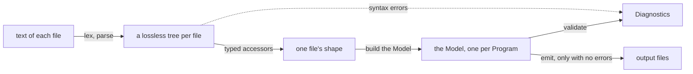

# The Transpiler

The banquet is fourteen files: a Vocabulary, nine Playbooks, three Plots and `banquet.regin`. None of them runs by itself. The Transpiler reads them, reports what is wrong with them, and writes the files a Target runs. It is one program, `regia`, and the same code runs inside the Visual Editor.

| We run | It does |
|---|---|
| `regia check banquet.regin` | reports every Diagnostic of the Program, and writes nothing |
| `regia build banquet.regin` | checks, then writes the Build into `build/banquet/` |
| `regia run banquet.regin` | builds, then starts the Build on its Target |
| `regia test cases/` | runs Conformance cases of our own, and the spec's |
| `regia explain banquet.regin precedence` | prints a report that isn't a Diagnostic |

This chapter is the tool seen from outside: what we hand it, what it prints and writes, and what the Visual Editor calls. How it is built comes in where it explains what we see. No Transpiler exists yet, so every line of output below is put together by hand from the spec. The words of a message are ours to choose; the spec fixes the parts.

## Checking a Program

```
regia check banquet.regin
```

The file we name is the Entry file. The Program is the Entry and every file reachable from it through imports. `banquet.regin` imports `plots/royal_banquet.regia`, which imports the Vocabulary, six Playbooks and the two Subplots, and they import the last three Playbooks. One command checks all fourteen, and no project file lists them.

The check reports and writes nothing. On the showcase it reports nothing at all: the Program has no error, no warning, and nothing allowed.

- An Entry can be any file. A `.regin` Entry names its `ROOT`, so everything is checked, Instancing included. A `.regia` Entry has no Root Plot: `regia check plots/honor_duel.regia` checks the duel for what it says, and skips the checks that need the whole story (Instancing's, and the ranking of Plans across Plots). The duel is read as written, never as if it were the Root Plot.
- Several Entry files are several Programs. `regia check banquet.regin plots/honor_duel.regia` checks the banquet, then the duel alone, one after the other. Builds are layered by importing, never by naming two Entries.
- Visibility is per file and uniqueness is per Program. Two files that never import each other can still clash on a name, and only an Entry that reaches both reports it.
- An import is followed from the file that writes it, until nothing new turns up. A path that leads to no file, or a loop of imports, is reported on the `IMPORT` line.

**Checks**

- An import path that leads to no file → `R1002`
- An import cycle → `R1003` (the message names every file in the loop)
- A `.regia` file importing a `.regin` → `R2101`
- A `.regin` Entry that reaches no `ROOT` → `R2104`

Spec: chapter 23, *Files and imports*, *The command line*. For Programs, chapter 10; for a `.regia` Entry, chapter 21, *The Root Plot*.

## Reading a Diagnostic

Had `serving.regia` lost its first line, `IMPORT "../vocabulary"`, every shared name in it would be unknown. `regia check banquet.regin` prints, for the first of them:

```
error[R1004]: `bring` is not declared
 --> playbooks/serving.regia:8:8
  |
8 |     TO bring(?dish, ?place), FROM patron ?guest:
  |        ^^^^^
  |
  = help: `bring` is declared in `vocabulary.regia`, which this file doesn't reach: add `IMPORT "../vocabulary"`
```

The same error follows for `walk_to`, `put_down`, `served` and the rest, each at its own place. The hint can name the file because the Vocabulary is still in the Program, reached through the other files.

A Diagnostic has the same parts wherever it is shown:

| Part | Here | What it is |
|---|---|---|
| severity | `error` | `error` or `warning`, nothing else |
| code | `R1004` | the check's stable name (*Diagnostic codes*) |
| message | "`bring` is not declared" | one line, free to change between versions |
| primary span | `serving.regia`, line 8, column 8 | the file and the stretch of text the problem is at |
| labels | none here | other places that explain it, each with a few words |
| hint | `help: …` | how to fix it |
| fixes | none here | quick fixes: a title and the text edits that apply it |

- Two severities. An error stops the Build; a warning doesn't. What the language does by its own rule, such as a default left out, is a line of a report (*Reports*), never a Diagnostic.
- The severity is printed beside the code, `warning[R1305]`, and never read from it.
- Every pass collects Diagnostics and none stops early, so one run reports every problem. A broken line in one file doesn't hide a wrong name in another.
- The list is sorted by file, then by position, and exact duplicates are removed. One mistake gives one Diagnostic: a check stays silent when what it looks for may be in text the Transpiler couldn't read, such as a broken Statement or a missing import.
- The command line prints a fix only by its title, as a `help:` line. The Visual Editor offers it as an action we can apply.
- The command line counts lines and columns from 1, columns in characters. Inside the Transpiler a position is a byte offset, and the Visual Editor gets them as the Language Server Protocol counts them (*The Workspace*).
- The command line renders Diagnostics in the layout above, rustc's.

### Warnings we accept

A warning we have read and accept is answered in the source with `#@allow` (*Syntax*). After validation, allowed warnings are marked *allowed* and hidden. `regia check --all-warnings` shows them, and the Visual Editor shows them faded.

**Checks**

- `#@allow` naming an error's code → `R0204`
- `#@allow` naming a code that silences nothing → `R0205` (warning, never itself allowed, reported only when the Program has no errors)

Spec: chapter 23, *Diagnostics*, *Positions*. For `#@allow`, chapter 02; for `R1004`, chapter 10.

## Diagnostic codes

A code is `R`, the two digits of the spec chapter that defines the check, and two digits numbering the check in that chapter's *Transpiler checks* section.

| Code | Defined in | Check |
|---|---|---|
| `R0111` | 01, Statements and blocks | a clause keyword with no `,` before it |
| `R1004` | 10, Scoping and imports | a name not declared in the file or anything it reaches |
| `R1301` | 13, Plan selection | a cycle in one Plot's relations |
| `R1305` | 13, Plan selection | a competition ordered only by name (warning) |
| `R3602` | 36, Jason `.jcm` | a `base_port` that isn't a whole number in 1–65535 |

- Inside a chapter, the numbers run errors first, then warnings. A check added later takes the next free number, whatever its severity.
- A code is never reused. A dropped check keeps its number, marked retired in its chapter: `R0107` went with Flat blocks, `R2111` with missing values. A check that changes severity keeps its number too.
- A check that reports a retired spelling is never dropped. It lives in the chapter that owns the construct, and spec chapter 01 lists them all (*Retired spellings*).
- Each code has a docs page, and the Visual Editor links each Diagnostic to it.
- What happens at runtime has `T` codes of the same shape, written into the Trace (*The Trace*).

A code says where its check is defined, and nothing more: `R13` means Plan selection only to someone who knows the spec's table of contents. The shape is kept because codes must stay stable and findable from the spec.

Spec: chapter 27, *Diagnostic codes*. For codes in a Diagnostic, chapter 23.

## What a check works on



| Pass | Works on | Gives |
|---|---|---|
| Lex | one file's text | tokens, comments and whitespace included; line ends and indentation as newline, indent and dedent tokens; lexical Diagnostics |
| Parse | one file's tokens | a lossless tree, and syntax Diagnostics |
| Typed accessors | one file's tree | typed views of its nodes (`Plot`, `WhenBlock`, `AssignStmt`, …); names are still text |
| Model build | every file of the Program | the Model: imports, names, kinds and parameter counts, Role Mappings, precedence ranks and Instancing resolved; Diagnostics for what can't enter it as written |
| Validate | the Model | the Diagnostics about what the built Model means, the Target's included |
| Emit | the Model | the Target's output files |

- Every file is parsed alone, and the parser always gives a tree, even for broken text. A stretch it can't read becomes an error node; what is inside is skipped and the rest is read as usual. A missing part leaves nothing in the tree, and the rest of its line is read. A missing `:` in `dining.regia` gives one syntax error there, and every other file is still checked.
- Parsing never depends on declarations. Every construct can be read from its tokens alone, which is what lets each file be parsed on its own and its imports be found before any name is resolved.
- The lossless tree keeps every byte: printing it gives the file back. The Visual Editor's text edits work on it (*The Visual Editor*).
- The Model is the Program's meaning across files. `ASSIGN Dining` in the `ROLE Guest` setup no longer holds the word `Dining`: it points to the Playbook declared in `dining.regia`, with the Mappings we left out filled in. Every item keeps its origin, its file and range, which is how a Diagnostic finds its way back to our text.
- The Model is resolved, not desugared. A Role setup stays a Role setup, and only the Target turns it into Messages from the Director. A Diagnostic therefore speaks of what we wrote, never of what it becomes.
- The Model is rebuilt in full on every change. On broken code it is built as far as it can be, so the Visual Editor's graph and the other Diagnostics stay while we type.
- One mistake gives one report. A check that says nothing does something (nothing declares `wave`, nothing sends `scandal`) stays silent when what it looks for may be in text that couldn't be read: `ACTION ) wave` is one syntax error, and `DO wave` reports nothing. A file that imports a missing file, directly or not, gets no `R1004` for a file-level name.

Since names are resolved across the Program, a name error can show in a file nobody touched, because an import elsewhere changed.

There is no preprocess pass, and no form between the Model and the Target: each Target reads the Model directly.

Spec: chapter 23, *Passes*, *The Model*, *Parsing never depends on declarations*. ADR 0010, ADR 0012.

## Targets

```regia
# throwaway: ports.regin
IMPORT "banquet.regin"

TARGET jason:
    base_port 0
```

```
error[R3602]: `base_port` must be a whole number from 1 to 65535
 --> ports.regin:5:15
  |
5 |     base_port 0
  |               ^
```

A Target is what a Build is for. It has two jobs:

- check: given the Model, report the Target's own Diagnostics. It runs in validate, with the rest, so `regia check` and `regia build` always report the same list. A Program that passes `check` never fails to build on an error that was there all along.
- emit: given the Model, return the output files as relative paths and their text. It runs only when there are no errors, and reports nothing.

The Target is chosen outside the Program: `--target <name>` on the command line, default `jason`, or the Visual Editor's project settings. A `TARGET` Block in a `.regin` only configures it (*Instancing*). `--target none` skips the Target's checks, so `regia check ports.regin --target none` reports nothing. 1.5 has one Target, Jason.

The core never writes a file. The command line writes the output into the Build folder, and the Visual Editor gets the same list from the Workspace.

**Checks**

- `SUITS` on a Target with no Selection function → `R1310` (warning, once per Program)
- A Label the Target doesn't support → `R1408` (warning, once per Program per Label)
- For Jason: `base_port` plus the number of starting Agents past 65535 → `R3601`; `base_port` not a whole number in 1–65535 → `R3602`; an individual Agent named `<kind>_<digits>` for a kind of the Build → `R3603`
- A `TARGET` group for a Target the Transpiler doesn't know → `R2116` (warning, the group is skipped)
- An unknown key under a known Target, or a value outside its set → `R2113` (warning)

Spec: chapter 23, *Targets*. For the settings, chapter 21, *Target settings*; for Jason's checks, chapter 36.

## Building

```
regia build banquet.regin
```

`regia build` checks, and if there is no error, writes the Build into the Build folder, `build/<Entry path>/`. The Entry path is the Entry's path from the current directory, without the `.regin` extension: `banquet.regin` builds into `build/banquet/`, and `tests/test.regin` into `build/tests/test/`. Two Entries with one name in two folders never share a Build.

- `build` takes one Entry. A `.regia` Entry gives Target code only, with no Root Plot and no cast: for Jason, the ASL files with no `.jcm`. It builds into a folder that keeps the extension, `build/plots/honor_duel.regia/`.
- Warnings don't block the Build.
- A build replaces everything in its folder except `traces/`, so the files of a renamed or removed Playbook don't linger. `traces/` keeps the Traces of past runs, and neither the command line nor the Visual Editor ever clears it.
- A `.regin` that declares no Agent kind and no individual Agent builds the Target code alone. For Jason, that is the ASL files with no `.jcm`.

What is inside a Jason Build, file by file, is in *Jason: the Build*. We don't read the ASL: the spec promises what a Program does and leaves the Target free in how it writes it, so two versions of the Transpiler may write different ASL for one Program. We read the Trace, which speaks in our names.

Spec: chapter 23, *The Build folder*, *The command line*. For a Build with no cast, chapter 21, *With no cast*; for Jason's files, chapter 28.

## Running

```
regia run banquet.regin --seed 42
```

`regia run` builds, then starts the Build with the Target's runtime, which the command line carries. For Jason that is the multi-agent system from the `.jcm`, with `regia-jason` on the class path and, after it, every jar in the Project's `lib/` folder. The game connects as it always does. We never write a class path.

- `lib/` sits beside `build/` in the current directory, and holds the Target's own code, already built: jars, for Jason, such as the class behind an Action with a dotted External name. `run` and `test` put it on the class path. The command line never compiles it, never reads it in `check` or `build`, and never copies it into a Build.
- `--seed <n>` gives the run its seed. It beats the Build's `SEED`; with neither, the run picks one. The Trace records it either way (*Randomness*).
- `--console all|warnings|off` sets how much of the Trace the console shows; the default is `all`. The Trace file always gets every entry (*The Trace*). How much is shown changes nothing in the run, so it isn't a Target setting.
- `run` takes one `.regin` Entry. A `.regia` Entry is an error of the command line: a run needs a `ROOT`.

Spec: chapter 23, *The command line*. For the Jason runtime and `lib/`, chapters 28 and 35.

## Reports

```
regia explain banquet.regin precedence
regia explain banquet.regin interface Duelling
```

Some things the Transpiler knows are not problems, and come as reports. `regia explain` prints them:

- `precedence` is the conflict report: per Role and Trigger, the competing Trigger Blocks in the order they rank, and why each is there. Full stops, unreachable candidates and defaults left out are lines of it (*Precedence and Labels*).
- `interface` is the Interface of one Playbook or Plot, as the Transpiler infers it (*Interfaces*).

Both work on a `.regia` Entry too, with what can be known without a Root Plot. The Visual Editor shows the same reports, through the Workspace's `report` call.

Spec: chapter 23, *The command line*. For the conflict report, chapter 13; for Interfaces, chapter 38.

## The command line

```
regia check <entry>…                 Diagnostics for each Entry, Target checks included
regia build <entry>                  check, then write the Build
regia run <entry>                    build, then start it
regia test <case or folder>…         run Conformance-format cases
regia explain <entry> precedence     the conflict report
regia explain <entry> interface <Playbook or Plot>
                                     an Interface
regia --version                      the Transpiler's version
```

| Option | On | Does |
|---|---|---|
| `--target <name>` | all | the Target; default `jason`; `none` skips the Target's checks |
| `--seed <n>` | `run` | the run's seed, over the Build's `SEED` |
| `--console all\|warnings\|off` | `run` | how much of the Trace the console shows; default `all` |
| `--deny-warnings` | `check`, `build`, `test` | a warning fails the command, for continuous integration |
| `--all-warnings` | `check`, `build` | shows allowed warnings too, marked *allowed* |
| `-q` | all | prints only Diagnostics |

The exit status is 0 on success, and 1 when an error was reported, a warning under `--deny-warnings`, or a case failed.

| Command | Entry |
|---|---|
| `check` | any number of `.regin` or `.regia` files, each its own Program; a `.regia` Entry is checked without a Root Plot |
| `explain` | one `.regin` or `.regia` file |
| `build` | one `.regin` or `.regia` file |
| `run` | one `.regin` file |
| `test` | case files and folders; a folder is searched for cases |

Spec: chapter 23, *The command line*.

## Regia 1.5 and the Transpiler

A Transpiler build has one version, which `regia --version` prints. No option picks 1.5 or 2.0. A 1.5 build still parses every construct of 2.0, and reports one error for each construct of a system 1.5 leaves out:

[`playbooks/keeping_watch.regia`](../showcase/playbooks/keeping_watch.regia), as a throwaway variation:
```regia
WHEN saw_pouring(?who), FROM GAME:
    DO seize(?who)
```

```
error[R0109]: `FROM GAME` is Regia 2.0, and this build is Regia 1.5
  --> playbooks/keeping_watch.regia:14:29
   |
14 |     WHEN saw_pouring(?who), FROM GAME:
   |                             ^^^^^^^^^
```

The construct gets no other Diagnostic: its own chapter's checks aren't run on it. At runtime, the 1.5 run refuses an Agent the game spawns, with the Trace warning `T1902`. `regia test` runs only the cases whose `#! regia:` line fits its version (*Conformance cases*).

> **In 2.0** `R0109` and `T1902` are retired and keep their numbers. A 1.5 Program is valid in 2.0 and does the same thing there, so a 2.0 build needs no 1.5 mode. Spec chapter 01, *A word of Regia 2.0 in a 1.5 build*; chapter 19, *Regia 1.5*; chapter 27, *Regia 1.5*.

**Checks**

- `FROM GAME`, `FROM ME`, `FROM` with `OR`, `BY` on a Goal's ending, a Goal's ending in a Plot, a Quota Trigger, `SENT` or `JOINED`, in a 1.5 build → `R0109`
- An Agent spawned during a 1.5 run → `T1902` (Trace warning)

Spec: chapter 23, *Regia 1.5*. For what 1.5 leaves out, chapter 27, *Regia 1.5*.

## Conformance cases

A Conformance case is a small Program with the outcome the spec promises for it. The spec keeps its cases in `docs/spec/cases/`, one folder per language chapter, and a Transpiler is tested against them. The format is not only the spec's: `regia test` runs cases of this form written by anyone, so we can keep cases for the banquet.

There are two kinds:

- A check case states the exact Diagnostics the Transpiler reports for it, or that there are none.
- A behaviour case adds a scripted run and the Trace it should leave. Its script, its `.trace` file and how a Trace is matched are in *The Trace*.

Emitted ASL is never part of a case. The spec promises what a Program means, not one way of writing it for a Target.

### Annotations

Here is a check case of our own, a throwaway: a Guard's Plan for being put on duty, with the kind word left out.

```regia
#! case: a Fact Trigger needs LEARNED to start a Plan
#! rule: R0503

IMPORT "../vocabulary"

PLAYBOOK Reporting_for_duty:
    WHEN on_duty, FROM DIRECTOR:      #! error R0503
        DO salute
```

A case says what it expects in annotations, comments that start with `#!`. To the language they are plain comments; only the test runner reads them.

The header comes first, before any code:

| Line | Says |
|---|---|
| `#! case: <one line>` | what the case shows |
| `#! rule: <section or code>` | the rule or check it exercises; several lines allowed |
| `#! ok` | an accepting case: the Program has no Diagnostics at all |
| `#! regia: 2.0`, `#! regia: 1.5` | the case runs only on that version (*Regia 1.5 and the Transpiler*) |

A behaviour case's header has three more lines, `seed:`, `exactly` and `game link: none` (*The Trace*).

After code, an annotation expects a Diagnostic whose primary span starts on that line: `#! error R0503`. Several on one line are written one after another, `#! error R1301, warning R1305`. On a line of its own, `#!^` points at the line above. It is for where a trailing comment can't go, such as after a one-line doc comment, whose value runs to the end of its line:

```regia
#@desc: the host's welcome
#!^ warning R0203
```

### Matching

A check case passes when the Transpiler reports exactly the annotated Diagnostics: the same severity, the same code, a primary span starting on the same line. One more, or one fewer, fails it.

- Messages, labels, hints and fixes aren't compared. They can improve without breaking a case.
- A case is matched as with `--all-warnings`. A warning `#@allow` silences is still annotated, so a case can show what an allow covers.
- In a folder case, each annotation sits in the file its Diagnostic lands in.
- A case that doesn't match is a failing test, not a Diagnostic.

### Case files

```
cases/
  fact-trigger-without-learned.regia
  banquet-reaches-farewell/
    farewell.regin
    case.trace
```

- A case is one `.regia` file, or a folder when it needs several files (imports, Instancing). Its name is a slug saying what it exercises.
- In a folder case, the Entry is the `.regin` at its root if there is one. Otherwise every `.regia` file in the folder is the Entry of a Program of its own, as on the command line.
- A behaviour case is always a folder, with a `.regin` Entry naming its `ROOT`, and a `.trace` file.

**Checks**

- A Diagnostic with no annotation, or an annotation with no Diagnostic → the case fails

Spec: chapter 27, *What a case checks*, *Case files*, *Annotations*. For behaviour cases, chapter 34.

## Coverage

A language chapter of the spec is proven when:

1. every error and warning in its *Transpiler checks* has at least one check case that reports it;
2. every rule it states has at least one accepting case (`#! ok`) that uses it;
3. every case names, in `rule:`, the rule or check it exercises;
4. every rule about what a Program does at runtime has at least one behaviour case.

The spec carries one exemplar case per language chapter, to show the format on that chapter's material. Full coverage is written by the development effort, test-first, as it builds each chapter's part of the Transpiler. The spec owns its cases: the Transpiler's test suite copies them and never edits them there. A disagreement with a case is a change to the spec.

The language chapters are 01–21 and 26. The architecture chapters (22–25) say how the tools are built and have no cases. With versions, each is proven on its own: a 1.5 build is proven on the cases it runs.

Spec: chapter 27, *Coverage*, *Regia 1.5*.

## `regia test`

```
regia test cases/
```

`regia test` runs cases in the spec's format. A folder is searched for cases.

- A check case is checked against its annotations.
- A behaviour case is built, then run in test mode against a scripted stand-in for the game, and its Trace matched against the `.trace` file (*The Trace*). The Project's `lib/` jars go on the class path, as for `regia run`, so the Project's own Java runs for real.
- A case whose `#! regia:` line names the other version is skipped.
- The exit status is 1 if a case failed.

How the runner is built inside `regia test`, and how the spec's cases are copied into the Transpiler's repository, belong to the development effort.

Spec: chapter 23, *The command line*; chapter 27, *Case files*. For test mode on Jason, chapter 35.

## Crates

The Transpiler is a Cargo workspace of three crates:

| Crate | Kind | Holds |
|---|---|---|
| `regia-core` | library | `syntax` (lexer, parser, the tree), `ast` (typed accessors), `model`, `validate`, `edit` (domain edit operations), `diagnostics`, `targets/jason`; no file I/O, no global state |
| `regia-cli` | native binary | the commands: gathers files from disk, renders Diagnostics, writes the Build folder, starts runs, matches cases |
| `regia-wasm` | WebAssembly library | the glue for the Visual Editor: the Workspace, conversions, serialization |

- The core does no file I/O. It is handed a file set (path → text) and an Entry. The command line gathers that set from disk: it reads the Entry, then each import, until nothing new turns up.
- More crates (a syntax crate of its own, one per Target) are split out only if compile times or reuse call for it.
- The parser is written by hand, and the tree is rowan's, behind the core's `syntax` module.

Spec: chapter 23, *Crates*, *Files and imports*. ADR 0010, ADR 0012.

## The Workspace

The Visual Editor runs `regia-core` compiled to WebAssembly, through one stateful object, the Workspace. It holds every file of the Project in memory.

| Call | Does |
|---|---|
| `setFile(path, text)` | adds or replaces a file, reparses it and rebuilds the Model |
| `removeFile(path)` | removes a file |
| `setActiveEntry(entry)` | sets the Active Entry: the Program whose meaning the calls below report, for a file several Entries reach |
| `entriesReaching(path)` | the `.regin` Entries whose Program holds a file |
| `diagnostics()` | the current Diagnostics, per file |
| `semanticTokens(path)` | one file's names, each coloured by what it resolves to |
| `graph(plot)` | the graph view of one Plot |
| `docs(path)` | one file's Docs page: its Plots, Playbooks and Vocabulary, with doc comments and Interfaces |
| `preview(operation)` | what an edit operation would do, before it is applied |
| `edit(operation)` | the text edits, per file, for one domain edit operation, `moveFile(from, to)` included |
| `build(entry)` | the Target's output files for one Entry |
| `report(entry, kind)` | the conflict report or an Interface, as `regia explain` prints it |

- Every `.regin` in the Project is an Entry, its own Program and its own Build. A `.regia` file no Entry reaches is checked as its own Entry, with no Root Plot, so it still gets name errors while it is being written. Every file gets its syntax Diagnostics either way.
- Only plain data crosses into the Visual Editor: Diagnostics, semantic tokens, text edits, graph views, output files. Tree nodes and Model items never do.
- An edit operation names what it edits by a structural key, `RoyalBanquet/feast/WHEN insult_heard#0`, never by a Model id (ids change on every rebuild) or a byte offset (the Visual Editor does no text logic). A key that no longer resolves, or a construct with an error inside, gives a Diagnostic instead of edits.

### The shapes at the boundary

Everything the Workspace hands out has the shape the Language Server Protocol uses, so a language server for another editor could pass it on unchanged:

| Diagnostic part | LSP | In the Visual Editor (Monaco) |
|---|---|---|
| severity | `Error`, `Warning` | `MarkerSeverity.Error`, `Warning` |
| code | `code`, with `codeDescription` linking to its docs page | `code`, with the same link |
| message, hint | `message`, the hint after a blank line as `help: …` | the same |
| labels | `relatedInformation` | `relatedInformation` |
| fixes | code actions carrying a `WorkspaceEdit` | code actions |

- Positions are LSP's: lines counted from 0, characters in UTF-16 units. The Visual Editor adds 1 to both for Monaco. The command line counts from 1, in characters.
- Text edits are LSP `TextEdit`s, grouped per file as a `WorkspaceEdit`. Semantic tokens use LSP's encoding, which Monaco shares.

Spec: chapter 23, *The Workspace (WASM surface)*, *LSP shapes at the boundary*, *Positions*. For the Active Entry, chapter 24; for graph views and previews, chapter 25.

## How this combines with…

### Syntax

`#@allow` answers a warning where a reviewer sees it, and the Transpiler removes what it covers after validation. A retired spelling always gets an error with the new spelling as its hint, so an old file reports every change it needs in one run. (*Syntax*)

### Vocabulary and files

The Program is everything an Entry reaches, so the same `.regia` file can be in several Programs and get different Diagnostics in each. `dining.regia` is checked in `banquet.regin`'s Program and again, alone, when the Visual Editor finds no Entry for it. (*Vocabulary and files*)

### Instancing

A `.regin` is what we build. The test casts of the walkthrough each import `banquet.regin` and change what differs, and each builds into a folder of its own. `SEED` gives every run of a Build its seed, and `--seed` overrides it for one run. (*Instancing*)

### Precedence and Labels

Most of what the Transpiler says about precedence is a warning, such as an order decided only by name. Why a Plan wins is a report: `regia explain <entry> precedence`. (*Precedence and Labels*)

### Interfaces

Interface checks are ordinary warnings, with codes from spec chapter 38, and `#@allow` silences them like any other. The Interface itself is a report, printed by `regia explain <entry> interface`. (*Interfaces*)

### The Trace

A Diagnostic is found at build and has an `R` code; a runtime warning or Failure is found in a run, has a `T` code, and goes into the Trace. A behaviour case, run by `regia test`, is how a rule about runtime is tested. (*The Trace*)

### The Visual Editor

The Visual Editor runs the same core through the Workspace, on every change. Its Diagnostics are the same, with the same codes; a fix is an action there, and its build writes the same `build/<Entry path>/` folder. (*The Visual Editor*)

### Jason: the Build

What `regia build` writes for Jason, the `.jcm`, the ASL files, `cast.json` and the source map, is in *Jason: the Build*. How `regia run` and `regia test` start a Jason run is in *Jason: the game and the Trace*.
