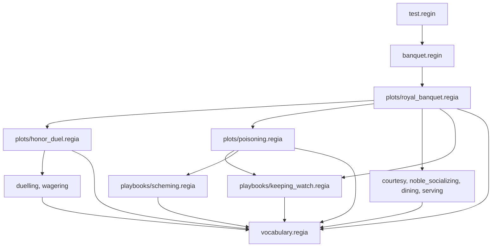

A Guest walks to their seat, sits down, greets the Host and lets the Director know. To write that down we have to show where one step ends and which steps belong together under "when the Guest knows its seat". Regia does both with the layout of the text: a line is a step, and indentation groups the steps. This chapter is about that layout, about comments, and about how a Program is spread over files.

It follows *The Logic of Regia*, which used all of this without explaining it. What the names on a line stand for is in *Vocabulary*.

## Statements and Blocks

`showcase/playbooks/courtesy.regia`
```regia
PLAYBOOK Courtesy:
    ROLE host.

    TO take_seat FROM DIRECTOR:
        GIVEN seat(?place):
            DO walk_to(?place).              # waits until we have arrived
            DO sit_down.
            TELL host greeting.
            SIGNAL took_seat.
        # no ELSE: with no seat laid for us, take_seat fails at once
```

One line is one Statement or one declaration. A line that ends in `:` is a Block header, and the lines indented under it are its Block. The Block ends at the first line indented as much as the header, or less. Here three Blocks sit inside each other: the Playbook, the Plan, and the `GIVEN`.

Every Block header ends in `:`, and a line that doesn't end in `:` never opens a Block. `ROLE host.` above declares a Role and nothing more. In a Plot, the same word opens a Block when the Role has a setup: `ROLE Guest STARTS WITH:`.

- We indent with tabs or with spaces, at any width, but not with both in one file.
- Blank lines and lines holding only a comment don't count. The last line of the snippet could sit at any depth.
- Coming back to a depth that no open Block has is an error.
- A header with nothing under it is allowed and gets a warning, so that we can sketch a Plot before filling it.

The `.` at the end of each line is optional. At the end of a line it does nothing, and `DO sit_down` means the same as `DO sit_down.`

`#revise` The showcase ends every Statement and Import with a `.` and writes no `.` after a Vocabulary line, and the spec's own examples do the same. Nothing asks for either habit, and the Visual Editor writes new lines without the `.`, so a file edited from both sides ends up mixed.

Spec: chapter 01.

## Inline blocks

`showcase/playbooks/noble_socializing.regia`
```regia
WHEN idle:
    ?grudges = COUNT(grudge(?, ?)).
    EITHER, WEIGHT 3: DO chat.
    OR: DO sip_wine.
    OR, WEIGHT ?grudges: PURSUE vent.
```

When something follows the `:` on the same line, the Block is an Inline block. It ends with the line. Each of the three Options above is a Block of one Statement, written this way so that the choice reads as a list. `EITHER` and `OR` are Block headers like any other, and an Option with more to do is indented instead (*Randomness*). An Inline block never runs over several lines.

More can go on one line with two more signs. A `.` followed by a space ends a Statement, so another can follow it. A `;` closes an Inline block before the line is over.

| We write | It means |
|---|---|
| `IF hungry: DO eat(?dish)` | An Inline block, closed by the end of the line. |
| `DO stand_up. DO raise_cup` | Two Statements on one line. |
| `IF hungry: DO eat(?dish). DO sip_wine` | Both Statements are in the `IF`. |
| `IF hungry: DO eat(?dish); ELSE: DO push_away(?dish)` | On one line, the `;` before `ELSE` is needed. |
| `IF hungry: DO eat(?dish); FORGET on_plate(?dish)` | After the `;` we are back outside. The `FORGET` runs whether or not the Guest is hungry. |
| `IF hungry: IF seat(?): DO sit_down;; DO chat` | Each `;` closes one Block. `DO chat` always runs. |

A header left at the end of a line can't have an indented Block if it is itself inside an Inline block:

```regia
PLAYBOOK Wagering: TO give_signal FROM DIRECTOR:
    DO drop_handkerchief.        # error: the Playbook's Inline block ended with the line above
```

`#revise` In 700 lines the showcase never needed a `;`, and never put two Statements on a line. Each of its Inline blocks holds one Statement and ends with its line. The one-line style brings the rule about what follows a `.`, the `;;` and the error above, for a way of writing we had no use for.

Spec: chapter 01.

## What a `.` ends

`showcase/banquet.regin`
```regia
AGENT hothead PLAYS Guest:
    COUNT 2.
    bravery AT 0.9.
    sympathy AT -0.4.
    aggressiveness AT RANDOM(0.6, 1).
```

The line `bravery AT 0.9.` has two dots, and only the second ends it. A `.` ends a Statement when it is followed by a space, the end of the line, a `;` or a `#`. Anywhere else it is part of a number, as here, or of a dotted name such as `hall.seating.seat`, the game's name for a Fact (*Vocabulary*).

The space after the `.` is therefore part of the syntax. `DO stand_up.DO raise_cup` is read as one Action with the dotted name `stand_up.DO`, which is an error. The Transpiler sees the keyword inside the name and suggests the space.

`#revise` One sign ends a Statement, marks a decimal and joins the parts of the game's names, and the character after it says which. The first of the three is the one we never need at the end of a line.

Spec: chapter 01. For dotted names, chapter 10.

## Long lines

`showcase/playbooks/noble_socializing.regia`
```regia
WHEN insulted FROM peer ?who,
        SUITS aggressiveness AT 0.2 AND sympathy AT -0.5,
        SHIFTS aggressiveness BY 0.3:
    DO scowl_at(?who).
    PURSUE resent(?who).
```

A line that ends in `,` goes on with the next line, and so does a line with a `(` still open. The three lines above are one Block header, and the `:` that closes the third opens the Block. The commas that separate a header's Labels are what let it wrap (*Precedence and Labels*). `RoyalBanquet` wraps a `START SUBPLOT` and its three Mappings the same way.

The lines that carry on have to be indented further than the first. How much further is up to us. The showcase indents them twice, so that they don't line up with the Block under them.

Spec: chapter 01.

## Comments

`showcase/playbooks/duelling.regia`
```regia
# Every change of stamina, the first included, is answered with a lunge.
WHEN stamina(?) LEARNED:
    WAIT RANDOM(1, 3) SECONDS.
    DO lunge.
    TELL opponent hit.
```

A `#` starts a Comment that runs to the end of the line. It can have a line to itself or follow code, as in `DO sit_down.  # at last`. Comments mean nothing to the language.

A Comment over several lines is enclosed in `#[` and `]#`. It can start and end in the middle of a line. These Comments nest, so we can comment out a piece of code that already has one inside:

```regia
#[ Left out until the kitchen can run out of wine.
WHEN sold_out(?dish) FROM waiter:
    FORGET craves(?dish).    #[ and sulk? ]#
]#
```

Where a Comment sits matters to the Visual Editor, which has to decide what to do with it when we move or delete a construct on the drawing. A Comment directly above a construct, or after it on its line, goes with the construct. One at the end of a Block and indented like its lines, such as `# no ELSE: …` in the first snippet of this chapter, belongs to that Block. One with blank lines around it belongs to nothing and stays where it is.

There are three kinds of comment, told apart by the character after the `#`:

| Kind | One line | Several lines | Read by |
|---|---|---|---|
| Comment | `# text` | `#[ … ]#` | people only |
| Doc comment | `#@key: value` | `#@key[ … ]#` | tools, as the description of a declaration |
| Instancing comment | `#% …` | `#%[ … ]#` | the Transpiler, as Instancing (*Instancing*) |

Spec: chapter 02. For Comments in the Visual Editor, chapter 22.

## Doc comments

`showcase/plots/royal_banquet.regia`
```regia
#@version: 2.0
#@desc[
    One evening at court, from the Guests arriving to the last one taking leave.
    HonorDuel and Poisoning are started during the feast, as its Subplots.
]#
PLOT RoyalBanquet:
```

A Doc comment describes the declaration directly below it. The word after `#@` is the Doc key. Tools know three keys, `desc`, `author` and `version`, and any other word is accepted. With no key at all, `#@ text`, the key is `desc`. A key may come more than once, for example for two authors.

In the form with brackets the text is taken as it stands up to the first `]#`, and the indentation its lines share is removed. It doesn't nest.

- A Doc comment starts its own line. It can't follow code.
- It can describe a Plot, a Playbook, a Role, a Phase, a Plan or a Vocabulary item. It can't describe a Statement.
- No blank line may come between it and its declaration. Plain Comments in between are fine.
- Any other Doc comment is ignored, with a warning.

One Doc comment describes a whole file. It comes first in the file and has a blank line after it:

`showcase/vocabulary.regia`
```regia
#@desc: The Vocabulary of the banquet: everything the game, the Agents and the Directors share.

# ── Propensities ─────────────────────────────────────────────────────────────

TRAIT bravery
MOOD sympathy, aggressiveness
```

The Visual Editor shows Doc comments when we select a declaration, and builds a documentation page for each Plot from them (*The Visual Editor*).

`#revise` A blank line means nothing anywhere else in the language. Here it decides whether the first Doc comment describes the file or the declaration under it, and whether any other one is read or ignored.

`#revise` The showcase gives its Playbooks a `#@desc` and its Plans a plain Comment on the line before, such as the one on the `stamina` Plan in the last section. A Plan can have a Doc comment too. One character separates the text tools read from the text they skip, and we wrote the second without choosing to.

`#revise` Every Vocabulary item with a Doc comment in the showcase is declared on a line of its own. The spec doesn't say what a Doc comment above `FACT purse(gold), craves(dish), on_duty` describes: the first item or all three.

Spec: chapter 02. For where Doc comments are shown, chapter 25.

## Files and Imports

`showcase/plots/poisoning.regia`
```regia
IMPORT "../vocabulary".
IMPORT "../playbooks/scheming".
IMPORT "../playbooks/keeping_watch".

#@desc: Someone at the table means harm. No Phases: it runs until the poison is taken or the Poisoner caught.
PLOT Poisoning:
```

An Import makes the declarations of another file visible in this one. The path is a string, read from the folder of the file that holds the Import. The `.regia` ending may be left out. Imports come first in a file, after the file's Doc comment if it has one, and before any declaration.

After the Imports a file holds Vocabulary, Playbooks and Plots in any order, and a name may be used above the line that declares it. The showcase keeps the Vocabulary in one file and gives every Playbook and Plot a file of its own. That is a habit, and a whole Program can sit in one file.

Imports carry on through other Imports. A file sees what it declares, what the files it imports declare, and what those import in turn.

`showcase/banquet.regin`
```regia
# The full banquet.
IMPORT "plots/royal_banquet".

ROOT RoyalBanquet.
```

This Instancing file names one Plot file and reaches all twelve `.regia` files of the showcase. It is the Entry file, the one we hand to the Transpiler, and the Program is everything reachable from it. `test.regin` in turn imports `"banquet.regin"`, with the ending written out because it isn't `.regia`.



- A file is loaded once, however many paths lead to it. `keeping_watch.regia` is reached from two Plots and `vocabulary.regia` from every file.
- Imports that form a circle are an error.
- Everything at the top level of a file is visible to whoever reaches the file. Nothing can be kept back, except Local Vocabulary (*Vocabulary*).
- Names are never written with their file in front. All files of a Program share one set of names, and a name means one thing in all of them (*Vocabulary*).

The three arrows from the Plots straight to `vocabulary.regia` are not needed, since each Plot reaches it through its Playbooks. We write them because the Plots use Vocabulary names themselves. A name that arrives through another file's Import is lost when that file stops importing it, and the error shows in a file nobody touched. The Transpiler's message then says where the name used to come from.

`#revise` Importing what we use is a habit that nothing checks. An Import line doesn't say which names it brings, and a use of a name doesn't say which file it came from. Only the Visual Editor shows it.

Spec: chapter 10. For `.regin` files, chapter 21.

## How this combines with…

### Instancing

`showcase/test.regin`
```regia
AGENT hothead PLAYS Guest.           # a kind can't be removed, only emptied

AGENT knight PLAYS Guest AND Guard:
    COUNT 1.
```

An Instancing file follows the same rules for lines, Blocks and Comments. An Agent declaration with nothing to say is written as a single line, like `ROLE host.`. In a `.regia` file the same lines go in Instancing comments, `#% ROOT RoyalBanquet.`, which stand at the top level after the Imports. The showcase keeps all its Instancing in the two `.regin` files. (*Instancing*)

### The Visual Editor

The editor changes only the text an edit touches. It keeps our dots, our `;` and our Comments as we typed them, and what it adds is written one Statement per line with no `.`. Whether a Comment follows a construct that is moved depends on the blank lines around it, as described above. (*The Visual Editor*)

### The Transpiler

A line can be read without knowing what its names are. The keyword in front says what the line is (`DO`, `LEARN`, `PURSUE`), and the names are only names. Each file is therefore read on its own, and its Imports are found before any name is looked up. A mistake of layout is reported in its own file even when an Import next to it is broken. (*The Transpiler*)

## Since 1.0

In 1.0 every Statement ended with a `.` and indentation meant nothing. A Plot was opened with `PLOT RoyalBanquet.`, unlike every other Block. A comment was carried over to the next line with `#-`.

`#changes` Indentation gives the structure. `.` and `;` are kept for writing several Statements or a whole Block on one line, and most 1.0 code still parses because a `.` at the end of a line is allowed.

`#changes` Every Block header ends in `:`, `PLOT` included.

`#changes` Comments over several lines are `#[ … ]#`, with the same brackets for Doc comments and Instancing comments. `#-` is gone, and the primer's `## … ##` was not taken up.

`#changes` Instancing comments (`#%`) and Instancing files (`.regin`) are new.

`#changes` Vocabulary no longer has to be declared before it is used. After the Imports, declarations come in any order.
