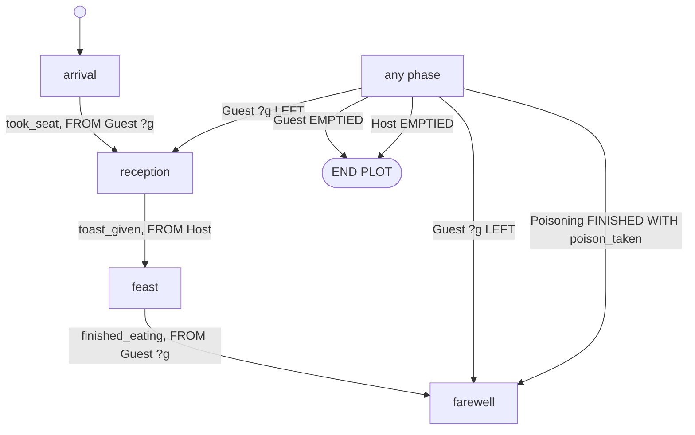
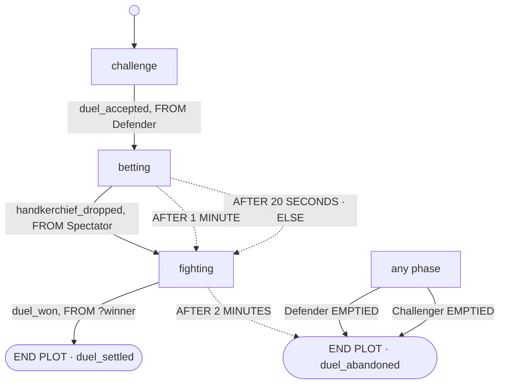
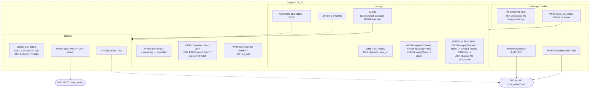
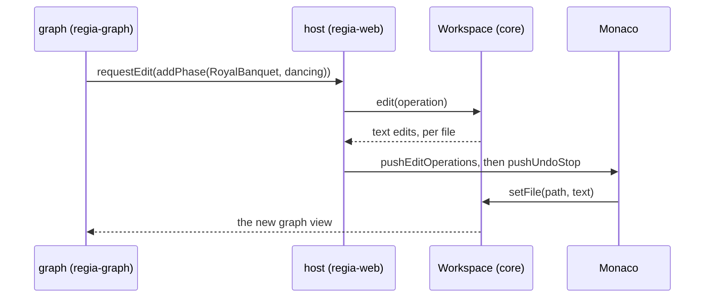

# The Visual Editor

The banquet moves from `arrival` to `farewell` through eight `ENTER` and `END PLOT` lines spread over a hundred lines of `royal_banquet.regia`, each inside the Plan that makes it. To see the evening as a whole, we have to find them and line them up in our head. The Visual Editor does that for us. It opens the showcase folder as a Project, shows a file's text on the left and a drawing of its Plot on the right, and keeps the two in step. An arrow drawn on the right becomes a Plan in the text, and a Plan typed on the left becomes an arrow.

| Part | What it is |
|---|---|
| the Project | a folder of files, on disk or kept by the browser |
| the text pane | Monaco, one tab per file, checked as we type |
| the graph pane | a drawing of one Plot, one tab per Plot of the active file, in two views |
| the side panel | the Inspector for what is selected, and a Docs page for the file |
| the Workspace | the Transpiler's core, compiled to WebAssembly, holding every file of the Project (*The Transpiler*) |

This chapter covers what the editor opens, what it draws, what we can change from the drawing, and what that does to our text. No Visual Editor exists yet, so every drawing and panel below is put together by hand from the spec. The spec fixes what is on a drawing or a panel and leaves the layout to us.

## A Project

```
showcase/
    banquet.regin
    vocabulary.regia
    README.md
    playbooks/    courtesy.regia, dining.regia, … (nine files)
    plots/        honor_duel.regia, poisoning.regia, royal_banquet.regia
```

A Project is a folder. The editor is a static web page with no server behind it, so there is nothing to install, and every file goes through one small project store (list, read, write, rename, delete) with two backends:

| Backend | Where the files are | Browsers |
|---|---|---|
| Disk folder | a folder on disk, opened with the File System Access API; edits change the real files | Chromium only (Chrome, Edge) |
| Browser project | the browser's private file storage (OPFS) | all |

- Both backends import and export a Project as a `.zip`. That is how a Browser project gets to disk or into git.
- The editor offers only the backends the browser has. Where "Open folder" is missing, a note says why. Only Chromium lets a page open a disk folder, so in Firefox and Safari the Project is a copy that moves in and out as a zip, apart from the copy in git. The note names the command line, which works on the git copy.
- A Project is not part of the language. There is no project file, no import root and no search path: an `IMPORT` stays relative to the file that writes it (*Vocabulary and files*). The Project only bounds which files the Workspace holds.

### What the Workspace is given

- The file tree shows the folder without hidden folders (`.git`, …) and without `build/`.
- Only `.regia` and `.regin` files go into the Workspace. `README.md` and other plain text open in Monaco with no language features. Other files are listed and don't open.
- Build output never goes back into the Workspace.

### Saving, and changes from outside

- There is no save step. An edit is written to the store after a short pause, and the Workspace gets every change as it is typed, so what is checked and built is always what is on screen.
- A Disk folder can't be watched portably, so the editor reads it again whenever the window gets the focus back and sets the changed files into the Workspace. An edit made in another tool, or a `git pull`, shows up that way.
- If a file changed on disk while its tab had edits not yet written, the editor asks whether to keep ours or take the disk's.

### Renaming and moving files

Renaming `vocabulary.regia`, or dragging it into a `shared/` folder, breaks the `IMPORT` line of every file that points at it. The editor asks the core for the `moveFile(from, to)` edit operation, which returns text edits rewriting every affected `IMPORT` string across the Project, and the moved file's own imports too. The editor applies them as one edit, then renames the file in the store. Moving the Vocabulary changes an `IMPORT` line in twelve files in one step, undone as one. Path logic lives only in the core.

Spec: chapter 24, *Platform*, *Projects and the project store*, *Renaming and moving files*. For imports, chapter 10.

## The window

```
┌──────────────────┬──────────────────────────────────┬──────────────────────────────┐
│ banquet.regin    │ [royal_banquet.regia] [dining…]  │ [RoyalBanquet]  Inspector│Docs│
│ vocabulary.regia │                                  │                              │
│ playbooks/       │   Monaco                         │   graph of the Plot          │
│ plots/           │                                  │                              │
└──────────────────┴──────────────────────────────────┴──────────────────────────────┘
 Entry: banquet.regin
```

- The text pane has one tab per open file.
- The graph pane follows the active `.regia` tab. It has its own tabs, one per Plot in that file, and a side panel with the Inspector and the Docs tab. Every Plot of the showcase has a file of its own, so there is never more than one graph tab.
- A `.regia` file with no Plot, such as `courtesy.regia`, shows only the Docs tab. A `.regin` tab shows no graph.

### The Active Entry

A `.regia` file can be reached by several `.regin` Entries. Each is its own Program, with its own Diagnostics, name origins and Interfaces (*Instancing*). The editor shows one of them, the Active Entry, and the status bar names it.

```regia
# throwaway: short_evening.regin
IMPORT "banquet.regin"

KIND noble:
    COUNT 2
```

With this file beside `banquet.regin`, `royal_banquet.regia` is in two Programs. A check that depends on the cast can pass in one and fail in the other.

- Markers, semantic colours, the graph's name origins, the Docs page and the Interfaces all come from the Active Entry's Program.
- The Active Entry defaults to the last `.regin` we opened or built that reaches the active file. When we switch to a file outside its Program, it switches to a `.regin` that reaches that file.
- When other Entries reach the file, the status bar says so ("also in 1 other Entry") and offers to switch.
- A `.regia` file no `.regin` reaches is checked alone, with no Root Plot.

### Undo

When a Project loads, every `.regia` and `.regin` file gets a Monaco model of its own, and opening a tab only shows it. Every edit, typed or computed by the core, lands in a model and is written to the store like typing, even in files that aren't open.

Undo follows the operation, not the file. The editor keeps one undo stack across all the models:

- A typed edit is undone in its file, as in any editor.
- An edit that touched several files (a rename, a declaration added to another file, `moveFile`) is undone whole, by undo in any of those files, as long as it is still the latest edit in each.
- If one of the files has been edited since, undo there takes back that file's part only, and a notice names the files that keep the edit.

There is no "Undo all" button.

Spec: chapter 24, *Layout*. For Entries and Programs, chapters 21 and 23.

## Highlighting and quick fixes

[`playbooks/courtesy.regia`](../showcase/playbooks/courtesy.regia)
```regia
TO take_seat, FROM DIRECTOR:
    GIVEN seat(?place):
        DO walk_to(?place)               # waits until we have arrived
        DO sit_down
        TELL host greeting
    # no ELSE: with no seat laid for us, take_seat fails at once
```

Colour comes in two layers:

1. A Monarch grammar colours what can be seen from the letters alone, at once: keywords, plain comments (nested `#[ ]#` included), doc comments, strings, numbers and `?variables`. It knows nothing about meaning, so it can't disagree with the parser about what a name is.
2. After each rebuild, the Workspace's semantic tokens colour every name by what it resolves to: Cue, Fact, Goal, Playbook, Role, Plot. `host` is coloured as a Role, `greeting` as a Cue, `take_seat` as a Goal, `seat` as a Fact. A mistyped `greting` gets none of these colours.

There is no tree-sitter grammar.

A Diagnostic can carry fixes: a title and the text edits that apply it. The editor offers them as Monaco code actions. Had `courtesy.regia` lost its first line, every shared name in it would be unknown, and `take_seat` would offer *Add `IMPORT "../vocabulary"`*. Which Diagnostics get a fix is decided code by code while the editor is built. The spec names three:

| Diagnostic | Fix |
|---|---|
| a name declared in a file this one doesn't reach | add the `IMPORT` |
| a Plot with Phases and no `INITIAL`, or several | mark one `INITIAL` |
| any warning | *Allow here*: add `#@allow: <code>` to the innermost declaration holding it |

An allowed warning is shown faded, not hidden (*Syntax*). Each Diagnostic links to its code's docs page.

**Checks**

- A name not declared in the file or anything it reaches → `R10_04-name-out-of-scope` (fix: the `IMPORT`)
- A Plot with Phases and no `INITIAL`, or several → `R20_07-missing-or-repeated-initial` (fix: mark one)
- `#@allow` naming an error's code → `R02_04-allow-names-error`; naming a code that silences nothing → `R02_05-stale-allow` (warning)

Spec: chapter 24, *Highlighting*, *Quick fixes*, *Instancing and builds*. For `#@allow`, chapter 02; for `R20_07-missing-or-repeated-initial`, chapter 20.

## Building

- `.regin` files are edited as text, with the same colours and Diagnostics as `.regia` files. A form for Agent kinds, counts and Propensities is post-2.0.
- The Build menu lists every `.regin` file in the Project, since only a `.regin` Entry names a Root Plot and can be run. A `.regia` Entry is built from the command line. Each `.regin` tab also has a Build button. A `.regia` file checked as its own Entry is not listed.
- The Target is a project setting, `jason` by default, as `--target` is on the command line.
- A build runs only with no errors. Otherwise the editor shows the Diagnostics and builds nothing.

What a build writes is the Workspace's `build(entry)` list of paths and texts:

| Backend | Output |
|---|---|
| Disk folder | written to `build/<Entry path>/` in the Project, `build/banquet/` for the banquet; everything in it except `traces/` is replaced; "Download as zip" is offered too |
| Browser project | downloaded as `<entry name>.zip`, `banquet.zip` |

The editor stops there, as `regia build` does. It doesn't start a run or show a Trace.

Spec: chapter 24, *Instancing and builds*. For the Build folder, chapter 23.

## The Phase map

[`plots/royal_banquet.regia`](../showcase/plots/royal_banquet.regia)
```regia
PHASE arrival INITIAL
PHASE reception
#@desc: Dinner is served. Insults start duels, and someone at the table means harm.
PHASE feast
PHASE farewell
```

The graph pane opens on the Phase map, a state machine. Each Phase is a node, and each `ENTER` in a Plan of `DURING <phase>` is an edge labelled with that Plan's Trigger as written. For `RoyalBanquet`:



| On the drawing | Comes from |
|---|---|
| a node | a `PHASE` line |
| the start dot | `INITIAL` |
| an edge | a Plan of `DURING <phase>` that runs `ENTER`, labelled with its Trigger as written |
| ` · GIVEN …` after a label | the Context of a Plan under a `GIVEN`: `food_served · GIVEN hungry` |
| two edges from one Plan | an `IF` whose branches enter two different Phases |
| a dotted edge | a timeout (below) |
| an `END PLOT` node | one per Outcome (`END PLOT · ruined`), and a plain one for a bare `END PLOT`, with an edge from each Plan that ends the Plot |
| the "any phase" node | the `DURING PLOT` layer (*Layers*), on by default |

- The label is the Trigger, not the condition around the `ENTER`. `took_seat, FROM Guest ?g` enters `reception` only once every Guest is seated, and the `IF COUNT(…)` that decides it isn't on the edge.
- `farewell` has no edge out. The evening ends from "any phase", when the last Guest or the Host has gone.
- A Phase node shows its name and nothing else unless a layer is on. Everything else about a Phase is in the Inspector.
- A Plot with no Phases, such as `Poisoning`, is one unnamed node, with the start dot and its endings.
- A transition to a Phase that doesn't exist is drawn to a placeholder node marked as an error.

We never arrange the drawing. It is laid out by elkjs, top to bottom with right-angled edges, from scratch after every change, and no position is stored anywhere. Pan and zoom are view state: after a redraw the view stays where it was, and switching Plot or view fits the drawing to the pane. The colours, type and shapes come from the editor's Material 3 tokens, in light and dark.

**Checks**

- `ENTER p` naming a Phase the Plot doesn't declare → `R20_08-undeclared-phase` (drawn to a placeholder node)

Spec: chapter 25, *Two views*, *Layout*, *The Phase map*. For Phases and `ENTER`, chapter 20.

### Timeouts

[`plots/honor_duel.regia`](../showcase/plots/honor_duel.regia)
```regia
DURING betting:
    WHEN ENTERED:
        TELL Spectator duel_on

    WHEN wagered(?stake), FROM Spectator ?who:
        LEARN wager(?who, ?stake)

    AFTER 20 SECONDS:                    # betting closes
        GIVEN wager(?backer, ?stake), HIGHEST ?stake, RANDOMLY:
            ASK ?backer TO give_signal
        ELSE:
            ENTER fighting               # nobody bet: no handkerchief to wait for

    AFTER 1 MINUTE:                      # the handkerchief never fell
        ENTER fighting

    WHEN handkerchief_dropped, FROM Spectator:
        ENTER fighting
```



A timeout is drawn dotted. An `AFTER <Duration>` Plan that enters a Phase or ends the Plot is labelled with its Trigger, as any Plan is. A `WHEN ENTERED` Plan that waits and then enters, `WAIT 30 SECONDS` then `ENTER p`, is labelled `after 30 SECONDS`, and one that enters at once is labelled `on entry`.

`betting` has three ways to `fighting`, and the map shows all three. Only the `ELSE` of `AFTER 20 SECONDS` enters a Phase; its `GIVEN` sibling asks the biggest backer for the handkerchief and stays put, so it has no edge.

Spec: chapter 25, *The Phase map*. For `AFTER`, chapter 12; for timeouts in a Phase, chapter 20.

## Layers

Layers are switches in the graph pane's toolbar, each adding one kind of detail to the Phase map. The editor remembers them for us, not in the source: someone else who opens the same folder starts from the defaults.

| Layer | Adds | On `RoyalBanquet` |
|---|---|---|
| DURING PLOT (on by default) | an "any phase" node, with an edge for every `DURING PLOT` Plan that enters a Phase or ends the Plot | the five edges from "any phase" above |
| Entry and exit | on each Phase, the Custom Actions and `WAIT` of its `WHEN ENTERED` and `WHEN EXITED` Plans; lines from `WHEN EXITED, BY PARENT` marked `↑` | `DO open_doors` on `arrival`, `DO clear_tables` on `feast` |
| Givings | on each Phase, a `+` line per `ASSIGN` and a `−` line per `REMOVE` from its Plans | `+ NobleSocializing` on `reception`; `− NobleSocializing` on `farewell`; `+ Keeping_watch` and `− NobleSocializing` on "any phase" |
| Messages | on each Phase, its `TELL`, `ASK` and `SIGNAL` lines | `ASK Host TO open_feast` on `reception`; `ASK Guest TO take_leave` on `farewell`; `ASK Host TO honour(?winner)`, `TELL ?winner on_duty`, `ASK ?culprit TO take_leave` on "any phase" |
| Knowledge | on each Phase, the Director's `LEARN`, `FORGET` and `UPDATE` | `LEARN seated(?g)` on `arrival`, `LEARN finished(?g)` on `feast`, the two `FORGET`s on "any phase" |
| Subplots | a dashed node per Subplot, with a dashed "starts" edge from the Phase that starts it, and an "ends" mark on the Phase whose Plan runs `DROP SUBPLOT` | `Poisoning` and `HonorDuel` from `feast`; `HonorDuel` ends on `farewell` |
| Roles | a box listing the Plot's Roles and their Role setups | the four Roles |
| Plain comments | on each Phase, the plain comments in its Plans' Extents | `# however the feast ends` on `feast` |

- The layers that write lines on Phase nodes write the lines of `DURING PLOT` Plans on the "any phase" node. That is where `ASSIGN Keeping_watch TO ?winner`, the reason for the banquet's first `PRECEDENCE` line, shows up. With the DURING PLOT layer off, those lines aren't drawn.
- When another edge has the same endpoints and Trigger, the Messages layer also writes an edge's own Message lines on it, so two Plans that differ only by an `ASK` read as two different edges.
- The two "starts" edges look alike. `Poisoning` is started once, when the feast begins, and `HonorDuel` at every insult, as many Stagings as there are quarrels. The Phase map draws what the Plot says, not a run.

### `DURING PLOT` in some Phases only

A `DURING PLOT` Plan whose Context holds only in some Phases, by `IN p`, is drawn from each of those Phases instead of from "any phase", dashed and marked as a `DURING PLOT` Plan. The map then shows where the Plot can be when the edge is taken:

| The Plan's Context | Drawn from |
|---|---|
| `GIVEN IN feast` | `feast` |
| `GIVEN IN feast OR IN reception` | `feast` and `reception` |
| `GIVEN NOT IN farewell` | "any phase", with `· GIVEN NOT IN farewell` on the label |

Only a Context counts. The banquet's `WHEN Guest ?g LEFT` tests `IN arrival` and `IN feast` in an `IF`, not in a `GIVEN`, so its two edges come from "any phase", although the first can only be taken in `arrival` and the second only in `feast`.

### What the Phase map leaves out

A Plan that neither enters a Phase nor ends the Plot appears only through the layers, and the layers don't reach everything. Custom Actions outside `WHEN ENTERED` and `WHEN EXITED` (`DO play_music` when the Host sits down, `DO ring_bell` on `culprit_seized`), `PRINT`, and a Phase's own Role setups (`feast` giving `Dining` and `Serving`) are on no layer of the Phase map. The first two are in the Inspector when their Plan is selected, and on its card in the Nested Plans view; a Phase's Role setups are in its box there, under the Roles layer, and on the Docs page. Doc comments are never drawn on the canvas.

Spec: chapter 25, *Layers*, *Things the Phase map doesn't draw*. For `IN`, chapter 20.

## The Nested Plans view

A switch in the toolbar changes to the second view, which draws every Plan as a card inside the box of its Phase. Here is `HonorDuel`:



- A dashed `DURING PLOT` frame holds the `DURING PLOT` Plans and a box per Phase. The initial Phase is marked `INITIAL`. A Plot with no Phases is the frame alone.
- Each Plan is a card: its Trigger, then a short line for every Statement of its Body (Custom Actions, `WAIT`, Givings, Messages, `LEARN`, `FORGET`, `UPDATE`, `SHIFT`, `START SUBPLOT`, `DROP SUBPLOT`), with `IF` and a Pick shown as their branches. No card is empty.
- `ENTER` and `END PLOT` are not lines on a card. They are the edges that leave it, to a Phase's box or to an `END PLOT` node, dotted for a timeout as in the Phase map.
- A Subplot is a collapsed node with a "starts" edge from the Plan that starts it. Expanding it draws that Plot's own Phase map inside, read-only, whatever file it is in. To edit `HonorDuel` from `RoyalBanquet`'s drawing we choose "Open HonorDuel", which opens its own tab.

| Layer | Adds | Default |
|---|---|---|
| Plans without a way out | the cards of Plans that neither enter a Phase nor end the Plot | on |
| Roles | the Plot's Roles and their Role setups; a Phase's Role setups in its box | off |
| Plain comments | the plain comments in each Plan's Extent | off |

With the first layer off, `HonorDuel` keeps eight cards: the ones with an edge.

Spec: chapter 25, *The Nested Plans view*.

## Names from other files

Every name on a label, on a node line or in the Inspector carries where it comes from:

| Origin | Mark | In the showcase |
|---|---|---|
| declared in the file being shown | none | `Guest`, `seated` in `royal_banquet.regia` |
| declared in a file this one imports | a dotted underline; hovering names the file | `took_seat` from `vocabulary.regia`, `Poisoning` from `poisoning.regia` |
| reached only through another file's import | `↗↗` after the name, and a dashed amber underline | none (below) |

Every file of the showcase imports the Vocabulary itself, so nothing is reached only through another file. Had `honor_duel.regia` left out `IMPORT "../vocabulary"`, it would still see `duel_accepted` through `Duelling`, and the Phase map would label the first edge `duel_accepted↗↗, FROM Defender`.

- Hovering a marked name shows its kind, its file and the chain of imports that reaches it. For a `↗↗` name, the tooltip warns that it breaks if that import goes away. The error would then show up in a file nobody edited (*Vocabulary and files*).
- Import marks are always drawn, in both views, and they never change the layout.

Spec: chapter 25, *Names from other files*. For transitive imports, chapter 10.

## The Inspector

Clicking a node, a card or an edge's label selects it and brings its text into view on the left. It works the other way too: moving the text cursor into a construct selects it on the drawing. A click on the empty canvas clears the selection.

The Inspector describes the selection. For the `feast` node:

```
Phase · RoyalBanquet/feast · plots/royal_banquet.regia:39

Dinner is served. Insults start duels, and someone at the table means harm.

Plans
    WHEN ENTERED
    WHEN insult_thrown(?offender), FROM Guest ?offended
    WHEN finished_eating, FROM Guest ?g
    WHEN EXITED

Names used
    Dining          Playbook   A Guest's dinner: ordering, waiting…   playbooks/dining.regia
    Serving         Playbook   A Servant's work: fetching what…       playbooks/serving.regia
    Poisoning       Plot       Someone at the table means harm. …     plots/poisoning.regia
    insult_thrown   Cue                                               vocabulary.regia
    Guest           Role       Everyone invited to the table. …       this file
    …

[Rename] [Delete] [Set as initial] [+ Plan] [+ Transition]
```

The spec fixes what is there:

- the selection's kind, its structural key and its place in the file;
- its doc comments;
- its Body, or its Plans;
- Names used: every name it uses, with its kind, its `#@desc`, and where it comes from;
- a button for each edit operation that applies to it.

With nothing selected, the Inspector shows the Plot: its doc comments, its `PRECEDENCE` relations and a "+ Phase" button.

The key, `RoyalBanquet/feast`, is how the editor finds a construct again after the text changes. It is built from the structure around the construct on every parse, and nothing is kept between parses. A Plan's key goes on with its Trigger, as in `RoyalBanquet/feast/WHEN insult_thrown#0`. After a rename the key changes, and the editor keeps the selection because it knows which rename it just applied.

`Names used` is where an Action's `#@desc` is read beside the Plan that does it. That is the agreement between the designer and the game programmer on when the Action is done (*Actions and time*).

### The Interface check

A selected `ASSIGN` or `START SUBPLOT` also shows the Interface check between its two sides (*Interfaces*). For `START SUBPLOT HonorDuel(?offender)` in `feast`, the Inspector lists `HonorDuel`'s endings, `duel_settled` and `duel_abandoned`, beside the Plans of `RoyalBanquet` that hear them: `FINISHED WITH duel_settled(?winner)` and `ENDED`, which hears both. Nothing is left over, so nothing is flagged. Any warning there is shown in place.

**Checks**

- A Plot gives a Playbook that Signals a Cue the Plot has no Plan for → `R38_01-unheard-signal` (warning)
- `WHEN e` with any `FROM` where no Playbook the Plot gives Signals `e` → `R38_02-cue-never-signalled` (warning)
- Mappings that leave an `ASK` or `TELL` with no receiving Plan whose `FROM` admits the sender's Role → `R38_03-unheard-message` (warning)
- A Subplot ending no Plan of the parent hears → `R17_08-unheard-subplot-ending` (warning)

Spec: chapter 25, *Selection, the Inspector and the Docs tab*. For keys, chapter 22; for the checks, chapters 38 and 17.

## The Docs page

[`playbooks/courtesy.regia`](../showcase/playbooks/courtesy.regia)
```regia
#@desc: Manners everyone at the banquet has, whatever else they are doing.
PLAYBOOK Courtesy:
    ROLE host

    CUE greeting                             # only holders of Courtesy say it, and hear it
```

The Docs tab is a read-only page, generated live from doc comments, the graph view and the Interfaces. Every `.regia` file has one, Plot or not. For `courtesy.regia`, which has no Plot, it is all the graph pane shows.

| For | The page holds |
|---|---|
| a Plot | its `desc` and `version`; its Roles with their descriptions and Role setups; its Phases with their descriptions, Role setups, transitions and endings; its `DURING PLOT` Plans, in a section of their own; its Interface: the Signals it hears and from which Role, the endings it sends up, and the Goals it asks |
| a Playbook | its `desc`; its Local Vocabulary; its Goals with their recipes; its Plans grouped by Trigger; its Interface: the Signals it sends and to whom, the Cues it can be told, the Goals it can be asked, and the Roles it is given to in the Program |
| a file's top-level Vocabulary | each declaration with its kind, its parameters and its description |

The page for `Courtesy`, in outline:

| Part | For `Courtesy` |
|---|---|
| description | Manners everyone at the banquet has, whatever else they are doing. |
| Local Vocabulary | `CUE greeting` |
| Goals and recipes | `take_seat` and `take_leave`, each `FROM DIRECTOR` |
| Plans by Trigger | `take_seat FAILED`, `take_seat ENDED`, `greeting` |
| Signals sent | `took_seat`, to the Directors that give `Courtesy` |
| Cues it can be told | `greeting` (local to `Courtesy`), from anyone |
| Goals it can be asked | `take_seat`, `take_leave`, by a Director |
| Given to | `CAST` of `RoyalBanquet`, with `host` as `Host` |

- A file holding several of these shows each in turn. `vocabulary.regia` is one long Vocabulary section.
- What depends on the whole Program, such as the Interfaces and the Roles a Playbook is given to, comes from the Active Entry.
- Doc comments are never drawn on the canvas. They are read in the Inspector, for the selection, and on this page.
- Writing documentation files for a whole Project (a "Generate docs" command) is post-2.0.

Spec: chapter 25, *Selection, the Inspector and the Docs tab*, *The Docs page*, *Doc comments*. For doc comments, chapter 02; for Interfaces, chapter 38.

## Editing from the graph

We double-click the empty canvas of `RoyalBanquet` and type `dancing`:

```regia
PHASE arrival INITIAL
PHASE reception
#@desc: Dinner is served. Insults start duels, and someone at the table means harm.
PHASE feast
PHASE farewell
PHASE dancing
```

A `PHASE` line goes after the last one. The new node has no edge into it, and no `DURING` Block yet.

The double-click changed the text, and the drawing followed. The text is the only model, and every edit takes the same path:



1. A gesture or a button sends a domain edit operation, addressed by structural key.
2. The core computes it against the current tree and returns text edits per file: replace this range with this text. One operation may touch several files.
3. The editor applies them to the Monaco models as one undo step.
4. The changed files are parsed again in full, and the drawing is redrawn from the new tree.

What we type in Monaco joins the same path at step 4. The graph never edits text, and never redraws from its own guess: it waits for the reparse. All the editing logic is in the core, tested as *source before, operation, expected source after*.

| Operation | From | The text changes by |
|---|---|---|
| `addPhase(plot, name)` | "+ Phase", or a double-click on empty canvas | a `PHASE name` line after the last `PHASE` |
| `rename(key, name)` | Inspector | every reference, in every file, and what the preview keeps ticked (*Renaming*) |
| `delete(key)` | Inspector | the construct's Extent; a Phase only after a confirmation (*Deleting, and Extents*) |
| `setInitial(phase)` | Inspector | `INITIAL` moving from the old initial Phase's line to this one |
| `addTransition(from, to, trigger)` | a drag from Phase to Phase, or "+ Transition" then a click on the target | a Plan (*Adding a transition*) |
| `retargetTransition(plan, to)` | a drag of an edge's arrowhead to another Phase, or Inspector | that Plan's `ENTER` |
| `removeTransition(plan)` | Inspector | the `ENTER` line, or the whole Plan if that was its whole Body |
| `changeTrigger(plan, trigger)` | Inspector | the Plan's `WHEN` line |
| `addPlan(phase, trigger)` | Inspector | a Plan at the end of the Phase's `DURING` Block, with `PASS` as its Body; the Block is made if missing |
| `deletePlan(plan)` | Inspector | the Plan's Extent |

- Only three gestures edit, all on the Phase map: dragging from Phase to Phase, dragging an arrowhead, and double-clicking empty canvas. In the Nested Plans view, and for everything else, we use the Inspector's buttons.
- "Open HonorDuel" is a navigation request, not an edit.
- Nothing moves an Extent: a Plan is moved to another Phase in the text. Givings, Messages, Role setups, `PRECEDENCE` lines and Plan Bodies aren't edited from the graph either. More operations are added while the editor is built, each tested the same way.

### What an edit writes

- Text an edit doesn't touch stays byte for byte as it was: our `.` and `;`, our Inline blocks, continuation lines and spacing.
- New constructs are written in indentation style, one Statement per line, with no `.` (*Syntax*). Clauses go in the order their chapter lists them, and a Block created empty gets `PASS`.
- An edit that adds to an Inline block first opens the smallest Inline block around the new line into indented lines. Adding a Statement to the `IF` branch of `IF is_hungry: DO eat_food; ELSE: DO complain` gives:

  ```regia
  IF is_hungry:
      DO eat_food
      DO new_statement
  ELSE: DO complain
  ```

- Each file has an indent unit: the indentation of its first indented line, or 4 spaces in a file with none. Tabs or spaces follow the file. A new construct goes at its parent's body column, and its own body one unit deeper.

### Editing broken text

The parser always gives a tree, so the drawing stays while we type. A construct whose Extent contains a syntax error, a missing part included, is drawn, and it can't be edited from the graph until the text is fixed. If Monaco has changed since the last parse, the core parses again before it computes an edit. A key that no longer resolves gives a Diagnostic instead of edits.

Spec: chapter 22; chapter 25, *Edit operations*, *Canvas gestures*. ADR 0011.

## Adding a transition

We want the evening to be called off during `reception`, and drag from `reception` to `farewell`. Dropping anywhere but a Phase cancels. Dropping on the Phase we started from re-enters it.

A Trigger picker opens. It is built from the Interface and the Vocabulary, and offers only what can reach this Plot:

- Signals that a Playbook this Plot gives can send, each with its possible senders (`FROM Host`, `FROM Guest ?who`) and "anyone";
- `GAME CUE`s, from anyone;
- a timeout;
- the endings of the Subplots this Plot starts (`WHEN HonorDuel(?) ENDED`, …);
- cast changes (`WHEN Guest LEFT`, …);
- a new Cue, by name (below).

A Cue nobody sends isn't offered, so no edge is drawn for what can't happen. Each name carries its import mark and its file.

> **In 2.0** the picker also offers `FROM GAME` for a game Cue, senders joined with `OR`, and a quantity field (`ALL`, `n OF`, `n% OF`) for a Signal a Quota can count. Spec chapter 25, *Adding a transition*, and chapter 18. The 1.5 picker is the 2.0 one with fewer choices, so nothing it writes changes later.

We pick `toast_given, FROM Host`, say. The core adds `WHEN <trigger>:` with `ENTER <to>` at the end of the source Phase's `DURING` Block, making the Block if there is none. The Trigger is written whole, with its Sender.

- If the Phase already has a Trigger Block for that Trigger holding a single Plan that neither enters a Phase nor ends the Plot, the `ENTER` is added at the end of that Plan's Body instead.
- If that Trigger Block already enters a Phase or ends the Plot, or holds `GIVEN` Blocks, the core returns a Diagnostic instead of edits. `reception` already enters `feast` on `toast_given, FROM Host`, so this drop changes nothing, and we edit that Plan in the text.

### A new Cue

We type a new Cue instead, `feast_cancelled`. It will be a Signal, so the Plot and the Playbook that sends it must both see its declaration. The Plot's file can't be reached from its Playbooks' files (that would be an import loop), and a Plot can't declare a `CUE` for anyone else. So the picker asks three things:

1. Which Playbook sends it, among those this Plot gives. We choose `Hosting`.
2. Which file declares it: one that both `royal_banquet.regia` and `hosting.regia` reach, and that already declares Cues. For the banquet the only one is `vocabulary.regia`. If none qualified, the picker would say so and offer a file the Playbook reaches, adding its `IMPORT` to the Plot's file.
3. Which comment section of that file: a run of comment lines that belongs to no construct, followed by declarations. The line goes at the end of the chosen section. The default is the section holding most of the Cues this Plot already uses.

[`vocabulary.regia`](../showcase/vocabulary.regia)
```regia
# ── Signals to the Directors ─────────────────────────────────────────────────

CUE took_seat, toast_given, finished_eating
CUE insult_thrown(offender)
CUE duel_accepted, wagered(stake), handkerchief_dropped, duel_won
CUE culprit_seized(person)
```

Five of the banquet's Cues are in this section, more than in any other, so `CUE feast_cancelled` goes after `CUE culprit_seized(person)`. A file with no sections gets the line after its last `CUE`, or after its imports. In `royal_banquet.regia`:

```regia
# throwaway: royal_banquet.regia after the drop
DURING reception:
    WHEN ENTERED:
        ASSIGN NobleSocializing TO Guest, MAPPING Guest AS peer

    AFTER 2 MINUTES:
        ASK Host TO open_feast

    WHEN toast_given, FROM Host:
        ENTER feast
    WHEN feast_cancelled:
        ENTER farewell
```

The Cue is declared and the edge is drawn. The `SIGNAL feast_cancelled` that sends it is written by hand in `Hosting`. Until then nothing in the Program sends it, and the new Plan carries a warning. The same rule places any declaration a later operation needs.

**Checks**

- A Trigger on a Cue that isn't `GAME` and that nothing in the Program sends → `R38_07-cue-never-sent` (warning, until the `SIGNAL` is written)
- `WHEN e` with any `FROM` where no Playbook the Plot gives Signals `e` → `R38_02-cue-never-signalled` (warning)

Spec: chapter 25, *Adding a transition*, *Where a new declaration lands*. For where a `CUE` may stand, chapter 10; for the checks, chapter 38.

## Renaming

`rename` shows a preview before it applies. Renaming `HonorDuel` to `Duel` from the Inspector lists:

1. every reference it rewrites, by file: the `PLOT` line in `honor_duel.regia`, and in `royal_banquet.regia` the `RUNNING` test, `START SUBPLOT`, `DROP SUBPLOT`, the two `HonorDuel(?)` Triggers and `HonorDuel OVER Poisoning`;
2. doc comments in the Program holding the exact old name as a whole word, each of which can be unticked: `RoyalBanquet`'s `#@desc: One evening at court. HonorDuel and Poisoning are started during the feast, as its Subplots.`;
3. the file, when a Playbook or Plot is renamed and its file is named after it: `honor_duel.regia` becomes `duel.regia` through `moveFile`, which also rewrites `IMPORT "honor_duel"`. It can be unticked;
4. competitions that flip: every pair of Plans ordered only by name whose winner the new name changes.

Plain comments are never rewritten. We confirm or cancel, and the whole rename is one undo step, across both files.

A rename can change behaviour, because name order is the last resort of Plan selection (*Precedence and Labels*). In a throwaway banquet without `Keeping_watch OVER NobleSocializing ON scandal`, a knight's `scandal` would go to `Keeping_watch` because K comes before N. Renaming `Keeping_watch` to `Watch` reverses that, and the preview says so: "`WHEN scandal` in `NobleSocializing` will now beat the one in `Watch`".

Spec: chapter 25, *The rename preview*. For name order, chapter 13.

## Deleting, and Extents

[`plots/royal_banquet.regia`](../showcase/plots/royal_banquet.regia)
```regia
WHEN finished_eating, FROM Guest ?g:
    LEARN finished(?g)
    IF COUNT(finished(?)) * 4 >= COUNT(? PLAYS Guest) * 3:     # three Guests in four
        ENTER farewell

WHEN EXITED:                         # however the feast ends
    DO clear_tables
```

`delete` removes a construct's Extent: the construct and the comments that belong to it. Belonging is decided by position alone:

1. Comment lines directly above a construct, at its indentation, with no blank line between, belong to it. This is the same rule that attaches doc comments.
2. A comment after a construct's last token, on the same line, belongs to the outermost construct that began on that line and ends there.
3. Comment lines at the end of a Block's body, indented at the body's level, belong to that Block.
4. A comment set apart from every construct by a blank line belongs to none. It stays where it is when a neighbour is deleted.

The first blank line above a construct is where its Extent begins. Deleting `WHEN EXITED` takes `# however the feast ends` with it. Deleting the `finished_eating` Plan takes its four lines, `# three Guests in four` included, and leaves `WHEN EXITED` and its comment alone. Position is all the editor goes by, so what a comment says about its neighbours is ours to keep true.

```regia
# throwaway: the four rules
PLAYBOOK Guest:

    # Reacts to rude guests        <- belongs to WHEN insult_heard (rule 1)
    WHEN insult_heard:
        DO complain                 # loudly   <- belongs to DO complain (rule 2)
        # TODO: add a retort        <- belongs to WHEN insult_heard's Body (rule 3)

    # --- eating ---                <- belongs to nothing (rule 4)

    WHEN food_served:
        DO eat_food
```

In the syntax tree, ownership is structural. Comments that belong to a construct are inside its node, a trailing comment inside the construct rule 2 gives, doc comments as the first children of their declaration, so a construct's Extent is its node's text range. The Plain comments layers draw exactly these comments.

### Deleting a Phase

Deleting a Phase deletes its `PHASE` line and its whole `DURING` Block. Before it does, the editor shows what goes and what breaks, and we confirm or cancel. For `reception`:

- the Plans removed, saying how many of them the current drawing doesn't show: `WHEN ENTERED` with its `ASSIGN NobleSocializing`, and the `AFTER 2 MINUTES` that asks the Host to open the feast, unless the Givings and Messages layers are on;
- every reference left behind: the `ENTER reception` in `arrival` and in the `LEFT` Plan of `DURING PLOT`, and Plans elsewhere that take back what only this Phase gave, such as `farewell`'s `REMOVE NobleSocializing FROM Guest`, now taking away a Playbook nobody is given.

References are left in place, and they become errors for us to fix: the two `ENTER reception` lines now name an undeclared Phase, drawn to a placeholder node. `feast`, which only `reception` entered, now warns that it can never be entered. Nothing outside the Phase's own lines is rewritten. A reference can also be an `IN p` in a Context, or a Giving or a Subplot tied to the Phase with `UNTIL EXITED`.

**Checks**

- An `ENTER`, `IN` or `DURING` left naming a deleted Phase → `R20_08-undeclared-phase`
- A Phase no `ENTER` reaches any more → `R20_11-unreachable-phase` (warning)

Spec: chapter 22, *Extent: what moves with a construct*, *What the syntax tree holds*; chapter 25, *Deleting a Phase*. For `UNTIL EXITED`, chapters 16 and 17.

## How it is built

The editor is a static web app: Vite, React, Monaco, React Flow for the drawing, elkjs for its layout, and zustand for state. The Workspace runs in a Web Worker. The interface reaches it through an async client (Comlink), which also debounces rebuilds and drops results a newer change has made stale, so typing never waits on a rebuild. The editor converts the Workspace's LSP-shaped values to Monaco's (*The Transpiler*).

| Package | Holds | Depends on |
|---|---|---|
| `regia-wasm` | the WebAssembly build of the core, and a typed async Workspace client that hides whether the Workspace runs in a Web Worker or, later, in Node | nothing |
| `regia-theme` | the Material 3 tokens as CSS variables, the light and dark schemes, and the Monaco themes made from them | nothing |
| `regia-graph` | the drawing: React Flow, the layout, and the graph's edit gestures | `regia-wasm` (types only), `regia-theme` |
| `regia-web` | the app: the project store, Monaco and its adapters, tabs, layout, builds | all three |

### The graph's host

`regia-graph` never touches Monaco, the project store or the Workspace. It talks to its host through plain data:

| Direction | Message |
|---|---|
| host → graph | the graph view of a Plot, and which construct is selected (following the text cursor) |
| graph → host | `requestEdit(operation)`: a domain edit operation, by structural key |
| graph → host | `reveal(span)`: show this text, as when a node is clicked |

In `regia-web` the host is plain function calls. The boundary lets the graph be tested alone, on fixture graph views.

### The graph view

The Workspace's `graph(plot)` returns what a Plot means, not a drawing. `regia-graph` turns it into nodes and edges, so switching views or layers never calls the core.

- the Plot: name, key, span, doc comments, `PRECEDENCE` relations;
- its Roles: name, key, span, doc comments, Role setup Statements;
- its Phases: name, key, `INITIAL`, doc comments, the spans of the `PHASE` line and of the `DURING` Block;
- its Plans, in `DURING PLOT` and in each Phase: key, span, Trigger (text and kind), the plain comments of its Extent, and its Body as effects (`ENTER` targets, `END PLOT` Outcome, a `WAIT` before a transition, Givings, Messages, `LEARN`/`FORGET`/`UPDATE`, `SHIFT`, Custom Actions, `START SUBPLOT` with its Mappings, `DROP SUBPLOT`);
- its Interface;
- name origins: for every name the view mentions, its kind, its declaring file, and the import chain from the shown file.

Spans are LSP ranges and keys are structural keys, as everywhere at the WebAssembly boundary. A Model built from broken code still gives a view. A file's Docs page comes from `docs(path)`, and the rename and delete previews from `preview(operation)`.

### Material 3

The look follows Material Design 3 through its design tokens, with components of our own: the editor needs few, and M3 component libraries for the web have stalled. Light and dark schemes are generated from one seed colour with `@material/material-color-utilities`. The editor follows the system's setting, and we can override it. Components, the drawing (nodes, edges, labels, import marks) and the Monaco themes all use only the token variables (`--md-sys-color-primary`, …), never raw colours.

### Toward VS Code

A VS Code extension that shows the graph beside VS Code's own text editor is post-2.0. The architecture keeps the way open:

- The Workspace speaks LSP's shapes, so a language server could forward its values unchanged.
- `regia-graph` moves as it is, into a webview, with its host messages over `postMessage`. The host maps VS Code's theme variables onto the same token names.
- Three parts are rewritten on purpose: lexical colours (a TextMate grammar instead of Monarch; semantic tokens are shared), applying edits (VS Code's own cross-file undo, and file renames through `workspace/willRenameFiles`), and files (the VS Code workspace replaces the project store).

Spec: chapter 24, *Platform*, *Design system: Material 3*, *Packages*, *Toward a VS Code extension*; chapter 25, *The graph view data*. For the Workspace calls, chapter 23.

## How this combines with…

### Syntax

The editor writes indentation style, one Statement per line, with `PASS` in the Blocks it creates empty, and it never touches text an edit doesn't reach. A file edited from both sides keeps our `.` and `;` where we wrote them. The Extent rules are the doc-comment attachment rule applied to plain comments too. (*Syntax*)

### Vocabulary and files

The Project bounds the files and never changes how an `IMPORT` is read. Import marks show at a glance which names a file reaches only through another's import, the ones that break when a file nobody is editing changes. (*Vocabulary and files*)

### Messages

`TELL ?winner on_duty` and `TELL host greeting` read alike, and only the colour of the last word says that one is a Fact and the other a Cue. (*Messages*)

### Plots and Directors

The Phase map is the diagram of *Phases* drawn by the tool, from every `ENTER`, with `DURING PLOT` on its own node. `AFTER` timeouts are dotted. A Plot with no Phases is one node. (*Plots and Directors*)

### Subplots and Stagings

The drawing is of a Plot, not of a run: two duels fought at once are one `HonorDuel` node, and a Subplot is opened in its own tab to be edited. The ways back from a Subplot are `DURING PLOT` Plans, on the "any phase" node. (*Subplots and Stagings*)

### Interfaces

The Trigger picker offers only what the Interface says can reach the Plot. The Inspector shows the check between the two sides of a Giving or a Subplot, and the Docs page shows every Interface. All of it comes from the Active Entry's Program. (*Interfaces*)

### Precedence and Labels

With nothing selected, the Inspector lists the Plot's `PRECEDENCE` relations as written. They aren't drawn or edited from the graph. A rename that flips a pair left to name order says so in its preview. (*Precedence and Labels*)

### Instancing

A `.regin` file is edited as text, with the same colours and Diagnostics, and has no drawing. Each `.regin` is an Entry of its own. The Active Entry decides which Program the open file is checked in. (*Instancing*)

### The Transpiler

The editor runs the same core as `regia`, through the Workspace, on every change. Its Diagnostics have the same codes, a fix is an action, and a build writes the same `build/<Entry path>/` folder. (*The Transpiler*)

### The Trace

The editor builds and stops there. It doesn't start a run or show a Trace, and `build/`, where runs leave their Traces, is hidden from the file tree. A live Trace view is post-2.0. (*The Trace*)
