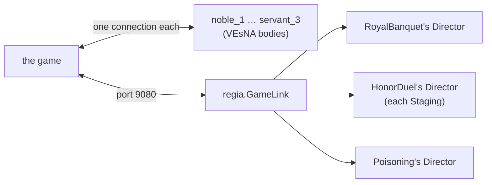

# Jason: the Build

`regia build banquet.regin` writes a folder. In it are the ASL files the Jason agents run, a `.jcm` that starts them, and a short manifest for the game. This chapter goes through that folder file by file, for the banquet: which files there are and what each includes, how our names become Jason names, what is fixed and what is generated, the Java around the ASL, the one connection the Directors share with the game, and how the cast in `banquet.regin` becomes fourteen Jason agents on fourteen ports, with one Director beside them.

| We write | The Build gets |
|---|---|
| a Playbook | one file, `asl/playbooks/<Playbook>.asl`, with its Plans and nothing else |
| a Plot | one Director file, `asl/directors/<Plot>.asl` |
| a Role of the Root Plot | one Role file, `asl/roles/<Role>.asl`, which an Agent starts from |
| a kind or an Agent in several Roles | a combination file, `asl/roles/<RoleA>__<RoleB>.asl` |
| the cast of a `.regin` | the `.jcm`, `cast.json`, and the starting cast in the Root Director's file |

No Transpiler exists yet, so every line of ASL and of the `.jcm` below was put together by hand from the spec. We are not meant to read a Build in our daily work: the Trace speaks in our names (*The Trace*). Whoever writes the Jason Target reads it. How a Plan's Statements become ASL is in *Jason: Plans and Goals*; Givings and ranks are in *Jason: Givings and Precedence*; what a Director file runs is in *Jason: Directors and Stagings*; the game's messages are in *Jason: the game and the Trace*.

## The Build folder

```
build/banquet/
    banquet.jcm
    cast.json
    asl/regia/agent.asl                Infrastructure, fixed
    asl/regia/director.asl             Infrastructure, fixed
    asl/regia/sourcemap.json           our names and places, for the Trace
    asl/playbooks/Courtesy.asl         one per Playbook: nine
    asl/playbooks/Dining.asl
    …
    asl/playbooks/Wagering.asl
    asl/directors/RoyalBanquet.asl     one per Plot: three
    asl/directors/HonorDuel.asl
    asl/directors/Poisoning.asl
    asl/roles/Host.asl                 one per Role of the Root Plot: four
    asl/roles/Guest.asl
    asl/roles/Servant.asl
    asl/roles/Guard.asl
    asl/roles/Guard__Guest.asl         the knights' Roles together
    asl/unheard.asl                    a catch-all for every told Cue
    asl/goals.asl                      the -!g plan of every Goal
    traces/                            one Trace per run, written by the runs
```

The Build of `banquet.regin` goes in `build/banquet/`, named after the Entry without its extension (*The Transpiler*). Every file but the `.jcm` and `cast.json` sits under `asl/`, and the `.jcm` sets `asl/` as the ASL source path, so every include and every file name in the `.jcm` is relative to it.

- A Playbook file holds the Plans of one Playbook and includes nothing.
- A Director file holds one Plot's Director, and includes `regia/director.asl`. Every Staging of a Plot runs the same file: the two duels of one evening both run `HonorDuel.asl`.
- Role files exist only for the Roles of the Root Plot, since only they start Agents. (The Build of a `.regia` Entry has no Root Plot, so it has one for every Role of every Plot, `roles/<Plot>__<Role>.asl`, and no `.jcm`.) `Challenger`, `Defender`, `Spectator`, `Poisoner` and `Watchman` get no file. `Guard.asl` is written though no Agent of the banquet plays `Guard` alone: there is one Role file for every Root Plot Role, played or not.
- `unheard.asl` and `goals.asl` depend on the Program, so they are generated, one each per Build. Every Role file and combination file includes both, once. What they hold is in *Jason: Plans and Goals*.
- File names are our names exactly as written: `Keeping_watch.asl`, `NobleSocializing.asl`. Names are unique ignoring case, so this is safe on a file system that ignores case.
- Every generated file starts with a comment naming the Transpiler version and the source file, and saying it is generated.
- A Build holds ASL, the `.jcm`, `cast.json` and the source map. It holds no Java.

A `.regin` that declares no kind and no individual Agent builds the ASL alone, with no `.jcm` and no `cast.json` (*Instancing*, *With no cast*). The rest of this chapter is about a Build with a cast.

Spec: chapter 28, *Files*. For the Build folder, chapter 23.

## Role files

[`plots/royal_banquet.regia`](../showcase/plots/royal_banquet.regia)
```regia
WHEN insult_thrown(?offender), FROM Guest ?offended:
    GIVEN NOT HonorDuel(?offender) RUNNING:  # one duel per offender at a time
        START SUBPLOT HonorDuel(?offender),
            MAPPING ?offended AS Challenger,
            MAPPING ?offender AS Defender,
            MAPPING Guest EXCEPT ?offended, ?offender AS Spectator
```

```regia
WHEN HonorDuel(?) FINISHED WITH duel_settled(?winner):
    ASK Host TO honour(?winner)
    ASSIGN Keeping_watch TO ?winner  # the winner stands guard of honour
    TELL ?winner on_duty
```

An Agent starts from a Role file, and that file includes every Playbook the Role can be given in the Agent's lifetime. Giving a Playbook at runtime never adds a plan; it switches on plans that were there from the start (*Jason: Givings and Precedence*). So the Transpiler works out, for each Root Plot Role, every Playbook that could ever reach it, following Mappings down the Plot tree:

- A Playbook given to a Role reaches the Root Plot Roles mapped to it. `Wagering`, given to `Spectator`, reaches `Guest` through `MAPPING Guest EXCEPT … AS Spectator`. `Scheming`, given to `Poisoner`, reaches `Guest` through `MAPPING 1 OF Guest AS Poisoner`.
- A Giving to a Placeholder, `ASSIGN Keeping_watch TO ?winner` in Plot X, could reach any Agent of X's Staging. The Playbook reaches every Root Plot Role that maps to any Role of X. Here X is the Root Plot, so `Keeping_watch` reaches all four Roles.
- A `MAPPING ?who AS r` in a `START SUBPLOT` run by Plot X works the same way: every Playbook `r` can be given reaches every Root Plot Role that maps to a Role of X. `?offender` is filled from a Cue's argument and may be anyone in the hall, so `Duelling` reaches `Host`, `Guest`, `Servant` and `Guard`.

| Role file | Includes |
|---|---|
| `Host.asl` | `Courtesy`, `Duelling`, `Hosting`, `Keeping_watch` |
| `Guest.asl` | `Courtesy`, `Dining`, `Duelling`, `Keeping_watch`, `NobleSocializing`, `Scheming`, `Wagering` |
| `Servant.asl` | `Courtesy`, `Duelling`, `Keeping_watch`, `Serving` |
| `Guard.asl` | `Courtesy`, `Duelling`, `Keeping_watch` |

The king can never be in a duel, and the servants never stand guard, but the Transpiler doesn't look that closely, and a Playbook that is never given costs only a guard test per event. Narrowing the reach is not in 1.5 or 2.0.

The Guest's file, cut short:

```asl
/* Generated by the Regia Transpiler <version> from royal_banquet.regia. Do not edit. */
{ include("regia/agent.asl") }
{ include("unheard.asl") }
{ include("goals.asl") }
{ include("playbooks/Courtesy.asl") }
{ include("playbooks/Dining.asl") }
/* … Duelling, Keeping_watch, NobleSocializing, Scheming, Wagering */
regia_playbook(courtesy).
regia_playbook(dining).
/* … one per included Playbook */
regia_game(fact, "hall.seating.seat", seat).
regia_game(cue, "hall.clock.idle", idle).
/* … one per game item these Playbooks use */
```

- `regia/agent.asl`, the Infrastructure, is included by the top-level file only. Jason doesn't skip a file included twice, so a Playbook file that included it too would run its initial goals twice.
- `regia_playbook` lists the included Playbooks, so the Infrastructure can check a Giving against them.
- `regia_game` translates the game's names (*Names*, below).

Spec: chapter 28, *Files*. For the reach, chapter 29, *Which Playbooks a Role file includes*.

## Shared Infrastructure

`regia/agent.asl` and `regia/director.asl` are fixed ASL built into the Transpiler. They are the same for every Program, and each Build gets its own copy, written out unchanged with a header naming the Transpiler version, so a Build stands on its own. `agent.asl` holds what every Agent runs: taking in Givings, sending Signals to Directors, failure and Trace plumbing. `director.asl` holds what every Director runs: Phases, a Staging's life, the records of who plays which Role. Anything that depends on the Program goes into a generated file instead.

Everything the Infrastructure knows about an Agent or a Director is a belief, with a Generated name, so Jason's mind inspector shows the whole state of a run and nothing is hidden:

| What | Held by | Belief |
|---|---|---|
| a Giving of a Playbook | Agent | `regia_given` |
| a Playbook in the Agent's files | Agent | `regia_playbook` |
| a game item and its External name | Agent, Director | `regia_game` |
| the Plot a Director runs, its parent and children, its ending | Director | `regia_staging`, `regia_parent`, `regia_child`, `regia_ending` |
| the current Phase | Director | `regia_phase` |
| a standing Giving | Director | `regia_standing` |
| what a Plot hears from the game | Director | `regia_hears` |
| a Role's members | Director, and a copy in Agents | `regia_cast` |
| the starting cast, the Staging's place in the tree | Root Director | `regia_start_cast`, `regia_rank_prefix` |
| an Agent kind | Root Director | `regia_kind` |

Java holds plumbing only: the game link's connection and routing, the Actions in flight, the run's clock, and the intentions suspended in `regia.wait` and `regia.act`. A Fact, a cast, a Phase or a Giving is never kept in Java. What the game reported lives in the game and in the beliefs of whoever heard it.

> **In 2.0** Agents and Directors also hold `regia_quota`, the counts behind Quota Triggers. Spec chapter 33, *Quota counts*. A 1.5 Build has no Quota Triggers and writes no such belief.

Spec: chapter 28, *Shared Infrastructure*, *Infrastructure state*.

## The Java library

[`vocabulary.regia`](../showcase/vocabulary.regia)
```regia
#@desc: The Target's own code, not the game's: done when that code returns.
ACTION hall.music.fanfare AS play_fanfare
```

Some of the Infrastructure has to be Java. Jason chooses among the plans for an event in `Agent.selectOption`, and ASL can't see the other options, so precedence can only be enforced there. That Java lives in `regia-jason`, a small library released and versioned with the Transpiler. It is never generated, and never copied into a Build.

| Class | Runs | Extends |
|---|---|---|
| `regia.RegiaAgent` | every Agent | VEsNA-Pro's agent class, for the body and the Propensities (VEsNA-Pro's `Temper`) |
| `regia.DirectorAgent` | every Director | Jason's `Agent`: a Director has no body and no Propensities |
| `regia.GameLink` | the one connection the Directors share | a JaCaMo platform (*The game link*, below) |

- `RegiaAgent.selectOption` keeps the options of the best rank, hands the Selection function, VEsNA-Pro's, the ones left when they are Suits alternatives or a `TIES` pool, and breaks what remains by Playbook name. It applies the chosen plan's `SHIFTS`, once, when the plan is chosen. The ranks are in *Jason: Givings and Precedence*.
- `RegiaAgent.selectIntention` takes Jason's default round-robin over VEsNA-Pro's, so Moods choose among a Trigger's alternatives and never which running Plan steps next.
- The ranking code is shared by the two agent classes.
- `regia-jason` also holds the internal actions (`regia.act`, `regia.wait`, `regia.trace`, …), the Trace writer and the test mode.
- Regia runs on JaCaMo 1.3.1, so Jason 3.3.2, on JDK 21 or later. VEsNA-Pro pins JaCaMo 1.2 and runs unchanged on 1.3.1.

`play_fanfare` is the one Action of the showcase whose External name has a dot. On Jason, a dot makes the External name a Java class, run inside the agent as an internal action: `DO play_fanfare` runs `hall.music.fanfare` and sends nothing to the game. That class is the Project's own code. We build it with any tool, into a jar in the Project's `lib/` folder beside `build/`, and `regia run` and `regia test` put every jar of `lib/` on the class path after `regia-jason`. Nobody writes a class path, and the command line never compiles Java.

Spec: chapter 28, *The Java library*. For Labels in `selectOption`, chapter 14, *ASL mapping notes*; for an Action with a dot, chapter 37.

## Names

Every name we write reaches Jason changed as little as Jason allows:

| In the source | In the ASL | Rule |
|---|---|---|
| `NobleSocializing`, `Guest`, `RoyalBanquet` | `nobleSocializing`, `guest`, `royalBanquet` | first letter lowercased: a Jason atom starts lowercase |
| `walk_to`, `roast`, `seat` | the same | |
| `greeting`, local to `Courtesy` | `regia_local__courtesy__greeting` | local Vocabulary |
| `stamina`, local to `Duelling` | `regia_local__duelling__stamina` | |
| `?speaker` | `Speaker` | a Placeholder: first letter uppercased |
| a name that is a Jason word (`not`, `if`, `div`, …) | `regia_word__not` | renamed quietly, never an error |
| anything the Transpiler adds | `regia_given`, `regia_director__royalBanquet` | a Generated name |

- A Generated name starts with `regia_` and separates its parts with `__`. Our names can do neither, so a Generated name never meets one of ours, and its parts split one way only.
- Lowercasing is one-to-one, because names are unique ignoring case. `RoyalBanquet`'s Role `Host` and `Courtesy`'s Role `host` both become `host`, and are meant to: a Plot's Role fills a Playbook's Role of the same name ignoring case (*Playbooks and Roles*).
- Two Playbooks with a local item of the same name get two Jason names.
- The Trace names our items, never Generated names.

### External names

[`vocabulary.regia`](../showcase/vocabulary.regia)
```regia
#@desc: The seat the game has laid for this Agent. Servants and Guards have none.
GAME FACT hall.seating.seat AS seat(place)
```

A game item's External name never appears in ASL. The belief is `seat(P)`, under our name, whatever the game calls it. Each Agent's and Director's files carry one `regia_game` belief per game item they use:

```asl
regia_game(fact, "hall.seating.seat", seat).
regia_game(cue, "hall.senses.saw_pouring", saw_pouring).
```

`regia-jason` translates the name of every Fact and Cue the game sends through them, so an External name may hold dots or any other character. A message to an Agent whose name has no `regia_game` entry is dropped with a Trace warning: it isn't a game item, or this Agent never uses it.

Actions work differently, because their External name decides who carries them out:

| The Action | Becomes | Carried out by |
|---|---|---|
| `ACTION walk_to(place)`, no dot | `regia.act` with the External name as a string | the game, through the Agent's body |
| `ACTION hall.music.fanfare AS play_fanfare`, a dot | `regia.act` with the External name as a string | the Java class `hall.music.fanfare`, inside the agent |

**Checks**

- Two names that differ only in case → `R1007`
- A name, a Placeholder's included, starting with `regia_` or containing `__` → `R1008`
- A dotted name without `AS` → `R1009`
- A game Fact or Cue whose name matches no `regia_game` entry of the receiving Agent → `T2801` (Trace warning)

Spec: chapter 28, *Names*. For name rules, chapter 10; for Placeholders as variables, chapter 39; for `regia.act`, chapter 37.

## The game link

```
platform: regia.GameLink("localhost", "9080")
```

Each Agent talks to the game through its own VEsNA body. The Directors don't have bodies. They share one game link for the whole run, `regia.GameLink`, which wraps one VEsNA WebSocket client. Each Director attaches to it, hears the game for itself and sends its own Actions. No Director passes a game message on, or performs an Action, for another Staging, and the game never learns that Stagings exist.



- It is a JaCaMo platform, one line of the `.jcm`. JaCaMo builds it and calls its `init` before it creates any agent, and the link connects to `address`:`base_port` there, waiting a bounded time. So no Director starts, attaches or sends before the link is up. It lives as long as the run, outliving the Root Director.
- Its name on the wire is `regia_game_link`. The game writes it as the receiver of everything it sends the link, and the link as the sender of everything it sends the game, whichever Director it is sending for. A Director's name never reaches the game.
- It routes by the message's type and, for Facts and Cues, by the item's name: each attached Director gets what its own Plot hears. A message no attached Director hears is dropped with no entry.
- It holds plumbing only: the connection, the attached Directors and what each hears, the requests and Actions in flight, and the clock.
- A Director attaches when it gets its start, asks the game for its starting state, and gets nothing else until the reply has come. How it hears and acts is in *Jason: Directors and Stagings* and *Jason: the game and the Trace*.

If the connection never opens, or closes during the run, the run goes on. The Directors keep running their Plans, Signals, `WAIT`s and Stagings, and hear nothing more from the game. Each Director Action fails at once as if refused, with the reason `no game link`. A paused clock starts again, with a `CLOCK RESUMED` entry, since no resume can come any more. The link never reconnects and never kills a Director.

**Checks**

- The link couldn't connect at start → `T2802` (Trace error, naming the address and port; the run starts anyway)
- The link's connection was lost during the run → `T2803` (Trace error; the run goes on)
- A Director's Action refused for `no game link` → `T1101` (Trace, Failure)

Spec: chapter 28, *The game link*. For the messages it carries, chapter 37; for attaching and hearing, chapter 30.

## The clock

[`playbooks/dining.regia`](../showcase/playbooks/dining.regia)
```regia
WAIT 1 MINUTE, UNTIL on_plate(?)
```

The Jason Target measures Durations on the wall clock, stopped while the game is paused. `WAIT 1 MINUTE` becomes a `regia.wait` of 60000 milliseconds. The game's `regia_pause` and `regia_resume` stop and start one clock for the whole run, held in `regia-jason`, and every `WAIT` and every `AFTER` of every Agent and Director is measured on it.

Durations ignore the game's time scale: a game running at half speed doesn't slow the Guest's minute. There is no setting to choose another clock.

Spec: chapter 28, *The clock*. For Durations, chapter 12; for pausing, chapter 37.

## The `.jcm`

[`banquet.regin`](../showcase/banquet.regin)
```regia
AGENT king, PLAYS Host

KIND noble, PLAYS Guest:
    COUNT 6
    bravery AT RANDOM(0.2, 0.8)
    sympathy AT RANDOM(0, 0.8)
    aggressiveness AT RANDOM(-0.4, 0.4)
```

```
/* Generated by the Regia Transpiler <version> from banquet.regin. Do not edit. */
mas banquet {

    platform: regia.GameLink("localhost", "9080")

    agent regia_director__royalBanquet : directors/RoyalBanquet.asl {
        ag-class:      regia.DirectorAgent
    }

    agent king : roles/Host.asl {
        ag-class:      regia.RegiaAgent
        temper:        temper(bravery(0.5), sympathy(0)[mood], aggressiveness(0)[mood])
        strategy:      most_similar
        address:       localhost
        port:          9081
    }

    agent percival : roles/Guard__Guest.asl {
        ag-class:      regia.RegiaAgent
        temper:        temper(bravery(0.8), sympathy(0.3)[mood], aggressiveness(0.1)[mood])
        strategy:      most_similar
        address:       localhost
        port:          9082
    }

    /* hothead_1, hothead_2, knight_1 */

    agent noble_1 : roles/Guest.asl {
        ag-class:      regia.RegiaAgent
        temper:        temper(bravery(random(0.2, 0.8)), sympathy(random(0, 0.8))[mood], aggressiveness(random(-0.4, 0.4))[mood])
        strategy:      most_similar
        address:       localhost
        port:          9086
    }

    /* noble_2 … noble_6, servant_1 … servant_3 */

    aslSourcePath: "asl";
}
```

The `.jcm` is written only when the cast declares at least one kind or individual Agent. Its parts come in a fixed order:

1. `mas banquet`, named after the Entry, with `asl/` as the ASL source path.
2. The game link's `platform:` line, with the `address` and `base_port` settings as its two parameters.
3. The Root Director, `regia_director__royalBanquet`, on `regia.DirectorAgent`, with no address and no port. It is the only Director in the file; Subplot Directors are created during the run.
4. One entry per starting Agent, in port order (below), on `regia.RegiaAgent`, each running its top-level file.

Each Agent's user parameters are written out in full:

- `temper` lists the Propensities that the Playbooks the Agent's Roles can be given name in a Label or a `SHIFT`: the same reach as the Role files. Each comes with the value from `banquet.regin`, or the neutral value where none is given: 0.5 for a Trait, 0 for a Mood. Moods are tagged `[mood]`, and a negative value is written as it is.
- `strategy` comes from `TARGET jason:`, and is written exactly when `temper` is: VEsNA-Pro throws on a `temper` without it.
- `address` and `port`.

Every Agent of the banquet gets all three Propensities, the king and the servants included. `Duelling` names `bravery` in a `SUITS` and shifts `sympathy` and `aggressiveness`, and `Duelling` reaches every Role through `MAPPING ?offender AS Defender`. The king never fights, so his neutral `temper` changes nothing. A Program where no Label and no `SHIFT` names a Propensity writes no `temper` and no `strategy` at all.

There is no `goals:` and no `beliefs:` line. What the Infrastructure needs at start is in its own files and in the Root Director's generated file (*The Root Director's file*, below).

Spec: chapter 36, *The `.jcm`*. For the `temper` rules, chapter 14, *ASL mapping notes*; for the settings, chapter 21, *Target settings*.

### Starting names

A kind with `COUNT n` gives Agents named `<kind>_1` … `<kind>_n`, the kind's first letter lowercased. An individual Agent keeps its own name.

- Always numbered, even for `COUNT 1`: the banquet's one knight is `knight_1`, so its name doesn't change if a test cast adds a second.
- The game knows an individual Agent by its name. `percival` is the character the hotheads' grudge names.
- These are the names the Trace and the behaviour cases use.
- Names can't collide. Kind `noble_1`'s first Agent would be `noble_1_1`, which kind `noble` never makes, and kind names can't start with `regia_` or contain `__`. An individual Agent named like the Agents of a kind, `knight_2`, is an error whatever the kind's `COUNT`, so a later file raising a count never makes two Agents share a name.

Spec: chapter 36, *Starting Agent names*.

### Ports

Every VEsNA body connects to the game on a port of its own, and Jason's `instances:` can't give the copies of one entry different ports, so each starting Agent has an entry of its own. The ports follow a fixed order:

1. the game link gets `base_port`, 9080 by default;
2. the individual Agents get the next ports, sorted by name;
3. then the Agents of the kinds, kinds sorted by name, then by number.

| Port | Agents | Top-level file | Propensities |
|---|---|---|---|
| 9080 | the game link | | |
| 9081 | `king` | `roles/Host.asl` | neutral |
| 9082 | `percival` | `roles/Guard__Guest.asl` | the knight's |
| 9083–9084 | `hothead_1`, `hothead_2` | `roles/Guest.asl` | `bravery(0.9)`, `sympathy(-0.4)[mood]`, `aggressiveness(random(0.6, 1))[mood]` |
| 9085 | `knight_1` | `roles/Guard__Guest.asl` | `bravery(0.8)`, `sympathy(0.3)[mood]`, `aggressiveness(0.1)[mood]` |
| 9086–9091 | `noble_1` … `noble_6` | `roles/Guest.asl` | three `random(…)` |
| 9092–9094 | `servant_1` … `servant_3` | `roles/Servant.asl` | neutral |

The order never depends on import order or on where a kind is declared. A test cast that sets `KIND noble: COUNT 2` moves the servants down to ports 9088 to 9090 and leaves every port before the nobles alone.

**Checks**

- `base_port` that isn't a whole number in 1–65535 → `R3602`
- `base_port` plus the number of starting Agents past 65535 → `R3601`
- An individual Agent named `<kind>_<digits>` for a kind of the Build → `R3603`
- An unknown key under `TARGET jason:`, or a `strategy` other than `most_similar` or `random` → `R2113` (warning)

Spec: chapter 36, *Ports and addresses*, *Transpiler checks*.

## The top-level file of an Agent

[`banquet.regin`](../showcase/banquet.regin)
```regia
KIND knight, PLAYS Guest, Guard:
    COUNT 1
    bravery AT 0.8
    sympathy AT 0.3
    aggressiveness AT 0.1
```

An Agent that plays one Role runs that Role's file. An Agent that plays several runs a combination file, named after its Roles sorted by name and joined with `__`: `knight_1` and `percival` both run `roles/Guard__Guest.asl`. Our names can't contain `__`, so a combination file never meets a Role file, and Agents with the same Roles share one.

```asl
/* Generated by the Regia Transpiler <version> from royal_banquet.regia. Do not edit. */
{ include("regia/agent.asl") }
{ include("unheard.asl") }
{ include("goals.asl") }
{ include("playbooks/Courtesy.asl") }
{ include("playbooks/Dining.asl") }
/* … Duelling, Keeping_watch, NobleSocializing, Scheming, Wagering */
regia_playbook(courtesy).
/* … one per included Playbook */
```

It holds the union of its Roles' files, each part once. Including `Guest.asl` and `Guard.asl` instead would run the Infrastructure's initial goals twice, and would double the plans of `Courtesy`, `Duelling` and `Keeping_watch`, which both Roles bring. Here `Guard` brings nothing `Guest` lacks, so the knights' file includes what `Guest.asl` does.

Role files are written all the same, for every Root Plot Role, whether a kind plays it alone or not. Combination files are written only for the Role sets that kinds and individual Agents end up with.

Spec: chapter 36, *The top-level file of an Agent*. For the Role files, chapter 28.

## Drawing `RANDOM`

A noble's `bravery AT RANDOM(0.2, 0.8)` is drawn when the agent is created, never by the Transpiler. The `.jcm` carries the roll as it is, `bravery(random(0.2, 0.8))`, and `regia.RegiaAgent` replaces each `random(a, b)` with a decimal drawn from [a, b] before it hands the `temper` to VEsNA-Pro, which reads only numbers.

- The draw comes from `regia-jason`'s one random source, seeded with the run's seed, so a run with the same seed draws the same values for the six nobles.
- Each Agent with a `temper` writes one `cast` entry with the values it starts with, drawn or not: `TEMPER noble_1 bravery 0.47 …` (*The Trace*).

Spec: chapter 36, *Drawing `RANDOM`*. For the seed, chapter 35.

## `cast.json`

```json
{
  "address": "localhost",
  "game_link": { "name": "regia_game_link", "port": 9080 },
  "agents": [
    { "name": "king", "port": 9081 },
    { "name": "percival", "port": 9082 },
    { "name": "hothead_1", "kind": "hothead", "port": 9083 },
    { "name": "hothead_2", "kind": "hothead", "port": 9084 },
    { "name": "knight_1", "kind": "knight", "port": 9085 },
    { "name": "noble_1", "kind": "noble", "port": 9086 },
    …
    { "name": "servant_3", "kind": "servant", "port": 9094 }
  ]
}
```

The game has to serve the game link and one body per starting Agent, and the `.jcm` gives names and ports but not kinds. `cast.json`, beside the `.jcm`, tells the game what it needs:

- the address, and the game link's name and port;
- every starting Agent in port order, with its kind. An individual Agent has no `kind`: the game knows the king by his name, and can't make another.

No Director's name is in it. It is written exactly when the `.jcm` is. How VEsNA and Godot read it is theirs; the test mode's scripted game reads the `.jcm` instead (*Jason: the game and the Trace*).

Spec: chapter 36, *What the game is told: `cast.json`*.

## The Root Director's file

The Transpiler knows the starting cast when it builds, so it writes it into `directors/RoyalBanquet.asl` as initial beliefs. Nothing about the cast goes through the `.jcm`'s `beliefs:`:

```asl
regia_start_cast([agent(king, agent(king), [host]),
                  agent(percival, agent(percival), [guest, guard]),
                  agent(hothead_1, kind(hothead), [guest]),
                  agent(hothead_2, kind(hothead), [guest]),
                  agent(knight_1, kind(knight), [guest, guard]),
                  agent(noble_1, kind(noble), [guest]),
                  /* … noble_2 … noble_6 */
                  /* … servant_1, servant_2 */
                  agent(servant_3, kind(servant), [servant])]).
regia_rank_prefix([]).
!regia_root_start.
```

- One `agent(Agent, Source, Roles)` per starting Agent, in port order.
- `Source` is `kind(hothead)` for an Agent of a kind and `agent(percival)` for an individual Agent. It names the plan of the Agent's setup lines (below).
- `Roles` are the Agent's Root Plot Roles, in the order the Plot declares them: `RoyalBanquet` declares `Guest` before `Guard`, so a knight's are `[guest, guard]`.
- `!regia_root_start` records the cast and attaches to the game link. The game's reply lists the Agents that have already left, and those are dropped before the Staging begins. What follows is in *Jason: Directors and Stagings*.

A kind with no `COUNT` has no entries.

Spec: chapter 33, *The Root Director's starting cast*. For `regia_rank_prefix`, chapter 32.

### Setup lines

[`banquet.regin`](../showcase/banquet.regin)
```regia
KIND hothead, LIKE noble:
    COUNT 2
    bravery AT 0.9
    sympathy AT -0.4
    aggressiveness AT RANDOM(0.6, 1)
    LEARN grudge(percival, 2)                # every hothead has a score to settle with Sir Percival
```

```asl
+!regia_instance_setup(kind(hothead), A)
   <- regia.send(A, tell, grudge(percival, 2)).   // banquet.regin:19
+!regia_instance_setup(_, _).
```

Each kind and each individual Agent with setup lines gets one plan in the Root Director's file, and a catch-all does nothing for the rest. When the Root Plot's Staging begins, after its own Role setups, the Root Director runs `!regia_instance_setup(Source, A)` for each entry of `regia_start_cast`, in its order.

- `LIKE` is resolved when the Build is written. The plan holds the lines the kind ends up with: its bases' lines in `LIKE` order, then its own, a line of its own replacing what it took. `percival` is `LIKE knight`, and the knight has no lines, so Sir Percival has no plan and holds no grudge.
- The plan is per kind, not per Agent: a `RANDOM` in a line is rolled for each Agent, inside the plan.
- The lines are sent as a Role setup's are. An `ASSIGN` among them is a Giving to that one Agent. Only `REMOVE … FROM ?who` or `FROM CAST ?who` with that Agent, or the end of the Staging, takes it away; it isn't standing.

Spec: chapter 36, *Setup lines of kinds and individual Agents*. For when they run, chapter 30, *Setup lines of kinds and individual Agents*.

### Agent kinds: `regia_kind`

```asl
regia_kind(noble, [guest], "roles/Guest.asl",
           [temper("temper(bravery(random(0.2, 0.8)), sympathy(random(0, 0.8))[mood], aggressiveness(random(-0.4, 0.4))[mood])"),
            strategy(most_similar), address(localhost)]).
regia_kind(servant, [servant], "roles/Servant.asl",
           [temper("temper(bravery(0.5), sympathy(0)[mood], aggressiveness(0)[mood])"),
            strategy(most_similar), address(localhost)]).
/* … hothead, knight */
```

The Root Director's file also holds one `regia_kind(Kind, Roles, File, Settings)` per declared kind: its Roles, its top-level file, and the user parameters a `.jcm` entry of the kind gets, without the port. Kinds with no `COUNT` are listed; kinds removed with `NO KIND` aren't. Setup lines aren't in it: they are the plans above. `Settings` is a list of `key(value)` terms, so a new `TARGET jason` key adds an entry and leaves the belief's shape alone.

The belief is what the Root Director would create a joiner from. In 1.5 the game can't add an Agent during the run: the Root Director ignores every `regia_join` and writes `T1902`, so `regia_kind` is written and nothing reads it.

> **In 2.0** the game reports a joiner with `{"type": "regia_join", "kind": "noble", "name": "noble_7", "port": 9107}`. The Root Director creates its agent from the kind's `regia_kind`, with the port from the report and a `temper` drawn for it, and runs the kind's setup lines after its Role setups. A report with a missing or invalid `port` makes no sense and is ignored with a warning. Spec chapter 36, *The `regia_join` body fields*, and chapter 33, *Joining*.

**Checks**

- A spawn reported by the game during a 1.5 run → `T1902` (Trace warning)

Spec: chapter 36, *Agent kinds in the Root Director: `regia_kind`*. For the 1.5 refusal, chapter 33, *Regia 1.5*.

## How this combines with…

### Instancing

`ROOT` picks the Director in the `.jcm`; `KIND` and `AGENT` give the entries, the names and the ports; `PLAYS` picks the top-level file; the `AT` lines give the `temper`; the setup lines give the Root Director's plans; `TARGET jason:` gives `strategy`, `address` and `base_port`. `SEED` is not in the Build: it is handed to the run when it starts. (*Instancing*)

### The Transpiler

`regia build` writes this folder, replacing everything in it except `traces/`. The Jason checks, `R3601` to `R3603`, are Target checks: `regia check` reports them as well, and `--target none` skips them. (*The Transpiler*)

### Precedence and Labels

The `temper` in the `.jcm` is what VEsNA-Pro measures the `SUITS` Labels against, and `selectOption` in `regia-jason` is where `PRECEDENCE` is enforced. A knight holds both `NobleSocializing` and `Keeping_watch` because its combination file includes both, and `Keeping_watch OVER NobleSocializing ON scandal` decides which runs. (*Precedence and Labels*, *Jason: Givings and Precedence*)

### Jason: Directors and Stagings

The Root Director is the only Director the `.jcm` starts. `HonorDuel.asl` and `Poisoning.asl` sit in the Build from the start, and a Subplot Director is created from its file when a `START SUBPLOT` runs, then attaches to the same game link. (*Jason: Directors and Stagings*)

### The Trace

The Trace and the behaviour cases call Agents by the names the `.jcm` gives them, `king`, `hothead_1`, `noble_4`, and call Directors `director:RoyalBanquet`, never `regia_director__royalBanquet`. `sourcemap.json` is how the Trace writer gets from the ASL back to our names and lines. (*The Trace*, *Jason: the game and the Trace*)

### When an Agent leaves

An Agent that leaves is killed by the game link, and every attached Director hears of it. The starting cast of the Root Director's file is the largest the run will have: in 1.5 nobody joins. (*When an Agent leaves*)
