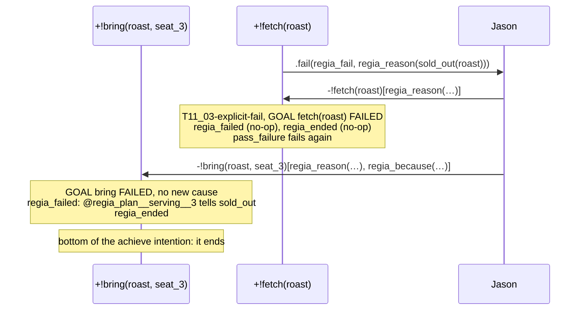

# Jason: Plans and Goals

A Guest is asked to take its seat. In Regia that is one `TO take_seat` Plan of four lines. In the Build it is one ASL plan with a guard in front, a test for who asked, a Context, its Statements turned into Jason, and a last step that tells the Infrastructure the Goal was reached. The plan stays plain Jason: what recurs from plan to plan is a named rule or Infrastructure plan in `regia/agent.asl`, and a `regia.*` internal action appears only where Jason can't do the job. This chapter goes through how the Jason Target writes a Plan's Contexts and Statements, and then how it runs a Pursuit from the request to its ending.

| We write | The ASL gets |
|---|---|
| a Placeholder, `?place` | a Jason variable, `Place` |
| a Context, a `GIVEN` chain | one plan per `GIVEN`, each with its own context |
| `IF`, `FOR EACH`, `RANDOMLY` | Jason's own `if` and `for`, and the Infrastructure plan `regia_choose` |
| a Pick, `COUNT` | a rule over the Matches, or a `.setof` |
| `LEARN`, `FORGET`, `UPDATE` | `+f`, `.abolish(f)` and `!regia_update` |
| `WAIT` | `regia.wait` |
| `TELL`, `ASK`, `SIGNAL` | the rule `regia_audience`, then `regia.send` |
| `PURSUE`, `DROP`, `FAIL`, `PURSUING` | `!g` and `!!g`, `regia.drop`, `.fail`, `.intend` |
| `WHEN g REACHED` … `ENDED` | plans for four generated goals, `regia_reached` … `regia_ended` |

No Transpiler exists yet, so every line of ASL below was put together by hand from the spec. Plan labels are `regia_plan__<owner>__<n>`, numbered per Playbook or Plot in source order. The numbers here, and those of generated variables (`Regia_to__1`), are the Transpiler's own and mean nothing. What is around a Body, the Givings guard and the rank annotation, is in *Jason: Givings and Precedence*; the file a plan lands in is in *Jason: the Build*; what `regia.act` sends to the game is in *Jason: the game and the Trace*.

## A Plan in ASL

[`playbooks/courtesy.regia`](../showcase/playbooks/courtesy.regia)
```regia
TO take_seat, FROM DIRECTOR:
    GIVEN seat(?place):
        DO walk_to(?place)               # waits until we have arrived
        DO sit_down
        TELL host greeting
    # no ELSE: with no seat laid for us, take_seat fails at once
```

```asl
@regia_plan__courtesy__1[regia_rank(courtesy, to(take_seat), 0)]
+!take_seat[source(Regia_sender), regia_pursuit(Regia_pursuit)]
    : regia_is_given(courtesy)
      & regia_from_director(courtesy, Regia_sender)
      & seat(Place)
   <- regia.act("walk_to", walk_to(Place));
      regia.act("sit_down", sit_down);
      ?regia_audience(courtesy, host, Regia_to__1); regia.send(Regia_to__1, signal, regia_local__courtesy__greeting);
      !regia_reach(take_seat, Regia_sender, Regia_pursuit).
```

Read from the top:

- The label carries the rank, which `selectOption` reads (*Jason: Givings and Precedence*).
- The trigger binds the Sender, Jason's own `source`, and the Pursuit's `Id` (*A Pursuit's identity*, below).
- The context starts with the Givings guard, the rule `regia_is_given`: some Giving of `Courtesy` exists. Then the `FROM DIRECTOR` test on the Sender, the rule `regia_from_director`, then our Context.
- Each Statement becomes one Jason step, in order, or a test goal and the one action it feeds. `DO` is `regia.act`. `TELL host` reads the rule `regia_audience`, the Role's Agents but the sender, and sends to the whole list.
- A recipe ends with `!regia_reach`, which raises the `REACHED` and `ENDED` endings (*`REACHED`*, below).

There is no `ELSE`, so there is no second plan. A Guest with no `seat` has no applicable plan for `+!take_seat`, and that is how `take_seat` fails at once (*No applicable `TO` Plan*, below).

### Placeholders and variables

A Placeholder becomes a Jason variable with its first letter uppercased and nothing else changed: `?place` → `Place`, `?the_dish` → `The_dish`.

- A blank, `?` or `?_name`, becomes Jason's anonymous `_`, which never joins another. A variable such as `_who` is never written, because Jason would join two of them in one clause.
- A variable the Transpiler makes up, for a chosen Option, a list, a Pursuit's `Id`, is a Generated name with its first letter uppercased: `Regia_option__1`, `Regia_to__1`, `Regia_pursuit__1`. Our Placeholders can't start with `regia_` or contain `__`, so the two never meet.
- Two Placeholders of one Plan can't differ only in case, so the mapping is one-to-one.
- A Placeholder is filled once per run of a Plan, and a Jason variable, once bound, stays bound for the rest of the plan. So nothing is renamed and nothing is copied.

**Checks**

- Two names, Placeholders included, that differ only in case → `R10_07-case-only-name-clash`
- A Placeholder starting with `regia_` or containing `__` → `R10_08-reserved-name-spelling`

Spec: chapter 39, *Placeholders and variables*. For the guard, chapter 29; for the rank, chapter 32; for `regia.act`, chapter 37; for when a `regia.*` action is allowed, chapter 28, *Generated ASL is readable*.

## Contexts and `GIVEN`

[`playbooks/noble_socializing.regia`](../showcase/playbooks/noble_socializing.regia)
```regia
WHEN scandal(?victim), FROM peer ?speaker:
    GIVEN grudge(?victim, ?):
        DO snigger
    GIVEN grudge(?speaker, ?), SHIFTS sympathy BY -0.1:
        DO roll_eyes
    # no ELSE: gossip about strangers falls through to the next Playbook
```

```asl
@regia_plan__nobleSocializing__5[regia_rank(nobleSocializing, when(scandal), 1)]
+scandal(Victim)[source(Speaker)]
    : regia_is_given(nobleSocializing)
      & regia_from_role(nobleSocializing, peer, Speaker)
      & grudge(Victim, _)
   <- regia.act("snigger", snigger).

@regia_plan__nobleSocializing__6[regia_rank(nobleSocializing, when(scandal), 1), effects([sympathy(-0.1)])]
+scandal(Victim)[source(Speaker)]
    : regia_is_given(nobleSocializing)
      & regia_from_role(nobleSocializing, peer, Speaker)
      & grudge(Speaker, _) & not grudge(Victim, _)
   <- regia.act("roll_eyes", roll_eyes).
```

Each `GIVEN` is a plan of its own with the shared trigger. Its context is its own Context and the negation of every earlier sibling's, so "first match wins" doesn't depend on the order Jason keeps plans in. An `ELSE` would be a third plan whose context negates both.

- `AND`, `OR` and `NOT` are `&`, `|` and `not`, which have the same precedence.
- In a negated copy, every Placeholder the Trigger didn't fill gets a fresh generated variable, so `GIVEN hates(?x)` and then `GIVEN fears(?x)` gives `fears(X) & not hates(Regia_x__1)`. Placeholders the Trigger filled stay shared on purpose, as `Victim` does above: the second plan asks about the same victim.
- The two plans share the `Pos` of their Trigger Block. Here it is 1, because `WHEN scandal(ME)` is the Block above.
- A `GIVEN`'s own `SHIFTS` goes into its own plan's `effects`, and nowhere else.
- With no `ELSE`, gossip about a stranger leaves both plans inapplicable. Jason then looks at the other Playbooks' plans for `+scandal`, and that is falling through: nothing more is written for it.
- `?x PLAYS r` is `regia_plays(p, r, X)`, with `p` the Playbook holding the Plan and the Agent itself left in. `ME PLAYS r` is `.my_name(Me) & regia_plays(p, r, Me)`, with a generated variable for `Me`.

Spec: chapter 39, *Contexts and `GIVEN`*. For why the negation, chapter 06; for `Pos`, chapter 32.

## `IF`

[`playbooks/noble_socializing.regia`](../showcase/playbooks/noble_socializing.regia)
```regia
TO resent(?who):
    IF grudge(?who, ?size):              # fills ?size, for this branch only
        UPDATE grudge(?who, ?size) TO grudge(?who, ?size + 1)
    ELSE:
        LEARN grudge(?who, 1)
```

```asl
+!resent(Who)[source(Regia_sender), regia_pursuit(Regia_pursuit)]
    : regia_is_given(nobleSocializing)
   <- if (grudge(Who, Size)) {
          !regia_update(grudge(Who, Size), grudge(Who, Size + 1))
      } else {
          +grudge(Who, 1)
      };
      !regia_reach(resent(Who), Regia_sender, Regia_pursuit).
```

A Body `IF` chain is Jason's own `if (…) { … } elif (…) { … } else { … }`.

- Jason keeps a variable bound in an `if` condition for the rest of the plan. The Placeholder rules already stop a later Statement from reading `?size`, so this changes nothing and nothing is renamed.
- A failure inside a branch is the plan's own failure.
- The Jason Target never writes the `regia_if__N` subgoal plans the spec describes for Targets without a native `if`.

Spec: chapter 39, *`IF`*. For what a branch fills, chapter 06.

## Random choice

[`playbooks/noble_socializing.regia`](../showcase/playbooks/noble_socializing.regia)
```regia
WHEN idle:
    LET ?grudges BE COUNT(grudge(?foe, ?) AND ?foe PLAYS peer)
    RANDOMLY:
        OPTION, WEIGHT 3: DO chat
        OPTION, WEIGHT 2:
            DO sip_wine
            IF RANDOM(1, 100) <= 30:     # one cup too many
                DO laugh
        OPTION, WEIGHT ?grudges: PURSUE vent
        OPTION, WEIGHT 5: PASS           # nothing, this time
```

```asl
+idle[source(_)] : regia_is_given(nobleSocializing)
   <- .setof(m(Foe, Regia_b__1), grudge(Foe, Regia_b__1) & regia_plays(nobleSocializing, peer, Foe), Regia_list__1);
      .length(Regia_list__1, Grudges);
      !regia_choose([3, 2, Grudges, 5], Regia_option__1);
      if (Regia_option__1 == 1) { regia.act("chat", chat) }
      elif (Regia_option__1 == 2) {
          regia.act("sip_wine", sip_wine);
          ?regia_roll(1, 100, whole, Regia_roll__1);
          if (Regia_roll__1 <= 30) { regia.act("laugh", laugh) }
      }
      elif (Regia_option__1 == 3) {
          regia.trace(goal, info, "", [goal(vent), event(pursued)], Regia_pursuit__1); !vent[regia_pursuit(Regia_pursuit__1)]
      }
      elif (Regia_option__1 == 4) { true }.
```

A Random choice is one step to choose, then Jason's own `if`/`elif` chain on the chosen Option's number.

- `regia_choose(Weights, N)` is an Infrastructure plan of `regia/agent.asl`. It works out the Weights, clamps a negative one to 0 with `T09_02-weight-below-zero`, rolls once with Jason's `.random`, and binds `N` to the chosen Option, from 1. A subgoal hands its bindings back, so `Regia_option__1` is bound when the chain runs.
- When every Weight is 0, `N` is 0 with `T09_03-all-weights-zero`, and no Option runs.
- The roll comes from the Agent's own generator, which `regia-jason` seeds from the run's seed when the Agent starts. Generated code never uses `.shuffle`, which that seed doesn't reach.
- An Option of only `PASS` is `true`.
- `RANDOM(1, 100)` is the rule `regia_roll(1, 100, whole, R)`, read with a test goal. `whole` or `decimal` comes from how the bounds are written.
- A Weight that isn't a Number makes the arithmetic in `regia_choose` fail, which fails the Plan.
- A Placeholder filled in every Option stays bound after the chain. One filled in only some is never read by a later Statement. `LET ?x BE e` is `X = e`, and `?a != ?b` is `A \== B`.
- The Jason Target never writes `regia_randomly__N`.

**Checks**

- A Weight that isn't a Number → `T09_01-weight-not-number` (Trace, Failure)
- A negative Weight, counted as 0 → `T09_02-weight-below-zero` (Trace entry)
- Every Weight 0 or less, and no Option runs → `T09_03-all-weights-zero` (Trace entry)
- A whole roll with no whole number between its bounds → `T04_03-empty-whole-roll` (Trace, Failure)

Spec: chapter 39, *Random choice*. For the seeded generator, chapter 35, *Random draws*; for Weights, chapter 09.

## Picks

[`playbooks/scheming.regia`](../showcase/playbooks/scheming.regia)
```regia
WHEN idle:
    GIVEN NOT poured AND grudge(?mark, ?size), LOWEST ?size:
        DO pour_poison(?mark), WITHOUT WAITING    # we don't stand there while it dissolves
        LEARN poured
        DO slip_away
    # no ELSE: once the poison is poured, idle falls through to small talk
```

```asl
@regia_plan__scheming__1[regia_rank(scheming, when(idle), 0)]
+idle[source(_)]
    : regia_is_given(scheming)
      & not regia_local__scheming__poured
      & regia_lowest(m(Mark, Size), Size, grudge(Mark, Size))
   <- regia.act("pour_poison", pour_poison(Mark));    // WITHOUT WAITING
      +regia_local__scheming__poured;
      regia.act("slip_away", slip_away).
```

A plain condition is left as it is, and Jason takes its first unifier. A Pick is a rule of `regia/agent.asl` that collects the distinct Matches first, with `.setof`, and fills the Placeholders only with the Match it picks.

| We write | The context |
|---|---|
| no Pick | the condition, unchanged |
| `LOWEST ?p`, `HIGHEST ?p` | `regia_lowest(T, P, F)`, `regia_highest(T, P, F)`: `.setof` the Matches, keep those where `.number(P)`, take the `.min` or `.max` of the values, then a Match with that value |
| `RANDOMLY` | `regia_random_match(T, F)`: `.setof` the Matches, then pick one with `.random` |
| `HIGHEST ?p, RANDOMLY` | `regia_highest_random`: the tied Matches, then pick one with `.random` |
| `WEIGHT e` | `.setof` the Matches with their Weight, `m(…, W)`, then `regia.weighted_pick` |

A random Pick, as `RANDOMLY` writes it:

```asl
regia_random_match(T, F) :- .setof(T, F, L) & .random(L, T).    // in regia/agent.asl

+bored : regia_random_match(m(G), guest(G)) <- …
```

- Every blank in these templates is a fresh generated variable, so Matches are told apart by every blank.
- `.setof`, not `.findall`, so the same Match reached through both sides of an `OR` counts once.
- Jason takes rules in contexts and in `if` conditions alike, so `IF …, RANDOMLY` is written the same way. With no Match, `.random` has nothing to pick and the context doesn't hold.
- `regia.weighted_pick` stays an internal action, because it writes the Trace from inside a context and a rule never does. It clamps negative Weights to 0. When they sum to 0 it writes `T26_01-all-pick-weights-zero` and fails, so the context doesn't hold. On a `GIVEN`, a Weight that isn't a Number is left out by a `.number(W)` test; on a Body `IF` it is kept, and the arithmetic fails the Plan.
- A Pick builds a list each time it is checked, linear in the matching Facts. A plain condition doesn't.

`poured` is local to `Scheming`, so it is `regia_local__scheming__poured`. With the poison poured, the context fails and Jason looks at the other Playbooks' plans for `+idle`: the Poisoner goes back to small talk.

**Checks**

- Every Match of a weighted Pick weighs 0 or less → `T26_01-all-pick-weights-zero` (Trace entry)
- A Weight that isn't a Number, on a Body `IF` → `T09_01-weight-not-number` (Trace, Failure)

Spec: chapter 39, *Picks, `FOR EACH` and `COUNT`*. For `regia.weighted_pick`, chapter 35; for Picks, chapter 26.

## `FOR EACH`

[`playbooks/dining.regia`](../showcase/playbooks/dining.regia)
```regia
FOR EACH on_plate(?dish):
    DO eat(?dish)
    FORGET on_plate(?dish)
```

```asl
for (regia_each(m(Dish), on_plate(Dish))) {
    regia.act("eat", eat(Dish));
    .abolish(on_plate(Dish))
}
```

Jason's `for` over the rule `regia_each` of `regia/agent.asl`, which takes a snapshot of the Matches:

```asl
regia_each(T, F) :- .setof(T, F, L) & .member(T, L).
```

- The snapshot is needed. Jason's `for` works out its solutions lazily, so a `for` straight over `on_plate(Dish)` would see the Block's own `FORGET` and lose rounds. In `regia_each`, `.setof` runs once, at the first round, and the later rounds walk the list it built.
- Jason undoes every binding made in the body between rounds, and again after the loop. That is the Regia rule: a Placeholder filled inside the Block lasts one round, and no later Statement sees it.
- A failure inside the Block fails the `for`, and with it the Plan.
- A `WAIT`, a waiting `PURSUE` or a `DO` inside the Block suspends the intention in the middle of the loop. The loop goes on when it resumes.
- The Jason Target never writes the recursive `regia_each__N` goal.

Spec: chapter 39, *Picks, `FOR EACH` and `COUNT`*. For `FOR EACH`, chapter 26.

## `COUNT`

[`playbooks/noble_socializing.regia`](../showcase/playbooks/noble_socializing.regia)
```regia
LET ?grudges BE COUNT(grudge(?foe, ?) AND ?foe PLAYS peer)
```

```asl
.setof(m(Foe, Regia_b__1), grudge(Foe, Regia_b__1) & regia_plays(nobleSocializing, peer, Foe), Regia_list__1);
.length(Regia_list__1, Grudges)
```

- A condition of a single Fact is `.count(f, N)`. Anything else is a `.setof` and its `.length`. An empty `.setof` gives `[]`, so 0.
- `PLAYS` is one more conjunct inside the `.setof`. A foe reached through two Givings is one Match, and counts once.
- In a Context the two are joined with `&`; in a Body, with `;`, followed by the arithmetic.

Spec: chapter 39, *Contexts and `GIVEN`*, *Picks, `FOR EACH` and `COUNT`*.

## Basic Actions on Facts

| We write | The ASL |
|---|---|
| `LEARN f` | `+f` |
| `FORGET f` | `.abolish(f)` |
| `UPDATE f TO f2` | `!regia_update(f, f2)`: a test that `f` is known, then `.abolish(f); +f2`; nothing when `f` equals `f2` |
| `PRINT(a, b)` | `.print(a, " ", b)` |
| `PASS` | `true`, or nothing when the Body has other Statements |

`LEARN poured` in `Scheming` is `+regia_local__scheming__poured`, and `FORGET on_plate(?dish)` in `Dining` is `.abolish(on_plate(Dish))`. Neither needs a guard.

- `LEARN` of a Fact already known raises no event, so no `LEARNED` Plan runs: `regia.RegiaAgent.brf` sees to it (*A told Fact*, below). A Fact held only because someone told it, or the game reported it, is known too.
- `FORGET` is `.abolish`, never a plain `-f`. A plain `-f` takes away only the `source(self)` annotation, and a Fact told by others or reported by the game would stay. `.abolish` takes the belief with every source and raises one `-f` event, so `FORGOTTEN` fires once. When the Fact isn't known it takes nothing and raises nothing.
- `UPDATE` is an Infrastructure plan, because it tests, writes the Trace and may fail. It is not `-+`, which matches any arguments. When `f` isn't known it writes `T08_01-update-of-unknown-fact` itself and fails with `regia_because(Seq)`, pointing at that entry, so nobody writes a second cause (*The cause entry*, below).

**Checks**

- `UPDATE` when the old Fact isn't known → `T08_01-update-of-unknown-fact` (Trace, Failure)

Spec: chapter 39, *Basic Actions on Facts*. For the Statements, chapter 08.

## `WAIT`

[`playbooks/dining.regia`](../showcase/playbooks/dining.regia)
```regia
WAIT 1 MINUTE, UNTIL on_plate(?)
IF NOT on_plate(?):
    FAIL WITH no_food
```

```asl
regia.wait(on_plate(_), 60000);
if (not on_plate(_)) { .fail(regia_fail, regia_reason(no_food)) }
```

| We write | The ASL |
|---|---|
| `WAIT d SECONDS` | `regia.wait(D)`, `D` in milliseconds |
| `WAIT d, UNTIL c` | `regia.wait(Cond, D)` |
| `WAIT UNTIL c` | `regia.wait(Cond)` |

`regia.wait` suspends only its own intention, as Jason's `.wait` does. The condition is compiled as a Jason formula, as for an `IF`.

- The condition is tested once at the call: if it holds already, the Body goes on at once. After that it is tested on every new event the Agent gets, which is Jason's own `.wait` mechanism. Every belief added or removed raises an event, even with no plan for it, so a change to a Fact, to `regia_phase` (`IN`) or to `regia_cast` (`PLAYS`) tests it again. It is not tested every cycle.
- Running out of time never fails. Jason's `.wait(Cond, T)` fails with `wait_timeout`; `regia.wait` always succeeds, and the `IF` after it tells the two endings apart.
- Nothing is bound after the wait. The condition fills no Placeholder, so its only unbound variables are `_`.
- The time is measured on the run's clock, which stops while the game is paused (*Jason: the Build*, *The clock*). That clock is why `WAIT` is an internal action at all.
- `regia.wait` writes the `time` entry when the wait ends, `WAIT UNTIL on_plate(?) TIMED OUT` or `… MET`, with how long it waited.

A Duration that isn't constant is worked out first, and `regia.wait` clamps a negative one to 0 with `T12_02-duration-below-zero`. `WAIT RANDOM(1, 3) SECONDS` in `Duelling`'s `TO strike`:

```asl
?regia_roll(1, 3, whole, Regia_roll__1);
Regia_wait__1 = Regia_roll__1 * 1000;
regia.wait(Regia_wait__1)
```

**Checks**

- A Placeholder in the condition that isn't certainly filled and isn't a blank → `R12_04-maybe-unfilled-wait-condition`
- A Duration that isn't a Number → `T12_01-duration-not-number` (Trace, Failure)
- A negative Duration, counted as 0 → `T12_02-duration-below-zero` (Trace warning)

Spec: chapter 39, *`WAIT`*. For `WAIT … UNTIL`, chapter 12; for the `time` entry, chapter 34.

## Messages

### Sending

[`playbooks/dining.regia`](../showcase/playbooks/dining.regia)
```regia
FOR EACH craves(?dish):
    ASK 1 OF waiter TO bring(?dish, ?place)
```

```asl
for (regia_each(m(Dish), craves(Dish))) {
    !regia_draw(dining, waiter, count(1), Regia_to__1); regia.send(Regia_to__1, achieve, bring(Dish, Place))
}
```

| We write | The ASL |
|---|---|
| `TELL ?x f`, a Fact | `regia.send(X, tell, f)` |
| `TELL ?x c`, a Cue, local or not | `regia.send(X, signal, c)` |
| `ASK ?x TO g` | `regia.send(X, achieve, g)` |
| `TELL r …`, `ASK r TO …` | `?regia_audience(p, r, L)`, then the same with the list `L`: each Agent of the Role but the sender |
| `TELL 50% OF r …`, `ASK 1 OF r TO …` | `!regia_draw(p, r, share(50), L)`, then the same with `L` |
| `TELL EVERYONE …`, `ASK EVERYONE TO …` | `.broadcast(achieve, regia_everyone(Ilf, Content))`, `Ilf` being `tell`, `signal` or `achieve` |
| `SIGNAL c` | `?regia_directors(p, L); regia.send(L, signal, c)`, `L` being each distinct Director in `regia_holds(p, D, …)` |

- A Cue travels as Jason's `signal` message. The receiver gets the event `+c[source(S), signal]` and no belief, so every telling fires and nothing is left to test. A plan for `+c` is relevant to a `signal` event, in Jason 3.2.1 and 3.3.4 alike.
- A game Cue arrives as the same kind of event, from `percept`. So `WHEN insulted:` hears both, and only `FROM` tells them apart.
- A local Cue goes under its Generated name: `regia_local__courtesy__greeting`.
- A `SIGNAL` is the same message as a told Cue, to other recipients.
- `regia.send` takes one receiver or a list. It stays an internal action because Jason's own `.send` fails the sender's plan on a receiver that has left, and stops there in a list. `regia.send` writes `T19_01-message-after-leaving` for that one and goes on.
- `regia_audience` and `regia_directors` are rules of `regia/agent.asl`, read when the Statement runs. An empty Role gives `[]`, and nothing is sent.
- `regia_draw` is an Infrastructure plan, since it writes the Trace. It draws each time the Statement runs, with `.random` from the Agent's seeded generator, uniformly and without replacement. A share rounds up against the pool, the sender already left out. Asking for more than the pool holds writes `T15_02-count-exceeds-pool` and sends to what there is. A count that isn't a Number fails the Plan.

The Cue is not a plain `tell`: the belief would stay until a Plan removed it, and the same Cue told again meanwhile would raise nothing. Nor is it a generated achieve-goal per Cue, which a Cue no Plan takes would turn into a Goal Failure.

**Checks**

- A recipient Placeholder that doesn't hold an Agent → `T07_01-recipient-not-agent` (Trace, Failure)
- A count asking for more Agents than the pool has → `T15_02-count-exceeds-pool` (Trace warning); a negative count → `T15_03-count-below-zero` (Trace warning)
- A `TELL` or `ASK` to an Agent that has left → `T19_01-message-after-leaving` (Trace warning)

Spec: chapter 39, *Sending*. For the Role's union, chapter 29; for the seeded generator, chapter 35; for `regia.send`, chapter 33.

### Who sent it

[`playbooks/courtesy.regia`](../showcase/playbooks/courtesy.regia)
```regia
WHEN greeting, FROM ?who:
    DO bow_to(?who)
```

```asl
@regia_plan__courtesy__4[regia_rank(courtesy, when(regia_local__courtesy__greeting), 0)]
+regia_local__courtesy__greeting[source(Who)]
    : regia_is_given(courtesy) & regia_from_agent(Who)
   <- regia.act("bow_to", bow_to(Who)).
```

A Trigger's Sender is the trigger's `source(S)`: the sending Agent's or Director's name, `percept` for the game, `self` for the Agent's own `LEARN`.

| Trigger | The plan |
|---|---|
| no `FROM` | `+c[source(_)]`: no test, so the game is heard too |
| `FROM ?who` | `+c[source(Who)] : … & regia_from_agent(Who)`, which is `Who \== percept & Who \== self` |
| `FROM r`, `FROM r ?who` | `regia_from_role(p, r, S)`, which is `regia_plays(p, r, S)`: a cast holds only Agents' names, so no test for `percept` or `self` is needed |
| `FROM DIRECTOR` | `regia_from_director(p, S)`, which is `regia_holds(p, S, _, _, _, _)`: a Director giving this Playbook, or one that gave it before a take still closing |

The three are rules of `regia/agent.asl`. The same tests serve `LEARNED, FROM …` on a told Fact and `TO g, FROM …` on a request.

Spec: chapter 39, *Who sent it*. For `regia_holds` and `regia_plays`, chapter 29.

### A told Fact

[`playbooks/noble_socializing.regia`](../showcase/playbooks/noble_socializing.regia)
```regia
WHEN wronged(?victim, ?offender) LEARNED, FROM peer:
    GIVEN grudge(?offender, ?):
        DO bow_to(?victim)
```

A Fact raises `+f` only when the Agent didn't know it, from any source. Jason doesn't do this on its own: a Fact told again by a new teller raises `+f[source(new)]` again. So `regia.RegiaAgent` overrides `brf`, and decides when the message arrives:

- If the belief is already held, from a teller, the game or the Agent's own `LEARN`, it adds the new source and raises no event.
- Otherwise it adds the belief and raises `+f[source(S)]` as usual.

It can't be a context test (`f[source(O)] & O \== S`). The belief base is updated before the context is tested, so when two peers tell `wronged` before either plan runs, both contexts see two sources, and `LEARNED` would never fire.

- The Sender of a `LEARNED` Trigger is the Fact's first teller, and `FROM peer` tests that one.
- A Fact already known fires nothing, whoever tells it. A knight told `on_duty` by the Director after winning a duel already holds it, and doesn't salute again.
- `FORGET`, `UPDATE` and a game report all take the Fact with every source, each raising one `-f`.

Spec: chapter 39, *A told Fact*. For `LEARNED`, chapter 07.

### `ME`

[`playbooks/noble_socializing.regia`](../showcase/playbooks/noble_socializing.regia)
```regia
WHEN scandal(ME), FROM peer ?speaker:
    SHIFT sympathy BY -0.2
    TELL 50% OF peer wronged(ME, ?speaker)
    PURSUE resent(?speaker)
```

```asl
+scandal(Regia_me__1)[source(Speaker)]
    : regia_is_given(nobleSocializing) & .my_name(Regia_me__1) & regia_from_role(nobleSocializing, peer, Speaker)
   <- …
```

A Role file is shared by every Agent of a kind, so an Agent's name isn't known when the Build is written.

- In a Trigger's pattern, `ME` is a fresh generated variable in the trigger, tested by `.my_name` right after the guard.
- As a Value, `ME` is a generated variable bound once at the start of the Body, only when the Plan uses it: `.my_name(Regia_me); …; regia.send(…, tell, wronged(Regia_me, Speaker))`.

Spec: chapter 39, *`ME`*.

### Nothing heard

```asl
@regia_unheard__scandal[regia_unheard]
+scandal(Regia_a__1)[source(S)] : S \== percept
   <- regia.trace(unheard, info, "T07_02-cue-found-no-plan", [cue(scandal(Regia_a__1)), sender(S)]).
```

Jason runs at most one plan for an event and drops an event no plan takes. So the Transpiler writes one catch-all plan for each Cue some `TELL` of the Program sends, into `asl/unheard.asl`, which every Role file includes.

- It means "no Plan ran", not "no Plan exists". Gossip about a stranger, which falls through both `GIVEN`s of `WHEN scandal(?victim)`, writes `T07_02-cue-found-no-plan`. So does `scandal` told to a Servant, whose Playbooks never name it.
- `selectOption` takes a `regia_unheard` plan only when it is the only option, so it never competes with a Playbook's plan.
- A catch-all on a variable trigger, `+C[source(S)]`, wouldn't do: Jason tries it only when no plan at all is relevant, and would miss a Cue whose plans are all inapplicable.
- A game Cue no Plan takes is dropped with no entry.

**Checks**

- A told Cue no Plan of the receiver runs for → `T07_02-cue-found-no-plan` (Trace, `unheard`)

Spec: chapter 39, *Nothing heard: `T07_02-cue-found-no-plan`*. For the file, chapter 28.

## Goal Statements

[`playbooks/serving.regia`](../showcase/playbooks/serving.regia)
```regia
TO fetch(?dish):
    DO walk_to(kitchen)
    IF NOT in_stock(?dish):
        FAIL WITH sold_out(?dish)
    DO pick_up(?dish)                    # still refused if the last one went while we walked
```

```asl
@regia_plan__serving__2[regia_rank(serving, to(fetch), 0)]
+!fetch(Dish)[source(Regia_sender), regia_pursuit(Regia_pursuit)] : regia_is_given(serving)
   <- regia.act("walk_to", walk_to(kitchen));
      if (not in_stock(Dish)) { .fail(regia_fail, regia_reason(sold_out(Dish))) };
      regia.act("pick_up", pick_up(Dish));
      !regia_reach(fetch(Dish), Regia_sender, Regia_pursuit).
```

| We write | The ASL |
|---|---|
| `PURSUE g` | `regia.trace(goal, info, "", [goal(g), event(pursued)], Regia_pursuit__N); !g[regia_pursuit(Regia_pursuit__N)]` |
| `PURSUE g, WITHOUT WAITING` | `regia.trace(goal, info, "", [goal(g), event(pursued)], Regia_pursuit__N); !!g[regia_pursuit(Regia_pursuit__N)]` |
| `DROP g` | `regia.drop(g)` |
| `FAIL` | `.fail(regia_fail)` |
| `FAIL WITH r` | `.fail(regia_fail, regia_reason(r))` |
| `PURSUING g`, in a `TO g` Plan | `.intend(g[regia_pursuit(Regia_id__N)]) & Regia_id__N \== Regia_pursuit`, leaving out the trigger's own `Id` |
| `PURSUING g`, anywhere else | `.intend(g)` |

- Every recipe, each `GIVEN` and `ELSE` of a `TO` Plan, binds the Sender and the `Id` in its trigger and ends with `!regia_reach`. A `TO g, FROM …` Plan writes its own Sender variable or test in place of `Regia_sender`.
- `!g` adds `source(self)` itself. The `Id` variable is one per `PURSUE` Statement.
- `PURSUE` writes its `PURSUED` entry with `regia.trace`, whose last argument binds the entry's `seq`, the Pursuit's `Id`.
- The other Statements write no Trace entry. `FAIL`'s `T11_03-explicit-fail` is written by whoever catches the failure, so it is written once.
- `NOT PURSUING g` is `not .intend(…)`.
- An ending Plan is a plan for a generated goal (*The ending goals*, below).

**Checks**

- `FAIL`, with its Reason → `T11_03-explicit-fail` (Trace, Failure)

Spec: chapter 39, *Goals*. For the Statements, chapters 05, 08 and 11.

## A Pursuit's identity

Every Pursuit carries `regia_pursuit(Id)` on its `+!g` event. `Id` is the `seq` of its `GOAL … PURSUED` entry, written when the request is made, so a Pursuit that never finds a recipe has one too. Every later `goal` entry of the Pursuit names it in `of`.

| The request | Stamped by |
|---|---|
| the Agent's own `PURSUE g` or `PURSUE g, WITHOUT WAITING` | `regia.trace(…, Id)`, then `!g[regia_pursuit(Id)]` or `!!g[…]` |
| an `ASK` from an Agent or a Director, a Role setup's `PURSUE` | `regia.RegiaAgent.socAcc`, which adds the annotation to the `achieve` message before Jason posts it |
| a Director's `ASK EVERYONE` | the Infrastructure plan that unwraps `regia_everyone(achieve, G)`, with `regia.trace(…, Id)` and `!!G[source(S), regia_pursuit(Id)]` |

`take_seat` is asked by the Director, in `RoyalBanquet`'s Guest setup, so it arrives as an `achieve` message and `socAcc` stamps it.

- The Sender is Jason's own `source(S)`: the asker's name, or `self` for the Agent's own `PURSUE`. Nothing else is stored.
- `-!g` keeps every annotation of `+!g`, so the generated `-!g` plan reads the Sender and the `Id` from its own event.
- Jason never joins two `!g`, so each request is its own Pursuit, as the language wants.
- No belief holds a Pursuit. Its identity and Sender live only in the annotations of its trigger.

Spec: chapter 40, *A Pursuit's identity*, *Infrastructure state*.

## The ending goals

[`playbooks/serving.regia`](../showcase/playbooks/serving.regia)
```regia
WHEN bring(?dish, ?) FAILED WITH sold_out(?dish), FROM patron ?guest:
    TELL ?guest sold_out(?dish)          # the Reason, told back by hand
WHEN bring(?dish, ?) FAILED, FROM patron ?guest:
    DO bow_to(?guest)                    # an apology, and nothing more to say
```

```asl
@regia_plan__serving__3[regia_rank(serving, failed(bring), 0)]
+!regia_failed(bring(Dish, _), Guest, sold_out(Dish), _, _)
    : regia_is_given(serving) & regia_from_role(serving, patron, Guest)
   <- regia.send(Guest, signal, sold_out(Dish)).

@regia_plan__serving__4[regia_rank(serving, failed(bring), 1)]
+!regia_failed(bring(Dish, _), Guest, _, _, _)
    : regia_is_given(serving) & regia_from_role(serving, patron, Guest)
   <- regia.act("bow_to", bow_to(Guest)).
```

Jason has no event for a Goal reached, dropped or ended, and its `-!g` is a rescue, not a notice. So our ending Plans become plans for four generated goals, and generated code raises them:

| Trigger | Generated goal |
|---|---|
| `WHEN g REACHED` | `+!regia_reached(G, Sender, Id, Closing)` |
| `WHEN g DROPPED` | `+!regia_dropped(G, Sender, Id, Closing)` |
| `WHEN g FAILED`, `WHEN g FAILED WITH r` | `+!regia_failed(G, Sender, Reason, Id, Closing)` |
| `WHEN g ENDED` | `+!regia_ended(G, Sender, Id, Closing)` |

- `G` is the Goal as the Trigger's pattern writes it. `Reason` is the Reason Cue, or `none`. A plain `FAILED` writes `_` there.
- `Closing` is `none`, except on the `DROPPED` and `ENDED` endings a Playbook's take hands to its closing, which carry the closing's id. Those two plans have a guard that also admits a closing of their Playbook named by `Closing` (*Jason: Givings and Precedence*). `REACHED` and `FAILED` carry it only so that the four have one shape.
- `FROM` is tested on the `Sender` argument, with the tests of *Who sent it*.
- Each plan carries the Item `reached(g)`, `dropped(g)`, `failed(g)` or `ended(g)` in its rank, and the Givings guard, like any plan of a Playbook.
- First match wins among a Playbook's `FAILED` Plans with no code of its own. The two plans above share the Item `failed(bring)` at `Pos` 0 and 1, and `selectOption` keeps the lowest `Pos` among the applicable ones. When the Reason isn't `sold_out`, only the plain one applies.
- An ending nobody listens for is never a goal failure. `agent.asl` holds one no-op plan per kind, annotated `regia_noop`, which `selectOption` takes only when it is the only option.
- An ending Plan that fails just stops. `agent.asl` holds one `-!regia_<kind>(…)` plan per kind, with the context `true`, which writes the Plan's cause entry and succeeds. The endings after it still run.

> **In 2.0** the asker hears how its request ended, on a Trigger that names who pursued the Goal with `BY`. Spec chapter 05, *Who pursued it: `BY`*, and chapter 40, *Not decided here*. The ending goals already carry the `Id` and the Sender it needs; in 1.5 a Reason goes only up the Agent's own chain.

Spec: chapter 40, *The ending goals*. For the Items, chapter 32; for the closing guard, chapter 29.

## `REACHED`

[`playbooks/dining.regia`](../showcase/playbooks/dining.regia)
```regia
WHEN have_dinner REACHED: LEARN sated
```

Every recipe plan ends with `!regia_reach(G, Sender, Id)`, an Infrastructure plan of `agent.asl`, which:

1. writes `GOAL … REACHED`, `of` the `Id`;
2. starts a new intention, `!!regia_endings([regia_reached(G, Sender, Id, none), regia_ended(G, Sender, Id, none)])`, which runs the two endings in turn.

Then the recipe's plan finishes, and the Body waiting on the Goal goes on at once, one reasoning cycle later than an internal action would allow. The `REACHED` entry still points at the recipe: an entry written from an Infrastructure plan takes the place of the Statement below it. By the time `LEARN sated` runs, the Body that pursued `have_dinner` has already moved on. Nothing spreads from a reach, so there is no order between levels to keep. `regia_endings` is an Infrastructure plan of `agent.asl`.

Spec: chapter 40, *`REACHED`*.

## `FAILED`: the generated `-!g`

```asl
-!fetch(Regia_arg__1)
   <- regia.goal_failed(Regia_sender, Regia_pursuit, Regia_reason, Regia_because);
      !regia_failed(fetch(Regia_arg__1), Regia_sender, Regia_reason, Regia_pursuit, none);
      !regia_ended(fetch(Regia_arg__1), Regia_sender, Regia_pursuit, none);
      regia.pass_failure(Regia_reason, Regia_because).
```

When a plan fails, Jason looks down the intention for the first goal with a relevant `-!` plan and posts that event, with the failure's annotations added: the `error` ones, the code location, and every argument of `.fail(…)`. When a `-!g` plan fails itself, Jason skips `g` and looks further down. That second rule carries a Failure up the chain.

The Transpiler writes one `-!g` plan for every Goal a recipe, a `PURSUE` or an `ASK` names, Local Goals included, into `asl/goals.asl`, which every Role file includes. Its context is `true` and it has no Givings guard: a `-!g` plan whose context is false makes Jason drop the whole intention, waiting Bodies of Playbooks still given included. Our own `FAILED` Plans keep their guard.

1. `regia.goal_failed` reads the plan's own event and binds the Sender, the `Id`, the Reason (`none` if there is none) and the `seq` of the chain's first entry. It writes the cause entry, if the event doesn't point at one already, and the Pursuit's `GOAL … FAILED` entry at level `error`, `because:` that first entry.
2. The ending Plans run in the failing intention, `FAILED` then `ENDED`. Every Body above has already stopped. Running them here, before the failure is passed on, is what fires the chain innermost first, each level complete before the next: `fetch FAILED`, `fetch ENDED`, `bring FAILED`, `bring ENDED`.
3. `regia.pass_failure` looks at the frame below the failed `+!g`. It is an internal action because a plain `.fail` can't do this: over a `WHEN` Plan, Jason would log a warning and drop the intention.

   It looks for:
   - a goal, a waiting recipe or a waiting ending Plan: it fails, with `regia_reason(R)` and `regia_because(B)`, and Jason posts the next `-!` below;
   - a `WHEN` Plan or an Infrastructure plan, which has no `-!`: it writes that Plan's `PLAN … FAILED` entry and removes the intention quietly, with no "Could not finish intention" from Jason;
   - nothing, because the Pursuit was the bottom of its intention (`!!g`, an `achieve` message): it succeeds, and the intention ends.

The roast runs out:



The four steps are written into every `-!g`, never moved into one shared plan. Jason skips the failed `g` only for a failure inside the `-!g` plan's own frame, so a shared plan that failed would post the same `-!g` again, with no end. That is also why the `-!regia_<kind>` catchers matter: without them, a failing ending plan would post the `-!g` again too.

The Reason rides along: Jason adds every `.fail` argument to the `-!g` event, `regia.goal_failed` reads `regia_reason`, and `regia.pass_failure` passes it on unchanged. So every Goal of the chain fails with `sold_out(roast)`, and `bring`'s `FAILED WITH sold_out(?dish)` matches at `Pos` 0. Only `FAIL WITH` sets a Reason.

Spec: chapter 40, *What Jason gives, and what it doesn't*, *`FAILED`: the generated `-!g`*, *Reasons along the chain*.

### No applicable `TO` Plan

A Guest with no `seat` asked to `take_seat` has no applicable `+!take_seat` plan. Jason sees the relevant `-!take_seat` plan and posts `-!take_seat[error(no_applicable), …]`. That is the same generated plan, so the Pursuit writes `T11_04-goal-found-no-plan` and `GOAL take_seat FAILED`, runs `WHEN take_seat FAILED` (the Guest stands by the wall) and `WHEN take_seat ENDED` (it signals `took_seat`), and the `achieve` intention ends. Its `PURSUED` entry was written when `socAcc` stamped the request, before any recipe was tried.

### The cause entry

Every Failure has exactly one cause entry, written once:

- by the Statement, when it knows its own cause: `UPDATE` (`T08_01-update-of-unknown-fact`), the reply of `regia.act` (`T11_01-failed-custom-action`), and the others that write their own code. It then fails with `regia_because(Seq)`;
- otherwise by the catcher, the generated `-!g`, a `-!regia_<kind>`, or the hook for a `WHEN` Plan, from the event's annotations: `regia_fail` is `T11_03-explicit-fail`, with `reason` when there is one; `error(no_applicable)` is `T11_04-goal-found-no-plan`; Jason's own errors, arithmetic or a failed internal action, map to the codes of the Failure table. The `at` comes from Jason's `code_src` and `code_line`, through the source map.

A catcher that finds `regia_because` writes no cause entry.

### A `WHEN` Plan that fails on its own

[`playbooks/courtesy.regia`](../showcase/playbooks/courtesy.regia)
```regia
WHEN greeting, FROM ?who:
    DO bow_to(?who)
```

A `WHEN` Plan with no Goal under it has no `-!` event. If the game refuses `bow_to`, the Plan fails, and Jason would drop the intention with a console warning and nothing else. `regia.RegiaAgent` catches this on the Java side and writes the Plan's cause entry, unless the failure points at one already, as a refused Action's `T11_01-failed-custom-action` does. So the Trace keeps it, and the console shows the Trace line, not Jason's warning. Which Jason hook does it is left to whoever writes `regia-jason`. A `WHEN` Plan waiting on a Goal that fails is `regia.pass_failure`'s, not this hook's.

**Checks**

- `FAIL`, with its Reason → `T11_03-explicit-fail` (Trace, Failure)
- A Goal no recipe takes → `T11_04-goal-found-no-plan` (Trace, Failure)
- Arithmetic on a non-Number, a division by zero → `T04_01-operand-not-number`, `T04_02-division-by-zero` (Trace, Failure)
- A Custom Action refused or failed while the `DO` waits → `T11_01-failed-custom-action` (Trace, Failure)

Spec: chapter 40, *No applicable `TO` Plan*, *The cause entry*, *A `WHEN` Plan that fails on its own*. For the chain's entries, chapter 34.

## `DROPPED`: the walker

[`playbooks/dining.regia`](../showcase/playbooks/dining.regia)
```regia
WHEN hungry FORGOTTEN:
    DROP have_dinner                     # stops the recipe, even while it waits
```

`DROP have_dinner` is `regia.drop(have_dinner)`, written in Java:

1. Find every intention holding a `+!have_dinner` frame, running, suspended in `regia.act` or `regia.wait`, or waiting for an event, and every pending `+!have_dinner` event already stamped.
2. Take each intention whole: the frames above the `+!g` frame are what it waits on, the frames below wait on it.
3. Call off a `DO` the intention is waiting on.
4. Write the Trace: each Pursuit of the Goal writes `GOAL … DROPPED` at the `DROP`'s place; every other goal frame writes `GOAL … DROPPED` `because:` that entry; a `WHEN` Plan at the bottom writes `plan … stopped`. All at `info`.
5. Remove the intention. If the `DROP` runs in one of them, the rest of that Body doesn't run.
6. Start one new intention per intention removed, `!!regia_endings([…])`, listing `regia_dropped` then `regia_ended` for each goal frame, from the top of the stack down.

The Guest's `have_dinner` was started `WITHOUT WAITING`, so it is the bottom of its own intention. Forgetting `hungry` while the Guest waits for a plate removes that intention, writes `GOAL have_dinner DROPPED`, and runs `WHEN have_dinner DROPPED`, pushing the plate away, and `WHEN have_dinner ENDED` on a fresh intention.

- A Goal started `WITHOUT WAITING` is on an intention of its own, and is stopped only if it holds `+!g` itself.
- `DROP g` with no Pursuit of `g` finds nothing and writes nothing. `DROP strike` in `Duelling`'s `WHEN yielded` runs in an intention that holds no `strike`, so its Body goes on to `DO salute`.

Taking a Playbook away uses the same walker, `regia.stop_playbook`. It looks for frames of the Playbooks taken instead of a `+!g` frame, writes its entries `because:` the take, and hands the endings to the take's one closing intention instead of starting new ones. A closing intention is never removed: a `DROP` that finds a frame in one takes only the frames above the step running now (*Jason: Givings and Precedence*).

Spec: chapter 40, *`DROPPED`: the walker*. For the steps, chapter 08; for calling off a `DO`, chapter 37.

## `PURSUING`

[`playbooks/serving.regia`](../showcase/playbooks/serving.regia)
```regia
WHEN idle:
    GIVEN NOT PURSUING bring(?, ?):      # no order on our hands
        DO walk_to(kitchen)
```

```asl
+idle[source(_)] : regia_is_given(serving) & not .intend(bring(_, _))
   <- regia.act("walk_to", walk_to(kitchen)).
```

`PURSUING` is Jason's own `.intend`. It holds once for each Pursuit of a Goal unifying with `G` that has a recipe running: a `+!g` frame on any intention, running, waiting in `regia.wait` or waiting on a `DO`. Like any condition it can fill Placeholders, one unifier per Pursuit.

- In the Context and Body of a `TO g` Plan, the Plan's own Pursuit is left out by its `Id`: `.intend(g[regia_pursuit(Regia_id__1)]) & Regia_id__1 \== Regia_pursuit`. The `Id` in the trigger is exact in a context and a Body alike.
- Everywhere else it is a plain `.intend(g)`, as in `Dining`'s `NOT PURSUING have_dinner`.
- `.intend` skips an intention flagged as suspended. So `regia.act` and `regia.wait` suspend the way Jason's `.wait` does, and never set that flag.

Spec: chapter 40, *`PURSUING`*.

## Intentions, in one table

| Ending | Raised by | Runs on | Then |
|---|---|---|---|
| reached | `!regia_reach`, at the end of the recipe | a new intention: `REACHED`, `ENDED` | the waiting Body goes on at once |
| failed | the generated `-!g` | the failing intention: `FAILED`, `ENDED` | `regia.pass_failure` fails the level below, or ends the intention |
| dropped | `regia.drop` | one new intention per one removed: `DROPPED`, `ENDED` for each level, innermost first | nothing: the levels have stopped |
| dropped by a take | `regia.stop_playbook` | the take's closing intention: `DROPPED`, `ENDED` for each level, then `REMOVED` | the closing ends |

What `regia-jason` adds for this chapter:

- `regia.wait(D)`, `regia.wait(Cond)`, `regia.wait(Cond, D)`, for the run's clock;
- `regia.send`, which never fails its sender;
- `regia.weighted_pick`, which writes the Trace from a context;
- `regia.goal_failed`, `regia.pass_failure`, `regia.drop`, which read or reshape the intention;
- in `regia.RegiaAgent`: `brf` for told Facts, `socAcc` for the stamp, the hook for a failing `WHEN` Plan, and `selectOption` leaving out `regia_noop` and `regia_unheard` options unless alone;
- in `agent.asl`: the rules `regia_is_given`, `regia_given_or_closing`, `regia_from_agent`, `regia_from_role`, `regia_from_director`, `regia_audience`, `regia_directors`, `regia_random_match`, `regia_highest`, `regia_lowest`, `regia_each`, `regia_roll`; the Infrastructure plans `regia_choose`, `regia_draw`, `regia_update`, `regia_reach`, `regia_endings`; the four `regia_noop` plans and the four `-!regia_<kind>` catchers.

Everything else is Jason's own: `.intend` for `PURSUING`, `.random` for every draw, `.abolish` for `FORGET`, `for` and `if`.

Spec: chapter 40, *Order and intentions, in one table*, *`regia-jason` additions*. Chapter 39, *`regia-jason` additions*.

## How this combines with…

### Goals and Failure

The order the language promises, innermost first and each level complete, comes from running `FAILED` and `ENDED` inside the generated `-!g` before failing again. A Goal reached lets its asker go on before its `REACHED` Plan runs, because the endings get an intention of their own. (*Goals and Failure*)

### Jason: Givings and Precedence

Every plan here starts with `regia_is_given(p)` and carries `regia_rank(p, Item, Pos)`. The generated `-!g` plans and `unheard.asl` carry neither: they belong to no Playbook. A `GIVEN` chain's plans share one `Pos`, and ending Plans compete on their own Items. (*Jason: Givings and Precedence*)

### Matching

A Pick, a `FOR EACH` and a `COUNT` each build a list with `.setof`, in a rule or in the plan, so they cost time in proportion to the matching Facts every time they are checked. A plain condition costs a unification. (*Matching*)

### Randomness

Every draw, a Random choice, a `RANDOM`, a random Pick, `n OF` and `n% OF`, comes from the Agent's own Jason generator, which `regia-jason` seeds from the run's seed when the Agent starts, so two runs with the same seed draw the same values. (*Randomness*)

### Jason: the game and the Trace

`DO` is `regia.act`, which suspends the intention until the game replies, like `regia.wait`. A `DROP` calls off the Action its intention waits on. Every `regia.trace` call and every entry the internal actions write go through the Trace writer, which turns the Generated names back into ours. (*Jason: the game and the Trace*)

### Jason: the Build

`unheard.asl` and `goals.asl` are the two files that depend on the whole Program, generated once per Build and included by every Role file. (*Jason: the Build*)

### The Trace

`regia_pursuit(Id)` is the `seq` of the `PURSUED` entry, so every `goal` entry of a Pursuit points back at its request, and `regia_because` carries the chain's first entry from level to level. (*The Trace*)
