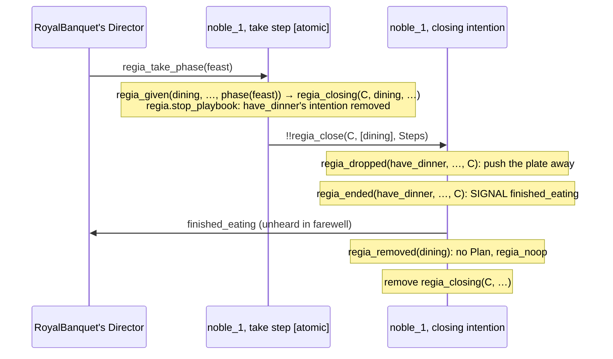
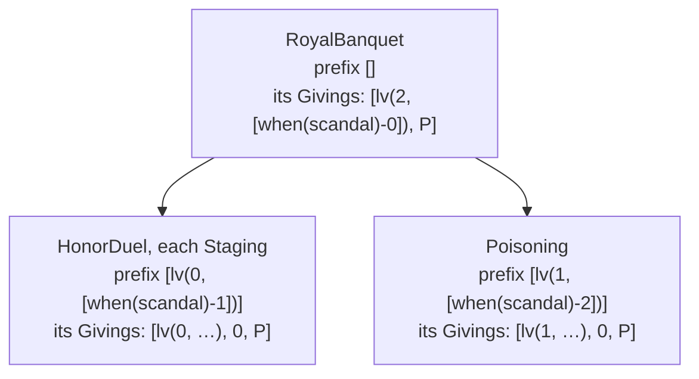

# Jason: Givings and Precedence

A knight sits at the banquet holding `Keeping_watch` three times over: from its Guard setup, from `Poisoning` as a Watchman, and once more as the winner of a duel. It holds `NobleSocializing` and `Dining` as a Guest, and `Wagering` while it watches a duel. A noble spreads gossip, and the knight has a Plan for `scandal` in three of those Playbooks. This chapter goes through how the Jason Target keeps track of what an Agent has been given, how giving and taking away travel between Director and Agent, what stops when a Playbook goes, and how `selectOption` picks the one plan that runs.

| We write | The Build gets |
|---|---|
| a Playbook an Agent can be given | its plans in the Agent's files from the start, each behind a guard |
| `ASSIGN`, a Role setup's `ASSIGN` | a `regia_give` message, and a `regia_given` belief on the Agent |
| `REMOVE`, a Phase left, a Staging ending | `regia_take`, `regia_set_aside`, `regia_take_phase` or `regia_end_staging`, and a closing on the Agent |
| a Playbook Role, `PLAYS`, `FROM host` | `regia_plays`, read through every Giving the Agent holds |
| `WHEN ASSIGNED`, `WHEN REMOVED` | plans for `regia_assigned(p)` and `regia_removed(p)` |
| `PRECEDENCE` | levels worked out at build time, a `Rank` on each Giving, an annotation on each plan |
| which plan runs | `selectOption` in `regia.RegiaAgent` and `regia.DirectorAgent` |

No Transpiler exists yet, so every line of ASL below was put together by hand from the spec. Plan labels are `regia_plan__<owner>__<n>`, and their numbers mean nothing here. How a Plan's Body becomes ASL is in *Jason: Plans and Goals*; the Role files and their includes are in *Jason: the Build*; what a Director does with Phases and Stagings is in *Jason: Directors and Stagings*.

## Plans are compiled in

[`plots/royal_banquet.regia`](../showcase/plots/royal_banquet.regia)
```regia
DURING reception:
    WHEN ENTERED:
        ASSIGN NobleSocializing TO Guest, MAPPING Guest AS peer
```

A noble's Role file includes `NobleSocializing.asl` from the start (*Jason: the Build*). When the reception begins, nothing is loaded. The noble gets one belief saying the Playbook is given, and from then on the Playbook's plans pass their guard.

- An Agent's files hold every Playbook it can be given in its lifetime. Giving never adds plans and taking away never removes them.
- The Jason Target never uses `.add_plan`, `.remove_plan`, `tellHow` or an `.include` at runtime. Plans added at runtime would merge with equal plans of other Playbooks, go to the end of the plan library, race with the Director's next message, and pick up values from the Director's variables.
- Compiled-in plans behave the same in every run, and we can read them in the Build's files.
- The cost: a Playbook that isn't given still has its plans looked at for every event that matches their trigger. The guard rejects them with one belief test.

Spec: chapter 29, *Plans are compiled in, Givings switch them on*. For what a Role file includes, chapter 28 and chapter 29, *Which Playbooks a Role file includes*.

## The guard

[`playbooks/keeping_watch.regia`](../showcase/playbooks/keeping_watch.regia)
```regia
WHEN scandal(?), FROM ?speaker:
    GIVEN on_duty AND (NOT seat(?) OR NOT hungry):   # standing guard, or seated and not thinking of food
        DO watch(?speaker)
    # no ELSE: a hungry knight at the table leaves gossip to NobleSocializing
```

```asl
@regia_plan__keeping_watch__2[regia_rank(keeping_watch, when(scandal), 0)]
+scandal(_)[source(Speaker)]
    : regia_is_given(keeping_watch)
      & regia_from_agent(Speaker)
      & on_duty & (not seat(_) | not hungry)
   <- regia.act("watch", watch(Speaker)).
```

Every plan generated from a Playbook starts its context with a test that the Playbook is given, the rule `regia_is_given(p)` of `regia/agent.asl`, which holds when some `regia_given(p, …)` belief exists. It comes first, so our Context is never evaluated for a Playbook the Agent doesn't hold. A servant's files hold this plan too, since `Keeping_watch` reaches every Role, and for a servant who never won a duel the test fails at once.

The guard covers our Plans, their ending Plans and the plans of the Playbook's Local Goals. Three kinds of plan are guarded differently:

| Plan | Its guard |
|---|---|
| `WHEN g DROPPED`, `WHEN g ENDED` in P | `regia_given_or_closing(p, Closing)`: given, or the drops of a closing of P |
| `WHEN REMOVED` in P | none: only a closing of P raises `regia_removed(p)` |
| the generated `-!g` of a Goal | none: it lives in `goals.asl`, belongs to no Playbook, and a `-!g` whose context fails would drop the whole intention |

[`playbooks/dining.regia`](../showcase/playbooks/dining.regia)
```regia
WHEN have_dinner ENDED: SIGNAL finished_eating
```

```asl
regia_is_given(P) :- regia_given(P, _, _, _, _, _).                                    // in regia/agent.asl
regia_given_or_closing(P, C) :- regia_is_given(P) | regia_closing(C, P, _, _, _, _, _).

@regia_plan__dining__11[regia_rank(dining, ended(have_dinner), 0)]
+!regia_ended(have_dinner, _, _, Regia_closing)
    : regia_given_or_closing(dining, Regia_closing)
   <- ?regia_directors(dining, Regia_to__1); regia.send(Regia_to__1, signal, finished_eating).
```

`Regia_closing` is the ending goal's last argument: `none` for an ordinary ending, the closing's id for an ending a take hands to its closing. A `regia_closing` belief never has `none` as its id, so the second half of `regia_given_or_closing` admits exactly the drops of a closing of `Dining`, and nothing else.

Spec: chapter 29, *The guard*. For the ending goals, chapter 40.

## The Giving record

Each Giving an Agent holds is one belief:

```
regia_given(Playbook, Director, Target, Rank, Bindings, Until)
```

| Argument | Holds |
|---|---|
| `Playbook` | the Playbook's Jason name: `nobleSocializing` |
| `Director` | the giving Director's Jason agent name, taken from the message's `source`. It is also the Staging's identity: each Staging is a Director agent of its own |
| `Target` | `role(guest)` for a Giving to a Role, whole, counted, with `EXCEPT` or from a Role setup; `role(cast)` for `CAST` in the same forms; `agent(Name)` for a Giving to `?who` |
| `Rank` | where this Giving ranks: a path of levels from the Root Plot down (*The Rank of a Giving*, below) |
| `Bindings` | one `bind(Role, Binding)` per Playbook Role: `live(PlotRole, Except)` for a whole-Role Mapping, `fixed([…])` for a counted pick or `MAPPING ?who` |
| `Until` | `staging` for a Giving that lasts until taken away or the Staging ends; `phase(feast)` for one made for a Phase, by the Phase's setup or with `UNTIL EXITED` |

The knight `percival`, late in the feast, with `Poisoning` running and a duel won:

```asl
regia_given(courtesy, regia_director__royalBanquet, role(cast),
            [lv(2, [when(scandal)-0]), 0], [bind(host, live(host, []))], staging).
regia_given(keeping_watch, regia_director__royalBanquet, role(guard),
            [lv(2, [when(scandal)-0]), 3], [], staging).
regia_given(nobleSocializing, regia_director__royalBanquet, role(guest),
            [lv(2, [when(scandal)-0]), lv(4, [when(insulted)-1])], [bind(peer, live(guest, []))], staging).
regia_given(dining, regia_director__royalBanquet, role(guest),
            [lv(2, [when(scandal)-0]), 1], [bind(waiter, live(servant, []))], phase(feast)).
regia_given(keeping_watch, regia_director__poisoning, role(watchman),
            [lv(1, [when(scandal)-2]), 0, 0], [], staging).
regia_given(keeping_watch, regia_director__royalBanquet, agent(percival),
            [lv(2, [when(scandal)-0]), 3], [], staging).
```

- `Courtesy` comes from the `CAST:` setup. Its `host` is filled by the Plot's `Host` by name, which is a whole-Role binding like any `MAPPING Host AS host`.
- `Dining` comes from `feast`'s Guest setup, so it carries `phase(feast)`. `NobleSocializing` was given in a `WHEN ENTERED` of `reception` with no `UNTIL EXITED`, so it carries `staging` and outlasts the reception.
- `Keeping_watch` has no Roles, so its `Bindings` is `[]`.
- The last line is `ASSIGN Keeping_watch TO ?winner`. It sits next to the Guard setup's Giving, same Playbook, same Director, another Target. `REMOVE Keeping_watch FROM Guard` would leave it, and `REMOVE Keeping_watch FROM ?winner` would take only it.

There is no Giving id. A Giving is told apart by Playbook, Director, Target and `Until`:

- The same `ASSIGN` running again with the same bindings makes the same belief, which Jason keeps once. Givings that differ only in bindings or rank are two beliefs, and add up.
- Taking away matches on Playbook, Director and Target, and removes every match at once. That is what `REMOVE` means.
- `Until` is an argument and not an annotation. Jason merges the annotations of equal literals, so a Plot-long Giving and an identical `UNTIL EXITED` one would become one belief, and leaving the Phase would take both.
- A target "that includes `Guest`" is `role(guest)`, or `role(cast)` while the Agent plays `Guest` in that Director's cast. `agent(Name)` never includes a Role.
- A Role's `EXCEPT` isn't in the record. An Agent left out never gets the Giving, and the Director's standing record keeps the list (*Jason: Directors and Stagings*).

Spec: chapter 29, *The Giving record*. For the cast copy's functor, chapter 28.

### Givings set aside

[`plots/royal_banquet.regia`](../showcase/plots/royal_banquet.regia)
```regia
WHEN Poisoning FINISHED WITH poisoner_caught(?culprit):
    REMOVE NobleSocializing FROM Guest ?culprit
    ASK ?culprit TO take_leave       # led out of the hall
```

`REMOVE … FROM Guest ?who` takes one Agent out of Givings that go on for every other Guest, and `ASSIGN … TO Guest ?who` gives it back with the same bindings. The Director doesn't keep counted Givings or setup Givings, so the Agent keeps what it lost, unchanged, in a second belief:

```
regia_aside(Playbook, Director, Target, Rank, Bindings, Until)
```

- `regia_set_aside` moves every matching `regia_given` to `regia_aside`. `regia_restore` moves them back.
- The guard and every reader ignore `regia_aside`. The caught Poisoner had one Giving of `NobleSocializing`; with it set aside, the Playbook closes as on any take, and `REMOVED` fires. Restoring it fires `ASSIGNED`.
- A full take clears what was set aside too: `REMOVE … FROM Guest`, `REMOVE … FROM CAST`, the Phase being left, the Staging ending. After those there is nothing left to give back.
- An Agent that leaves is dropped from the `fixed` lists of `regia_aside` as from those of `regia_given`.

Spec: chapter 29, *Givings set aside*. For the language, chapter 15, *Taking a giving from one Agent*, *Giving it back*.

### The cast copy

A whole-Role binding is live: `TELL host greeting` reaches whoever plays `Host` in that Staging when the Statement runs. So every Agent holding a Giving from a Staging keeps a copy of that Staging's cast, as `regia_cast(Director, Role, Agent)`, the functor the Director uses for its own record.

- The Director sends its cast to an Agent before the first Giving it sends that Agent. Jason keeps one sender's messages in order, so the copy is there when the Giving arrives.
- The copies are kept up to date as Agents leave (*Jason: Directors and Stagings*).
- Asking the Director at every send would be slow and would block the Plan. Relaying Messages through the Director would make the Director the Sender, and break `FROM` and the per-sender order of Messages.

Spec: chapter 29, *The cast copy*. For the message that carries it, chapter 30.

## Messages between Director and Agent

The Director gives and takes away with `achieve` messages. The Agent handles each with a fixed `[atomic]` plan in `regia/agent.asl`, so no other event is handled halfway through one.

```asl
// RoyalBanquet's Director, entering reception, for each Agent playing Guest
.send(noble_1, achieve,
      regia_give(nobleSocializing, role(guest),
                 [lv(2, [when(scandal)-0]), lv(4, [when(insulted)-1])],
                 [bind(peer, live(guest, []))], staging))

// the Agent, in regia/agent.asl
@regia_give[atomic]
+!regia_give(P, T, R, B, U)[source(D)] : regia_playbook(P)
   <- +regia_given(P, D, T, R, B, U)
      // if P was neither held nor closing just before: !!regia_assigned(P)
+!regia_give(P, _, _, _, _)[source(D)]
   <- // Trace warning: P isn't in this Agent's files; the Giving is ignored
```

- `regia_give` carries the record without the Director. The Agent adds `D` from `source`, so no argument can make a Giving look as if another Director made it.
- `regia_playbook(P)` is the Role file's list of the Playbooks it includes. A `regia_give` for any other Playbook is a Transpiler bug, not our error: the Agent writes a Trace warning and ignores it.
- A Playbook given twice keeps both Givings.

The take-away plans, in outline:

| Message | The Agent |
|---|---|
| `regia_take(P, role(R))` | removes every `regia_given` and `regia_aside` of P from `D` whose Target includes R |
| `regia_take(P, agent)` | removes every `regia_given` of P from `D` with Target `agent(Me)`; nothing matched is a warning |
| `regia_take(P, all)` | removes every Giving of P from `D`, any Target |
| `regia_set_aside(P, R)` | moves every `regia_given` of P from `D` whose Target includes R to `regia_aside`; nothing moved is a warning |
| `regia_restore(P, R, Resent)` | moves those `regia_aside` back; nothing moved, with `Resent` false, is a warning |
| `regia_take_phase(Ph)` | removes every `regia_given` and `regia_aside` from `D` with `Until` `phase(Ph)` |
| `regia_end_staging` | removes every `regia_given` and `regia_aside` from `D`, and `D`'s cast copy |

Each plan that can take an Agent's last Giving of a Playbook goes on into a take step (*Taking a Playbook away*, below).

### What each Director Statement sends

| Statement | Sent to | Message |
|---|---|---|
| `ASSIGN P TO Guest`, whole Role | each Agent playing `Guest` in the Staging | `regia_give(p, role(guest), …)` |
| `ASSIGN P TO Guest EXCEPT Guard, ?who` | each Agent playing `Guest`, not `Guard`, not `?who` | `regia_give(p, role(guest), …)` |
| `ASSIGN P TO CAST`, the `CAST` setup's `ASSIGN P` | each cast Agent, once | `regia_give(p, role(cast), …)` |
| `ASSIGN P TO 2 OF Guest` | each picked Agent | `regia_give(p, role(guest), …)` |
| a Role setup's `ASSIGN P` | the Agent starting in the Role | `regia_give(p, role(guest), …)` |
| `ASSIGN P TO ?who` | that Agent | `regia_give(p, agent(who), …)` |
| a kind's or an individual Agent's `ASSIGN P` | that Agent, from the Root Director | `regia_give(p, agent(a), …, staging)` |
| `REMOVE P FROM Guest` | each Agent in the Staging's cast | `regia_take(p, role(guest))` |
| `REMOVE P FROM CAST` | each Agent in the Staging's cast | `regia_take(p, all)` |
| `REMOVE P FROM ?who` | that Agent | `regia_take(p, agent)` |
| `REMOVE P FROM Guest ?who` | that Agent, if it plays `Guest` | `regia_set_aside(p, guest)` |
| `REMOVE P FROM CAST ?who` | that Agent | `regia_take(p, all)` |
| `ASSIGN P TO Guest ?who` | that Agent, if it plays `Guest` | any resent `regia_give`, then `regia_restore(p, guest, Resent)` |
| leaving a Phase | each Agent in the Staging's cast | `regia_take_phase(feast)` |
| a Staging ending | each Agent in its cast | `regia_end_staging` |

- `Until` is `phase(feast)` for a Giving from `feast`'s setup, or with `UNTIL EXITED` in a `DURING feast` Plan. Everything else is `staging`.
- `REMOVE NobleSocializing FROM Guest` at `farewell` goes to the whole cast, the king and the servants included. The Director doesn't track who holds what, so each Agent removes whatever matches in its own record, and a servant finds nothing. A take to a Role that matches nothing is not a warning.
- `REMOVE P FROM Guest` takes a Guest's `role(guest)` Givings and its `role(cast)` ones: a Giving to `CAST` narrows, and goes on for the others.
- Only the Agent knows what it holds, so the Agent writes the warnings for a `REMOVE … FROM ?who` that takes nothing, a `FROM Guest ?who` with nothing to set aside, and an `ASSIGN … TO Guest ?who` with nothing to give back. When `?who` doesn't play `Guest`, the Director writes them and sends nothing.
- `Resent` is `true` when the Director has just resent a standing Giving whose written `EXCEPT` left `?who` out. That Giving arrived first, by per-sender order, so the Agent has nothing to warn about.
- Every send goes through `regia.send`, which catches a recipient that has left and writes a Trace entry.

> **In 2.0** a standing Giving reaches Agents that join later: the Director replays its standing record to each joiner, after its setups. Spec chapter 30, *Joining*. In 1.5 nobody joins, and the standing record serves only `REMOVE` and giving back.

**Checks**

- A `regia_give` for a Playbook the Agent's files don't hold → `T29_01-give-of-missing-playbook` (Trace warning, a Transpiler bug)
- A `REMOVE` naming one Agent that takes nothing → `T15_05-remove-takes-nothing` (Trace warning)
- An `ASSIGN P TO <Role> ?who` with nothing to give back → `T15_06-assign-lifts-nothing` (Trace warning)
- An `EXCEPT ?who` whose Placeholder holds no Agent → `T15_04-except-placeholder-not-agent` (Trace warning, on the Director)
- A Giving or Mapping to an Agent who has left → `T20_01-giving-after-leaving` (Trace warning, on the Director)

Spec: chapter 29, *Messages between Director and Agent*, *What each Director Statement sends*. For the standing record and giving back, chapter 30; for a Staging's end, chapter 31.

## Reading the record

Every reader goes through one rule in `regia/agent.asl`, which holds for each Giving in effect:

```asl
regia_holds(P, D, T, R, B, U) :- regia_given(P, D, T, R, B, U).
regia_holds(P, D, T, R, B, U) :- regia_closing(_, P, D, T, R, B, U).
```

`regia_closing` is a closing's snapshot of the Givings it took (*The closing*, below). Outside a closing the two are the same. Inside one, a closing Plan speaks through the Givings as they were just before the take. Only the guard reads `regia_given` directly.

### Who plays a Playbook Role

[`playbooks/dining.regia`](../showcase/playbooks/dining.regia)
```regia
WHEN served(?dish), FROM waiter:
    GIVEN sated:
        DO push_away(?dish)
    ELSE:
        LEARN on_plate(?dish)
```

```asl
regia_plays(P, R, A) :-
    regia_holds(P, D, _, _, B, _) & .member(bind(R, X), B) &
    ( X = live(cast, Ex) & regia_cast(D, _, A) & not regia_excepted(D, Ex, A)
    | X = live(PR, Ex) & PR \== cast & regia_cast(D, PR, A) & not regia_excepted(D, Ex, A)
    | X = fixed(L) & .member(A, L) ).

regia_excepted(_, Ex, A) :- .member(agent(A), Ex).
regia_excepted(D, Ex, A) :- .member(role(XR), Ex) & regia_cast(D, XR, A).
```

`FROM waiter` is `regia_plays(dining, waiter, S)` on the Sender. The Guest's `Dining` Giving binds `waiter` to `live(servant, [])`, so a servant counts if the banquet's cast copy says it plays `Servant` at the moment the Cue arrives.

- `A` plays `R` if any Giving of P binds `R` to it: the rule is the union over every Giving.
- It leaves the Agent itself in. `TELL` leaves it out where it collects its recipients; `PLAYS` doesn't.
- It can hold for one Agent more than once, through two Givings or a knight's two Roles. Every reader collects with `.setof`, or tests a bound `A`, so nobody is counted twice.
- Generated code never reads `bind` itself. A new kind of binding changes this rule and nothing else.

### `EXCEPT` in a binding

A whole-Role binding always carries a list, `[]` when nobody is left out. In a variation of the reception where the Guards are no one's peers:

```regia
ASSIGN NobleSocializing TO Guest, MAPPING Guest EXCEPT Guard AS peer
```

the binding is `bind(peer, live(guest, [role(guard)]))`, and with `EXCEPT Guard, ?who`, `live(guest, [role(guard), agent(noble_3)])`.

- A `role(guard)` item is read live, from the same cast copy as the Role it narrows.
- An `agent(…)` item is the Agent the Placeholder held when the Statement ran. The Director writes the name in. A Placeholder holding no Agent is left out of the list, with a warning, and the rest of the list still applies.
- A counted Mapping with `EXCEPT` is drawn by the Director from what is left, and arrives as `fixed`.

### What reads it

| We write, in Playbook P | The Infrastructure reads |
|---|---|
| any Plan of P runs | the guard, `regia_is_given(p)` |
| `SIGNAL c` | `regia_directors(p, L)`, each distinct Director in `regia_holds(p, D, …)`, then one `regia.send` to the list |
| `TELL host f` | `regia_audience(p, host, L)`, the Role's union without the Agent itself, then one `regia.send` to the list |
| `TELL 2 OF host f`, `ASK 50% OF host TO g` | the same pool, drawn by the Infrastructure plan `regia_draw` each time the Statement runs |
| `?x PLAYS host`, `ME PLAYS host` | `regia_plays(p, host, X)`, the Agent itself left in |
| `FROM host` | `regia_from_role(p, host, S)`, which is `regia_plays(p, host, S)`, on the Sender |
| `FROM DIRECTOR` | `regia_from_director(p, S)`, which is `regia_holds(p, S, _, _, _, _)`, on the Sender |
| precedence | `Rank` from `regia_holds`, the best per item (*`selectOption` in Agents*, below) |

> **In 2.0** a Quota Trigger over `host` in P counts against `regia_plays(p, host, _)`, and P starts counting as soon as it is given. Spec chapter 18 and chapter 33, *Quota counts*. A 1.5 Build has no Quota Triggers.

Spec: chapter 29, *Reading the record*. For the Body's side of each row, chapter 39.

## Opening: `ASSIGNED`

[`playbooks/dining.regia`](../showcase/playbooks/dining.regia)
```regia
WHEN ASSIGNED:
    IF hungry:
        PURSUE have_dinner, WITHOUT WAITING
    ELSE:
        SIGNAL finished_eating           # not hungry tonight: nothing to count on
```

```asl
@regia_plan__dining__1[regia_rank(dining, assigned, 0)]
+!regia_assigned(dining)
    : regia_is_given(dining)
   <- if (hungry) {
          regia.trace(goal, info, "", [goal(have_dinner), event(pursued)], Regia_pursuit__1); !!have_dinner[regia_pursuit(Regia_pursuit__1)]
      } else {
          ?regia_directors(dining, Regia_to__1); regia.send(Regia_to__1, signal, finished_eating)
      }.
```

`ASSIGNED` fires when the Agent goes from holding no Giving of P to holding one. `regia_give` and `regia_restore` look, before they add, at whether P is held or closing:

| Before the Giving | What happens |
|---|---|
| P was held | nothing fires. `ASSIGN Keeping_watch TO ?winner` for a Guard is one more belief |
| P was neither held nor closing | the atomic plan posts `!!regia_assigned(p)`, which runs on a new intention once the atomic plan ends |
| P was closing | nothing is posted. The closing runs `ASSIGNED` as its last step, after `REMOVED` |

When `feast` begins, `Dining` reaches a Guest, `ASSIGNED` runs on its own intention, and `PURSUE have_dinner, WITHOUT WAITING` starts yet another.

- A Playbook taken and given again by one `ENTER`, because the Phase is entered again, closes and then opens: `REMOVED`, then `ASSIGNED`. Its other Plans run as soon as the new Giving is in, next to the closing Plans. Only `ASSIGNED` waits.
- `agent.asl` holds a `regia_noop` plan for `regia_assigned(_)` and one for `regia_removed(_)`, so a Playbook with neither Plan needs nothing. It also holds a `-!` catcher for each, which writes the failing Plan's cause entry and succeeds.

Spec: chapter 29, *Opening: `ASSIGNED`*. For the `regia_noop` plans, chapter 40.

## Taking a Playbook away

[`plots/royal_banquet.regia`](../showcase/plots/royal_banquet.regia)
```regia
WHEN finished_eating, FROM Guest ?g:
    LEARN finished(?g)
    IF COUNT(finished(?)) * 4 >= COUNT(? PLAYS Guest) * 3:     # three Guests in four
        ENTER farewell
```

Three Guests in four have finished, and the banquet enters `farewell`. The Guests who are still eating lose `Dining`, which was given for `feast`.

Removing a Giving removes its record. If the Agent still holds another Giving of P, nothing else happens: P's Plans go on, with the bindings of the Givings that are left. When the last Giving of P goes, P closes. A Playbook on an Agent is always in one of three states: given, closing, or not given.

### The take step

Each atomic plan that can take a last Giving is a take step. Leaving `feast` takes `Dining` from a Guest, and could take several Playbooks at once from an Agent that had several for the Phase. With `Ps` the Playbooks that lost their last Giving, still inside the atomic plan:

1. Snapshot the Givings. Each removed `regia_given` of a Playbook in `Ps` becomes `regia_closing(C, P, D, T, R, B, U)`. Removed `regia_aside` records are not kept: they were not in effect. A Playbook that keeps another Giving isn't in `Ps`, and its removed records are just deleted.
2. Stop the Playbooks' running Plans: `regia.stop_playbook(C, Ps)`.
3. Start the closing: `!!regia_close(C, Ps, Steps)`.

`C`, the closing's id, is the `seq` of the first `giving` entry the step writes, as a Pursuit's id is the `seq` of its `PURSUED` entry.

> **In 2.0** the take step also clears the Playbook's Quota counts, between stopping its Plans and starting its closing. Spec chapter 29, *The take step*, and chapter 33. A 1.5 Agent keeps no counts.

### Stopping the Plans: `regia.stop_playbook`

`regia.stop_playbook` is `regia.drop`'s walker, starting from the Playbook's frames instead of a `+!g` frame:

1. Find every intention holding a frame of a Playbook in `Ps`, by the first argument of its `regia_rank` annotation: running, suspended or waiting. Skip the steps of a closing of the same Playbook: those Plans run to their end, even when the Playbook was given back and is taken again.
2. Take each intention whole, as a `DROP` does. Every goal frame on it is dropped, a still-given Playbook's included, and what waited on a dropped Goal is dropped too. In the intention of another closing, only the frames above its `regia_close` frame are taken, and that closing goes on with its next step.
3. Call off a `DO` the intention is waiting on.
4. Write the Trace: each Pursuit stopped writes `GOAL … DROPPED` `because:` the take's `giving` entry; a `WHEN` Plan at the bottom writes `plan … stopped`, at `info`.
5. Remove the intentions.
6. Hand back the endings: for each removed intention, `regia_dropped` then `regia_ended` per goal frame, innermost first, intentions in the order Jason created them. They go into the closing's `Steps`, not onto new intentions as a `DROP`'s do.

`have_dinner` was started `WITHOUT WAITING` from `ASSIGNED`, so it is the bottom of its own intention, and its recipe is a plan of `Dining`. The walker finds it, while it waits for a plate or while the Guest eats, and stops it. This is also how Local Goals go: their recipes are only in their Playbook, so whatever runs them is found.

### The closing

`regia_close(C, Ps, Steps)` is an Infrastructure plan of `agent.asl`. It runs on one intention, in order:

1. the endings `regia.stop_playbook` handed back;
2. `regia_removed(p)` for each P in `Ps`, in name order;
3. removing every `regia_closing(C, …)`;
4. `regia_assigned(p)` for each P in `Ps` that is held again, in name order.



The closing is that intention, and the Playbook is closing from the take step until it ends. Running the steps one after the other is what keeps the language's order, each drop's `DROPPED` and `ENDED`, then `REMOVED`. A `WAIT` in one closing Plan delays the steps after it.

[`playbooks/dining.regia`](../showcase/playbooks/dining.regia)
```regia
# Full before the plate is empty: push away what is left.
WHEN have_dinner DROPPED:
    FOR EACH on_plate(?dish):
        DO push_away(?dish)
        FORGET on_plate(?dish)
```

- The endings in `Steps` carry `C`, so `Dining`'s `DROPPED` and `ENDED` plans pass their guard through `regia_closing(C, dining, …)`. Any other ending of `Dining`'s Goals while it closes carries `none` and finds no plan of `Dining`.
- A closing Plan is an ordinary Plan. A `PURSUE` in it of a Goal whose only recipe is in the closing Playbook finds no plan, and the Pursuit's endings carry `none`, so the Playbook's own `FAILED` Plan for it doesn't run.
- A closing Plan speaks through `regia_holds`, snapshot included. `SIGNAL finished_eating` reaches the banquet's Director, now in `farewell`, which has no Plan for it.
- A failing step is caught by its kind's `-!` catcher, and the closing goes on.
- The Playbook's Local Facts stay unless a closing Plan forgets them. The guard hides the Plans that read them, and they are there again if the Playbook is given back.
- Messages already queued for the Playbook's Triggers find no applicable plan. A queued Goal fails like any Goal with no recipe.

### A Staging that has ended

[`plots/royal_banquet.regia`](../showcase/plots/royal_banquet.regia)
```regia
DURING farewell:
    WHEN ENTERED:
        DROP SUBPLOT HonorDuel(?)
        REMOVE NobleSocializing FROM Guest
        ASK Guest TO take_leave
```

[`playbooks/duelling.regia`](../showcase/playbooks/duelling.regia)
```regia
WHEN REMOVED:
    FOR EACH stamina(?left): FORGET stamina(?left)
```

```asl
@regia_plan__duelling__14[regia_rank(duelling, removed, 0)]
+!regia_removed(duelling)
   <- for (regia_each(m(Left), regia_local__duelling__stamina(Left))) {
          .abolish(regia_local__duelling__stamina(Left))
      }.
```

A duel still running at `farewell` ends, and its Director sends `regia_end_staging` to each Agent of its cast. A duellist's only Giving of `Duelling` goes, the walker stops its `strike` lunges, and the closing runs `REMOVED`, which forgets `stamina`.

- `regia_end_staging` also removes that Staging's cast copy, and its Director is gone. A `live` binding through it reaches nobody; a `fixed` one still reaches its Agents.
- A `SIGNAL` from a closing Plan to a Director that has ended is caught by `regia.send`. It is not a warning: the Director hears nothing, as the language promises. The `message` entry lists that Director as ended, at `info`.
- The `REMOVED` plan has no guard. `Duelling` is closing, so only its snapshot holds it, and nothing but a closing posts `regia_removed(duelling)`.
- Its annotation carries the Item `removed`, so `selectOption` can rank it like any plan of the Playbook (*The plan annotation*, below).

**Checks**

- A `PURSUE` in a closing Plan of a Goal whose only recipe is in the closing Playbook → `T11_04-goal-found-no-plan` (Trace, Failure)
- A Signal from a closing Plan with no Plan in the Director's current Phase → `T38_01-signal-found-no-plan` (Trace, `unheard`)

Spec: chapter 29, *Taking a Playbook away*. For the walker, chapter 40; for `regia_end_staging`, chapter 31; for the `giving` entry, chapter 34.

## Levels

[`plots/royal_banquet.regia`](../showcase/plots/royal_banquet.regia)
```regia
PRECEDENCE:
    Keeping_watch OVER NobleSocializing ON scandal   # a knight on duty is a Guard first
    Dining TIES NobleSocializing ON insulted         # over dinner, temper decides
    HonorDuel OVER Poisoning
```

[`plots/honor_duel.regia`](../showcase/plots/honor_duel.regia)
```regia
PRECEDENCE:
    PARENT OVER SELF ON scandal          # gossip and guard duty come before hushing
```

At runtime the Infrastructure only compares numbers. The Transpiler turns each Plot's relations into levels, 0, 1, 2, …, where lower wins. Each Plot gets two level tables:

- the Staging table ranks its direct Subplots, by Plot name, and `SELF`;
- the Playbook table ranks the Playbooks it gives.

Each table is worked out once for every item named in an `ON` relation of that table, and once for every other item:

1. Collect the relations that apply: those without `ON`, and those `ON` the item.
2. Fold in each Subplot's `PARENT` relations, rewritten from the parent's side: `HonorDuel`'s `PARENT OVER SELF ON scandal` is `SELF OVER HonorDuel ON scandal` here. Where they contradict the parent's own relations, the parent's win.
3. Add the defaults, every Subplot over `SELF`, one at a time, each only if what is already placed doesn't put `SELF` above that Subplot, directly or through a chain.
4. Merge each `TIES` pair into one member. With no `SUITS` on either side the pair isn't really tied, and stays two members.
5. Sort: repeatedly take the members nothing unplaced is above, and when several are free, the alphabetically first. The place at which a member is taken is its level. A merged pair shares one level.

`RoyalBanquet`'s Staging table, for `scandal` and for every other item:

| Member | Every other item | `scandal` |
|---|---|---|
| `HonorDuel` | 0 | 1 |
| `Poisoning` | 1 | 2 |
| `SELF` | 2 | 0 |

On most items only the defaults and `HonorDuel OVER Poisoning` apply, and both Subplots come before the banquet. On `scandal`, `SELF OVER HonorDuel` comes in from the duel, and together with `HonorDuel OVER Poisoning` it puts `SELF` above `Poisoning` as well. Both defaults are left out for that item.

`RoyalBanquet`'s Playbook table:

| Playbook | Every other item | `insulted` |
|---|---|---|
| `Courtesy` | 0 | 0 |
| `Dining` | 1 | 1 |
| `Hosting` | 2 | 2 |
| `Keeping_watch` | 3 | 3 |
| `NobleSocializing` | 4 | 1 |
| `Serving` | 5 | 4 |

- On `scandal` the sort gives the same levels as on every other item: `Keeping_watch OVER NobleSocializing` agrees with the alphabet. The line still matters, since it makes the order the Plot's decision and silences the name-order warning.
- On `insulted`, `Dining` and `NobleSocializing` both carry `SUITS`, so they merge and share level 1. The merged member is sorted under the first of its names.

`HonorDuel` and `Poisoning` start no Subplots, so `SELF` is 0 in their Staging tables. Their Playbook tables are `Duelling` 0, `Wagering` 1, and `Keeping_watch` 0, `Scheming` 1, by name.

- The conflict report prints these same tables, so what `regia explain … precedence` shows and what runs can't disagree.
- Step 5 is what "name order" means. Comparing unordered pairs by name one at a time can't be done: with `C OVER A` and B ordered against neither, pairwise name order would put A over B and B over C, against the relation.
- A Plot started from two parents has a level in each parent's Staging table, worked out with each parent's relations.

**Checks**

- A cycle among the relations collected for an item → `R13_01-precedence-cycle`
- A Subplot's relation dropped because its parent says the opposite → `R13_11-overridden-subplot-relation` (warning)
- A competition ordered only by name → `R13_05-competition-ordered-by-name` (warning)
- `TIES` with no `SUITS` on either side → `R13_08-ties-without-suits` (warning)

Spec: chapter 32, *Levels: the order is worked out at compile time*. For the relations and defaults, chapter 13.

## The Rank of a Giving

A Giving's `Rank` is a path of levels from the Root Plot down. For a Giving of Playbook P by Staging G:

```
Rank = Prefix ++ [SELF's level in G's Staging table, P's level in G's Playbook table]
```

`Prefix` is G's own place in the tree. Each step of the path is a number, the level for every item, or `lv(N, [Item-M, …])`, level N except M for the listed items. An `lv` step appears only where the table was worked out differently for some item.



- The Root Director's file holds `regia_rank_prefix([])`.
- When a parent starts a Subplot, it sends the child its prefix in `regia_start(Cast, Prefix, Args)`: its own prefix plus the child's level in its Staging table. The child keeps it as `regia_rank_prefix(Prefix)`. A duel against `noble_3` starts with `regia_start(Cast, [lv(0, [when(scandal)-1])], [noble_3])`.
- Every `ASSIGN`, Role setup and standing Giving appends a constant pair of steps for its Playbook, written inline by the Transpiler. The Director builds the Rank with `.concat(Prefix, Suffix, Rank)`.
- Stagings of one Plot under one parent get equal prefixes. Two duels give `Duelling` the same Rank.
- A Plot started from two parents gets a different prefix in each Staging. Which of its Givings ranks better is decided per item, at selection time.

### Comparing two Ranks

A Rank is always compared for one item, the one the competing plans react to:

1. Resolve each step for the item: a number stays; `lv(N, Overrides)` becomes the item's override, or N.
2. Compare the two lists step by step. The first difference decides, and lower wins.

| Playbook, from | Rank | On `scandal` | On `idle` |
|---|---|---|---|
| `Keeping_watch`, `RoyalBanquet` | `[lv(2, [when(scandal)-0]), 3]` | `[0, 3]` | `[2, 3]` |
| `NobleSocializing`, `RoyalBanquet` | `[lv(2, [when(scandal)-0]), lv(4, [when(insulted)-1])]` | `[0, 4]` | `[2, 4]` |
| `Wagering`, `HonorDuel` | `[lv(0, [when(scandal)-1]), 0, 1]` | `[1, 0, 1]` | `[0, 0, 1]` |
| `Duelling`, `HonorDuel` | `[lv(0, [when(scandal)-1]), 0, 0]` | `[1, 0, 0]` | `[0, 0, 0]` |
| `Keeping_watch`, `Poisoning` | `[lv(1, [when(scandal)-2]), 0, 0]` | `[2, 0, 0]` | `[1, 0, 0]` |
| `Scheming`, `Poisoning` | `[lv(1, [when(scandal)-2]), 0, 1]` | `[2, 0, 1]` | `[1, 0, 1]` |

On `scandal` a knight ranks `Keeping_watch`, `NobleSocializing`, `Wagering`; on `idle` a duelling Poisoner ranks `Duelling`, `Scheming`, `NobleSocializing`. These are the orders *Precedence and Labels* reads off the source.

Every path starts at the Root and goes down through the same tables, so where two paths first differ both steps come from one table. A path is never a proper prefix of another that differs from it.

### A Playbook given several times

The Agent keeps every `regia_given` and never stores a merged Rank. For each item, a Playbook's Rank is the best of its Givings' Ranks for that item, read through `regia_holds`, so a closing Playbook's ending plans rank by its snapshot. With `ON` relations the best Giving for one item may not be the best for another. The knight's `Keeping_watch` ranks `[0, 3]` on `scandal`, from the banquet, and `[1, 0, 0]` on any other item, from `Poisoning`.

Spec: chapter 32, *The Rank of a Giving*. For the `regia_start` message, chapters 31 and 32, *Messages*.

## The plan annotation

[`playbooks/noble_socializing.regia`](../showcase/playbooks/noble_socializing.regia)
```regia
WHEN insulted, FROM peer ?who, SUITS aggressiveness AT 0.8, bravery AT 0.8:
    DO stand_up
    SIGNAL insult_thrown(?who)

#@desc: Scowl, and remember it. Only at someone we already resent.
WHEN insulted, FROM peer ?who, SUITS sympathy AT -0.5, SHIFTS aggressiveness BY 0.3:
    GIVEN grudge(?who, ?):
        DO scowl_at(?who)
        PURSUE resent(?who)

# `?_who` names who we ignore, so that the three ways read alike.
WHEN insulted, FROM peer ?_who, SUITS sympathy AT 0.7, SHIFTS aggressiveness BY -0.1:
    DO laugh
```

```asl
@regia_plan__nobleSocializing__6[regia_rank(nobleSocializing, when(insulted), 0), temper([aggressiveness(0.8), bravery(0.8)])]
@regia_plan__nobleSocializing__7[regia_rank(nobleSocializing, when(insulted), 0), temper([sympathy(-0.5)]), effects([aggressiveness(0.3)])]
@regia_plan__nobleSocializing__8[regia_rank(nobleSocializing, when(insulted), 0), temper([sympathy(0.7)]), effects([aggressiveness(-0.1)])]
```

Every plan compiled from a Playbook's Trigger Block carries `regia_rank(Playbook, Item, Pos)` in its label, the fixed part of its rank:

| Argument | Holds |
|---|---|
| `Playbook` | the Playbook's Jason name |
| `Item` | the Trigger's item, in Jason names: `when(e)`, `learned(f)`, `forgotten(f)`, `to(g)`, `reached(g)`, `dropped(g)`, `failed(g)`, `ended(g)`, and `assigned` and `removed` for the Playbook's own two |
| `Pos` | the Trigger Block's place among the Playbook's Trigger Blocks with the same Trigger, from 0, in text order |

- Suits alternatives share one `Pos`, so all three ways of taking an insult reach temper selection.
- `GIVEN` siblings share their Trigger Block's `Pos`. Their negated Contexts already keep them apart.
- `WHEN scandal(ME)` and `WHEN scandal(?victim)` in `NobleSocializing` are two Trigger Blocks on one item, `Pos` 0 and 1.
- Writing the item out means the Java never needs to know how each kind of Trigger is lowered.
- `regia.stop_playbook` finds a Playbook's frames by the first argument.
- `temper` and `effects` come from the Labels, unchanged, next to it.

Spec: chapter 32, *The plan annotation*. For `temper` and `effects`, chapter 14, *ASL mapping notes*.

## `selectOption` in Agents

`regia.RegiaAgent` overrides `selectOption(options)`. Jason hands it only applicable options: the guard has already removed the plans of Playbooks the Agent doesn't hold, and a Trigger Block whose `GIVEN`s all fail isn't there. That is falling through.

0. A catch-all last. An option annotated `regia_unheard` or `regia_noop` is chosen only when it is the only option. Otherwise it is left out.
1. Infrastructure first. If no option carries `regia_rank`, call `super.selectOption` unchanged. Infrastructure triggers start with `regia_`, which our names can't, so an Infrastructure plan never competes with one of ours.
2. Best Rank. For each option, read its Playbook's Rank for the option's Item, the best over the Playbook's Givings in `regia_holds`. Keep the options with the best Rank. An option with `regia_rank` whose Playbook isn't held at all got past its guard: drop it, with a Trace warning.
3. Best position in each Playbook. Among one Playbook's options, keep those with the lowest `Pos`: the first Trigger Block in the text wins, and a Playbook's later Blocks stay out of a `TIES` pool.
4. Hand over. Sort what remains by Playbook name and call `VesnaAgent.selectOption` on the new list. VEsNA-Pro uses temper selection if any option carries `temper`; otherwise it takes the first, which is name order.
5. Fits and Shifts. With a `temper` in the list, compute each option's fit with `Temper.computeWeight` before handing over. After VEsNA-Pro picks, apply the chosen plan's `effects` with `Temper.shift`. This runs for every chosen plan of a Playbook, contested or not.
6. Write the Trace: the chosen plan's `plan` entry, its Block from the label through the source map, its Placeholder values from the unifier, and when options were removed, `over` and `by`. `by` names the step that removed the last rival: `PRECEDENCE` at step 2, `DEFAULT` there when a default gave way, `NAME` at step 4 without temper selection, `SUITS` with it. Then one `mood` entry per Mood shifted.

A noble tells the hall `scandal(noble_3)`. The knight, not hungry, is on duty, watching a duel, and holds a grudge against `noble_3`:

| Step | Options left |
|---|---|
| applicable | `Keeping_watch` (Pos 0), `NobleSocializing` `GIVEN grudge(?victim, ?)` (Pos 1), `Wagering` (Pos 0) |
| 2, Rank on `scandal` | `Keeping_watch`, at `[0, 3]`; `NobleSocializing` `[0, 4]` and `Wagering` `[1, 0, 1]` lose |
| 3, 4 | one option; no `temper`, so VEsNA-Pro takes it |
| 6 | `plan` entry for `Keeping_watch`, `over` the other two, `by: PRECEDENCE` |

A Guest is insulted over dinner, and holds a grudge against the speaker:

| Step | Options left |
|---|---|
| applicable | `Dining` (Pos 0), the three `NobleSocializing` alternatives (Pos 0) |
| 2, Rank on `insulted` | all four, at `[2, 1]`: the `TIES` pair shares a level |
| 3 | all four: each Playbook's options share Pos 0 |
| 4, 5 | `Dining` first, then `NobleSocializing`'s three; VEsNA-Pro measures each `temper` against the Guest's Propensities and picks |
| 6 | `plan` entry `by: SUITS`, with each fit; a `mood` entry if the pick has `effects` |

After step 2 only a `TIES` pool leaves options from different Playbooks, since every other pair gets different levels. So the name sort in step 4 only sets the order temper selection sees, and decides a pool with no `temper`.

- `VesnaAgent.selectOption` removes the option it picks from the list it gets. The list handed over is a new one, and the chosen option is removed from Jason's list too, as Jason expects.
- Once `selectOption` is overridden, Jason calls it for every event, so step 5 applies the `effects` of a plan nobody competed with too.

**Checks**

- A ranked option whose Playbook isn't held, so its guard was bypassed → `T32_01-unguarded-ranked-option` (Trace warning; the option is dropped)
- `SUITS` on a Target with no Selection function → `R13_10-suits-without-selection-function` (warning)

Spec: chapter 32, *`selectOption` in Agents*. For the `plan` entry, chapters 34 and 35; for `regia_noop`, chapter 40; for `regia_unheard`, chapter 39.

## Directors

[`plots/royal_banquet.regia`](../showcase/plots/royal_banquet.regia)
```regia
WHEN culprit_seized(?):              # any Guard's report: sound the alarm
    DO ring_bell
```

A Director's competing plans all come from one Plot, and each has one fixed item, so its rank is resolved at build time:

```asl
@regia_plan__royalBanquet__31[regia_rank(1, 0)]
+culprit_seized(_)[source(_)] : regia_phase(_)
   <- regia.act("ring_bell", ring_bell).
```

`regia_rank(Level, Pos)`:

- `Level` is the plan's level in the Plot's Director table for its item. The table has two members, the Phases together and `DURING PLOT`, since only one Phase is current at a time. By default a Phase's plans are 0 and `DURING PLOT`'s are 1.
- `Pos` is the Trigger Block's place in its `DURING` Block among those with the same Trigger.

The banquet has no Trigger that both a Phase and `DURING PLOT` handle. In a variation that drowns out the alarm over dinner:

```regia
DURING feast:
    WHEN culprit_seized(?), FROM Guard:
        DO play_music
```

the new plan is `[regia_phase(feast), regia_rank(0, 0)]` and wins over `DURING PLOT`'s `regia_rank(1, 0)`. Adding `DURING PLOT OVER DURING feast ON culprit_seized` to `PRECEDENCE` swaps the two levels for that item.

`regia.DirectorAgent.selectOption` leaves out a `regia_unheard` option unless it is alone, calls `super` if no option has `regia_rank`, and otherwise compares `[Level, Pos]` and takes the first best. Either way it writes the chosen plan's `plan` entry, with `by: PRECEDENCE`, or `DEFAULT`, when a lower `Level` lost. There is no prefix and no temper: Directors have no Propensities and no Labels.

The ranking helper, which resolves a path for an item and compares two lists of numbers, is shared by both agent classes.

Spec: chapter 32, *Directors*. For `regia_phase`, chapter 30.

## Infrastructure state

What this chapter adds to the Agent's and the Director's beliefs:

| What | Held by | Belief |
|---|---|---|
| a Giving | Agent | `regia_given(Playbook, Director, Target, Rank, Bindings, Until)` |
| a Giving set aside | Agent | `regia_aside(Playbook, Director, Target, Rank, Bindings, Until)` |
| a Giving kept while its Playbook closes | Agent | `regia_closing(Closing, Playbook, Director, Target, Rank, Bindings, Until)` |
| a Giving in effect | Agent, a rule | `regia_holds(Playbook, Director, Target, Rank, Bindings, Until)` |
| a Playbook in the Agent's files | Agent, initial beliefs | `regia_playbook(Playbook)` |
| a Role's members | Director, and a copy in each Agent with a Giving from it | `regia_cast(Director, Role, Agent)` |
| who plays a Playbook Role | Agent, a rule | `regia_plays(Playbook, Role, Agent)` |
| an Agent left out by a binding | Agent, a rule | `regia_excepted(Director, Except, Agent)` |
| the Staging's place in the tree | Director | `regia_rank_prefix(Path)` |

Spec: chapter 29, *Infrastructure state*; chapter 32, *Infrastructure state*.

## How this combines with…

### Playbooks and Roles

Every rule of *Playbooks and Roles* is one of these beliefs: several Givings of one Playbook are several `regia_given`, a binding is live because it is read from the cast copy, a Role is the union over every Giving because `regia_plays` is, and `REMOVED` comes after the drops because the closing runs them in that order. (*Playbooks and Roles*)

### Precedence and Labels

The conflict report and `selectOption` read the same level tables. A `SUITS` becomes `temper`, a `SHIFTS` becomes `effects`, and VEsNA-Pro's Selection function sees only what is left after the ranks have spoken: Suits alternatives and `TIES` pools. (*Precedence and Labels*)

### Jason: Plans and Goals

Every plan of a Playbook starts with the guard and carries `regia_rank`. A take stops Plans with the same walker as `DROP`, and hands the endings to a closing intention instead of starting new ones. The ending goals' `Closing` argument is what lets `DROPPED` and `ENDED` run for a Playbook that is going. (*Jason: Plans and Goals*)

### Jason: Directors and Stagings

The Director keeps `regia_standing` for whole-Role Givings made by its Plans, sends each Agent its cast copy before its first Giving, sends `regia_take_phase` when it leaves a Phase, and `regia_end_staging` when its Staging ends. It passes `regia_rank_prefix` down to each Subplot it starts. (*Jason: Directors and Stagings*)

### Jason: the Build

A Role file includes every Playbook its Role could ever be given, and lists them as `regia_playbook`. The reach is generous: `Keeping_watch` and `Duelling` sit in every Role file, behind a guard that is false for most Agents most of the time. (*Jason: the Build*)

### When an Agent leaves

An Agent that leaves takes its Givings with it, and no closing runs. Everyone else drops it from their cast copies and from the `fixed` lists of their Givings, set aside or not. (*When an Agent leaves*)

### The Trace

Each Giving and each take is a `giving` entry written by the Agent that holds it, since only that Agent knows what it received. A closing's id is the `seq` of its take's first `giving` entry, and every Pursuit the take stops writes `GOAL … DROPPED` `because:` it. (*The Trace*)
