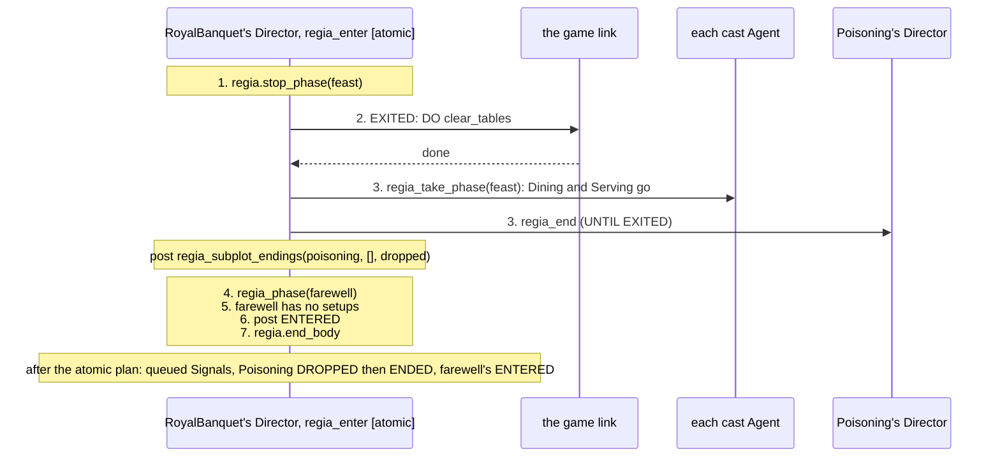
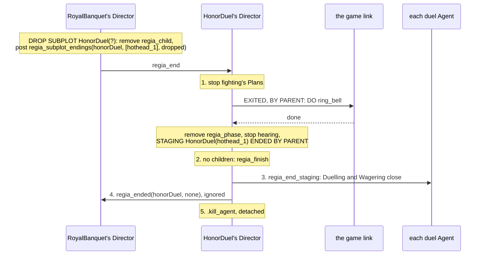

# Jason: Directors and Stagings

The banquet runs on one Director agent. When a noble insults a hothead over dinner, that Director creates a second one for the duel, hands it a cast, and goes on serving the feast. The duel's Director asks the game what it needs to know, takes bets, and ends with a winner. It takes back everything it gave and tells the banquet, which hears `FINISHED WITH duel_settled(?winner)`. This chapter goes through how the Jason Target runs a Director: its agent class, how it hears the game, how it keeps and changes Phases, what it runs when a Staging starts and when it ends, what it keeps for its Givings, and what happens to every Director when an Agent leaves.

| We write | The Build gets |
|---|---|
| a Plot | a Director file, `directors/<Plot>.asl`, run by one `regia.DirectorAgent` per Staging |
| a Staging | a Jason agent, whose name is the Staging's identity |
| `PHASE`, `DURING feast`, `IN feast` | a `regia_phase(feast)` belief, and a guard on each of the Phase's plans |
| `ENTER farewell` | `!regia_enter(farewell)`, one `[atomic]` step |
| `AFTER 20 SECONDS` | a generated Goal `regia_after(phase(betting), 1)` posted on entering the Phase |
| a setup Block | a plan of `regia_setup(Scope, Role, A)` |
| a whole-Role `ASSIGN` in a Plan | a `regia_give` to each Agent of the Role, and a `regia_standing` record |
| `START SUBPLOT` | Jason's `.create_agent`, a `regia_child` record, a `regia_start` message |
| `END PLOT`, `DROP SUBPLOT`, the parent ending | one ending walk: children first, then the Givings, then the parent is told |
| `WHEN HonorDuel(?) FINISHED …` | a plan of `regia_subplot_finished(honorDuel, …)` |
| an Agent leaving | `regia_leave` from the game link to every Director, and a leave walk on each |

No Transpiler exists yet, so every line of ASL below was put together by hand from the spec. Plan labels are `regia_plan__<Plot>__<n>`, and their numbers mean nothing, and neither does `regia_setup_line__1`: the spec doesn't name a setup line's subgoal. How a Plan's Body becomes ASL is in *Jason: Plans and Goals*; Givings, the Agent's side of giving and taking away, and ranks are in *Jason: Givings and Precedence*; the Director files and the Root's starting cast are in *Jason: the Build*; the messages on the game link are in *Jason: the game and the Trace*.

## The Director's agent class

A Director runs on `regia.DirectorAgent`, a class of `regia-jason` that extends Jason's `Agent`. It is not a `VesnaAgent`, as the Agents are.

- A Director has no Propensities, so it never needs VEsNA-Pro's Temper.
- No Director has a body, the Root included. Every Director attaches to the run's one game link (*Jason: the Build*), and that is its only connection to the game. The Root's `.jcm` entry has no `address` or `port`.
- `VesnaAgent` wouldn't do: its body setup is private and reads `port` unconditionally, so an agent with no port fails to start, and a subclass can't skip it.
- Directors still rank their plans, a Phase's over `DURING PLOT`'s. The ranking code is a helper that `regia.DirectorAgent` and `regia.RegiaAgent` share (*Jason: Givings and Precedence*, *Directors*).

Spec: chapter 30, *The Director's agent class*.

## One Director agent per Staging

[`plots/royal_banquet.regia`](../showcase/plots/royal_banquet.regia)
```regia
WHEN insult_thrown(?offender), FROM Guest ?offended:
    GIVEN NOT HonorDuel(?offender) RUNNING:  # one duel per offender at a time
        START SUBPLOT HonorDuel(?offender),
            MAPPING ?offended AS Challenger,
            MAPPING ?offender AS Defender,
            MAPPING Guest EXCEPT ?offended, ?offender AS Spectator
```

Every Staging is a Jason agent of its own, running its Plot's Director file. Two duels over two insults are two agents running `directors/HonorDuel.asl`. That is why none of a Director's beliefs, `regia_phase`, `regia_standing` and the rest, carries a Staging argument: the agent is the Staging.

- A Staging is identified by its Director's Jason agent name, and by nothing else.
- Agents learn that name from a message's `source`, never from its arguments, so it can't be forged or go stale. The Giving record's `Director` column, the cast copy's key, where a `SIGNAL` goes and what `FROM DIRECTOR` matches are all that one name (*Jason: Givings and Precedence*).
- The Root Director is declared in the `.jcm` as `regia_director__royalBanquet`.
- A Subplot's Director is created at runtime with Jason's own `.create_agent(Regia_director__honorDuel, "directors/HonorDuel.asl", [agentClass("regia.DirectorAgent")])`. Jason names the agent after the variable, `regia_director__honorDuel`, makes a clashing name unique by adding a number, so a second duel gets a name of its own, and binds the variable to the name it gave. That JaCaMo does the same is still to be confirmed when `regia-jason` is written.
- Names are there to be unique and readable in the mind inspector. The Infrastructure never parses them, and the Trace calls a Director `director:HonorDuel` (*The Trace*).

A Director keeps these records about itself:

| What | Held by | Belief |
|---|---|---|
| the Plot it runs | every Director, an initial belief | `regia_staging(honorDuel)` |
| its parent | a Subplot's Director, from the `source` of `regia_start` | `regia_parent(Director)` |
| its Plot's arguments | a Subplot's Director, if the Plot has parameters | `regia_args([hothead_1])` |
| a running child Staging | the parent | `regia_child(Director, Plot, Args, Until)` |
| that it is ending, and how | an ending Director | `regia_ending(Outcome)` |

The Root has no `regia_parent` and no `regia_args`: a Root Plot takes no parameters.

**Checks**

- A Root Plot with parameters → `R2114`

Spec: chapter 31, *One Director agent per Staging*, *A Director's records*.

## Hearing the game

[`plots/poisoning.regia`](../showcase/plots/poisoning.regia)
```regia
WHEN poison_drunk:                   # a game Cue, straight to the Director
    END PLOT WITH poison_taken
```

```asl
// directors/Poisoning.asl, initial beliefs
regia_hears(poisoning, poison_drunk, 0).

@regia_plan__poisoning__2[regia_rank(1, 0)]
+poison_drunk[source(_)] : regia_phase(_)
   <- !regia_end_plot(poison_taken, self).
```

Every Director hears the game for itself, through the one game link. `Poisoning`'s Director hears `poison_drunk` because its own file lists it, not because the banquet passes it down. No Director passes a game message on to another, and none keeps game Facts for another Staging.

- Which Facts and Cues a Plot hears is known when the Build is written. Each Director file lists, as initial beliefs, `regia_hears(Plot, Name, Arity)` for its own Plot only: every Cue and Fact its Triggers and Contexts name. What its Subplots hear is theirs.
- The game's Cue arrives as a `regia_cue` message and becomes the momentary event `+poison_drunk[source(percept)]`, with no belief kept. A game Fact arrives as `regia_fact` and becomes a `source(percept)` belief, or is removed with every source. The link translates External names into ours through the Director's own `regia_game` beliefs, as an Agent's body does.
- `regia.DirectorAgent` takes these in with the same Java code as an Agent's `myHandleMsg`. No ASL plan is involved, so `WHEN e:`, `WHEN f LEARNED:` and `GIVEN f` behave as in an Agent, and a percept never looks like a Signal.
- Facts the Director learned itself, with `LEARN`, are `source(self)` and stay its own. Facts belong to one Staging.
- `WHEN poison_drunk:` has no `FROM`, so its plan has no Sender test: a Watchman's Signal of the same name would be heard too.

### Attaching

A Director attaches when it gets its start: a Subplot's on `regia_start`, the Root on its own initial goal. `regia.attach` registers with the link the Director's name, the External names its `regia_hears` lists, and whether it is the Root.

1. Attaching makes the link send the game a state request, `regia_state`, naming the Facts this Director hears and the Agents of its starting cast.
2. The game answers with `regia_state_result`: every instance of those Facts true now, and which of those Agents have already left. The game keeps no record of Stagings; it answers a question about its own state.
3. The link delivers nothing else to the Director until that reply has gone through. Everything the game sends after the reply follows it on the socket, so no Fact change and no leave is missed or counted twice. The link buffers nothing.
4. The reply's Facts are added as `source(percept)` beliefs without raising events, in Java. So `LEARNED` doesn't fire for what was already true when the Staging started.
5. `!regia_attached(Left)` is posted. It drops the Agents of `Left` from the starting cast and runs `!regia_begin` (*Starting a Staging*, below).

The Root is always the first to attach, since Subplots start only from a running Director, so its request is the first `regia_state` the game sees.

If the link is down when a Director attaches, or is lost before the reply, the attach completes at once with no Facts and nobody left, and the Staging starts. A game that is connected and never answers holds that Director unstarted; avoiding that is the game's job.

### Stopping hearing

At the first step of its ending (*Ending a Staging*, below), a Director calls `regia.stop_hearing`, and the link delivers it no more Facts or Cues. It stays attached, so it still hears leaves while it waits for its children. It detaches when its agent stops, in `regia.DirectorAgent`'s stop hook, however it stops, so the link never routes to a dead agent.

**Checks**

- The link couldn't connect at start → `T2802` (Trace error; the run starts anyway)
- The link's connection was lost during the run → `T2803` (Trace error; the run goes on)

Spec: chapter 30, *What the game sends*, *Hearing the game*. For the link, chapter 28; for `regia_state`, chapter 37.

## Phases

[`plots/royal_banquet.regia`](../showcase/plots/royal_banquet.regia)
```regia
DURING arrival:
    WHEN ENTERED:
        DO open_doors

    WHEN took_seat, FROM Guest ?g:
        LEARN seated(?g)
        IF COUNT(seated(?)) >= COUNT(? PLAYS Guest):
            ENTER reception

    WHEN took_seat, FROM Host:           # the king is seated: music
        DO play_music
```

```asl
@regia_plan__royalBanquet__1[regia_phase(arrival), regia_rank(0, 0)]
+!regia_entered(phase(arrival)) : regia_phase(arrival)
   <- regia.act("open_doors", open_doors).

@regia_plan__royalBanquet__2[regia_phase(arrival), regia_rank(0, 0)]
+took_seat[source(G)] : regia_phase(arrival) & regia_cast(_, guest, G)
   <- if (not seated(G)) { +seated(G) };
      if (.count(seated(_), Regia_n__1)
          & .setof(Regia_a__1, regia_plays(guest, Regia_a__1), Regia_list__1)
          & .length(Regia_list__1, Regia_n__2) & Regia_n__1 >= Regia_n__2) {
          !regia_enter(reception)
      }.

@regia_plan__royalBanquet__3[regia_phase(arrival), regia_rank(0, 1)]
+took_seat[source(S)] : regia_phase(arrival) & regia_cast(_, host, S)
   <- regia.act("play_music", play_music).
```

The Director holds its current Phase as one belief, `regia_phase(arrival)`. Every plan generated from a `DURING arrival` Block:

- starts its context with `regia_phase(arrival)`, so it applies only in that Phase. It is the same pattern as the Givings guard;
- carries `regia_phase(arrival)` in its label, so the intentions running it can be found when the Phase is left;
- carries `regia_rank(Level, Pos)` in its label, worked out at build time: by default a Phase's plans are level 0 and `DURING PLOT`'s level 1. `Pos` is the Block's place among the Blocks with the same Trigger, so the Host's `took_seat` is 1 (*Jason: Givings and Precedence*, *Directors*).

`DURING PLOT` plans carry no `regia_phase` annotation, and their context starts with `regia_phase(_)`. A Director with no current Phase is ending, and hears nothing.

`ENTERED` and `EXITED` become plans for the generated Goals `regia_entered(phase(arrival))`, `regia_entered(plot)`, `regia_exited(phase(arrival))` and `regia_exited(plot)`. Each has a catch-all plan that does nothing, so a Phase with no `ENTERED` Plan, or one whose `GIVEN`s don't match, is fine.

`FROM Guest ?g` is a test on `regia_cast`, the Director's own record of its cast, read when the Signal arrives. A Director holds only its own Staging's records, so the first argument is `_`.

### A Plot with no Phases

`Poisoning` declares no Phases. Its Director gets one hidden Phase, the Generated name `regia_phase__plot`, as its initial Phase. Everything above works unchanged: there is a current Phase, so `DURING PLOT`'s plans hear, and the hidden Phase has no plans of its own and is never left. It writes no `phase` entry, and the source map folds it away.

### `IN`

[`plots/royal_banquet.regia`](../showcase/plots/royal_banquet.regia)
```regia
IF IN arrival AND COUNT(seated(?)) >= COUNT(? PLAYS Guest):
    ENTER reception
```

`IN arrival` is `regia_phase(arrival)`, and `NOT IN arrival` is `not regia_phase(arrival)`, wherever a condition goes: a Context or an `IF`. The hidden `regia_phase__plot` is never named.

**Checks**

- `IN` naming a Phase the Plot doesn't declare → `R2008`
- `IN` in a Playbook, or in a Plot that declares no Phases → `R2014`

Spec: chapter 30, *Phases*, *The current Phase*, *`IN`*. For the rank, chapter 32.

## `AFTER`

[`plots/honor_duel.regia`](../showcase/plots/honor_duel.regia)
```regia
AFTER 20 SECONDS:                    # betting closes
    GIVEN wager(?backer, ?stake), HIGHEST ?stake, RANDOMLY:
        ASK ?backer TO give_signal
    ELSE:
        ENTER fighting               # nobody bet: no handkerchief to wait for

AFTER 1 MINUTE:                      # the handkerchief never fell
    ENTER fighting
```

```asl
// directors/HonorDuel.asl, initial beliefs
regia_afters(phase(betting), [1, 2]).
regia_afters(phase(fighting), [1]).

@regia_after__betting__1[regia_phase(betting)]
+!regia_after(phase(betting), 1) : regia_phase(betting)
   <- regia.wait(20000);                        // honor_duel.regia:37
      !regia_after_body(phase(betting), 1).

+!regia_after_body(phase(betting), 1) : <the Pick on wager(Backer, Stake)>
   <- regia.send(Backer, achieve, give_signal).
+!regia_after_body(phase(betting), 1) : not (<the Pick>)
   <- !regia_enter(fighting).
+!regia_after_body(_, _).                        // catch-all
+!regia_after(_, _).                             // catch-all
```

Each `AFTER` Plan is a generated Goal of its own, `regia_after(Scope, N)`, numbered from 1 in source order within its Block: `regia_after(phase(betting), 1)` and `regia_after(phase(betting), 2)` here, `regia_after(plot, 1)` for an `AFTER` in `DURING PLOT`. Jason runs one plan per event, so two `AFTER`s of one Phase can't share a Goal. `regia_afters` lists them, so fixed Infrastructure can post them; a Block with no `AFTER` has no line.

- The Duration is worked out once, at the start of the plan, as for `WAIT`. `regia.wait` runs on the run's one clock, so a paused game holds the count.
- The Context is tested when the time is up, in `regia_after_body`: that is when the Trigger fires. A Context that doesn't hold runs the catch-all, with no entry. So does a Phase left before the event was picked.
- A Phase's `AFTER`s are posted right after its `ENTERED`, in number order, when it is entered and when the Staging starts in it.
- `DURING PLOT`'s `AFTER`s count from the start of the Staging. Their plans have no `regia_phase` annotation, so only the Staging's ending stops them.
- Two counts that end at the same moment run in the order they were posted.

When the handkerchief falls first, `ENTER fighting` stops both counts: they are intentions running plans annotated `regia_phase(betting)`.

Spec: chapter 30, *`AFTER`*. For `regia.wait` and Durations, chapter 39; for Picks in a context, chapter 39.

## `ENTER`

[`plots/royal_banquet.regia`](../showcase/plots/royal_banquet.regia)
```regia
WHEN finished_eating, FROM Guest ?g:
    LEARN finished(?g)
    IF COUNT(finished(?)) * 4 >= COUNT(? PLAYS Guest) * 3:     # three Guests in four
        ENTER farewell

WHEN EXITED:                         # however the feast ends
    DO clear_tables
```

`ENTER farewell` is `!regia_enter(farewell)`, an `[atomic]` plan in `regia/director.asl`. Nothing else of the Director runs while it does. In outline:

```asl
@regia_enter[atomic]
+!regia_enter(New) : regia_phase(Old)
   <- regia.stop_phase(Old);                  // 1. the old Phase's intentions, silently
      !regia_exited(phase(Old));              // 2. EXITED, to completion
      // 3. regia_take_phase(Old) to every cast Agent; remove regia_standing(_, _, _, _, phase(Old), _, _);
      //    end every regia_child(C, P, Args, phase(Old)) and post its dropped endings
      -regia_phase(Old); +regia_phase(New);   // 4. and the phase entry
      !regia_run_setups(phase(New));          // 5. the new Phase's setups
      // 6. !!regia_entered(phase(New)), then !!regia_after(phase(New), N) for each N
      regia.end_body.                         // 7. the Plan that ran ENTER ends here
```

1. Stop the old Phase's Plans. `regia.stop_phase(Old)` drops every intention running a plan annotated `regia_phase(Old)`. It drops them silently: Directors have no Goals, so nothing fires and nothing is traced. It skips the intention running the `ENTER`. It also drops the old Phase's queued entry events, `+!regia_entered(phase(Old))` and `+!regia_after(phase(Old), _)`: an `ENTERED` Plan that entered another Phase at once would otherwise leave its `AFTER`s queued, and a re-entry would start them twice. Queued Signals, Cues and `LEFT` events stay in the queue, for the new Phase to hear.
2. Run `EXITED` to completion, as a subgoal inside the atomic plan. If it fails, a `-!regia_exited` plan writes `T2002` and the transition carries on: a Director Statement never fails.
3. Take away what was given for the old Phase. Every cast Agent gets `regia_take_phase(Old)`, and the standing records made for the Phase go (*The standing-Giving record*, below). A re-entered Phase's Givings are taken here and given again at step 5, so its Agents hear `REMOVED` and then `ASSIGNED`. Each `UNTIL EXITED` Subplot is ended: its record removed, `regia_end` sent to its Director, and `!!regia_subplot_endings(P, Args, dropped)` posted, as `DROP SUBPLOT` does. The transition doesn't wait for the child.
4. Change the Phase, and write the `phase` entry.
5. Run the new Phase's setups, inside the atomic plan. Every setup Giving is in place before any of the Phase's Plans starts.
6. Post the entry Plans, `ENTERED` and then the `AFTER`s. They start after the atomic plan, as ordinary intentions of the new Phase: they may `WAIT`, and they stop if the Phase is left.
7. End the Body. `regia.end_body` drops the frames of the Plan that ran the `ENTER`, and everything above them on its intention. That is how `ENTER` ends its Body inside an `IF` with Statements after it, and in a `DURING PLOT` Plan too. For a Plan run as a subgoal of Infrastructure, such as a Subplot's `FINISHED WITH` Plan, the Infrastructure below carries on. `END PLOT` ends its Body the same way.

`ENTER` naming the current Phase takes the same path, so it re-enters the Phase.

When three Guests in four have finished, the banquet leaves `feast`:



The events start in the order they were queued: any Signal that came in while `EXITED` waited on `clear_tables`, then `Poisoning`'s `dropped` endings, then `farewell`'s `ENTERED`. They all see `regia_phase(farewell)`, and none waits for the one before. So `WHEN Poisoning DROPPED:`, in `DURING PLOT`, starts before `farewell`'s `ENTERED` does.

### A `DO` in `EXITED`

`DO clear_tables` waits for the game's reply, and the transition with it.

- While it waits, the Director runs nothing else. A suspended `[atomic]` intention holds back every other intention and event. Messages and the game's Cues and Facts are still read, and their events queue for the new Phase.
- The reply reaches the Director that sent the Action, through the game link, and `regia.DirectorAgent`'s Java intake resumes `regia.act` with no ASL plan involved. A suspended atomic intention still wakes on a message, so the `DO` wakes inside the atomic plan.
- A game that never replies holds the Director forever. That is the game's to avoid, as for any `DO`.
- A refused or failed `DO` fails the `EXITED` Plan, which writes `T2002`, and the transition carries on.

`WAIT` in `EXITED` is still an error: a `DO` is the game's time, not the Plot's.

> **In 2.0** `ENTER` also clears the counts of the Quota Triggers that belong to the Phase being left, before the Phase changes, so re-entering a Phase starts its counts afresh. Spec chapter 30, *`ENTER`*, and chapter 33, *Clearing counts*. A 1.5 Director keeps no counts.

**Checks**

- `WAIT`, `ENTER` or `END PLOT` in an `EXITED` Plan → `R2003`
- An `EXITED` Plan that fails, a refused `DO` included → `T2002` (Trace warning; the transition carries on)

Spec: chapter 30, *`ENTER`*, *A `DO` in `EXITED`*. For the language's six steps, chapter 20; for `regia_take_phase`, chapter 29.

## Who plays a Role here

[`plots/royal_banquet.regia`](../showcase/plots/royal_banquet.regia)
```regia
WHEN finished_eating, FROM Guest ?g:
    LEARN finished(?g)
    IF COUNT(finished(?)) * 4 >= COUNT(? PLAYS Guest) * 3:     # three Guests in four
        ENTER farewell
```

A Director reads its own Roles through a rule in `regia/director.asl`, the Plot's twin of the Agents' `regia_plays/3`:

```asl
regia_plays(cast, A) :- .my_name(Me) & regia_cast(Me, _, A).
regia_plays(R, A)    :- R \== cast & .my_name(Me) & regia_cast(Me, R, A).
```

- `?x PLAYS Guest` in a Director's Context or `IF` is `regia_plays(guest, X)`.
- `COUNT(? PLAYS Guest)` is a `.setof` and its `.length`, never `.count`. A knight plays `Guest` and `Guard`, and under `CAST` it would be counted twice.
- It reads the cast as it is now. A Guest who has left is already gone from `regia_cast` when the `LEFT` Plan runs, so the recount there sees the smaller hall.
- A counted pick, `MAPPING 1 OF Guest AS Poisoner`, draws from the same Agents with `regia/director.asl`'s `regia_draw`.

### A Role with `EXCEPT`

[`plots/honor_duel.regia`](../showcase/plots/honor_duel.regia)
```regia
DURING betting:
    WHEN ENTERED:
        TELL Spectator duel_on
```

Every Director use of `Role EXCEPT …` reads one more rule:

```asl
regia_reach(R, Ex, A) :-
    regia_plays(R, A) & not .member(agent(A), Ex) &
    not (.member(role(XR), Ex) & regia_plays(XR, A)).
```

`Ex` is the list a binding carries (*Jason: Givings and Precedence*): `role(guard)` items, read live, and `agent(noble_4)` items, holding the Agent the Placeholder held when the Statement ran. A Placeholder that holds no Agent is left out of the list, with a warning, and the rest of the list applies.

- It serves a recipient (`TELL Guest EXCEPT Guard …`), the target of an `ASSIGN`, the pool of a counted pick (`1 OF Guest EXCEPT Guard`), and a Subplot's Mapping.
- `MAPPING Guest EXCEPT ?offended, ?offender AS Spectator` is worked out once, when the duel starts, into the child's cast. `TELL Spectator duel_on` in the duel then needs no `EXCEPT`: the duellists were never Spectators.
- A whole-Role Mapping with `EXCEPT` in an `ASSIGN` isn't worked out here. It travels with the Giving as `live(guest, Ex)` and the Agent reads it.

**Checks**

- An `EXCEPT ?who` whose Placeholder holds no Agent → `T1504` (Trace warning)

Spec: chapter 30, *Who plays a Role here*, *A Role with `EXCEPT`*. For counted picks, chapter 39.

## Starting a Staging

[`plots/royal_banquet.regia`](../showcase/plots/royal_banquet.regia)
```regia
PHASE arrival INITIAL
PHASE reception
#@desc: Dinner is served. Insults start duels, and someone at the table means harm.
PHASE feast
PHASE farewell
```

```asl
// directors/RoyalBanquet.asl, initial beliefs
regia_staging(royalBanquet).
regia_initial_phase(arrival).
regia_roles([host, guest, servant, guard]).
```

`regia_roles` lists the Plot's Roles in declaration order, without `CAST`. A Plot with no Phases has `regia_initial_phase(regia_phase__plot)`.

Once the Director has its cast and the game's reply, with the Agents that have left already dropped, it runs `!regia_begin`, an `[atomic]` plan in `regia/director.asl`:

1. Add `regia_phase(arrival)`. Write the start of the Staging: the `STAGING … STARTED` entry with the cast, `PHASE -> arrival` (none for a Plot with no Phases), and a `FACT +…` entry for each game Fact in the reply.
2. Send every cast Agent the cast copy, as one message: `regia_cast_copy([cast(host, king), cast(guest, percival), …])`. The Agent replaces any copy it holds from this Director. It comes before every setup, so a live binding in a setup's Giving already finds its Agents.
3. Run the Plot's setups: `!regia_run_setups(plot)`.
4. Run the initial Phase's setups: `!regia_run_setups(phase(arrival))`.
5. On the Root only, run the setup lines of kinds and individual Agents: `!regia_instance_setup(Source, A)` for each entry of `regia_start_cast`, in its order (*Jason: the Build*).
6. Post `EMPTIED` for each Role that starts empty: `!!regia_role_emptied(Role)` in `regia_roles` order, then `!!regia_role_emptied(cast)` if the cast is empty.
7. Post the entry Plans: `ENTERED` of `DURING PLOT`, `ENTERED` of the initial Phase, then `DURING PLOT`'s `AFTER`s and the initial Phase's, each in number order.

Every setup is in place before any start-up Trigger runs. Jason picks events in the order they were posted, so the `EMPTIED` Plans start first, then `DURING PLOT`'s `ENTERED`, then the Phase's. "Before" means it starts first, not that it finishes first: a `WAIT` in one doesn't hold up the next.

### The Root's start

The Root Director's file carries its starting cast as `regia_start_cast`, and the initial goal `!regia_root_start` (*Jason: the Build*, *The Root Director's file*):

1. `!regia_root_start` adds `regia_cast(Me, Role, A)` for each Role of each entry, and attaches.
2. On the game's reply, `!regia_attached(Left)` drops the starting Agents that have already left, and runs `!regia_begin`. Step 5 skips their setup lines.

Starting Agents are never reported as joins. Starting is not joining.

### A Subplot's start

`START SUBPLOT HonorDuel(?offender), MAPPING …` becomes a generated `[atomic]` plan on the parent, `!regia_start_subplot__honorDuel__1`:

1. Work out the arguments, in parameter order: `[Offender]`.
2. Resolve the cast. A whole-Role Mapping takes everyone in the parent's `regia_cast` now. A counted pick draws at random, no Agent twice in one Statement. A Role with `EXCEPT` is read through `regia_reach`. `MAPPING ?offended AS Challenger` keeps the Agent only if it is in the parent's cast now (*One Agent*, below). The result is a list, `[cast(challenger, noble_4), cast(defender, hothead_1), cast(spectator, percival), …]`.
3. Create the child with `.create_agent`, as above, and call the name it binds `Child`.
4. Record it: `+regia_child(Child, honorDuel, [hothead_1], staging)`. `Until` is `phase(feast)` for `START SUBPLOT …, UNTIL EXITED` in a `DURING feast` Plan, as `Poisoning`'s is.
5. Send the start: `regia_start(Cast, Prefix, [hothead_1])`, where `Prefix` is the parent's `regia_rank_prefix` plus the duel's level in its Staging table, `[lv(0, [when(scandal)-1])]` (*Jason: Givings and Precedence*).

The parent's Body carries on at once. It sends the child no game Facts: the child asks the game itself.

On the child, `regia/director.asl` stores what the parent sent and attaches:

```asl
@regia_start[atomic]
+!regia_start(Cast, Prefix, Args)[source(P)] : not regia_parent(_)
   <- +regia_parent(P);
      +regia_rank_prefix(Prefix);
      if (Args \== []) { +regia_args(Args) };
      // add regia_cast(Me, Role, A) for each cast(Role, A) in Cast
      regia.attach.

@regia_attached[atomic]
+!regia_attached(Left)
   <- // remove regia_cast(Me, _, A) for each A in Left
      !regia_begin.
```

Dropping the Agents of `Left` closes one race. A Guest may leave after the parent's `START SUBPLOT` resolved the cast and before the child attached. The leave reached every attached Director, but not the child, which wasn't attached yet. The game's reply lists it as left, and the child drops it before its setups, its `EMPTIED` and its cast copies see it.

### Plot arguments

The child keeps its arguments as `regia_args([hothead_1])`, added before `!regia_begin`, so the setups already read it. Every generated plan whose Block names a parameter reads it at the head of its context, right after the Phase guard, as the Jason variable of its Placeholder: `?offender` is `Offender`. `HonorDuel` never names `?offender` in its own Blocks, so none of its plans reads the belief. In a variation where the Challenger is told who it faces:

```asl
+!regia_setup(plot, challenger, A) : regia_args([Offender])
   <- regia.send(A, tell, facing(Offender)).
```

A Trigger that names a parameter, `WHEN conceded(?offender)`, binds it from the event first, and `regia_args` then tests it, as for any filled Placeholder.

### A Role that starts empty

[`plots/honor_duel.regia`](../showcase/plots/honor_duel.regia)
```regia
WHEN Challenger EMPTIED:
    END PLOT WITH duel_abandoned
WHEN Defender EMPTIED:
    END PLOT WITH duel_abandoned
```

A Role mapped from a parent Role that is empty when `START SUBPLOT` runs starts empty, and so does one whose `MAPPING ?who` was dropped, or whose Agent was in `Left`. That is not an error. Step 6 posts `regia_role_emptied(defender)` after the setups and before the entry Plans, so a duel whose Defender is already gone ends with `duel_abandoned`. An entry Plan that has already begun is stopped by that ending, like any Plan of the Staging, and one not yet started finds no `regia_phase` and runs its catch-all.

Running the `EMPTIED` Plans to completion before posting `ENTERED` was rejected: a `WAIT` in an `EMPTIED` Plan would hold up the Staging's start.

**Checks**

- A `START SUBPLOT` argument that isn't filled, or is a Role → `R1710`

Spec: chapter 30, *Starting a Staging*; chapter 31, *Starting a Subplot*, *Plot arguments*; chapter 33, *The Root Director's starting cast*.

## Setups

[`plots/royal_banquet.regia`](../showcase/plots/royal_banquet.regia)
```regia
CAST:
    ASSIGN Courtesy                      # its `host` is the Plot's Host, by name

ROLE Host:
    ASSIGN Hosting
    PURSUE take_seat
#@desc: Everyone invited to the table. A knight is a Guest and a Guard at once.
ROLE Guest:
    LEARN purse(RANDOM(5, 20))           # rolled for each Guest
    LEARN craves(roast)
    LEARN craves(pie)
    PURSUE take_seat
ROLE Servant
ROLE Guard:
    ASSIGN Keeping_watch
    LEARN on_duty
```

```asl
+!regia_setup(plot, cast, A) : regia_rank_prefix(Regia_prefix)
   <- .concat(Regia_prefix, [lv(2, [when(scandal)-0]), 0], Regia_rank__1);
      regia.send(A, achieve, regia_give(courtesy, role(cast), Regia_rank__1,
                                        [bind(host, live(host, []))], staging)).

+!regia_setup(plot, guest, A)
   <- !regia_setup_line__1(A);                  // royal_banquet.regia:27, a roll
      regia.send(A, tell, craves(roast));
      regia.send(A, tell, craves(pie));
      regia.send(A, achieve, take_seat).

+!regia_setup_line__1(A)
   <- ?regia_roll(5, 20, whole, Regia_roll__1);
      regia.send(A, tell, purse(Regia_roll__1)).
-!regia_setup_line__1(_)
   <- regia.trace(warning, warning, "T1601", […]).

+!regia_setup(_, _, _).                          // catch-all
```

Each setup Block is one plan of the generated Goal `regia_setup(Scope, Role, A)`:

| Block | Plan |
|---|---|
| `CAST:` | `+!regia_setup(plot, cast, A)` |
| `ROLE Guest:` | `+!regia_setup(plot, guest, A)` |
| `DURING feast:` `ROLE Guest:` | `+!regia_setup(phase(feast), guest, A)` |

`!regia_run_setups(Scope)` runs the `CAST` setup for each Agent of the cast, then each Role's, in `regia_roles` order, for each Agent of the Role. A knight gets the `CAST` setup once, then `Guest`'s, then `Guard`'s. `ROLE Servant` has no setup, and the catch-all covers it.

A setup sends its Statements to the Agent in the order written:

| Setup Statement | Sent |
|---|---|
| `ASSIGN P[, MAPPING …]` | `achieve regia_give(p, role(guest), Rank, Bindings, Until)`, `Until` being `staging` in the Plot's setup and `phase(feast)` in `feast`'s. The `CAST` setup's target is `role(cast)` |
| `LEARN f` | `tell f` |
| `PURSUE g` | `achieve g` |

- The Agent sees the Director as `source`, so `TO take_seat, FROM DIRECTOR:` in `Courtesy` matches.
- Every send goes through `regia.send`, so a `LEARN` writes a `TELL` entry and a `PURSUE` an `ASK` entry on the Director, with the setup line as `at`. A setup is not a Plan and writes no `plan` entry; its `ASSIGN` shows as the Agent's `GIVE` entry.
- A Statement whose arguments use Body arithmetic, the only kind that can go wrong, is its own subgoal with a `-!` plan that writes `T1601` and returns. That is the language's "skipped": the next line still runs. Its Expressions are worked out inside the plan, for this Agent, so each Guest rolls its own purse.
- A setup's Givings are not standing (*The standing-Giving record*, below). A Phase setup's are taken away on leaving the Phase, by their `Until`.

The setup lines of kinds and individual Agents, `banquet.regin`'s `LEARN grudge(percival, 2)` for the hotheads, are plans of `regia_instance_setup(Source, A)` in the Root's file, and are sent the same way (*Jason: the Build*, *Setup lines*). An `ASSIGN` among them is a Giving to that one Agent, `agent(a)`.

**Checks**

- A setup Statement that can't be carried out, skipped → `T1601` (Trace warning)

Spec: chapter 30, *Setups*, *Setup lines of kinds and individual Agents*. For the language, chapter 16.

## The standing-Giving record

[`plots/royal_banquet.regia`](../showcase/plots/royal_banquet.regia)
```regia
DURING reception:
    WHEN ENTERED:
        ASSIGN NobleSocializing TO Guest, MAPPING Guest AS peer
```

```asl
@regia_plan__royalBanquet__5[regia_phase(reception), regia_rank(0, 0)]
+!regia_entered(phase(reception)) : regia_phase(reception) & regia_rank_prefix(Regia_prefix)
   <- .concat(Regia_prefix, [lv(2, [when(scandal)-0]), lv(4, [when(insulted)-1])], Regia_rank__1);
      // keep it standing: regia_standing(Seq, nobleSocializing, guest, [], staging, Regia_rank__1, Bindings)
      .my_name(Regia_me);
      .setof(Regia_to__1, regia_cast(Regia_me, guest, Regia_to__1), Regia_pool__1);
      for (.member(Regia_to__1, Regia_pool__1)) {
          regia.send(Regia_to__1, achieve,
                     regia_give(nobleSocializing, role(guest), Regia_rank__1, [bind(peer, live(guest, []))], staging))
      }.
```

The Director doesn't track who holds what: each Agent keeps its own Givings. It keeps one belief for each standing Giving, a whole-Role `ASSIGN` made by one of its Plans:

```
regia_standing(Seq, Playbook, Role, Except, Until, Rank, Bindings)
```

| Argument | Holds |
|---|---|
| `Seq` | from a counter of the Director's, `regia_standing_seq(N)`, so the records keep the order the Givings were made in |
| `Role` | the target: `guest`, or `cast` for `ASSIGN P TO CAST` |
| `Except` | the target's list of `role(…)` and `agent(…)` items, as in a binding. It starts as the written `EXCEPT` and grows when the Giving is narrowed |
| `Until` | `staging`, or `phase(feast)` for an `UNTIL EXITED` Giving in a `DURING feast` Plan |
| `Rank`, `Bindings` | as sent in `regia_give` |

The banquet's one standing Giving, after the reception begins:

```asl
regia_standing(1, nobleSocializing, guest, [], staging,
               [lv(2, [when(scandal)-0]), lv(4, [when(insulted)-1])], [bind(peer, live(guest, []))]).
```

- Only a whole-Role `ASSIGN` is standing, with or without `EXCEPT`. A counted pick, a Giving to `?who`, a setup's `ASSIGN` and a setup line's aren't.
- The same `ASSIGN` running again keeps its first `Seq`: it is the same Giving.
- A record lasts until `REMOVE`, the end of the Staging, or, with `phase(Ph)`, the Phase being left. Leaving another Phase doesn't touch it.

What each Statement does to the record:

| Statement | `regia_standing` |
|---|---|
| `REMOVE P FROM Guest` | removes every record of P with Role `guest`, and adds `role(guest)` to the `Except` of every record of P with Role `cast` |
| `REMOVE P FROM CAST` | removes every record of P |
| `REMOVE P FROM Guest ?who` | adds `agent(who)` to the `Except` of every record of P whose target includes `Guest`: Role `guest`, or `cast` while `?who` plays `Guest` |
| `ASSIGN P TO Guest ?who` | removes `agent(who)` from those `Except` lists. Where a written `EXCEPT` had left `?who` out, it first resends `regia_give` from the record |
| `REMOVE P FROM ?who`, `FROM CAST ?who` | nothing: no record was made to `?who` |

[`plots/royal_banquet.regia`](../showcase/plots/royal_banquet.regia)
```regia
WHEN Poisoning FINISHED WITH poisoner_caught(?culprit):
    REMOVE NobleSocializing FROM Guest ?culprit
    ASK ?culprit TO take_leave       # led out of the hall
```

When the Watchmen catch the Poisoner, say `noble_2`, the record becomes `regia_standing(1, nobleSocializing, guest, [agent(noble_2)], …)`, and `noble_2` gets `regia_set_aside(nobleSocializing, guest)`. At `farewell`, `REMOVE NobleSocializing FROM Guest` removes the record, and every Agent of the cast gets `regia_take(nobleSocializing, role(guest))`.

Giving back lifts only what was done to `?who`: what `REMOVE … FROM Guest ?who` set aside, and a written `EXCEPT ?who` on a standing Giving. It lifts nothing a whole-Role `REMOVE P FROM Guest` ended, and nothing on a counted Giving, since a pick never grows. When nothing is lifted, the Agent writes `T1506`.

> **In 2.0** the standing record is what an Agent that joins later receives: the Root replays the records of its Roles and of `CAST`, in `Seq` order, after the joiner's cast copy and setups, skipping each one whose `Except` leaves it out, and then runs `JOINED`. Spec chapter 30, *An Agent joining*. In 1.5 nobody joins, and the record serves `REMOVE`, leaving a Phase and giving back.

### One Agent

`ASSIGN P TO ?who`, `REMOVE P FROM ?who`, `MAPPING ?who AS r` and a Subplot's `MAPPING ?who AS Role` first check `regia_cast(Me, _, Who)`: is that Agent in this Staging's cast now?

- If it is, the Giving is `regia_give(p, agent(who), …)`, the Mapping `bind(r, fixed([who]))`, or the Subplot's cast entry is kept.
- If it isn't, the Giving or Mapping is dropped with a Trace warning. That covers an Agent that has left and an Agent that was never in this Staging, such as one named in a game Cue's arguments. A Director directs its own cast. Every cast Agent already has the cast copy, so nothing more needs tracking.

[`plots/royal_banquet.regia`](../showcase/plots/royal_banquet.regia)
```regia
WHEN HonorDuel(?) FINISHED WITH duel_settled(?winner):
    ASK Host TO honour(?winner)
    ASSIGN Keeping_watch TO ?winner  # the winner stands guard of honour
    TELL ?winner on_duty
```

A duel's winner is a Guest of the banquet, so the check passes. A winner who has left the hall by the time the banquet hears the ending gets no Giving, and the `TELL` after it is dropped too.

**Checks**

- A Giving or Mapping to an Agent who has left → `T2001` (Trace warning)
- A Giving or Mapping to an Agent who was never in this Staging → `T3001` (Trace warning)
- A `REMOVE` naming one Agent that takes nothing → `T1505` (Trace warning, on the Agent)
- An `ASSIGN P TO <Role> ?who` with nothing to give back → `T1506` (Trace warning, on the Agent)

Spec: chapter 30, *The standing-Giving record*, *One Agent*. For the Agent's side, chapter 29.

## Signals

[`plots/honor_duel.regia`](../showcase/plots/honor_duel.regia)
```regia
WHEN wagered(?stake), FROM Spectator ?who:
    LEARN wager(?who, ?stake)
```

```asl
@regia_plan__honorDuel__7[regia_phase(betting), regia_rank(0, 0)]
+wagered(Stake)[source(Who)] : regia_phase(betting) & regia_cast(_, spectator, Who)
   <- if (not wager(Who, Stake)) { +wager(Who, Stake) }.
```

An Agent's `SIGNAL wagered(?stake)` reaches the Director as a `signal` message, the same as a told Cue, and `source` is the signalling Agent. The Director's plan is a plan for `+wagered(…)[source(S)]`, with the Phase guard:

| Trigger | The plan |
|---|---|
| `WHEN took_seat, FROM Guest ?g:` | `+took_seat[source(G)] : regia_phase(arrival) & regia_cast(_, guest, G)` |
| `WHEN toast_given, FROM Host:` | `+toast_given[source(S)] : regia_phase(reception) & regia_cast(_, host, S)` |
| `WHEN duel_won, FROM ?winner:` | `+duel_won[source(Winner)] : regia_phase(fighting) & Winner \== percept` |
| `WHEN culprit_seized(?):` | `+culprit_seized(_)[source(_)] : regia_phase(_)`, with no Sender test, so a game Cue of that name is heard too |

- The cast test never turns away a real Signal. An Agent holds Givings only from Stagings whose cast it is in, so only cast Agents can Signal this Director.
- A Signal never has `percept` as its Sender, and a game Cue always does. So a `FROM` form never matches the game.

### Nothing heard

```asl
@regia_unheard__finished_eating[regia_unheard]
+finished_eating[source(S)] : S \== percept & regia_phase(Ph)
   <- regia.trace(unheard, info, "T3801", [cue(finished_eating), sender(S), plot(royalBanquet), phase(Ph)]).
```

For each Cue some Agent can Signal to this Plot, the Director file has one catch-all, chosen only when no other plan is. It writes the entry whenever no plan of the current Phase or of `DURING PLOT` runs, a plan whose `GIVEN`s all fail included. `finished_eating` from `Dining`'s closing Plans, arriving in `farewell`, is one; `insult_thrown` outside `feast` is another.

- A Director that is ending has no `regia_phase`. A Signal reaching it is dropped with no entry.
- A game Cue no plan takes is dropped silently.

**Checks**

- A Signal no plan of the current Phase or `DURING PLOT` runs for → `T3801` (Trace, `unheard`)

Spec: chapter 30, *Signals*, *Nothing heard: `T3801`*. For `regia_unheard` in `selectOption`, chapter 32.

## Messages and Actions from a Director

[`plots/honor_duel.regia`](../showcase/plots/honor_duel.regia)
```regia
DURING fighting:
    WHEN ENTERED:
        ASK Challenger TO fight
        ASK Defender TO fight
```

```asl
@regia_plan__honorDuel__9[regia_phase(fighting), regia_rank(0, 0)]
+!regia_entered(phase(fighting)) : regia_phase(fighting)
   <- .my_name(Regia_me);
      .setof(Regia_to__1, regia_cast(Regia_me, challenger, Regia_to__1), Regia_pool__1);
      for (.member(Regia_to__1, Regia_pool__1)) { regia.send(Regia_to__1, achieve, fight) };
      .setof(Regia_to__2, regia_cast(Regia_me, defender, Regia_to__2), Regia_pool__2);
      for (.member(Regia_to__2, Regia_pool__2)) { regia.send(Regia_to__2, achieve, fight) }.
```

- `TELL Role f`, `TELL Role c` and `ASK Role TO g` send `tell f`, `signal c` or `achieve g` to each Agent with `regia_cast(Me, Role, A)` when the Statement runs. With `EXCEPT`, to each Agent of `regia_reach`.
- A Placeholder recipient is a single `regia.send`.
- `TELL EVERYONE …` and `ASK EVERYONE TO …` are one `.broadcast(achieve, regia_everyone(Ilf, Content))`, from a Director as from an Agent (*Jason: Plans and Goals*). `regia/director.asl` ignores a `regia_everyone` it receives, so `EVERYONE` reaches every Agent and no Director.
- The Agents see the Director as `source`, so `TO fight, FROM DIRECTOR:` in `Duelling` matches.

Every Director sends its own Actions through the game link, the Root included. `DO ring_bell` is `regia.act("ring_bell", ring_bell)`, as in an Agent. It waits, fails and is called off as anywhere else. No Director performs an Action for another, so a duel's `EXITED, BY PARENT` Action is the duel's own, even while the banquet is ending.

**Checks**

- A `TELL` or `ASK` to an Agent who has left → `T1901` (Trace warning)
- A Director Action refused for `no game link` → `T1101` (Trace, Failure)

Spec: chapter 30, *Messages from a Director*, *`EVERYONE`*, *Custom Actions in a Director*. For Actions, chapter 37.

## Ending a Staging

[`plots/royal_banquet.regia`](../showcase/plots/royal_banquet.regia)
```regia
DURING farewell:
    WHEN ENTERED:
        DROP SUBPLOT HonorDuel(?)
        REMOVE NobleSocializing FROM Guest
        ASK Guest TO take_leave
```

[`plots/honor_duel.regia`](../showcase/plots/honor_duel.regia)
```regia
WHEN EXITED, BY PARENT:              # the banquet called the duel off
    DO ring_bell
```

Every ending follows one path, the walk, whether the Staging ended itself with `END PLOT`, its parent ended it, or it is the Root. On Director `D`, with Outcome `O` (`none`, or the Cue of `END PLOT WITH`, such as `duel_settled(noble_4)`) and `By` (`self` for its own `END PLOT`, `parent` for `regia_end`):

1. Stop and exit, in one `[atomic]` plan, `!regia_end_plot(O, By)`. Stop the current Phase's Plans, as `ENTER`'s step 1 does. Run the exit Plans, each to completion: with `By = parent`, `EXITED, BY PARENT` of the Phase, its `EXITED`, `EXITED, BY PARENT` of `DURING PLOT`, then `DURING PLOT`'s `EXITED`; with `By = self`, only the two `EXITED`. A failing one writes `T2002`, and the ending carries on. Then remove `regia_phase`, call `regia.stop_hearing`, stop every other intention of the Director, add `regia_ending(O)`, and write the `staging` entry: `ENDED BY PARENT`, or `FINISHED WITH O`, or `FINISHED` when `O` is `none`.
2. End the children: send `regia_end` to every `regia_child`, then wait for a `regia_ended` from each.
3. Take the Givings away: send `regia_end_staging` to every Agent of the cast.
4. Tell the parent: send `regia_ended(Plot, O)` to `regia_parent`, if there is one.
5. Go: `.kill_agent` on itself, which detaches it from the game link. The Root first tells the game the story has ended, with `regia.end_story(O)`.

Steps 3 to 5 are `!regia_finish`, an `[atomic]` plan run as soon as no `regia_child` is left: at the end of step 1 when there are no children, otherwise when the last child's `regia_ended` arrives.

The language ends children before parents. On an Agent cast in both, the child's Givings must go before the parent's, so a Plan of the Subplot's Playbook is never left running on a Goal whose recipe the parent's Playbook just lost. Jason doesn't order messages from different senders, so the only way to get that order is for the parent to send its take-aways after its children have sent theirs.

A duel still running at `farewell`:



### A child ended by its parent

A child that receives `regia_end` from its parent runs the same walk, with Outcome `none` and `By = parent`.

- It runs its Phase's `EXITED` and `DURING PLOT`'s `EXITED` as with its own `END PLOT`, so a duel cut short can still `TELL` its Spectators. `EXITED` can't `WAIT`, so it can't hold the ending up.
- `EXITED, BY PARENT` runs before each plain `EXITED`. Its Blocks become plans for `regia_exited_by_parent(phase(fighting))` or `regia_exited_by_parent(plot)`, with a catch-all. `regia_end` is the only way a parent ends a child, by `DROP SUBPLOT`, by `UNTIL EXITED` or by ending itself, so receiving it is what "by parent" means. The Root never runs these.
- `DO ring_bell` here and `Poisoning`'s `DO discard_cup` go to the game on the link, from the child itself, and wait inside the atomic walk as an `EXITED` `DO` does.
- `regia_end` is accepted only from the `regia_parent`. A child already ending ignores it: it will send `regia_ended` anyway.

### `regia_ended`: the ack and the news are one message

The parent accepts `regia_ended(Plot, O)` only from a Director it holds as `regia_child(C, Plot, Args, _)`, in one `[atomic]` step:

- If the parent is ending, it is an ack. Remove the record, and run `!regia_finish` if none is left. No Plan runs.
- Otherwise the child ended itself. Remove the record, read `Args` from it, and post `!!regia_subplot_endings(Plot, Args, finished(O))` (*The parent's ending Plans*, below).
- From a Director it no longer holds as a child, it is ignored. That settles a duel that ends itself at the moment `farewell` drops it: `DROP SUBPLOT` has already removed the record and posted `dropped`, so the banquet hears that duel end once, as `DROPPED`.

### `DROP SUBPLOT`

`DROP SUBPLOT HonorDuel(?)` is one `[atomic]` step. For every `regia_child(C, honorDuel, Args, _)` whose `Args` unify with the pattern (`[_]` for `?` or an unfilled Placeholder, `[Q]` for a filled `?q`, `[]` for a Plot without parameters):

1. remove the record;
2. send `regia_end` to `C`;
3. post `!!regia_subplot_endings(honorDuel, Args, dropped)`, once per Staging, with its own arguments.

It doesn't wait and doesn't stop the Body. The posted endings are picked after the Body, so `REMOVE NobleSocializing FROM Guest` and `ASK Guest TO take_leave` run first. With no duel running, it does nothing. An `UNTIL EXITED` child ended at `ENTER`'s step 3 takes the same three steps.

### `RUNNING`

[`plots/royal_banquet.regia`](../showcase/plots/royal_banquet.regia)
```regia
GIVEN NOT HonorDuel(?offender) RUNNING:  # one duel per offender at a time
```

`RUNNING` reads the parent's record. It holds from the moment `START SUBPLOT` adds the record until the record is removed, by `DROP SUBPLOT`, by `ENTER`'s step 3, or by the child's `regia_ended`, each before the ending is posted. So a `DROPPED` or `ENDED` Plan already sees the Staging gone.

| We write | The ASL |
|---|---|
| `HonorDuel(?o) RUNNING` | `regia_child(_, honorDuel, [O], _)` |
| `NOT HonorDuel(?offender) RUNNING` | `not regia_child(_, honorDuel, [Offender], _)` |
| `COUNT(HonorDuel(?) RUNNING)` | `.setof(A, regia_child(_, honorDuel, A, _), L) & .length(L, N)` |
| `Poisoning RUNNING` | `regia_child(_, poisoning, [], _)` |

`COUNT` goes through `.setof` on the argument lists, so two duels over one quarrel count once.

### An ending Director hears nothing

While it waits for its children, a Director has no current Phase, and that is what "ending" means to the generated code. Phase plans are guarded by their Phase, and every `DURING PLOT` Trigger plan by `regia_phase(_)`, so no Trigger, Signal, percept, `LEFT` or ending Plan applies. Only `regia_exited(plot)` and `regia_exited_by_parent(plot)` have no guard, so step 1 can run them.

- It no longer hears the game, but it is still attached. It still runs the leave walk, so its cast is right when it sends `regia_end_staging`.
- It still acts. Its exit Plans' `DO`s go out on the link, and their replies reach it. Stopping its other intentions at step 1 calls off their waiting Actions.
- Of what its children send, only `regia_ended` is handled.

### What an Agent does with `regia_end_staging`

```asl
@regia_end_staging[atomic]
+!regia_end_staging[source(D)]
   <- // remove every regia_given(_, D, _, _, _, _), every regia_aside(_, D, _, _, _, _)
      // and every regia_cast(D, _, _); the Playbooks whose last Giving went close,
      // in one take step: snapshot, regia.stop_playbook, regia_close
```

The Director doesn't know what it gave, so the Agent's own record decides which Playbooks lose their last Giving (*Jason: Givings and Precedence*, *Taking a Playbook away*). It is one atomic step, so the Agent never holds half of an ending Staging. After it, a `live` binding through that Staging finds nobody, and `FROM DIRECTOR` no longer matches `D`.

### The Root's `END PLOT`

[`plots/royal_banquet.regia`](../showcase/plots/royal_banquet.regia)
```regia
WHEN Guest EMPTIED:
    END PLOT
WHEN Host EMPTIED:
    END PLOT
```

The Root ends by the same walk, so every Staging ends and every Agent loses every Giving. At step 5 the Root sends the game `regia_story_ended` with the Outcome, and is then killed like any other Director. The game link outlives it, and goes on killing Agents that leave. The Agents keep running, with no Givings.

**Checks**

- An `EXITED` or `EXITED, BY PARENT` Plan that fails → `T2002` (Trace warning; the ending carries on)

Spec: chapter 31, *Ending a Staging*. For `regia_end_staging`'s take step, chapter 29; for `regia_story_ended`, chapter 37.

## The parent's ending Plans

[`plots/royal_banquet.regia`](../showcase/plots/royal_banquet.regia)
```regia
WHEN HonorDuel(?) FINISHED WITH duel_settled(?winner):
    ASK Host TO honour(?winner)
    ASSIGN Keeping_watch TO ?winner  # the winner stands guard of honour
    TELL ?winner on_duty
WHEN HonorDuel(?) ENDED:             # however the duel ended
    DO play_music
```

```asl
@regia_plan__royalBanquet__21[regia_rank(1, 0)]
+!regia_subplot_finished(honorDuel, [_], duel_settled(Winner), Heard) : regia_phase(_)
   <- Heard = heard;
      .my_name(Regia_me);
      .setof(Regia_to__1, regia_cast(Regia_me, host, Regia_to__1), Regia_pool__1);
      for (.member(Regia_to__1, Regia_pool__1)) { regia.send(Regia_to__1, achieve, honour(Winner)) };
      if (regia_cast(Regia_me, _, Winner)) {
          ?regia_rank_prefix(Regia_prefix);
          .concat(Regia_prefix, [lv(2, [when(scandal)-0]), 3], Regia_rank__1);
          regia.send(Winner, achieve, regia_give(keeping_watch, agent(Winner), Regia_rank__1, [], staging))
      } else {
          // dropped, with a Trace warning (One Agent, above)
      };
      regia.send(Winner, tell, on_duty).

@regia_plan__royalBanquet__22[regia_rank(1, 0)]
+!regia_subplot_ended(honorDuel, [_], Heard) : regia_phase(_)
   <- Heard = heard;
      regia.act("play_music", play_music).
```

A Subplot's ending is heard like a Goal's: the specific Plan, then the plain `ENDED` Plan. There is one generated Goal per kind of Trigger:

| Trigger | Generated Goal |
|---|---|
| `WHEN P FINISHED WITH e` | `regia_subplot_finished(p, Args, e, Heard)` |
| `WHEN P FINISHED` | `regia_subplot_finished(p, Args, _, Heard)` |
| `WHEN P DROPPED` | `regia_subplot_dropped(p, Args, Heard)` |
| `WHEN P ENDED` | `regia_subplot_ended(p, Args, Heard)` |

- Every ending posts `!!regia_subplot_endings(p, Args, How)`: `finished(O)` from `regia_ended`, `O` being `none` for a bare `END PLOT`, and `dropped` from `DROP SUBPLOT` and `ENTER`'s step 3. That plan, in `regia/director.asl`, runs the specific Goal for `How` and then `regia_subplot_ended`, each as a subgoal to completion, on one intention.
- Each subgoal is picked when it is posted, so it is heard like any Director Trigger: the plan of the Phase current then, else `DURING PLOT`'s, ranked as usual.
- The arguments are matched in the trigger. `?winner` is filled from the Outcome and can be a recipient, an `ASSIGN` target or a `MAPPING`.
- `FINISHED` Blocks are tried in written order, and the first that matches runs. The `FINISHED` Blocks of one Phase, or of `DURING PLOT`, share the Item `subplot_finished(p)` at their written `Pos`, and `selectOption` keeps the lowest applicable `Pos`. A plain `FINISHED` leaves the Outcome unbound, so it matches `none` too.
- An `ENTER` or `END PLOT` in the specific Plan ends that Plan only. `regia.end_body` drops its frames, and the dispatcher goes on with `regia_subplot_ended`, picked under the new Phase. `WHEN Poisoning FINISHED WITH poison_taken: ENTER farewell` would still run a plain `Poisoning ENDED` Plan, under `farewell`. After `END PLOT` only the catch-all applies.
- Each Goal has a catch-all that does nothing but bind `Heard`. The language's "the ending is ignored" is that plan.

### `Heard` and `T3802`

```asl
+!regia_subplot_endings(P, Args, How)
   <- !regia_subplot_specific(P, Args, How, H1);   // the Goal for How
      !regia_subplot_ended(P, Args, H2);
      if (H1 == unheard & H2 == unheard & How \== dropped) {
          regia.trace(unheard, info, "T3802", …)
      }.
```

`Heard` is an out-argument. Every generated plan of the four Goals binds it to `heard` as its first step, and each catch-all binds it to `unheard`. Jason passes a subgoal's bindings back to the caller when it finishes, so the dispatcher reads both. `regia_subplot_specific` stands for the Goal chosen by `How`, one clause per kind.

- A duel that finishes `WITH duel_abandoned` matches no `FINISHED` Block of the banquet, but `HonorDuel(?) ENDED` hears it, so nothing is written.
- A `DROPPED` ending nobody hears writes nothing: the parent caused it.
- An ending Plan that fails writes `T2002`. `regia/director.asl` holds one `-!` plan per Goal, which writes the entry, binds `Heard` to `heard`, and succeeds, so the dispatcher carries on.

**Checks**

- A Subplot's own ending that no Plan of the parent hears → `T3802` (Trace, `unheard`)
- An ending Plan that fails → `T2002` (Trace warning)

Spec: chapter 31, *The parent's ending Plans*, *`Heard` and `T3802`*. For the language, chapter 17; for the ending goals of a Goal, chapter 40.

## Leaving

[`plots/honor_duel.regia`](../showcase/plots/honor_duel.regia)
```regia
WHEN Spectator ?who LEFT:
    FOR EACH wager(?who, ?stake): FORGET wager(?who, ?stake)
```

```asl
@regia_plan__honorDuel__15[regia_rank(1, 0)]
+!regia_role_left(spectator, Who) : regia_phase(_)
   <- .setof(m(Stake), wager(Who, Stake), Regia_each__1);
      for (.member(m(Stake), Regia_each__1)) {
          if (wager(Who, Stake)) { .abolish(wager(Who, Stake)) }
      }.
-!regia_role_left(_, _)[error(no_applicable)].
-!regia_role_left(_, _)[error(no_relevant)].
```

The game reports a leave once, as `regia_leave` with the Agent's name, on the game link. The link hands it to every attached Director, Root and Subplots alike, and each runs the leave walk on itself, in one `[atomic]` plan:

1. If the Agent isn't in this cast, do nothing.
2. Note the Roles it played here, then remove every `regia_cast(Me, _, A)`.
3. Send `regia_cast_left(A)` to every Agent left in the cast.
4. For each Role it played here, in declaration order, post `!!regia_role_left(Role, A)`, then `!!regia_role_emptied(Role)` if nobody is left in the Role.

The plans of `regia_role_left` and `regia_role_emptied` are our `WHEN Role [?who] LEFT` and `WHEN Role EMPTIED` Blocks. Each Goal has the two empty failure plans above, so a Role nobody listens for is silent.

A Spectator who walks out of the hall mid-duel: the banquet's Director removes it from `Guest`, and its `WHEN Guest ?g LEFT` recounts the hall. The duel's Director removes it from `Spectator` and forgets its wagers. `Poisoning`'s Director does nothing, unless that Spectator was its Poisoner or a Watchman.

- The link kills the agent with Jason's `killAgent`, once it has handed the leave to every attached Director. No Director does it: removing an Agent from the Program is plumbing for the whole run. Nobody waits for the walks, so a Director that sends to the Agent afterwards is caught by `regia.send`. The link still kills leavers after the Root has ended.
- No Director passes a leave on to another. Step 1 makes the walk a no-op wherever the Agent isn't cast.
- An ending Director is still attached, so it still runs the walk and its cast is right when it sends `regia_end_staging`. Its `LEFT` and `EMPTIED` Goals find no plan, since every Director Trigger plan wants a `regia_phase`.
- A body whose connection closes has not left. VEsNA-Pro kills that agent, but it stays in every cast, and sends to it are caught. Only `regia_leave` removes an Agent from the Program.

### What the Agents do

```asl
@regia_cast_left[atomic]
+!regia_cast_left(A)[source(D)]
   <- // remove every regia_cast(D, _, A)
      // in every regia_given, regia_aside and regia_closing from D, drop A from each fixed([…]) list
```

A counted pick or a `MAPPING ?who` from Director `D` only ever names Agents of `D`'s cast, so the `regia_cast_left` from `D` reaches every list that can hold the leaver. The pick is not refilled. A leaver cast in several Stagings causes one `regia_cast_left` from each of those Directors.

One broadcast from the Root to every Agent was rejected: it races with Givings still coming from other Directors.

> **In 2.0** the leave walk has a step for Quota counts between telling the cast and posting `LEFT`: the leaver's counts are removed, and each Quota Trigger is checked again against the smaller Role, so a departure can complete a Quota. `regia_cast_left` does the same for an Agent's counts. Spec chapter 33, *The leave walk*, *Quota counts*.

### Nobody joins

In 1.5 the game can't add an Agent during the run. A `regia_join` that reaches the Root Director is ignored, with `T1902`; the body the game started for it is never given a cast. The Root's starting cast is the largest the run will have, and every Staging's cast only shrinks.

> **In 2.0** the Root Director creates a joiner's agent with `regia.spawn_agent`, from its `regia_kind`, adds it to its cast, sends `regia_cast_joined` to the rest of the cast, then runs the join: the joiner's cast copy, its setups and its kind's lines, the standing Givings replayed, then `JOINED`. Joiners join only the Root Plot. Spec chapter 33, *Joining*, and chapter 30, *An Agent joining*.

**Checks**

- A `regia_leave` for an Agent that isn't in the Program → `T3302` (Trace warning; the link ignores it)
- A spawn the game reports in a 1.5 run, refused → `T1902` (Trace warning)

Spec: chapter 33, *What the game reports*, *Leaving*, *Regia 1.5*. For the language, chapter 19.

## Sends to agents that are gone

Jason's `.send` to an agent that doesn't exist throws, and the sending plan fails. The language wants a Trace entry instead. So every send in generated and Infrastructure code goes through `regia.send(Receiver, Ilf, Content)`, which does what `.send` does, catches the failure, writes an entry, and never fails. Generated code never uses `.send`.

It covers:

- a `TELL` or `ASK` to a Placeholder holding an Agent that has left;
- a send racing a leave: a Director that hasn't run its walk yet, or a body that closed before the game reported the leave;
- any message to a Director that has ended. An Agent may `SIGNAL` before its `regia_end_staging` arrives. A closing Plan's `SIGNAL` to a Director whose Staging has ended is expected, so it is not a warning: the `SIGNAL`'s `message` entry lists that Director as ended, at `info`.

`.broadcast`, for `EVERYONE`, never targets a missing agent and stays as it is.

It is Java because checking `.all_names` first in ASL leaves a window in which the agent dies between the check and the send.

**Checks**

- A `TELL` or `ASK` of ours to an Agent who has left → `T1901` (Trace warning)
- An Infrastructure send to an agent that doesn't exist → `T3303` (Trace warning)

Spec: chapter 33, *Sends to agents that are gone*.

## Infrastructure state

What this chapter adds to a Director's beliefs, and to an Agent's:

| What | Held by | Belief |
|---|---|---|
| the Plot it runs | Director, initial belief | `regia_staging(Plot)` |
| the Plot's initial Phase | Director, initial belief | `regia_initial_phase(Phase)` |
| the Plot's Roles, in declaration order | Director, initial belief | `regia_roles([Role, …])` |
| what its own Plot hears from the game | Director, initial beliefs | `regia_hears(Plot, Name, Arity)` |
| each Block's `AFTER`s | Director, initial beliefs | `regia_afters(Scope, [N, …])` |
| the Root Plot's starting cast | Root Director, initial belief | `regia_start_cast([agent(Agent, Source, Roles), …])` |
| the current Phase | Director | `regia_phase(Phase)` |
| a Role's members | Director, and a copy in each Agent with a Giving from it | `regia_cast(Director, Role, Agent)` |
| who plays a Role here | Director, a rule | `regia_plays(Role, Agent)` |
| who a Role with `EXCEPT` reaches | Director, a rule | `regia_reach(Role, Except, Agent)` |
| a standing Giving | Director | `regia_standing(Seq, Playbook, Role, Except, Until, Rank, Bindings)` |
| the next standing Giving's number | Director | `regia_standing_seq(N)` |
| its parent Staging | Subplot Director | `regia_parent(Director)` |
| its Plot's arguments | Subplot Director of a Plot with parameters | `regia_args([Value, …])` |
| a running child Staging | Director | `regia_child(Director, Plot, Args, Until)` |
| an ending in progress | Director | `regia_ending(Outcome)` |
| a game Fact | Agent or Director | the Fact itself, `[source(percept)]` |

The messages between Directors, and from a Director to its cast:

| Message | From → to | Meaning |
|---|---|---|
| `achieve regia_start(Cast, Prefix, Args)` | parent → new child | start with this cast and these arguments, at this place in the tree |
| `achieve regia_end` | parent → child | end, with Outcome `none`, running `EXITED, BY PARENT` |
| `achieve regia_ended(Plot, Outcome)` | child → parent | the child has ended: an ack if the parent is ending, else its ending Plans |
| `achieve regia_cast_copy([cast(Role, A), …])` | Director → each cast Agent | the Staging's cast, at its start |
| `achieve regia_end_staging` | Director → each cast Agent | take away every Giving and the cast copy of this Staging |
| `achieve regia_cast_left(A)` | Director → each remaining cast Agent | drop A from the cast copy and the fixed bindings |

`regia-jason` adds for this chapter: the class `regia.DirectorAgent`, its message intake for the game link, detaching in its stop hook, and the internal actions `regia.attach` and `regia.stop_hearing` (the game link), `regia.stop_phase` and `regia.end_body` (they reshape intentions), and `regia.send`. Creating a Subplot's Director and unwrapping `EVERYONE` are plain Jason: `.create_agent`, and three plans of `regia/agent.asl` built on `+F[source(S)]` and `.signal`.

Spec: chapter 30, *Infrastructure state*, *`regia-jason` additions*; chapter 31, *Infrastructure state*, *Messages*; chapter 33, *Infrastructure state*, *Messages*.

## How this combines with…

### Plots and Directors

Each rule of *Plots and Directors* has a place here: Facts are the Director agent's own beliefs, a Phase is one belief that guards its plans, `ENTER`'s steps are one atomic plan, and a setup's order is `regia_begin`'s. That a Director Statement never fails is the `-!` plans around `EXITED`, setup lines and ending Plans. (*Plots and Directors*)

### Subplots and Stagings

A Staging is a Director agent, and its name is all that identifies it. `RUNNING` is the parent's `regia_child` record, children end before parents because the parent waits for each `regia_ended`, and a dropped Staging is heard once because the record goes before the ending is posted. (*Subplots and Stagings*)

### When an Agent leaves

The game reports a leave once, and every Director decides from its own cast whether it is concerned. The `LEFT` Plan already sees the smaller Role, because the walk removes the Agent before it posts the Goal. A send to a leaver is caught by `regia.send`. (*When an Agent leaves*)

### Jason: Givings and Precedence

The Director sends `regia_give`, `regia_take`, `regia_set_aside`, `regia_restore`, `regia_take_phase` and `regia_end_staging`, and keeps only `regia_standing`; the Agent keeps the Givings and decides what closes. Each Director's plans carry `regia_rank(Level, Pos)`, and each Subplot is sent its `Prefix` in `regia_start`. (*Jason: Givings and Precedence*)

### Jason: Plans and Goals

A Director's Body is translated as an Agent's, with `regia_cast` where an Agent reads `regia_plays`. A Director has no Goals, so `regia.stop_phase` drops intentions silently, where `regia.stop_playbook` writes `DROPPED` and hands back endings. A Subplot's endings borrow the shape of a Goal's: a specific Goal, then `ENDED`, on one intention. (*Jason: Plans and Goals*)

### Jason: the Build

The Root Director is the one Director the `.jcm` starts, with its starting cast and setup lines in its file. Every other Director file sits in the Build from the start, and is turned into an agent when a `START SUBPLOT` runs. (*Jason: the Build*)

### Jason: the game and the Trace

`regia_state` and its reply, `regia_cue`, `regia_fact`, `regia_leave`, the Director's Actions and `regia_story_ended` travel on the game link. A Staging's start writes its `staging`, `phase` and `fact` entries in that order, and its end one more `staging` entry. (*Jason: the game and the Trace*, *The Trace*)
