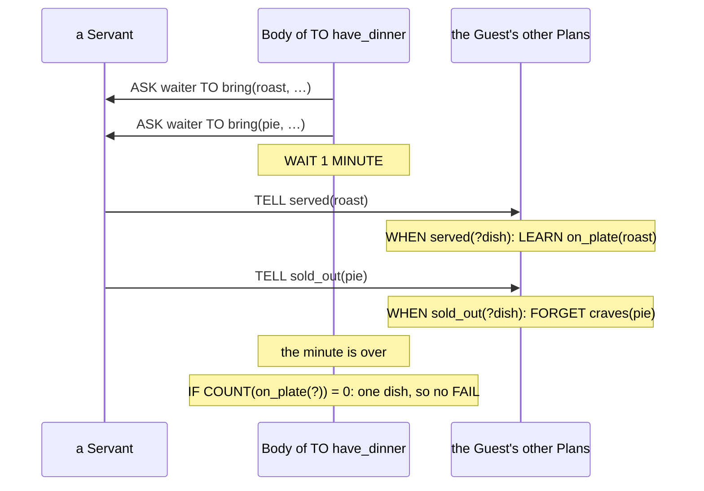

A Guest is greeted and bows. A Guest gets hungry and sets about having dinner. A duellist is hit and either loses a point of stamina or drops the sword. Each of these sentences is a Plan: something that starts it, sometimes a condition, and the steps that follow. The first part is the Trigger, the second the Context, the third the Body. This chapter covers the three parts, the Statements a Body is made of, and the difference between a condition that chooses a Plan (`GIVEN`) and one that steers a Body already running (`IF`).

It follows *Vocabulary*, which declares the names a Plan uses. What goes in a blank is in *Placeholders and Expressions* and *Matching*, Goals are in *Goals and Failure*, and sending is in *Messages*.

## A Trigger and a Body

`showcase/playbooks/courtesy.regia`
```regia
WHEN greeting FROM ?who:
    DO bow_to(?who).
```

The smallest Plan is a header and one Statement. `WHEN greeting` is the Trigger: the Plan starts when the Event `greeting` reaches the Agent. `FROM ?who` fills `?who` with whoever sent it. The Block under the header is the Body.

`showcase/playbooks/duelling.regia`
```regia
WHEN yielded FROM opponent:
    DO salute.
    SIGNAL duel_won.
```

A Body runs from top to bottom, and each Statement finishes before the next one starts. The duellist has finished saluting when the Director hears `duel_won`. A Plan belongs to the Agent that holds its Playbook and is written from that Agent's side: nothing in it says who "we" are.

Spec: chapter 05, chapter 08.

## Trigger kinds

`showcase/playbooks/dining.regia`
```regia
WHEN hungry LEARNED:
    PURSUE have_dinner, WITHOUT WAITING.

WHEN hungry FORGOTTEN:
    DROP have_dinner.

WHEN served(?dish) FROM waiter:
    LEARN on_plate(?dish).
```

A Plan can start from more than an Event. `hungry` is a Fact, and a Fact triggers a Plan when it is learned or when it is forgotten. The word after the item says which, and it can't be left out: `WHEN hungry:` is an error. `LEARNED` and `FORGOTTEN` fire whoever caused the change, the game (as with `hungry`), a Message, or the Agent's own `LEARN`.

`Dining` uses every kind a Playbook can:

| A Plan starts when | We write |
|---|---|
| an Event happens | `WHEN served(?dish) FROM waiter:` |
| a Fact is learned | `WHEN hungry LEARNED:` |
| a Fact is forgotten | `WHEN hungry FORGOTTEN:` |
| a Goal is pursued | `TO have_dinner:` |
| a Goal is dropped | `WHEN have_dinner DROPPED:` |
| a Goal fails | `WHEN have_dinner FAILED, SHIFTS sympathy BY -0.3:` |

A Director's Plans have a few more: `WHEN ENTERED:` and `WHEN EXITED:` for a Phase, `WHEN Guest ?late JOINED:` and its siblings for the cast, `WHEN HonorDuel ENDED:` for a Subplot, and Quota Triggers such as `WHEN took_seat FROM ALL Guest:`.

- A header reads in a fixed order: `WHEN` or `TO`, the item with its slots, the kind word, `FROM`, then Labels after a comma. The longest in the showcase is `WHEN bring(?dish, ?) FAILED FROM patron ?guest:`.
- The kind word has to suit the item. `WHEN served(?dish) LEARNED` is an error, since `served` is an Event.
- `TO` is the one kind written without `WHEN`. A `TO` Plan is otherwise an ordinary Plan, with the same Context, Labels and Body.
- An Event is over once it has triggered. Nothing can test it later, so a Plan that needs to remember it records a Fact, as `LEARN on_plate(?dish)` does above.

`#revise` Between Playbooks and Plots there are ten kind words (`LEARNED`, `FORGOTTEN`, `DROPPED`, `FAILED`, `ENTERED`, `EXITED`, `JOINED`, `LEFT`, `EMPTIED`, `ENDED`), and a Goal being pursued, alone among the kinds, has none: it is `TO` in place of `WHEN`.

Spec: chapter 05. For the Director's kinds, chapters 17 to 20.

## The Context

`showcase/playbooks/keeping_watch.regia`
```regia
WHEN scandal(?) FROM ?speaker:
    GIVEN on_duty:
        DO watch(?speaker).
```

`GIVEN` holds the Context: the condition under which the Plan is chosen. A Guard who hears gossip watches the speaker, but only on duty. Off duty the Plan is not chosen and none of its Body runs.

The Context is checked once, when the Plan is chosen, before any of its Body runs. It says nothing about later: a Guard relieved of duty halfway through `DO watch(?speaker)` goes on watching.

A condition tests Facts, with comparisons and three operators. The showcase has `GIVEN hungry AND seat(?place):`, `GIVEN NOT poured:` and `GIVEN purse(?gold) AND ?gold > 0:`.

| We write | It holds when |
|---|---|
| `hungry` | the Agent knows the Fact |
| `seat(?place)` | the Agent knows a `seat`, and `?place` is filled with it |
| `?gold > 0` | the comparison is true |
| `NOT x` | `x` doesn't hold |
| `x AND y` | both hold |
| `x OR y` | at least one holds |
| `PURSUING have_dinner` | the Agent is pursuing the Goal now |

- `NOT` applies to the one item after it. `NOT hungry AND seat(?place)` means not hungry, and with a seat.
- `AND` and `OR` can't be mixed without parentheses. `hungry OR tired AND seat(?place)` is an error, and we write which grouping we mean.
- An Event can't be tested. `GIVEN idle:` is an error.

Spec: chapter 06. For comparisons, chapter 04.

## Several Plans under one Trigger

`showcase/playbooks/duelling.regia`
```regia
WHEN hit FROM opponent, SHIFTS aggressiveness BY 0.1:
    GIVEN stamina(?now) AND ?now > 1:
        CHANGE stamina(?now) TO stamina(?now - 1).
    ELSE:
        DO drop_sword.
        TELL opponent yielded.
```

One Trigger can head several Plans. Each `GIVEN` Block is a Plan, and so is the `ELSE`. Here there are two: with stamina to spare the duellist loses a point, otherwise it yields. They share everything in the header, so both come from `opponent` and both shift `aggressiveness`.

`showcase/playbooks/noble_socializing.regia`
```regia
WHEN scandal(?victim) FROM peer ?speaker:
    GIVEN grudge(?victim, ?):
        DO snigger.
    GIVEN grudge(?speaker, ?), SHIFTS sympathy BY -0.1:
        DO roll_eyes.
    # no ELSE: gossip about strangers falls through to the next Playbook
```

The first `GIVEN` in the text whose Context holds is the Plan that runs, and only that one. A Guest with a grudge against both the victim and the speaker sniggers and doesn't roll its eyes. The order we wrote is the order that counts, whatever else the Agent holds.

- `ELSE` is optional and comes last.
- Under a Trigger we write either a Body or `GIVEN` Blocks, never both. A Statement before the first `GIVEN` or between two of them is an error, because the Context is checked before anything runs.
- Each `GIVEN` fills its own Placeholders, and siblings may use the same names.
- A `GIVEN` that an earlier one always catches, such as `GIVEN hungry AND seat(?place):` after `GIVEN hungry:`, gets a warning.

When no Context holds and there is no `ELSE`, none of the Plans applies. What that means depends on the Trigger. For an Event or a Fact change nothing happens in this Playbook, and another Playbook the Agent holds may react in its place. For a Goal, the Goal fails.

`#revise` The showcase has four Trigger Blocks with no `ELSE`, and each carries a Comment saying what the missing line does: "fails at once" in `Courtesy` and `Dining`, "falls through" in `NobleSocializing` and `Scheming`. The same absence means two things depending on the kind of Trigger, and we explained it by hand every time.

`#revise` 1.0 let Statements stand before the branches, and 2.0 doesn't. `Wagering` ends both of its Plans for `duel_on` with `DO cheer.` and `SIGNAL cheered.`, and `HonorDuel` ends both Plans for the third cheer with `TRANSITION TO fighting.`

Spec: chapter 06. For falling through, chapter 13.

## `IF` in a Body

`showcase/playbooks/dining.regia`
```regia
TO have_dinner:
    GIVEN hungry AND seat(?place):           # hungry when the Plan is chosen
        FOR EACH craves(?wish):
            ASK waiter TO bring(?wish, ?place).
        WAIT 1 MINUTE.                       # ASK never waits, so we give the Servants a minute
        IF COUNT(on_plate(?)) = 0:
            FAIL.
        FOR EACH on_plate(?dish):
            IF hungry:                       # still hungry, now that we get to this dish?
                DO eat(?dish).
            ELSE:
                DO push_away(?dish).
            FORGET on_plate(?dish).
        SIGNAL finished_eating.
    GIVEN NOT hungry:
        SIGNAL finished_eating.
```

An `IF` is a Statement. It is checked when the Body gets to it, after everything above it has run, and it only decides which Statements come next. The Plan was chosen long before.

`IF COUNT(on_plate(?)) = 0:` could not have been a Context. When the Plan is chosen the plate is always empty. The question makes sense only after the orders have gone out and a minute has passed. `GIVEN hungry` and `IF hungry` test the same Fact at two moments: the first when the Guest decides to dine, the second in front of each dish, by which time an earlier dish may have been enough.

| | `GIVEN` | `IF` |
|---|---|---|
| Where | a Block under the Trigger | a Statement in the Body |
| Checked | once, when the Plan is chosen | when the Body reaches it |
| If it doesn't hold | the next `GIVEN` is tried, then `ELSE`; with neither, the Plan doesn't apply | the next `ELSE IF` is tried, then `ELSE`; with neither, the Body carries on |
| Can it fail a Goal | yes, when no Plan applies | no |

The full form has any number of `ELSE IF` branches and nests to any depth:

```regia
IF on_plate(roast):
    DO eat(roast).
ELSE IF on_plate(?other):
    DO eat(?other).         # ?other exists only in this branch
ELSE:
    DO complain.
```

A Placeholder filled by an `IF` condition lives in its branch and nowhere else. (*Placeholders and Expressions*)

`#revise` With an `ELSE`, a `GIVEN` chain and an `IF` chain that makes up the whole Body do the same thing. The showcase wrote `WHEN hit` and `WHEN duel_on` the first way. Written the second way, `Wagering` would not repeat its last two lines:

```regia
WHEN duel_on FROM DIRECTOR:
    IF purse(?gold) AND ?gold > 0:
        ?stake = RANDOM(1, ?gold).
        CHANGE purse(?gold) TO purse(?gold - ?stake).
        SIGNAL wagered(?stake).
    DO cheer.
    SIGNAL cheered.
```

Nothing told us which to pick, and we picked the longer one twice.

`#revise` The `ELSE` under `IF hungry` almost never runs. `Dining` also has `WHEN hungry FORGOTTEN: DROP have_dinner.`, which stops the recipe as soon as the hunger goes, and `WHEN have_dinner DROPPED` then clears the plate. Two Plans answer one change, and whether the Body gets to its `IF` before the `DROP` lands depends on how the Agent's running Plans take turns, which the source doesn't show.

Spec: chapter 06.

## Basic Actions

The Statements built into the language are the Basic Actions. They are written without `DO`.

| Statement | Does | Read more in |
|---|---|---|
| `LEARN f.` | adds a Fact | below |
| `FORGET f.` | removes a Fact | below |
| `CHANGE f TO f2.` | replaces a Fact with another of the same name | below |
| `PURSUE g.` | takes on a Goal and waits until it is reached | *Goals and Failure* |
| `DROP g.` | stops pursuing a Goal | *Goals and Failure* |
| `FAIL.` | fails the Plan on purpose | *Goals and Failure* |
| `TELL`, `ASK … TO`, `SIGNAL` | send a Message | *Messages* |
| `WAIT <Duration>.` | pauses the Body | *`WAIT`*, further down |
| `PRINT(…).` | prints, for debugging | below |

A Body also holds `IF`, `FOR EACH` (*Matching*), `EITHER` (*Randomness*) and lines that name a value, `?stake = RANDOM(1, ?gold).` (*Placeholders and Expressions*). A Director has Statements of its own (*Plots and Directors*).

`showcase/playbooks/noble_socializing.regia`
```regia
TO resent(?who):
    GIVEN grudge(?who, ?size):
        CHANGE grudge(?who, ?size) TO grudge(?who, ?size + 1).
    ELSE:
        LEARN grudge(?who, 1).
```

`LEARN` and `FORGET` change what the Agent itself knows. Learning a Fact already known does nothing, and so does forgetting one that isn't: no Trigger fires and the Plan carries on. `CHANGE` is a `FORGET` and a `LEARN` in one Statement, both sides with the same Fact name. It is stricter than the pair: if the old Fact isn't known, the Plan fails. That is why `TO resent` has two Plans, one for a grudge that grows and one for a first grudge.

Every slot of a Basic Action has to be filled. `FORGET on_plate(?)` is an error; forgetting everything that matches is a `FOR EACH`. A slot can hold an Expression, as in `stamina(?now - 1)`.

`PRINT` takes any number of Expressions and prints them with spaces between. It is the one place a String is of use:

```regia
PRINT("Staked", ?stake, "of", ?gold).    # Staked 4 of 12
```

`#revise` All three `CHANGE`s in the showcase (`grudge`, `stamina`, `purse`) come right after a condition that matches the Fact they change, so the Fact is written three times to add or take away one. "One more" and "one less" have no shorter form.

Spec: chapter 08.

## Custom Actions

`showcase/playbooks/courtesy.regia`
```regia
TO take_seat FROM DIRECTOR:
    GIVEN seat(?place):
        DO walk_to(?place).              # waits until we have arrived
        DO sit_down.
        TELL host greeting.
        SIGNAL took_seat.
```

`DO` hands an Action to the game, and the Body waits there until the game says it is done. The Guest sits down only once it has arrived, and the Director hears `took_seat` only once the Guest is sitting. What "done" means is up to the game, Action by Action: arrived, animation over, or at once.

The game can also refuse an Action, or report that it failed. The `DO` then fails and the Plan with it. A seat that can't be reached fails `take_seat`.

`showcase/playbooks/scheming.regia`
```regia
WHEN idle:
    GIVEN NOT poured:
        DO pour_poison, WITHOUT WAITING.     # we don't stand there while it dissolves
        LEARN poured.
        DO slip_away.
        SIGNAL poison_poured.
```

`, WITHOUT WAITING` lets the Body go on as soon as the game has accepted the Action. The Poisoner is already slipping away while the poison dissolves. A refusal still fails the Plan. Anything that goes wrong later doesn't: the Body has moved on.

The clause goes on `DO` and on `PURSUE`, and on nothing else. A Director uses `DO` in the same way, as in `DO open_doors.`

`#revise` Once a Body has gone on, the Agent can never learn how the Action ended. `LEARN poured` is written on the next line and is true whether or not the poison dissolves; a failure goes to the Trace and no Plan can react to it.

Spec: chapter 08. For failing, chapter 11.

## `WAIT`

`showcase/playbooks/duelling.regia`
```regia
WHEN stamina(?) LEARNED:
    WAIT RANDOM(1, 3) SECONDS.
    DO lunge.
    TELL opponent hit.
```

`WAIT` pauses the Body for a Duration. Here the Duration is rolled when the Body reaches the line, so no two lunges come at the same pace.

It pauses only the Body it is in. The Agent goes on reacting, and that is what the minute in `TO have_dinner` relies on:



The plate fills while the recipe is paused, through Plans that run alongside it. A paused recipe is still running, so the Guest is still pursuing `have_dinner` all that minute.

- A Duration of 0 carries on at once. A negative one counts as 0 and leaves a warning in the Trace.
- A Plan stopped during a `WAIT`, by a `DROP` for instance, just stops.

`#revise` `WAIT` knows about time and nothing else. A Body can wait for its own Action or its own Goal, and beyond those only for the clock. The Guest waits the whole minute even when both dishes are on the plate after ten seconds, and fails after one minute when the roast was two seconds away.

Spec: chapter 12.

## How this combines with…

### Several Playbooks on one Agent

One Plan runs per Trigger on an Agent, however many Playbooks it holds. The Poisoner holds `Scheming` and `NobleSocializing`, and both have a `WHEN idle`. `Scheming`'s has `GIVEN NOT poured` and no `ELSE`, so it takes the first `idle` and lets every later one fall through to small talk. Had it been written as an `IF` in the Body, the Poisoner would never chat again: a Trigger Block with no Context always applies. (*Precedence and Labels*, *Playbooks and Roles*)

### Labels

`NobleSocializing` has three Trigger Blocks that start with `WHEN insulted FROM peer ?who`, each with a `SUITS` Label. These are several Plans under one Trigger too, written as repeated headers, and the Agent's Propensities choose among them where the text order chooses among `GIVEN`s. `#revise` "Which Plan runs for this Trigger" is written in two shapes with two rules, siblings under one header and headers side by side, and a reader has to notice which one is on the page. (*Precedence and Labels*)

### Goals and Failure

A `TO` with no Plan that applies fails its Goal at once, and so does a Body that hits a refused `DO`, a `CHANGE` of an unknown Fact or a `FAIL`. Nothing a failed Body already did is undone: the Guest who fails `have_dinner` after a minute has still sent its orders. (*Goals and Failure*)

### Matching

`GIVEN grudge(?victim, ?)` holds for a Guest with one such grudge or with three. A Context only asks whether there is a Match. Which one the Body then works with is a separate question. (*Matching*)

### Directors

A Director's Plans are built the same way, from the same Triggers, Contexts and Bodies, minus `PURSUE`, `DROP` and `SIGNAL`.

`showcase/plots/honor_duel.regia`
```regia
DURING fighting:
    WHEN ENTERED:
        ASK Challenger TO fight.
        ASK Defender TO fight.
        WAIT 2 MINUTES.                  # a rough timeout: never reached if the duel ends first
        END PLOT WITH duel_abandoned.
```

A Plan of a Phase that is still running when the Plot leaves the Phase is stopped silently, with no Failure. So a `WAIT` at the end of an `ENTERED` Plan works as a timeout on the Phase. (*Plots and Directors*)

## Since 1.0

1.0 wrote the Context as an `IF` under the `WHEN`, and had no branching inside a Body. Its Triggers had no kinds, and its basic actions were called through `DO` like any other.

`#changes` The Context is written `GIVEN`. `IF`, `ELSE IF` and `ELSE` are Statements in the Body.

`#changes` "First match wins" among the Plans of one Trigger is a rule of the language. In 1.0 it followed from the order of the generated ASL plans.

`#changes` Statements before the branches of a Trigger, which 1.0 copied into each branch, are gone.

`#changes` Trigger kinds are new: `LEARNED`, `FORGOTTEN`, `DROPPED`, `FAILED` and `TO`.

`#changes` Basic Actions lose their `DO` and their parentheses, except `PRINT`. `BELIEVE` is now `LEARN`, `ACHIEVE` is `PURSUE`, and `BROADCAST` is a `TELL` to `EVERYONE`. `CHANGE`, `DROP` and `FAIL` are new.

`#changes` `WAIT` takes a Duration with its unit, and `, WITHOUT WAITING` is new.
