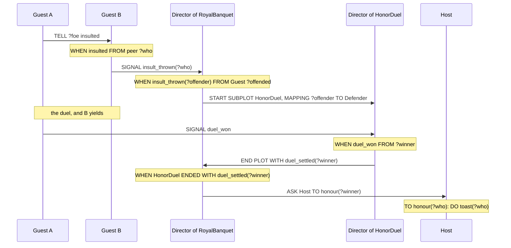

A Servant is asked to bring a dish. Which dish, to which seat and for whom is not known when the Plan is written, since every Guest orders for itself. The Plan leaves three blanks, and the Agent fills them when the request arrives. Such a blank is a Placeholder, written `?name`. This chapter covers where Placeholders are filled, where they can be used and how long they last, and then the Expressions that calculate with what they hold.

It follows *Plans*, which covers Triggers, Contexts and Bodies. What a Plan does when a blank could be filled in several ways is in *Matching*, and random rolls have more room in *Randomness*.

## A blank in a Trigger

`showcase/playbooks/serving.regia`
```regia
TO bring(?dish, ?place) FROM patron ?guest:
    PURSUE fetch(?dish, ?place).         # PURSUE waits: if fetching fails, so does bringing
    DO walk_to(?place).
    DO put_down(?dish).
    TELL ?guest served(?dish).
```

`?dish` and `?place` sit in the slots of the Goal and are filled with what the request carried. `?guest` comes after `FROM` and is filled with the Agent who asked. All three are filled when the Plan starts, by matching the Trigger against what arrived. The Body then uses them wherever it could have written a Value: as an argument of a Goal, an Action or an Event, and, for `?guest`, as the Recipient of a Message.

The `?` is written every time, where the blank is filled and where it is used. `DO put_down(dish)` would put down a thing called `dish`.

We choose the names. The Vocabulary declares `bring(dish, place)`, and the Plan could as well say `bring(?what, ?where)`, since Parameter names document the slots and bind nothing.

A Trigger slot can also hold a Value, and then the Plan is only for that value:

```regia
WHEN served(roast) FROM waiter:      # only the roast
    DO raise_cup.

WHEN served(?dish) FROM waiter:      # any dish
    LEARN on_plate(?dish).
```

When both could react, the first in the text runs, so the narrower one goes first. A Trigger slot holds a Value or a Placeholder and nothing else: `WHEN wagered(?stake + 1)` is an error, because a Trigger matches what arrived and doesn't calculate.

Spec: chapter 03. For `FROM`, chapter 05.

## Blanks in the Context

`showcase/playbooks/noble_socializing.regia`
```regia
TO resent(?who):
    GIVEN grudge(?who, ?size):
        CHANGE grudge(?who, ?size) TO grudge(?who, ?size + 1).
    ELSE:
        LEARN grudge(?who, 1).
```

A Context fills Placeholders too, by matching its condition against the Agent's Facts. Here `?size` is filled with the size of the grudge. `?who` is not filled here: the Trigger already did that, so in the Context it is a fixed value, and the condition asks for a grudge against that person and no other.

That is the rule for a name written more than once in a Trigger and its Context. It stands for one value. Reading left to right, the first appearance fills it and every later one has to agree. This is also how a Context ties two Facts together:

```regia
GIVEN grudge(?foe, ?) AND debt(?foe, ?sum):      # someone we resent who also owes us
```

A Match has to satisfy the whole Context. The Agent looks for a foe who is also a debtor, and a first foe who owes nothing doesn't stop it from finding a second who does.

- Each `GIVEN` fills its own Placeholders. The `ELSE` above can use `?who`, which the Trigger filled, and can't use `?size`.
- A comparison never fills. In `GIVEN stamina(?now) AND ?now > 1:` the Fact fills `?now` and the comparison tests it. Both sides of a comparison have to be filled already, so `GIVEN purse(?gold) AND ?half = ?gold / 2:` is an error.
- A Placeholder is filled once per run of the Plan and keeps its value until the run ends. Then it is gone.

`#revise` `grudge(?who, ?size)` holds one Placeholder that is tested and one that is filled, and they look the same. Which is which depends on what the header above happens to contain. A misspelt `?woh` is a new blank that matches any grudge, and the only thing that may catch it is the warning for a Placeholder that is never used.

Spec: chapter 03. For comparisons, chapter 04.

## The blank we don't name

`showcase/playbooks/serving.regia`
```regia
WHEN bring(?dish, ?) FAILED FROM patron ?guest:
    TELL ?guest sold_out(?dish).
```

A bare `?` fills a slot without giving it a name. `bring` has two slots wherever it is written, and this Plan has no use for the second, the seat.

- Every `?` is on its own. The two in `COUNT(grudge(?, ?))` have nothing to do with each other.
- A `?` can't be used in a Body. `FORGET on_plate(?)` is an error.
- A named Placeholder that is filled and never used gets a warning that suggests `?`.

`#revise` A `?` doesn't say what is being ignored. To read `WHEN scandal(?) FROM ?speaker:` we look up the declaration. Writing `scandal(?victim)` for the reader's sake earns the warning, though inside a `COUNT` a name that only documents the slot is accepted without one.

`#revise` The third way to take an insult in `NobleSocializing` is `WHEN insulted FROM peer ?who, SUITS sympathy AT 0.7, …: DO laugh.` It never uses `?who`, so it gets the warning. Its two siblings do use it. Dropping the name from one header makes the three look less alike, where they are meant to be read as alternatives for one Trigger.

Spec: chapter 03.

## Only what is certainly filled

```regia
WHEN idle:
    GIVEN NOT grudge(?foe, ?):       # we resent nobody
        DO sneer_at(?foe).           # error: ?foe was never filled
```

A Body can use a Placeholder only if it is filled on every way the condition can hold. `NOT` never fills anything: it holds when there is no Match, so there is no value to hand on. A name that appears only under a `NOT` gets a warning that suggests `?`.

A Placeholder that is already filled is a different case. In a recipe for `resent(?who)`, `GIVEN NOT grudge(?who, ?):` tests the person the Trigger filled: no grudge against them yet.

`OR` fills a Placeholder only when every side fills it:

```regia
GIVEN grudge(?foe, ?) OR debt(?foe, ?):      # ?foe is filled either way
GIVEN grudge(?foe, ?) OR hungry:             # ?foe may be empty, so the Body can't use it
```

The same holds wherever a Placeholder is used: in a Recipient, a Duration, a Weight, or a slot of any Statement.

Spec: chapter 03.

## Blanks filled in a Body

`showcase/playbooks/dining.regia`
```regia
TO have_dinner:
    GIVEN hungry AND seat(?place):           # hungry when the Plan is chosen
        FOR EACH craves(?wish):
            ASK waiter TO bring(?wish, ?place).
        WAIT 1 MINUTE.                       # ASK never waits, so we give the Servants a minute
```

Conditions inside a Body fill Placeholders as a Context does. The difference is how long the Placeholder lasts. `?place` was filled by the Context and is there for the whole run. `?wish` was filled by the `FOR EACH` and belongs to its Block: each round fills it afresh, and after the Block it is gone.

An `IF` works the same way, branch by branch:

```regia
WHEN scandal(?victim) FROM peer ?speaker:
    IF grudge(?victim, ?size) AND ?size > 2:
        DO snigger.
    ELSE IF grudge(?speaker, ?size) AND ?size > 2:    # a sibling branch may use the name again
        DO roll_eyes.
    DO sip_wine.                                      # ?size is gone here
```

- A Placeholder filled by an `IF` or `ELSE IF` condition can be used in that branch only: not in the other branches, and not after the `IF`.
- Sibling branches of one chain may use the same name, since only one of them runs. So may the Options of one `EITHER`.
- Using that name anywhere else in the Plan is an error, for example in a second `IF` further down.
- A Placeholder that was filled before is simply tested, as `?victim` and `?speaker` are above.
- The rules of the previous section apply to these conditions too.

`#revise` After its branch a name is gone, and it still can't be used again. Two `IF`s in a row that each look at the plate need `?dish` and some second name. Two sibling `GIVEN`s may share every name, because they are separate Plans. The two chains look alike on the page and follow different rules.

Spec: chapter 06. For `FOR EACH`, chapter 26. For Options, chapter 09.

## Naming a value

`showcase/playbooks/wagering.regia`
```regia
WHEN duel_on FROM DIRECTOR:
    GIVEN purse(?gold) AND ?gold > 0:
        ?stake = RANDOM(1, ?gold).
        CHANGE purse(?gold) TO purse(?gold - ?stake).
        SIGNAL wagered(?stake).
        DO cheer.
        SIGNAL cheered.
```

The third way to fill a Placeholder is a Statement of the Body, `?name = Expression.` It names a value: `?stake` is filled with what the Expression works out to. The Spectator needs the name because the roll is used twice. Every `RANDOM(…)` is a fresh roll, so without the name the gold taken from the purse and the stake announced to the Director would be two different numbers. An Expression that is used once needs no name, as `?gold - ?stake` shows.

- Naming a Placeholder that is already filled is an error. `?gold = ?gold - ?stake.` doesn't lower `?gold`. We pick a new name.
- Order counts. `?stake` can be used by the Statements after the one that names it.
- A Placeholder named inside an `IF` branch can be used after the `IF` only when every branch names it:

```regia
IF ?gold > 10:
    ?stake = RANDOM(5, 10).
ELSE:
    ?stake = 1.
SIGNAL wagered(?stake).      # every branch named ?stake
```

A Placeholder is not a variable. After the `CHANGE`, `?gold` still holds the old amount, and when the run ends both `?gold` and `?stake` are gone. The purse lasts because it is a Fact, `purse(…)`, which the next duel reads again by matching. Anything an Agent has to remember, or that changes over time, is a Fact.

`#revise` `IF ?stake = ?gold:` compares and `?stake = ?gold.` names. Both are lines of a Body, and only the first word tells them apart. Instancing has a third `=`, in `strategy = most_similar.`

`#revise` Chapter 04 lets a name be used after an `IF` when every branch names it. Chapter 09 keeps a name made inside an Option inside that Option, with no such exception. So `?stake` named in both branches of an `IF`/`ELSE` can be used afterwards, and named in both Options of an `EITHER`/`OR` it can't.

Spec: chapter 04.

## Expressions

An Expression is anything that works out to a Value: a Value, a filled Placeholder, `RANDOM(a, b)`, `COUNT(<condition>)`, or these combined with operators. The showcase has one in each of these places:

| Where | In the showcase |
|---|---|
| a slot in a Body | `CHANGE stamina(?now) TO stamina(?now - 1).` |
| a naming | `?grudges = COUNT(grudge(?, ?)).` |
| either side of a comparison | `GIVEN purse(?gold) AND ?gold > 0:` |
| a Duration | `WAIT RANDOM(1, 3) SECONDS.` |
| a Weight | `OR, WEIGHT ?grudges: PURSUE vent.` |
| a Role setup | `LEARN purse(RANDOM(5, 20)).` |
| a count in a Mapping | `MAPPING 1 OF Guest TO Poisoner` |

A Trigger slot and a declaration never hold one.

| We write | It means |
|---|---|
| `+` `-` `*` `/` | arithmetic on Numbers; `*` and `/` bind tighter; `-?x` negates |
| `( … )` | grouping |
| `=` | equal, for any two Values |
| `<` `>` `<=` `>=` | comparisons, for Numbers |
| `RANDOM(a, b)` | a random Number from `a` to `b`, both included |

- `/` gives a decimal whenever the result isn't whole: `7 / 2` is `3.5`. There is no remainder and no whole-number division.
- There is no "not equal". We write `NOT ?dish = roast`.
- Comparisons don't chain. `1 < ?now < 3` is an error, and the Transpiler suggests `1 < ?now AND ?now < 3`.
- Arithmetic binds tightest, then comparisons, then `NOT`, `AND` and `OR`. So `NOT ?now - 1 = 0` means `NOT ((?now - 1) = 0)`.
- `RANDOM` gives a whole number when both bounds are whole (`RANDOM(1, 6)` is a die) and a decimal when either is a decimal (`RANDOM(0, 1.0)`).
- Arithmetic is for Numbers only. Strings can't be joined with `+`.

A roll can stand in a comparison of a Context, for a Plan that applies only some of the time:

```regia
WHEN idle:
    GIVEN hungry AND RANDOM(1, 100) <= 30:       # three times in ten
        DO complain.
```

Slots have no types, so a Placeholder can turn out to hold a Name where a Number was meant. The Transpiler reports what it can see in the source, such as `roast + 1`. At runtime it depends on the place. In a condition, a comparison that needs Numbers and doesn't get them is false: a Spectator whose purse somehow held `empty` fails `?gold > 0` and cheers without betting. In a Body, arithmetic on something that isn't a Number fails the Plan, and so does a division by zero.

`#revise` Nothing rounds. A Spectator who wants to stake at most half the purse writes `RANDOM(1, ?gold / 2)`. With 12 coins the roll is whole. With 13 the bound is `6.5`, so the roll is a decimal and the stake may be 3.71 coins. Whether a roll is whole depends on a value that only exists at runtime.

`#revise` The count in `MAPPING 1 OF Guest TO Poisoner` is an Expression, and `RANDOM(1, 3) OF Guest` would do. The quantity in the Quota Trigger `WHEN cheered FROM 3 OF Spectator:` has to be a written Number. A Propensity value in Instancing takes `RANDOM` with written bounds and no arithmetic. The three look alike, and each allows a different amount of calculation.

Spec: chapter 04. For counts in a Mapping, chapter 15. For Quota Triggers, chapter 18.

## How this combines with…

### Messages

Regia never names an Agent. The only way to reach one particular Agent is a Placeholder that holds it, filled either by `FROM`, as `?guest` in `Serving`, or from a slot of a Fact:

`showcase/playbooks/noble_socializing.regia`
```regia
TO vent:
    GIVEN grudge(?foe, ?size), HIGHEST ?size, AT RANDOM:
        DO sneer_at(?foe).
        TELL ?foe insulted.
        TELL peer scandal(?foe).
```

Nothing checks that `?foe` holds an Agent. If a grudge against `roast` ever got in, `TELL ?foe insulted` would fail the Plan. (*Messages*)

### Goals and Failure

A Placeholder doesn't travel from one Plan to another. `PURSUE resent(?who)` hands the value over as an argument of the Goal, and `TO resent(?who)` fills a Placeholder of its own that happens to have the same name. When a Goal fails, its arguments are all a `FAILED` Trigger gets back, as in `WHEN bring(?dish, ?) FAILED FROM patron ?guest:`. Whatever the failed Body had named is gone with its run. (*Goals and Failure*)

### Matching

When a condition has several Matches, its Placeholders could be filled in several ways, and by default the language doesn't say which one is used. A Pick such as `HIGHEST ?size` ranks by a Placeholder that the same condition fills. Placeholders inside a `COUNT(…)` never leave it. (*Matching*)

### Randomness

A Weight is an Expression, so in `OR, WEIGHT ?grudges: PURSUE vent.` a count named one line earlier decides how likely the Option is. A Weight of 0 means never. (*Randomness*)

### Directors

A Director fills Placeholders with Agents in the same ways, and can do more with them: send them a Message, give them a Playbook, or map them onto a Role.

`showcase/plots/royal_banquet.regia`
```regia
WHEN insult_thrown(?offender) FROM Guest ?offended:
    START SUBPLOT HonorDuel,
        MAPPING ?offended TO Challenger,
        MAPPING ?offender TO Defender,
        MAPPING Guest TO Spectator.
```

`?offended` is the Sender. `?offender` arrived in a slot, put there by the Guest's own `SIGNAL insult_thrown(?who).` Followed through the evening, the Guest who started it is held by five Plans as `?who`, `?offender`, `?winner`, `?winner` again and `?who` again, and the source never names it:



A Role setup is the one Block of Statements with no Placeholders at all: nothing is matched there, so nothing could fill them. Its slots take Values and Expressions, as in `LEARN purse(RANDOM(5, 20)).` (*Plots and Directors*, *Subplots and Stagings*)

## Since 1.0

In 1.0 Facts and Actions took parameters, and every argument was a fixed Value. A Plan couldn't leave a slot open, so it couldn't react to "whoever insulted us". There were no Numbers to calculate with either.

`#changes` Placeholders are new: `?name`, the bare `?`, and `FROM … ?who` for the Sender.

`#changes` Naming a value in the Body, `?name = Expression.`, is new.

`#changes` Numbers, arithmetic, comparisons and `RANDOM(a, b)` are new.
