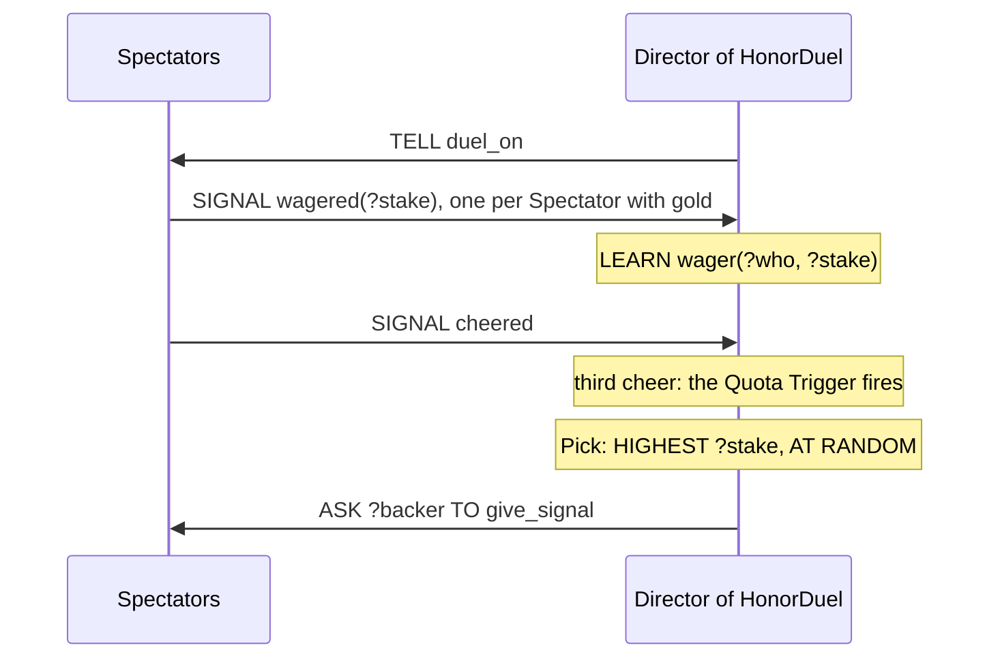

A condition can hold in more than one way. A Guest who holds three grudges satisfies `grudge(?foe, ?size)` three times over, once per grudge. Each of these ways is a Match: a Value for every blank of the condition, named Placeholders and `?` alike. This chapter is about what a Plan does when there are several. It can leave the choice open, choose one on purpose with a Pick, run a Block for every Match with `FOR EACH`, or count them with `COUNT`.

Conditions and Placeholders themselves are covered in *Plans* and in *Placeholders and Expressions*. All the snippets come from the showcase; the file is named above each one.

## One Match, and we don't say which

`showcase/playbooks/noble_socializing.regia`
```regia
WHEN scandal(?victim) FROM peer ?speaker:
    GIVEN grudge(?victim, ?):
        DO snigger.
```

A Guest hears gossip about `?victim` and sniggers if it holds a grudge against them. The `?` stands for the size of the grudge, which we don't care about. If the Guest somehow held two grudges against the same victim, the condition would have two Matches. The Agent uses one of them, and the language doesn't say which.

Here that is harmless, because nothing in the Body depends on the Match. It stops being harmless as soon as the Body uses what was filled:

```regia
TO vent:
    GIVEN grudge(?foe, ?size):      # which foe? we can't tell
        DO sneer_at(?foe).
```

This Plan is legal, and on Jason it will even sneer at the same foe every time. We must not rely on that. When the choice matters, we write it.

Spec: chapter 03, chapter 26.

## Picks

A Pick is a clause after the condition, set off by a comma, that chooses which Match is used.

`showcase/playbooks/noble_socializing.regia`
```regia
# We insult the Guest we resent the most.
TO vent:
    GIVEN grudge(?foe, ?size), HIGHEST ?size, AT RANDOM:
        DO sneer_at(?foe).
        TELL ?foe insulted.
        TELL peer scandal(?foe).
```

`HIGHEST ?size` keeps the Match with the largest `?size`. `AT RANDOM` then breaks ties: with two grudges of size 4, either foe may be insulted. Each clause also works alone:

| We write | The Agent uses |
|---|---|
| `GIVEN grudge(?foe, ?), AT RANDOM:` | any grudge, each equally likely |
| `GIVEN grudge(?foe, ?size), HIGHEST ?size:` | the largest grudge; on a tie, one of the largest, and we don't say which |
| `GIVEN grudge(?foe, ?size), LOWEST ?size:` | the smallest, with the same tie rule |
| `GIVEN grudge(?foe, ?size), HIGHEST ?size, AT RANDOM:` | the largest, ties broken at random |

- A Pick chooses among the Matches of the whole condition. In `GIVEN grudge(?foe, ?size) AND seat(?place), HIGHEST ?size:` the Pick ranks pairs of a grudge and a seat, not grudges alone.
- A Pick never decides whether the condition holds. `TO vent` above applies when the Guest holds at least one grudge, with or without the Pick. The one exception is a ranked Placeholder that isn't a Number: those Matches are skipped, and if none is left the condition doesn't hold.
- The ranked Placeholder has to be filled by the same condition. `HIGHEST ?victim` under the `scandal(?victim)` Trigger would be an error: `?victim` has one value in every Match, so there is nothing to rank.

A Pick can go on a `GIVEN`, an `IF` or an `ELSE IF`, and nowhere else.

`#revise` Both Picks in the showcase are written `, HIGHEST …, AT RANDOM`. A bare `HIGHEST` leaves ties open, which is rarely what we mean, and nothing warns us that we forgot.

`#revise` `AT` has three readings in one Program: `, AT RANDOM` here, `SUITS bravery AT 0.8` on a Label, and `bravery AT RANDOM(-0.6, 0.6)` in Instancing, where `AT RANDOM` is followed by a parenthesis and means a roll.

Spec: chapter 26.

## `FOR EACH`

A Pick uses one Match. `FOR EACH` uses all of them: its Block runs once per Match.

`showcase/playbooks/duelling.regia`
```regia
TO fight FROM DIRECTOR:
    FOR EACH stamina(?old): FORGET stamina(?old).    # left over from an earlier duel
    DO draw_sword.
    LEARN stamina(3).
```

This is how we forget everything that matches. `FORGET stamina(?)` is an error, since a Basic Action can't hold a blank, so we go through the Matches and forget each one. With no `stamina` Fact there are no Matches, the Block doesn't run, and the Body carries on.

The full form is in a Guest's dinner:

`showcase/playbooks/dining.regia`
```regia
TO have_dinner:
    GIVEN hungry AND seat(?place):
        FOR EACH craves(?wish):
            ASK waiter TO bring(?wish, ?place).
        WAIT 1 MINUTE.
        IF COUNT(on_plate(?)) = 0:
            FAIL.
        FOR EACH on_plate(?dish):
            IF hungry:
                DO eat(?dish).
            ELSE:
                DO push_away(?dish).
            FORGET on_plate(?dish).
        SIGNAL finished_eating.
```

The first `FOR EACH` asks for every dish the Guest craves. `?place` was filled by the Context, so inside the condition and the Block it is a fixed value. `?wish` is filled afresh in each round and is gone after the Block.

In the second one, the Matches are collected once, when the Body reaches the `FOR EACH`. Three dishes on the plate at that moment means three rounds, whatever happens meanwhile. A dish that a Servant brings during the second round is not eaten: it stays `on_plate` after the Plan has finished. Each round takes time, since `DO eat(?dish)` waits for the game, and the Guest may stop being hungry halfway through. That is why the Block tests `IF hungry` again in every round.

The rounds run in no particular order. If one fails, the Plan fails and the remaining rounds don't run.

`#revise` A dish served after the second `FOR EACH` has started is never eaten or cleared. Repeating "until the plate is empty" needs a loop we don't have, or a Plan on `on_plate(?) LEARNED`, which moves the eating out of the recipe.

Spec: chapter 26. For `FORGET` and blanks, chapter 08.

## `COUNT`

`COUNT(<condition>)` is a Number: how many Matches the condition has right now. We have seen it above, `IF COUNT(on_plate(?)) = 0:`, deciding whether the dinner failed. It is an Expression, so it can also be named and used in arithmetic or as a Weight:

`showcase/playbooks/noble_socializing.regia`
```regia
WHEN idle:
    ?grudges = COUNT(grudge(?, ?)).
    EITHER, WEIGHT 3: DO chat.
    OR: DO sip_wine.
    OR, WEIGHT ?grudges: PURSUE vent.
```

Every blank counts, `?` included. `COUNT(grudge(?, ?))` counts `grudge` Facts. Here that is also the number of foes, because `TO resent` keeps one grudge per person. In a world with several grudges against one person, the number of foes could not be written as a `COUNT` at all, since the size would still tell the Matches apart.

Placeholders named inside a `COUNT` never leave it. `COUNT(grudge(?foe, ?))` is the same number, with the name there only to document the slot.

`#revise` `IF COUNT(on_plate(?)) = 0:` and `IF NOT on_plate(?):` say the same thing. The showcase has the longer one.

`#revise` `COUNT` is also the number of Agents of a kind in Instancing (`COUNT 2.`). The two never meet in one file, but they share a word.

Spec: chapter 26, chapter 04.

## How this combines with…

### Random choice

In the `idle` Plan above, a Guest with no grudges gives `PURSUE vent` a Weight of 0, so it never vents. `TO vent` has a `GIVEN` and no `ELSE`, so pursued with no grudge it would fail. The `COUNT` in one Plan is what keeps the Pick in another from ever finding no Match. Nothing ties the two together in the source. (*Randomness*)

### Several Plans under one Trigger

A Pick is looked at only after the Plan has been chosen. First match wins among sibling `GIVEN`s exactly as without it, and so does the choice between Suits alternatives. (*Plans*, *Precedence and Labels*)

### Labels

Pick clauses and Labels share the header and the comma, in any order: `GIVEN grudge(?foe, ?size), HIGHEST ?size, SHIFTS aggressiveness BY 0.1:`. `#revise` A reader has to know which words after a comma choose a Match and which describe the Plan.

### Directors and Quota Triggers

Everything in this chapter works in a Plot, over the Director's own Facts.

`showcase/plots/honor_duel.regia`
```regia
WHEN wagered(?stake) FROM Spectator ?who:
    LEARN wager(?who, ?stake).

WHEN cheered FROM 3 OF Spectator:
    GIVEN wager(?backer, ?stake), HIGHEST ?stake, AT RANDOM:
        ASK ?backer TO give_signal.
        TRANSITION TO fighting.
    ELSE:
        TRANSITION TO fighting.
```

A Director can't read its Agents' Facts, so it can't pick "the Spectator with the fullest purse". The Spectators Signal their stakes, the Director keeps them as its own `wager` Facts, and the Pick runs over those. The `ELSE` covers a duel nobody bet on.



(*Plots and Directors*, *Quotas and cast changes*)

### Facts that outlive their use

`WHEN hit` in `Duelling` has `GIVEN stamina(?now) AND ?now > 1:`, a plain condition that is safe only while there is a single `stamina` Fact. The `FOR EACH … FORGET` at the top of `TO fight` is what guarantees it. Without it, a second duel would start with two `stamina` Facts and the unspecified Match would show.

## Since 1.0

1.0 had none of this. Facts took no parameters, so a condition held or didn't, and there was nothing to choose between or count.

`#changes` Match, Pick (`AT RANDOM`, `HIGHEST`, `LOWEST`), `FOR EACH` and `COUNT` are new in 2.0.

`#changes` `FOR EACH` is the only repetition construct. `WHILE` and counted loops are left for after 2.0.
