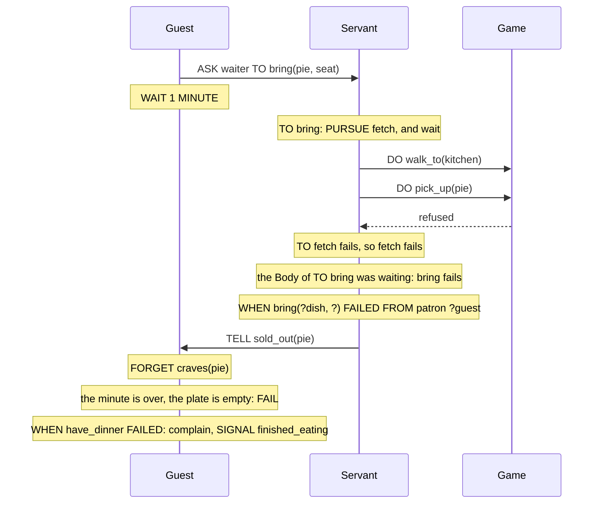

A Guest who gets hungry sets about having dinner: it orders, waits for the Servants, eats what arrives. That takes minutes, other Plans can depend on it, and it can go wrong, because the kitchen has run out or because no seat was laid. Something an Agent sets about doing is a Goal. This chapter covers how a Goal is given, pursued, dropped and reached, and what happens when a Plan can't go on: what counts as a Failure, how it travels from one Plan to the next, and how we react to it.

The Trigger kinds and the Basic Actions are introduced in *Plans*. Asking another Agent for a Goal is in *Messages*, and what a Director may ask is in *Plots and Directors*.

## A Goal and its recipe

`showcase/vocabulary.regia`
```regia
GOAL take_seat, take_leave, open_feast, honour(person)
GOAL vent, resent(person)
GOAL have_dinner, bring(dish, place)
```

`showcase/playbooks/courtesy.regia`
```regia
TO open_feast FROM DIRECTOR:
    DO stand_up.
    DO raise_cup.
    SIGNAL toast_given.
```

A Goal is declared like any other item of the Vocabulary. A Plan whose header starts with `TO` is a recipe for it: when the Agent takes the Goal on, the recipe runs. Apart from the first word it is an ordinary Plan, with Placeholders, a Context, Labels and a Body.

An Agent gets a Goal in three ways:

- from itself, with `PURSUE` in a Body;
- from a Director, with `ASK` in a Plan or `PURSUE` in a Role setup;
- from another Agent, with `ASK`.

However it arrived, it is then the Agent's own Goal. `FROM` on the recipe can tell the cases apart, as `FROM DIRECTOR` does above. A Goal the Agent gave itself has no Sender.

A Goal is reached when a recipe for it finishes its Body. Nothing looks at the world: `open_feast` is reached when the cup has been raised and the Signal sent, whether or not anyone was watching. There is only one kind of Goal, the kind we reach and then stop pursuing. We can't declare one that must be kept true, or one that is reached when a Fact holds.

No Trigger fires when a Goal is reached. Whoever needs to know has to be told, which is why the recipe above ends with a Signal:

`showcase/plots/royal_banquet.regia`
```regia
DURING reception:
    WHEN ENTERED:
        ASSIGN NobleSocializing TO Guest, MAPPING Guest TO peer.
        WAIT 2 MINUTES.
        ASK Host TO open_feast.

    WHEN toast_given FROM Host:
        TRANSITION TO feast.
```

`#revise` Every recipe a Director depends on ends with a Signal that means "done": `took_seat`, `toast_given`, `finished_eating`. Each one needs its own `EVENT` line and its own name next to the Goal's. A Goal has Triggers for being dropped and for failing, and none for being reached.

Spec: chapter 05.

## `PURSUE` waits

`showcase/playbooks/serving.regia`
```regia
GOAL fetch(dish, place)

TO bring(?dish, ?place) FROM patron ?guest:
    PURSUE fetch(?dish, ?place).         # PURSUE waits: if fetching fails, so does bringing
    DO walk_to(?place).
    DO put_down(?dish).
    TELL ?guest served(?dish).

TO fetch(?dish, ?):                      # the place only keeps two orders of one dish apart
    DO walk_to(kitchen).
    DO pick_up(?dish).                   # refused once the dish has run out
```

A Body is a list of steps, each one finished before the next starts. `PURSUE fetch(…)` follows that rule: the Body of `TO bring` stops there until `fetch` is reached, and only then does the Servant walk to the seat. The Servant never puts down a dish it doesn't have.

When the Body should not wait, we say so:

`showcase/playbooks/dining.regia`
```regia
WHEN hungry LEARNED:
    PURSUE have_dinner, WITHOUT WAITING.
```

Here the Plan ends at once and the dinner goes on beside whatever else the Guest does. `, WITHOUT WAITING` is the same clause that `DO` takes. `ASK` has no such choice: a Goal given to someone else never makes the giver wait.

A waiting Body depends on its Goal. If the Goal fails or is dropped, the Body fails with it. A Body that didn't wait is not affected by anything that happens to the Goal afterwards.

`#revise` `PURSUE` waits and `ASK … TO` doesn't. The two lines look alike, both hand out a Goal, and only one of them holds the Body up. `Serving` and `Dining` each carry a Comment to say which is which.

Spec: chapter 08. ADR 0005.

## The same Goal twice

A Guest has two reasons to start dinner. `Dining` pursues `have_dinner` when the Guest learns it is hungry, and the Director asks every Guest for it when the feast begins (`ASK Guest TO have_dinner.`). A Guest who is already dining when the second one arrives doesn't dine twice. A request for a Goal that is being pursued, with the same arguments, starts nothing.

- With `PURSUE g.` the Body joins the pursuit that is under way, waits for it, and fails with it.
- With `PURSUE g, WITHOUT WAITING.` or an `ASK`, the request is ignored.
- Different arguments make different Goals. A Servant pursues `bring(roast, seat_3)` and `bring(pie, seat_3)` side by side.

A condition can ask whether a Goal is being pursued, with `PURSUING`. Blanks work as they do for a Fact:

```regia
WHEN greeting FROM ?who:
    GIVEN NOT PURSUING have_dinner:      # we don't get up from our plate
        DO bow_to(?who).
```

`#revise` An ignored request loses its Sender. If the Guest started dinner by itself and the Director asks later, the Goal still has no Sender, and a `WHEN have_dinner FAILED FROM DIRECTOR:` would stay silent. Which of two requests came first is not something we can see in the source.

`#revise` Because arguments are what tells two pursuits apart, they get used for that alone. `bring` carries the seat so that two Guests ordering roast are two Goals, and `fetch` carries it for no other reason. Its recipe matches the slot with a `?` and a Comment explains why it is there.

Spec: chapter 05, chapter 08.

## `DROP`

`showcase/playbooks/dining.regia`
```regia
WHEN hungry FORGOTTEN:
    DROP have_dinner.

# Dropped because we are full: clear what is left.
WHEN have_dinner DROPPED:
    FOR EACH on_plate(?dish):
        DO push_away(?dish).
        FORGET on_plate(?dish).
    SIGNAL finished_eating.
```

`DROP g.` stops pursuing a Goal. Three things happen, in this order:

1. The recipe running for `g` stops at once, wherever it was. The rest of its Body doesn't run.
2. Every Goal that recipe was waiting on stops too, and every Goal those were waiting on.
3. `DROPPED` fires: first for the Goals stopped in step 2, innermost first, then for `g`.

A Guest who is full after the first dish is stopped in the middle of its `FOR EACH`, and the `DROPPED` Plan pushes the other dishes away. Had the Guest already finished dinner when the hunger went, there would be no Goal to drop. Dropping a Goal that isn't being pursued does nothing, `DROPPED` doesn't fire, and no second `finished_eating` is sent.

- Goals started `WITHOUT WAITING` are left alone. They were set loose on purpose.
- A Body that was waiting on `g` fails, since `g` will never be reached.
- Nothing is undone. The dishes already eaten stay eaten. An Action the game was still carrying out when the recipe stopped carries on in the game: nobody tells the game to stop.
- A recipe may drop its own Goal. It stops there, and `DROPPED` fires in place of `FAILED`.

Only the Agent itself can drop its Goals. Messages only add, so neither a Director nor another Agent can take a Goal back once asked.

`#revise` Dropping goes down as a drop and up as a Failure. If we `DROP bring(…)`, the `fetch` under it fires `DROPPED`. If we `DROP fetch(…)`, the `bring` above it fires `FAILED`, though nothing went wrong and we chose to stop.

`#revise` A Director that has asked for a Goal can't call it off. `RoyalBanquet` ends the meal by taking `Dining` away (`UNASSIGN Dining FROM Guest.`). The spec's Jason chapter says the Goal is then dropped, but the `DROPPED` Plan above belongs to the Playbook that has just gone, so it doesn't run. A Guest still eating at that moment keeps its `on_plate` Facts, hidden, until the next banquet.

Spec: chapter 08. For a Playbook taken away, chapters 10 and 29.

## What fails a Plan

A Plan fails when one of its Statements can't be carried out. It stops at that Statement and the rest of the Body doesn't run.

| A Statement can't be carried out when | At the banquet |
|---|---|
| the game refuses a Custom Action, or reports that it failed while the `DO` waits | `DO pick_up(?dish)` once the dish has run out; `DO draw_sword` at the table |
| a `PURSUE g.` is waiting and `g` fails or is dropped | `PURSUE fetch(?dish, ?place)` in `TO bring` |
| it is `FAIL.` | the empty plate in `Dining` |
| a `CHANGE` names a Fact the Agent doesn't know | nowhere: every `CHANGE` in the showcase follows a condition that matched the Fact |
| arithmetic meets something that isn't a Number, or divides by zero; a Weight, a Duration or the count of a Mapping isn't a Number | `purse(?gold - ?stake)`, if a purse ever held a Name |
| the Placeholder a `TELL` or `ASK` is sent to doesn't hold an Agent | `TELL ?foe insulted`, if a grudge named a thing |

Regia never checks the world. A Custom Action fails only when the game says so, and on a game that never does, every `DO` succeeds.

Some things that look like trouble are not Failures, and the Plan carries on: learning a Fact already known, forgetting one that isn't, dropping a Goal that isn't pursued, a Random choice whose Weights are all 0, a Message to an Agent that has left. Nothing to do with time fails either, since there are no timeouts.

As with a drop, nothing is undone. The Facts learned, the Messages sent and the Actions done before the failing Statement all stay. A Guest whose dinner fails after a minute has still sent its orders, and a Servant may still turn up with the pie.

Spec: chapter 11.

## How Failure spreads

What a failed Plan does to the rest of the Agent depends on its Trigger.

- A failed `WHEN` Plan has nobody waiting on it. It stops.
- A failed `TO g` Plan fails `g`: the Goal stops being pursued without being reached.
- Every Body waiting on `g` with `PURSUE g.` then fails as well. If that Body is a recipe, its Goal fails, and so on up.
- `, WITHOUT WAITING` stops the climb. The Body that started the Goal has moved on.

A Goal also fails without any Plan failing, when no recipe applies to it. That covers a Goal with no recipe on this Agent, and one whose `GIVEN`s are all false with no `ELSE`:

`showcase/playbooks/courtesy.regia`
```regia
TO take_seat FROM DIRECTOR:
    GIVEN seat(?place):
        DO walk_to(?place).              # waits until we have arrived
        DO sit_down.
        TELL host greeting.
        SIGNAL took_seat.
    # no ELSE: with no seat laid for us, take_seat fails at once
```

An Event that no Plan applies to is ignored, and that is normal: most Agents ignore most Events. A Goal that no recipe applies to is a Failure, whoever gave it.

In `Serving` the climb has two levels. The diagram follows one order of pie on an evening when the kitchen has run out of everything.



The Failure climbs inside the Servant and stops there. The Guest sent an `ASK` and never waited on it, so nothing reaches the Guest unless the Servant sends it. The Guest's own dinner fails later and for its own reason: it counted an empty plate.

Regia doesn't try again. When a recipe fails, no other recipe for the Goal is tried, even if a `GIVEN` further down would hold by now. The Guest whose dinner failed is still hungry. `hungry` isn't learned a second time, so nothing starts dinner again, and the Guest stays hungry for the rest of the evening.

`#revise` A Plan can react to a Goal that failed and never to a `WHEN` Plan that failed. In `Keeping_watch`, `WHEN saw_pouring(?who): DO seize(?who). SIGNAL culprit_seized(?who).` is a `WHEN` Plan. If the game refuses `seize`, the Plan stops, the Signal is never sent, and no Plan of the Guard can react. To make that step something we can recover from, we would have to wrap it in a Goal for no other purpose.

`#revise` A warning tells us when a Goal has no recipe anywhere in the Program. It can't tell us that the Agent we ask doesn't hold the Playbook with the recipe. An `ASK` to the wrong Role fails at once, on the receiver, and the asker hears nothing.

`#revise` `FROM` on a recipe narrows who may give the Goal, and eight of the showcase's twelve recipes have one. If another Playbook on the same Agent wrote `PURSUE take_seat.`, the Goal would have no Sender, `TO take_seat FROM DIRECTOR` would not apply, and the Goal would fail at once. The `FAILED FROM DIRECTOR` Plan below would not match it either.

Spec: chapter 11. For candidates, chapter 13.

## `FAIL`

`showcase/playbooks/dining.regia`
```regia
TO have_dinner:
    GIVEN hungry AND seat(?place):
        FOR EACH craves(?wish):
            ASK waiter TO bring(?wish, ?place).
        WAIT 1 MINUTE.                       # ASK never waits, so we give the Servants a minute
        IF COUNT(on_plate(?)) = 0:
            FAIL.
        # …
```

`FAIL.` fails the Plan on purpose. It is a Basic Action with no argument. In a recipe it fails the Goal, and the Failure spreads as any other does. In a `WHEN` Plan it stops the Plan.

Without it, the Guest with an empty plate would run its second `FOR EACH` zero times, send `finished_eating`, and reach a dinner it never had.

It usually sits in an `IF` or in an Option of a Random choice. Statements written after it in the same Block can never run, and we get a warning for them.

Spec: chapter 11.

## `FAILED`

`showcase/playbooks/dining.regia`
```regia
WHEN have_dinner FAILED, SHIFTS sympathy BY -0.3:
    DO complain.
    SIGNAL finished_eating.
```

`showcase/playbooks/serving.regia`
```regia
WHEN bring(?dish, ?) FAILED FROM patron ?guest:
    TELL ?guest sold_out(?dish).
```

`showcase/playbooks/courtesy.regia`
```regia
WHEN take_seat FAILED FROM DIRECTOR:
    DO stand_by(wall).
    SIGNAL took_seat.                    # the Director is counting on it
```

`FAILED` is a Trigger kind on a Goal. It fires when the Goal fails, for any of the reasons above: a failed recipe, no recipe that applies, a Goal it was waiting on.

A `FAILED` Plan is told about the Failure and can't take it back. By the time it runs, every Body that was waiting on the Goal has already failed. Finishing the `FAILED` Plan doesn't reach the Goal and doesn't let anything carry on. This keeps one rule true everywhere: the line after `PURSUE g.` runs only if a recipe for `g` finished. In `TO bring`, the Servant never walks to the seat empty-handed because some other Plan "handled" the missing dish.

- Every level fires, innermost first. When the pie runs out, `fetch` fires `FAILED`, which nobody listens to, and then `bring` does.
- The Plan gets the Goal's arguments and nothing else. `?dish` above comes from the Goal. There is no reason to match on: why the Goal failed is only in the Trace.
- `FROM` names whoever gave the Goal, as it does on the recipe. The Servant answers the Guest who asked.
- A `FAILED` Plan is not a recipe. If it fails in turn, it stops. Nothing else fires, so Failures can't loop.
- Labels go on it as on any Trigger. The Guest's sympathy drops when dinner fails.

A Goal that stops without being reached fires exactly one of the two kinds.

| The Goal ends | Fires | In `Dining`, `finished_eating` is sent by |
|---|---|---|
| reached | nothing | the last line of each of the two recipes |
| dropped | `DROPPED` | the `DROPPED` Plan |
| failed | `FAILED` | the `FAILED` Plan |

`#revise` `Dining` writes `SIGNAL finished_eating.` four times, because "dinner is over, however it went" has no Trigger. The reached case is the odd one: it has to be written at the end of every recipe.

`#revise` `WHEN bring(?dish, ?) FAILED` tells the Guest `sold_out` whatever went wrong. If the game refused `walk_to(?place)` because the seat couldn't be reached, the Guest is told the pie has run out, and forgets it craves a dish that is sitting in the Servant's hands. The same holds for `take_seat`: no seat laid, and a seat we couldn't walk to, look the same. The reason is in the Trace and no Plan can read it.

`#revise` `WHEN take_seat FAILED` sends `took_seat` from a Guest standing by the wall. The Director counts Signals and never hears of a Failure, so the only way to keep the evening moving is to send the Signal that means success.

`#revise` `SIGNAL took_seat.` and `TELL ?guest sold_out(?dish).` are both replies written by hand to whoever asked. `ASK` has none of its own.

Spec: chapter 11. ADR 0007.

## Writing a fallback

Since `FAILED` doesn't rescue and nothing is tried twice, a second way of reaching a Goal has to be written out. There are three places for it.

Another recipe, chosen before the first one starts. `TO have_dinner` has a second `GIVEN`:

`showcase/playbooks/dining.regia`
```regia
    GIVEN NOT hungry:
        SIGNAL finished_eating.
    # no ELSE: hungry with no seat, have_dinner fails at once
```

A Guest asked to dine when it isn't hungry reaches the Goal at once.

A test before the risky step, which takes another way or fails cleanly. This is the `IF COUNT(on_plate(?)) = 0:` of the previous section.

Something started from the `FAILED` Plan. `Courtesy` stands the Guest by the wall. A `FAILED` Plan can also pursue another Goal:

```regia
WHEN have_dinner FAILED:
    PURSUE beg_for_scraps, WITHOUT WAITING.
```

`#revise` The spec doesn't stop a `FAILED` Plan from pursuing the Goal that has just failed. `WHEN have_dinner FAILED: PURSUE have_dinner, WITHOUT WAITING.` reads as "try again", and for a Guest with no seat it would fail and start again for as long as the evening lasts.

Spec: chapter 11.

## How this combines with…

### Several Plans under one Trigger

A recipe is chosen like any other Plan: the first `GIVEN` that holds wins. With no `ELSE`, an Event falls through to the Agent's next Playbook, while a Goal with no candidate left fails. *Plans* has a `#revise` on that one absence meaning two things. (*Plans*, *Precedence and Labels*)

### Matching

`TO vent` picks the largest grudge, and with no grudge at all its `GIVEN` has no Match, so `vent` fails. The `idle` Plan that pursued it was waiting and fails too. It is a `WHEN` Plan, so it stops and leaves an entry in the Trace. A round of a `FOR EACH` that fails also fails the whole Plan, and the remaining rounds don't run. (*Matching*)

### Messages

An asked Goal fails at the receiver, where its `FAILED` Plan runs. The asker hears nothing. `Serving` replies by hand with `sold_out`, and the Guest's recipe, which is in the middle of a `WAIT`, can't see the reply. A Message to an Agent that has left the Program is dropped and doesn't fail the sender. (*Messages*)

### Role setup

`showcase/plots/royal_banquet.regia`
```regia
ROLE Host STARTS WITH:
    ASSIGN Courtesy, MAPPING Host TO host.
    PURSUE take_seat.
```

In a Role setup, `PURSUE` is the Director asking. The Goal arrives with the Director as its Sender, which is why `TO take_seat FROM DIRECTOR` applies, and it never waits. It has to come after the `ASSIGN` that gives its recipe, or the Goal finds no Plan and fails. `#revise` `PURSUE` in a Body is the Agent's own, has no Sender and waits. The same word in a setup is an `ASK` from the Director and doesn't wait. (*Plots and Directors*)

### Directors

A Director has no Goals: no recipes, no `PURSUE`, no `DROP`, no `FAILED` Plans. It gives Goals with `ASK` and hears nothing of how they end, which is where all the Signals in this chapter come from. Its own Plans can fail, on a refused `DO` or a `FAIL`. The Plan then stops with an entry in the Trace, and the Phase and the Staging stay as they were. A Plan stopped because the Plot left its Phase has not failed. (*Plots and Directors*)

### Subplots and Stagings

`FROM DIRECTOR` means the Director of any Plot that gives this Playbook to the Agent. A Guest who is a duellist in two Stagings of `HonorDuel` at once is asked to `fight` by two Directors. It is the same Goal with the same arguments, so the second request is ignored and the Guest fights once. (*Subplots and Stagings*)

### Time

Nothing has a timeout. `PURSUE fetch(…)` waits for as long as the game takes to answer `pick_up`, and a Servant whose Action is never answered waits for good. A recipe paused in a `WAIT` is still running, so its Goal is still pursued and Bodies waiting on it keep waiting. (*Plans*)

### The Trace

Every Failure leaves entries in the Trace, whether or not a `FAILED` Plan reacted: the Statement that could not be carried out and why, then one entry for each Goal and each waiting Plan that failed because of it. For the pie, that is the refused `pick_up`, then `fetch`, then `bring`. (*The Transpiler*)

## Since 1.0

1.0 could add a goal with `DO ACHIEVE(…)`, and that was all it had: no declaration, no recipe written with `TO`, no way to drop a goal or to react when one failed. What a failed plan did was whatever Jason did with it.

`#changes` Goals are declared with `GOAL`, their recipes are written `TO g:`, and `PURSUING` tests them in a condition.

`#changes` `ACHIEVE` is `PURSUE`. It waits, as the generated ASL already did, and `, WITHOUT WAITING` is new.

`#changes` `DROP`, `FAIL` and the Trigger kinds `DROPPED` and `FAILED` are new.

`#changes` Failure is defined by the language: what fails a Plan, how that spreads through waiting Goals, and the Trace entry it leaves. `FAILED` notifies, where Jason's `-!g` rescues.
