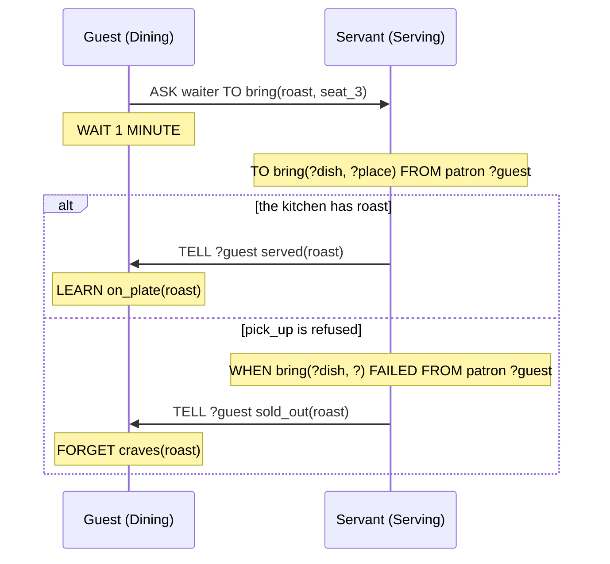

A Guest at the table wants roast. It has no Plan for fetching one, and it can't make a Servant move: a Playbook describes its own Agent and nobody else. All it can do is say so. A Message is something one Agent sends to others: a Fact or an Event with `TELL`, a request to pursue a Goal with `ASK … TO`, or an Event for the Directors with `SIGNAL`. What happens next is decided by the Plans of whoever receives it.

The three Statements are Basic Actions, listed in *Plans* with the Trigger kinds that receive them. What becomes of a Goal once it is pursued is in *Goals and Failure*. How a Playbook's Roles get their Agents is in *Playbooks and Roles*, and the Director's side is in *Plots and Directors*.

## Telling an Event

`showcase/playbooks/courtesy.regia`
```regia
TO take_seat FROM DIRECTOR:
    GIVEN seat(?place):
        DO walk_to(?place).              # waits until we have arrived
        DO sit_down.
        TELL host greeting.
        SIGNAL took_seat.

WHEN greeting FROM ?who:
    DO bow_to(?who).
```

Once seated, a Guest tells the Host `greeting`. `host` is a Role of the Playbook, and `greeting` is an Event. On the other side, the Host holds `Courtesy` as well, so the second Plan runs there, with `?who` filled by the Guest who sent the Event, and the Host bows.

- Sending never waits. The Guest goes on to `SIGNAL took_seat` at once, whether or not the Host has bowed yet.
- For the receiver, a told Event is the same Event as one from the game. It triggers a Plan and is over. If no Plan handles it, it is dropped.
- A Message never comes back to its sender. The Host runs `take_seat` too and tells `host`, which is the Host alone, so that `TELL` reaches nobody. This is not an error.

Spec: chapter 07.

## Recipients

`showcase/playbooks/noble_socializing.regia`
```regia
TO vent:
    GIVEN grudge(?foe, ?size), HIGHEST ?size, AT RANDOM:
        DO sneer_at(?foe).
        TELL ?foe insulted.
        TELL peer scandal(?foe).
```

The first `TELL` goes to one Agent, the one held by `?foe`. The second goes to a Role, every Guest but the speaker. There is a third recipient, which the showcase doesn't use:

| We write | It reaches |
|---|---|
| `TELL ?foe insulted.` | the Agent held by `?foe` |
| `TELL peer scandal(?foe).` | every Agent playing the Role, except the sender |
| `TELL EVERYONE scandal(?foe).` | every Agent in the game, except the sender |

- Regia never names an Agent. `TELL king greeting.` is an error: a recipient is never a Value. One Agent is reached through a Placeholder, filled by a `FROM` or from a slot of a Fact, as `?foe` is here.
- One recipient per Statement. Reaching two takes two Statements.
- A Role is looked up when the Statement runs. A Guest who Joined a minute ago hears the gossip, and one who has left doesn't.
- Counts are not recipients. `TELL 2 OF peer …` is an error.

Three things can be wrong with a recipient at runtime, and each ends differently:

| The recipient is | What happens |
|---|---|
| a Role nobody else plays, or `EVERYONE` with nobody else | nothing is sent; not an error |
| a Placeholder holding an Agent that has left the Program | the Message is dropped, with an entry in the Trace; the Plan goes on |
| a Placeholder holding something that isn't an Agent | the Plan fails |

The last one can't be caught earlier. `grudge(person, size)` promises a person only through its Parameter name, and a grudge against `roast` would fail `TO vent` at the first `TELL`, after the sneer.

`#revise` An Agent can't tell that a Message is about itself. `?foe` is a `peer` too, so the victim receives `insulted` and then the gossip about its own insult, and nothing in `WHEN scandal(?victim) FROM peer ?speaker` can say "unless the victim is me".

`#revise` Between one Role and the whole game there is no recipient. `EVERYONE` reaches the Servants, the Guards and the Agents of Plots we have never read. "Everyone at this banquet" is one `TELL` per Role, and a knight, who is a Guest and a Guard, would hear it twice.

Spec: chapter 07. For Roles in a Playbook, chapter 15.

## Who sent it

`showcase/playbooks/dining.regia`
```regia
WHEN served(?dish) FROM waiter:
    LEARN on_plate(?dish).
```

A Message arrives with its Sender, and a Trigger can restrict or name it with `FROM`. Here `served` counts only if a `waiter` sent it. The showcase has every form:

| We write | The Plan starts if | In the showcase |
|---|---|---|
| no `FROM` | anyone sent it, or nobody did | `WHEN saw_pouring(?who):` |
| `FROM waiter` | the Sender plays the Role | `WHEN served(?dish) FROM waiter:` |
| `FROM ?who` | anyone sent it; `?who` is the Sender | `WHEN greeting FROM ?who:` |
| `FROM peer ?who` | the Sender plays the Role; `?who` is the Sender | `WHEN insulted FROM peer ?who, …` |
| `FROM DIRECTOR` | a Director giving us this Playbook sent it | `TO take_seat FROM DIRECTOR:` |

What the game sends has no Sender, and neither has what the Agent does to itself. A `FROM` of any form therefore leaves the game out: `WHEN scandal(?) FROM ?speaker` in `Keeping_watch` never runs for a `scandal` the game might raise. A Trigger with no `FROM` takes both.

The Role is checked when the Message arrives, against who plays it then. The Sender is known only to the Trigger: a Body that needs it later has to name it with `?who` there.

`#revise` No `FROM` means "from anyone or from nobody", and there is no way to write "from nobody". `WHEN saw_pouring(?who):` in `Keeping_watch` is meant for what the game shows a Guard. Any Agent that tells a Guard `saw_pouring(?rival)` gets `?rival` seized, and the Plan can't shut that out. The same holds for Goals: `TO vent:` runs for the Guest's own `PURSUE` and for anybody's `ASK`.

Spec: chapter 05, chapter 07.

## Telling a Fact

`showcase/plots/royal_banquet.regia`
```regia
WHEN HonorDuel ENDED WITH duel_settled(?winner):
    ASK Host TO honour(?winner).
    ASSIGN Keeping_watch TO ?winner.     # the winner stands guard of honour
    TELL ?winner on_duty.
```

`on_duty` is a Fact, so this `TELL` leaves something behind. The winner now knows `on_duty` exactly as if it had learned it by itself, and the `GIVEN on_duty` in `Keeping_watch` holds from here on. Only a Director tells a Fact in the showcase; an Agent does it with the same line.

A told Fact becomes the receiver's own, and nothing remembers who told it. The Sender is seen once, by a `LEARNED` Trigger with a `FROM`:

```regia
WHEN on_duty LEARNED FROM DIRECTOR:
    DO stand_by(door).
```

- The Plan runs only if the Fact was new. A knight has known `on_duty` since its Role setup, so a knight who wins a duel is told something it already knows and nothing happens.
- A Fact learned from the game, or by the Agent's own `LEARN`, has no Sender. This Plan doesn't run for it; `WHEN on_duty LEARNED:` would.
- `FORGET on_duty` removes the Fact, however many Agents told it. `FORGOTTEN` never has a Sender, and a `FROM` on it is an error.
- Messages only add. No Statement makes another Agent forget a Fact or drop a Goal.

`#revise` `TELL ?winner on_duty.` and `TELL Host guest_arrived(?late).` are a few lines apart in `RoyalBanquet` and read the same. The first changes what the winner knows for the rest of the evening. The second is over as soon as the Host has bowed. Only the Vocabulary file says which is which.

`#revise` The winner is on duty for good. The Director can take the Playbook back with `UNASSIGN` and can't take the Fact back. Relieving the guard would need a new Event, and a Plan in `Keeping_watch` that forgets `on_duty` when told.

`#revise` Only the first teller counts, and is then forgotten. To believe a rumour "once three Guests say it", or to remember who said it, we stop telling the Fact: we tell an Event and keep a Fact of our own, `WHEN rumour(?about) FROM ?who: LEARN heard_from(?who, ?about).` Whether an item is a `FACT` or an `EVENT` ends up decided by how we want it received.

Spec: chapter 07. For `LEARNED` and `FROM`, chapter 05.

## Asking for a Goal

`showcase/playbooks/dining.regia`
```regia
FOR EACH craves(?wish):
    ASK waiter TO bring(?wish, ?place).
WAIT 1 MINUTE.                       # ASK never waits, so we give the Servants a minute
```

`showcase/playbooks/serving.regia`
```regia
TO bring(?dish, ?place) FROM patron ?guest:
    PURSUE fetch(?dish, ?place).         # PURSUE waits: if fetching fails, so does bringing
    DO walk_to(?place).
    DO put_down(?dish).
    TELL ?guest served(?dish).

WHEN bring(?dish, ?) FAILED FROM patron ?guest:
    TELL ?guest sold_out(?dish).
```

`ASK … TO` sends a request. `bring(roast, seat_3)` becomes the Servant's own Goal, like one it gave itself, and the Servant's `TO bring` recipe starts. `ASK` reads like the `TO` it starts on the other side.

- The receiver can't refuse in 2.0. Its recipes and their Contexts decide what is done, and if none applies the Goal fails there.
- The asker doesn't wait and hears nothing: not that the Goal was reached, not that it failed. `Serving` answers by hand, with one `TELL` at the end of the recipe and one in the `FAILED` Plan.
- The Goal keeps its Sender. `FROM patron ?guest` on the recipe, and again on `FAILED`, is how both replies find their way back.
- A request for a Goal the receiver already pursues, with the same arguments, is ignored.
- Each name has one kind, so the Transpiler knows what is being sent. `TELL waiter bring(…)` is an error that suggests `ASK … TO`, and `ASK waiter TO served(…)` one that suggests `TELL`.



*Goals and Failure* has the `#revise` on `PURSUE` waiting where `ASK` doesn't, and on replies written by hand. *Plans* has the one on the minute's `WAIT`.

`#revise` A Role recipient reaches every Agent of the Role. With three Servants, `ASK waiter TO bring(roast, seat_3)` starts three trips to the kitchen and puts three roasts on one plate. Nothing says "one of them": counts are allowed in a Mapping and not in a recipient.

Spec: chapter 07. For what a failed Goal does, chapter 11.

## Signals

`showcase/playbooks/wagering.regia`
```regia
WHEN duel_on FROM DIRECTOR:
    GIVEN purse(?gold) AND ?gold > 0:
        ?stake = RANDOM(1, ?gold).
        CHANGE purse(?gold) TO purse(?gold - ?stake).
        SIGNAL wagered(?stake).
        DO cheer.
        SIGNAL cheered.
```

`showcase/plots/honor_duel.regia`
```regia
WHEN wagered(?stake) FROM Spectator ?who:
    LEARN wager(?who, ?stake).
```

A Signal is an Event sent to the Directors. It has no recipient. It goes to the Director of every Plot that currently gives the Agent the Playbook the `SIGNAL` is written in: `Wagering` is given by `HonorDuel`, so `wagered` reaches the duel's Director and not the banquet's. The Director handles it as any Event, and `FROM` tells it which of its Roles the Sender plays.

- A Signal carries an Event, never a Fact or a Goal.
- It is an Agent's only way to reach a Director. A Director plays no Role and is held by no Placeholder, so it can't be the recipient of a `TELL` or an `ASK`.
- A Director never reads its Agents' Facts. What it needs to know, the Agents Signal: the stake here, which the Director keeps as a Fact of its own.
- A Playbook never names a Plot. Who hears a Signal is decided by who gave the Playbook, as with `FROM DIRECTOR` in the other direction.

`#revise` Where a Signal goes is not on its line. `Keeping_watch` is given by `RoyalBanquet` and, to the same Guards, by `Poisoning`, so `SIGNAL culprit_seized(?who)` reaches both Directors. `RoyalBanquet` has no Plan for it and the Event is dropped there without a warning. An insult taken badly during `reception` ends the same way: the Guest stands up, `insult_thrown` finds a Director with a Plan for it only in `feast`, and nothing follows.

Spec: chapter 07. For the Director's side, chapter 20.

## What a Director sends

`showcase/plots/honor_duel.regia`
```regia
DURING challenge:
    WHEN ENTERED:
        ASK Challenger TO issue_challenge.

    WHEN duel_accepted FROM Defender:
        TELL Spectator duel_on.
```

A Director uses the same `TELL` and `ASK` as an Agent, and besides giving Playbooks and casting Agents in Subplots, this is all it can do to them. It never orders an Action. `issue_challenge` is carried out by the Challenger's own recipe in `Duelling`, and with no recipe the Goal would fail.

- The Sender is `DIRECTOR`. `TO issue_challenge FROM DIRECTOR:` and `WHEN duel_on FROM DIRECTOR:` match it.
- A recipient is a Role of the Plot, a Placeholder holding an Agent (`ASK ?backer TO give_signal.`), or `EVERYONE`. A Role means the Agents playing it in this Staging when the Message is sent.
- A Director can't `SIGNAL`, and it hears nothing back from an `ASK`. `duel_accepted` is a Signal the Defender's Plan sends for that purpose.
- The `LEARN` and `PURSUE` lines of a Role setup are these same Messages, written with other words (*Goals and Failure*).

A Message reaches whoever plays the Role at that moment and is never sent again:

`showcase/plots/royal_banquet.regia`
```regia
DURING farewell:
    WHEN ENTERED:
        ...
        ASK Guest TO take_leave.

    WHEN Guest ?late JOINED:             # Messages aren't replayed, so we ask again
        ASK ?late TO take_leave.
```

`#revise` `ASSIGN Dining TO Guest, MAPPING Servant TO waiter.` and `ASK Guest TO have_dinner.` are three lines apart in `feast`, both addressed to `Guest`. The Giving is standing and reaches a latecomer. The request is not, and a latecomer dines only if the game makes it `hungry` after it has Joined. In `farewell` the same gap needed a Plan of its own.

Spec: chapter 20. For Joining, chapter 19.

## A conversation

`showcase/playbooks/duelling.regia`
```regia
# Every change of stamina, the first included, is answered with a lunge.
WHEN stamina(?) LEARNED:
    WAIT RANDOM(1, 3) SECONDS.
    DO lunge.
    TELL opponent hit.

WHEN hit FROM opponent, SHIFTS aggressiveness BY 0.1:
    GIVEN stamina(?now) AND ?now > 1:
        CHANGE stamina(?now) TO stamina(?now - 1).
    ELSE:
        DO drop_sword.
        TELL opponent yielded.

WHEN yielded FROM opponent:
    DO salute.
    SIGNAL duel_won.
```

A duel is two Agents telling each other Events until one yields. No Statement waits for an answer, so an exchange is written as Plans that answer Messages, and the Facts each side keeps are what holds it together.

Two things are promised about delivery:

- Messages from one sender to one receiver arrive in the order they were sent. In `TO vent`, the victim gets `insulted` before `scandal`. Across senders nothing is promised: the two duellists' hits may cross.
- A Message is not lost while its receiver is in the Program. When it arrives is up to the Target.

A Message Statement takes no trailing clause. `ASK ?who TO fight, AND WAIT.` is an error in 2.0, and so is any other clause. The words `TOLD`, `AGREED`, `REFUSED`, `REACHED` and `REFUSE` are reserved for a later version in which Agents can answer each other, and using one is an error too.

`#revise` Nothing in `Duelling` shows the duel as one exchange. We read its Plans one by one, with three Events from the shared Vocabulary between them, and put them in order in our heads.

Spec: chapter 07.

## How this combines with…

### Playbook Roles and Mappings

`showcase/plots/royal_banquet.regia`
```regia
ASSIGN Dining TO Guest, MAPPING Servant TO waiter.
ASSIGN Serving TO Servant, MAPPING Guest TO patron.
```

The order in the previous sections works because of these two lines. `ASK waiter` in `Dining` reaches the Servants through the first Mapping, and `FROM patron` in `Serving` recognises the Guests through the second. `#revise` One relation is written three times, under two Role names in two Playbooks and as a pair of Mappings in the Plot, and nothing checks the three against each other. With `MAPPING Host TO patron` the Program still compiles, every `bring` fails at the Servants, and the Guests are told nothing.

An Agent holding a Playbook through several Givings has, for each Role, everyone bound by any of them. A Guest in two Stagings of `HonorDuel` at once has both opponents as `opponent`, and each `TELL opponent hit` strikes both. (*Playbooks and Roles*, *Subplots and Stagings*)

### Goals and Failure

A sender's Plan fails on a Message in one case only, a recipient that isn't an Agent. Everything else that goes wrong happens at the receiver. A Message already sent stays sent when the Plan fails later: a Guest whose `walk_to(door)` is refused in `TO take_leave` has already taken leave of the Host. (*Goals and Failure*)

### Several Playbooks on one Agent

A Message is delivered to an Agent, whichever Playbooks it holds. `scandal` has a Plan in `NobleSocializing`, in `Keeping_watch` and in `Wagering`, and a knight watching a duel holds all three. One Plan runs, and the `PRECEDENCE` Blocks of the two Plots decide which. (*Precedence and Labels*)

### Matching

`FOR EACH craves(?wish): ASK waiter TO bring(?wish, ?place).` sends one request per Match. In `HonorDuel`, a Pick chooses the recipient: `GIVEN wager(?backer, ?stake), HIGHEST ?stake, AT RANDOM:` and then `ASK ?backer TO give_signal.` (*Matching*)

### Quota Triggers

A plain `FROM Spectator` runs its Plan for every Signal. A quantity before the Role waits for enough different senders:

`showcase/plots/honor_duel.regia`
```regia
WHEN cheered FROM 3 OF Spectator:
```

A Playbook can count too, over Events told by a Playbook Role: `WHEN scandal(?victim) FROM 3 OF peer:`. Facts can't be counted this way, since `LEARNED` fires only for the first teller. (*Quotas and Cast Changes*)

### Subplots and Stagings

A Signal written in a Playbook that a Subplot gave reaches the Subplot's Director, and the parent's Director hears nothing of it. The parent learns how the Subplot went from its Outcome. An Agent holding `Duelling` from two Stagings sends `duel_won` to both Directors, and the README has a `#revise` on the two duels that can't be kept apart. (*Subplots and Stagings*)

### Cast changes

A Message to an Agent that has left is dropped and doesn't fail the sender. A Role recipient needs no such care. It is looked up live, so once the Defender has walked out, the Challenger's `opponent` is a Role nobody plays. (*Quotas and Cast Changes*)

## Since 1.0

1.0 had `TELL`, `BROADCAST` and `SIGNAL`, written as Actions with `DO` and parentheses, and a Director that could put a Role's name before an Action to have it done. It didn't say what the receiver saw. 2.0 keeps the three ways of sending, adds the request, and defines the receiving side.

`#changes` `ASK … TO` is new: a Goal can be requested of another Agent.

`#changes` `BROADCAST` is gone. Its audience is the recipient `EVERYONE`.

`#changes` A recipient is a Placeholder, a Role or `EVERYONE`. A Playbook declares the Roles it addresses, and an Agent is never named.

`#changes` `WHEN ROLE Guest SIGNALS insult_thrown:` is `WHEN insult_thrown FROM Guest:`. `FROM` works on everything that is sent, in Playbooks and in Plots.

`#changes` A Director no longer orders Actions (`Host DO call_guards.`). It sends `ASK` and `TELL` with the Sender `DIRECTOR`.

`#changes` What a Message becomes is part of the language: a told Fact is the receiver's own and fires `LEARNED` only when new, a told Event is like a game Event, an asked Goal is like the receiver's own, and Messages from one sender to one receiver keep their order.
