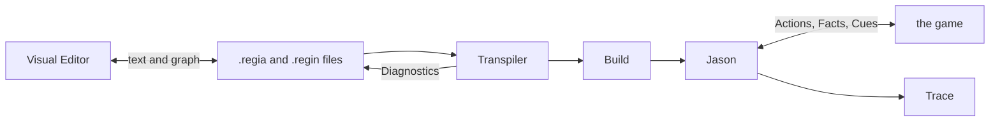
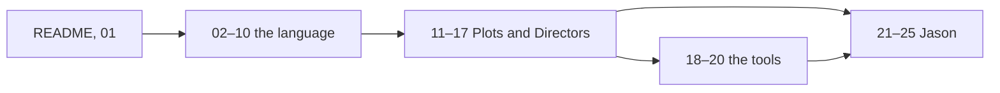

# A guide to Regia 1.5

A Guest arrives at a royal banquet, walks to the seat laid for it, sits down and greets the Host. Once every Guest has done so, the reception begins. Regia is a language for writing down both halves of that: what one character does, and how the evening moves on once enough characters have done it. This guide describes Regia 1.5, the first version of the language to be built, and its two tools. None of it is built yet.

The guide is written for whoever builds the Transpiler and the Visual Editor. It states every rule a tool needs, with an example from one Program, and leaves the reasons for each rule to the spec.

| We write | It is | In full in |
|---|---|---|
| a `.regia` file with a `PLAYBOOK` | what one Agent does, in Plans | *Plans*, *Playbooks and Roles* |
| a `.regia` file with a `PLOT` | a story: its Roles, its Phases, and the Director that runs it | *Plots and Directors* |
| a `.regin` file | who is in the hall when the run starts | *Instancing* |
| `regia build banquet.regin` | the Transpiler writing a Build for a Target | *The Transpiler* |
| the Build, running on Jason | Agents and Directors talking to the game, and a Trace of what they did | *Jason: the Build*, *The Trace* |

## What Regia is

[`playbooks/courtesy.regia`](../showcase/playbooks/courtesy.regia)
```regia
TO take_seat, FROM DIRECTOR:
    GIVEN seat(?place):
        DO walk_to(?place)               # waits until we have arrived
        DO sit_down
        TELL host greeting
    # no ELSE: with no seat laid for us, take_seat fails at once

WHEN take_seat FAILED:
    DO stand_by(wall)

WHEN take_seat ENDED: SIGNAL took_seat   # seated or standing, the Director counts us
```

[`plots/royal_banquet.regia`](../showcase/plots/royal_banquet.regia)
```regia
DURING arrival:
    WHEN ENTERED:
        DO open_doors

    WHEN took_seat, FROM Guest ?g:
        LEARN seated(?g)
        IF COUNT(seated(?)) >= COUNT(? PLAYS Guest):
            ENTER reception

    WHEN took_seat, FROM Host:           # the king is seated: music
        DO play_music
```

Regia describes the characters of a game as Agents. An Agent knows Facts about the world, pursues Goals and reacts to Cues, and what it does is written as Plans. The first snippet holds three: a recipe for the Goal `take_seat`, usable when the Agent knows its seat; a reaction to that Goal failing; and a reaction to it ending either way. Plans are grouped in Playbooks, here `Courtesy`, the manners everyone at the banquet has. Every Plan is written from the point of view of the Agent that holds it.

A Playbook doesn't say when it applies or to whom. A Plot does that: it names Roles (`Guest`, `Host`), moves through Phases (`arrival`, `reception`) and gives Playbooks to Roles as it goes. Each Plot is run by a Director, an agent behind the scenes with Plans of its own. In the second snippet the Director of `RoyalBanquet` opens the doors, counts the Guests as they Signal `took_seat`, and enters `reception` once they are all seated. The Director is also the one that asked every Guest to take a seat, which is what `FROM DIRECTOR` in the first snippet says.

How many Guests there are, and what each is like, is written in neither file. Instancing says it, in a `.regin` file kept apart from the story.

- A Director can't make an Agent act. It gives Playbooks, tells Facts and Cues, and asks for Goals; the Agent's own Plans decide what follows.
- An Agent reaches others only by Messages: `TELL`, `ASK … TO`, and `SIGNAL` to the Directors that gave it the Playbook.
- No Plan names a single Agent. Plans address Roles, and reach one Agent through a Placeholder filled at runtime, such as `?g` above.
- The words are a designer's (Fact, Goal, Plan, Cue), and a Plan should read close to the sentence we would use to describe it. `GLOSSARY.md` fixes every term.

*The logic of Regia* reads these files, and `banquet.regin`, from the first line to the toast.

Spec: chapter 05. For Roles and Givings, chapter 15; for Directors, chapter 20.

## From a Program to a running game



Regia doesn't run by itself. The Transpiler, `regia`, reads an Entry file and every file it reaches through `IMPORT`: together, the Program. `regia check` reports Diagnostics, each an error or a warning pointing at a place in the source and carrying a Diagnostic code. `regia build` takes an Entry and, when there are no errors, writes a Build: the Target files for that Program and its Instancing. A `.regia` Entry has no Instancing, so its Build is Target code only.

A Target is a language that can run. 1.5 has one, AgentSpeak as run by Jason. A Build holds our Plans, translated, and the Infrastructure: fixed Target code, the same for every Program, that runs Givings, Phases, Stagings and Precedence around them. On Jason, every Agent and every Director is a Jason agent.

The game supplies the world. It keeps the game Facts the Agents know, such as `seat`, sends them Cues, carries out the Custom Actions they ask for (`walk_to`, `sit_down`), and removes an Agent when its character leaves. While the Build runs it writes a Trace, the record of what happened, in order. The Trace is how we find out why a Guest spent the evening by the wall.

The Visual Editor is a web application that opens a folder of Regia files as a Project. It shows a file's text beside a drawing of its Plot, Phases as nodes and `ENTER` as arrows, and both sides can be edited. Only the text is stored. The Transpiler runs inside it, so Diagnostics show as we type.

- `regia run` builds and starts the Build; `regia test` runs cases in the spec's Conformance format; `regia explain` prints the conflict report and Interfaces. (*The Transpiler*)
- A Build is written to `build/<Entry path>/`. Its `traces/` folder keeps every past run's Trace, and a new build never clears it. (*The Transpiler*, *Jason: the game and the Trace*)
- An error stops the Build; a warning doesn't. The same Diagnostics come from `check`, `build` and the Visual Editor.

Spec: chapter 23. For the Visual Editor, chapters 22, 24 and 25; for the Trace, chapter 34; for the game link on Jason, chapter 37.

## Regia 1.5

Regia 2.0 adds more than twenty systems to Regia 1.0, designed together so that they fit. 1.5 is the subset built first, with the same Transpiler and Visual Editor; the rest is added once 1.5 runs. A 1.5 Program is a 2.0 Program and does the same thing there.

| 1.5 leaves out | The showcase does instead | The "In 2.0" note is in |
|---|---|---|
| `FROM GAME`, `FROM ME`, `FROM` with `OR` | a Trigger with no `FROM`; a Director-only recipe in front of one that repeats (`fight` and `strike`) | *Plans*, *Messages*, *Plots and Directors*, *Interfaces*, *The Visual Editor* |
| `BY`, and the asker hearing how an asked Goal ended, its Reason included | a done-Signal from an `ENDED` Plan (`took_seat`); a Reason told back by hand (`sold_out`) | *The logic of Regia*, *Goals and Failure*, *Messages*, *Plots and Directors*, *Interfaces* |
| Quota Triggers and `SENT` | the Director counts in Facts of its own, against `COUNT(? PLAYS Guest)` | *The logic of Regia*, *Matching*, *Playbooks and Roles*, *Plots and Directors*, *When an Agent leaves*, *The Trace* |
| Joining: `JOINED`, spawning, Givings and setups that reach a joiner | nothing: the cast is fixed when the run starts, and only shrinks | *Playbooks and Roles*, *Plots and Directors*, *Subplots and Stagings*, *When an Agent leaves*, *Instancing*, *The Trace* |

Where a 1.5 pattern stands in for a 2.0 construct, a chapter says so in a short note, and shows no 2.0 code:

> **In 2.0** the Director hears how a Goal it asked ended, and a Quota Trigger waits for every Guest's `take_seat` in a single Trigger. Spec chapter 20, *Hearing how an asked Goal ended*, and chapter 18. In 1.5 `Courtesy` Signals `took_seat`, and the Director counts in a Fact of its own.

- A 1.5 build parses all of 2.0. A construct of a left-out system gets one error saying it is Regia 2.0, and none of its own chapter's checks.
- No option picks 1.5 or 2.0. A Transpiler build has one version, which `regia --version` prints.
- The Jason chapters carry notes only for whole spec sections the Jason Target skips in 1.5.

**Checks**

- A construct of a system 1.5 leaves out, in a 1.5 build → `R0109`
- A spawn the game reports in a 1.5 run → `T1902` (Trace warning; the Agent joins nothing)

Spec: chapter 27, *Regia 1.5*, which lists where every spec chapter marks its cut. ADR 0025.

## The banquet

[`banquet.regin`](../showcase/banquet.regin)
```regia
IMPORT "plots/royal_banquet"

ROOT RoyalBanquet

AGENT king, PLAYS Host
```

Every example comes from one Program, the showcase, in [`docs/showcase/`](../showcase/README.md): a Vocabulary, nine Playbooks, three Plots and `banquet.regin`, fourteen files in all. It builds in 1.5 with no error and no warning.

The world is one evening at a royal banquet in a 3D hall. The Root Plot, `RoyalBanquet`, goes through four Phases: `arrival`, `reception`, `feast` and `farewell`. During the feast an insult taken badly starts an `HonorDuel` between two Guests while the others bet, and a `Poisoning` runs with one Guest as the Poisoner and the Guards on watch. Nine Playbooks carry the behaviour, from `Courtesy`, which everyone holds, to `Duelling`, held only while a duel lasts.

`banquet.regin` starts fourteen Agents: the king, who is the Host; six nobles and two hotheads, who are Guests; two knights, who are Guests and Guards at once, one of them Sir Percival; and three servants. The showcase's `README.md` lists every Plot, Playbook and kind, and which file and Plan shows each section of the spec.

- A snippet has a link to its showcase file above it, and is cut from that file as it stands, with its outer indentation taken off.
- A snippet with no link is a variation made up on the spot, usually a banquet line broken to show a Diagnostic. It is never added to the showcase.
- No Transpiler exists, so no example has been run. Each was checked by hand against the spec chapters under its section.

Spec: chapter 21, for `banquet.regin`. The showcase's `README.md` is the outline of the rest.

## How a chapter reads

Every chapter opens with a moment at the banquet and a short table of what the chapter covers. Then one `##` section per construct, from the simple form to the full one. Each section shows an example first and gives the rules after it, as bullets:

- *Checks* lists, at the end of a section, what can go wrong with the construct and the code it gets: `TELL` with a Goal → `R0701` (hint: `ASK … TO`). A code starting with `R` is a Diagnostic code, reported by the Transpiler; one starting with `T` is a Trace code, written at runtime. A section borrows another chapter's codes where the misuse is written in that section. Codes appear only in *Checks*, never in the prose.
- The last line of each section, `Spec:`, names the spec chapters it comes from.
- A chapter ends with *How this combines with…*: the construct next to the others, one short part per chapter it meets.
- Another chapter is named by its title, in italics.

The guide is derived from `docs/spec/`, `GLOSSARY.md` and `docs/adr/`. Where the guide disagrees with them, they are right and the guide is fixed. It doesn't list every check either: each spec chapter's *Transpiler checks* section does.

In some places the spec leaves a detail open, and the guide fills it in without saying so each time. Treat these as one way it could be done, not as the spec's rule: the ASL in the Jason chapters beyond what the spec writes out (plan names, Items, the order of lines in a file), the Visual Editor's edge labels and file names, and the console texts the Trace gives only by example. When the spec settles one of them, the guide follows.

Spec: chapter 27, *Diagnostic codes*. For Trace codes, chapter 34.

## The chapters



### Part 1: reading a Program

| Chapter | Spec | What it covers |
|---|---|---|
| [01 The logic of Regia](01-the-logic-of-regia.md) | 05, 15, 16, 20, 21 | The banquet read from the doors to the toast: a Playbook, a Plot with Roles and Phases, a Giving, Instancing, one run |

### Part 2: the language

| Chapter | Spec | What it covers |
|---|---|---|
| [02 Syntax](02-syntax.md) | 01, 02 | Statements and Blocks, indentation and the one-line layout, clauses, `PASS`, comments and doc comments, reserved words and retired spellings |
| [03 Vocabulary and files](03-vocabulary-and-files.md) | 10, 03, 12 | `FACT`, `CUE`, `GOAL`, `ACTION` and the rest, parameters, Values, Durations, `GAME`, External names, imports, one namespace, local Vocabulary |
| [04 Plans](04-plans.md) | 05, 06 | Trigger, Context and Body; the Trigger kinds; several Plans under one Trigger; `IF`; loops |
| [05 Placeholders and Expressions](05-placeholders-and-expressions.md) | 03, 04 | Filling and using Placeholders, `?`, what is certainly filled, `LET`, Numbers and Expressions |
| [06 Matching](06-matching.md) | 26 | Matches, Picks, `FOR EACH`, `COUNT` |
| [07 Actions and time](07-actions-and-time.md) | 08, 12 | `LEARN`, `FORGET`, `UPDATE`, `PRINT`, Custom Actions, `WAIT`, `WAIT … UNTIL`, the Target's clock |
| [08 Randomness](08-randomness.md) | 09, 21 | `RANDOMLY` and `OPTION`, Weights, `RANDOM`, random Picks, the seed |
| [09 Goals and Failure](09-goals-and-failure.md) | 05, 11 | `PURSUE`, `DROP`, how a Pursuit ends, what fails a Plan, how Failure climbs, `FAIL`, Reasons, fallbacks |
| [10 Messages](10-messages.md) | 07 | `TELL`, `ASK`, `SIGNAL`, recipients, `FROM`, delivery |

### Part 3: Plots and Directors

| Chapter | Spec | What it covers |
|---|---|---|
| [11 Playbooks and Roles](11-playbooks-and-roles.md) | 15 | Playbook Roles, Mappings, Givings, `CAST`, counts and shares, `EXCEPT`, `PLAYS`, taking a Playbook away |
| [12 Plots and Directors](12-plots-and-directors.md) | 20, 16 | Plot Roles and their setups, Phases, `ENTER`, `AFTER`, `DURING PLOT`, what a Director perceives and does, the Root Plot |
| [13 Subplots and Stagings](13-subplots-and-stagings.md) | 17 | `START SUBPLOT`, Plot parameters, several Stagings, `RUNNING`, Outcomes, `FINISHED`, `ENDED`, `DROP SUBPLOT` |
| [14 When an Agent leaves](14-when-an-agent-leaves.md) | 19 | Leaving, `LEFT`, `EMPTIED`, what goes with a leaver and what the Director tidies |
| [15 Interfaces](15-interfaces.md) | 38 | The Interface the Transpiler works out for a Playbook and a Plot, and the checks of one side against the other |
| [16 Precedence and Labels](16-precedence-and-labels.md) | 13, 14 | Which Plan runs when several could: falling through, `PRECEDENCE`, `TIES`, Propensities, `SUITS`, `SHIFT`, the conflict report |
| [17 Instancing](17-instancing.md) | 21 | `.regin` files and layering, `ROOT`, `KIND`, `AGENT`, `LIKE`, setup lines, starting Propensities, `SEED`, Target settings |

### Part 4: the tools

| Chapter | Spec | What it covers |
|---|---|---|
| [18 The Trace](18-the-trace.md) | 34 | What a run records, entry fields, the failure chain, Trace codes, the console line, behaviour cases and their scripts |
| [19 The Transpiler](19-the-transpiler.md) | 23, 27 | Passes, the Model, Diagnostics, the command line, the Build folder, Targets, the WASM Workspace, Conformance cases, `regia test` |
| [20 The Visual Editor](20-the-visual-editor.md) | 24, 25, 22 | Projects, the editor's layout, quick fixes, the Phase map and the Nested Plans view, editing from the graph, text as the source of truth |

### Part 5: the Jason Target

| Chapter | Spec | What it covers |
|---|---|---|
| [21 Jason: the Build](21-jason-the-build.md) | 28, 36 | The Build folder file by file: names, the Infrastructure, the Java library, the `.jcm`, `cast.json`, setup lines |
| [22 Jason: Plans and Goals](22-jason-plans-and-goals.md) | 39, 40 | Placeholders and Contexts in ASL, Statements, Picks, `WAIT`, Messages; a Pursuit's identity and how it ends |
| [23 Jason: Givings and Precedence](23-jason-givings-and-precedence.md) | 29, 32 | Plans compiled in and switched on, the Giving record, `ASSIGNED` and `REMOVED`, Levels and Rank, `selectOption` |
| [24 Jason: Directors and Stagings](24-jason-directors-and-stagings.md) | 30, 31, 33 | The Director agent, hearing the game, Phases, one Director per Staging, starting and ending a Staging, leaving |
| [25 Jason: the game and the Trace](25-jason-the-game-and-the-trace.md) | 37, 35 | The messages between a Build and the game, Custom Actions, the end of the story, test mode; the Trace writer and its source map |

Part 1 is read first. Parts 2 and 3 can be read in order or looked up, since each chapter names the others it leans on. The tools and the Jason chapters assume both.

Spec: chapter 27, *Regia 1.5*, indexes the 1.5 cut across every chapter listed here.
